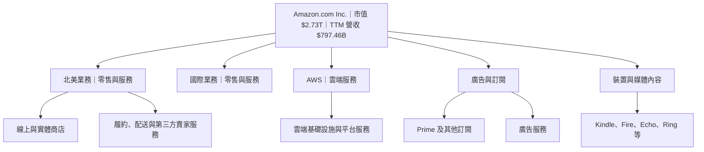
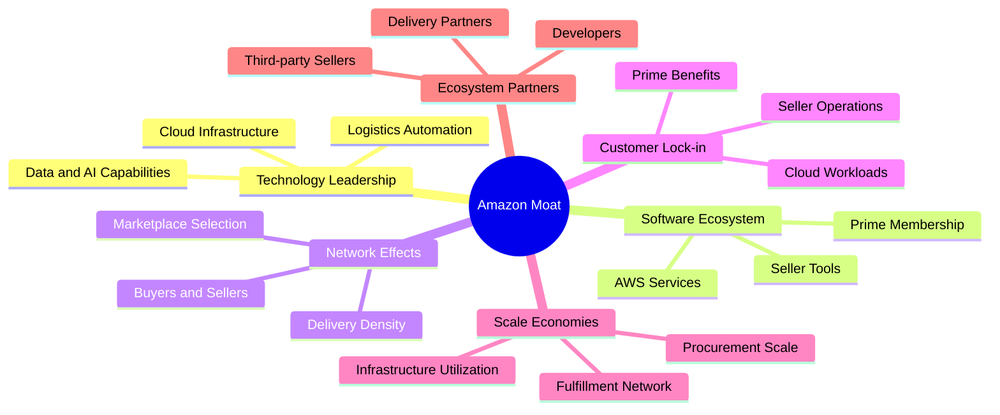
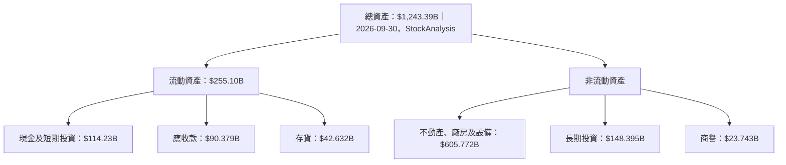
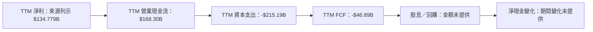
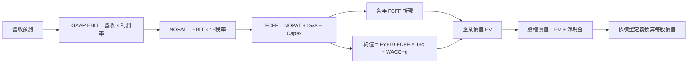
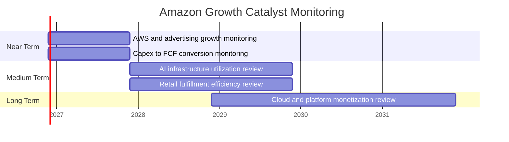
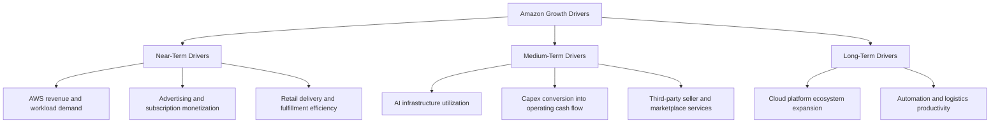
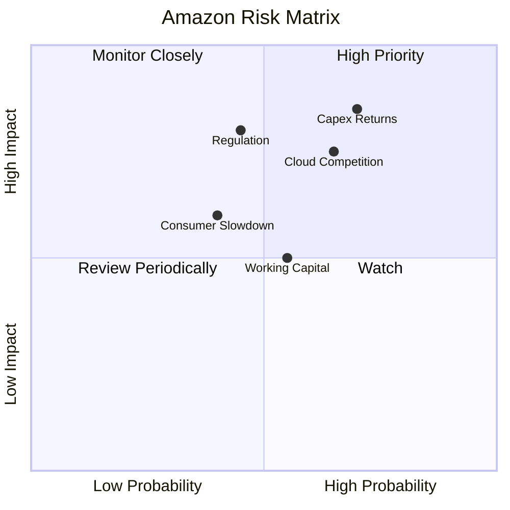
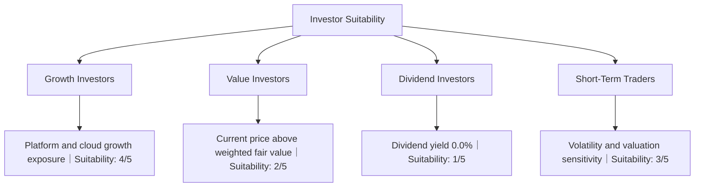

# AMZN 基本面深度分析報告
> **報告日期**：2026-11-25 ｜ **語言**：繁體中文 ｜ **數據來源**：SEC 申報資料 (XBRL)、Yahoo Finance、Finviz、StockAnalysis、Roic.ai ｜ **分析師**：CFA 級機構研究

## 目錄

| # | 章節 | 核心結論 |
|---|------|----------|
| 1 | 執行摘要 | 賣出；加權合理價值 $186.98；MOS -34.9% |
| 2 | 公司概覽與商業模式 | 零售、廣告、訂閱與 AWS 的綜合平台；市場份額數據未提供 |
| 3 | 損益表深度分析 | TTM 營收 $797.46B、成長 15.4%；TTM 營業利益率 13.1% |
| 4 | 資產負債表分析 | 淨負債 $65.73B；DSO 增至 45 天，部分流動性指標來源有差異 |
| 5 | 現金流量深度分析 | TTM FCF -$46.89B，主要受資本支出高於營業現金流影響 |
| 6 | 獲利能力與資本效率 | ROIC 11.9% 高於 WACC 10.93%，仍創造正經濟價值 |
| 7 | 相對估值分析 | P/E 低於部分同業，但 DCF 與加權合理價值均低於現價 |
| 8 | DCF 內在價值評估 | 基準 DCF $55.72；加權合理價值 $186.98；估值對終值高度敏感 |
| 9 | 成長催化劑 | AWS、廣告、AI 與履約效率可能支撐成長；TAM 數據未提供 |
| 10 | 風險矩陣 | 資本支出回報、競爭與監管為主要風險 |
| 11 | 投資建議 | 依 MOS 評級為賣出；設定估值與營運監控門檻 |

---

## 1. 執行摘要

### 1.0 一頁式投資儀表板（Portfolio Manager 30 秒速讀）

| 項目 | 內容 |
|------|------|
| **投資論點（3 句）** | ① TTM 營收 $797.46B、年增 15.4%，規模與服務組合仍支持成長。② TTM 營業利益率 13.1%、ROIC 11.9%，高於 10.93% WACC，但利差僅 0.97 個百分點。③ TTM FCF -$46.89B，資本支出 $215.19B 高於營業現金流 $168.30B，近期投資回報尚未轉化為自由現金流。 |
| **綜合評分** | **5.8/10**（引用 1.1；六項算術平均） |
| **財務健康** | 🟡 現金及短期投資 $114.23B，總債務 $179.95B，淨負債 $65.73B；流動性尚可但非淨現金狀態 |
| **ROIC vs WACC** | **11.9% vs 10.93%**，高出 0.97 個百分點，代表目前仍創造正經濟價值 |
| **FCF 趨勢** | TTM FCF 為 **-$46.89B**；FCF Yield **-1.72%**。投資支出擴大使短期現金回報承壓 |
| **估值** | Forward P/E **23.1x**｜EV/EBITDA **15.4x**（歷史估值資料）｜FCF Yield **-1.72%** |
| **DCF 內在價值（基準）** | **$55.72**｜現價相對 DCF 溢價 **+352.8%**（以現價 ÷ DCF 價值 − 1 計） |
| **安全邊際（MOS）** | **-34.9%**＝（加權合理價值 $186.98 − 現價 $252.29）÷ $186.98；🔴 無安全邊際 |
| **預期報酬（基準情境 12M）** | DCF 基準情境相對現價 **-77.9%**；這是模型情境值，不等同分析師共識 |
| **關鍵風險（前二）** | AI／雲端資本支出回報延遲；零售履約與雲端競爭使利潤率承壓 |
| **評級 + 信心度** | 🔴 **賣出**｜信心：中（MOS 與 DCF 指向估值偏高，但 DCF 終值依賴度高） |

### 1.1 綜合評分卡（全報告唯一）

| 維度 | 評分（1–10） | 主要依據（引用數字與其來源章節） |
|------|--------------|----------------------------------|
| 成長性 | 7.5 | TTM 營收成長 15.4%，最新一季年增 12.1%（第 3 章） |
| 獲利能力 | 7.0 | TTM 營業利益率 13.1%；ROIC 11.9% 高於 WACC 10.93%；Piotroski F-Score 4/8（第 6 章） |
| 財務健康 | 6.0 | 淨負債 $65.73B；現金及短期投資 $114.23B；DSO 45 天（第 4 章） |
| 估值 | 2.0 | MOS -34.9%；加權合理價值 $186.98 低於現價 $252.29（第 8 章） |
| 護城河 | 8.0 | TTM 營收 $797.46B，具零售、雲端、廣告與訂閱的多業務平台（第 2 章） |
| 管理層與資本配置 | 4.5 | FY2025 資本支出 $131.82B、SBC $19.47B；稀釋股數測試未通過，投資回報需持續驗證（第 3、5 章） |
| **綜合評分** | **5.8** | 六項算術平均： (7.5 + 7.0 + 6.0 + 2.0 + 8.0 + 4.5) ÷ 6 = 5.83，四捨五入至一位小數 |

### 1.2 五大投資論點 + 三大核心風險

| 類型 | 項目 | 具體依據 | 信心度 |
|------|------|----------|--------|
| 🟢 **投資論點①** | 平台規模支撐多元變現 | TTM 營收 $797.46B，TTM 年增 15.4%；零售、廣告、訂閱與 AWS 能形成跨業務交叉銷售 | 🟢 高 |
| 🟢 **投資論點②** | 營業獲利率已改善 | FY2022 營業利益率約 2.4%，FY2025 約 11.2%；TTM 為 13.1%，營運槓桿改善明顯 | 🟢 高 |
| 🟢 **投資論點③** | ROIC 高於資本成本 | ROIC 11.9% 對 WACC 10.93%，正利差 0.97 個百分點，仍有價值創造 | 🟡 中 |
| 🟢 **投資論點④** | AWS 與廣告有較高服務屬性 | 公司業務包含雲端、廣告與訂閱，但各板塊營收分拆數字未提供，不能量化其對集團利潤的占比 | 🟡 中 |
| 🟢 **投資論點⑤** | 估值低於部分大型科技同業 | AMZN P/E 20.4x，低於 MSFT 25.9x；但估值折價可能反映其巨額再投資與負 FCF | 🟡 中 |
| 🟡 **風險①** | 資本支出回報不及預期 | TTM Capex $215.19B，高於 OCF $168.30B，FCF 為 -$46.89B；若投資無法轉為營收與利潤，估值承壓 | 🔴 高衝擊 |
| 🔴 **風險②** | 股價與內在價值落差大 | 現價 $252.29，高於 DCF 基準 $55.72 及加權合理價值 $186.98 | 🔴 高 |
| 🟡 **風險③** | 應收款回收週期延長 | DSO 從一年前 32 天增至 45 天，可能提高營運資金占用 | 🟡 中 |

### 1.3 快速統計卡片

| 指標 | 公司實際值（期間） | 同業中位數 | 狀態 |
|------|--------------------|------------|------|
| 營收成長（TTM） | **15.4%** | — | 🟢 |
| 營收成長（最新一季年增） | **12.1%** | 18.8% | 🟡 |
| 毛利率（TTM） | **51.4%** | 60.9% | 🟡 |
| 營業利益率（TTM） | **13.1%** | — | 🟢 |
| ROIC（TTM） | **11.9%** | — | 🟢 |
| Forward P/E | **23.1x** | 20.5x | 🟡 |
| FCF Yield（TTM） | **-1.72%** | — | 🔴 |
| Piotroski F-Score | **4 / 8** | — | 🟡 |

*註：Peer 中位數按 MSFT、GOOG、WMT 三家公司提供值取中位數；Forward P/E 中位數 20.5x。*

### 1.4 投資結論

```text
╔══════════════════════════════════════════════════════════════════╗
║                    📊 投資結論摘要                               ║
╠══════════════════════════════════════════════════════════════════╣
║  評級：🔴 賣出（依 8.8 MOS 評級；未作質化調整）                  ║
║  價格（2026-11-24 收盤）：$252.29                                ║
║  DCF 內在價值（基準）：$55.72（現價相對 DCF 溢價 +352.8%）       ║
║  安全邊際 MOS：-34.9%（以加權合理價值 $186.98 為分母）           ║
║  加權合理價值（8.8）：$186.98                                    ║
║  DCF 情境價值：                                                   ║
║    悲觀情境：$12.54（相對現價 -95.0%）                           ║
║    基準情境：$55.72（相對現價 -77.9%）                           ║
║    樂觀情境：$128.34（相對現價 -49.1%）                          ║
║  綜合評分：5.8/10（引用 1.1）                                    ║
║  適合投資人：能承受波動、以長期平台成長為主且不依賴近期現金收益者║
╚══════════════════════════════════════════════════════════════════╝
```

---

## 2. 公司概覽與商業模式

### 2.1 業務結構與收入來源

現有財務資料未提供 North America、International、AWS 等分部的最新收入金額與占比，因此不以估計比例繪製。可確認集團 TTM 營收為 $797.46B，業務包含線上與實體零售、AWS、廣告、訂閱、裝置與媒體內容。



### 2.2 市場份額

市場份額數據未提供，故不列份額百分比。以規模而言，Amazon TTM 營收 $797.46B、年增 15.4%；但與 Microsoft、Google、Walmart 的比較必須區分業務組合，不能將集團營收直接等同於單一零售或雲端市場份額。

### 2.3 競爭護城河分析



### 2.4 護城河強度

| 護城河項目 | 強度（強／中／弱） | 證據（引用數字或事實） | 會削弱它的情況 |
|------------|--------------------|------------------------|----------------|
| 技術與雲端 | 強 | AWS 是公司主要業務板塊之一；集團 TTM 營收 $797.46B，但 AWS 單獨數據未提供 | 雲端價格競爭、AI 基建投入回報低 |
| 軟體與訂閱生態 | 中至強 | 公司提供 Prime、AWS 及第三方賣家工具；會員數與留存數據未提供 | 會員價值下降、服務替代性上升 |
| 網路效應 | 強 | 買家、賣家與物流網絡互相增強；第三方賣家比例未提供 | 監管限制平台自營與第三方業務整合 |
| 客戶鎖定 | 中至強 | Prime 與企業雲端工作負載可提高轉換成本；客戶留存數據未提供 | 企業多雲化、零售客戶價格敏感 |
| 規模效應 | 強 | FY2025 營收 $716.92B，營業利益 $79.97B | 高固定成本、履約網路利用率下降 |
| 生態夥伴 | 中 | 第三方賣家、開發者及配送夥伴擴大供給 | 夥伴依賴平台、監管或費率調整 |

**1.1 護城河評分為 8.0/10**：依據是集團營收規模、零售與雲端等多平台的互補性；因分部收入占比、客戶留存與市場份額數據未提供，並未給予更高分數。

---

## 3. 損益表深度分析

### 3.1 年度收入成長趨勢（近4年）

年度收入來自 SEC 申報資料整理；YoY 為以前一年營收為基期計算。圖中條長僅作視覺比例，營收數字為分析依據。

```text
╔══════════════════════════════════════════════════════════════════╗
║              Amazon 年度收入趨勢（FY2022-FY2025）                ║
╠══════════════════════════════════════════════════════════════════╣
║  FY2022  $513.98B  █████████████████░░░░░░░░░░░  基期            ║
║  FY2023  $574.78B  ███████████████████░░░░░░░░░  YoY +11.8% 🟢  ║
║  FY2024  $637.96B  █████████████████████░░░░░░░  YoY +11.0% 🟢  ║
║  FY2025  $716.92B  ████████████████████████░░░░  YoY +12.4% 🟢  ║
╠══════════════════════════════════════════════════════════════════╣
║  FY2022-FY2025 營收 CAGR：約 11.7%                                ║
╚══════════════════════════════════════════════════════════════════╝
```

計算：\((716.92 ÷ 513.98)^{1/3} - 1 \approx 11.7\%\)。營收增長由電商規模、AWS、廣告及訂閱共同支持；但公司未提供此處可用的分部貢獻拆分，不能將成長歸因精確量化至單一板塊。

### 3.2 季度收入趨勢分析

| 季度 | 營收（$B） | QoQ 成長 | YoY 成長 | 備註 |
|------|------------|----------|----------|------|
| 2025 Q4 | 213.386 | — | 13.63% | 季節性高峰；作為 Q1 QoQ 基期 |
| 2026 Q1 | 181.519 | -14.9% | 16.61% | 相較假期季回落，仍高於一年前 |
| 2026 Q2 | 200.606 | +10.5% | 19.62% | 季度反彈；來源為 StockAnalysis |
| 2026 Q3 | 201.944 | +0.7% | 12.1% | YoY 採 VERIFIED FIGURES 的最新一季年增率 |

QoQ 公式分別為 \((181.519 ÷ 213.386)-1\)、\((200.606 ÷181.519)-1\)、\((201.944 ÷200.606)-1\)。最新一季營收年增 12.1%，低於 Q1、Q2 的來源列示增速，需注意不同資料來源可能因季度版本或口徑而有差異；本報告採用 SEC／VERIFIED FIGURES 的最新一季年增率。

### 3.3 利潤率演變分析

| 利潤率指標 | FY2022 | FY2023 | FY2024 | FY2025 | 趨勢 | 評估 |
|------------|--------|--------|--------|--------|------|------|
| **毛利率** | 43.8% | 47.0% | 48.9% | 50.3% | 連續改善 | 🟢 |
| **營業利益率** | 2.4% | 6.4% | 10.8% | 11.2% | 大幅擴張 | 🟢 |
| **淨利率** | -0.5% | 5.3% | 9.3% | 10.8% | 從虧損回升 | 🟡 |

*註：年度毛利率與營業利益率由各年度財務表列數字相除計算；2022–2025 年營業利益採同一年度損益表列示值。TTM 毛利率及淨利率另依來源資料列示為 51.4% 與 16.9%。*

**利潤率演變深度解析：** FY2022 到 FY2025 營業利益率由約 2.4% 升至約 11.2%，改善幅度與營收成長同時發生，反映固定成本吸收、履約效率及服務組合改善的可能性。TTM 營業利益率達 13.1%，最新季度為 13.9%，顯示近期營運槓桿仍在；然而 TTM FCF 為負，代表利潤改善尚未等比例轉成扣除資本支出後的現金。

### 3.4 費用結構分析

財務數據提供營收、毛利與營業利益，但未提供可完全對帳的 TTM 費用明細拆分，故不繪製可能造成誤導的費用 pie chart。FY2025 毛利 $360.51B、營業利益 $79.97B；兩者之間包含履約、技術與內容、銷售行銷及管理費用等項目，但本資料未提供足以逐項量化的費用數字。

### 3.5 季度 EPS 趨勢與盈餘品質（Quality of Earnings）

過去四季 EPS beat/miss 的預估值與實際值均為缺失（N/A），因此不能判定超預期或不及預期。實際 EPS 可見 2025 Q4 $1.95、2026 Q1 $2.78、2026 Q2 $5.75、2026 Q3 $1.89；Q2 的大幅變動不宜直接視為經常性趨勢。最新一季 EPS 年增 -3.1%，淨利年增 -2.4%。

| 盈餘品質項目 | 數值/佔比 | 評估 |
|--------------|-----------|------|
| 股權薪酬 SBC / 營收 | FY2025：$19.47B ÷ $716.92B = **2.7%** | 🟡 SBC 形成持續稀釋成本；Piotroski 稀釋股數測試未通過 |
| SBC / 營業現金流 | FY2025：$19.47B ÷ $139.51B = **14.0%** | 🟡 現金流量表中的 SBC 是非現金加回，但經濟上仍有股東稀釋成本 |
| FCF / 淨利（現金轉換率） | TTM FCF -$46.89B；TTM 淨利 $134.779B（StockAnalysis）→ 約 **-34.8%** | 🔴 現金轉換偏弱；資本支出高於 OCF 是主要原因 |
| 一次性/非經常性損益 | 無法由現有資料確認 | 🟡 季度淨利波動大，需檢視 10-Q 損益附註 |
| 有效稅率異常 | 實際 TTM 有效稅率 N/A；DCF 採用 21.0% | 🟡 21.0% 為模型預設稅率，不能視為實際稅率 |
| 資本化支出 vs 費用化 | TTM Capex $215.19B；資產化與費用化細節 N/A | 🟡 高資本支出可能先資本化、之後以折舊攤銷進入損益 |

**盈餘品質結論：** GAAP 營業獲利改善具有實際營運支持，但 TTM FCF 為負且 SBC 仍達 FY2025 營收的 2.7%，代表會計盈餘未完全轉化為可分配現金，股東回報須同時考察資本支出回報與稀釋。

---

## 4. 資產負債表分析

### 4.1 資產結構分解

最新季度資產明細與不同資料來源存在口徑差異，以下只呈現有明確數字的主要項目，不把未列項目反推成餘額。



### 4.2 流動性與營運資金分析

| 指標 | 最新 TTM | 一年前 TTM | 變化 | 解讀 |
|------|----------|------------|------|------|
| DSO 應收帳款天數 | 45 天 | 32 天 | +13 天 | 收款週期拉長，應收款由 $61.029B（FY2025）升至 $90.379B（TTM 資產表）；需追蹤是否為業務組合或回款效率變化 |
| DIO 存貨天數 | N/A | N/A | N/A | 財務品質指標來源明示無法計算，不補填 |
| DPO 應付帳款天數 | N/A | N/A | N/A | 財務品質指標來源明示無法計算，不補填 |
| CCC 現金轉換週期 | N/A | N/A | N/A | DIO、DPO 缺失，故 CCC 不可計算 |

流動比率在另一來源列為 0.989、速動比率 0.793；因非品質指標中的同一套計算口徑，作為交叉參考而非覆蓋其他資料。Piotroski 的流動比率比較測試未通過，表明相較一年前的流動性指標未改善。

### 4.3 債務結構分析

```text
╔══════════════════════════════════════════════════════════════════╗
║                   Amazon 債務健康診斷                            ║
╠══════════════════════════════════════════════════════════════════╣
║  總債務：       $179.95B  （VERIFIED FIGURES）                    ║
║  現金+短期投資：$114.23B  （VERIFIED FIGURES）                    ║
║  淨負債：        $65.73B  🟡                                    ║
║                                                                  ║
║  ROIC：11.9%｜WACC：10.93%｜資本成本利差：+0.97 個百分點          ║
║  Debt/EBITDA、利息保障倍數：N/A（可比口徑資料未提供）             ║
║                                                                  ║
║  ⚠ 另一資料來源列示總債務 $304.84B、淨負債 $190.61B；             ║
║    與 SEC／VERIFIED FIGURES 所用口徑不同，本報告以後者為主。       ║
╚══════════════════════════════════════════════════════════════════╝
```

不得以來源不一致的債務數字拼接成新的 Debt/EBITDA 或利息保障倍數。以採用口徑看，公司持有 $114.23B 現金與短期投資，但債務仍高於現金，呈淨負債狀態。

### 4.4 股東權益趨勢

```text
╔══════════════════════════════════════════════════════════════════╗
║                  Amazon 年度股東權益變化                          ║
╠══════════════════════════════════════════════════════════════════╣
║  FY2022  $146.04B  ████████░░░░░░░░░░░░░░░░                      ║
║  FY2023  $201.88B  ████████████░░░░░░░░░░░░                      ║
║  FY2024  $285.97B  █████████████████░░░░░░░                      ║
║  FY2025  $411.06B  ████████████████████████                      ║
╚══════════════════════════════════════════════════════════════════╝
```

FY2022 至 FY2025 股東權益上升，與盈利累積及資產擴張一致；但 2026-09-30 權益數值未在可比資料表中提供，不延伸外推。

---

## 5. 現金流量深度分析

### 5.1 現金流量瀑布圖

季度／TTM 淨利與現金流期間口徑不完全一致，故圖中只放可引用的 TTM 營業現金流、資本支出與 FCF。股息與回購現金金額未提供。



### 5.2 FCF 轉換率趨勢

| 年度 | OCF（$B） | FCF（$B） | 淨利（$B） | FCF / 淨利 |
|------|-----------|-----------|------------|------------|
| 2022 | 46.75 | -16.89 | -2.72 | 比率無解讀價值（淨利為負） |
| 2023 | 84.95 | 32.22 | 30.43 | 105.9% |
| 2024 | 115.88 | 32.88 | 59.25 | 55.5% |
| 2025 | 139.51 | 7.70 | 77.67 | 9.9% |
| TTM 至 2026-09-30 | 168.30 | -46.89 | $134.779B（StockAnalysis） | 約 -34.8% |

年度 FCF 與 TTM FCF 來源口徑並非完全相同；表內分別照列提供數據。FY2025 FCF 明顯低於淨利，TTM 則轉負，主要反映資本支出加速。

### 5.3 自由現金流趨勢

```text
╔══════════════════════════════════════════════════════════════════╗
║             自由現金流：年度歷史值與最新 TTM                     ║
╠══════════════════════════════════════════════════════════════════╣
║  FY2022  -$16.89B  ◀ 負值                                        ║
║  FY2023   $32.22B  ████████████████████                          ║
║  FY2024   $32.88B  ████████████████████                          ║
║  FY2025    $7.70B  █████                                          ║
║  TTM      -$46.89B  ◀ 負值｜FCF Yield -1.72%                     ║
╚══════════════════════════════════════════════════════════════════╝
```

### 5.4 資本配置評估

| 用途 | 可引用數據 | 評估 |
|------|------------|------|
| 資本支出 | FY2025 Capex $131.82B；TTM Capex $215.19B | 🔴 投資規模快速提高，回報兌現是關鍵 |
| 股權薪酬 | FY2025 SBC $19.47B | 🟡 非現金支出但造成稀釋 |
| 股息 | 殖利率 0.0% | 🟡 公司目前不以現金股息回饋股東 |
| 回購 | 金額未提供 | N/A，無法量化 |
| 留存與其他投資 | 金額未提供 | N/A，不製作比例圖 |

---

## 6. 獲利能力與資本效率

### 6.1 ROE / ROA / ROIC 趨勢

| 指標 | 期間 | 數值 | 評估 |
|------|------|------|------|
| ROE | TTM，品質指標 | 22.0% | 🟢 高，但包含財務槓桿效果 |
| ROE | TTM，另一市場資料來源 | 27.4% | ⚠ 與品質計算口徑不同，並列不混用 |
| ROA | TTM，另一市場資料來源 | 6.6% | 🟡 資產密集業務下仍有改善空間 |
| ROIC | TTM | 11.9% | 🟢 高於 10.93% WACC |
| 歷年 ROIC 可比序列 | — | N/A（可比年度序列未提供） | 不補造歷史趨勢 |

### 6.2 ROIC vs WACC 分析（核心價值創造判斷）

```text
╔══════════════════════════════════════════════════════════════════╗
║                ROIC vs WACC 深度分析                            ║
╠══════════════════════════════════════════════════════════════════╣
║  WACC（採用資本成本資料）：10.93%                                ║
║  ├── 無風險利率 Rf（10Y 美債）：4.90%                            ║
║  ├── 市場風險溢酬 ERP：5.00%                                     ║
║  ├── 原始 Beta：1.50｜調整後 Beta：1.34                         ║
║  ├── 股權成本 Ke：11.58%                                         ║
║  ├── 稅前債務成本：1.26%｜稅率：21.0%                            ║
║  ├── 股權／債務權重：93.8%／6.2%                                 ║
║  └── WACC：10.93%                                                 ║
║                                                                  ║
║  ROIC（TTM）：11.9%                                               ║
║  EVA 利差 = ROIC − WACC = 11.9% − 10.93% = +0.97 個百分點       ║
║                                                                  ║
║  ROIC 11.9%  ▓▓▓▓▓▓▓▓▓▓▓▓░░░░░░░░░░                             ║
║  WACC 10.93% ▓▓▓▓▓▓▓▓▓▓▓░░░░░░░░░░                              ║
║                                                                  ║
║  結論：ROIC 略高於 WACC，現階段仍創造股東價值；但利差不厚，      ║
║  若大型資本投資回報下降，ROIC 可能跌破資本成本。                 ║
╚══════════════════════════════════════════════════════════════════╝
```

成本資本資料給定 Ke 11.58%、稅前 Kd 1.26%、稅率 21.0%、E/D 權重 93.8%/6.2%。採表列值重算為：

\[
稅後 Kd = 1.26\% \times (1-21.0\%) = 0.9954\%
\]

\[
WACC = 93.8\% \times 11.58\% + 6.2\% \times 0.9954\%
= 10.8620\% + 0.0617\% = 10.9237\% \approx 10.93\%
\]

原始 Beta 1.50 依給定調整方式：\(⅔ \times 1.50 + ⅓ = 1.333\ldots\)，資料列示調整後 Beta 為 1.34，後續以資料提供的調整 Beta 為準。由於資本成本來源未提供利息費用與平均計息負債明細，不另行重建 Kd 或債務權重。

### 6.3 杜邦三因素分解

| 因素 | 數值（TTM） | 解讀 |
|------|-------------|------|
| 淨利率 | 16.9% | 品質指標列示值 |
| 資產週轉率 | 0.64 | 資產基礎龐大，週轉率相對受零售與基建投資影響 |
| 權益乘數 | 2.03 | 有財務槓桿，但不是 ROE 唯一來源 |
| **ROE** | **22.0%** | 16.9% × 0.64 × 2.03 ≈ 22.0% |

### 6.4 財務體質：Piotroski F-Score

| 測試 | 結果 | 解讀 |
|------|------|------|
| ROA > 0 | ✅ 通過 | TTM 盈利為正 |
| 營業現金流 > 0 | ✅ 通過 | TTM OCF $168.30B |
| ROA 高於一年前 | ✅ 通過 | 資產報酬改善 |
| 營業現金流 > 淨利（應計品質） | ✅ 通過 | 指標測試通過，但資本支出後 FCF 仍為負 |
| 長期負債 ÷ 總資產低於一年前 | ❌ 未通過 | 槓桿相對資產未改善 |
| 流動比率高於一年前 | ❌ 未通過 | 流動性相較前期未改善 |
| 稀釋股數未增加 | ❌ 未通過 | 股數有增加，需關注 SBC 稀釋 |
| 毛利率高於一年前 | — 無法判定 | 缺少該項必要比較輸入 |
| 資產週轉率高於一年前 | ❌ 未通過 | 資產擴張速度可能高於營收轉化 |

**Piotroski F-Score：4/8**。分母為 8，因毛利率比較缺少資料而排除；未通過項目集中於負債、流動性、稀釋與資產效率，與高資本支出階段相符。

---

## 7. 相對估值分析

### 7.1 同業估值比較表格

| 估值指標 | **AMZN** | **MSFT** | **GOOG** | **WMT** | 本公司評估 |
|----------|----------|----------|----------|---------|-----------|
| **Trailing P/E** | 20.4x | 25.9x | 14.4x | 47.9x | 🟡 位於同業分布中間，業務組合差異大 |
| **Forward P/E** | 23.1x | 20.5x | 18.1x | 41.0x | 🟡 高於三家同業中位數 20.5x |
| **P/S Ratio** | 3.5x | 10.6x | 7.2x | 1.4x | 🟡 介於雲端平台與低毛利零售商之間 |
| **EV/EBITDA** | 15.4x | 18.3x | 17.8x | 23.1x | 🟢 低於所列同業，但 FCF 為負 |

同業估值全部取自 Yahoo Finance Peer multiples。AMZN 的歷史估值資料列示 P/E 20.4x、EV/EBITDA 15.4x；與其他市場資料源顯示的 EV/EBITDA 15.887x 不同，本節依歷史估值口徑引用 15.4x。

### 7.2 歷史估值區間分析

```text
╔══════════════════════════════════════════════════════════════════╗
║          AMZN 自身五年估值區間（TTM multiples）                  ║
╠══════════════════════════════════════════════════════════════════╣
║  P/E        範圍 2.6x ───────── 現值 20.4x ───── 中位數 32.2x    ║
║             現值百分位：35%                                       ║
║  P/S        範圍 0.2x ───────────────── 現值 3.5x ─ 中位數 3.0x  ║
║             現值百分位：86%                                       ║
║  EV/EBITDA  範圍 0.7x ─── 現值 15.4x ─── 中位數 17.3x           ║
║             現值百分位：24%                                       ║
╚══════════════════════════════════════════════════════════════════╝
```

P/E 與 EV/EBITDA 位於自身歷史中位數以下，但 P/S 位於歷史百分位 86%，說明不同倍數給出的訊號並不一致；營收倍數相對偏高，可能反映市場對未來利潤改善的預期。

### 7.3 情境價值（Bear / Base / Bull，照抄 DCF MODEL 的 Scenarios）

| 情境 | 第 1 年營收成長 | 期末營業利潤率 | WACC | 每股價值 | 相對現價 | 機率 | 會發生的條件 |
|------|----------------|----------------|------|----------|----------|------|--------------|
| 🔴 悲觀 | 7.7% | 9.1% | 11.93% | $12.54 | -95.0% | 25% | 零售與雲端增速降溫、資本支出回報低於預期，且風險溢酬上升 |
| 🟡 基準 | 15.4% | 10.8% | 10.93% | $55.72 | -77.9% | 50% | 以 TTM 成長為起點，長期利潤率回落至歷史五年中位數 |
| 🟢 樂觀 | 23.0% | 11.8% | 9.93% | $128.34 | -49.1% | 25% | AWS、廣告與零售效率同步加速，利潤率保持高於基準 |

### 7.4 相對估值隱含價格區間

```text
╔══════════════════════════════════════════════════════════════════╗
║         相對估值回推價值與現價位置（每股美元）                    ║
╠══════════════════════════════════════════════════════════════════╣
║  $55.72 ───── $223.99 ───── 現價 $252.29 ───── $304.25 ── $326.34║
║  DCF基準       Forward P/E       現價            EV/EBITDA 分析師 ║
╚══════════════════════════════════════════════════════════════════╝
```

- 同業 Forward P/E：同業中位數 20.5x × AMZN Forward EPS $10.93 = **$223.99**。
- 同業 EV/EBITDA：MSFT、GOOG、WMT 中位數 18.3x 套用 AMZN TTM EBITDA 並加回淨現金，程式估值為 **$304.25**。
- 分析師共識：60 位分析師平均目標價 **$326.34**；屬外部參考，不替代現金流推導。

---

## 8. DCF 內在價值評估（Discounted Cash Flow）

### 8.0 估值推理鏈（Thinking Logic：在算之前先想清楚）

**Step 1 — 價值來源與主導變數：** AMZN 的價值由零售與履約的現金流底盤、AWS 雲端服務、廣告與訂閱等服務型收入構成；現有資料沒有分部營收，不能虛構各板塊占比。模型中最主導估值的變數是資本支出由營收 27.0% 逐步下降至 10.9% 的路徑，因為它直接決定 FCFF 是否由負轉正。

**Step 2 — 模型選擇**

| 決策點 | 本報告採用 | 理由（含數字） | 曾考慮但否決 | 否決理由 |
|--------|-----------|----------------|--------------|----------|
| 現金流定義 | FCFF | 對應 WACC 折現並先求 EV；淨負債 $65.73B | FCFE | 債務與股權資本結構直接套入會增加模型不一致 |
| 預測期 N | 10 年 | DCF MODEL 固定 10 年，讓投資支出有時間淡出 | 5 年 | 高資本投入期下，5 年可能未涵蓋投資回收 |
| 終值方法 | Gordon Growth | 模型採永續成長率 3.0% | 退出倍數 | DCF MODEL 未提供可用退出倍數，不能自行加建 |
| EBIT 基礎 | GAAP EBIT | 模型列示 GAAP EBIT，SBC 已作費用 | 非 GAAP | 避免把 SBC 加回後漏計經濟成本 |

**Step 3 — 關鍵假設四段式推導**

- **營收成長路徑**：錨點＝TTM 營收成長 15.4%，近三個完整年度營收 CAGR 約 11.7% → 調整＝第 1 年沿用最新 TTM 增速，之後線性降至 3.0%，反映大基數下增速正常化 → **採用 FY+1 15.4%、FY+10 3.0%** → 曾考慮以三年 CAGR 11.7%作第一年起點，但模型採最新 TTM 15.4%，不另改程式假設。
- **期末營業利潤率**：錨點＝TTM 13.1%，模型五年歷史中位數 10.8% → 調整＝對成熟期競爭與規模效應採回歸歷史中位數 → **採用 13.1% 線性降至 10.8%** → 否決長期高於 13.1%，因缺少可驗證的分部利潤率與長期證據。
- **永續成長率 g**：錨點＝模型採 3.0%，接近長期名目經濟成長的保守量級；宏觀來源數字未提供 → 調整＝不假設永久高成長 → **採用 3.0%** → 否決高於 3.0%，避免終值占比進一步上升；且 3.0% 必須低於 WACC 10.93%。
- **預測期 N**：錨點＝模型固定 10 年 → 調整＝不自行改期間，延續程式模型 → **採用 10 年** → 否決較短期間，因與已計算現金流表不一致。
- **Capex／營收**：錨點＝TTM Capex／營收約 27.0% → 調整＝隨投資成熟逐步下降，FY+10 為 10.9% → **採用 27.0% 線性下降至 10.9%** → 否決立即回到維持性資本支出水準，因大型 AI／雲端投資仍需建置。
- **EBIT 與 SBC**：錨點＝GAAP EBIT 已含 SBC 費用 → **採用組合 (A)：GAAP EBIT、無額外 −SBC 列、股數不再稀釋** → 否決非 GAAP 加回方式，避免 SBC 被漏計或重複計算。
- **WACC**：錨點＝成本資本資料的 WACC 10.93% → 調整＝無；以給定 WACC 作折現率 → **採用 10.93%** → 否決自行用不同 Beta、債務口徑另算 WACC，因資料要求採同一資本成本輸入。
- **D&A／營收與稅率**：錨點＝模型 D&A／營收 10.0%、稅率 21.0% → **採用模型值**；實際有效稅率及 D&A 比率長期趨勢未提供，不能另作調整。
- **營運資金變動**：模型明示未建模 → **採用不列 ΔWC**；否決自行估算，因缺少一致的 ΔWC 歷史序列。

**Step 4 — 最脆弱的一環：** Capex／營收能否由 27.0% 持續下降至 10.9% 是最脆弱假設；若投資強度高於模型路徑，FCFF 會下降，且現有敏感性矩陣顯示基準估值本身已遠低於現價。

**Step 5 — 計算路徑**



### 8.1 模型假設總表（Model Inputs）

| 假設項目 | 採用值 | 依據 / 來源 | 敏感度 |
|----------|--------|-------------|--------|
| 預測期長度 **N** | 10 年 | DCF MODEL 固定預測期 | 🟡 中 |
| 營收成長 | FY+1 15.4% 線性降至 FY+10 3.0% | 起點為 TTM vs prior TTM 成長 15.4% | 🔴 高 |
| 營業利潤率 | FY+1 13.1% → FY+10 10.8% | TTM 13.1% 逐步回落至近五年中位數 | 🔴 高 |
| 有效稅率 | 21.0% | 模型預設稅率；實際 TTM 稅率未提供 | 🟢 低 |
| Capex / 營收 | FY+1 27.0% → FY+10 10.9% | TTM 支出比率起點，淡出至 1.1×D&A | 🔴 高 |
| D&A / 營收 | 10.0% | DCF MODEL 的 TTM 比率 | 🟢 低 |
| 營運資金變動 | 未建模 | DCF MODEL 明示不建模 | 🟢 低 |
| EBIT 基礎 | GAAP | DCF MODEL 指定 GAAP EBIT | 🟡 中 |
| SBC 處理 | 組合 (A)：已含於 GAAP EBIT，不再扣 SBC | DCF MODEL 明示組合 A | 🟡 中 |
| 年稀釋率 | 0%（固定股數） | 組合 A；SBC 已在費用中計入一次 | 🟡 中 |
| 永續成長率 g | 3.0% | DCF MODEL 假設，且低於 WACC 10.93% | 🔴 高 |
| 終值方法 | Gordon Growth | DCF MODEL 提供公式與終值 | 🔴 高 |
| WACC | 10.93% | 成本資本資料直接採用 | 🔴 高 |
| FCFF 定義 | NOPAT + D&A − Capex | DCF MODEL 指定；不含 ΔWC 列 | — |

**一致性說明：** 本模型採用 (A)，故 SBC 影響已計入一次；8.3 不設 −SBC 列，股數不逐年稀釋。FCFF 按模型定義不含營運資金變動。

### 8.2 折現率推導（WACC）

```text
╔══════════════════════════════════════════════════════════════════╗
║                    WACC 推導（折現率）                           ║
╠══════════════════════════════════════════════════════════════════╣
║  股權成本 Ke（CAPM）：                                            ║
║  ├── 無風險利率 Rf：4.90%                                        ║
║  ├── ERP：5.00%                                                   ║
║  ├── 原始 Beta：1.50；調整 Beta：1.34                            ║
║  ├── 規模／國別溢酬：未另加                                       ║
║  └── Ke：資料列示 11.58%                                         ║
║                                                                  ║
║  債務成本 Kd：                                                    ║
║  ├── 稅前 Kd：1.26%                                               ║
║  ├── 稅率：21.0%                                                  ║
║  └── 稅後 Kd = 1.26% × (1−21.0%) = 0.9954%                       ║
║                                                                  ║
║  資本結構：股權 93.8%｜債務 6.2%                                  ║
║  WACC = 93.8%×11.58% + 6.2%×0.9954% = 10.9237% ≈ 10.93%         ║
╚══════════════════════════════════════════════════════════════════╝
```

逐步演算：
1. **Ke**：調整 Beta 使用 1.34；\(4.90\% + 1.34 × 5.00\% = 11.60\%\)。成本資本來源列示 Ke **11.58%**，此微小差異來自輸入精度；後續採用資料列示 Ke。
2. **稅前 Kd**：資料列示 **1.26%**；利息費用與平均計息負債細項未提供，不能由報告自行還原分子、分母。
3. **稅後 Kd**：\(1.26\% × (1-21.0\%) = 0.9954\%\)。
4. **權重**：股權 93.8%、債務 6.2%，合計 \(93.8\%+6.2\%=100.0\%\)。市場市值與計息負債的明細口徑未提供完整重算項，直接沿用成本資本資料權重。
5. **WACC**：\(93.8\% × 11.58\% + 6.2\% × 0.9954\% = 10.8620\% + 0.0617\% = 10.9237\% \approx 10.93\%\)。因輸入均已四捨五入，末位可能有小幅差異；全篇採用 10.93%。

### 8.3 逐年自由現金流預測（基準情境）

單位：$B；金額取 2 位小數，折現因子取 3 位小數。下表逐年照列 DCF MODEL，計算表的四捨五入可能造成加總尾差。

| 年度 | FY+1 | FY+2 | FY+3 | FY+4 | FY+5 | FY+6 | FY+7 | FY+8 | FY+9 | FY+10 |
|------|------|------|------|------|------|------|------|------|------|-------|
| 營收 | 919.87 | 1,048.46 | 1,180.63 | 1,313.26 | 1,442.76 | 1,565.24 | 1,676.64 | 1,772.96 | 1,850.48 | 1,905.99 |
| 營收 YoY | 15.4% | 14.0% | 12.6% | 11.2% | 9.9% | 8.5% | 7.1% | 5.7% | 4.4% | 3.0% |
| 營業利潤率 | 13.1% | 12.8% | 12.6% | 12.3% | 12.0% | 11.8% | 11.5% | 11.3% | 11.0% | 10.8% |
| EBIT（GAAP） | 120.39 | 134.49 | 148.39 | 161.65 | 173.84 | 184.54 | 193.32 | 199.83 | 203.76 | 204.93 |
| − 稅（21.0%） | (25.28) | (28.24) | (31.16) | (33.95) | (36.51) | (38.75) | (40.60) | (41.96) | (42.79) | (43.04) |
| = NOPAT | 95.11 | 106.25 | 117.22 | 127.70 | 137.34 | 145.79 | 152.73 | 157.86 | 160.97 | 161.90 |
| + D&A | 91.53 | 104.33 | 117.48 | 130.68 | 143.57 | 155.75 | 166.84 | 176.42 | 184.14 | 189.66 |
| − Capex | (248.23) | (264.24) | (276.51) | (284.17) | (286.48) | (282.91) | (273.16) | (257.26) | (235.53) | (208.63) |
| = FCFF | **-61.59** | **-53.66** | **-41.80** | **-25.79** | **-5.58** | **18.63** | **46.40** | **77.03** | **109.58** | **142.93** |
| 折現因子 @10.93% | 0.902 | 0.813 | 0.733 | 0.660 | 0.595 | 0.537 | 0.484 | 0.436 | 0.393 | 0.355 |
| FCFF 現值 PV | **-55.52** | **-43.61** | **-30.63** | **-17.03** | **-3.32** | **10.00** | **22.46** | **33.60** | **43.10** | **50.68** |

預測期現值加總按逐年列示值為：

\[
-55.52 + (-43.61) + (-30.63) + (-17.03) + (-3.32) + 10.00 + 22.46 + 33.60 + 43.10 + 50.68 = 9.73\text{B}
\]

DCF MODEL 列示合計 **$9.72B**；$0.01B 差異為逐年數字四捨五入造成，後續估值橋接依程式列示的 **$9.72B**。

**FY+1 逐步演算（以模型列示值為準）：**
1. 營收：模型起點 $797.46B，FY+1 成長率列示 15.4%，因未四捨五入前輸入不同，模型營收為 **$919.87B**。
2. EBIT：\(919.87 × 13.1\% \approx 120.39\)B。
3. 稅：\(120.39 × 21.0\% \approx 25.28\)B。
4. NOPAT：\(120.39 - 25.28 = 95.11\)B。
5. D&A：模型列示 **$91.53B**。
6. Capex：模型列示 **$248.23B**。
7. ΔWC：模型未建模，不扣列。
8. FCFF：\(95.11 + 91.53 - 248.23 = -61.59\)B。
9. 折現：折現因子 0.902；模型 PV 為 **-$55.52B**。展示因子已四捨五入，故直接引用模型未四捨五入計算結果。

**合理性自檢：**
- 預測 FCF CAGR：由負數轉為正數，CAGR 不具通常經濟意義；歷史年度 FCF 由 FY2023 $32.22B、FY2024 $32.88B 至 FY2025 $7.70B，走勢弱於模型後段回升路徑。
- FY+10 FCF 利潤率：\(142.93 ÷ 1,905.99 = 7.5\%\)；目前 TTM FCF 利潤率約 \(-46.89 ÷ 797.46 = -5.9\%\)。同業最佳值未提供，不能比較。
- FY+1 至 FY+5 FCFF 為負，原因是 Capex 高於 NOPAT 加 D&A；負值會降低預測期 PV，並非忽略項目。

```text
╔══════════════════════════════════════════════════════════════════╗
║            自由現金流：歷史實際 vs 模型預測                      ║
╠══════════════════════════════════════════════════════════════════╣
║  FY2023（實） $32.22B   正值，約為 FY2022 的反轉                 ║
║  FY2024（實） $32.88B   與 FY2023 接近                           ║
║  FY2025（實）  $7.70B   明顯下降                                 ║
║  FY+1（預）  -$61.59B   Capex $248.23B 高於 NOPAT+D&A            ║
║  FY+10（預） $142.93B   隨 Capex 率降至 10.9% 而回升             ║
╠══════════════════════════════════════════════════════════════════╣
║  ⚠ 模型的估值回升高度依賴後續資本支出率下降。                    ║
╚══════════════════════════════════════════════════════════════════╝
```

### 8.4 終值計算（Terminal Value）

適用性檢查：**WACC 10.93% vs g 3.0% → WACC > g？✅**

| 方法 | 計算式 | 終值 TV | TV 現值 | 佔總 EV 比重 |
|------|--------|---------|---------|--------------|
| Gordon Growth | $142.93B × (1 + 3.0%) ÷ (10.93% − 3.0%) | $1,857.44B | $658.55B | 98.5% |
| 退出倍數法 | N/A（DCF MODEL 未提供退出倍數與相應價值） | N/A | N/A | N/A |

逐步演算：
1. FY+10 FCFF = **$142.93B**。
2. 分子：\(142.93 × 1.03 = 147.2179\)B。
3. 分母：\(10.93\%-3.0\%=7.93\%\)；\(147.2179 ÷ 7.93\% \approx 1,857.44\)B。
4. PV(TV)：模型列示 \(1,857.44 × 0.355 = 658.55\)B；折現因子取模型未四捨五入值。
5. 終值佔比：\(658.55 ÷ 668.28 = 98.5\%\)。

**本估值高度依賴終值假設，短期現金流貢獻有限。** 未提供退出倍數情境，因此不自行補建第二套終值。

### 8.5 企業價值 → 每股內在價值（Bridge）

```text
╔══════════════════════════════════════════════════════════════════╗
║              企業價值 → 每股內在價值 橋接表                      ║
╠══════════════════════════════════════════════════════════════════╣
║  預測期 FCF 現值合計             +$9.72B                         ║
║  終值現值 PV(TV)                +$658.55B                        ║
║  = 企業價值 EV                    $668.28B                        ║
║  + 淨現金（負值代表淨負債）       -$65.73B                        ║
║  = 股權價值                       $602.55B                        ║
║  每股內在價值（模型口徑）          $55.72                          ║
║  當前股價（2026-11-24）            $252.29                         ║
║  折溢價（現價÷DCF價值−1）          +352.8%（溢價）                ║
╚══════════════════════════════════════════════════════════════════╝
```

逐步演算：
1. EV：\(9.72 + 658.55 = 668.27\)B；DCF MODEL 列示 EV **$668.28B**，$0.01B 為未四捨五入值差異。
2. 股權價值：\(668.28 + (-65.73)=602.55\)B。
3. 每股內在價值：模型指定公式為 equity value × price ÷ market cap，結果 **$55.72**；模型市值及輸入精度未完整展開，故照列程式結果，不另以其他股數口徑取代。
4. 折溢價：\((252.29 ÷ 55.72)-1 = +352.8\%\)。
5. 本節不計算 MOS；MOS 僅於 8.8 以加權合理價值為分母。

淨負債取 2026-09-30 對應的 VERIFIED FIGURES：現金及短期投資 $114.23B、總債務 $179.95B、淨負債 $65.73B。DCF 採固定股數及組合 (A)，未作額外年度稀釋。

### 8.6 敏感性分析（WACC × 永續成長率）

格內為每股內在價值；括號為相對現價 $252.29 的上行空間。以下矩陣直接照列 DCF MODEL。

| g（列）／WACC（欄） | 8.93% | 9.93% | **10.93%（基準）** | 11.93% | 12.93% |
|-----------|------:|------:|-------------------:|-------:|-------:|
| 2.0% | $79.58 (-68.5%) | $61.78 (-75.5%) | $48.38 (-80.8%) | $38.01 (-84.9%) | $29.82 (-88.2%) |
| 2.5% | $86.46 (-65.7%) | $66.57 (-73.6%) | $51.83 (-79.5%) | $40.57 (-83.9%) | $31.76 (-87.4%) |
| 3.0% | $94.50 (-62.5%) | $72.06 (-71.4%) | **$55.72 (-77.9%)** | $43.42 (-82.8%) | $33.90 (-86.6%) |
| 3.5% | $104.03 (-58.8%) | $78.39 (-68.9%) | $60.14 (-76.2%) | $46.61 (-81.5%) | $36.26 (-85.6%) |
| 4.0% | $115.48 (-54.2%) | $85.80 (-66.0%) | $65.19 (-74.2%) | $50.20 (-80.1%) | $38.89 (-84.6%) |

選格：**WACC 9.93% > g 3.5% ✅**。選格價值與其他敏感性值均是程式輸出；因模型未提供該格逐年折現 PV 明細，無法在不重建模型的前提下重算各中間值，故不虛構示範計算。基準格與 8.5 每股 DCF 價值一致，均為 $55.72。

**三情境 DCF（模型提供之情境值）**

| 情境 | 年 1 成長 | 期末營業利潤率 | g | WACC | 每股內在價值 | 相對現價 | 主觀機率 |
|------|---------:|---------------:|---:|-----:|-------------:|---------:|---------:|
| 🔴 悲觀 | 7.7% | 9.1% | 3.0%（沿用基準） | 11.93% | $12.54 | -95.0% | 25% |
| 🟡 基準 | 15.4% | 10.8% | 3.0% | 10.93% | $55.72 | -77.9% | 50% |
| 🟢 樂觀 | 23.0% | 11.8% | 3.0%（沿用基準） | 9.93% | $128.34 | -49.1% | 25% |
| **機率加權** | — | — | — | — | **$63.08** | **-75.0%** | **100%** |

機率加權演算：\(12.54×25\% + 55.72×50\% + 128.34×25\% = 3.135 + 27.860 + 32.085 = 63.08\)。模型未提供各情境 FY+10 營收、FCFF 與終值明細，故不另造逐段情境算式。

**敏感度結論（依矩陣）：**
- g 由 2.0% 增至 3.0%、WACC 固定 10.93%：價值由 $48.38 升至 $55.72，增加 **$7.34／約 15.2%**（以 $48.38 為基礎）。
- WACC 由 9.93% 升至 10.93%、g 固定 3.0%：價值由 $72.06 降至 $55.72，減少 **$16.34／約 22.7%**。
- 營業利潤率每 +1 個百分點：模型未提供單變數敏感度，無法可靠量化；情境表的價值變化同時改變成長、利潤率與 WACC，不能用來單獨歸因。
- 結論：已提供矩陣中折現率變動對估值影響明顯；但模型現金流對 Capex 下降假設亦高度敏感，符合 8.0 Step 1 的主導變數判斷。

### 8.7 反推 DCF（Reverse DCF：市場在預期什麼）

固定其他輸入：WACC 10.93%、稅率 21.0%、Capex 路徑 27.0% 降至 10.9%、預測期 10 年、GAAP EBIT、固定股數、營運資金未建模。反推表只引用 DCF MODEL 已解出的變數：

| 求解的變數（一次一個） | 其餘變數設定 | 市場隱含值 | 公司歷史實際 | 判斷 |
|------------------------|--------------|-------------|--------------|------|
| 年 1 營收成長 | 其他參數固定基準值 | **47.6%** | 最新 TTM 15.4%；FY2025 12.4% | 🔴 顯著高於近期實際 |
| 固定營業利潤率 | 其他參數固定基準值 | **27.3%** | TTM 13.1% | 🔴 遠高於目前利潤率 |
| 永續成長率 g | 未提供求解值 | 未計算 | — | N/A |
| 高成長持續年數 N | 未提供求解值 | 未計算 | — | N/A |

模型列示的反推 DCF 顯示：要令 DCF 等於現價，若只放開一項，年 1 營收成長須達 47.6%，或固定營業利潤率須達 27.3%。這兩個值均遠高於目前 15.4% TTM 營收成長與 13.1% TTM 營業利益率。程式未提供逐級試算軌跡及其餘變數反解值，故不補造收斂表。市場價格因此包含高於基準 DCF 的成長／利潤預期。

### 8.8 估值三角驗證與安全邊際

| 估值方法 | 隱含每股價值 | 上行空間（÷現價） | 權重 | 說明 |
|----------|--------------|-------------------|------|------|
| DCF（基準） | $55.72 | -77.9% | 40% | 10 年 FCFF、WACC 10.93%、g 3.0% |
| 同業 Forward P/E | $223.99 | -11.2% | 25% | 同業中位數 20.5x × Forward EPS $10.93 |
| 同業 EV/EBITDA | $304.25 | +20.6% | 25% | 同業中位數 18.3x × TTM EBITDA，並加回淨現金 |
| 分析師共識目標價 | $326.34 | +29.4% | 10% | 60 位分析師平均目標價 |
| **加權合理價值** | **$186.98** | **-25.9%** | **100%** | 公司類型：獲利公司；固定權重照列 |

加權演算：

\[
55.72×40\% + 223.99×25\% + 304.25×25\% + 326.34×10\%
=22.288+55.9975+76.0625+32.634
=186.982
\approx \$186.98
\]

以四捨五入後列示值驗算，總和為 $186.982，顯示為 $186.98。方法權重合計 100%；未有方法被剔除。

\[
MOS=(186.98-252.29)÷186.98=-34.9\%
\]

\[
上行空間=(186.98-252.29)÷252.29=-25.9\%
\]

```text
╔══════════════════════════════════════════════════════════════════╗
║                  估值區間與安全邊際                              ║
╠══════════════════════════════════════════════════════════════════╣
║  $12.54 ─── $55.72 ─── $186.98 ─── $252.29 ─── $326.34          ║
║  悲觀DCF    基準DCF   加權合理值    現價       分析師共識          ║
║                                                                  ║
║  MOS = (加權合理價值−現價)÷加權合理價值 = -34.9%                 ║
║  MOS 評估：🔴 無安全邊際                                         ║
║  上行空間 = (合理價值−現價)÷現價 = -25.9%                        ║
║                                                                  ║
║  MOS ≥10% 對應價格：$168.28 以下                                  ║
║  目前評級：賣出；此價格僅為估值條件，不構成執行保證。             ║
╚══════════════════════════════════════════════════════════════════╝
```

MOS 門檻價格計算：\(186.98×(1-10\%)=168.282\)，約 **$168.28**。依 MOS -34.9%，規則 20 評級為賣出；未作質化調整。

> 🔎 **程式複算（Python，依本節各項自動重算）**
>
> 加權合理價值 = $55.72 × 40% + $223.99 × 25% + $304.25 × 25% + $326.34 × 10% = **$186.98**（權重合計 100%）
>
> 以價格 $252.29 計：MOS = **-34.9%**，上行空間 = **-25.9%**
>
> ✅ 與本節所寫數值一致。

### 8.9 DCF 模型的局限與失效條件

- **終值依賴度：** PV(TV) 佔 EV **98.5%**，模型幾乎由第 10 年後現金流假設決定。
- **最脆弱假設：** Capex／營收由 FY+1 27.0% 降至 FY+10 10.9%；若資本支出未正常化，FCFF 與估值低於基準。第二個脆弱點是 3.0% 永續成長率與終值占比；WACC 上升會顯著壓低估值，敏感性矩陣中 g=3.0% 時，WACC 由 9.93% 升至 10.93%，價值由 $72.06 降至 $55.72。
- **負 FCF 限制：** TTM FCF -$46.89B，且模型前五年 FCFF 為負；因此單一 DCF 點估值可靠度低於成熟、低資本需求企業，需搭配 EV/EBITDA、Forward P/E 及投資回報檢驗。
- **與第 10 章連結：** AI／AWS 投資回報延遲會影響 Capex、營收成長與營業利潤率；雲端價格競爭會打擊利潤率；監管限制可能影響平台變現與長期 g。
- DCF 基準 $55.72 與加權合理價值 $186.98 差距大，反映相對估值法與現金流模型對資本支出及終值假設的敏感性不同。

### 8.10 複算檢核表（Audit Trail：輸出前自我驗算）

| # | 檢核項目 | 檢查方式 | 結果 |
|---|----------|----------|------|
| 1 | 所有 🔴高 / 🟡中敏感度輸入有推導 | 對照 8.0、8.1；已說明模型假設與其錨點，部分替代值無法量化 | ✅ |
| 2 | 每個假設有來歷 | 8.1 依據欄列出模型或財務數據來源 | ✅ |
| 3 | WACC 五步與算式 | 權重 100%；以列示輸入重算約 10.92%，採用模型 10.93% | ✅（差異來自輸入四捨五入） |
| 4 | Kd 分母與債務權重口徑一致 | 利息及計息負債明細不足，沿用資本成本資料，未自造負債範圍 | ⚠️ |
| 5 | WACC 與 6.2 同值 | 均採 10.93% | ✅ |
| 6 | 預測年度數為 N=10 | FY+1 至 FY+10 全列 | ✅ |
| 7 | FY+1 FCFF 算式 | 95.11 + 91.53 − 248.23 = -61.59 | ✅ |
| 8 | 預測期 PV 合計 | 顯示值相加 $9.73B；模型列示 $9.72B，差 $0.01B | ✅（四捨五入尾差） |
| 9 | WACC > g | 10.93% > 3.0% | ✅ |
| 10 | 終值基期及折現期 | 以 FY+10 FCFF 計終值，折現 10 期 | ✅ |
| 11 | 橋接 EV 至每股價值 | 橋接照列模型；EV 與 PV 加總有 $0.01B 尾差 | ✅ |
| 12 | SBC 三要素相容 | GAAP EBIT、無 −SBC 列、固定股數（組合 A） | ✅ |
| 13 | 敏感性基準格 | 矩陣基準 $55.72，等於 DCF 基準值 | ✅ |
| 14 | 矩陣有效性 | 所列矩陣各格 WACC 均大於 g | ✅ |
| 15 | 情境機率 | 25% + 50% + 25% = 100%；加權值 $63.08 | ✅ |
| 16 | 反推 DCF 一次放開一變數 | 僅列模型已提供的 47.6%、27.3%；逐級軌跡未提供 | ⚠️ |
| 17 | MOS 與折溢價基準 | MOS 以 $186.98；折溢價以 DCF $55.72 | ✅ |
| 18 | 報告完整至第 11 章 | 11 章均列出 | ✅ |
| 19 | 加權合理價值加總 | 四方法價值×權重之和 $186.982，列示 $186.98 | ✅ |
| 20 | 評級符合 MOS 門檻 | MOS -34.9% < -25%，評級賣出 | ✅ |

需注意的限制：成本資本明細不足以獨立重建 Kd 分母與市值權重；DCF 模型亦未提供敏感度單格的完整折現因子、退出倍數及反推逐步迭代軌跡。本章依規則引用模型數值並明確標註未提供的中間項，未自行補造。

---

## 9. 成長催化劑

### 9.1 催化劑時間軸

財務資料無法精確指定產品或投資項目的商業化日期，時間軸按一般財報追蹤週期呈現，不代表公司已承諾特定里程碑。



### 9.2 TAM 市場規模分析

**N/A（TAM 數據未提供）**。公司 TTM 營收 $797.46B、TTM 成長 15.4%，顯示仍有規模擴張能力；AWS、廣告、訂閱與電商的市場規模及滲透率缺乏可引用的 TAM 數字，不估算市場容量。

### 9.3 成長驅動力結構圖



---

## 10. 風險矩陣

### 10.1 風險評分矩陣

以下機率與衝擊座標為分析師定性風險定位，非公司財務報表中的統計機率；不把座標視為已實現損失預測。



### 10.2 風險清單詳細分析

| # | 風險項目 | 發生機率 | 財務衝擊 | 風險評估 | 緩解措施 |
|---|----------|----------|----------|----------|----------|
| 1 | 🔴 **資本支出回報延遲** | 中高（分析判斷） | 高；TTM FCF 已為 -$46.89B | 🔴 高衝擊 | 追蹤 AWS／AI 相關營收、利用率、Capex 與 OCF；要求 FCF 趨勢逐季改善 |
| 2 | 🔴 **雲端與 AI 競爭** | 中高（分析判斷） | 高；可能壓低雲端定價與營業利潤率 | 🔴 高衝擊 | 追蹤 AWS 成長、營業利潤率及競品定價；避免只以 AI 投資額推論回報 |
| 3 | 🟠 **監管與反壟斷** | 中（分析判斷） | 高；可能限制平台整合及賣家服務變現 | 🟠 高衝擊 | 追蹤監管案件、平台規則變更、賣家費用與法規成本 |
| 4 | 🟡 **營運資金占用上升** | 中（指標已出現） | 中；DSO 由 32 天升至 45 天 | 🟡 中度 | 追蹤應收帳款增速是否持續高於營收、回款天數是否回落 |
| 5 | 🟡 **零售需求與競爭波動** | 中（分析判斷） | 中高；最新一季營收年增 12.1% | 🟡 中度 | 監控同店、配送效率、折扣與北美／國際分部利潤率；分部數據目前未提供 |

---

## 11. 投資建議

### 11.1 最終評級與評分

依 8.8 加權合理價值 $186.98 與 2026-11-24 收盤價 $252.29 計算，MOS 為 -34.9%，低於 -25% 門檻，故評級為 **賣出**，未作質化調整。1.1 綜合評分為 **5.8/10**；其六項分數為成長性 7.5、獲利能力 7.0、財務健康 6.0、估值 2.0、護城河 8.0、管理層與資本配置 4.5。

### 11.2 合理價值與隱含報酬率

| 估值基準 | 每股價值 | 相對現價 | 機率／權重 |
|----------|----------|----------|------------|
| 加權合理價值 | $186.98 | -25.9% | 估值方法權重合計 100% |
| 悲觀 DCF | $12.54 | -95.0% | 25% |
| 基準 DCF | $55.72 | -77.9% | 50% |
| 樂觀 DCF | $128.34 | -49.1% | 25% |
| DCF 情境機率加權（參考） | $63.08 | -75.0% | 100% |

### 11.3 買入時機與觸發因素

```text
╔══════════════════════════════════════════════════════════════════╗
║                  ✅ 買入觸發因素 Checklist                        ║
╠══════════════════════════════════════════════════════════════════╣
║  目前評級為賣出；下列條件需重新評估後才考慮建立／增加部位：      ║
║                                                                  ║
║  重新評估條件（多數符合）：                                      ║
║  ☐ 股價回落至 $168.28 以下，對應加權合理價值至少 10% MOS         ║
║  ☐ TTM FCF 由負轉正，且不是僅由暫時性營運資金釋放帶動             ║
║  ☐ Capex 增速放緩，營業現金流能逐步覆蓋資本支出                 ║
║  ☐ ROIC 維持高於 WACC 10.93%                                     ║
║                                                                  ║
║  加碼觸發條件（出現以下任一，且估值條件仍成立）：                ║
║  ☐ AWS／廣告等服務業務成長改善並帶動營業利益率                    ║
║  ☐ DSO 從 45 天回落，且應收款增長不再持續高於營收                  ║
║                                                                  ║
║  減碼／退出觸發條件（出現以下任一）：                             ║
║  ☐ ROIC 跌破 WACC 10.93%                                          ║
║  ☐ FCF 進一步惡化且 Capex 回報無可驗證改善                         ║
║  ☐ 營業利益率較 TTM 13.1% 持續收縮                                ║
╚══════════════════════════════════════════════════════════════════╝
```

### 11.4 投資人適配度分析



- **成長型投資人：** 可關注 AWS、廣告與平台成長，但需承受高投資與負 FCF 風險。
- **價值型投資人：** 現價高於加權合理價值 $186.98，等待估值回落或現金流改善較有利。
- **股息型投資人：** 殖利率 0.0%，不適合以現金股息為主要目標者。
- **短期交易者：** 52 週高低價為 $287.20／$196.00，價格波動與估值敏感度需納入風險控制。

### 11.5 每季財報監控清單（Quarterly Watch List）

| 指標 | 目前基準 | 加碼觀察門檻 | 減碼／重新評估門檻 |
|------|----------|--------------|-------------------|
| 集團營收年增 | 最新一季 12.1% | 成長回升並連續兩季高於最新基準 | 連續兩季低於 10% |
| 營業利益率 | TTM 13.1%；最新季度 13.9% | 維持或改善，且不以一次性項目為主 | 持續低於 11% |
| 營業現金流 | TTM $168.30B | OCF 增速快於 Capex 增速 | OCF 下滑且投資支出仍擴張 |
| 資本支出 | TTM $215.19B | 新投資可證明改善利用率或服務營收 | Capex 持續增長而 FCF 未改善 |
| FCF | TTM -$46.89B | 轉正並連續改善 | 進一步惡化或長期維持負值 |
| DSO | 45 天；一年前 32 天 | 回落至 45 天以下並穩定 | 持續上升、應收增速高於營收 |
| ROIC／WACC | 11.9%／10.93% | ROIC 利差擴大 | ROIC 跌破 10.93% |
| 股數與 SBC | FY2025 SBC $19.47B；Piotroski 稀釋測試未通過 | SBC／營收下降或股數穩定 | 稀釋持續增加且回購抵銷不足 |
| 財測與分部業務 | 分部財測未提供 | AWS、廣告、零售分部增長與利潤率同步改善 | 核心分部指引下修或利潤率惡化 |

### 11.6 反面論證：什麼會證明論點錯誤（What Would Change My Mind）

```text
╔══════════════════════════════════════════════════════════════════╗
║              ⚠️ 論點失效條件（Disconfirming Evidence）           ║
╠══════════════════════════════════════════════════════════════════╣
║  本投資論點在下列情況成立時應重新檢視或退出：                    ║
║  ☐ 集團營收年增連續兩季低於 10%                                  ║
║  ☐ TTM 營業利益率由 13.1% 持續收縮至 11% 以下                    ║
║  ☐ TTM FCF 持續低於 -$46.89B，或資本支出上升而營收未加速         ║
║  ☐ ROIC 跌破 WACC 10.93%，代表資本投資開始摧毀經濟價值           ║
║  ☐ DSO 持續高於 45 天且應收款增速持續快於營收                    ║
║  ☐ SBC 稀釋持續上升，且未被每股現金流或每股盈餘增長抵銷           ║
╚══════════════════════════════════════════════════════════════════╝
```

> **免責聲明：**本報告為 AI 自動生成，僅供研究參考，不構成投資建議。投資有風險，入市需謹慎。

---

## 資料與來源

| 項目 | 內容 |
|------|------|
| 價格 | 252.29 USD，2026-11-24 收盤（Yahoo Finance 即時報價（該交易日已收盤）） |
| 財務報表 | SEC 10-Q filed 2026-10-30，最新季度 2026-09-30（FY2026 Q3） |
| 有回應的資料來源 | SEC 申報資料 (XBRL)、Yahoo Finance、Finviz、StockAnalysis、Roic.ai |
| 由程式計算 | TTM 數字、WACC、DCF 模型、估值方法與權重、加權合理價值、MOS、評級門檻、F-Score、杜邦分解、營運資金天數、綜合評分 |
| 撰寫模型 | openai / gpt-6-luna |

> 本區塊由產生報告的程式依實際取得的資料填寫，非模型撰寫。「由程式計算」的數字不是模型的估計；其餘判斷（評分、情境、策略）是模型的分析。
