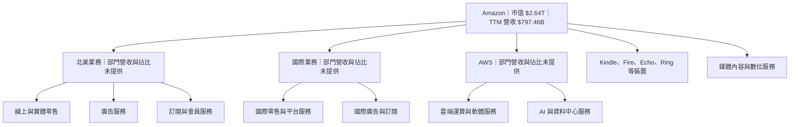
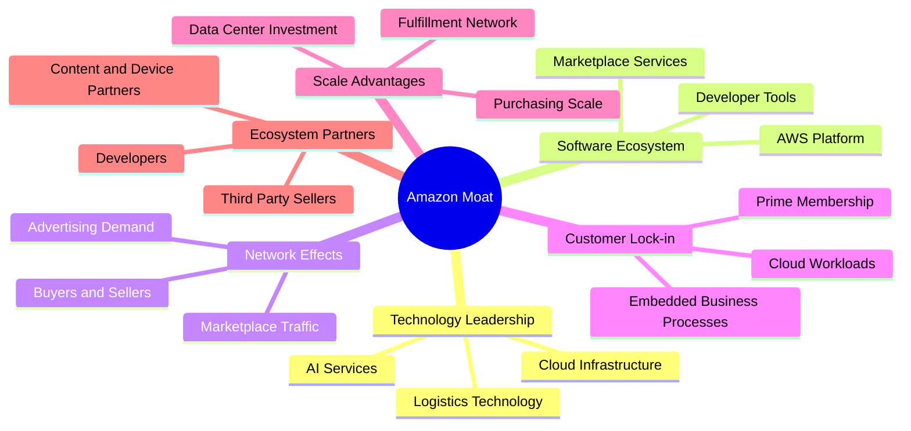
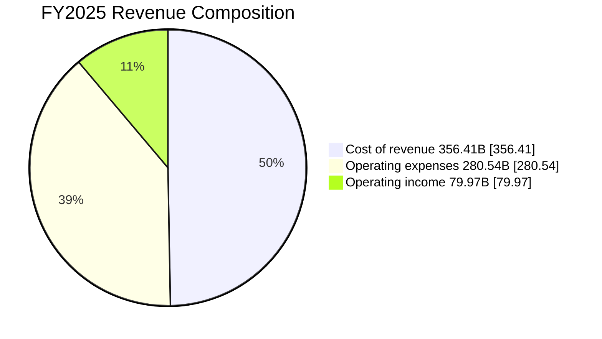
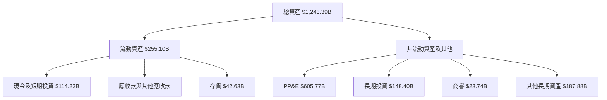
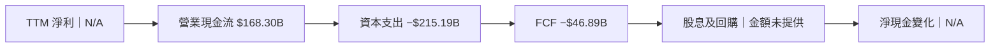
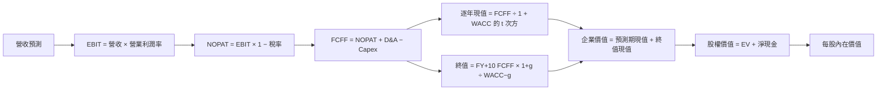
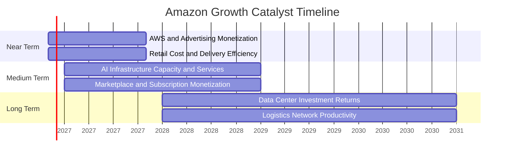
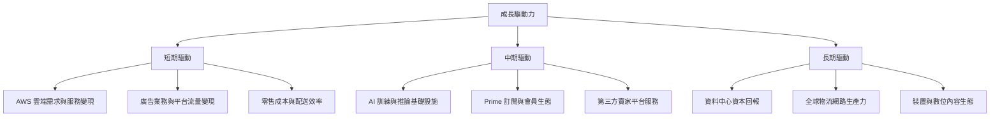
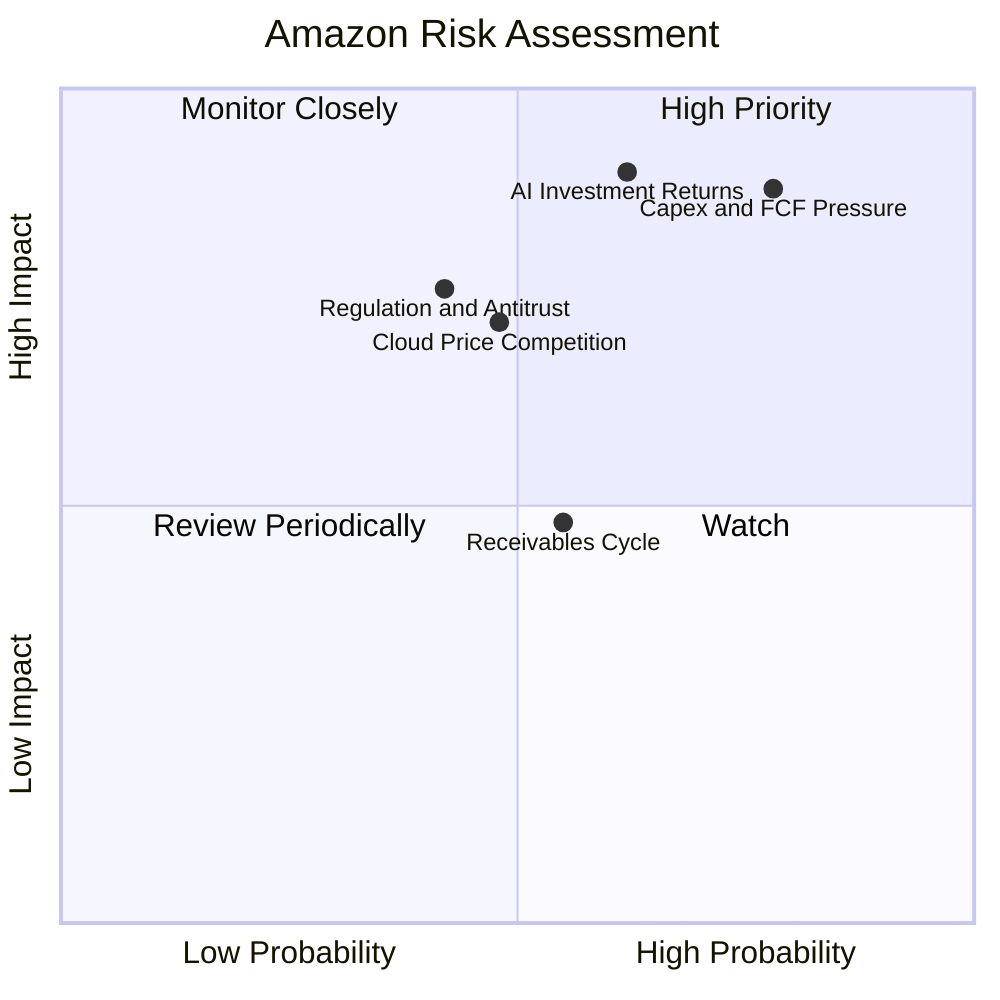
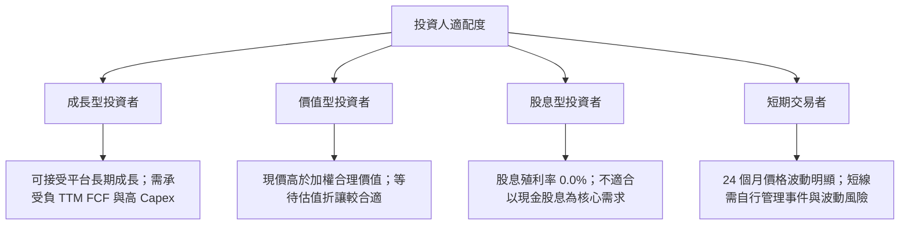

# AMZN 基本面深度分析報告
> **報告日期**：2026-11-26 ｜ **語言**：繁體中文 ｜ **數據來源**：SEC 申報資料 (XBRL)、Yahoo Finance、Finviz、StockAnalysis、Roic.ai ｜ **分析師**：CFA 級機構研究

## 目錄

| # | 章節 | 核心結論 |
|---|------|----------|
| 1 | 執行摘要 | 賣出；加權合理價值 $185.63；MOS −31.7% |
| 2 | 公司概覽與商業模式 | 電商、AWS、廣告與訂閱構成多層次生態系，護城河整體深但各業務資料有限 |
| 3 | 損益表深度分析 | TTM 營收 $797.46B、成長 15.4%；TTM 營業利益率 13.1% |
| 4 | 資產負債表分析 | VERIFIED 數據為淨負債 $65.73B；應收帳款天數升至 45 天 |
| 5 | 現金流量深度分析 | TTM FCF −$46.89B，Capex 超過營業現金流 |
| 6 | 獲利能力與資本效率 | ROIC 11.9% 高於 WACC 10.85%，目前仍創造正經濟利潤 |
| 7 | 相對估值分析 | P/E、EV/EBITDA 低於自身五年中位數，但加權價值低於現價 |
| 8 | DCF 內在價值評估 | DCF 基準值 $56.75；估值高度依賴終值，且模型存在可核對的算術差異 |
| 9 | 成長催化劑 | AWS、廣告、AI 基礎設施與物流效率是主要潛在驅動力 |
| 10 | 風險矩陣 | Capex/FCF、AI 投資回報與監管是主要風險 |
| 11 | 投資建議 | 依 MOS 評級為賣出；需等待估值重置或現金流改善 |

---

## 1. 執行摘要

### 1.0 一頁式投資儀表板

| 項目 | 內容 |
|------|------|
| **投資論點（3 句）** | ① TTM 營收 $797.46B、年增 15.4%，平台規模與多元業務仍支持成長。② ROIC 11.9% 高於 WACC 10.85%，目前資本回報略高於資金成本。③ TTM FCF −$46.89B、FCF Yield −1.77%，資本支出已超過營業現金流，短期現金回報承壓。 |
| **綜合評分** | **6.5/10**（引用 1.1 評分卡） |
| **財務健康** | 🟡 現金及短期投資 $114.23B、總債務 $179.95B，淨負債 $65.73B；現金部位大，但並非淨現金。 |
| **ROIC vs WACC** | **11.9% vs 10.85%**；高出 1.05 個百分點，仍創造正價值，但緩衝不厚。 |
| **FCF 趨勢** | TTM FCF 為 **−$46.89B**；FCF Yield **−1.77%**。投資擴張是主要解釋，但若資本支出回報未兌現，負 FCF 會延續。 |
| **估值** | Forward P/E 22.37x（市場資料）；EV/EBITDA 14.9x（五年估值資料）；FCF Yield −1.77%。 |
| **DCF 內在價值（基準）** | **$56.75**；按「現價 ÷ DCF 價值 − 1」計算，現價相對 DCF 基準值溢價 **330.7%**。 |
| **安全邊際（MOS）** | **−31.7%＝($185.63 − $244.43) ÷ $185.63**，以 8.8 加權合理價值為基準；🔴 無安全邊際。 |
| **預期報酬（基準情境 12M）** | 估值隱含上行空間 **−24.1%**，即加權合理價值 $185.63 相對現價 $244.43；這是估值差額，不是時間精確的價格預測。 |
| **關鍵風險（前二）** | ① TTM Capex $215.19B 高於 OCF $168.30B。② AI／資料中心投入若未轉化為收入與利潤，負 FCF 可能持續。 |
| **評級 + 信心度** | 🔴 **賣出** ｜ 信心：中；估值訊號明確，但 DCF 終值占比極高且模型有算術核對差異。 |

### 1.1 綜合評分卡（全報告唯一）

| 維度 | 評分（1–10） | 主要依據（引用數字與其來源章節） |
|------|--------------|----------------------------------|
| 成長性 | 8.0 | TTM 營收年增 15.4%，最新一季 YoY 12.1%（第 3 章）；仍有 AWS、廣告等成長來源，但最新單季增速低於 TTM。 |
| 獲利能力 | 8.0 | TTM 營業利益率 13.1%、ROIC 11.9%，高於 WACC 10.85%；Piotroski 4/8（第 6 章）。 |
| 財務健康 | 5.0 | 淨負債 $65.73B；現金及短期投資 $114.23B；F-Score 4/8，DSO 從 32 天升至 45 天（第 4 章）。 |
| 估值 | 3.0 | MOS −31.7%；DCF $56.75，低於現價 $244.43；但 P/E、EV/EBITDA 分別位於自身歷史第 30、19 百分位（第 7、8 章）。 |
| 護城河 | 9.0 | 多邊市場、履約網路、AWS 雲端服務及廣告／訂閱生態具有規模與轉換成本支撐；市場份額數字未提供（第 2 章）。 |
| 管理層與資本配置 | 6.0 | 2025 年 Capex $131.82B、SBC $19.47B；年股數增加的 Piotroski 測試未通過，資本投入回報需持續驗證（第 3、5、6 章）。 |
| **綜合評分** | **6.5** | 六項算術平均：$(8+8+5+3+9+6)÷6=6.5$。 |

### 1.2 五大投資論點 + 三大核心風險

| 類型 | 項目 | 具體依據 | 信心度 |
|------|------|----------|--------|
| 🟢 **投資論點①** | 電商規模與營收韌性 | TTM 營收 $797.46B，TTM 成長 15.4%；最新一季營收 YoY 成長 12.1%。規模可支撐配送密度與平台流量變現。 | 🟢 高 |
| 🟢 **投資論點②** | 利潤率已具規模槓桿 | TTM 營業利益率 13.1%，最新一季 13.9%；2025 年營業利益 $79.97B，高於 2024 年 $68.59B。 | 🟢 高 |
| 🟢 **投資論點③** | 資本回報仍高於資金成本 | ROIC 11.9% 對 WACC 10.85%，差距 1.05 個百分點；若維持，新增資本仍有望創造價值。 | 🟡 中 |
| 🟢 **投資論點④** | 現金流具備長期修復空間 | TTM OCF $168.30B，代表營運端仍可產生大量現金；目前負 FCF 與高 Capex 同時出現，未來回報率是關鍵。 | 🟡 中 |
| 🟢 **投資論點⑤** | 估值部分指標已低於自身歷史中位數 | P/E 19.8x 對五年中位數 32.2x；EV/EBITDA 14.9x 對 17.3x。 | 🟡 中 |
| 🟡 **風險①** | 資本支出侵蝕自由現金流 | TTM Capex $215.19B，高於 OCF $168.30B，導致 FCF −$46.89B、FCF Yield −1.77%。 | 🔴 高衝擊 |
| 🔴 **風險②** | DCF 對終值與資本回報高度敏感 | DCF 終值現值占 EV 98.5%；WACC 或永續成長假設的微小變化，可能造成每股價值大幅波動。 | 🔴 高衝擊 |
| 🟡 **風險③** | 應收帳款天數上升 | DSO 從一年前 32 天升至 45 天，增加 13 天；可能反映收入組合、結算條件或收款週期變化，應持續追蹤。 | 🟡 中 |

### 1.3 快速統計卡片

| 指標 | 公司實際值（期間） | 同業中位數 | 狀態 |
|------|--------------------|------------|------|
| 營收成長（TTM） | **15.4%** | — | 🟢 |
| 營收成長（最新一季年增） | **12.1%** | **18.8%**（MSFT、GOOG、WMT） | 🟡 |
| 毛利率（TTM） | **51.4%** | **60.9%** | 🟡 |
| 營業利益率（TTM） | **13.1%** | — | 🟢 |
| ROIC（TTM） | **11.9%** | — | 🟡 |
| Forward P/E | **22.37x** | **20.2x**（同業中位數） | 🟡 |
| FCF Yield（TTM） | **−1.77%** | — | 🔴 |
| Piotroski F-Score | **4 / 8** | — | 🟡 |

> 同業毛利率與單季營收成長中位數，分別取 MSFT、GOOG、WMT 三家公司提供的數字。公司 Forward P/E 來自市場估值資料；同業倍數與估值方法部分依指定的 Peer multiples 資料。

### 1.4 投資結論

```text
╔══════════════════════════════════════════════════════════════════╗
║                    📊 投資結論摘要                               ║
╠══════════════════════════════════════════════════════════════════╣
║  評級：賣出（依 MOS 評級門檻）                                   ║
║  價格（2026-11-25 收盤）：$244.43                                ║
║  DCF 內在價值（基準）：$56.75（現價相對 DCF 溢價 330.7%）       ║
║  安全邊際 MOS：−31.7%（以加權合理價值 $185.63 為分母）          ║
║  加權合理價值（8.8）：$185.63                                   ║
║  DCF 情境價值：                                                  ║
║    悲觀情境：$12.98（相對現價 −94.7%）                           ║
║    基準情境：$56.75（相對現價 −76.8%）                           ║
║    樂觀情境：$130.52（相對現價 −46.6%）                          ║
║  綜合評分：6.5/10（引用 1.1）                                   ║
║  適合投資人：能承受高資本支出與估值波動、重視長期平台成長者；   ║
║              不適合以當期 FCF 或股息收益為主要要求的投資人。    ║
╚══════════════════════════════════════════════════════════════════╝
```

---

## 2. 公司概覽與商業模式

### 2.1 業務結構與收入來源

公司資料指出 Amazon 主要由北美、國際與 AWS 三個報告部門構成，另經營廣告、訂閱、實體店、裝置及媒體內容。最新提供的財報數字未列各部門營收，因此不拆分部門金額或佔比，以免將未提供資料推估成事實。



### 2.2 市場份額

可引用的市場份額數字及年份未提供，因此不繪製市場份額圖表。以規模衡量，Amazon TTM 營收為 $797.46B、TTM 成長 15.4%；最新一季 YoY 成長 12.1%，低於所列 MSFT、GOOG 的 18.8%、24.7%，但高於 WMT 的 5.2%。這些跨業態比較只表示成長速度，不能直接視作零售或雲端市場份額比較。

### 2.3 競爭護城河分析



### 2.4 護城河強度

| 護城河項目 | 強度（強／中／弱） | 證據（引用數字或事實） | 會削弱它的情況 |
|------------|--------------------|------------------------|----------------|
| 技術與雲端基礎設施 | 強 | AWS 是公司三大報告部門之一；但本期 AWS 營收及利潤率未提供。 | 雲端價格競爭、AI 投資回報不足、客戶多雲化。 |
| 軟體生態系統 | 強 | AWS 企業客戶工作負載與工具鏈可形成轉換成本；財務資料未列客戶留存率。 | 開源替代、遷移成本下降、服務差異化減弱。 |
| 網路效應 | 中至強 | 第三方賣家、消費者流量與廣告服務相互帶動；部門與平台活躍數據未提供。 | 賣家流失、商品品質下降、競爭平台提高補貼。 |
| 客戶鎖定 | 中至強 | Prime、雲端工作負載及企業服務可提高切換成本；訂閱戶數未提供。 | 會員價值感下降、企業縮減雲端支出。 |
| 規模效應 | 強 | TTM 營收 $797.46B；年度營收從 2022 年 $513.98B 升至 2025 年 $716.92B。 | 勞動與履約成本上升、低效資產與投資過度擴張。 |
| 生態夥伴 | 中 | 市場平台仰賴第三方賣家、AWS 開發者及內容合作方；合作方數據未提供。 | 監管限制自營與平台整合、夥伴轉向競爭平台。 |

**護城河評分引用 1.1：9.0/10**；支持因素是平台規模、雲端服務及多邊生態的組合，限制是未提供分部營收、留存率及市場份額等可量化佐證。

---

## 3. 損益表深度分析

### 3.1 年度收入成長趨勢（近 4 年）

年度營收以公司年度資料列示；YoY 為依年度營收計算。FY2022–FY2025 的累計 CAGR 公式為 $(716.92÷513.98)^{1/3}-1=11.7\%$。

```text
╔══════════════════════════════════════════════════════════════════╗
║             Amazon 年度收入趨勢（FY2022–FY2025）                ║
╠══════════════════════════════════════════════════════════════════╣
║  FY2022  $513.98B  ██████████████████░░░░░░░░  YoY: —          ║
║  FY2023  $574.78B  ████████████████████░░░░░░  YoY: +11.8% 🟢  ║
║  FY2024  $637.96B  ██████████████████████░░░░  YoY: +11.0% 🟢  ║
║  FY2025  $716.92B  █████████████████████████░  YoY: +12.4% 🟢  ║
║                                                                  ║
║  FY2022–FY2025 三年累計 CAGR：+11.7%                             ║
╚══════════════════════════════════════════════════════════════════╝
```

營收由 FY2022 $513.98B 增至 FY2025 $716.92B，三年 CAGR 11.7%。FY2025 年增 12.4%，略高於 FY2024 的 11.0%；這表示營收增速未隨規模擴大而明顯衰退，但增速本身不代表利潤或現金流同步提升。

### 3.2 季度收入趨勢分析

| 季度 | 營收 | QoQ 成長 | YoY 成長 | 備註 |
|------|------:|---------:|---------:|------|
| 2025 Q4 | $213.386B | 36.8% | 13.6% | QoQ 由 2025 Q3 $180.169B 計算；第四季季節性較高。 |
| 2026 Q1 | $181.519B | −14.9% | 16.6% | QoQ 回落主要反映季度季節性；YoY 仍高於 TTM 前期成長率。 |
| 2026 Q2 | $200.606B | 10.5% | 19.6% | StockAnalysis 列出季度營收；與其他來源該季欄位缺漏不同，引用此來源作季度趨勢。 |
| 2026 Q3 | $201.944B | 0.7% | **12.1%** | VERIFIED 最新季度年增率為 12.1%；QoQ 由 Q2 比較計算。 |

季度數字顯示 Q2 YoY 加速至 19.6%，Q3 回落至 12.1%。這不必然代表長期趨勢反轉，但應確認 AWS、零售與廣告各自的增長貢獻；目前無分部數據可用以拆解。

### 3.3 利潤率演變分析

| 利潤率指標 | FY2022 | FY2023 | FY2024 | FY2025 | 趨勢 | 評估 |
|------------|--------:|--------:|--------:|--------:|------|------|
| **毛利率** | 43.8% | 47.0% | 48.9% | 50.3% | ↗️ 持續提高 | 🟢 |
| **營業利益率** | 2.4% | 6.4% | 10.8% | 11.2% | ↗️ 顯著改善 | 🟢 |
| **淨利率** | −0.5% | 5.3% | 9.3% | 10.8% | ↗️ 由虧轉盈 | 🟢 |

毛利率及營業利益率按年度毛利、營業利益除以營收計算。FY2022 至 FY2025 營業利益由 $12.25B 增至 $79.97B，增幅遠高於營收同期增幅，顯示成本控制、固定成本槓桿及高利潤服務組合可能帶來營業槓桿。TTM 營業利益率為 13.1%，高於 FY2025 年度 11.2%；最新季度為 13.9%，但單季數字不宜直接視作全年水準。

### 3.4 費用結構分析

FY2025 年度資料可拆分營收、銷貨成本、毛利後營業費用與營業利益；此為基於已披露損益項目的計算，不代表公司完整費用科目分類。



```text
╔══════════════════════════════════════════════════════════════════╗
║                 FY2025 營收費用結構                             ║
╠══════════════════════════════════════════════════════════════════╣
║  營收 $716.92B                                                   ║
║  銷貨成本 $356.41B（49.7%）  ██████████████░░░░░░░░░░           ║
║  營業費用 $280.54B（39.1%）  ███████████░░░░░░░░░░░░           ║
║  營業利益  $79.97B（11.2%）  ███░░░░░░░░░░░░░░░░░░░           ║
╚══════════════════════════════════════════════════════════════════╝
```

計算：銷貨成本 = $716.92B − $360.51B = $356.41B；營業費用合計代理值 = $360.51B − $79.97B = $280.54B。公司未提供此處分項營業費用明細，故不再拆分研發、行銷與管理費用。

### 3.5 季度 EPS 趨勢與盈餘品質（Quality of Earnings）

| 季度 | EPS 實際值 | EPS YoY | 超預期／不及預期 |
|------|-----------:|--------:|------------------|
| 2025 Q4 | $1.95 | 5.0% | 預估 EPS N/A；無法判定。 |
| 2026 Q1 | $2.78 | 74.8% | 預估 EPS N/A；無法判定。 |
| 2026 Q2 | $5.75 | 242.3% | 預估 EPS N/A；無法判定；單季 EPS 顯著高於相鄰季度，應查明一次性或非營運項目，但此處未提供原因。 |
| 2026 Q3 | $1.89 | −3.1% | 預估 EPS N/A；無法判定。 |

Earnings History 的四季預估值及實際值為 nan，不能據此宣稱超預期或不及預期。不同資料表中的季度淨利與 EPS 序列也有明顯波動，季度盈餘歸因應待 SEC 10-Q 附註核實。

| 盈餘品質項目 | 數值／佔比 | 評估 |
|--------------|-----------|------|
| SBC / 營收 | FY2025 $19.47B ÷ $716.92B = **2.72%** | 🟡 SBC 是實質股東成本；比例不算忽略不計，稀釋股數測試亦未通過。 |
| SBC / 營業現金流 | FY2025 $19.47B ÷ $139.51B = **14.0%** | 🟡 若將 SBC 視作股東經濟成本，現金流品質需以稀釋後股數一併觀察。 |
| FCF / 淨利（現金轉換率） | TTM FCF −$46.89B；TTM 淨利未在 VERIFIED figures 提供 | N/A；不可用年度或其他來源替代 TTM 淨利分母。 |
| 一次性／非經常性損益 | N/A（未提供可核對明細） | 無法判斷季度淨利與 EPS 波動是否由一次性項目造成。 |
| 有效稅率異常 | 模型採用稅率 21.0%；實際 TTM 有效稅率 N/A | 無法判斷報告期實際稅率是否異常或受到稅務利益帶動。 |
| 資本化支出 vs 費用化 | TTM Capex $215.19B；折舊攤銷比例模型假設為營收 10.0% | 🟡 投資先資本化並在未來折舊，不能僅由 Capex 斷定費用遞延或盈餘高估；需對照資產附註與折舊年限。 |

**盈餘品質結論**：年度營業利益與利潤率改善有損益表數據支持，但 TTM FCF 為負且 SBC 相當於 FY2025 營業現金流的 14.0%。目前不宜單以淨利衡量股東可取得的經濟盈餘；估值應同時考量高投資需求與稀釋。

---

## 4. 資產負債表分析

### 4.1 資產結構分解

最新 TTM 資產負債表總資產在品質數據中為 $1,243.39B；流動資產 $255.10B，PP&E $605.77B，長期投資 $148.40B，其他長期資產 $187.88B、商譽 $23.74B。各項合計可能因資產項目分類與四捨五入略有差異，以下為資料列出的細項，不將未列項目反推補足。



### 4.2 流動性與營運資金分析

| 指標 | 最新 TTM | 一年前 TTM | 變化 | 解讀 |
|------|---------:|-----------:|-----:|------|
| 流動比率 | 0.989（市場資料來源） | N/A | N/A | 低於 1；但零售與平台型公司的應付帳款、遞延收入結構會影響單一比率解讀。 |
| 速動比率 | 0.793（市場資料來源） | N/A | N/A | 短期資產不含存貨後低於流動負債；應搭配 $114.23B 現金及短期投資觀察。 |
| DSO 應收帳款天數 | **45 天** | **32 天** | **+13 天** | 收款週期拉長；可能受營收組合與結算時間影響，需後續確認。 |
| DIO 存貨天數 | **N/A** | **N/A** | N/A | 資料標示公司未提供可用餘額／流量組合，不推算。 |
| DPO 應付帳款天數 | **N/A** | **N/A** | N/A | 同上，不以其他資料反推。 |
| CCC 現金轉換週期 | **N/A** | **N/A** | N/A | DIO、DPO 缺漏，不能計算。 |

流動比率與速動比率來自市場資料彙整，非品質指標中的一致口徑序列，故不作歷史趨勢比較。DSO 上升 13 天是可觀察的營運資金變化，但單憑此項不能判定收款品質惡化；需檢視應收款增速、帳齡及信用損失準備。

### 4.3 債務結構分析

以 VERIFIED 數字為準，現金與短期投資 $114.23B、總債務 $179.95B、淨負債 $65.73B。其他市場資料另列債務 $304.84B、淨負債 $190.61B，與 SEC 數據摘要口徑不一致；本報告不混用不同口徑作槓桿比率推算。

```text
╔══════════════════════════════════════════════════════════════════╗
║                   Amazon 債務健康診斷                            ║
╠══════════════════════════════════════════════════════════════════╣
║  總債務：        $179.95B  ████████████████████  🟡              ║
║  現金+短期投資： $114.23B  █████████████░░░░░░░  🟢              ║
║  淨負債：         $65.73B  ███████░░░░░░░░░░░░░  🟡              ║
║                                                                  ║
║  Debt/EBITDA：N/A（債務口徑及 EBITDA 口徑未能一致核對）          ║
║  利息保障倍數：N/A（利息費用資料未提供）                         ║
║  淨負債 / 現金及短期投資：$65.73B / $114.23B = 57.5%             ║
╚══════════════════════════════════════════════════════════════════╝
```

### 4.4 股東權益趨勢

| 年度 | 股東權益 | YoY 變化 |
|------|---------:|---------:|
| 2022 | $146.04B | — |
| 2023 | $201.88B | +38.2% |
| 2024 | $285.97B | +41.7% |
| 2025 | $411.06B | +43.7% |

```text
╔══════════════════════════════════════════════════════════════════╗
║                 股東權益趨勢（年度）                             ║
╠══════════════════════════════════════════════════════════════════╣
║  2022  $146.04B  ███████░░░░░░░░░░░░░░░                         ║
║  2023  $201.88B  ██████████░░░░░░░░░░░                         ║
║  2024  $285.97B  ██████████████░░░░░░░                         ║
║  2025  $411.06B  ████████████████████                         ║
╚══════════════════════════════════════════════════════════════════╝
```

權益增長與年度獲利累積及資產負債表變化相符，但不應直接視為每股價值等比例增加；最新資料顯示稀釋股數由 2026 年 3 月 10.754B 增至 9 月 10.811B，股數擴張會分攤每股權益。

---

## 5. 現金流量深度分析

### 5.1 現金流量瀑布圖

TTM OCF、Capex、FCF 採 VERIFIED 指標。TTM 淨利與股息／回購金額未提供，因此不將其填入現金流橋接。



### 5.2 FCF 轉換率趨勢

| 年度 | OCF | Capex | FCF | 淨利 | FCF / 淨利 |
|------|----:|------:|----:|-----:|-----------:|
| 2022 | $46.75B | $63.65B | −$16.89B | −$2.72B | N/A（淨利為負，比例不具可比性） |
| 2023 | $84.95B | $52.73B | $32.22B | $30.43B | 105.9% |
| 2024 | $115.88B | $83.00B | $32.88B | $59.25B | 55.5% |
| 2025 | $139.51B | $131.82B | $7.70B | $77.67B | 9.9% |
| TTM 至 2026-09-30 | $168.30B | $215.19B | −$46.89B | N/A | N/A |

年度數據顯示 OCF 增長，但 Capex 快速上升，使 FCF 由 FY2024 $32.88B 降至 FY2025 $7.70B，TTM 進一步轉負。這表示營運現金流擴張暫時被建置資產的現金需求抵銷，投資回報與建置節奏比帳面獲利更值得關注。

### 5.3 自由現金流趨勢

| 期間 | FCF | FCF Yield |
|------|----:|----------:|
| 2022 | −$16.89B | N/A |
| 2023 | $32.22B | N/A |
| 2024 | $32.88B | N/A |
| 2025 | $7.70B | N/A |
| TTM | **−$46.89B** | **−1.77%** |

```text
╔══════════════════════════════════════════════════════════════════╗
║                  自由現金流趨勢                                  ║
╠══════════════════════════════════════════════════════════════════╣
║  FY2022  −$16.89B  ◀████████░░░░░░░░░░░░░                       ║
║  FY2023   $32.22B  ████████████████░░░░                         ║
║  FY2024   $32.88B  ████████████████░░░░                         ║
║  FY2025    $7.70B  ████░░░░░░░░░░░░░░░░                         ║
║  TTM      −$46.89B ◀████████████████████                         ║
║  TTM FCF Yield：−1.77%                                           ║
╚══════════════════════════════════════════════════════════════════╝
```

另有市場資料彙總列出 TTM FCF −$37.64B、FCF Yield −1.42%，與 SEC 計算區塊不同。本報告依規則採用 TTM FCF = OCF − Capex 的 VERIFIED 數值 **−$46.89B**，不將兩種口徑混合。

### 5.4 資本配置評估

FY2025 可量化的現金流支出以資本支出為主；回購、股息及其他投資金額未提供完整可比資料，故不作比例圓餅圖。

| 資本配置項目 | 可用數字 | 評估 |
|--------------|---------|------|
| Capex | FY2025 $131.82B；TTM $215.19B | 🟡／🔴 資本投入快速上升，未來須以新增營業利益、現金流和資產利用率證明回報。 |
| SBC | FY2025 $19.47B | 🟡 需要搭配稀釋股數監控；SBC 不等同現金支出，但會稀釋股東持分。 |
| 股息 | 殖利率 0.0% | 未以現金股息作主要股東回報。 |
| 回購／其他投資 | N/A | 可比金額未提供，不推估資本配置比例。 |

---

## 6. 獲利能力與資本效率

### 6.1 ROE / ROA / ROIC 趨勢

| 指標 | 最新可用數值 | 歷史資料 | 評估 |
|------|-------------:|---------|------|
| ROE | **22.0% TTM**（VERIFIED） | StockAnalysis 另列 2025 年淨利 $77.67B、年末權益 $411.06B；未用此口徑重算 TTM ROE。 | 🟢 回報良好，但需留意槓桿與權益乘數。 |
| ROA | **6.6% TTM**（市場資料） | Piotroski 測試顯示 TTM ROA 高於一年前；精確歷史 ROA 數值未提供。 | 🟡 資產龐大，資產利用率改善仍是效率關鍵。 |
| ROIC | **11.9% TTM**（VERIFIED） | 歷年一致口徑 ROIC 序列未提供。 | 🟢 略高於 WACC。 |
| 行業均值 | N/A | 未提供可核對來源 | 不作同業平均比較。 |

### 6.2 ROIC vs WACC 分析（核心價值創造判斷）

```text
╔══════════════════════════════════════════════════════════════════╗
║                ROIC vs WACC 深度分析                            ║
╠══════════════════════════════════════════════════════════════════╣
║  WACC（依 Cost of capital 資料採用值）：10.85%                  ║
║  ├── 無風險利率（10Y 美債）：4.85%                              ║
║  ├── 市場風險溢酬 ERP：5.00%                                     ║
║  ├── 原始 Beta：1.50；調整後 Beta：1.34                         ║
║  ├── 股權成本（來源計算值）：11.52%                              ║
║  ├── 稅前債務成本：1.26%；稅率：21.0%                           ║
║  ├── 股權／債務權重：93.6%／6.4%                                ║
║  └── 採用 WACC：10.85%（以成本資本資料列示值為準）              ║
║                                                                  ║
║  ROIC（TTM）：11.9%                                             ║
║  EVA Spread = ROIC − WACC = 11.9% − 10.85% = +1.05 個百分點     ║
║                                                                  ║
║  ROIC  11.9%  ▓▓▓▓▓▓▓▓▓▓▓▓░░░░░░░░                             ║
║  WACC  10.85% ▓▓▓▓▓▓▓▓▓▓▓░░░░░░░░                              ║
║                                                                  ║
║  結論：ROIC 高於 WACC，現階段創造正經濟價值；差距僅 1.05pp，  ║
║        若回報下滑或資本成本上升，超額報酬緩衝可能迅速消失。   ║
╚══════════════════════════════════════════════════════════════════╝
```

資本成本資料已提供調整後 Beta 與 WACC，本報告直接採用，不另建 WACC。需注意，原始輸入按展示精度計算時，$4.85\%+1.34×5.00\%=11.55\%$，與資料列示股權成本 11.52% 有 0.03 個百分點差異；此外，展示權重與債務成本重算亦不完全等於 10.85%。因此以資料列示的 WACC 10.85% 作估值與 ROIC 比較，並將精度／底層輸入差異列入檢核限制。

### 6.3 杜邦三因素分解

| 因素 | 數值（TTM） | 解讀 |
|------|-------------|------|
| 淨利率 | **16.9%** | 品質指標區塊原值；相對年度淨利率序列差異較大，應避免混用口徑。 |
| 資產週轉率 | **0.64** | 大量資產與投資使資產週轉率成為 ROE 的重要限制因素。 |
| 權益乘數 | **2.03** | 槓桿提高股東權益回報，但非極端槓桿。 |
| **ROE** | **22.0%** | 品質區塊原列：16.9% × 0.64 × 2.03 = 22.0%（乘積受四捨五入影響）。 |

ROE 由利潤率、資產週轉率與權益乘數共同支撐；權益乘數 2.03 顯示槓桿有一定作用，但主要監控重點仍是大規模資本投入能否提高資產週轉與營業回報。

### 6.4 財務體質：Piotroski F-Score

| 測試 | 結果 | 解讀 |
|------|------|------|
| ROA > 0 | ✅ 通過 | 獲利能力為正。 |
| 營業現金流 > 0 | ✅ 通過 | TTM OCF 正值。 |
| ROA 高於一年前 | ✅ 通過 | 資產報酬方向改善。 |
| 營業現金流 > 淨利（應計品質） | ✅ 通過 | 現金流測試通過；不可據此忽略負 FCF，因 Capex 扣除後結果不同。 |
| 長期負債 ÷ 總資產低於一年前 | ❌ 未通過 | 槓桿相對資產的走勢未改善。 |
| 流動比率高於一年前 | ❌ 未通過 | 短期流動性相對去年未改善。 |
| 稀釋股數未增加 | ❌ 未通過 | 股數增加會分薄每股價值。 |
| 毛利率高於一年前 | — 無法判定 | 缺少該測試所需輸入。 |
| 資產週轉率高於一年前 | ❌ 未通過 | 資產擴張可能快於營收轉化效率。 |

**Piotroski F-Score：4 / 8**。八項可判定測試中四項通過；毛利率測試缺資料而排除。分數反映公司獲利與營業現金流面向有正面訊號，但槓桿、流動性、稀釋及資產週轉的測試未通過。

---

## 7. 相對估值分析

### 7.1 同業估值比較表格

| 估值指標 | **AMZN** | **MSFT** | **GOOG** | **WMT** | AMZN 評估 |
|----------|---------:|---------:|---------:|--------:|-----------|
| **Trailing P/E** | 19.8x | 25.6x | 14.2x | 47.8x | 🟡 位於同業範圍中段；商業模式與利潤率差異大，不宜單獨判斷便宜。 |
| **Forward P/E** | 22.37x | 20.2x | 17.7x | 40.9x | 🟡 AMZN 高於 MSFT、GOOG，低於 WMT。 |
| **P/S Ratio** | 3.3x | 10.5x | 7.1x | 1.4x | 🟡 高於零售型 WMT、低於大型軟體／平台公司。 |
| **EV/EBITDA** | 14.9x | 18.0x | 17.4x | 23.0x | 🟢 低於所列三家同業。 |
| **最新季度營收 YoY** | 12.1% | 18.8% | 24.7% | 5.2% | 🟡 成長快於 WMT，但低於 MSFT、GOOG。 |
| **TTM 毛利率** | 51.4% | 67.7% | 60.9% | 25.3% | 🟡 高於零售型 WMT，低於 MSFT、GOOG。 |

AMZN 的估值低於部分高毛利科技同業，但商業模式包含低毛利零售與資本密集型物流，不能只以平台公司倍數比較。Forward P/E 亦受未來 EPS 預測影響，若 Capex 導致折舊上升或利潤未達預期，倍數看似便宜不代表價值必然低估。

### 7.2 歷史估值區間分析

```text
╔══════════════════════════════════════════════════════════════════╗
║               AMZN 五年估值位置（TTM）                           ║
╠══════════════════════════════════════════════════════════════════╣
║  P/E        範圍 2.6x ───────── 19.8x ───────── 251.9x           ║
║             五年中位數 32.2x｜目前百分位 30%                     ║
║                                                                  ║
║  P/S        範圍 0.2x ───────────────── 3.3x ─ 3.7x              ║
║             五年中位數 3.0x｜目前百分位 67%                     ║
║                                                                  ║
║  EV/EBITDA  範圍 0.7x ─────── 14.9x ─────── 22.7x                ║
║             五年中位數 17.3x｜目前百分位 19%                    ║
╚══════════════════════════════════════════════════════════════════╝
```

P/E、EV/EBITDA 分別處於自身五年區間第 30、19 百分位，低於中位數；P/S 位於第 67 百分位，高於五年中位數 3.0x。歷史倍數範圍包含獲利低谷或異常週期，百分位是位置描述，不是合理價值結論。

### 7.3 情境價值（Bear / Base / Bull）

| 情境 | 第 1 年營收成長 | 期末營業利潤率 | WACC | 每股價值 | 相對現價 | 機率 | 會發生的條件 |
|------|----------------:|----------------:|-----:|---------:|---------:|-----:|--------------|
| 🔴 悲觀 | 7.7% | 9.1% | 11.85% | $12.98 | −94.7% | 25% | 零售與雲端增長降速、競爭或投資成本壓縮利潤，且資本成本上行。 |
| 🟡 基準 | 15.4% | 10.8% | 10.85% | $56.75 | −76.8% | 50% | 營收由 TTM 成長率起步，長期漸降至 3%，利潤率收斂至五年中位數。 |
| 🟢 樂觀 | 23.0% | 11.8% | 9.85% | $130.52 | −46.6% | 25% | AWS、廣告與 AI 需求帶動成長，利潤率維持較高水準且資本成本下降。 |

三個情境的價格與假設均照 DCF 情境模型列示。即使樂觀情境 $130.52，仍低於 2026-11-25 收盤價 $244.43，說明模型的悲觀程度主要源於高投資需求、折現率與終值假設，並不代表市場共識目標價。

### 7.4 相對估值隱含價格區間

```text
╔══════════════════════════════════════════════════════════════════╗
║           相對估值與模型估值：每股價值（美元）                   ║
╠══════════════════════════════════════════════════════════════════╣
║  DCF（基準）       $56.75                                        ║
║  同業 Forward P/E  $221.19                                       ║
║  現價              $244.43                                       ║
║  同業 EV/EBITDA    $299.99                                       ║
║  分析師共識        $326.34                                       ║
╚══════════════════════════════════════════════════════════════════╝
```

- **同業 Forward P/E：$221.19**；同業中位數 20.2x × AMZN Forward EPS $10.93。
- **同業 EV/EBITDA：$299.99**；同業中位數 18.0x × AMZN TTM EBITDA，再加回淨現金／扣除淨負債的模型橋接。
- 同業為 MSFT、GOOG、WMT；各方法價格照估值方法資料列示，不改用 AMZN 自身目前倍數。
- **分析師共識目標價 $326.34**，平均 60 位分析師；是參考值，不是由可複算的現金流模型推導。

---

## 8. DCF 內在價值評估（Discounted Cash Flow）

### 8.0 估值推理鏈（Thinking Logic）

**核心命題**：AMZN 價值由零售與履約網路、AWS 雲端服務、廣告與訂閱等業務共同形成；公司總 TTM 營收為 $797.46B，但未提供分部營收，因此不能誠實拆出各業務營收佔比。當前估值最受資本支出路徑及終值現金流支配：TTM Capex $215.19B、FCF −$46.89B，DCF 終值現值占 EV 98.5%。

| 決策點 | 本報告採用 | 理由（含數字） | 曾考慮但否決 | 否決理由 |
|--------|-----------|----------------|--------------|----------|
| 現金流定義 | FCFF | 與 WACC 10.85% 折現並先計 EV，再扣淨負債。 | FCFE | 債權人與股東現金流需分開處理。 |
| 預測期 N | 10 年 | 模型指定 10 年，允許營收成長及 Capex 比例逐步淡出。 | 5 年 | 會縮短資本密集投資週期的過渡時間，且不是指定模型。 |
| 終值方法 | Gordon Growth | 模型提供 g=3.0% 及 WACC=10.85%，符合 WACC>g。 | 退出倍數 | DCF 模型未提供退出倍數，不能自行補值。 |
| EBIT 基礎 | GAAP EBIT | 採模型設定的 GAAP 營業利益。 | 非 GAAP | 可能把 SBC 加回，與模型口徑不一致。 |

**四段式假設推導鏈**

- **營收成長**：錨點＝TTM 對前一 TTM 成長 15.4% → 調整＝模型令增速由 FY+1 的 15.4% 線性降至 FY+10 的 3.0%，反映成熟化 → **採用模型列示路徑** → 曾考慮維持 15.4% 十年，但否決，因模型並無足夠證據支持長期固定高增長。
- **期末營業利潤率**：錨點＝TTM 營業利益率 13.1%；模型參考最近五個財年的中位數並令利潤率逐步收斂 → **FY+10 採用 10.8%** → 曾考慮永久維持 13.1%，但否決，因忽略成熟期競爭及模型指定的歷史中位數收斂。
- **永續成長率 g**：錨點＝模型採用 3.0%，低於 WACC 10.85% → 反映長期名目成長需維持在折現率之下 → **採用 3.0%** → 不採用接近或高於 WACC 的假設，因 Gordon Growth 分母會縮小甚至失效。
- **預測期 N**：錨點＝模型預設 10 年 → 調整＝不作自行修改，完整涵蓋現金流逐步由負轉正的路徑 → **採用 10 年** → 不縮短或延長，以免偏離固定模型。
- **Capex／營收**：錨點＝TTM 比例 27.0% → 調整＝模型假設由 27.0% 線性下降至 10.9%，並淡出至 1.1 倍 D&A → **採用模型列示路徑** → 不採用永久 27.0%，因模型假設成熟後投資強度下降；也不直接改成較低比例，因無可核對依據。
- **EBIT 基礎與 SBC**：錨點＝模型明列 GAAP EBIT、SBC 已作費用 → **採用組合 (A)：GAAP EBIT + 固定股數、不再扣 SBC、不額外稀釋** → 否決另扣 SBC 或另加股數稀釋，避免重複計算。
- **年稀釋率**：錨點＝組合 (A) 的固定股數設計 → **模型採 0% 額外稀釋** → 未使用年度股數擴張假設，因模型將 SBC 成本留在 GAAP EBIT 中。
- **終值方法**：錨點＝Gordon Growth，g=3.0%、WACC=10.85% → **採用 Gordon Growth** → 退出倍數未提供，無法交叉驗證或另行填入。
- **WACC**：錨點＝Cost of capital 資料列示 10.85% → **採用 10.85%** → 不另以自行估算替代，避免違反指定資本成本輸入。

**最脆弱的一環**：Capex 從營收 27.0% 逐步降至 10.9% 的模型路徑；若投資強度無法下降，預測現金流與終值將低於基準模型。



### 8.1 模型假設總表（Model Inputs）

| 假設項目 | 採用值 | 依據／來源 | 敏感度 |
|----------|--------|-------------|--------|
| 預測期長度 N | 10 年 | DCF 模型指定；提供 FY+1 至 FY+10 逐年估計。 | 🟡 中 |
| 營收成長路徑 | FY+1 15.4% 降至 FY+10 3.0% | 起點為 TTM 對前一 TTM 成長 15.4%；模型線性淡出。 | 🔴 高 |
| 營業利潤率路徑 | 13.1% 降至 10.8% | 13.1% 為 TTM；終點為模型採用的最近五年中位數。 | 🔴 高 |
| 有效稅率 | 21.0% | Cost of capital 預設稅率；實際 TTM 稅率未提供。 | 🟢 低 |
| Capex／營收 | FY+1 27.0% 降至 FY+10 10.9% | TTM 比例起點，逐步淡出至 1.1×D&A。 | 🔴 高 |
| D&A／營收 | 10.0% | 模型取 TTM 比例並固定。 | 🟢 低 |
| ΔWC／營收增額 | 不建模 | DCF 模型明示 working capital is not modelled；不另補數值。 | 🟢 低 |
| EBIT 基礎 | GAAP | 模型明示使用 GAAP EBIT。 | 🟡 中 |
| SBC 處理 | GAAP EBIT 已含 SBC，不再扣一次 | 模型組合 (A)；固定股數。 | 🟡 中 |
| 年稀釋率 | 0%（模型固定股數） | 組合 (A) 設定；未另加股數稀釋。 | 🟡 中 |
| 永續成長率 g | 3.0% | DCF 模型值；低於 WACC。 | 🔴 高 |
| 終值方法 | Gordon Growth | 模型明列 TV 公式；未提供退出倍數。 | 🔴 高 |
| WACC | 10.85% | Cost of capital 資料列示值；詳見 8.2。 | 🔴 高 |

**FCFF 定義**：採 FCFF = NOPAT + D&A − Capex；營運資金不建模。**本模型採用 (A)，故 SBC 影響已計入 GAAP EBIT 一次，不另扣 SBC，且不另設股數稀釋。**

### 8.2 折現率推導（WACC）

```text
╔══════════════════════════════════════════════════════════════════╗
║                    WACC 推導（折現率）                           ║
╠══════════════════════════════════════════════════════════════════╣
║  股權成本 Ke（CAPM，採用來源列值）：11.52%                       ║
║  ├── 無風險利率 Rf（10Y 美債）：4.85%                            ║
║  ├── 市場風險溢酬 ERP：5.00%                                      ║
║  ├── 原始 Beta：1.50；調整後 Beta：1.34                          ║
║  └── 調整 Beta = ⅔×1.50 + ⅓×1 = 1.333… ≈ 1.34                  ║
║                                                                  ║
║  債務成本：                                                       ║
║  ├── 稅前 Kd（利息 ÷ 債務）：1.26%                               ║
║  ├── 稅率：21.0%                                                 ║
║  └── 稅後 Kd = 1.26%×(1−21.0%) = 0.9954%                       ║
║                                                                  ║
║  資本權重：股權 93.6%／債務 6.4%                                ║
║  └── 採用 WACC：10.85%（直接引用成本資本資料列值）              ║
╚══════════════════════════════════════════════════════════════════╝
```

- **來源輸入的來歷**：10Y Treasury 無風險利率 4.85%；ERP 為資料列示假設值 5.00%；Beta 原始值 1.50，依公式調整為 1.34。未提供無風險利率觀察日與 ERP 來源方法，不能補造日期或外部依據。
- CAPM 按展示值代入為 $4.85\%+1.34×5.00\%=11.55\%$，資料列示 Ke 為 11.52%，差異可能來自底層精度；本報告以資料列示 Ke 11.52% 為引用值。
- **WACC 五步覆核**：① Ke 資料列值 11.52%；② 稅前 Kd 資料列值 1.26%；③ $1.26\%×(1−21.0\%)=0.9954\%$；④ E/D 權重為 93.6%/6.4%，合計 100%；⑤ 來源列示 WACC 10.85%，本報告直接採用該值，不另替換。依展示精度計算 $93.6\%×11.52\%+6.4\%×0.9954\%=10.8461\%\approx10.85\%$。
- 資料未提供構成 WACC 債務權重的計息負債逐項明細與成本資本市值基礎，因此不自行重建 E、D 市值或債務範圍。第 6.2 節及本節一致使用 WACC 10.85%。

### 8.3 逐年自由現金流預測（基準情境）

金額為美元十億；表中數字照 DCF 模型列示。折現因子保留三位小數。模型未列 ΔWC，因此本表不另加該列。

| 年度 | FY+1 | FY+2 | FY+3 | FY+4 | FY+5 | FY+6 | FY+7 | FY+8 | FY+9 | FY+10 |
|------|-----:|-----:|-----:|-----:|-----:|-----:|-----:|-----:|-----:|------:|
| 營收 | 919.87 | 1,048.46 | 1,180.63 | 1,313.26 | 1,442.76 | 1,565.24 | 1,676.64 | 1,772.96 | 1,850.48 | 1,905.99 |
| 營收 YoY | 15.4% | 14.0% | 12.6% | 11.2% | 9.9% | 8.5% | 7.1% | 5.7% | 4.4% | 3.0% |
| 營業利潤率 | 13.1% | 12.8% | 12.6% | 12.3% | 12.0% | 11.8% | 11.5% | 11.3% | 11.0% | 10.8% |
| EBIT（GAAP） | 120.39 | 134.49 | 148.39 | 161.65 | 173.84 | 184.54 | 193.32 | 199.83 | 203.76 | 204.93 |
| − 稅 | (25.28) | (28.24) | (31.16) | (33.95) | (36.51) | (38.75) | (40.60) | (41.96) | (42.79) | (43.04) |
| NOPAT | 95.11 | 106.25 | 117.22 | 127.70 | 137.34 | 145.79 | 152.73 | 157.86 | 160.97 | 161.90 |
| + D&A | 91.53 | 104.33 | 117.48 | 130.68 | 143.57 | 155.75 | 166.84 | 176.42 | 184.14 | 189.66 |
| − Capex | (248.23) | (264.24) | (276.51) | (284.17) | (286.48) | (282.91) | (273.16) | (257.26) | (235.53) | (208.63) |
| **FCFF** | **−61.59** | **−53.66** | **−41.80** | **−25.79** | **−5.58** | **18.63** | **46.40** | **77.03** | **109.58** | **142.93** |
| 折現因子 | 0.902 | 0.814 | 0.734 | 0.662 | 0.597 | 0.539 | 0.486 | 0.439 | 0.396 | 0.357 |
| **FCFF 現值 PV** | **−55.56** | **−43.67** | **−30.69** | **−17.08** | **−3.33** | **10.04** | **22.56** | **33.78** | **43.35** | **51.01** |

**FY+1 逐步演算**（模型表格以兩位小數列示；各分項可能有四捨五入差異）：

1. 營收 = $797.46B × (1 + 15.4%) = $920.27B；模型列示 $919.87B，差異顯示模型使用未四捨五入的增長路徑／基數。
2. EBIT = $919.87B × 13.1% = $120.50B；模型列示 $120.39B。
3. 稅 = $120.39B × 21.0% = $25.28B。
4. NOPAT = $120.39B − $25.28B = $95.11B。
5. D&A = $919.87B × 10.0% = $91.99B；模型列示 $91.53B。
6. Capex = $919.87B × 27.0% = $248.36B；模型列示 $248.23B。
7. ΔWC = 模型不建模，未另扣除。
8. FCFF = $95.11B + $91.53B − $248.23B = −$61.59B。
9. 折現因子 = $1÷(1+10.85\%)^1=0.902$；PV = −$61.59B × 0.902 = −$55.56B（依模型列值及折現精度）。

模型中 FY+1 收入、EBIT、D&A 及 Capex 逐項與表格顯示的百分比存在細微不一致；故該表是程式模型輸出值，不能僅以已四捨五入百分比精確重建每一格。依規則不得自行改寫模型格值。

**預測期 PV 加總**：

$-55.56-43.67-30.69-17.08-3.33+10.04+22.56+33.78+43.35+51.01=-10.59B$

這個依表列 PV 逐項相加的結果為 **−$10.59B**，與模型列示「Sum of PV (forecast): $10.42B」不一致。由於差異遠超 1%，不能將兩者同時當作相符的合計；後續 EV 橋接仍依照指定模型列示的 EV $679.36B 與 DCF 每股價值 $56.75 引用，但必須將此處差異視為重大模型稽核限制。

**合理性自檢**

- 預測 FCFF CAGR：因 FY+1 FCFF 為負，傳統 CAGR 無定義；歷史 FY2023–FY2025 FCF 由 $32.22B 降至 $7.70B，並不支持直接以正 CAGR 外推。模型依賴 Capex 率逐年下降，令 FCFF 於 FY+6 轉正。
- FY+10 FCFF 利潤率 = $142.93B ÷ $1,905.99B = **7.50%**；目前 TTM FCF 利潤率 = −$46.89B ÷ $797.46B = **−5.88%**。同業最佳 FCF 利潤率資料未提供，不作比較。
- FY+1 至 FY+5 FCFF 為負，會降低預測期現值；模型假設 FY+6 後 Capex 下降帶動正 FCFF，但能否實現取決於基建投資回報與資本開支退坡。

```text
╔══════════════════════════════════════════════════════════════════╗
║            自由現金流：歷史實際 vs 模型預測                      ║
╠══════════════════════════════════════════════════════════════════╣
║  FY2023(實)  $32.22B  ████████████░░░░░░░░                     ║
║  FY2024(實)  $32.88B  ████████████░░░░░░░░                     ║
║  FY2025(實)   $7.70B  ███░░░░░░░░░░░░░░░░░                     ║
║  FY+1 (預)  −$61.59B  ◀████████████████████                     ║
║  FY+10(預)  $142.93B  ████████████████████                     ║
╠══════════════════════════════════════════════════════════════════╣
║  ⚠️ FY+1 至 FY+5 為負 FCFF；預測反轉取決於 Capex 比率下降。      ║
╚══════════════════════════════════════════════════════════════════╝
```

### 8.4 終值計算（Terminal Value）

**適用性檢查**：WACC 10.85% vs g 3.0% → WACC > g？✅

| 方法 | 計算式 | 終值 TV | TV 現值 | 佔總 EV 比重 |
|------|--------|---------:|--------:|-------------:|
| Gordon Growth | $142.93B × (1+3.0%) ÷ (10.85%−3.0%) | $1,874.51B（模型列值） | $668.94B（模型列值） | 98.5% |
| 退出倍數法 | N/A（模型未提供退出倍數） | N/A | N/A | N/A |

**終值逐步演算（按模型列值）**

1. FY+10 FCFF = **$142.93B**。
2. 分子 = $142.93B × 1.03 = **$147.2179B**。
3. 分母 = 10.85% − 3.0% = **7.85%**；按算式計算，TV = $147.2179B ÷ 0.0785 = **$1,875.39B**。模型列示 $1,874.51B，兩者差異約 0.05%。
4. PV(TV) 按模型列示 $1,874.51B × 0.357 = **$669.20B**；模型列示 $668.94B，存在折現因子精度差異。
5. 模型列示 TV 現值占 EV 98.5%。本估值高度依賴終值假設，短期現金流貢獻有限。

退出倍數法沒有模型輸入，依規則不自行套用同業倍數另建終值。

### 8.5 企業價值 → 每股內在價值（Bridge）

```text
╔══════════════════════════════════════════════════════════════════╗
║              企業價值 → 每股內在價值 橋接表                      ║
╠══════════════════════════════════════════════════════════════════╣
║  預測期 FCF 現值合計（模型列示）  +$10.42B                      ║
║  終值現值 PV(TV)（模型列示）      +$668.94B                     ║
║  = 企業價值 EV                      $679.36B                     ║
║  + Net cash（−代表淨負債）          −$65.73B                     ║
║  = 股權價值                         $613.63B                     ║
║  每股內在價值（模型列示）           $56.75                        ║
║  當前股價（2026-11-25 收盤）        $244.43                       ║
║  折溢價：現價÷DCF價值−1             +330.7%（溢價）              ║
╚══════════════════════════════════════════════════════════════════╝
```

1. 模型列示 EV = $10.42B + $668.94B = **$679.36B**。
2. 股權價值 = $679.36B − $65.73B = **$613.63B**。
3. 每股價值模型列示 **$56.75**。模型說明使用 Equity value × price ÷ market cap 的換算方式；因底層股數／市值精度未完整提供，不另改用外部股份數重算替換。
4. 折溢價 = $244.43 ÷ $56.75 − 1 = **+330.7%**。
5. **本節不計算 MOS**；MOS 固定採 8.8 加權合理價值為分母。

資料列示的 EV、股權價值及每股價值依模型引用。依表格年度 PV 逐項相加為 −$10.59B，而非模型列示的 +$10.42B；這是需要下游使用者核對的模型一致性問題。現金及債務依 VERIFIED figures 的現金／短期投資 $114.23B、總債務 $179.95B 對應淨負債 $65.73B；DCF 模型橋接直接採用淨負債原值。

### 8.6 敏感性分析（WACC × 永續成長率）

| g（列）／WACC（欄） | 8.85% | 9.85% | **10.85%（基準）** | 11.85% | 12.85% |
|-----------|------:|------:|------------------:|-------:|-------:|
| 2.0% | $81.09 | $62.90 | $49.23 | $38.67 | $30.35 |
| 2.5% | $88.16 | $67.81 | $52.76 | $41.29 | $32.33 |
| **3.0%（基準）** | $96.44 | $73.44 | **$56.75** | $44.20 | $34.51 |
| 3.5% | $106.27 | $79.95 | $61.28 | $47.46 | $36.93 |
| 4.0% | $118.13 | $87.58 | $66.46 | $51.14 | $39.61 |

矩陣數值照模型列示；因年度現金流逐項加總與模型 EV 橋接有差異，敏感度表與基準值不應被視為已通過完整模型稽核。

**非基準格演算說明**：要求以新 WACC 重算預測期 PV、TV 與股權價值，但 DCF 模型只提供矩陣最終每股結果，沒有提供各個新 WACC 下的逐年 PV、TV 中間值。依規則 19 不另建模型，故不能聲稱重算出未提供的中間結果；矩陣中選取有效格 **WACC 9.85% > g 3.0% ✅**，模型列示該格每股價值 **$73.44**，此值為照抄，未自行重建中間項。

**三情境 DCF**（價格與情境假設照模型列示；未提供各情境的完整逐年 FCFF 與 TV 中間表，故不補造逐步現金流）：

| 情境 | 第 1 年營收成長 | 期末營業利潤率 | g | WACC | 每股內在價值 | 相對現價 | 主觀機率 |
|------|----------------:|----------------:|--:|-----:|--------------:|---------:|---------:|
| 🔴 悲觀 | 7.7% | 9.1% | 模型未另列 | 11.85% | $12.98 | −94.7% | 25% |
| 🟡 基準 | 15.4% | 10.8% | 3.0% | 10.85% | $56.75 | −76.8% | 50% |
| 🟢 樂觀 | 23.0% | 11.8% | 模型未另列 | 9.85% | $130.52 | −46.6% | 25% |
| **機率加權** | — | — | — | — | **$64.25** | **−73.7%** | 100% |

機率加權算式：$12.98×25\%+$56.75×50\%+$130.52×25\%=$64.25（依模型列值；未四捨五入原始值可能造成細微差異）。8.8 仍依指定使用 DCF 基準值，不以機率加權值替代。

**敏感度結論**

- g 上升 1 個百分點（3.0%→4.0%，WACC 10.85%）：$56.75→$66.46，增加 **$9.71／17.1%**。
- WACC 上升 1 個百分點（10.85%→11.85%，g 3.0%）：$56.75→$44.20，減少 **$12.55／22.1%**。
- 期末營業利潤率每增加 1 個百分點：模型未提供相應敏感度，**N/A**，不自行估算。
- 以已提供矩陣衡量，WACC 變化的 1pp 衝擊大於 g 變化的 1pp 衝擊；這與終值依賴折現率及永續成長的結構一致。8.0 Step 1 所指的 Capex 路徑仍是基準現金流能否實現的主要營運變數。

### 8.7 反推 DCF（Reverse DCF）

模型只提供兩個單變數反推結果，其他反推項目未提供。不能假稱已對未知變數逐一完成求解。

| 求解的變數（一次一個） | 其餘變數設定 | 市場隱含值（令 DCF = 現價） | 公司歷史實際 | 判斷 |
|------------------------|--------------|------------------------------:|--------------|------|
| 年 1 營收成長 | 其餘基準值固定 | **46.5%** | TTM 成長 15.4%；FY2025 成長 12.4% | 🔴 顯著高於近期成長錨點 |
| 固定營業利潤率 | 其餘基準值固定 | **26.4%** | TTM 營業利益率 13.1% | 🔴 約為當前利潤率兩倍 |
| 永續成長率 g | 未提供求解結果 | N/A | — | 未計算 |
| 高成長持續年數 N | 未提供求解結果 | N/A | 模型預測期 10 年 | 未計算 |

**反推結論**：依模型反推，若其他基準假設不變，要使 DCF 等於現價，年 1 營收成長需達 46.5%，或固定營業利潤率需達 26.4%；兩者均明顯高於 TTM 營收增長 15.4% 與營業利益率 13.1%。市場價格可能反映比模型基準更高的成長／獲利預期，或市場給予其他未在本模型明確分拆的選擇權價值。

### 8.8 估值三角驗證與安全邊際

| 估值方法 | 隱含每股價值 | 上行空間（÷現價） | 權重 | 說明 |
|----------|--------------:|-------------------:|-----:|------|
| DCF（基準） | $56.75 | −76.8% | 40% | 10 年 FCFF、WACC 10.85%、g 3.0%。 |
| 同業 Forward P/E | $221.19 | −9.5% | 25% | 同業中位數 20.2x × Forward EPS $10.93。 |
| 同業 EV/EBITDA | $299.99 | +22.7% | 25% | 同業中位數 18.0x × TTM EBITDA，再做淨負債橋接。 |
| 分析師共識目標價 | $326.34 | +33.5% | 10% | 60 位分析師平均目標價。 |
| **加權合理價值** | **$185.63** | **−24.1%** | **100%** | 依獲利型公司固定權重計算。 |

**逐步演算**

$$
56.75×40\%+221.19×25\%+299.99×25\%+326.34×10\%
=22.70+55.2975+74.9975+32.634
=185.629
\approx \$185.63
$$

權重合計：$40\%+25\%+25\%+10\%=100\%$。公司類型為獲利型；估值方法與權重按模型固定，不另增減。四種方法均有可用值，無方法被剔除。

$$
MOS=(185.63-244.43)÷185.63=-31.7\%
$$

$$
上行空間=(185.63-244.43)÷244.43=-24.1\%
$$

```text
╔══════════════════════════════════════════════════════════════════╗
║                  估值區間與安全邊際                              ║
╠══════════════════════════════════════════════════════════════════╣
║  $12.98 ───── $56.75 ───── $185.63 ───── $244.43 ───── $326.34 ║
║  悲觀DCF       基準DCF      加權合理值      現價         共識目標 ║
║                                                                  ║
║  MOS = (加權合理價值 − 現價) ÷ 加權合理價值 = −31.7%            ║
║  MOS 評估：🔴 無安全邊際                                         ║
║  上行空間 = (合理價值 − 現價) ÷ 現價 = −24.1%                   ║
║                                                                  ║
║  MOS ≥10% 對應價格上限：$185.63×90% = $167.07                   ║
║  MOS ≥25% 對應價格上限：$185.63×75% = $139.22                   ║
╚══════════════════════════════════════════════════════════════════╝
```

8.8 加權合理價值 $185.63 是 MOS 唯一基準；DCF 基準 $56.75 只用於第 8.5 節折溢價與 DCF 分析。

> 🔎 **程式複算（Python，依本節各項自動重算）**
>
> 加權合理價值 = $56.75 × 40% + $221.19 × 25% + $299.99 × 25% + $326.34 × 10% = **$185.63**（權重合計 100%）
>
> 以價格 $244.43 計：MOS = **-31.7%**，上行空間 = **-24.1%**
>
> ✅ 與本節所寫數值一致。

### 8.9 DCF 模型的局限與失效條件

- **終值依賴度**：模型列示終值現值占 EV **98.5%**；代表價值主要取決於 FY+10 之後的現金流假設，短期現金流貢獻有限。
- **最脆弱假設**：第一，Capex／營收由 27.0% 降至 10.9%；若投資強度不退坡，FCFF 將低於基準。第二，WACC 與 g 對估值影響大；敏感度矩陣顯示基準每股 $56.75 在 WACC +1pp 時降至 $44.20。
- **負 FCF 對 DCF 可靠度的影響**：TTM FCF 為 −$46.89B，前五年預測 FCFF 亦為負；此時價值依賴未來資本支出回收與成熟期利潤，不宜將單一 DCF 數字當成精確目標價。相對估值、分部估值（SOTP）及單位經濟性應作交叉參照，但現有資料不足以完成分部 SOTP。
- **模型算術限制**：預測期年度 PV 列值逐項相加為 −$10.59B，模型卻列示 +$10.42B；TV 的展示算式也與列示結果有輕微差異。模型總值依指定資料引用，但使用者在投資決策前應取得原始未四捨五入工作表核驗。
- **風險矩陣連結**：AI／資料中心回報不及預期會衝擊 Capex／營收與利潤率；雲端價格競爭會壓低成長與 EBIT margin；利率上升會提高 WACC，並降低終值現值。

### 8.10 複算檢核表（Audit Trail）

| # | 檢核項目 | 檢查方式 | 結果 |
|---|----------|----------|------|
| 1 | 所有高／中敏感度輸入有推導 | 對照 8.0 與 8.1；已逐項說明，但部分缺少外部錨點 | 🟡 |
| 2 | 每個假設都有來歷 | 8.1 有依據欄；ΔWC 明確標示模型不建模 | ✅ |
| 3 | WACC 五步與算術 | 來源值及展示精度有 0.03pp Ke 差異；採用值照抄 | 🟡 |
| 4 | Kd 分母與 D 權重範圍一致 | 計息負債逐項明細未提供，無法完全核實 | 🟡 |
| 5 | WACC 與第 6.2 節一致 | 兩節均採 10.85% | ✅ |
| 6 | 預測年度數等於 N、無省略 | FY+1 至 FY+10 完整列出 | ✅ |
| 7 | FY+1 九步算式可複算 | 四捨五入百分比無法精確還原模型逐項值 | 🟡 |
| 8 | PV 逐項加總 | 列示年度 PV 加總 −$10.59B，模型合計 +$10.42B | ❌ |
| 9 | WACC > g | 10.85% > 3.0% | ✅ |
| 10 | 終值使用 FY+N 並折現 N 期 | 模型列示 FY+10 現金流及十年折現因子；中間值有小幅差異 | 🟡 |
| 11 | EV 至每股橋接 | EV 與股權價值加減成立；每股換算沿用模型列值 | 🟡 |
| 12 | SBC 組合相容 | GAAP EBIT、無 −SBC 列、固定股數，符合組合 (A) | ✅ |
| 13 | 矩陣基準格等於 DCF 基準 | g 3.0%、WACC 10.85% 格為 $56.75 | ✅ |
| 14 | 矩陣有效性 | 所有提供格 WACC 均大於 g | ✅ |
| 15 | 情境機率相加及加權 | 25%+50%+25%=100%；模型列示加權值 $64.25 | ✅ |
| 16 | 反推每列一次一變數 | 只引用模型有提供的營收成長及固定利潤率結果 | 🟡 |
| 17 | MOS 與折溢價基準 | MOS 以 $185.63；DCF 折溢價以 $56.75 | ✅ |
| 18 | 報告完整至第 11 章 | 全章節列出 | ✅ |
| 19 | 8.8 加權合理價值加總 | 原始加權總和 $185.629，四捨五入 $185.63 | ✅ |
| 20 | 評級符合 MOS 門檻 | MOS −31.7%，按門檻為賣出 | ✅ |

已知限制：第 8 項不通過，且 FY+1 分項按展示百分比無法精確還原模型輸出；本報告未自行修改模型輸入或估值，已將 DCF 信心度降為中等並揭露差異。

---

## 9. 成長催化劑

### 9.1 催化劑時間軸

下列為質化催化劑時間軸，並非公司已公布的執行日期或財測。



### 9.2 TAM 市場規模分析

**N/A（TAM 數據未提供）**。無可引用的市場規模金額與年份，因此不估算 TAM 或滲透率。Amazon TTM 營收 $797.46B、成長 15.4%，而最新一季成長 12.1%；增長空間需從 AWS、廣告、訂閱與零售效率等分部財務資料驗證。

### 9.3 成長驅動力結構圖



---

## 10. 風險矩陣

### 10.1 風險評分矩陣

機率與衝擊位置為研究者的定性評估，並非公司揭露的概率；本圖不代表精確財務預測。



### 10.2 風險清單詳細分析

| # | 風險項目 | 發生機率 | 財務衝擊 | 風險評分 | 緩解措施 |
|---|----------|----------|----------|----------|----------|
| 1 | 🔴 **Capex 持續高於營運現金流** | 高；目前已發生 | TTM Capex $215.19B、OCF $168.30B，FCF −$46.89B；若延續將增加外部融資或壓縮股東回報空間。 | 🔴 高 | 追蹤季度 Capex、OCF、FCF 與新增資產利用率；若 Capex 增長持續快於收入，調降現金流預期。 |
| 2 | 🔴 **AI／資料中心投資變現不足** | 中高 | DCF 基準模型假設 Capex／營收由 27.0% 降至 10.9%；若不退坡，估值低於模型基準。 | 🔴 高 | 追蹤 AWS 增速、雲端利潤率、AI 服務收入及資本回報；分部數字未提供時避免將市場敘事等同財務回報。 |
| 3 | 🟠 **雲端與數位服務價格競爭** | 中 | 可能降低營業利益率；TTM 營業利益率 13.1% 對 DCF 期末假設 10.8%，利潤率下行會壓低終值。 | 🟠 中高 | 監控 AWS 成長與利潤率、客戶支出及競爭定價；評估成長是否以折價換取。 |
| 4 | 🟡 **應收帳款回收期拉長** | 中 | DSO 由 32 天升至 45 天，增加 13 天；若持續升高會占用營運資金。 | 🟡 中 | 追蹤 DSO、應收款帳齡與信用損失準備；目前 DIO、DPO、CCC 均 N/A。 |
| 5 | 🟠 **監管、平台責任與反壟斷** | 中 | 可能限制自營、平台整合、廣告與賣家政策；財務衝擊金額未提供。 | 🟠 中高 | 追蹤法院與監管裁決、合規成本、平台政策變動及其對賣家留存的影響。 |
| 6 | 🟡 **折現率上升與估值收縮** | 中 | WACC 增加 1pp，模型基準值由 $56.75 降至 $44.20，減少 $12.55／22.1%。 | 🟠 中高 | 依利率、ERP 與股權風險變化調整估值，不以單一終值假設支撐買進決策。 |

---

## 11. 投資建議

### 11.1 最終評級與評分

MOS 為 −31.7%，低於賣出門檻 −25%，因此依規則 20 評級為 **賣出**，未作質化調整。綜合評分引用 1.1 為 **6.5/10**，六項分數依序為成長性 8.0、獲利能力 8.0、財務健康 5.0、估值 3.0、護城河 9.0、管理層與資本配置 6.0；公司品質與平台價值不等同現價具吸引力。

### 11.2 合理價值與隱含報酬率

| 估值基準 | 每股價值 | 機率 | 相對現價 $244.43 |
|----------|---------:|-----:|-----------------:|
| 加權合理價值 | **$185.63** | — | **−24.1%** |
| 悲觀 DCF 情境 | $12.98 | 25% | −94.7% |
| 基準 DCF 情境 | $56.75 | 50% | −76.8% |
| 樂觀 DCF 情境 | $130.52 | 25% | −46.6% |
| DCF 機率加權值（參考） | $64.25 | 100% | −73.7% |

DCF 情境明顯低於相對估值方法及分析師共識，主要反映模型的高 WACC、負現金流預測及終值依賴；同時，模型算術不一致限制了 DCF 結論的精確度。加權合理價值依固定方法加權得出，不等同對未來一年股價的保證。

### 11.3 買入時機與觸發因素

```text
╔══════════════════════════════════════════════════════════════════╗
║                  ✅ 買入觸發因素 Checklist                      ║
╠══════════════════════════════════════════════════════════════════╣
║  目前操作：現價 $244.43 高於加權合理價值 $185.63，避免追價。    ║
║                                                                  ║
║  重新評估買入的條件：                                            ║
║  ☐ 股價回到 $167.07 或以下，對應加權合理值約 10% MOS。          ║
║  ☐ 股價回到 $139.22 或以下，對應加權合理值約 25% MOS。          ║
║  ☐ TTM FCF 回正，且不是靠一次性營運資金變動達成。               ║
║  ☐ Capex 增長放緩，營業現金流持續高於資本支出。                 ║
║  ☐ ROIC 維持高於 WACC 10.85%，並有分部數據證明投資回報。        ║
║                                                                  ║
║  加碼觸發條件：                                                  ║
║  ☐ AWS／廣告等高毛利業務維持成長，且公司披露的利潤率改善。      ║
║  ☐ FCF Yield 由負值轉為正值，並呈連續改善趨勢。                 ║
║                                                                  ║
║  減碼／重新檢視條件：                                            ║
║  ☐ TTM FCF 持續低於 −$46.89B 且 Capex 回報未改善。              ║
║  ☐ ROIC 跌至 WACC 10.85% 以下。                                 ║
║  ☐ DSO 持續高於 45 天且應收帳款增速超過營收。                   ║
╚══════════════════════════════════════════════════════════════════╝
```

上述價格門檻由加權合理價值直接計算，並非 DCF 情境目標價。評級為賣出，故買入條件屬重新評估觸發，不代表現價建議買進。

### 11.4 投資人適配度分析



### 11.5 每季財報監控清單（Quarterly Watch List）

| 監控指標 | 最新基準 | 加碼觀察條件 | 減碼／警示條件 |
|----------|----------|--------------|----------------|
| 營收成長 | TTM 15.4%；最新季 YoY 12.1% | 最新季度成長回升並維持雙位數，且非單靠低基期。 | 連續兩季最新季度 YoY 低於 10%。 |
| 營業利益率 | TTM 13.1%；最新季度 13.9%（VERIFIED） | 維持或提高 13.1%，並伴隨 FCF 改善。 | TTM 利潤率降至 10.8% 以下，接近模型長期假設。 |
| AWS／廣告分部成長與利潤率 | 本期分部明細 N/A | 分部收入與利潤率同步提升，且公司披露可驗證數字。 | 分部增長減速並伴隨利潤率下降。 |
| Capex | TTM $215.19B | Capex 增速低於營收增速，且 OCF 覆蓋 Capex。 | Capex 長期高於 OCF，FCF 持續惡化。 |
| FCF | TTM −$46.89B；Yield −1.77% | FCF 轉正並連續改善。 | FCF 低於 −$46.89B 或資本回收計畫延後。 |
| DSO | 45 天；一年前 32 天 | 回落至 45 天以下並穩定。 | 超過 45 天且應收帳款增速快於營收。 |
| 股權薪酬與稀釋 | FY2025 SBC $19.47B；稀釋股數測試未通過 | SBC／營收下降，稀釋股數穩定或減少。 | SBC 占比上升或稀釋股數加速增加。 |
| ROIC | TTM 11.9% | 維持高於 WACC 10.85%。 | ROIC 跌破 10.85%。 |
| 財測與資本回報 | 管理層未提供於本報告資料 | 資本支出計畫與需求、利用率、利潤率相互印證。 | 資本投入上修但收入、利潤率及現金流未跟上。 |

### 11.6 反面論證：什麼會證明論點錯誤（What Would Change My Mind）

```text
╔══════════════════════════════════════════════════════════════════╗
║              ⚠️ 論點失效條件（Disconfirming Evidence）           ║
╠══════════════════════════════════════════════════════════════════╣
║  本報告的長期多頭論點若遭下列情況推翻，應重新檢視估值：          ║
║                                                                  ║
║  ☐ 最新季度營收 YoY 連續兩季低於 10%。                          ║
║  ☐ TTM 營業利益率低於 10.8%，且無分部結構改善證據。             ║
║  ☐ TTM FCF 持續低於 −$46.89B，或連續多期無法轉正。              ║
║  ☐ ROIC 跌破 WACC 10.85%，代表資本回報不再覆蓋資金成本。        ║
║  ☐ Capex／營收無法按模型假設由 27.0% 朝 10.9% 下降。             ║
║  ☐ DSO 高於 45 天並持續上升，且應收帳款增速高於營收。           ║
║  ☐ 稀釋股數持續增加，SBC 占營收比例高於 FY2025 的 2.72%。       ║
║  ☐ AWS／AI 投資增加，卻未帶動可驗證的分部營收或營業利益改善。   ║
╚══════════════════════════════════════════════════════════════════╝
```

> **免責聲明**：本報告為 AI 自動生成，僅供研究參考，不構成投資建議。投資有風險，入市需謹慎。

---

## 資料與來源

| 項目 | 內容 |
|------|------|
| 價格 | 244.43 USD，2026-11-25 收盤（Yahoo Finance 即時報價（該交易日已收盤）） |
| 財務報表 | SEC 10-Q filed 2026-10-30，最新季度 2026-09-30（FY2026 Q3） |
| 有回應的資料來源 | SEC 申報資料 (XBRL)、Yahoo Finance、Finviz、StockAnalysis、Roic.ai |
| 由程式計算 | TTM 數字、WACC、DCF 模型、估值方法與權重、加權合理價值、MOS、評級門檻、F-Score、杜邦分解、營運資金天數、綜合評分 |
| 撰寫模型 | openai / gpt-6-luna |

> 本區塊由產生報告的程式依實際取得的資料填寫，非模型撰寫。「由程式計算」的數字不是模型的估計；其餘判斷（評分、情境、策略）是模型的分析。
