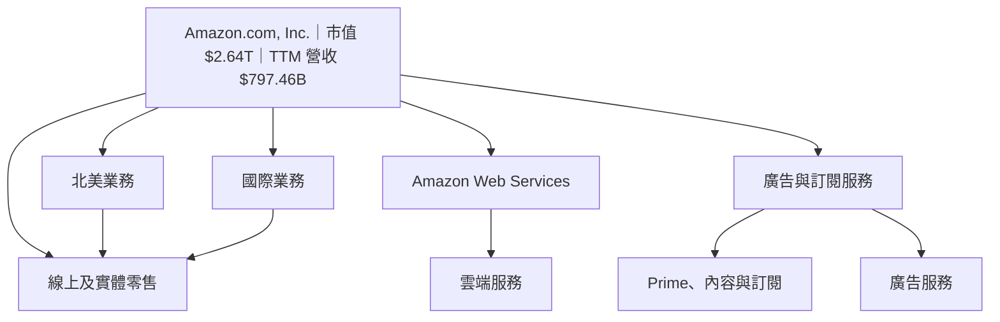
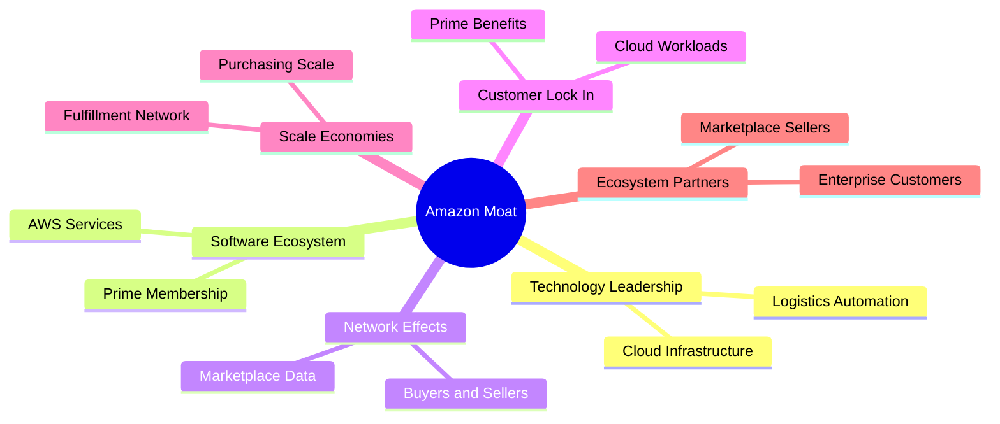
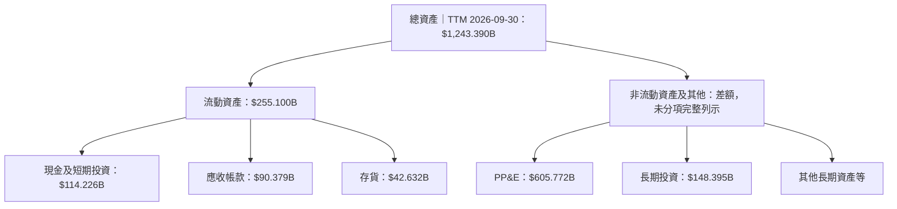
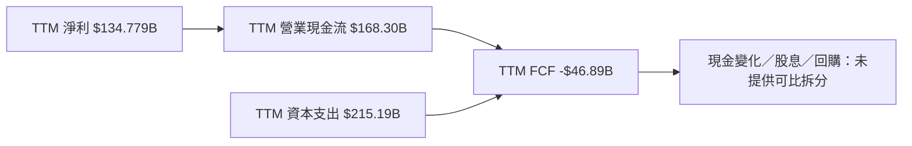
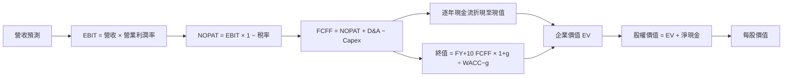
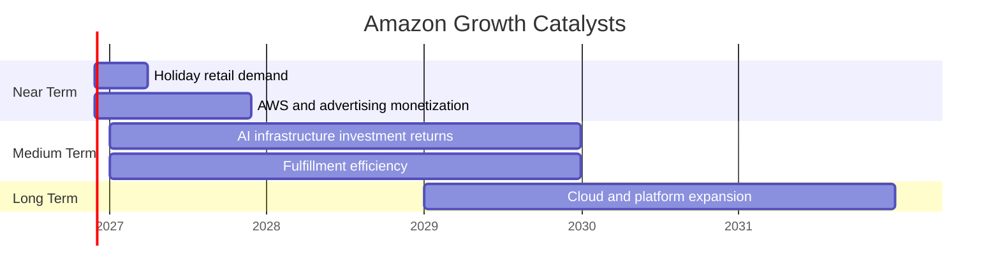
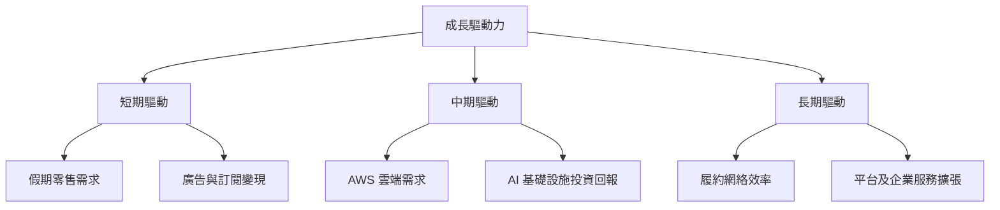
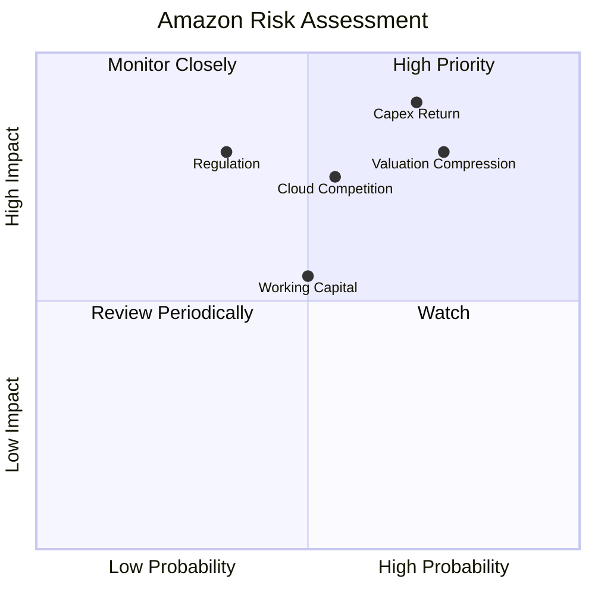
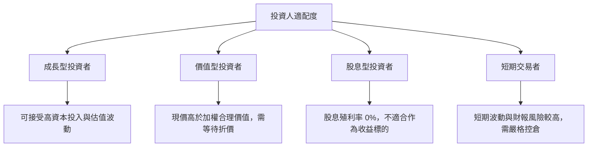

# AMZN 基本面深度分析報告
> **報告日期**：2026-11-27 ｜ **語言**：繁體中文 ｜ **數據來源**：SEC 申報資料 (XBRL)、Yahoo Finance、Finviz、StockAnalysis、Roic.ai ｜ **分析師**：CFA 級機構研究

## 目錄

| # | 章節 | 核心結論 |
|---|------|----------|
| 1 | 執行摘要 | 賣出；加權合理價值 $185.68；MOS -31.6% |
| 2 | 公司概覽與商業模式 | 多業務平台具規模與客戶鎖定，但各板塊收入占比未提供 |
| 3 | 損益表深度分析 | TTM 營收 $797.46B、成長 15.4%；最新季營業利益率 13.9% |
| 4 | 資產負債表分析 | 淨負債 $65.73B；流動比率約 0.99 |
| 5 | 現金流量深度分析 | TTM FCF -$46.89B，主要受高額資本支出影響 |
| 6 | 獲利能力與資本效率 | ROIC 11.9% 高於 WACC 10.85%，仍有正價差 |
| 7 | 相對估值分析 | P/E 低於部分同業，但 DCF 與加權價值均低於現價 |
| 8 | DCF 內在價值評估 | 基準 DCF $56.75；估值高度依賴終值與投資回報 |
| 9 | 成長催化劑 | AWS、廣告與 AI 相關需求具潛力，分部數字不足以量化 |
| 10 | 風險矩陣 | 資本支出回報、估值與競爭為主要風險 |
| 11 | 投資建議 | 賣出；以估值回落及 FCF 改善作為重新評估條件 |

---

## 1. 執行摘要

### 1.0 一頁式投資儀表板

| 項目 | 內容 |
|------|------|
| **投資論點（3 句）** | ① TTM 營收 $797.46B、年增 15.4%，顯示平台仍在擴張。② ROIC 11.9% 高於 WACC 10.85%，現階段仍創造正經濟價值。③ TTM 資本支出 $215.19B 高於營業現金流 $168.30B，令 FCF 降至 -$46.89B，回報率與投資節奏是估值核心。 |
| **綜合評分** | **6.0/10**（引用 1.1） |
| **財務健康** | 🟡 現金及短期投資 $114.23B，但淨負債 $65.73B、流動比率約 0.99 |
| **ROIC vs WACC** | 11.9% vs 10.85%；正價差 1.05 個百分點 |
| **FCF 趨勢** | TTM FCF 為 -$46.89B；FCF Yield -1.77%，高資本支出壓低近期現金回收 |
| **估值** | Forward P/E 22.37x ｜ EV/EBITDA 15.42x ｜ FCF Yield -1.77% |
| **DCF 內在價值（基準）** | $56.75 ｜ 相對 DCF 溢價 **330.7%** |
| **安全邊際（MOS）** | **-31.6%**＝($185.68 − $244.43) ÷ $185.68；🔴 無安全邊際 |
| **預期報酬（基準情境 12M）** | DCF 基準情境對現價為 **-76.8%**；此為模型情境差距，不是短期價格預測 |
| **關鍵風險（前二）** | 巨額資本支出無法及時轉成現金流；零售競爭、監管與雲端競爭壓縮利潤 |
| **評級 + 信心度** | 🔴 **賣出** ｜ 信心：中；模型對終值及再投資假設敏感 |

### 1.1 綜合評分卡（全報告唯一）

| 維度 | 評分（1–10） | 主要依據（引用數字與其來源章節） |
|------|--------------|----------------------------------|
| 成長性 | 8.0 | TTM 營收成長 15.4%、最新季年增 12.1%（第 3 章） |
| 獲利能力 | 7.0 | TTM 營業利益率 13.1%、ROIC 11.9% 高於 WACC 10.85%；F-Score 4/8（第 6 章） |
| 財務健康 | 5.0 | 淨負債 $65.73B；流動比率 0.989；DSO 由 32 天升至 45 天（第 4 章） |
| 估值 | 2.0 | MOS -31.6%；DCF 基準值 $56.75，低於現價 $244.43（第 8 章） |
| 護城河 | 8.0 | TTM 營收 $797.46B、三類主要業務及平台規模提供規模與客戶黏著（第 2 章） |
| 管理層與資本配置 | 6.0 | FY2025 SBC $19.47B；TTM Capex $215.19B、TTM FCF -$46.89B，投資回收仍待驗證（第 5 章） |
| **綜合評分** | **6.0** | 六項算術平均： (8.0 + 7.0 + 5.0 + 2.0 + 8.0 + 6.0) ÷ 6 = 6.0 |

### 1.2 五大投資論點 + 三大核心風險

| 類型 | 項目 | 具體依據 | 信心度 |
|------|------|----------|--------|
| 🟢 **投資論點①** | 收入仍具雙位數成長 | TTM 營收 $797.46B、年增 15.4%；最新季年增 12.1% | 🟢 高 |
| 🟢 **投資論點②** | 營業槓桿持續存在 | FY2022 至 FY2025 營業利益由 $12.25B 升至 $79.97B | 🟢 高 |
| 🟢 **投資論點③** | ROIC 高於資本成本 | ROIC 11.9% vs WACC 10.85%，價差 +1.05pp | 🟡 中 |
| 🟢 **投資論點④** | 多元業務提供交叉支撐 | 零售、廣告、訂閱與 AWS 並行；分部營收數據未提供 | 🟡 中 |
| 🟢 **投資論點⑤** | 現金資源仍具規模 | 現金及短期投資 $114.23B | 🟢 高 |
| 🟡 **風險①** | 資本支出高於營業現金流 | TTM Capex $215.19B，高於 OCF $168.30B；FCF -$46.89B | 🔴 高衝擊 |
| 🔴 **風險②** | 現價高於模型合理價值 | 加權合理價值 $185.68，現價 $244.43；MOS -31.6% | 🔴 高 |
| 🟡 **風險③** | 應收帳款天數上升 | DSO 由 32 天升至 45 天，可能反映收款週期拉長 | 🟡 中 |

### 1.3 快速統計卡片

| 指標 | 公司實際值（期間） | 同業中位數 | 狀態 |
|------|--------------------|------------|------|
| 營收成長（TTM） | **15.4%** | — | 🟢 |
| 營收成長（最新一季年增） | **12.1%** | 18.8% | 🟡 |
| 毛利率（TTM） | **51.4%** | 60.9% | 🟡 |
| 營業利益率（TTM） | **13.1%** | — | 🟢 |
| ROIC（TTM） | **11.9%** | — | 🟢 |
| Forward P/E | **22.37x** | 20.2x | 🟡 |
| FCF Yield（TTM） | **-1.77%** | — | 🔴 |
| Piotroski F-Score | **4 / 8** | — | 🟡 |

### 1.4 投資結論

╔══════════════════════════════════════════════════════════════════╗  
║                    📊 投資結論摘要                               ║  
╠══════════════════════════════════════════════════════════════════╣  
║ 評級：賣出（依 MOS -31.6%）                                      ║  
║ 價格（2026-11-25 收盤）：$244.43                                ║  
║ DCF 內在價值（基準）：$56.75（現價溢價 330.7%）                 ║  
║ 安全邊際 MOS：-31.6%（加權合理價值分母）                        ║  
║ 加權合理價值（8.8）：$185.68                                    ║  
║ DCF 情境價值：悲觀 $12.98（-94.7%）｜基準 $56.75（-76.8%）      ║  
║               樂觀 $130.52（-46.6%）                             ║  
║ 綜合評分：6.0/10（引用 1.1）                                     ║  
║ 適合投資人：能承受高波動、並願意等待估值與現金流改善者           ║  
╚══════════════════════════════════════════════════════════════════╝

---

## 2. 公司概覽與商業模式

### 2.1 業務結構與收入來源

各業務板塊收入分拆未提供，因此不虛構營收占比或金額。

零售提供流量與履約網絡，AWS 提供雲端服務，廣告與訂閱則可利用既有客戶觸及及平台流量變現。各板塊最新營收、營業利益及成長率未提供，不宜將集團整體成長率直接套用到個別板塊。

### 2.2 市場份額

市場份額數據未提供。以營收規模觀察，AMZN TTM 營收 $797.46B，最新季營收年增 12.1%；相較資料所列 Walmart 最新季成長 5.2%，AMZN 的集團成長較快，但兩者業務組合不同，不能直接視為份額變化。

### 2.3 競爭護城河分析

### 2.4 護城河強度

| 護城河項目 | 強度（強／中／弱） | 證據（引用數字或事實） | 會削弱它的情況 |
|------------|--------------------|------------------------|----------------|
| 技術與雲端能力 | 強 | AWS 為集團主要業務板塊之一；分部數字未提供 | 雲端價格競爭、AI 投資回報不佳 |
| 軟體生態系統 | 中至強 | AWS、Prime、廣告及零售服務共同觸及客戶 | 客戶轉換成本降低或服務價值下降 |
| 網路效應 | 強 | 零售平台連結買家與第三方賣家 | 賣家流失、平台信任下降 |
| 客戶鎖定 | 中至強 | Prime、雲端工作負載與履約服務增加黏著 | 訂閱成本提高或替代服務增多 |
| 規模效應 | 強 | TTM 營收 $797.46B；員工 1,638,000 人 | 固定成本上升、效率未跟上規模 |
| 生態夥伴 | 中 | 第三方賣家及企業客戶參與平台 | 監管限制或夥伴轉向競爭平台 |

1.1「護城河」評分 8.0，理由是零售、雲端、廣告與訂閱形成多面平台，但分部獲利及客戶留存數據不足，不能視為無風險。

---

## 3. 損益表深度分析

### 3.1 年度收入成長趨勢（近 4 年）

╔══════════════════════════════════════════════════════════════════╗  
║              Amazon 年度收入趨勢（FY2022–FY2025）                ║  
╠══════════════════════════════════════════════════════════════════╣  
║ FY2022 $513.98B  ██████████████░░░░░░░░░░ YoY：—                 ║  
║ FY2023 $574.78B  ████████████████░░░░░░░░ YoY：+11.8% 🟢         ║  
║ FY2024 $637.96B  ██████████████████░░░░░░ YoY：+11.0% 🟢         ║  
║ FY2025 $716.92B  ████████████████████░░░░ YoY：+12.4% 🟢         ║  
╠══════════════════════════════════════════════════════════════════╣  
║ FY2022–FY2025 收入 CAGR：約 +11.7%                                ║  
╚══════════════════════════════════════════════════════════════════╝  

收入擴張來自零售、雲端及服務業務合計；因各分部數字未提供，無法量化各驅動項貢獻。TTM 成長 15.4% 高於近三年年增區間，若能延續，將支持營業利益絕對額成長，但不保證現金流同步改善。

### 3.2 季度收入趨勢分析

| 季度 | 營收（$B） | QoQ | YoY | 備註 |
|------|-----------:|----:|----:|------|
| 2025 Q4 | 213.386 | +18.4% | +13.6% | 季節性旺季 |
| 2026 Q1 | 181.519 | -14.9% | +16.6% | 旺季後回落，年增仍高 |
| 2026 Q2 | 200.606 | +10.5% | +19.6% | 季度收入回升 |
| 2026 Q3 | 201.944 | +0.7% | +12.1% | QoQ 放緩，YoY 仍雙位數 |

QoQ 為本季除以前季減一；旺季季節性使季度環比不宜直接外推。最新季 YoY 低於 Q1、Q2，需觀察是否為基期或需求降速。

### 3.3 利潤率演變分析

| 利潤率指標 | FY2022 | FY2023 | FY2024 | FY2025 | 趨勢 | 評估 |
|------------|-------:|-------:|-------:|-------:|------|------|
| 毛利率 | 43.8% | 47.0% | 48.9% | 50.3% | 上升 | 🟢 |
| 營業利益率 | 2.4% | 6.4% | 10.8% | 11.2% | 明顯上升 | 🟢 |
| 淨利率 | -0.5% | 5.3% | 9.3% | 10.8% | 回升 | 🟢 |

FY2022 至 FY2025 營業利益由 $12.25B 增至 $79.97B，反映收入規模擴大及成本效率改善。TTM 營業利益率為 13.1%，最新季為 13.9%；但高額資本投入可能使折舊與履約成本未來增加，利潤率能否再擴張需以後續季度驗證。以上年率按年度營收及營業利益計算。

### 3.4 費用結構分析

費用明細與分部成本未提供足以拆分的同期間資料，故不繪製費用圓餅圖或估算費用比例。可確認的是 TTM Capex $215.19B，屬資本支出而非當期營業費用；折舊負擔會在後續期間進入損益。

### 3.5 季度 EPS 趨勢與盈餘品質（Quality of Earnings）

| 盈餘品質項目 | 數值／佔比 | 評估 |
|--------------|-----------|------|
| 股權薪酬 SBC / 營收 | FY2025：$19.47B ÷ $716.92B = 2.7% | 🟡 持續稀釋股東權益 |
| SBC / 營業現金流 | FY2025：$19.47B ÷ $139.51B = 14.0% | 🟡 佔現金流比例不低 |
| FCF / 淨利（現金轉換率） | TTM：-$46.89B ÷ $134.779B = -34.8% | 🔴 投資期現金轉換偏弱 |
| 一次性／非經常性損益 | 明細未提供 | N/A，無法判斷對當期盈餘影響 |
| 有效稅率異常 | N/A | 稅率資料未提供，無法定量 |
| 資本化支出 vs 費用化 | TTM Capex $215.19B | 高投入增加資產並延後以折舊進入費用的時間；模型不作額外調整 |

過去四季 EPS beats/misses 的估值與實際 EPS 均為 N/A，因此不能判定超預期或不及預期。已披露的最新季 EPS 年增 -3.1%，淨利年增 -2.4%；即使收入仍成長，單季盈餘下滑顯示成本、投資或其他損益可能抵銷部分收入增長。TTM FCF 為負，反映高資本支出的現金成本；現階段 GAAP 獲利不等同可分配現金。

---

## 4. 資產負債表分析

### 4.1 資產結構分解

資料來源為 StockAnalysis 資產負債表；與其他彙整來源的資產分類可能不同，且總資產中有未單獨展示項目。

### 4.2 流動性與營運資金分析

| 指標 | 最新 TTM | 一年前 TTM | 變化 | 解讀 |
|------|----------|------------|------|------|
| DSO 應收帳款天數 | 45 天 | 32 天 | +13 天 | 收款天數增加，需觀察信用條件與應收成長 |
| DIO 存貨天數 | N/A | N/A | N/A | 公司未提供可計算所需資料 |
| DPO 應付帳款天數 | N/A | N/A | N/A | 公司未提供可計算所需資料 |
| CCC 現金轉換週期 | N/A | N/A | N/A | DIO、DPO 缺漏，不能補算 |

FY2025 年報列示流動資產 $229.08B、流動負債 $218.00B，流動比率約 1.05；另一來源列示最新比率 0.989。口徑及期點不同，應以最新季度資料為主，流動性不寬裕但現金及短期投資仍達 $114.23B。

### 4.3 債務結構分析

╔══════════════════════════════════════════════════════════════════╗  
║                   Amazon 債務健康診斷                           ║  
╠══════════════════════════════════════════════════════════════════╣  
║ 總債務：              $179.95B                                   ║  
║ 現金及短期投資：      $114.23B                                   ║  
║ 淨負債：               $65.73B                                   ║  
║ Debt/EBITDA：          N/A（口徑資料不一致，不自行推算）          ║  
║ 利息保障倍數：         N/A（利息費用未提供）                     ║  
╚══════════════════════════════════════════════════════════════════╝  

注意：其他彙整表列示總債務 $304.84B，與 SEC 申報計算區塊採用的 $179.95B 不一致。本報告涉及淨負債及估值橋接時，依 SEC 計算口徑引用淨負債 $65.73B，不混用兩組債務數字。

### 4.4 股東權益趨勢

╔══════════════════════════════════════════════════════════════════╗  
║                   股東權益趨勢（年度）                           ║  
╠══════════════════════════════════════════════════════════════════╣  
║ FY2022  $146.04B  ████████░░░░░░░░░░░░                           ║  
║ FY2023  $201.88B  ███████████░░░░░░░░░                           ║  
║ FY2024  $285.97B  ████████████████░░░░                           ║  
║ FY2025  $411.06B  ████████████████████                           ║  
╚══════════════════════════════════════════════════════════════════╝  

股東權益增加主要反映累積獲利與資產負債表擴張；FY2025 對 FY2024 增加約 43.7%。該數字不等同每股價值成長，仍須一併考慮股數增加與資本報酬率。

---

## 5. 現金流量深度分析

### 5.1 現金流量瀑布圖

淨利及股息／回購的最新一致期間明細不足；以下呈現可確認的 TTM 現金流關係，不以缺漏數字補值。

### 5.2 FCF 轉換率趨勢

| 財年 | FCF（$B） | 淨利（$B） | FCF / 淨利 | 趨勢 |
|------|----------:|-----------:|-----------:|------|
| 2022 | -16.89 | -2.72 | 不具經濟解讀 | 🔴 |
| 2023 | 32.22 | 30.43 | 105.9% | 🟢 |
| 2024 | 32.88 | 59.25 | 55.5% | 🟡 |
| 2025 | 7.70 | 77.67 | 9.9% | 🔴 |

FY2025 淨利增加但 FCF 明顯低於淨利，核心原因是資本支出增加：FY2025 Capex $131.82B，較 FY2024 $83.00B 為高。TTM 口徑則 Capex $215.19B、FCF -$46.89B。

### 5.3 自由現金流趨勢

╔══════════════════════════════════════════════════════════════════╗  
║                  自由現金流趨勢（年度）                          ║  
╠══════════════════════════════════════════════════════════════════╣  
║ FY2022  -$16.89B  ◀████████░░░░░░░░░░░░                         ║  
║ FY2023   $32.22B  ████████████████████                          ║  
║ FY2024   $32.88B  ████████████████████                          ║  
║ FY2025    $7.70B  █████░░░░░░░░░░░░░░░                           ║  
║ TTM      -$46.89B ◀████████████████████                         ║  
╠══════════════════════════════════════════════════════════════════╣  
║ TTM FCF Yield：-1.77%                                            ║  
╚══════════════════════════════════════════════════════════════════╝  

年報與 TTM 的資本支出口徑及期間不同，不應將 FY2025 的正 FCF 外推為目前狀態；最新 TTM 顯示投資現金流出已超過營運現金流。

### 5.4 資本配置評估

回購、股息及留存的同期間金額未完整提供，因此不畫比例圖。FY2025 Capex $131.82B、SBC $19.47B；公司無現金股息，股息殖利率 0%。目前資本配置的主要檢驗點是新增資本支出能否提升 AWS、履約或 AI 相關業務的增量回報。

---

## 6. 獲利能力與資本效率

### 6.1 ROE / ROA / ROIC 趨勢

| 指標 | 最新資料 | 歷史比較 | 評估 |
|------|----------|----------|------|
| ROE | TTM 22.0%（品質指標口徑） | 另一彙整來源列示 27.4%，口徑不同 | 🟡 |
| ROA | 6.6% | 年度歷史序列未完整提供 | 🟡 |
| ROIC | TTM 11.9% | 完整歷年同口徑資料未提供 | 🟢 |
| 同業／行業均值 | 未提供 | 不列示 | — |

### 6.2 ROIC vs WACC 分析（核心價值創造判斷）

╔══════════════════════════════════════════════════════════════════╗  
║                ROIC vs WACC 深度分析                             ║  
╠══════════════════════════════════════════════════════════════════╣  
║ 無風險利率（10Y 美債）：4.85%                                    ║  
║ 市場風險溢酬：5.00% ｜原始 Beta：1.50｜調整後 Beta：1.34         ║  
║ 股權成本（資料計算值）：11.52%                                   ║  
║ 稅前債務成本：1.26%｜稅率：21.0%                                 ║  
║ 股權／債務權重：93.6%／6.4%                                      ║  
║ 採用 WACC：10.85%                                                ║  
║                                                                  ║  
║ ROIC：11.90%                                                     ║  
║ EVA 價差：11.90% − 10.85% = +1.05 個百分點                      ║  
║ 結論：ROIC 高於 WACC，現階段有創造股東價值，但價差有限。         ║  
╚══════════════════════════════════════════════════════════════════╝  

Beta 調整公式為 ⅔ × 1.50 + ⅓ = 1.33，資料採用調整後 1.34。成本資本資料列示 Ke 11.52%，但以顯示至兩位小數的 Rf、Beta、ERP 代入 CAPM 得 4.85% + 1.34 × 5.00% = 11.55%；差異為輸入精度或取整差異。本報告依規則採用既定 WACC 10.85%，不另行重算替代 WACC。

### 6.3 杜邦三因素分解

| 因素 | 數值（TTM） | 解讀 |
|------|-------------|------|
| 淨利率 | 16.9% | 高淨利率對 ROE 有正向貢獻 |
| 資產週轉率 | 0.64 | 大型資產基礎下，週轉率相對較低 |
| 權益乘數 | 2.03 | 槓桿提供部分放大，但非唯一來源 |
| **ROE** | **22.0%** | 16.9% × 0.64 × 2.03 ≈ 22.0% |

### 6.4 財務體質：Piotroski F-Score

**Piotroski F-Score：4 / 8**；毛利率測試缺少資料而不計入分母。

| 測試 | 結果 | 解讀 |
|------|------|------|
| ROA > 0 | ✅ 通過 | TTM 資產報酬為正 |
| 營業現金流 > 0 | ✅ 通過 | TTM OCF $168.30B |
| ROA 高於一年前 | ✅ 通過 | 獲利資產效率改善 |
| 營業現金流 > 淨利 | ✅ 通過 | 應計品質測試通過 |
| 長期負債／總資產低於一年前 | ❌ 未通過 | 負債相對資產未改善 |
| 流動比率高於一年前 | ❌ 未通過 | 短期流動性指標未改善 |
| 稀釋股數未增加 | ❌ 未通過 | 股數增加可能稀釋每股權益 |
| 毛利率高於一年前 | — 無法判定 | 缺少同口徑資料 |
| 資產週轉率高於一年前 | ❌ 未通過 | 資產擴張未同步帶來週轉改善 |

---

## 7. 相對估值分析

### 7.1 同業估值比較表格

| 估值指標 | **AMZN** | **MSFT** | **GOOG** | **WMT** | AMZN 評估 |
|----------|---------:|---------:|---------:|--------:|-----------|
| Trailing P/E | 19.8x | 25.6x | 14.2x | 47.8x | 🟡 介於同業之間 |
| Forward P/E | 22.37x | 20.2x | 17.7x | 40.9x | 🟡 高於 MSFT、GOOG |
| P/S Ratio | 3.3x | 10.5x | 7.1x | 1.4x | 🟢 低於科技同業，高於零售同業 |
| EV/EBITDA | 14.9x¹ | 18.0x | 17.4x | 23.0x | 🟢 相對較低 |
| 最新季營收年增 | 12.1% | 18.8% | 24.7% | 5.2% | 🟡 低於雲端／科技同業 |

¹ AMZN 自身歷史區間表列 14.9x；另一彙整市場資料列 15.424x，依同業比較規則採用歷史估值區間所列 14.9x。各同業商業組合不同，倍數差異不可只作單一排名。

### 7.2 歷史估值區間分析

╔══════════════════════════════════════════════════════════════════╗  
║              AMZN 五年估值位置（TTM）                            ║  
╠══════════════════════════════════════════════════════════════════╣  
║ P/E：      2.6x ───── 中位數 32.2x ─── 現值 19.8x                ║  
║            現值百分位：30%                                       ║  
║ P/S：      0.2x ───── 中位數 3.0x ───── 現值 3.3x                ║  
║            現值百分位：67%                                       ║  
║ EV/EBITDA：0.7x ───── 中位數 17.3x ─── 現值 14.9x                ║  
║            現值百分位：19%                                       ║  
╚══════════════════════════════════════════════════════════════════╝  

P/E 與 EV/EBITDA 位於各自五年區間偏低位置，但 P/S 高於歷史中位數。歷史低分位不等於低估，尤其 TTM FCF 為負、投資週期仍高。

### 7.3 情境價值（Bear / Base / Bull）

| 情境 | 第 1 年營收成長 | 期末營業利潤率 | WACC | 每股價值 | 相對現價 | 機率 | 會發生的條件 |
|------|----------------|----------------|------|----------|----------|------|--------------|
| 🔴 悲觀 | 7.7% | 9.1% | 11.85% | $12.98 | -94.7% | 25% | 零售及雲端成長放緩、投資支出回報低且折現率上升 |
| 🟡 基準 | 15.4% | 10.8% | 10.85% | $56.75 | -76.8% | 50% | 起始成長延續後逐步降至 3%，利潤率回歸五年中位數 |
| 🟢 樂觀 | 23.0% | 11.8% | 9.85% | $130.52 | -46.6% | 25% | AWS／廣告成長加速、成熟利潤率較高且資本成本下降 |

情境價值及假設依 DCF 模型原值列示；即使樂觀情境，價值仍低於 2026-11-25 收盤價。

### 7.4 相對估值隱含價格區間

╔══════════════════════════════════════════════════════════════════╗  
║          估值方法隱含每股價值與現價 $244.43                      ║  
╠══════════════════════════════════════════════════════════════════╣  
║ DCF 基準 $56.75 ── Forward P/E $221.19 ── 現價 $244.43           ║  
║ EV/EBITDA $300.19 ── 分析師共識 $326.34                         ║  
╚══════════════════════════════════════════════════════════════════╝  

Forward P/E 使用同業中位數 20.2x × AMZN Forward EPS $10.93，得 $221.19；EV/EBITDA 使用同業中位數 18.0x 加回淨現金後得 $300.19。分析師共識目標價為 $326.34，來自 60 位分析師平均值，僅作參考。

---

## 8. DCF 內在價值評估（Discounted Cash Flow）

### 8.0 估值推理鏈（Thinking Logic）

**Step 1 — 價值來源與主導變數：**本模型以集團 TTM 營收 $797.46B 作為整體起點；北美、國際、AWS、廣告及訂閱的營收占比未提供，故不能可靠拆分占比。模型價值主要由未來 FCFF 及終值構成；終值現值占 EV 98.5%，因此 WACC、永續成長率及成熟期資本支出是估值主導變數。

**Step 2 — 模型選擇**

| 決策點 | 本報告採用 | 理由 | 曾考慮但否決 | 否決理由 |
|--------|-----------|------|--------------|----------|
| 現金流定義 | FCFF | 與 WACC 折現，推得企業價值 | FCFE | 需另行預測融資現金流 |
| 預測期 N | 10 年 | 模型固定設定，讓成長及 Capex 逐步回歸 | 5 年 | 高投資業務的轉換期可能未呈現完整 |
| 終值方法 | Gordon Growth | DCF 模型採用 | 退出倍數 | DCF 模型未提供退出倍數終值數字 |
| EBIT 基礎 | GAAP EBIT | 模型使用 GAAP 營業利益 | 非 GAAP | 避免剔除 SBC 後低估股東成本 |

**Step 3 — 高敏感度輸入的推導鏈**

- **營收成長：**錨點為 TTM 成長 15.4% → 以最新 TTM 成長作第一年起點，之後線性降至 3.0% → **採用 FY+1 15.4%、FY+10 3.0%** → 未採用全期固定 15.4%，因模型已將成熟期成長衰退納入。
- **期末營業利潤率：**錨點為 TTM 13.1%、近年營業利益率回升 → 模型以五個財年中位數為終點 → **FY+10 採用 10.8%** → 未採用永續維持 13.1%，因其高於模型採用的成熟期中位水準。
- **永續成長率 g：**錨點為模型採用的長期成熟成長假設 → **採用 3.0%**，低於 WACC 10.85% → 未採用較高長期成長，以避免終值分母過度縮小。
- **預測期 N：**錨點為模型設定 10 年 → 讓營收成長與 Capex 比率逐步淡出 → **採用 10 年** → 未採用更短期間，以免終值過早承接現金流。
- **Capex／營收：**TTM Capex $215.19B、營收 $797.46B，模型比率起點約 27.0% → 隨投資成熟而下降 → **FY+1 27.0% 線性淡出至 FY+10 10.9%** → 未採用將當前高 Capex 永續化，因模型假設投資強度回歸。
- **WACC：**以 10Y 美債 4.85%、調整後 Beta 1.34、ERP 5.00%及既定資本結構輸入為錨點 → 依成本資本資料 → **採用 10.85%** → 不另改用其他折現率。
- **終值方法：**模型採 Gordon Growth，基於終期 FCFF 及 3.0% 永續成長 → **採用 Gordon Growth** → 退出倍數法未提供模型輸出，故不能自行建模補值。
- **EBIT 與 SBC：**採 GAAP EBIT，SBC 已列入費用 → **不再從 FCFF 扣 SBC** → 否決非 GAAP 加回方案，避免重複處理。
- **年稀釋率：**模型設定固定股數 → **年稀釋率 0%** → SBC 成本已透過 GAAP 費用處理，模型不另放大股數。

有效稅率 21.0%為模型預設；D&A／營收固定 10.0%；營運資金不建模。這些採用值是模型設定，不代表公司承諾或管理層財測。

**Step 4 — 最脆弱環節：**終值占 EV 98.5%，若長期 Capex 未降至模型假設或 WACC 上升，DCF 會大幅下修；敏感度矩陣顯示基準 g 下，WACC 由 10.85%升至 11.85%時每股價值由 $56.75 降至 $44.20。

**Step 5 — 計算路徑**

### 8.1 模型假設總表（Model Inputs）

| 假設項目 | 採用值 | 依據／來源 | 敏感度 |
|----------|--------|-------------|--------|
| 預測期長度 N | 10 年 | DCF 模型設定 | 🟡 中 |
| 營收成長 | FY+1 15.4% → FY+10 3.0% | TTM 成長 15.4%，線性淡出 | 🔴 高 |
| 營業利潤率 | 13.1% → 10.8% | TTM 起點，末年回歸五年中位數 | 🔴 高 |
| 有效稅率 | 21.0% | 模型預設 | 🟢 低 |
| Capex／營收 | 27.0% → 10.9% | TTM 起點，淡出至 1.1 倍 D&A | 🔴 高 |
| D&A／營收 | 10.0% | TTM 模型假設，固定 | 🟢 低 |
| 營運資金變動 | 未建模 | DCF 模型不含 working capital | 🟢 低 |
| EBIT 基礎 | GAAP | 模型指定 | 🟡 中 |
| SBC 處理 | 組合 A：GAAP EBIT、固定股數 | SBC 已含在費用，不再扣減 | 🟡 中 |
| 年稀釋率 | 0% | 配合組合 A | 🟡 中 |
| 永續成長率 g | 3.0% | DCF 模型設定，低於 WACC | 🔴 高 |
| 終值方法 | Gordon Growth | 模型已計算 | 🔴 高 |
| WACC | 10.85% | 成本資本資料 | 🔴 高 |

**FCFF 定義：**FCFF = NOPAT + D&A − Capex。模型未納入營運資金變動，亦未另扣 SBC。本模型採用 **(A) GAAP EBIT + 固定股數**，故 SBC 影響已透過費用計入一次。

### 8.2 折現率推導（WACC）

╔══════════════════════════════════════════════════════════════════╗  
║                    WACC 推導（折現率）                           ║  
╠══════════════════════════════════════════════════════════════════╣  
║ Rf：4.85%｜ERP：5.00%｜原始 Beta：1.50｜調整後 Beta：1.34         ║  
║ Ke（成本資本資料）：11.52%                                       ║  
║ 稅前 Kd：1.26%｜稅率：21.0%｜稅後 Kd：0.9954%                   ║  
║ 股權／債務權重：93.6%／6.4%                                      ║  
║ 採用 WACC：10.85%                                                ║  
╚══════════════════════════════════════════════════════════════════╝  

逐步演算：

1. **Ke**：成本資本資料原值為 11.52%。顯示值代入 CAPM 得 `4.85% + 1.34 × 5.00% = 11.55%`；相差 0.03 個百分點，屬顯示精度不一致，依規則採用原列 11.52%。
2. **稅前 Kd**：直接採用成本資本資料 1.26%；利息費用及計息負債平均餘額未完整列示，不能獨立複算分子分母。
3. **稅後 Kd**：`1.26% × (1 − 21.0%) = 0.9954%`，約 1.00%。
4. **權重**：股權 93.6%、債務 6.4%，合計 `93.6% + 6.4% = 100.0%`。
5. **WACC**：`93.6% × 11.52% + 6.4% × 0.9954% = 10.78272% + 0.0637056% = 10.8464256%`，按資料採用 **10.85%**。

Rf 為所列 10Y Treasury 輸入，資料未列明觀察日；ERP 為假設值 5.00%。債務權重及債務成本直接採用成本資本資料，因缺少利息及同口徑計息債務明細，不以其他債務數字替代。第 6.2 節與本節均使用 WACC 10.85%。

### 8.3 逐年自由現金流預測（基準情境）

金額單位：$B。ΔWC 不建模；SBC 不另扣除。表格數字依 DCF 模型原值照列。

| 年度 | FY+1 | FY+2 | FY+3 | FY+4 | FY+5 | FY+6 | FY+7 | FY+8 | FY+9 | FY+10 |
|------|-----:|-----:|-----:|-----:|-----:|-----:|-----:|-----:|-----:|------:|
| 營收 | 919.87 | 1,048.46 | 1,180.63 | 1,313.26 | 1,442.76 | 1,565.24 | 1,676.64 | 1,772.96 | 1,850.48 | 1,905.99 |
| 營收 YoY | 15.4% | 14.0% | 12.6% | 11.2% | 9.9% | 8.5% | 7.1% | 5.7% | 4.4% | 3.0% |
| 營業利潤率 | 13.1% | 12.8% | 12.6% | 12.3% | 12.0% | 11.8% | 11.5% | 11.3% | 11.0% | 10.8% |
| EBIT（GAAP） | 120.39 | 134.49 | 148.39 | 161.65 | 173.84 | 184.54 | 193.32 | 199.83 | 203.76 | 204.93 |
| − 稅 | (25.28) | (28.24) | (31.16) | (33.95) | (36.51) | (38.75) | (40.60) | (41.96) | (42.79) | (43.04) |
| NOPAT | 95.11 | 106.25 | 117.22 | 127.70 | 137.34 | 145.79 | 152.73 | 157.86 | 160.97 | 161.90 |
| + D&A | 91.53 | 104.33 | 117.48 | 130.68 | 143.57 | 155.75 | 166.84 | 176.42 | 184.14 | 189.66 |
| − Capex | (248.23) | (264.24) | (276.51) | (284.17) | (286.48) | (282.91) | (273.16) | (257.26) | (235.53) | (208.63) |
| **FCFF** | **-61.59** | **-53.66** | **-41.80** | **-25.79** | **-5.58** | **18.63** | **46.40** | **77.03** | **109.58** | **142.93** |
| 折現因子 | 0.902 | 0.814 | 0.734 | 0.662 | 0.597 | 0.539 | 0.486 | 0.439 | 0.396 | 0.357 |
| **FCFF 現值 PV** | **-55.56** | **-43.67** | **-30.69** | **-17.08** | **-3.33** | **10.04** | **22.56** | **33.78** | **43.35** | **51.01** |

預測期 PV 合計依模型為 $10.42B；按表內已四捨五入 PV 逐項相加為：
`-55.56 - 43.67 - 30.69 - 17.08 - 3.33 + 10.04 + 22.56 + 33.78 + 43.35 + 51.01 = 10.41B`。差異 $0.01B 為逐年四捨五入尾差。

**FY+1 逐步演算：**

1. 營收：`797.46 × (1 + 15.4%) = 919.87B`
2. EBIT：`919.87 × 13.1% = 120.39B`
3. 稅：`120.39 × 21.0% = 25.28B`
4. NOPAT：`120.39 − 25.28 = 95.11B`
5. D&A：`919.87 × 10.0% = 91.53B`
6. Capex：`919.87 × 約 27.0% = 248.23B`（依模型列示）
7. ΔWC：模型未建模，不另列扣減。
8. FCFF：依模型列示 `95.11 + 91.53 − 248.23 = -61.59B`；以表內四捨五入數字計算為 -61.59B。
9. 折現：`1 ÷ (1 + 10.85%)^1 = 0.902`；`-61.59 × 0.902 = -55.56B`（依模型精度）。

前三至第五年 FCFF 為負，表示模型假設的高資本支出暫時超過 NOPAT 與折舊加回，負值會抵減企業價值，而非被忽略。FY+10 FCF 利潤率為 `142.93 ÷ 1,905.99 = 7.5%`；現行 TTM FCF 利潤率為 `-46.89 ÷ 797.46 = -5.9%`。歷史年度 FCF 由 FY2024 $32.88B 降至 FY2025 $7.70B，歷史 FCF CAGR 因負值及波動不具可比性。

╔══════════════════════════════════════════════════════════════════╗  
║            自由現金流：歷史實際 vs 模型預測                      ║  
╠══════════════════════════════════════════════════════════════════╣  
║ FY2023（實） $32.22B  █████████░░░░░░░░░░░                       ║  
║ FY2024（實） $32.88B  █████████░░░░░░░░░░░                       ║  
║ FY2025（實）  $7.70B  ██░░░░░░░░░░░░░░░░░░░                       ║  
║ FY+1（預）  -$61.59B  ◀████████████████                         ║  
║ FY+10（預） $142.93B  ████████████████████                       ║  
╠══════════════════════════════════════════════════════════════════╣  
║ 預測期前段 FCF 為負，後段改善依賴 Capex／營收比率下降。           ║  
╚══════════════════════════════════════════════════════════════════╝  

### 8.4 終值計算（Terminal Value）

**適用性檢查：**`WACC 10.85% vs g 3.0% → WACC > g ✅`

| 方法 | 計算式 | 終值 TV | TV 現值 | 佔總 EV 比重 |
|------|--------|---------:|--------:|-------------:|
| Gordon Growth | 模型列示 | $1,874.51B | $668.94B | 98.5% |
| 退出倍數法 | N/A | N/A | N/A | N/A |

逐步演算依模型所列數字：
1. FY+10 FCFF = $142.93B。
2. 分子：`142.93 × (1 + 3.0%) = 147.2179B`。
3. 分母：`10.85% − 3.0% = 7.85%`；模型列示 TV 為 **$1,874.51B**。
4. PV(TV)：模型列示 `1,874.51 × 0.357 = $668.94B`。
5. 終值占比：`668.94 ÷ 679.36 = 98.5%`。

模型列示的終值算式經顯示精度複核存在尾數差異：以上述已顯示數字直接計算，`147.2179 ÷ 7.85%` 不精確等於 $1,874.51B，且 `$1,874.51 × 0.357` 不精確等於 $668.94B。依規則 19 保留模型原值，不自行改動；此處明確列為模型稽核差異。退出倍數終值未提供，不能自行補算。終值占 EV 98.5%，因此估值高度依賴終值假設，短期現金流貢獻有限。

### 8.5 企業價值 → 每股內在價值（Bridge）

╔══════════════════════════════════════════════════════════════════╗  
║              企業價值 → 每股內在價值 橋接表                      ║  
╠══════════════════════════════════════════════════════════════════╣  
║ 預測期 FCF 現值合計             +$10.42B                         ║  
║ 終值現值 PV(TV)                 +$668.94B                        ║  
║ = 企業價值 EV                    $679.36B                         ║  
║ + 淨現金（負數代表淨負債）       -$65.73B                         ║  
║ = 股權價值                       $613.63B                         ║  
║ 每股內在價值                     $56.75                           ║  
║ 現價（2026-11-25）               $244.43                          ║  
║ 折溢價（現價÷DCF價值−1）         +330.7% 溢價                    ║  
╚══════════════════════════════════════════════════════════════════╝  

1. EV：`10.42 + 668.94 = 679.36B`。
2. 股權價值：`679.36 − 65.73 = 613.63B`。
3. 每股價值：依模型換算列示 **$56.75**；模型採價格與市值比例橋接，非單純以股權價值除以財報股數。
4. 折溢價：`244.43 ÷ 56.75 − 1 = 330.7%`。
5. 本節不計算 MOS；MOS 僅在 8.8 以加權合理價值為分母計算。

模型橋接值與每股換算口徑依原模型照列。最新季稀釋股數 10.811B 股可由 Roic.ai 資料參考；但 DCF 模型明確使用價格乘股權價值除以市值的換算方式，因此不能另以該股數重算並取代 $56.75。

### 8.6 敏感性分析（WACC × 永續成長率）

| g（列）／WACC（欄） | 8.85% | 9.85% | **10.85%（基準）** | 11.85% | 12.85% |
|-----------|------:|------:|-------------------:|-------:|-------:|
| 2.0% | $81.09（-66.8%） | $62.90（-74.3%） | $49.23（-79.9%） | $38.67（-84.2%） | $30.35（-87.6%） |
| 2.5% | $88.16（-63.9%） | $67.81（-72.3%） | $52.76（-78.4%） | $41.29（-83.1%） | $32.33（-86.8%） |
| **3.0%** | $96.44（-60.6%） | $73.44（-69.9%） | **$56.75（-76.8%）** | $44.20（-81.9%） | $34.51（-85.9%） |
| 3.5% | $106.27（-56.5%） | $79.95（-67.3%） | $61.28（-74.9%） | $47.46（-80.6%） | $36.93（-84.9%） |
| 4.0% | $118.13（-51.7%） | $87.58（-64.2%） | $66.46（-72.8%） | $51.14（-79.1%） | $39.61（-83.8%） |

以上價值與敏感度矩陣依模型原值照列。模型亦未提供在每個矩陣格重新折現後的逐年現金流明細，因此不另造一格重算過程。矩陣顯示即使 g 提高至 4.0%，基準 WACC 下每股價值仍為 $66.46，低於現價。

**三情境 DCF**：依 7.3 的原始情境列示。模型提供每股價值、營收成長、期末利潤率及 WACC，但未提供各情境逐年營收、FCFF 及終值明細，故無法在不另建模型的情況下逐情境重建完整算式；不以估算值補入。機率加權值依模型為 $64.25。

**敏感度結論：**基準 g 下 WACC 從 9.85%升至 10.85%，價值由 $73.44 降至 $56.75，減少 $16.69、約 22.7%；從 10.85%升至 11.85%，價值由 $56.75 降至 $44.20，減少 $12.55、約 22.1%。基準 WACC 下 g 從 2.0%增至 3.0%，價值由 $49.23 升至 $56.75，增加 $7.52、約 15.3%；升至 4.0%則為 $66.46。敏感度支持 8.0 的判斷：折現率與終值假設是重要估值變數。

### 8.7 反推 DCF（Reverse DCF）

固定基準模型其餘條件，資料反推結果為：

| 求解變數 | 其餘變數固定 | 市場隱含值 | 基準模型 | 判斷 |
|----------|--------------|------------:|---------:|------|
| 第 1 年營收成長 | 利潤率等其餘基準值 | 46.5% | 15.4% | 🔴 現價要求顯著更高成長 |
| 固定營業利潤率 | 成長等其餘基準值 | 26.4% | 13.1% → 10.8% | 🔴 顯著高於基準 |
| 永續成長率 g | 未提供反解值 | 未計算 | 3.0% | N/A |
| 預測期 N | 未提供反解值 | 未計算 | 10 年 | N/A |

模型反推一項變數時，其餘變數固定。由於沒有模型提供的試算軌跡或上述兩個解的逐輪現金流，不能聲稱已獨立重現反解過程。結論是：在基準模型其他假設不變時，現價需依賴遠高於基準的第一年成長或固定營業利潤率，市場定價較模型基準樂觀。

### 8.8 估值三角驗證與安全邊際

| 估值方法 | 隱含每股價值 | 上行空間（÷現價） | 權重 | 說明 |
|----------|--------------:|------------------:|------:|------|
| DCF（基準） | $56.75 | -76.8% | 40% | 10 年 FCFF、WACC 10.85%、g 3.0% |
| 同業 Forward P/E | $221.19 | -9.5% | 25% | 同業中位數 20.2x × Forward EPS 10.93 |
| 同業 EV/EBITDA | $300.19 | +22.8% | 25% | 同業中位數 18.0x，加入淨現金 |
| 分析師共識目標價 | $326.34 | +33.5% | 10% | 60 位分析師平均目標價 |
| **加權合理價值** | **$185.68** | **-24.0%** | **100%** | — |

加權計算：  
`$56.75 × 40% + $221.19 × 25% + $300.19 × 25% + $326.34 × 10%`  
`= $22.70 + $55.2975 + $75.0475 + $32.634 = $185.679 ≈ $185.68`。  
此權重為獲利型公司固定方法權重；各方法均已計算，沒有剔除項目。

╔══════════════════════════════════════════════════════════════════╗  
║                  估值區間與安全邊際                              ║  
╠══════════════════════════════════════════════════════════════════╣  
║ $12.98 ─────── $130.52 ─────── $185.68 ─────── $244.43          ║  
║ 悲觀 DCF       樂觀 DCF         加權合理值       現價             ║  
║                                                                  ║  
║ MOS = ($185.68 − $244.43) ÷ $185.68 = -31.6%                    ║  
║ 上行空間 = ($185.68 − $244.43) ÷ $244.43 = -24.0%               ║  
║                                                                  ║  
║ 對應 MOS ≥ 10% 的買入價格上限：$185.68 × 90% = $167.11           ║  
║ 建議買入區間：低於 $167.11；現價 $244.43 不符合買入條件          ║  
║ 合理持有區間：$167.11–$185.68                                   ║  
║ 減碼考慮區間：高於 $185.68                                      ║  
╚══════════════════════════════════════════════════════════════════╝  

MOS -31.6% 依規則 20 對應 **賣出**。本報告未作質化上調或下調。

> 🔎 **程式複算（Python，依本節各項自動重算）**
>
> 加權合理價值 = $56.75 × 40% + $221.19 × 25% + $300.19 × 25% + $326.34 × 10% = **$185.68**（權重合計 100%）
>
> 以價格 $244.43 計：MOS = **-31.6%**，上行空間 = **-24.0%**
>
> ✅ 與本節所寫數值一致。

### 8.9 DCF 模型的局限與失效條件

- **終值依賴度：**PV(TV) 占 EV 98.5%，價值主要由 FY+10 之後的假設決定。
- **最脆弱假設：**Capex／營收由 27.0%降至 10.9%、g 3.0%；若投資強度不降，價值低於基準。
- **負 FCF 限制：**TTM FCF -$46.89B，處於高再投資階段，DCF 的短期可驗證性較弱；EV/EBITDA、同業 Forward P/E 及分部估值可作交叉參考，但不得取代規定模型。
- **模型適用性：**模型前五年 FCFF 為負，且營運資金未建模。若應收帳款與營收同步快速上升，實際現金需求可能高於模型。
- **風險連結：**雲端價格戰及 AI 投資回報不足會壓低 EBIT／提高 Capex；監管或零售競爭會使成長與利潤率假設下修。

### 8.10 複算檢核表（Audit Trail）

| # | 檢核項目 | 結果 |
|---|----------|------|
| 1 | 高／中敏感度輸入均有推導說明 | ✅ |
| 2 | 假設均列來源或模型依據 | ✅ |
| 3 | WACC 顯示輸入及加權結果 | ⚠️ Ke 顯示組成與原列差 0.03pp，已揭露並採用原列 WACC |
| 4 | Kd 分母及債務權重同口徑可獨立核對 | ⚠️ 利息與計息債務平均額未提供；採用既定成本資本輸入 |
| 5 | WACC 與第 6.2 節同為 10.85% | ✅ |
| 6 | 逐年表格共 10 年，無省略 | ✅ |
| 7 | FY+1 主要推導列示 | ✅ |
| 8 | PV 合計與表格逐項加總 | ✅；$0.01B 四捨五入差異 |
| 9 | WACC 10.85% > g 3.0% | ✅ |
| 10 | 終值採 FY+10 FCFF 並折現 10 期 | ✅（依模型原值） |
| 11 | EV 至股權價值橋接列示 | ✅ |
| 12 | SBC 組合 A 相容 | ✅ |
| 13 | 敏感度基準格等於 DCF 基準值 $56.75 | ✅ |
| 14 | 矩陣內均為 WACC > g 的有效格 | ✅ |
| 15 | 情境機率合計 100% | ✅ |
| 16 | 反推 DCF 每列只放開一個變數 | ✅；模型未提供逐輪軌跡 |
| 17 | MOS 分母為加權合理價值，折溢價基準為 DCF | ✅ |
| 18 | 報告完整至第 11 章 | ✅ |
| 19 | 加權合理價值由方法價值乘權重加總 | ✅ |
| 20 | 評級依 MOS 門檻 | ✅ 賣出 |

模型終值公式與顯示數字存在尾數差異，且缺少退出倍數終值及情境逐年現金流細項；依規則照列原模型值並降低 DCF 可稽核性的信心，不以自行建模掩蓋差異。

---

## 9. 成長催化劑

### 9.1 催化劑時間軸

時間範圍為研究追蹤期而非公司財測。新聞資料提及假期購物季與 AI 相關競爭，但未提供足以量化增量收入的數據。

### 9.2 TAM 市場規模分析

N/A（TAM 數據未提供）。公司 TTM 營收 $797.46B、成長 15.4%，顯示可觀營收基礎；但未提供可引用的市場規模、滲透率或公司市場份額，故不估算 TAM。

### 9.3 成長驅動力結構圖

---

## 10. 風險矩陣

### 10.1 風險評分矩陣

機率與衝擊座標為分析師定性評估，並非公司財務數據。

### 10.2 風險清單詳細分析

| # | 風險項目 | 發生機率 | 財務衝擊 | 風險評分 | 緩解措施 |
|---|----------|----------|----------|----------|----------|
| 1 | 🔴 資本支出回報不足 | 中高（分析師估計 60%） | 高：TTM FCF 已為 -$46.89B | 🔴 8.5/10 | 追蹤 Capex／營收、AWS 增量營業利益及 FCF |
| 2 | 🔴 估值收縮 | 中高（分析師估計 65%） | 高：加權價值 $185.68，較現價低 24.0% | 🔴 8.0/10 | 分批控倉，價格回落至估值區間再重估 |
| 3 | 🟡 雲端及 AI 競爭 | 中（分析師估計 50%） | 高：影響 AWS 成長與利潤率 | 🟠 7.5/10 | 監控 AWS 季度成長、利潤與投資回報 |
| 4 | 🟡 監管與反壟斷 | 中低（分析師估計 35%） | 高：可能限制平台做法或提高合規成本 | 🟠 7.0/10 | 追蹤監管裁決、訴訟與平台政策變化 |
| 5 | 🟡 營運資金與收款週期 | 中（分析師估計 50%） | 中：DSO 由 32 天升至 45 天 | 🟡 5.5/10 | 追蹤應收帳款增幅是否持續高於營收 |

---

## 11. 投資建議

### 11.1 最終評級與評分

依加權合理價值 $185.68、現價 $244.43 計算，MOS 為 -31.6%，依規則 20 評級為 **賣出**，未作一級調整。公司品質綜合評分為 **6.0/10**，六項分數依序為成長性 8.0、獲利能力 7.0、財務健康 5.0、估值 2.0、護城河 8.0、管理層與資本配置 6.0。

### 11.2 合理價值與隱含報酬率

| 估值項目 | 每股價值 | 相對現價 | 機率 |
|----------|---------:|---------:|-----:|
| 加權合理價值 | $185.68 | -24.0% | — |
| DCF 悲觀情境 | $12.98 | -94.7% | 25% |
| DCF 基準情境 | $56.75 | -76.8% | 50% |
| DCF 樂觀情境 | $130.52 | -46.6% | 25% |
| DCF 機率加權參考值 | $64.25 | -73.7% | — |

### 11.3 買入時機與觸發因素

╔══════════════════════════════════════════════════════════════════╗  
║                  ✅ 買入觸發因素 Checklist                       ║  
╠══════════════════════════════════════════════════════════════════╣  
║ 重新評估買入前，建議同時觀察：                                   ║  
║ ☐ 股價回落至 $167.11 以下，達加權合理價值 10% MOS 門檻           ║  
║ ☐ TTM FCF 回正，且不單靠暫時性營運資金釋放                       ║  
║ ☐ Capex／營收下降並伴隨營業利益率維持或提升                      ║  
║                                                                  ║  
║ 加碼觸發條件：                                                   ║  
║ ☐ AWS 或廣告成長與利潤改善有可核對的季度披露                     ║  
║ ☐ ROIC 持續高於 WACC，且差距不只依賴短期稅務或一次性項目         ║  
║                                                                  ║  
║ 減碼／停損觸發條件：                                             ║  
║ ☐ FCF 持續為負且 Capex 投資回報無法改善                          ║  
║ ☐ ROIC 跌破 WACC 10.85%                                          ║  
║ ☐ 最新季營收年增連續兩季低於 8%，或營業利益率較 13.9% 收縮 2pp   ║  
╚══════════════════════════════════════════════════════════════════╝

### 11.4 投資人適配度分析

### 11.5 每季財報監控清單（Quarterly Watch List）

| 監控指標 | 最新基準 | 加碼觸發條件 | 減碼觸發條件 |
|----------|----------|--------------|--------------|
| 集團營收年增 | 最新季 12.1% | 維持 ≥12% 且連續改善 | 連續兩季 <8% |
| 營業利益率 | 最新季 13.9% | 維持或提高 | 連續兩季低於 11.9% |
| TTM FCF | -$46.89B | 轉正並有營運現金流支持 | 持續惡化且 Capex 不下降 |
| TTM Capex | $215.19B | 投資強度下降且產出改善 | 支出上升但營收／利潤未跟上 |
| DSO | 45 天 | 回落並接近一年前 32 天 | 再上升至少 5 天 |
| 稀釋股數 | F-Score 測試未通過 | 股數趨穩或回落 | 股數持續上升且回購抵銷不足 |
| 財測／投資回報 | 未提供 | 管理層披露項目回報改善 | 下修成長或新增大型低回報投資 |

### 11.6 反面論證：什麼會證明論點錯誤（What Would Change My Mind）

╔══════════════════════════════════════════════════════════════════╗  
║              ⚠️ 論點失效條件（Disconfirming Evidence）            ║  
╠══════════════════════════════════════════════════════════════════╣  
║ ☐ 營收年增連續兩季低於 8%，且 AWS／廣告不能抵銷零售放緩          ║  
║ ☐ 營業利益率由最新季 13.9% 下滑超過 2 個百分點並持續兩季         ║  
║ ☐ TTM FCF 持續為負，Capex／營收下降仍未改善現金流                ║  
║ ☐ ROIC 跌破 WACC 10.85%，顯示增量投資開始摧毀價值                ║  
║ ☐ DSO 再升至少 5 天，且應收帳款增速持續高於營收                  ║  
║ ☐ 稀釋股數持續增加，且利潤增長無法抵銷每股價值稀釋               ║  
╚══════════════════════════════════════════════════════════════════╝  

> **免責聲明**：本報告為 AI 自動生成，僅供研究參考，不構成投資建議。投資有風險，入市需謹慎。

---

## 資料與來源

| 項目 | 內容 |
|------|------|
| 價格 | 244.43 USD，2026-11-25 收盤（Yahoo Finance 日線） |
| 財務報表 | SEC 10-Q filed 2026-10-30，最新季度 2026-09-30（FY2026 Q3） |
| 有回應的資料來源 | SEC 申報資料 (XBRL)、Yahoo Finance、Finviz、StockAnalysis、Roic.ai |
| 由程式計算 | TTM 數字、WACC、DCF 模型、估值方法與權重、加權合理價值、MOS、評級門檻、F-Score、杜邦分解、營運資金天數、綜合評分 |
| 撰寫模型 | openai / gpt-6-luna |

> 本區塊由產生報告的程式依實際取得的資料填寫，非模型撰寫。「由程式計算」的數字不是模型的估計；其餘判斷（評分、情境、策略）是模型的分析。
