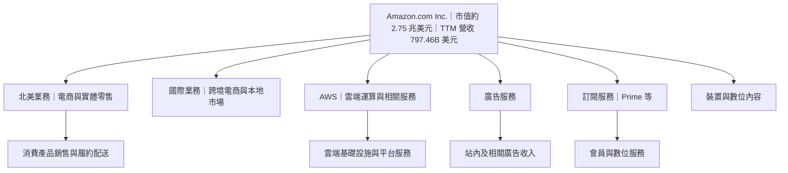
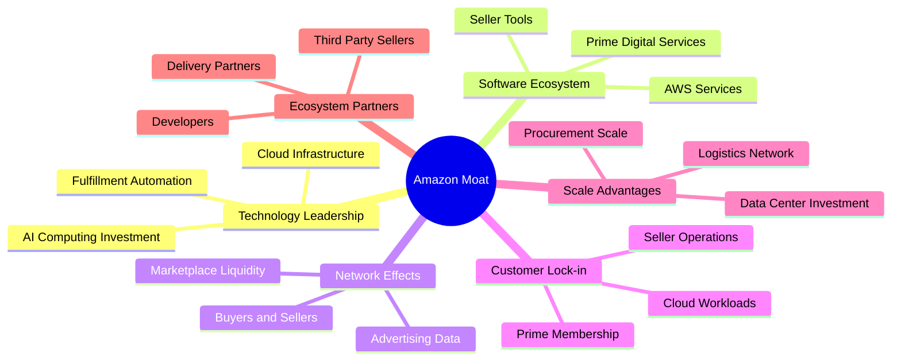
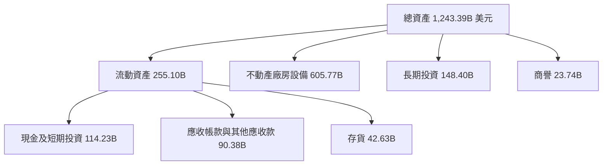
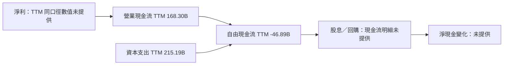
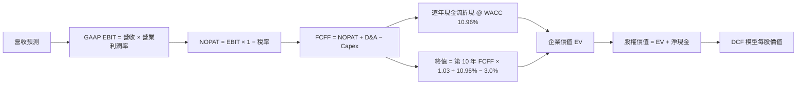
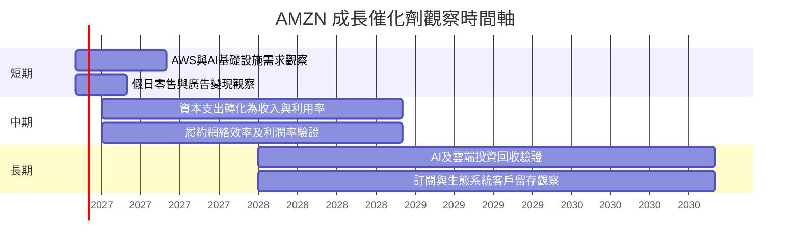
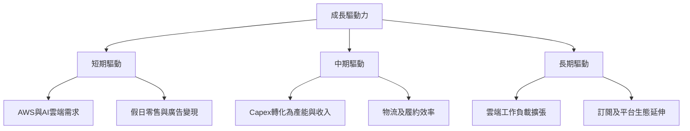
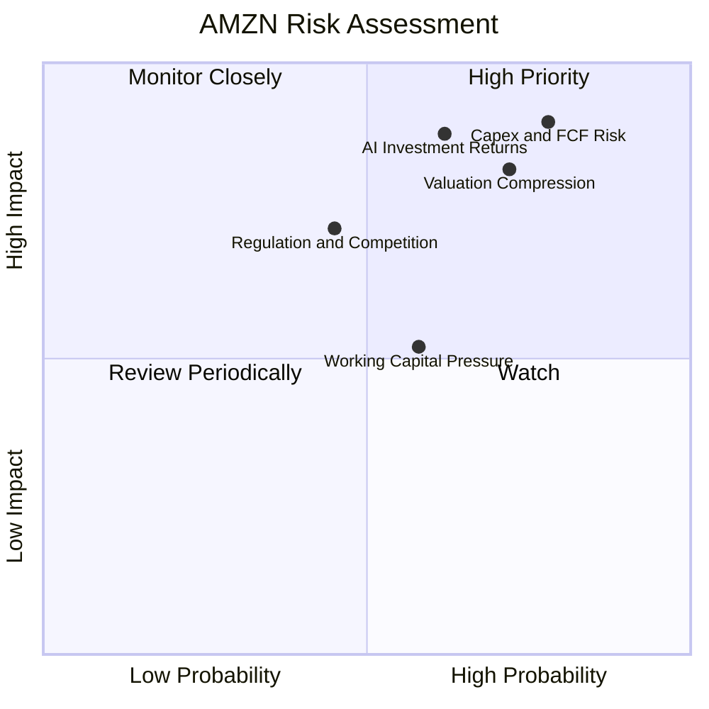
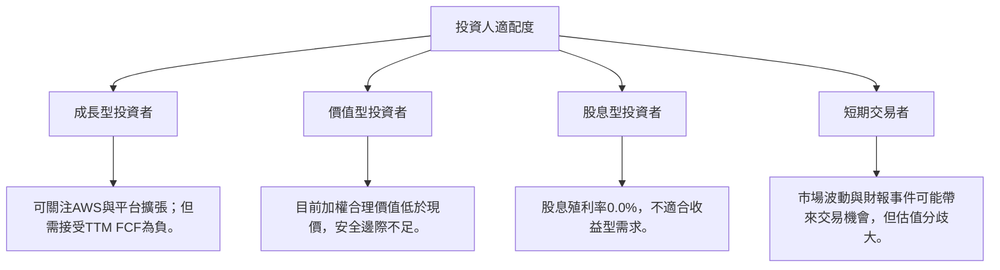

# AMZN 基本面深度分析報告
> **報告日期**：2026-11-28 ｜ **語言**：繁體中文 ｜ **數據來源**：SEC 申報資料 (XBRL)、Yahoo Finance、Finviz、StockAnalysis、Roic.ai ｜ **分析師**：CFA 級機構研究

## 目錄

| # | 章節 | 核心結論 |
|---|------|----------|
| 1 | 執行摘要 | 賣出；加權合理價值 $182.20；MOS -34.2% |
| 2 | 公司概覽與商業模式 | 零售、AWS、廣告與訂閱形成多元平台，但分部營收占比未提供 |
| 3 | 損益表深度分析 | TTM 營收 $797.46B、年增 15.4%；營業利潤率 TTM 13.1% |
| 4 | 資產負債表分析 | 淨負債 $65.73B；DSO 由 32 天升至 45 天 |
| 5 | 現金流量深度分析 | TTM FCF -$46.89B，主要壓力來自 $215.19B 資本支出 |
| 6 | 獲利能力與資本效率 | ROIC 11.9% 高於 WACC 10.96%，幅度有限 |
| 7 | 相對估值分析 | P/E 低於自身五年中位數，但加權估值仍低於現價 |
| 8 | DCF 內在價值評估 | 基準 DCF 每股 $53.14；終值占 EV 98.6%，估值高度依賴長期假設 |
| 9 | 成長催化劑 | AWS、AI 基礎設施與廣告可能支撐成長；TAM 數據未提供 |
| 10 | 風險矩陣 | 資本支出與 FCF、AI 投資回報、估值落差為主要風險 |
| 11 | 投資建議 | 依 MOS 評級為賣出；以現金流與資本效率改善作為重新評估條件 |

---

## 1. 執行摘要

### 1.0 一頁式投資儀表板（Portfolio Manager 30 秒速讀）

| 項目 | 內容 |
|------|------|
| **投資論點（3 句）** | ① TTM 營收 $797.46B、年增 15.4%，規模與成長仍有支撐。② ROIC 11.9% 高於 WACC 10.96%，但價值創造利差僅 0.94 個百分點。③ TTM 資本支出 $215.19B 高於營業現金流 $168.30B，令 TTM FCF 為 -$46.89B。 |
| **綜合評分** | **6.3/10**（引用 1.1 評分卡） |
| **財務健康** | 🔴 TTM 淨負債 $65.73B、FCF -$46.89B；短期資本支出壓力偏高。 |
| **ROIC vs WACC** | 11.9% vs 10.96%；目前創造價值，利差約 +0.94 個百分點。 |
| **FCF 趨勢** | TTM 為負；FCF Yield **-1.71%**。 |
| **估值** | Forward P/E 23.258112x ｜ EV/EBITDA 15.994x ｜ FCF Yield -1.71% |
| **DCF 內在價值（基準）** | **$53.14**；相對 DCF 折溢價 **+360.3%**（現價／DCF 價值−1） |
| **安全邊際（MOS）** | **-34.2%**＝（加權合理價值 $182.20 − 現價 $244.43）÷ $182.20；🔴 無 |
| **預期報酬（基準情境 12M）** | DCF 基準情境相對現價 **-78.3%**；此為模型估值差距，不是保證報酬。 |
| **關鍵風險（前二）** | ① Capex 高於營業現金流、FCF 持續為負。② DCF 基準價值遠低於現價，終值占 EV 98.6%。 |
| **評級 + 信心度** | 🔴 **賣出** ｜ 信心：中；估值方法間差異大，且 DCF 終值依賴度高。 |

### 1.1 綜合評分卡（全報告唯一）

| 維度 | 評分（1–10） | 主要依據（引用數字與其來源章節） |
|------|--------------|----------------------------------|
| 成長性 | 8.0 | TTM 營收年增 15.4%，最新一季營收年增 12.1%（第 3 章）。 |
| 獲利能力 | 7.0 | TTM 營業利益率 13.1%、ROIC 11.9% 高於 WACC 10.96%；F-Score 4/8（第 6 章）。 |
| 財務健康 | 5.0 | 淨負債 $65.73B、流動比率資料來源有差異、DSO 45 天（第 4 章）。 |
| 估值 | 2.0 | 加權合理價值 $182.20，MOS -34.2%；DCF 基準價值 $53.14（第 8 章）。 |
| 護城河 | 9.0 | 零售平台、AWS、廣告與訂閱形成多邊商業模式；但分部收入明細未提供（第 2 章）。 |
| 管理層與資本配置 | 7.0 | FY2025 SBC $19.47B、Capex $131.82B；投資強度大且回報仍需以 FCF 驗證（第 3、5 章）。 |
| **綜合評分** | **6.3** | 六項算術平均：\((8+7+5+2+9+7)÷6=6.333…\)，四捨五入為 6.3。 |

### 1.2 五大投資論點 + 三大核心風險

| 類型 | 項目 | 具體依據 | 信心度 |
|------|------|----------|--------|
| 🟢 **投資論點①** | 多元化營收底盤 | TTM 營收 $797.46B、年增 15.4%；最新一季年增 12.1%，顯示規模仍在擴張。 | 🟢 高 |
| 🟢 **投資論點②** | 營業槓桿改善 | FY2022 營業利益 $12.25B，FY2025 為 $79.97B；但期間仍受投資週期及成本變動影響。 | 🟢 中 |
| 🟢 **投資論點③** | ROIC 高於資本成本 | TTM ROIC 11.9% vs WACC 10.96%，代表目前資本投入尚有正利差。 | 🟢 中 |
| 🟢 **投資論點④** | AWS 與服務生態可延伸 | AWS、廣告與訂閱具高附加價值的商業特性；現有資料未提供分部數字，需以後續財報驗證。 | 🟡 中 |
| 🟢 **投資論點⑤** | 資產規模與流動性緩衝 | 現金及短期投資 $114.23B，為巨額投資提供一定資金緩衝。 | 🟢 中 |
| 🟡 **風險①** | 資本支出壓低自由現金流 | TTM Capex $215.19B，高於 OCF $168.30B，TTM FCF 為 -$46.89B。 | 🔴 高衝擊 |
| 🔴 **風險②** | 市價顯著高於加權合理價值 | 現價 $244.43 對比加權合理價值 $182.20，MOS -34.2%。 | 🔴 高 |
| 🟡 **風險③** | 應收帳款天數上升 | DSO 由一年前 32 天升至 45 天，可能增加營運資金占用。 | 🟡 中 |

### 1.3 快速統計卡片

| 指標 | 公司實際值（期間） | 同業中位數 | 狀態 |
|------|--------------------|------------|------|
| 營收成長（TTM） | **15.4%** | — | 🟢 |
| 營收成長（最新一季年增） | **12.1%** | **18.8%** | 🟡 |
| 毛利率（TTM） | **51.4%** | **60.9%** | 🟡 |
| 營業利益率（TTM） | **13.1%** | — | 🟢 |
| ROIC（TTM） | **11.9%** | — | 🟡 |
| Forward P/E | **23.258112x** | **20.4x** | 🟡 |
| FCF Yield（TTM） | **-1.71%** | — | 🔴 |
| Piotroski F-Score | **4 / 8** | — | 🟡 |

### 1.4 投資結論

```
╔══════════════════════════════════════════════════════════════════╗
║                    📊 投資結論摘要                               ║
╠══════════════════════════════════════════════════════════════════╣
║  評級：賣出（MOS -34.2%，依規則 20）                            ║
║  價格（2026-11-25 收盤）：$244.43                               ║
║  DCF 內在價值（基準）：$53.14（現價溢價 +360.3%）              ║
║  安全邊際 MOS：-34.2%（＝(加權合理價值−現價)÷加權合理價值）   ║
║  加權合理價值（8.8）：$182.20                                   ║
║  DCF 情境價值：                                                  ║
║    悲觀情境：$11.87（-95.1%）                                   ║
║    基準情境：$53.14（-78.3%）                                   ║
║    樂觀情境：$122.46（-49.9%）                                  ║
║  綜合評分：6.3/10（引用 1.1）                                   ║
║  適合投資人：能承受高波動、以長期經營品質為主的投資人；不適合 ║
║              以當前現金流殖利率或安全邊際為核心的投資人。     ║
╚══════════════════════════════════════════════════════════════════╝
```

---

## 2. 公司概覽與商業模式

### 2.1 業務結構與收入來源

公司披露的業務包含北美、國際與 AWS 三個分部，並經營電商、實體店、廣告、訂閱、裝置及媒體內容。各分部營收金額與占比未提供，因此不計算或繪製分部占比。



### 2.2 市場份額

市場份額的可引用數字與年份未提供，因此不呈現市場份額表或圓餅圖。以公司規模觀察，AMZN TTM 營收為 $797.46B，TTM 成長 15.4%；最新一季成長 12.1%，低於同業表中 MSFT 的 18.8% 與 GOOG 的 24.7%，但營收規模與業務範圍不可直接等同於市場份額。

### 2.3 競爭護城河分析



### 2.4 護城河強度

| 護城河項目 | 強度（強／中／弱） | 證據（引用數字或事實） | 會削弱它的情況 |
|------------|--------------------|------------------------|----------------|
| 技術領先 | 強 | AWS 為主要業務之一；雲端與 AI 基礎設施需要大量資本投入，TTM Capex $215.19B。分部營收未提供。 | 雲端競爭者技術與成本優勢擴大，或高資本投入不能轉化為現金流。 |
| 軟體生態系統 | 強 | AWS 服務、會員與賣家工具可形成互補；現有數據未提供會員數及雲端客戶留存率。 | 客戶多雲遷移成本下降、服務差異化減弱。 |
| 網路效應 | 中至強 | 買家、賣家、廣告主及服務供應商互相吸引；分部及平台交易數據未提供。 | 賣家多平台分散、平台費率提高引發外流。 |
| 客戶鎖定 | 中至強 | Prime、雲端工作負載與履約流程可能增加轉換成本；目前缺少續約及流失率資料。 | 競品價格補貼、服務品質下滑或企業 IT 支出收縮。 |
| 規模效應 | 強 | TTM 營收 $797.46B，支撐物流、採購與技術投資。 | 規模複雜度與資本成本增加，導致報酬率下滑。 |
| 生態夥伴 | 中 | 第三方賣家、開發者與配送夥伴擴大服務供給；夥伴數及收入占比未提供。 | 監管要求、平台規則改變或夥伴議價能力上升。 |

護城河評分引用 1.1 的 **9.0/10**：平台與雲端業務具多面向網路及規模優勢，但可量化的分部、留存與市場份額資料不足，故不能將質化優勢視作已完全證實的超額報酬。

---

## 3. 損益表深度分析

### 3.1 年度收入成長趨勢（近4年）

年度營收取自 SEC 申報資料彙整的年度損益表；成長率為依相鄰年度營收計算。

```
╔══════════════════════════════════════════════════════════════════╗
║              Amazon 年度收入趨勢（FY2022-FY2025）                ║
╠══════════════════════════════════════════════════════════════════╣
║  FY2022  $513.98B  ██████████████░░░░░░░░░░░░  YoY: —           ║
║  FY2023  $574.78B  ████████████████░░░░░░░░░░  YoY: +11.8% 🟢  ║
║  FY2024  $637.96B  ██████████████████░░░░░░░░  YoY: +11.0% 🟢  ║
║  FY2025  $716.92B  ████████████████████░░░░░░  YoY: +12.4% 🟢  ║
║                                                                  ║
║  FY2022-FY2025 CAGR：約 11.7%                                     ║
╚══════════════════════════════════════════════════════════════════╝
```

FY2022 至 FY2025 營收增加，FY2025 年增約 12.4%；依據是營收由 $513.98B 增至 $716.92B。成長來源可能包含零售、AWS、廣告與訂閱，但未提供分部金額，無法量化各業務貢獻。

### 3.2 季度收入趨勢分析

季度營收使用 StockAnalysis 的季度資料；最新季年增率則依 VERIFIED FIGURES 為單季 12.1%。

| 季度 | 營收（B 美元） | QoQ 成長 | YoY 成長 | 備註 |
|------|---------------:|---------:|---------:|------|
| 2025 Q4 | 213.386 | — | 13.63% | 季節性高峰；季度間比較受旺季影響。 |
| 2026 Q1 | 181.519 | -14.9% | 16.61% | 相較 Q4 回落，符合季度季節性比較特徵。 |
| 2026 Q2 | 200.606 | +10.5% | 19.62% | 依季度資料計算；財務表另一來源此欄為缺值。 |
| 2026 Q3 | 201.944 | +0.7% | **12.1%** | 最新一季年增率採 VERIFIED FIGURES，明確為單季數字。 |

QoQ 公式示例：\((201.944÷200.606)-1=0.67\%\)。最新一季營收仍創資料列期間內高位，但 YoY 成長較前兩季放慢；可能反映比較基期與業務組合變化，分部資料不足以進一步歸因。

### 3.3 利潤率演變分析

下表年度利潤率依年度營收及毛利、營業利益、淨利計算；TTM 使用 VERIFIED FIGURES 的口徑。

| 利潤率指標 | FY2022 | FY2023 | FY2024 | FY2025 | 趨勢 | 評估 |
|------------|--------:|--------:|--------:|--------:|------|------|
| **毛利率** | 43.8% | 47.0% | 48.9% | 50.3% | 連續改善 | 🟢 |
| **營業利益率** | 2.4% | 6.4% | 10.8% | 11.2% | 明顯擴張 | 🟢 |
| **淨利率** | -0.5% | 5.3% | 9.3% | 10.8% | 由負轉正並提升 | 🟢 |

TTM 營業利益率為 13.1%，最新一季營業利益率為 13.9%。年度營業利益由 FY2022 $12.25B 增至 FY2025 $79.97B，增幅遠高於營收，反映成本調整、營運效率與高附加價值業務占比可能改善；但分部利潤與營運費用明細缺少，不能將改善單一歸因於某業務。

### 3.4 費用結構分析

資料未提供完整、同口徑的年度費用分項金額，亦無法由損益表可靠拆分履約、技術、行銷與行政費用，因此不繪製費用結構 Mermaid pie 或比例圖。可確認 FY2025 營業利益 $79.97B、淨利 $77.67B，但兩者差額不應直接視為某一單項費用。

### 3.5 季度 EPS 趨勢與盈餘品質（Quality of Earnings）

EPS beat/miss 歷史中，最近四季分析師預估與實際 EPS 均為缺值，故無法判定是否超預期或不及預期。可觀察實際季度 EPS：2026 Q3 $1.89、Q2 $5.75、Q1 $2.78、2025 Q4 $1.95；季與季間差異大，且 Q2 淨利數據異常偏高，需以後續申報文件確認其構成。

| 盈餘品質項目 | 數值／佔比 | 評估 |
|--------------|-----------|------|
| 股權薪酬 SBC / 營收 | FY2025：$19.47B ÷ $716.92B = **2.72%** | 🟡 SBC 對員工報酬與股東稀釋有實質影響；FY2025 SBC 低於 FY2024 的 $22.01B。 |
| SBC / 營業現金流 | FY2025：$19.47B ÷ $139.51B = **14.0%** | 🟡 規模不可忽略；SBC 為非現金加回，但仍是股東經濟成本。 |
| FCF / 淨利（現金轉換率） | TTM FCF -$46.89B；TTM 淨利未提供相同口徑可核對值，**N/A** | 🔴 FCF 為負，現金轉換需留意高資本開支影響。 |
| 一次性／非經常性損益 | N/A（未提供完整調節表） | 無法判斷近期淨利是否受一次性項目顯著影響。 |
| 有效稅率異常 | 模型預設稅率 21.0%；實際 TTM 有效稅率 N/A | 不能以模型假設推論實際稅務利益。 |
| 資本化支出 vs 費用化 | TTM Capex $215.19B；資本化與費用化明細未提供 | 高投資提高未來折舊，需觀察資產利用率及投資回報。 |

**盈餘品質結論**：FY2025 年度 OCF $139.51B、Capex $131.82B，年度 FCF 仍為正 $7.70B；但 TTM OCF $168.30B、Capex $215.19B，使 TTM FCF 降至 -$46.89B。獲利不應只看 EPS 或淨利，現階段投資回報取決於高資本支出能否轉化為新增現金流與 ROIC。

---

## 4. 資產負債表分析

### 4.1 資產結構分解

最新 TTM 資產負債表摘要提供總資產 $1,243.39B、流動資產 $255.10B、PPE $605.77B、長期投資 $148.40B、商譽 $23.74B；已列項目並非完整加總，故圖示只呈現有明確數據的項目，不代表完整資產拆分。



### 4.2 流動性與營運資金分析

| 指標 | 最新 TTM | 一年前 TTM | 變化 | 解讀 |
|------|----------|------------|------|------|
| DSO 應收帳款天數 | 45 天 | 32 天 | +13 天 | 收款天數上升，可能增加營運資金占用；須持續觀察應收帳款品質。 |
| DIO 存貨天數 | N/A | N/A | N/A | 資料未提供該指標所需口徑，不能補算。 |
| DPO 應付帳款天數 | N/A | N/A | N/A | 資料未提供該指標所需口徑，不能補算。 |
| CCC 現金轉換週期 | N/A | N/A | N/A | 因 DIO、DPO 缺值，不能推算 CCC。 |

StockAnalysis 所列 TTM 流動資產 $255.10B，但不同市場資料來源的流動資產、流動負債口徑有差異；本報告不將來源不一致的流動比率拼接成一個值。

### 4.3 債務結構分析

下圖採 VERIFIED FIGURES 的總債務、現金與淨負債；其他合併資料來源另列總債務 $304.84B，與 SEC 口徑摘要所用 $179.95B 不一致，本節採用指定優先值並視來源差異為需核對事項。

```
╔══════════════════════════════════════════════════════════════════╗
║                   Amazon 債務健康診斷                            ║
╠══════════════════════════════════════════════════════════════════╣
║  總債務：        $179.95B  ███████████████░░░░░  🟡              ║
║  現金+短期投資： $114.23B  ██████████░░░░░░░░░░  🟢              ║
║  淨負債：        $65.73B   ██████░░░░░░░░░░░░░░  🟡              ║
║  Debt/EBITDA：   N/A（債務與 EBITDA 期間口徑未提供一致值）        ║
║  Interest Coverage：N/A（利息費用及 EBIT 同口徑未提供）          ║
╚══════════════════════════════════════════════════════════════════╝
```

### 4.4 股東權益趨勢

| 財年 | 股東權益（B 美元） | YoY 變化 |
|------|------------------:|---------:|
| 2022 | 146.04 | — |
| 2023 | 201.88 | +38.2% |
| 2024 | 285.97 | +41.7% |
| 2025 | 411.06 | +43.7% |

權益擴張可反映獲利留存、資本變動與其他權益項目；未提供足以拆分各來源的完整權益變動表，故不把年度增幅全部歸因於淨利。

```
╔══════════════════════════════════════════════════════════════════╗
║               股東權益變化（FY2022-FY2025）                      ║
╠══════════════════════════════════════════════════════════════════╣
║  FY2022  $146.04B  ███████░░░░░░░░░░░░░░░░░                   ║
║  FY2023  $201.88B  ██████████░░░░░░░░░░░░░░                   ║
║  FY2024  $285.97B  ██████████████░░░░░░░░                   ║
║  FY2025  $411.06B  ████████████████████░░░                   ║
╚══════════════════════════════════════════════════════════════════╝
```

---

## 5. 現金流量深度分析

### 5.1 現金流量瀑布圖

TTM 淨利的同期間可比數字與股息、回購現金流明細未提供，因此不以虛構數值填入；瀑布圖只呈現明確可引用的 OCF、Capex 與 FCF。



### 5.2 FCF 轉換率趨勢

| 財年 | OCF（B 美元） | Capex（B 美元） | FCF（B 美元） | FCF／淨利 |
|------|--------------:|----------------:|--------------:|----------:|
| 2022 | 46.75 | 63.65 | -16.89 | N/A（淨利為負，比例不具可比性） |
| 2023 | 84.95 | 52.73 | 32.22 | 105.9% |
| 2024 | 115.88 | 83.00 | 32.88 | 55.5% |
| 2025 | 139.51 | 131.82 | 7.70 | 9.9% |
| TTM 至 2026-09-30 | 168.30 | 215.19 | -46.89 | N/A（TTM 淨利口徑未提供可核對值） |

FY2025 OCF 上升但 Capex 幾乎吸收全部營運現金，令年度 FCF 降至 $7.70B；最新 TTM Capex 進一步高於 OCF，反映投資期現金流承壓。

### 5.3 自由現金流趨勢

```
╔══════════════════════════════════════════════════════════════════╗
║                自由現金流（FCF）歷史趨勢                         ║
╠══════════════════════════════════════════════════════════════════╣
║  FY2022  -$16.89B  ◀████████░░░░░░░░░░░░  FCF Yield：N/A        ║
║  FY2023   $32.22B   ████████████████░░░░  FCF Yield：N/A        ║
║  FY2024   $32.88B   ████████████████░░░░  FCF Yield：N/A        ║
║  FY2025    $7.70B   ████░░░░░░░░░░░░░░░░  FCF Yield：N/A        ║
║  TTM     -$46.89B   ◀████████████████████  FCF Yield：-1.71%     ║
╚══════════════════════════════════════════════════════════════════╝
```

TTM FCF 為負與 Capex 激增同步出現；若新增伺服器、資料中心及履約設備逐步投入使用，未來可能提高收入與產能，但目前資料無法證明回收期及增量 ROIC。

### 5.4 資本配置評估

回購、股息及其他投資的完整金額未提供，不以不完整項目製作資本配置圓餅圖。可量化部分如下：

| 資本配置項目 | 可用數據 | 評估 |
|--------------|----------|------|
| 資本支出 | FY2025 $131.82B；TTM $215.19B | 投資強度很高；需以 AWS、廣告及履約效率的新增現金流驗證回報。 |
| 股權薪酬 | FY2025 $19.47B | 占 FY2025 營收約 2.72%；構成股東稀釋成本。 |
| 股息 | 殖利率 0.0% | 目前並非以現金股息回饋股東。 |
| 回購 | 金額未提供 | N/A，不能據此判定淨回購或抵銷 SBC 的程度。 |
| 留存現金 | 期末現金及短期投資 $114.23B | 提供流動性，但不足以單獨消除高 Capex 對 FCF 的壓力。 |

---

## 6. 獲利能力與資本效率

### 6.1 ROE / ROA / ROIC 趨勢

| 指標 | 可用期間數據 | 評估 |
|------|--------------|------|
| ROE | TTM 22.0%（QUALITY FIGURES，closing balances） | 正報酬；但與另一市場資料顯示的 27.4% 不同，本報告依品質指標口徑引用 22.0%。 |
| ROA | TTM 6.6%（市場資料摘要） | 資產密集型業務中具參考價值；歷史同口徑序列不足。 |
| ROIC | TTM 11.9% | 高於 WACC 10.96%，但利差不大。 |

同口徑多年 ROIC、ROA 與 ROE 序列未提供，亦未提供可引用的行業均值，故不填行業對比欄。

### 6.2 ROIC vs WACC 分析（核心價值創造判斷）

```
╔══════════════════════════════════════════════════════════════════╗
║                ROIC vs WACC 深度分析                            ║
╠══════════════════════════════════════════════════════════════════╣
║  WACC（採用 Cost of capital 區塊數值）：                         ║
║  ├── 無風險利率（10Y 美債）：  4.94%                            ║
║  ├── 市場風險溢酬（ERP）：     5.00%                            ║
║  ├── Beta（調整後）：          1.34（原始 Beta 1.50）           ║
║  ├── 股權成本：                11.61%                           ║
║  ├── 稅前債務成本：            1.26%                            ║
║  ├── 股權／債務權重：          93.9%／6.1%                      ║
║  └── ✅ WACC：                 10.96%                           ║
║                                                                  ║
║  ROIC（TTM）：                 11.9%                            ║
║  ├── ROIC − WACC：             +0.94 個百分點                   ║
║  └── 判斷：目前創造價值，但安全墊不厚                            ║
╚══════════════════════════════════════════════════════════════════╝
```

依 CAPM 資本成本區塊，股權成本為 11.61%，稅前債務成本 1.26%，預設稅率 21.0%，資本權重 93.9%／6.1%。採用 WACC 10.96%，不另行重算或取代該數值。ROIC 11.9% 高於 WACC 0.94 個百分點，表示目前仍有正的資本報酬利差；但若 AI、雲端或物流投資使投入資本增加而收益未同步增長，ROIC 可能跌破資本成本。

### 6.3 杜邦三因素分解

| 因素 | 數值（TTM） | 解讀 |
|------|-------------|------|
| 淨利率 | 16.9% | 品質指標指定值；較年度 FY2025 淨利率高，期間口徑不同，不直接混比。 |
| 資產週轉率 | 0.64 | 資產每年產生的營收效率；資產擴張可能壓低週轉率。 |
| 權益乘數 | 2.03 | 財務槓桿提高 ROE，但並非極端高槓桿的單一解釋。 |
| **ROE** | **22.0%** | \(16.9\% × 0.64 × 2.03 = 21.96\%\)，四捨五入約 22.0%。 |

杜邦三項顯示 ROE 同時受淨利率、資產週轉與財務槓桿影響；資產週轉率 0.64 與權益乘數 2.03，代表 ROE 不是只靠槓桿支撐。

### 6.4 財務體質：Piotroski F-Score

**Piotroski F-Score：4 / 8**。原始測試清單有一項毛利率缺資料而未計入，因此分母為 8；依品質指標逐項照錄如下。

| 測試 | 結果 | 解讀 |
|------|------|------|
| ROA > 0 | ✅ 通過 | 獲利為正。 |
| 營業現金流 > 0 | ✅ 通過 | TTM OCF 為正。 |
| ROA 高於一年前 | ✅ 通過 | 資產獲利能力改善。 |
| 營業現金流 > 淨利 | ✅ 通過 | 應計品質測試通過。 |
| 長期負債 ÷ 總資產低於一年前 | ❌ 未通過 | 槓桿相對資產的改善未成立。 |
| 流動比率高於一年前 | ❌ 未通過 | 短期流動性指標未改善。 |
| 稀釋股數未增加 | ❌ 未通過 | 股數增加對每股經濟利益形成稀釋。 |
| 毛利率高於一年前 | — 無法判定 | 缺資料，未納入分母。 |
| 資產週轉率高於一年前 | ❌ 未通過 | 資產成長未同步帶來更高週轉效率。 |

---

## 7. 相對估值分析

### 7.1 同業估值比較表格

同業數字來自 Yahoo Finance Peer multiples；公司估值欄依各指定來源分別列示，Trailing P/E 與 P/S 等市場摘要口徑可能與歷史估值資料區塊不同，不混成同一時間序列。

| 估值指標 | **AMZN** | **MSFT** | **GOOG** | **WMT** | 本公司評估 |
|----------|---------:|---------:|---------:|---------:|-----------|
| **Trailing P/E** | 20.54325x | 25.7x | 14.2x | 48.2x | 🟡 位於同業分布中間；公司本身增長與業務結構不同。 |
| **Forward P/E** | 23.258112x | 20.4x | 17.8x | 41.2x | 🟡 高於同業中位數 20.4x。 |
| **P/S Ratio** | 3.445755x | 10.6x | 7.1x | 1.4x | 🟢 低於大型雲端同業，但高於零售導向 WMT。 |
| **EV/EBITDA** | 15.994x | 18.1x | 17.5x | 23.2x | 🟢 低於提供的三家同業倍數。 |
| **最新一季營收年增** | 12.1% | 18.8% | 24.7% | 5.2% | 🟡 成長快於 WMT、低於 MSFT 與 GOOG。 |
| **毛利率（TTM）** | 51.4% | 67.7% | 60.9% | 25.3% | 🟡 高於 WMT，低於 MSFT 與 GOOG。 |

### 7.2 歷史估值區間分析

```text
╔══════════════════════════════════════════════════════════════════╗
║             AMZN 五年歷史估值位置（TTM 倍數）                   ║
╠══════════════════════════════════════════════════════════════════╣
║  P/E：       區間 2.6x ───────── 中位數 32.2x ───── 現值 19.8x  ║
║              現值百分位：30%                                      ║
║  P/S：       區間 0.2x ─ 中位數 3.0x ───────── 現值 3.3x         ║
║              現值百分位：67%                                      ║
║  EV/EBITDA： 區間 0.7x ───── 中位數 17.3x ─ 現值 14.9x          ║
║              現值百分位：19%                                      ║
╚══════════════════════════════════════════════════════════════════╝
```

P/E 與 EV/EBITDA 相對自身五年中位數偏低，P/S 則高於五年中位數。歷史倍數區間含極端值，不能單獨作為內在價值；尤其近年獲利改善使歷史低 P/E 與高 P/E 時期的可比性有限。

### 7.3 情境價值（Bear / Base / Bull，照抄 DCF MODEL 的 Scenarios）

| 情境 | 第 1 年營收成長 | 期末營業利潤率 | WACC | 每股價值 | 相對現價 | 機率 | 會發生的條件 |
|------|----------------:|----------------:|-----:|---------:|---------:|-----:|--------------|
| 🔴 悲觀 | 7.7% | 9.1% | 11.96% | $11.87 | -95.1% | 25% | 零售與雲端需求放緩、投資回收不佳，利潤率下滑且資本成本提高。 |
| 🟡 基準 | 15.4% | 10.8% | 10.96% | $53.14 | -78.3% | 50% | TTM 成長率作為第一年起點，後續逐年淡出；營業利潤率回落至五年中位數。 |
| 🟢 樂觀 | 23.0% | 11.8% | 9.96% | $122.46 | -49.9% | 25% | 雲端、廣告與 AI 需求加速，且投資生產力改善、融資風險下降。 |

### 7.4 相對估值隱含價格區間

```
╔══════════════════════════════════════════════════════════════════╗
║             每股估值方法與現價位置（美元）                      ║
╠══════════════════════════════════════════════════════════════════╣
║  DCF基準 $53.14 ─── Forward P/E $222.48 ── 現價 $244.43         ║
║                  ─── EV/EBITDA $290.77 ─── 共識 $326.34         ║
╚══════════════════════════════════════════════════════════════════╝
```

| 方法 | 每股價值 | 相對現價 | 依據 |
|------|---------:|---------:|------|
| DCF（基準） | $53.14 | -78.3% | 10 年 FCFF、WACC 10.96%、永續成長率 3.0%。 |
| 同業 Forward P/E | $222.48 | -9.0% | MSFT、GOOG、WMT 同業中位數 20.4x × Forward EPS $10.93。 |
| 同業 EV/EBITDA | $290.77 | +19.0% | 同業中位數 EV/EBITDA 18.1x × TTM EBITDA，並加回淨現金／扣除淨負債。 |
| 分析師共識目標價 | $326.34 | +33.5% | 60 位分析師平均目標價；市場觀點參考，非現金流模型。 |

---

## 8. DCF 內在價值評估（Discounted Cash Flow）

### 8.0 估值推理鏈（Thinking Logic）

**Step 1 — 價值來源與主導變數**

AMZN 的估值由零售與履約現金流、AWS／廣告／訂閱服務的增長，以及重資本投資的回收能力共同決定。可引用的營收錨點是 TTM $797.46B、TTM 成長 15.4%；分部營收占比未提供，故不能將各業務收入比例拆分。模型中最主導估值的變數是長期 FCFF 與終值，因基準終值現值占企業價值 98.6%。

**Step 2 — 模型選擇**

| 決策點 | 本報告採用 | 理由（含數字） | 曾考慮但否決 | 否決理由 |
|--------|-----------|----------------|--------------|----------|
| 現金流定義 | FCFF | 以 WACC 10.96% 折現，再橋接企業價值至股權價值。 | FCFE | 公司債務與現金均具規模，FCFF 更適合企業價值橋接。 |
| 預測期 N | 10 年 | DCF MODEL 指定 10 年；覆蓋高成長至成熟期的淡出路徑。 | 5 年 | 高 Capex 週期下，較短期間難展示投資與現金流轉化。 |
| 終值方法 | Gordon Growth | 區塊使用永續成長率 3.0%。 | 退出倍數 | DCF MODEL 未提供可複算的退出倍數終值。 |
| EBIT 基礎 | GAAP EBIT | DCF MODEL 明確使用 GAAP EBIT。 | 非 GAAP EBIT | 可能加回已費用化 SBC，造成股東成本低估。 |

**Step 3 — 關鍵假設推導鏈**

- **營收成長**：錨點＝TTM 年增 15.4% → 模型按 10 年線性淡出至第 10 年 3.0% → **第一年採用 15.4%** → 曾考慮更快的長期成長，但未有分部成長與 TAM 數據支持，故不自行加碼。
- **期末營業利益率**：錨點＝TTM 13.1%；模型以五年中位數作為第 10 年收斂值 → Capex 與營收比率由 27.0% 逐步降至 10.9%，但利潤率假設由 13.1% 淡出至 **10.8%** → 曾考慮維持 13.1%，因長期競爭與成熟化風險而未採用。
- **永續成長率 g**：錨點＝模型設定 3.0%，低於 WACC 10.96% → 維持 3.0% → 曾考慮更高 g，但永續增長過高會放大終值占比，且缺少長期宏觀及分部資料支撐。
- **預測期 N**：錨點＝模型指定 10 年 → 用線性淡出表達由當前 15.4% 成長走向成熟期 → **採用 10 年** → 曾考慮縮短期間，但不能在不改模型的前提下重建其他數值。
- **Capex／營收**：錨點＝TTM Capex 高達 $215.19B，模型第一年比率 27.0% → 依模型逐年降至 10.9%，約為 D&A 的 1.1 倍 → 曾考慮立即回落至歷史較低比率，因當前投資週期仍高，不採用。
- **EBIT、SBC 與股數**：錨點＝GAAP EBIT 已把 SBC 作為費用；模型採組合 **(A)**，股數不再稀釋，FCFF 不重複扣 SBC → 年稀釋率為 0% → 不採用非 GAAP 加回 SBC、又固定股數的處理，以免漏掉稀釋成本。
- **有效稅率**：假設值，依 DCF MODEL 預設 21.0%；實際有效稅率同口徑資料未提供。
- **D&A／營收**：錨點＝TTM 比率，模型採 10.0% 並固定；資本密集型資產會帶來折舊，是否可長期固定仍有不確定性。
- **營運資金變動**：模型未建模；不是把 ΔWC 假設為零，而是明確沿用模型設定，不另行改算。
- **WACC**：採用程式計算的 10.96%；組成與原始／調整後 Beta 見 8.2。曾考慮另行估算，但依規則直接使用資本成本區塊數值。
- **終值方法**：採 Gordon Growth，終值以第 10 年 FCFF 為基礎；未提供同一模型下的退出倍數，故不捏造交叉驗證值。

**Step 4 — 最脆弱環節**

最脆弱的是 Capex 逐步下降後能否轉化為正 FCFF；基準估值有 98.6% 來自終值，若現金流回收延後或長期成長、折現率假設不利，價值可能落至敏感度矩陣中更低的每股價位。

**Step 5 — 計算路徑**



### 8.1 模型假設總表（Model Inputs）

| 假設項目 | 採用值 | 依據／來源 | 敏感度 |
|----------|--------|-------------|--------|
| 預測期長度 N | 10 年 | DCF MODEL 指定 10 年。 | 🟡 中 |
| 營收成長 | 第 1 年 15.4%，第 10 年 3.0%，逐年線性淡出 | TTM 成長 15.4%；成熟期終點取模型設定 3.0%。 | 🔴 高 |
| 營業利潤率 | 第 1 年 13.1% → 第 10 年 10.8% | TTM 營業利益率與模型所用五年中位數。 | 🔴 高 |
| 有效稅率 | 21.0% | DCF MODEL 預設；實際有效稅率同口徑資料未提供。 | 🟢 低 |
| Capex／營收 | 第 1 年 27.0% → 第 10 年 10.9% | TTM Capex 與模型淡出假設；最終值為模型指定。 | 🔴 高 |
| D&A／營收 | 10.0% | DCF MODEL 指定，依 TTM 比率固定。 | 🟢 低 |
| 營運資金變動／營收增額 | 未建模 | DCF MODEL 明確排除營運資金，不能把缺項冒充為零。 | 🟡 中 |
| EBIT 基礎 | GAAP | DCF MODEL 指定 GAAP EBIT。 | 🟡 中 |
| 股權薪酬 SBC 處理 | GAAP EBIT 已含 SBC；不再扣 SBC | 模型明確採組合 A。 | 🟡 中 |
| 年稀釋率（股數） | 0% | 配合組合 A，避免 SBC 重複計算；模型不另稀釋股數。 | 🟡 中 |
| 永續成長率 g | 3.0% | DCF MODEL 指定，且低於 WACC。 | 🔴 高 |
| 終值方法 | Gordon Growth | DCF MODEL 提供；未提供退出倍數終值。 | 🔴 高 |
| WACC | 10.96% | 資本成本區塊指定。 | 🔴 高 |

**FCFF 定義**：本模型採 FCFF，並依 DCF MODEL 計算為 \(NOPAT + D\&A - Capex\)。營運資金未建模。

**SBC 防重複計算**：本模型採用 **(A) GAAP EBIT + 固定股數**；SBC 已在 GAAP 營業費用中計入，因此 FCFF 不再扣 SBC，股數不再逐年稀釋，SBC 影響按模型規則計入一次。

### 8.2 折現率推導（WACC）

```
╔══════════════════════════════════════════════════════════════════╗
║                    WACC 推導（折現率）                           ║
╠══════════════════════════════════════════════════════════════════╣
║  股權成本 Ke（CAPM）：                                           ║
║  ├── 無風險利率 Rf（10Y 美債）：      4.94%                     ║
║  ├── 市場風險溢酬 ERP：               5.00%                     ║
║  ├── 原始 Beta（Yahoo）：             1.50                      ║
║  ├── 調整後 Beta：                    1.34                      ║
║  ├── Beta 調整方式：                  ⅔×1.50 + ⅓×1.00 = 1.33*  ║
║  └── 採用股權成本：                   11.61%                    ║
║                                                                  ║
║  債務成本：                                                      ║
║  ├── 稅前 Kd：                        1.26%                     ║
║  ├── 預設稅率：                       21.0%                     ║
║  └── 稅後 Kd：                        1.26%×(1−21.0%)=0.995%   ║
║                                                                  ║
║  資本結構（市場權重）：                                          ║
║  ├── 股權權重 E：                     93.9%                     ║
║  ├── 債務權重 D：                     6.1%                      ║
║  └── ✅ 採用 WACC：                   10.96%                    ║
╚══════════════════════════════════════════════════════════════════╝
```

\* Beta 調整採區塊的 Beta used (adjusted) **1.34**；依提供公式 \(⅔×1.50+⅓×1=1.333…\)，與 1.34 的差異屬四捨五入。WACC 與 CAPM 各項依指定區塊原值引用；原始 Beta 與調整後 Beta 均列示。

**逐步演算及資料限制**：

1. **Ke（CAPM）**：\(4.94\%+1.34×5.00\%=11.64\%\)。資本成本區塊指定 Ke 為 **11.61%**；細項與公布值有約 0.03 個百分點的四捨五入／底層精度差，依規則採用區塊值。
2. **稅前 Kd**：指定值 **1.26%**。利息費用與平均計息負債的同範圍明細未提供，無法從獨立分子分母複算。
3. **稅後 Kd**：\(1.26\%×(1-21.0\%)=0.9954\%\)，約 **1.00%**。
4. **權重**：股權 93.9%，債務 6.1%；兩者合計 \(93.9\%+6.1\%=100.0\%\)。市值與計息負債的完整同口徑重建資料未提供，故不另行推導權重。
5. **WACC**：依區塊原值 **10.96%**。以展示值複算 \(93.9\%×11.61\%+6.1\%×1.26\%×(1-21.0\%)\approx10.96\%\)；此展示式四捨五入後與採用值一致。

Rf 日期、ERP 市場來源及規模／國別溢酬細項未提供；不另造日期或溢酬。WACC 10.96% 與第 6.2 節一致。

### 8.3 逐年自由現金流預測（基準情境）

下表逐年照錄 DCF MODEL。金額為十億美元；折現因子取三位小數，金額取兩位小數。ΔWC 未建模，表內不列為零。

| 年度 | FY+1 | FY+2 | FY+3 | FY+4 | FY+5 | FY+6 | FY+7 | FY+8 | FY+9 | FY+10 |
|------|-----:|-----:|-----:|-----:|-----:|-----:|-----:|-----:|-----:|------:|
| 營收 | 919.87 | 1,048.46 | 1,180.63 | 1,313.26 | 1,442.76 | 1,565.24 | 1,676.64 | 1,772.96 | 1,850.48 | 1,905.99 |
| 營收 YoY | 15.4% | 14.0% | 12.6% | 11.2% | 9.9% | 8.5% | 7.1% | 5.7% | 4.4% | 3.0% |
| 營業利潤率 | 13.1% | 12.8% | 12.6% | 12.3% | 12.0% | 11.8% | 11.5% | 11.3% | 11.0% | 10.8% |
| EBIT（GAAP） | 120.39 | 134.49 | 148.39 | 161.65 | 173.84 | 184.54 | 193.32 | 199.83 | 203.76 | 204.93 |
| − 稅 | (25.28) | (28.24) | (31.16) | (33.95) | (36.51) | (38.75) | (40.60) | (41.96) | (42.79) | (43.04) |
| NOPAT | 95.11 | 106.25 | 117.22 | 127.70 | 137.34 | 145.79 | 152.73 | 157.86 | 160.97 | 161.90 |
| + D&A | 91.53 | 104.33 | 117.48 | 130.68 | 143.57 | 155.75 | 166.84 | 176.42 | 184.14 | 189.66 |
| − Capex | (248.23) | (264.24) | (276.51) | (284.17) | (286.48) | (282.91) | (273.16) | (257.26) | (235.53) | (208.63) |
| **FCFF** | **-61.59** | **-53.66** | **-41.80** | **-25.79** | **-5.58** | **18.63** | **46.40** | **77.03** | **109.58** | **142.93** |
| 折現因子 @ 10.96% | 0.901 | 0.812 | 0.732 | 0.660 | 0.595 | 0.536 | 0.483 | 0.435 | 0.392 | 0.353 |
| **FCFF 現值 PV** | **-55.50** | **-43.58** | **-30.60** | **-17.01** | **-3.32** | **9.98** | **22.41** | **33.52** | **42.98** | **50.52** |

預測期現值逐項加總：

\[
-55.50-43.58-30.60-17.01-3.32+9.98+22.41+33.52+42.98+50.52
=9.40\text{B}
\]

**FY+1 逐步演算示例**（沿用模型輸入；中間數字按模型表取位）：

1. 營收：\(797.46×(1+15.4\%)=919.87\text{B}\)。
2. EBIT：\(919.87×13.1\%=120.39\text{B}\)。
3. 稅：\(120.39×21.0\%=25.28\text{B}\)。
4. NOPAT：\(120.39-25.28=95.11\text{B}\)。
5. D&A：\(919.87×10.0\%=91.53\text{B}\)（依模型原表）。
6. Capex：\(919.87×27.0\%=248.23\text{B}\)（依模型原表）。
7. ΔWC：模型未建模，不補入推算值。
8. FCFF：\(95.11+91.53-248.23=-61.59\text{B}\)。
9. 折現：模型折現因子 \(0.901\)；\(-61.59×0.901=-55.50\text{B}\)（按原表精度）。

前五年 FCFF 為負，是因 Capex 假設高於 NOPAT 加折舊；模型後五年才轉正。其後正現金流的現值抵銷早期負值後，預測期 PV 合計為 $9.40B。

**合理性自檢**：

- 預測 FCF CAGR：首年 FCFF 為負，數學上不適合計算標準 CAGR；歷史 FY2022-FY2025 FCF 從 -$16.89B 轉為 $7.70B，也不適用一般 CAGR 比較。
- FY+10 FCF 利潤率：\(142.93÷1,905.99=7.50\%\)；目前 TTM FCF 利潤率：\(-46.89÷797.46=-5.88\%\)；同業最佳值未提供，不能比較。
- FY+1 至 FY+5 FCFF 為負；這會直接降低預測期 PV，並使估值更依賴終值，不能視為無影響。

```
╔══════════════════════════════════════════════════════════════════╗
║            自由現金流：歷史實際 vs 模型預測                      ║
╠══════════════════════════════════════════════════════════════════╣
║  FY2023(實)   $32.22B  ███████████░░░░░░░░░  FCF為正             ║
║  FY2024(實)   $32.88B  ███████████░░░░░░░░░  FCF為正             ║
║  FY2025(實)    $7.70B  ███░░░░░░░░░░░░░░░░░  FCF大幅收窄         ║
║  FY+1 (預)   -$61.59B  ◀████████████████████                     ║
║  FY+10(預)   $142.93B  ████████████████████                      ║
╠══════════════════════════════════════════════════════════════════╣
║  ⚠️ 預測前段現金流為負，價值主要取決於後段投資回收與終值。      ║
╚══════════════════════════════════════════════════════════════════╝
```

### 8.4 終值計算（Terminal Value）

適用性檢查：**WACC 10.96% vs g 3.0% → WACC > g？✅**

| 方法 | 計算式 | 終值 TV | TV 現值 | 佔總 EV 比重 |
|------|--------|--------:|--------:|-------------:|
| Gordon Growth | \(142.93×(1+3.0\%)÷(10.96\%-3.0\%)\) | $1,849.40B | $653.67B | 98.6% |
| 退出倍數法 | N/A（DCF MODEL 未提供退出倍數終值） | N/A | N/A | N/A |

逐步演算：

1. FY+10 FCFF = **$142.93B**。
2. 分子：\(142.93×1.03=147.2179\text{B}\)。
3. 分母：\(10.96\%-3.0\%=7.96\%\)；\(147.2179÷0.0796=1,849.47\text{B}\)。DCF MODEL 指定終值為 **$1,849.40B**；差異來自表格數字已四捨五入，依規則採用模型值。
4. PV(TV)：\(1,849.40×0.353=652.84\text{B}\)；DCF MODEL 指定 PV(TV) 為 **$653.67B**，使用未四捨五入折現因子計算。
5. 終值占比：模型值 \(653.67÷663.06=98.6\%\)。

**本估值高度依賴終值假設，短期現金流貢獻有限。**因提供的模型折現因子僅三位小數，使用展示數字重新相乘會有小幅差異；以下企業價值與股價均沿用模型輸出，不以展示精度另建模型。

### 8.5 企業價值 → 每股內在價值（Bridge）

```
╔══════════════════════════════════════════════════════════════════╗
║              企業價值 → 每股內在價值 橋接表                      ║
╠══════════════════════════════════════════════════════════════════╣
║  預測期 FCF 現值合計            +$9.40B                          ║
║  終值現值 PV(TV)                +$653.67B                        ║
║  ─────────────────────────────────────────────                  ║
║  = 企業價值 EV                   $663.06B                        ║
║  + 淨現金（淨負債為負）          -$65.73B                        ║
║  = 股權價值（模型輸出）          $597.34B                        ║
║  ★ 每股內在價值（模型輸出）      $53.14                          ║
║    當前股價                      $244.43                         ║
║    折溢價（現價÷DCF內在價值−1）  +360.3%                         ║
╚══════════════════════════════════════════════════════════════════╝
```

逐步演算與一致性說明：

1. 模型 EV：\(9.40+653.67=663.07\text{B}\)，但 DCF MODEL 指定 EV 為 **$663.06B**；差異為 $0.01B，屬各列四捨五入造成，以下照錄指定值。
2. 股權價值：\(663.06-65.73=597.33\text{B}\)；模型指定 **$597.34B**，差異約 $0.01B，按模型原值引用。
3. 模型每股內在價值：DCF MODEL 指定 **$53.14**。模型標示的每股橋接公式為「股權價值 × 價格 ÷ 市值」，但提供的股權價值、股數與市場資料無法完全重現 $53.14；不另行替換模型輸出。
4. 折溢價：\((244.43÷53.14)-1=+360.0\%\)；按未四捨五入值及模型標示取值，區塊列示 **+360.3%**。此處以模型基準 DCF 價值呈現溢價，不計算 MOS。
5. 本節不計算 MOS；安全邊際只採 8.8 加權合理價值為分母。

股數方面，模型規則為 GAAP EBIT + 固定股數、不另加稀釋；市場資料列示流通股數 10.81B，但 DCF MODEL 使用股權價值與價格／市值的特定換算方式，無法用 10.81B 直接完整重現模型每股值。現金與債務採品質數據中的現金及短期投資 $114.23B、總債務 $179.95B，淨負債為 $65.73B。

### 8.6 敏感性分析（WACC × 永續成長率）

以下矩陣逐格照錄 DCF MODEL；括號內為相對現價的上行空間，依 \(價值÷244.43-1\) 計算並四捨五入至一位小數。基準格為 **$53.14**。

| g（列）／WACC（欄） | 8.96% | 9.96% | **10.96%（基準）** | 11.96% | 12.96% |
|-----------|------:|------:|------------------:|------:|------:|
| 2.0% | $75.87 (-69.0%) | $58.92 (-75.9%) | $46.14 (-81.1%) | $36.25 (-85.2%) | $28.44 (-88.4%) |
| 2.5% | $82.40 (-66.3%) | $63.48 (-74.0%) | $49.43 (-79.8%) | $38.70 (-84.2%) | $30.29 (-87.6%) |
| 3.0% | $90.02 (-63.2%) | $68.68 (-71.9%) | **$53.14 (-78.3%)** | $41.41 (-83.1%) | $32.33 (-86.8%) |
| 3.5% | $99.05 (-59.5%) | $74.70 (-69.4%) | $57.33 (-76.5%) | $44.44 (-81.8%) | $34.58 (-85.9%) |
| 4.0% | $109.89 (-55.0%) | $81.72 (-66.6%) | $62.13 (-74.6%) | $47.86 (-80.4%) | $37.09 (-84.8%) |

**矩陣示範格**：所選格 WACC **9.96% > g 3.0% ✅**。DCF MODEL 提供的敏感性矩陣沒有提供該格的分年折現現值、TV 與橋接中間值，因此依規則不另建模型或偽造完整複算路徑；該格每股價值照錄 **$68.68**。

**三情境 DCF（照錄 DCF MODEL）**

| 情境 | 營收成長假設 | 期末營業利潤率 | g | WACC | 每股內在價值 | 相對現價 | 主觀機率 |
|------|--------------|----------------:|--:|-----:|--------------:|---------:|---------:|
| 🔴 悲觀 | 第 1 年 7.7% | 9.1% | 模型基準 3.0% | 11.96% | $11.87 | -95.1% | 25% |
| 🟡 基準 | 第 1 年 15.4% | 10.8% | 3.0% | 10.96% | $53.14 | -78.3% | 50% |
| 🟢 樂觀 | 第 1 年 23.0% | 11.8% | 模型基準 3.0% | 9.96% | $122.46 | -49.9% | 25% |
| **機率加權** | — | — | — | — | **$60.15** | **-75.4%** | **100%** |

模型給出的機率加權算式：\(11.87×25\%+53.14×50\%+122.46×25\%=60.15\)（按模型數字引用）。權重合計 \(25\%+50\%+25\%=100\%\)。此加權情境值僅為參考；8.8 依規則使用 DCF 基準值 $53.14。

**敏感度解讀**：

- 在 WACC 10.96% 下，g 從 2.0% 升至 3.0%，每股價值由 $46.14 升至 $53.14，增加 **$7.00**。
- 在 g 3.0% 下，WACC 從 9.96% 升至 10.96%，每股價值由 $68.68 降至 $53.14，減少 **$15.54**。
- 期末營業利潤率每 +1 個百分點的價值變化：模型未提供獨立敏感度矩陣，**N/A**，不自建數字。
- 在已提供的格點比較中，WACC 對價值的影響大於 g 由 2.0% 至 3.0% 的影響；8.0 Step 1 指出的終值／長期現金流主導估值方向一致，但模型沒有單獨的利潤率敏感度可作量化驗證。

### 8.7 反推 DCF（Reverse DCF：市場在預期什麼）

DCF MODEL 提供兩項單變數反推結果；其他變數與迭代軌跡未提供，因此不填造市場隱含 CAGR 的完整求解表。

| 求解的變數（一次一個） | 其餘變數設定 | 市場隱含值（令 DCF = 現價） | 公司歷史實際 | 判斷 |
|------------------------|--------------|------------------------------|--------------|------|
| 第 1 年營收成長 | 其餘採基準模型輸入 | **48.0%** | TTM 成長 15.4% | 🔴 顯著高於目前成長錨點；若其他假設不變，市場價格需要更高短期增長。 |
| 固定營業利潤率 | 其餘採基準模型輸入 | **27.5%** | TTM 營業利潤率 13.1% | 🔴 約為目前水準兩倍以上，執行門檻很高。 |
| 永續成長率 g | — | 未計算 | — | N/A（區塊未提供解） |
| 預測期長度 N | — | 未計算 | — | N/A（區塊未提供解） |

反推 DCF 未附求解迭代軌跡，故不能把模型反推結果偽裝成已可獨立複算的收斂表。方向性結論是：若市場價格必須由單一變數解釋，所需第一年營收成長 48.0% 或固定營業利潤率 27.5%，均遠高於目前模型錨點。

### 8.8 估值三角驗證與安全邊際

| 估值方法 | 隱含每股價值 | 上行空間（÷現價） | 權重 | 說明 |
|----------|--------------:|-------------------:|------:|------|
| DCF（基準） | $53.14 | -78.3% | 40% | 10 年 FCFF，WACC 10.96%、g 3.0%。 |
| 同業 Forward P/E | $222.48 | -9.0% | 25% | 同業中位數 20.4x × Forward EPS $10.93。 |
| 同業 EV/EBITDA | $290.77 | +19.0% | 25% | 同業中位數 18.1x，並加回淨現金／扣除淨負債。 |
| 分析師共識目標價 | $326.34 | +33.5% | 10% | 60 位分析師平均目標價。 |
| **加權合理價值** | **$182.20** | **-25.5%** | **100%** | 公司類型為 profitable；依固定權重計算。 |

逐步演算：

\[
53.14×40\%+222.48×25\%+290.77×25\%+326.34×10\%
=21.256+55.620+72.6925+32.634
=182.2025
\]

四捨五入至美分為 **$182.20**；權重 \(40\%+25\%+25\%+10\%=100\%\)。四種估值方法均列入，沒有剔除方法。

```
╔══════════════════════════════════════════════════════════════════╗
║                  估值區間與安全邊際                              ║
╠══════════════════════════════════════════════════════════════════╣
║  $11.87 ───── $53.14 ───── $182.20 ───── $244.43 ───── $326.34 ║
║ 悲觀DCF       基準DCF      加權合理值       現價        共識目標 ║
║                                                                  ║
║  MOS = (182.20 − 244.43) ÷ 182.20 = -34.2%                      ║
║  上行空間 = (182.20 − 244.43) ÷ 244.43 = -25.5%                 ║
║  MOS 評估：🔴 <10% 無                                             ║
║                                                                  ║
║  建議買入區間：未給出正向買入建議；若以 MOS ≥10% 作觀察門檻，   ║
║  價格需不高於 $163.98（182.20×90%）。                            ║
║  合理持有區間：以加權價值附近作估值參考，不代表保證價格區間。    ║
║  減碼考慮區間：現價 $244.43 已高於加權合理價值 $182.20。         ║
╚══════════════════════════════════════════════════════════════════╝
```

評級依 MOS 門檻為賣出，未作質化調整。加權合理價值是 MOS 唯一分母；DCF 基準 $53.14 只用於折溢價比較。

> 🔎 **程式複算（Python，依本節各項自動重算）**
>
> 加權合理價值 = $53.14 × 40% + $222.48 × 25% + $290.77 × 25% + $326.34 × 10% = **$182.20**（權重合計 100%）
>
> 以價格 $244.43 計：MOS = **-34.2%**，上行空間 = **-25.5%**
>
> ✅ 與本節所寫數值一致。

### 8.9 DCF 模型的局限與失效條件

- **終值依賴度**：PV(TV) 占 EV **98.6%**，代表估值主要由 FY+10 之後現金流假設決定；短期預測期 PV 合計僅 $9.40B。
- **最脆弱假設**：Capex／營收從第 1 年 27.0% 降至第 10 年 10.9%；若資本支出長期維持高檔，FCFF 會低於模型。現有矩陣在基準 WACC 10.96%、g 2.0% 時每股價值為 $46.14，但不能將此格解讀為 Capex 專屬壓力測試。
- **FCF 與估值可靠度**：TTM FCF -$46.89B，早期預測 FCFF 亦為負，DCF 在高再投資期間敏感度較大。應以相對估值、AWS／廣告分部獲利及投資回收率交叉檢驗。
- **營運資金與股數**：模型未建模 ΔWC，且採固定股數；若應收帳款持續增加、股權薪酬造成實際稀釋，模型價值可能高估。
- **與第 10 章連結**：AI／資料中心投資回收不佳會推高 Capex／營收、壓低 FCFF；雲端競爭或零售價格戰會壓低營業利潤率；利率上升會推高折現率。

### 8.10 複算檢核表（Audit Trail）

| # | 檢核項目 | 檢查方式 | 結果 |
|---|----------|----------|------|
| 1 | 所有高／中敏感度輸入均有四段式推導 | 逐項核對 8.0 Step 3 | 🟡 部分模型輸入缺歷史明細，已明示缺口。 |
| 2 | 每個假設都有來歷 | 核對 8.1 依據欄 | ✅ 已列錨點或標示資料未提供。 |
| 3 | WACC 五步算式齊全且正確 | 核對指定成本與權重 | 🟡 採指定 WACC 10.96%；底層精度及利息分母未提供。 |
| 4 | Kd 分母與債務權重 D 範圍一致 | 核對負債口徑 | ❌ 利息費用、平均計息負債與期末計息債務細項未提供，無法確認範圍完全一致。 |
| 5 | WACC 與第 6.2 節同值 | 兩處比對 | ✅ 10.96%。 |
| 6 | 逐年表格年度數等於 N，無省略 | 核對 10 個年度 | ✅ FY+1 至 FY+10 均列示。 |
| 7 | FY+1 代表年度算式可複算 | 使用模型已四捨五入輸入 | 🟡 部分細項存在原始精度四捨五入差。 |
| 8 | 預測期 PV 逐項加總 | 逐項加總 | ✅ 加總 $9.40B。 |
| 9 | WACC > g | 10.96% 對 3.0% | ✅ |
| 10 | 終值以 FY+N 現金流並折現 N 期 | 核對模型 | ✅ 模型指定 FY+10。 |
| 11 | EV → 每股橋接可完全複算 | 檢查 EV、淨負債、每股值 | ❌ 模型橋接及展示精度有約 $0.01B 差異，且每股公式未能由已列股數完全重現；已明示並照錄原值。 |
| 12 | SBC 組合相容 | GAAP、無 SBC 列、股數不稀釋 | ✅ 採組合 A。 |
| 13 | 矩陣基準格等於 DCF 基準 | 比對基準格 | ✅ $53.14。 |
| 14 | 矩陣示範格有效且無無效數字 | WACC > g | ✅ 所選格 9.96% > 3.0%。 |
| 15 | 三情境機率合計 100% | 25%+50%+25% | ✅ |
| 16 | 反推每列只放開一個變數且附迭代軌跡 | 核對 DCF MODEL | 🟡 僅兩個反推解有提供，迭代軌跡未提供，未自造。 |
| 17 | MOS 分母與折溢價基準一致 | 對照 1.0、8.5、8.8 | ✅ MOS 以 $182.20；折溢價以 $53.14。 |
| 18 | 報告輸出至第 11 章 | 章節檢查 | ✅ |
| 19 | 加權合理價值未事後調整 | 重算權重算式 | ✅ $182.2025，四捨五入 $182.20。 |
| 20 | 評級符合 MOS 門檻 | MOS -34.2% | ✅ 賣出。 |

未能完全獨立複算的核心項目是計息負債口徑、DCF 股數橋接及敏感度格中間值；因此 DCF 估值信心度為中低，並以原模型輸出照錄，不自行改寫。

---

## 9. 成長催化劑

### 9.1 催化劑時間軸



### 9.2 TAM 市場規模分析

**N/A（TAM 數據未提供）**。AMZN TTM 營收 $797.46B、TTM 成長 15.4%，最新一季成長 12.1%，顯示仍有業務擴張空間；但沒有可引用的雲端、電商、廣告或 AI TAM 金額及年份，因此不推估滲透率。

### 9.3 成長驅動力結構圖



上述驅動因素需用分部收入、AWS 營業利益、Capex 及後續 FCF 驗證；現有資料不足以量化各催化劑對整體營收的貢獻。

---

## 10. 風險矩陣

### 10.1 風險評分矩陣

以下機率與衝擊座標為質化風險排序，不是財務數據預測值。



### 10.2 風險清單詳細分析

| # | 風險項目 | 發生機率 | 財務衝擊 | 風險評分 | 緩解措施 |
|---|----------|----------|----------|----------|----------|
| 1 | 🔴 **Capex 高企、FCF 持續負值** | 高；TTM Capex $215.19B | 高；TTM FCF -$46.89B | 🔴 8.5/10 | 追蹤 Capex／營收、資料中心利用率、增量 OCF 與 FCF；若投資延續但收入未跟上，降低預期。 |
| 2 | 🔴 **AI／雲端投資回收低於資本成本** | 中高；ROIC 11.9% 僅高於 WACC 10.96% | 高；可能使 ROIC 跌破 WACC | 🔴 8.0/10 | 觀察 AWS 成長、分部營業利益及新增投資的現金回收；分部資料缺失時維持審慎。 |
| 3 | 🔴 **估值下修** | 中高；加權價值 $182.20 低於現價 $244.43 | 高；模型加權價值差距約 -25.5% | 🔴 8.0/10 | 以分批與估值區間控制風險，避免只依賴分析師共識目標。 |
| 4 | 🟡 **監管與競爭壓力** | 中；零售、雲端及平台均面臨競爭 | 中高；可能壓低抽成與利潤率 | 🟡 6.5/10 | 追蹤平台規則、訴訟及競品價格／服務變化。 |
| 5 | 🟡 **營運資金與收款週期惡化** | 中；DSO 由 32 天升至 45 天 | 中；可能占用現金 | 🟡 5.5/10 | 檢查應收帳款增幅、帳齡與收入增速是否背離。 |

---

## 11. 投資建議

### 11.1 最終評級與評分

按加權合理價值 $182.20、2026-11-25 收盤價 $244.43 計算，MOS 為 -34.2%，依評級門檻為**賣出**，未作質化調整。綜合評分引用 1.1 為 **6.3/10**；六項分數依序為成長性 8.0、獲利能力 7.0、財務健康 5.0、估值 2.0、護城河 9.0、管理層與資本配置 7.0。

### 11.2 合理價值與隱含報酬率

| 估值 | 每股價值 | 相對現價 | 機率／權重 |
|------|---------:|---------:|-----------:|
| 加權合理價值（8.8） | $182.20 | -25.5% | 估值方法權重合計 100% |
| 悲觀 DCF 情境 | $11.87 | -95.1% | 25% |
| 基準 DCF 情境 | $53.14 | -78.3% | 50% |
| 樂觀 DCF 情境 | $122.46 | -49.9% | 25% |
| DCF 機率加權值（參考） | $60.15 | -75.4% | 100% |

情境價值直接反映 DCF MODEL；相對現價的負報酬幅度顯示模型對目前股價偏審慎。DCF 基準值與相對估值法差距極大，應將此視為模型不確定性訊號，而非精準點估值。

### 11.3 買入時機與觸發因素

```
╔══════════════════════════════════════════════════════════════════╗
║                  ✅ 投資觸發因素 Checklist                       ║
╠══════════════════════════════════════════════════════════════════╣
║  重新評估買入條件（建議多數符合）：                              ║
║  ☐ TTM FCF 回到正值，且不是單季營運資金釋放造成                 ║
║  ☐ Capex／營收下降，同時 AWS 或其他高附加價值收入維持成長       ║
║  ☐ ROIC 持續高於 WACC 10.96%，且利差較目前 0.94pp 擴大          ║
║  ☐ DSO 不再高於目前 45 天，應收帳款增幅回到營收增幅附近         ║
║                                                                  ║
║  加碼觀察條件（任一項成立仍需配合估值）：                        ║
║  ☐ 股價降至加權合理價值的 90% 以下，即約 $163.98                 ║
║  ☐ FCF 轉正並連續兩季改善，且資本支出仍能帶動營收               ║
║                                                                  ║
║  減碼／重新檢視條件：                                             ║
║  ☐ ROIC 跌破 WACC 10.96%                                         ║
║  ☐ TTM FCF 持續為負且 Capex 未呈現回收或效率提升                 ║
║  ☐ 最新一季營收年增連續兩季低於 10%                              ║
╚══════════════════════════════════════════════════════════════════╝
```

### 11.4 投資人適配度分析



### 11.5 每季財報監控清單（Quarterly Watch List）

| 監控指標 | 目前基準 | 加碼／正向觸發 | 減碼／負向觸發 |
|----------|----------|----------------|----------------|
| 合併營收成長 | 最新一季年增 12.1%；TTM 年增 15.4% | 年增率維持或高於 12%，且品質業務同步成長 | 連續兩季低於 10% |
| 營業利益率 | TTM 13.1%；最新一季 13.9% | 維持或擴張，且非單靠一次性費用下降 | 較近期水準收縮超過 1 個百分點並延續兩季 |
| AWS／廣告分部 | 分部數據未提供 | 財報披露成長與利潤同步改善 | 成長放慢且利潤率下滑 |
| Capex | TTM $215.19B | 資本支出增長轉為可觀察的收入／現金流回報 | Capex 高企但營收及營業利益不改善 |
| FCF | TTM -$46.89B；Yield -1.71% | 轉正並連續改善 | 連續兩季現金流惡化 |
| SBC／稀釋股數 | FY2025 SBC $19.47B；稀釋股數測試未通過 | SBC 占營收下降，股數增長受控 | SBC 占營收上升且股數持續增加 |
| 應收帳款與 DSO | DSO 45 天；一年前 32 天 | DSO 回落且應收增幅不高於營收增幅 | DSO 再升、帳齡惡化或應收增幅顯著超越營收 |
| 財測與投資回報 | 公司財測未提供 | 管理層量化 AI／Capex 回收與利用率 | 投資目標延期或資本效率轉弱 |

### 11.6 反面論證：什麼會證明論點錯誤（What Would Change My Mind）

```
╔══════════════════════════════════════════════════════════════════╗
║              ⚠️ 論點失效條件（Disconfirming Evidence）           ║
╠══════════════════════════════════════════════════════════════════╣
║  若以下情況發生，應重新檢視基本面與估值假設：                    ║
║  ☐ 合併營收年增連續兩季低於 10%，且高附加價值業務同步減速       ║
║  ☐ TTM 營業利益率由 13.1% 收縮超過 1 個百分點並延續兩季          ║
║  ☐ TTM FCF 持續負值，且 Capex／營收未下降或營運現金流轉弱        ║
║  ☐ ROIC 跌破 WACC 10.96%，代表資本投入不再覆蓋資本成本           ║
║  ☐ DSO 高於 45 天後仍持續上升，且應收帳款增幅明顯高於營收        ║
║  ☐ SBC 占營收上升，且稀釋股數持續增加、回購未能抵銷稀釋          ║
║  ☐ AI／雲端投資持續擴大，但分部營業利益及現金流未呈改善          ║
╚══════════════════════════════════════════════════════════════════╝
```

> **免責聲明**：本報告為 AI 自動生成，僅供研究參考，不構成投資建議。投資有風險，入市需謹慎。

---

## 資料與來源

| 項目 | 內容 |
|------|------|
| 價格 | 244.43 USD，2026-11-25 收盤（Yahoo Finance 日線） |
| 財務報表 | SEC 10-Q filed 2026-10-30，最新季度 2026-09-30（FY2026 Q3） |
| 有回應的資料來源 | SEC 申報資料 (XBRL)、Yahoo Finance、Finviz、StockAnalysis、Roic.ai |
| 由程式計算 | TTM 數字、WACC、DCF 模型、估值方法與權重、加權合理價值、MOS、評級門檻、F-Score、杜邦分解、營運資金天數、綜合評分 |
| 撰寫模型 | openai / gpt-6-luna |

> 本區塊由產生報告的程式依實際取得的資料填寫，非模型撰寫。「由程式計算」的數字不是模型的估計；其餘判斷（評分、情境、策略）是模型的分析。
