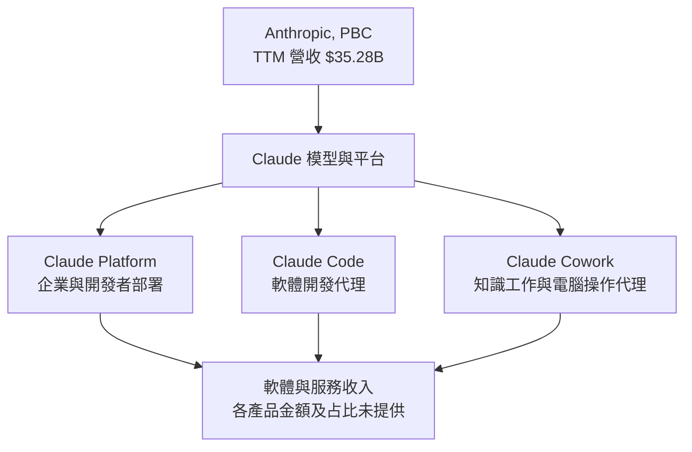
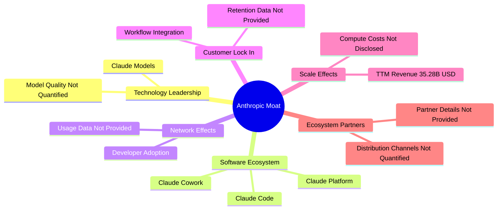
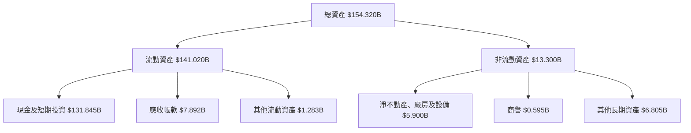
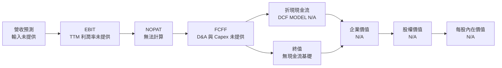
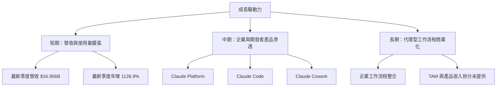
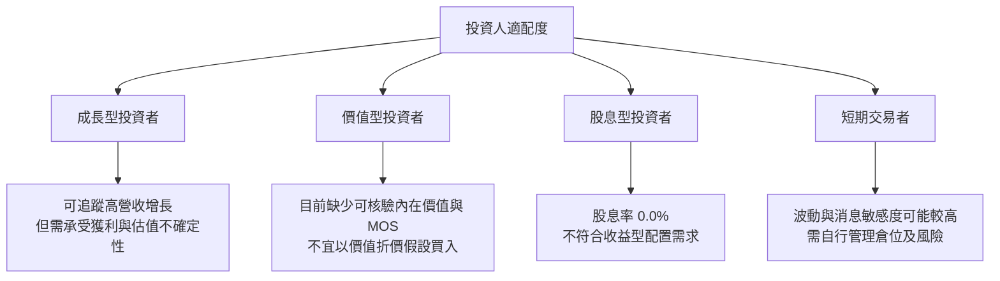

# ANT 基本面深度分析報告
> **報告日期**：2026-11-28 ｜ **語言**：繁體中文 ｜ **數據來源**：Yahoo Finance、Finviz、StockAnalysis ｜ **分析師**：CFA 級機構研究

> **資料口徑提示**：本報告依現有資料分析，並優先照錄已核驗欄位。部分市場資料彼此不一致，且缺少 SEC 申報資料與多項 TTM 現金流、營業利潤率及估值模型輸入；相關結論標示 N/A，不以推估值補足。

## 目錄

| # | 章節 | 核心結論 |
|---|------|----------|
| 1 | 執行摘要 | MOS 與加權合理價值無法計算；營收快速增長，但估值結論受資料缺口限制 |
| 2 | 公司概覽與商業模式 | Claude 模型、平台與代理型應用形成潛在生態；收入分部與市占資料未提供 |
| 3 | 損益表深度分析 | TTM 營收 $35.28B；TTM 成長率 N/A；最新一季營收年增 1,126.9% |
| 4 | 資產負債表分析 | 現金及短期投資 $131.84B、總債務 $134.99B；核驗淨負債 $3.14B |
| 5 | 現金流量深度分析 | TTM FCF N/A；最新季度 FCF $242M，但單季數字不能替代 TTM |
| 6 | 獲利能力與資本效率 | ROIC N/A，不能判斷是否創造超過 WACC 的經濟價值 |
| 7 | 相對估值分析 | 同業倍數與自身歷史估值區間未提供；Forward P/E 179.34x |
| 8 | DCF 內在價值評估 | DCF N/A：缺少 TTM 營業利益率、D&A 與 Capex |
| 9 | 成長催化劑 | 模型採用、企業代理型應用與開發工具是可追蹤方向；TAM 與時間表未提供 |
| 10 | 風險矩陣 | 主要風險為獲利及資料可核驗性、資本需求、競爭與估值；缺少量化機率資料 |
| 11 | 投資建議 | 評級、合理價值與買賣區間均不能依 MOS 規則計算；以條件式監控為主 |

---

## 1. 執行摘要

現有資料顯示，ANT 的 TTM 營收為 **$35.28B**，最新一季營收年增 **1,126.9%**，顯示營收規模快速擴大；但 TTM 營收成長率、TTM 營業利益率與 TTM FCF 均為 N/A，且最新一季營業利益率仍為 **-11.6%**。因此，尚不能證明高速營收增長已轉化為可持續的營業獲利與自由現金流。

估值方面，Forward P/E 為 **179.34x**、TTM P/S 為 **34.81x**，而同業倍數、DCF 所需的 TTM 營業利益率、D&A 與 Capex 均缺失；程式計算的估值方法也無法產生每股價值。因此 **加權合理價值、MOS 與 MOS 評級均為 N/A**，本報告不以分析師共識目標價替代內在價值，也不自行建立 DCF。

### 1.0 一頁式投資儀表板（Portfolio Manager 30 秒速讀）

| 項目 | 內容 |
|------|------|
| **投資論點（3 句）** | ① TTM 營收 $35.28B，最新一季營收年增 1,126.9%，顯示商業化規模快速擴大。② 最新一季營業利益率為 -11.6%，代表營收增長尚未消除營業虧損。③ 現金及短期投資 $131.84B、總債務 $134.99B，核驗淨負債為 $3.14B；資產負債表有大量流動資產，但現金流與估值資料仍不完整。 |
| **綜合評分** | **4.8/10**（引用 1.1 評分卡；六項算術平均） |
| **財務健康** | 🟡 現金及短期投資 $131.84B、流動比率 12.083；但核驗淨負債 $3.14B，且負股東權益使部分槓桿比率難以解讀。 |
| **ROIC vs WACC** | ROIC：N/A；WACC：9.49%。資料不足，不能判斷創造或摧毀價值。 |
| **FCF 趨勢** | TTM FCF：N/A；TTM FCF Yield：N/A。最新季度 FCF 為 $242M，不能代表 TTM 趨勢。 |
| **估值** | Forward P/E **179.34x** ｜ EV/EBITDA **-94.266x** ｜ FCF Yield **N/A** |
| **DCF 內在價值（基準）** | N/A；現價相對 DCF 的折溢價亦為 N/A，因 DCF 模型無法計算。 |
| **安全邊際（MOS）** | N/A：8.8 無加權合理價值，無法按「(加權合理價值 − 現價) ÷ 加權合理價值」計算。 |
| **預期報酬（基準情境 12M）** | N/A：DCF 情境價值未提供。 |
| **關鍵風險（前二）** | TTM 營業利益率與 FCF 缺失／未證明穩定獲利；估值倍數高且市值、企業價值與股數資料存在不一致。 |
| **評級 + 信心度** | MOS 評級：N/A；估值與資料完整性信心度：低。 |

### 1.1 綜合評分卡（全報告唯一）

> 評分為本報告對現有證據完整度與公司特徵的分析判斷，不取代依 MOS 計算的投資評級。

| 維度 | 評分（1–10） | 主要依據（引用數字與其來源章節） |
|------|--------------|----------------------------------|
| 成長性 | 9.0 | TTM 營收 $35.28B，最新一季年增 1,126.9%；但 TTM 成長率缺失（第 3 章）。 |
| 獲利能力 | 2.0 | 最新一季營業利益率 -11.6%；TTM 營業利益率及 ROIC 均 N/A（第 3、6 章）。 |
| 財務健康 | 5.0 | 現金及短期投資 $131.84B、流動比率 12.083，但淨負債 $3.14B、股東權益為負（第 4 章）。 |
| 估值 | 2.0 | Forward P/E 179.34x、P/S 34.81x；同業倍數與內在價值無法核驗（第 7、8 章）。 |
| 護城河 | 7.0 | Claude Platform、Claude Code、Claude Cowork 提供平台與應用產品組合；缺少留存率、客戶集中度、市占率等量化驗證（第 2 章）。 |
| 管理層與資本配置 | 4.0 | 最新季度 SBC $1.07B，為該季營收 6.3%；回購、股息及完整資本配置資料未提供（第 3、5 章）。 |
| **綜合評分** | **4.8** | 六項算術平均：\((9.0+2.0+5.0+2.0+7.0+4.0)÷6=4.833...\)，四捨五入至小數一位為 **4.8**。 |

### 1.2 五大投資論點 + 三大核心風險

| 類型 | 項目 | 具體依據 | 信心度 |
|------|------|----------|--------|
| 🟢 **投資論點①** | 營收規模迅速擴大 | TTM 營收 $35.28B；最新一季營收 $16.96B，年增 1,126.9%。若後續留存與付費擴張延續，規模可支持平台商業化；但目前 TTM 成長率無法核驗。 | 🟡 中 |
| 🟢 **投資論點②** | 產品涵蓋模型、開發工具與代理型應用 | Claude Platform、Claude Code、Claude Cowork 分別對應企業部署、軟體開發與知識工作流程；產品收入拆分與單位經濟性未提供。 | 🟡 中 |
| 🟢 **投資論點③** | 流動資產提供資金緩衝 | 現金及短期投資 $131.84B，最新季度營業現金流 $2.64B；但 TTM 營業現金流與 Capex 均 N/A，不能由單季外推。 | 🟡 中 |
| 🟢 **投資論點④** | 最新季度毛利資料顯示產品收入擴張 | 最新季度毛利 $14.52B、營收 $16.96B；單季毛利率約 85.7%，但與資料來源的 TTM 毛利率 22.3% 存在明顯口徑差異，需先核對。 | 🔴 低 |
| 🟢 **投資論點⑤** | 企業客戶與開發者需求可能帶來擴張空間 | 公司介紹顯示平台面向企業與開發者；新聞標題亦提及高消費客戶，但沒有客戶數、淨留存率或客戶支出分布數字。 | 🟡 中 |
| 🟡 **風險①** | 高估值與獲利證據不足 | Forward P/E 179.34x、P/S 34.81x；TTM 營業利益率、TTM FCF 與 DCF 均 N/A，市場預期對未來獲利的依賴度高。 | 🔴 高 |
| 🔴 **風險②** | 財務資料存在重大內部不一致 | 市值 $1.23T、收盤價 $91.88 與流通股數 7.73B 無法直接相互核對；市值與 EV $362.73B 的差距亦大，估值基礎需確認。 | 🔴 高 |
| 🟡 **風險③** | SBC 與投入資本可能稀釋股東回報 | 最新季度 SBC $1.07B，相當於當季營收約 6.3%；FY2025 SBC $1.16B，相當於 FY2025 營收 $4.585B 約 25.3%。完整 TTM SBC 與股數變化缺失。 | 🟡 中 |

### 1.3 快速統計卡片

同業中位數未提供，故不列同業比較欄。

| 指標 | 公司實際值（期間） | 狀態 |
|------|--------------------|------|
| 營收成長（TTM） | **N/A** | 🟡 TTM 對前一 TTM 成長率未提供 |
| 營收成長（最新一季年增） | **1,126.9%** | 🟢 增長快；但須檢視基期效應與收入品質 |
| 毛利率（TTM） | **22.3%** | 🔴 與最新季度毛利資料口徑差異大，需核對 |
| 營業利益率（TTM） | **N/A** | 🔴 無法確認 TTM 營業獲利狀況 |
| ROIC（TTM） | **N/A** | 🟡 缺少必要輸入 |
| Forward P/E | **179.34453x** | 🔴 估值依賴未來獲利實現 |
| FCF Yield（TTM） | **N/A** | 🟡 TTM FCF 缺失 |
| Piotroski F-Score | **N/A** | 🟡 缺少兩個相隔一年的 SEC TTM 期間資料 |

### 1.4 投資結論

```
╔══════════════════════════════════════════════════════════════════╗
║                    📊 投資結論摘要                               ║
╠══════════════════════════════════════════════════════════════════╣
║  評級：N/A（MOS 無法計算；非依 MOS 評級門檻作出評級）           ║
║  價格（2026-11-27 收盤）：$91.88                                 ║
║  DCF 內在價值（基準）：N/A（缺少 TTM 營業利益率、D&A、Capex）  ║
║  安全邊際 MOS：N/A（8.8 無加權合理價值）                         ║
║  加權合理價值（8.8）：N/A（無估值方法可計算）                   ║
║  綜合評分：4.8/10（引用 1.1）                                    ║
║  適合投資人：能承受高波動、願意等待財務資料與獲利路徑驗證者     ║
╚══════════════════════════════════════════════════════════════════╝
```

## 2. 公司概覽與商業模式

### 2.1 業務結構與收入來源

公司介紹指出 Anthropic 開發 AI 模型，並透過 Claude Platform 支援開發者與企業建置、管理及部署代理型應用；直接應用包括 Claude Code 與 Claude Cowork。財務資料沒有提供各產品營收、客戶數或分部占比，因此不能推算產品收入比重。



### 2.2 市場份額

市場份額數據未提供，亦沒有可引用的市場規模與年份，故不繪製市占圖。TTM 營收為 $35.28B、最新一季年增 1,126.9%，可以說明公司營收快速擴大，但不足以推導其在生成式 AI 或企業 AI 市場的市占位置。

### 2.3 競爭護城河分析



### 2.4 護城河強度

| 護城河項目 | 強度（強／中／弱） | 證據（引用數字或事實） | 會削弱它的情況 |
|------------|--------------------|------------------------|----------------|
| 技術與模型能力 | 中 | 公司開發 Claude 模型；但模型性能、推理成本、客戶留存及第三方基準測試未提供。 | 競爭模型在品質、價格或延遲上持續優於 Claude。 |
| 軟體生態系統 | 中 | Claude Platform、Claude Code、Claude Cowork 覆蓋平台及應用；TTM 營收 $35.28B，但沒有產品分部營收。 | 客戶使用停留在試用、未形成持續付費或跨產品採用。 |
| 網路效應 | 弱至中 | 有開發者平台定位，但活躍開發者、應用數、API 使用量等資料未提供。 | 開發者可低成本轉換至替代模型或多模型供應商。 |
| 客戶鎖定 | 中 | 代理型工具若嵌入工作流程，可能增加轉換成本；目前沒有續約率與淨收入留存資料。 | 客戶可快速切換、模型供應商被雲端平台商品化。 |
| 規模效應 | 中 | TTM 營收 $35.28B，具一定商業規模；但算力支出及單位服務成本未提供。 | 算力成本增速超過收入增速，規模擴張仍未改善毛利。 |
| 生態夥伴 | 弱至中 | 資料描述國內外提供模型服務，但沒有合作夥伴、分發量或收入貢獻數字。 | 主要通路依賴少數平台或合作條件惡化。 |

1.1「護城河」評分為 **7.0/10**，理由是產品線覆蓋模型平台與應用，但留存、市占、客戶集中度及單位經濟性等核心證據仍不足。

## 3. 損益表深度分析

### 3.1 年度收入成長趨勢（近4年）

可用年度營收僅有 FY2023–FY2025 三個年度，不足四年。以下按提供的年度數列示；FY2026 尚非完整財年，不能混作全年值。

```
╔══════════════════════════════════════════════════════════════════╗
║              Anthropic 年度收入趨勢（FY2023-FY2025）             ║
╠══════════════════════════════════════════════════════════════════╣
║  FY2023  $0.041B   █░░░░░░░░░░░░░░░░░░░░░░  基期               ║
║  FY2024  $0.386B   ██░░░░░░░░░░░░░░░░░░░░░  YoY: +841.46%     ║
║  FY2025  $4.585B   ████████████████████████  YoY: +1,087.82%   ║
╠══════════════════════════════════════════════════════════════════╣
║  FY2023-FY2025 CAGR：((4.585 ÷ 0.041)^(1÷2)) − 1 ≈ 957.5%       ║
╚══════════════════════════════════════════════════════════════════╝
```

FY2023 至 FY2025 營收 CAGR 約 957.5%，主要反映由低基期快速商業化，不應直接線性外推。FY2025 年營收 $4.585B，而截至 2026-09-30 的 TTM 營收已為 $35.28B；但 TTM 對前一 TTM 成長率為 N/A，無法以一致期間核對加速或減速幅度。

### 3.2 季度收入趨勢分析

| 季度 | 營收 | QoQ 成長率 | YoY 成長率 | 備註 |
|------|------:|------------:|------------:|------|
| 2025 Q3 | $1.382B | — | — | 可用季度序列起點 |
| 2025 Q4 | $2.040B | +47.6% | N/A | 前一年同季營收未提供 |
| 2026 Q1 | $4.731B | +131.9% | +1,158.24% | YoY 依季度資料來源 |
| 2026 Q2 | $11.555B | +144.2% | +1,368.23% | QoQ 以本季除以前季計算 |
| 2026 Q3 | $16.956B | +46.7% | +1,126.9% | 規則指定最新一季年增率；QoQ 以本季除以前季計算 |

QoQ 算式示例：2026 Q3 相對 Q2 為 \((16.956÷11.555)-1=46.7\%\)。快速成長可能來自企業需求、用量增加與產品擴展，但資料未拆分價格、用量、新客與既有客戶擴張，因此不能把成長全歸因於特定因素。季度增速由 Q2 的 144.2% 降至 Q3 的 46.7%，仍為高增長但已有季增率回落；需後續觀察是否為基期與交付節奏所致。

### 3.3 利潤率演變分析

| 利潤率指標 | FY2023 | FY2024 | FY2025 | 最新可用期間 | 趨勢與評估 |
|------------|-------:|-------:|-------:|--------------:|------------|
| **毛利率** | 36.6% | -94.8% | 39.5% | TTM 22.3%；最新季依季度金額約 85.7% | 🔴 年度與季度口徑波動極大，且最新季度算得值與 TTM 欄位不一致，須核對來源。 |
| **營業利益率** | -1,343.9% | -772.0% | -143.1% | TTM N/A；最新季 -11.6% | 🟡 FY2025 相較前兩年有改善，但仍大幅虧損；最新季虧損率較 FY2025 年度數據改善，不能推斷全年轉盈。 |
| **淨利率** | -3,734.1% | -2,152.1% | -915.5% | TTM 0.0%（來源欄位） | 🔴 年度淨損與 TTM 淨利率 0.0% 明顯不一致，資料品質限制判讀。 |

年度毛利率依各年毛利除以營收計算，例如 FY2025 為 \(1.812÷4.585=39.5\%\)。FY2024 毛利為負值，FY2025 又轉正，可能反映收入成本、雲端算力成本或會計分類變化，但資料未提供成本細項，不宜將改善歸因於定價或效率。最新季度毛利率 \(14.524÷16.956=85.7\%\)，與 TTM 毛利率 22.3% 差異甚大，可能涉及資料映射、期間或分類口徑，應先核實再判斷毛利趨勢。

### 3.4 費用結構分析

完整營業費用明細未提供，不能繪製費用占比圓餅圖。可辨識的 FY2025 研發費用為 **$6.34B**，高於同年營收 **$4.585B**；研發投入約為營收的 138.3%。此計算顯示公司仍處於高投入階段，但因其他營業費用與收入期間可能存在資料口徑差異，不應將其視為完整費用率或可持續水準。

### 3.5 季度 EPS 趨勢與盈餘品質（Quality of Earnings）

| 季度 | EPS 實際值 | EPS 預期 | 超預期／不及預期 | 備註 |
|------|------------:|----------:|------------------|------|
| 2025 Q4 | -$9.04 | N/A | N/A | 無分析師預期值 |
| 2026 Q1 | -$7.13 | N/A | N/A | 無分析師預期值 |
| 2026 Q2 | -$32.75 | N/A | N/A | 無分析師預期值 |
| 2026 Q3 | -$10.68 | N/A | N/A | Earnings History 中 EPS Est 與 EPS Act 為 nan，不能判定 beat/miss |

| 盈餘品質項目 | 數值／佔比 | 評估 |
|--------------|------------|------|
| 股權薪酬 SBC / 營收 | 最新季度：$1.07B ÷ $16.956B = **6.3%**；FY2025：$1.16B ÷ $4.585B = **25.3%** | 🟡 具實質股東成本；FY2025 比例高。期間口徑不等同 TTM。 |
| SBC / 營業現金流 | 最新季度：$1.07B ÷ $2.64B = **40.5%** | 🟡 SBC 規模相對單季營業現金流顯著；不應把營業現金流全視為可分配現金。 |
| FCF / 淨利（現金轉換率） | N/A；最新季度 FCF $242M、淨利 -$23.291B，正負方向相反，不適合作為一般轉換率 | 🔴 TTM FCF 與一致期間淨利資料不足。 |
| 一次性／非經常性損益 | N/A | 未提供調整項目或一次性損益附註，無法判斷盈餘是否受其美化。 |
| 有效稅率異常 | N/A | 缺少可一致計算的稅前損益與所得稅費用。 |
| 資本化支出 vs 費用化 | 年度 Capex：FY2025 $185M；FY2024 $15M；FY2023 $2M。資本化政策與資產化研發明細未提供。 | 🟡 Capex 明顯增加，但尚不能據此判斷是否有成本延後費用化。 |

**盈餘品質結論**：現有資料不足以量化 TTM 現金轉換率與稅務影響；季度 EPS 均為負，FY2025 SBC 約占營收 25.3%，反映股權薪酬對股東回報具有實質稀釋成本。最新季度營業現金流為正，但 TTM OCF、Capex 與 FCF 均 N/A，不能將單季正 FCF 解讀為已建立穩定自我融資能力。

## 4. 資產負債表分析

### 4.1 資產結構分解

下列結構採截至 2026-09-30 的 StockAnalysis 資產資料，單位為美元；流動資產細項可以核對至約 $141.020B。



現金及短期投資占總資產約 85.4%（$131.845B ÷ $154.320B），流動資產占約 91.4%。這代表帳面流動性較高，但資產結構高度集中於現金與短期投資；其可用性、受限制資金及投資風險細節未提供。

### 4.2 流動性與營運資金分析

| 指標 | 最新值 | 歷史比較 | 評估 |
|------|-------:|----------|------|
| 流動比率 | 12.083 | 另一期間同口徑值未提供 | 🟢 帳面流動資產相對流動負債充足；不能替代現金流分析。 |
| 速動比率 | 11.973 | 另一期間同口徑值未提供 | 🟢 高於 1；需留意資料期間與資產分類。 |
| 現金及短期投資 | $131.84B | FY2025 $20.277B | 🟢 增幅明顯；可能包括資金籌措，不能只歸因於營運現金累積。 |

| 指標 | 最新 TTM | 一年前 TTM | 變化 | 解讀 |
|------|----------|------------|------|------|
| DSO 應收帳款天數 | N/A | N/A | N/A | QUALITY FIGURES 未提供，不能判斷收款速度。 |
| DIO 存貨天數 | N/A | N/A | N/A | 未提供；無法判斷存貨周轉。 |
| DPO 應付帳款天數 | N/A | N/A | N/A | 未提供；無法判斷供應商付款條件。 |
| CCC 現金轉換週期 | N/A | N/A | N/A | 無法計算與解讀營運資金週期。 |

### 4.3 債務結構分析

```
╔══════════════════════════════════════════════════════════════════╗
║                 Anthropic 債務健康診斷                           ║
╠══════════════════════════════════════════════════════════════════╣
║  總債務：          $134.99B   核驗值；債務明細與到期日未提供      ║
║  現金及短期投資：  $131.84B   高流動資產                         ║
║  淨負債：          $3.14B     依核驗欄位原值引用                  ║
║  流動比率：        12.083     流動性比率偏高                      ║
║  Debt/Equity：     1767.527   負股東權益下不具通常經濟解讀性      ║
║  Debt/EBITDA：     N/A        EBITDA 為負，倍數不具經濟可比性     ║
║  利息保障倍數：    N/A        利息費用未提供                      ║
╚══════════════════════════════════════════════════════════════════╝
```

需注意資料內部差異：核驗淨負債為 **-$3.14B**（即淨負債），以列示現金及短期投資 $131.84B 減總債務 $134.99B，算術約為 -$3.15B；差異可能來自未四捨五入數值，報告保留核驗欄位的 -$3.14B。年度資產負債表 FY2025 總債務另列 $41.79B，與最新市場資料 $134.99B 不同，可能期間不同；不可混用作同一期債務結構。

### 4.4 股東權益趨勢

```
╔══════════════════════════════════════════════════════════════════╗
║                Anthropic 股東權益變化                             ║
╠══════════════════════════════════════════════════════════════════╣
║  FY2024  股東權益 -$9.80B     ◀ 負權益                           ║
║  FY2025  股東權益 -$50.51B    ◀ 負權益擴大                       ║
║  2026-09-30 股東權益：N/A（未提供季度權益數）                    ║
╠══════════════════════════════════════════════════════════════════╣
║  解讀：負權益令 P/B、Debt/Equity 等比率失去一般解讀能力。        ║
╚══════════════════════════════════════════════════════════════════╝
```

FY2024 至 FY2025 權益下降 $40.71B，但同時期淨損、資本交易及其他權益變動資料存在明顯口徑疑慮；不宜僅將權益變動歸因於單一項目。

## 5. 現金流量深度分析

### 5.1 現金流量瀑布圖

TTM 營業現金流與 Capex 未提供，故不能畫出完整 TTM 現金流量瀑布。以下呈現最近可用季度，不代表全年或 TTM。


### 5.2 FCF 轉換率趨勢

| 期間 | 淨利 | FCF | FCF / 淨利 | 解讀 |
|------|------:|----:|-----------:|------|
| FY2023 | -$1.53B | -$1.63B | 不適用於常規正向轉換率 | 淨損與負 FCF 並存。 |
| FY2024 | -$8.31B | -$5.71B | 不適用於常規正向轉換率 | FCF 虧損收窄幅度不能單獨說明獲利品質。 |
| FY2025 | -$41.97B | -$2.82B | 不適用於常規正向轉換率 | 淨損與 FCF 數值差異大，需核對非現金項目與資料口徑。 |
| TTM 至 2026-09-30 | N/A | N/A | N/A | 核驗 TTM OCF、Capex 與 FCF 均未提供。 |

年度 FCF 依資料表列示引用；其中 FY2025 OCF -$2.64B、Capex -$185M，與 FCF -$2.82B 的加總差異可能源於未四捨五入數值或欄位口徑，不能以此反推替換核驗的 TTM FCF。

### 5.3 自由現金流趨勢

```
╔══════════════════════════════════════════════════════════════════╗
║                自由現金流：歷史年度與最新季度                    ║
╠══════════════════════════════════════════════════════════════════╣
║  FY2023  -$1.63B   負 FCF                                         ║
║  FY2024  -$5.71B   負 FCF，較 FY2023 更負                         ║
║  FY2025  -$2.82B   相較 FY2024 收窄                               ║
║  最新季度 +$0.242B 單季正值；不等同 TTM FCF                       ║
╠══════════════════════════════════════════════════════════════════╣
║  TTM FCF：N/A ｜ TTM FCF Yield：N/A                               ║
╚══════════════════════════════════════════════════════════════════╝
```

最新季度 FCF 為營業現金流 $2.64B 減資本支出 $2.40B，即 $0.242B（依來源列示）。Capex 單季升至 $2.40B，遠高於 FY2025 年度 $185M；這可能反映算力與基礎設施投入增加，但季度與年度期間不可直接比較為趨勢證明。TTM 資料缺失使得目前無法確認正 FCF 是否持續。

### 5.4 資本配置評估

回購、股息與留存資金的完整金額未提供，不繪製資本配置圓餅圖。

| 項目 | 可用資料 | 評估 |
|------|----------|------|
| 研發投資 | FY2025 $6.34B；FY2024 $2.27B；FY2023 $422M | 研發支出快速增加，支持模型與產品開發；回報效率尚無資料可驗證。 |
| 資本支出 | FY2025 $185M；最新季度 $2.40B | 最新季度投入顯著，需追蹤是否轉化為容量、收入與毛利改善。 |
| 股權薪酬 | FY2025 $1.16B；最新季度 $1.07B | 具稀釋風險，需以完全稀釋股數與 TTM SBC 追蹤。 |
| 股息／回購 | 股息率 0.0%；回購金額未提供 | 現階段無股息回報證據；不能判斷是否有回購抵銷 SBC。 |
| 留存／融資 | 現金及短期投資 $131.84B；資金來源分解未提供 | 帳面資金充裕，但無法區分營運累積、融資或其他來源。 |

## 6. 獲利能力與資本效率

### 6.1 ROE / ROA / ROIC 趨勢

| 指標 | FY2023 | FY2024 | FY2025／TTM | 評估 |
|------|-------:|-------:|------------:|------|
| ROE | N/A | N/A | TTM N/A | 股東權益為負，常規 ROE 解讀有限。 |
| ROA | N/A | N/A | TTM N/A | 缺少可核驗的同期間淨利與平均資產資料。 |
| ROIC | N/A | N/A | TTM N/A | 缺少一致的投入資本與 NOPAT 資料。 |

產業均值未提供，不作臆測比較。FY2025 營業損失為 -$6.56B，最新季度營業損失為 -$567M；即使季度虧損相對營收規模縮小，仍不能在沒有平均投入資本與一致期間 NOPAT 的情況下計算 ROIC。

### 6.2 ROIC vs WACC 分析（核心價值創造判斷）

```
╔══════════════════════════════════════════════════════════════════╗
║                ROIC vs WACC 深度分析                            ║
╠══════════════════════════════════════════════════════════════════╣
║  WACC（直接採用核驗資本成本資料）：9.49%                         ║
║  ├── 無風險利率（10Y Treasury）：4.94%                           ║
║  ├── 市場風險溢酬 ERP：5.00%（假設值）                           ║
║  ├── 原始 Beta：N/A；採用調整後 Beta：1.00（假設值）             ║
║  ├── 股權成本：9.94%                                             ║
║  ├── 稅前債務成本：6.94%（假設值；利息費用未報告）               ║
║  ├── 稅率：21.0%（預設值）                                       ║
║  ├── 股權／債務權重：90.1%／9.9%                                 ║
║  └── WACC：9.49%（依核驗欄位使用）                               ║
║                                                                  ║
║  ROIC：N/A（缺少可核驗輸入）                                     ║
║  EVA = ROIC − WACC：N/A                                          ║
║  判斷：無法確認公司目前創造或摧毀股東價值。                      ║
╚══════════════════════════════════════════════════════════════════╝
```

資本成本資料中的輸入值為風險自由利率 4.94%、ERP 5.00%、調整後 Beta 1.00、股權成本 9.94%、稅前債務成本 6.94%、稅率 21.0%、E/D 權重 90.1%/9.9%，WACC 原值 9.49%。由已顯示且已四捨五入的數字推算，結果可能與 9.49% 有尾差；本報告遵守核驗欄位，統一使用 **9.49%**，不另改算成新的 WACC。因原始 Beta、利息費用、債務成本細節與權重未四捨五入值不足，不能獨立重建其全部底層計算。

ROIC 為 N/A，因此無法計算 ROIC 與 WACC 的利差，也不能以最新季度營業利益率替代 TTM ROIC。

### 6.3 杜邦三因素分解

| 因素 | 數值（TTM） | 解讀 |
|------|-------------|------|
| 淨利率 | N/A | QUALITY FIGURES 缺少可用淨利與收入資料。 |
| 資產週轉率 | N/A | 缺少一致期間總資產及收入輸入。 |
| 權益乘數 | N/A | QUALITY FIGURES 指標整體 N/A；另 FY2025 股東權益為負，常規解讀受限。 |
| **ROE** | **N/A** | QUALITY FIGURES：淨利、營收、總資產或正權益資料不完整。 |

### 6.4 財務體質：Piotroski F-Score

**Piotroski F-Score：N/A。** 資料來源說明，計算需要相隔一年的兩組 SEC 申報 TTM 資料；目前沒有 SEC 申報資料，九項測試均無法依核驗品質指標逐項判定，因此不補造測試結果。

## 7. 相對估值分析

### 7.1 同業估值比較表格

Peer multiples 未提供。按規則，沒有可核驗的同業倍數，不以估計值補齊競爭對手比較表。Anthropic 面臨 OpenAI、Google Gemini、Meta AI、Microsoft 等模型與平台競爭，但本報告不引用其未核驗倍數。

ANT 可用估值指標如下：

| 估值指標 | ANT | 評估 |
|----------|----:|------|
| Trailing P/E | N/A | TTM EPS 為負，無可比 P/E。 |
| Forward P/E | 179.34453x | 🔴 倍數高，須依賴預期盈利成長兌現。 |
| P/S（TTM） | 34.808884x | 🔴 對營收增長與未來利潤率假設敏感。 |
| P/B | -1.3483608x | 🔴 負權益下不具一般估值解讀性。 |
| EV / EBITDA（TTM） | -94.266x | 🔴 EBITDA 為負，倍數不適合當作正向估值依據。 |
| EV / Revenue（TTM） | 10.281x | 🟡 可作收入型公司參考，但 EV 與市值資料有不一致需核對。 |

### 7.2 歷史估值區間分析

N/A（數據未提供：沒有「Valuation vs own history」歷史估值區間、百分位或 24 個月月度價格序列；目前僅有 2026-11 收盤價 $91.88）。因此不估計歷史 P/E 區間或當前百分位。

### 7.3 情境價值（Bear / Base / Bull）

N/A（DCF 無法計算：缺少 TTM 營業利益率、D&A、Capex；DCF MODEL 標示 N/A）。依規則不提供自行設定的情境目標價或機率。

### 7.4 相對估值隱含價格區間

N/A（估值方法資料未提供可計算的每股價值及權重；Peer multiples 未提供）。現有 Forward P/E、P/S 與 EV/Revenue 只能作估值倍數描述，不能在缺少核驗方法與同業中位數的情況下回推合理價區間。

## 8. DCF 內在價值評估（Discounted Cash Flow）

> 本章依財務資料所列 DCF MODEL 狀態執行。DCF MODEL 為 N/A，原因是缺少 TTM 營業利益率、折舊攤銷（D&A）與資本支出（Capex）。按要求，不另建模型、不填入假設型目標價。

### 8.0 估值推理鏈（Thinking Logic：在算之前先想清楚）

**Step 1 — 價值由哪些變數決定？**  
對模型平台型公司，價值理論上由既有企業模型收入、開發工具與代理應用的擴張，以及最終現金流轉換能力共同決定。已知 TTM 營收 $35.28B，但各產品營收占比未提供；因此不能量化哪一條產品線對估值貢獻最大。對目前缺失資料而言，最關鍵的估值變數是可持續營業利潤率與其轉為自由現金流的能力。

**Step 2 — 模型選擇與資料限制**

| 決策點 | 本報告採用 | 理由（含數字） | 曾考慮但否決 | 否決理由 |
|--------|-----------|----------------|--------------|----------|
| 現金流定義 | 不計算 | TTM OCF、Capex 與 FCF 均 N/A | 自行建立 FCFF | 缺少必要 TTM 輸入；核驗規則禁止另建 DCF。 |
| 預測期 N | N/A | DCF MODEL 未提供預測期 | 自行設定 5–10 年 | 會新增未核驗假設。 |
| 終值方法 | N/A | 無逐年現金流與永續成長假設 | Gordon Growth／退出倍數 | 缺少基礎現金流及終值輸入。 |
| EBIT 基礎 | N/A | TTM 營業利益率缺失；最新一季為 -11.6% | 用最新季度代替 TTM | 季度數字不能替代 TTM，且會違反期間一致性。 |

**Step 3 — 關鍵假設推導鏈**  
營收 CAGR、期末營業利潤率、永續成長率、預測期、Capex/營收、D&A/營收、營運資金變動、SBC 處理及股數稀釋率均未由 DCF MODEL 提供。由於模型已明確標示 N/A，不能另設假設值或聲稱某項為基準輸入。

**Step 4 — 最脆弱的一環**  
最脆弱之處是尚無法建立經核驗的 TTM 營業利潤與再投資基礎；若直接以季度營收或現金流外推，可能大幅高估或低估終值，故本報告不報 DCF 每股價值。

**Step 5 — 計算路徑圖**



### 8.1 模型假設總表（Model Inputs）

| 假設項目 | 採用值 | 依據／來源 | 敏感度 |
|----------|--------|-------------|--------|
| 預測期長度 N | N/A | DCF MODEL 未提供；缺少建模輸入 | 🔴 高 |
| 營收 CAGR（預測期） | N/A | TTM 營收成長率 N/A；無 DCF 假設 | 🔴 高 |
| 營業利潤率（期末） | N/A | TTM 營業利益率 N/A；最新一季 -11.6% 不能代替 TTM | 🔴 高 |
| 有效稅率 | 不作 DCF 輸入 | 資本成本資料有 21.0% 預設稅率，但 DCF 模型未提供其他輸入 | 🟢 低 |
| Capex / 營收 | N/A | TTM Capex N/A | 🟡 中 |
| 折舊攤銷 D&A / 營收 | N/A | D&A 未提供 | 🟢 低 |
| 營運資金變動 / 營收增額 | N/A | DCF 模型未提供；營運資金天數 N/A | 🟢 低 |
| EBIT 基礎 | N/A | 無 DCF 模型輸入，無法選擇 GAAP／非 GAAP 基礎 | 🟡 中 |
| 股權薪酬 SBC 處理 | N/A | DCF MODEL 不可用 | 🟡 中 |
| 年稀釋率（股數） | N/A | 歷史稀釋股數變化與模型假設未提供 | 🟡 中 |
| 永續成長率 g | N/A | DCF MODEL 未提供 | 🔴 高 |
| 終值方法 | N/A | 缺少現金流、預測期與終值假設 | 🔴 高 |
| WACC | **9.49%** | 直接採用 Cost of capital 核驗值；細節見 8.2 | 🔴 高 |

**FCF 定義說明**：未執行 DCF，故沒有可計算的 FCFF 或 FCFE。資料所列 TTM FCF 口徑為營業現金流減資本支出，結果 N/A。

**SBC 防呆規則**：由於 DCF 未建立，不採用組合 (A)、(B) 或 (C)，也不對 SBC 或稀釋股數作模型假設。

### 8.2 折現率推導（WACC）

```
╔══════════════════════════════════════════════════════════════════╗
║                    WACC 推導（折現率）                           ║
╠══════════════════════════════════════════════════════════════════╣
║  股權成本 Ke（核驗資本成本資料）：                               ║
║  ├── 無風險利率 Rf：4.94%                                        ║
║  ├── 市場風險溢酬 ERP：5.00%（假設值）                           ║
║  ├── 原始 Beta：N/A；調整後 Beta：1.00（假設值）                 ║
║  ├── 規模／國別溢酬：未列示                                      ║
║  └── 股權成本 Ke：9.94%（核驗欄位）                              ║
║                                                                  ║
║  債務成本 Kd：                                                   ║
║  ├── 稅前 Kd：6.94%（假設值；利息費用未報告）                    ║
║  ├── 稅率：21.0%（預設值）                                       ║
║  └── 權重與 WACC：採用核驗資本成本資料                           ║
║                                                                  ║
║  資本結構權重：股權 90.1%／債務 9.9%                             ║
║  ✅ WACC：9.49%（核驗值；不另建另一組 WACC）                     ║
╚══════════════════════════════════════════════════════════════════╝
```

**輸入來源與限制**：Rf 為資料所列 10Y Treasury 4.94%，但沒有提供觀測日期；ERP 5.00% 為假設值；Yahoo 原始 Beta N/A，採用調整後 Beta 1.00，且缺少原始 Beta 及調整公式。稅前 Kd 6.94% 是以 Rf 加信用利差的假設代理，利息費用未提供。資料提供 E/D 權重 90.1%/9.9%，但沒有足以獨立核對的未四捨五入資本基數。

**逐步演算檢核**：

1. Ke = 9.94%（核驗欄位）；由顯示數字 \(4.94\%+1.00×5.00\%=9.94\%\)。
2. 稅前 Kd = 6.94%（假設值）；利息費用及平均計息負債未提供，不能以實際利息／負債獨立重算。
3. 若只依顯示輸入計算，稅後 Kd = \(6.94\%×(1-21.0\%)=5.4826\%\)；此為顯示數字的算術推導，不替代核驗 WACC。
4. 權重 = 股權 90.1%、債務 9.9%；\(90.1\%+9.9\%=100.0\%\)。
5. 顯示輸入計算得 \(90.1\%×9.94\%+9.9\%×5.4826\%=9.4987\%\)，約為 9.50%；核驗欄位 WACC 為 **9.49%**。差異可能源自底層未四捨五入數字，因此依規則使用核驗值 **9.49%**，不自行取代。

此 WACC 與第 6.2 節使用同一個 **9.49%**。債務權重與利息費用資料不足，不能完成嚴格的計息負債範圍核對。

### 8.3 逐年自由現金流預測（基準情境）

N/A（DCF MODEL 為 N/A：缺少 TTM 營業利益率、D&A、Capex）。依規則不建立年度預測、不填入假設營收、FCFF 或折現因子。

代表年度九步算式、預測期 PV 加總與歷史 FCF 對預測 FCF 的合理性比較均不適用。歷史年度 FCF 可見 FY2023 -$1.63B、FY2024 -$5.71B、FY2025 -$2.82B；TTM FCF 為 N/A，故不能計算預測 FCF CAGR 或 FCF Yield。

### 8.4 終值計算（Terminal Value）

N/A（缺少 DCF 預測期最後一年 FCFF、WACC 對應的永續成長率 g，以及終值方法輸入）。因此不計算 Gordon Growth 或退出倍數終值，也不填終值現值與占 EV 比重。

### 8.5 企業價值 → 每股內在價值（Bridge）

N/A（沒有預測期 FCF 現值或終值現值，因此 EV、股權價值與每股內在價值均無法計算）。財務資料列示現金及短期投資 $131.84B、總債務 $134.99B，但不能只憑資產負債表數字替代 DCF 企業價值。

- DCF 內在價值：N/A。
- 2026-11-27 收盤價：$91.88。
- 折溢價：N/A，因分母 DCF 內在價值無法取得。
- MOS 不在本節計算；安全邊際需以 8.8 加權合理價值為分母，而 8.8 亦為 N/A。
- 流通股數資料列示 7.73B，但市場資料一致性問題未解，且 DCF 不可用，故不以其計算每股價值。

### 8.6 敏感性分析（WACC × 永續成長率）

N/A（沒有 DCF 基準現金流、永續成長率及終值，無法產生 5×5 每股價值敏感度矩陣）。不以自行假設的輸入填造矩陣。

三情境 DCF、機率加權價值，以及 g、WACC、期末營業利潤率的價值彈性均 N/A。

### 8.7 反推 DCF（Reverse DCF：市場在預期什麼）

N/A（缺少可用的 DCF 基準模型，不能以現價反推出營收 CAGR、期末營業利潤率、永續成長率或預測期）。單一現價亦不能同時識別多個未知變數；本報告不作無法複現的反推。

### 8.8 估值三角驗證與安全邊際

N/A（VALUATION METHODS：沒有可計算的方法）。依規則不提供加權合理價值、MOS、MOS 評級或建議買入區間。缺少項目包括：

- DCF 基準每股價值：DCF MODEL N/A。
- 相對估值方法：同業倍數未提供；EV/EBITDA 為負值且 EBITDA 為負，不具通常可比性。
- 分析師共識目標價雖列平均 $136.33、低 $92.00、高 $300.00，但不屬於本資料列示的可計算估值方法，不能取代加權估值。
- 因加權合理價值無法取得，MOS 與上行空間均不計算。

### 8.9 DCF 模型的局限與失效條件

- **終值依賴度**：N/A；沒有 DCF，不能計算終值占 EV 比重。
- **最脆弱的輸入**：TTM 營業利益率、D&A 與 Capex 均缺失；任何估值都會高度依賴未核驗假設。
- **不適用情境**：FY2023–FY2025 年度 FCF 分別為 -$1.63B、-$5.71B、-$2.82B；公司仍有年度虧損，且 TTM FCF N/A。對這類資料狀態，宜先追蹤 EV/Revenue、單位經濟性、毛利及資本投入效率；在收入分部資料不足時，亦無法可靠做 SOTP。
- **與第 10 章風險矩陣連結**：若算力資本支出增加但毛利與收入轉化不足，會直接影響 Capex/營收、營業利潤率與 FCF；若競爭導致定價下降，會影響營收成長與終值假設；若 SBC 持續高於營收增長，會侵蝕每股股東回報。
- **最脆弱假設的量化下行**：由於模型不存在，無法給出對應的每股跌幅數字；硬填價位將構成未經資料支持的估值。

### 8.10 複算檢核表（Audit Trail：輸出前自我驗算）

| # | 檢核項目 | 檢查方式 | 結果 |
|---|----------|----------|------|
| 1 | 所有高／中敏感度輸入均有完整推導 | DCF MODEL N/A，沒有模型輸入可推導 | N/A（不建模） |
| 2 | 每個假設都有來歷 | 8.1 將缺失輸入標示 N/A，未靜默填值 | ✅ |
| 3 | WACC 五步算式齊全且相乘相加正確 | 顯示輸入算得 9.4987%；核驗值 9.49%，尾差原因已披露 | ⚠️ 顯示值尾差；採用核驗值 |
| 4 | Kd 分母與債務權重同範圍 | 利息費用與計息負債明細未提供，無法獨立核對 | N/A |
| 5 | WACC 與第 6.2 節同值 | 兩處均採用 9.49% | ✅ |
| 6 | 逐年預測欄位數等於 N 且無省略 | DCF MODEL N/A，無年度預測表 | N/A |
| 7 | FY+1 九步算式可複算 | 無 FY+1 模型輸入 | N/A |
| 8 | 預測期 PV 加總可核對 | 無預測期現金流 | N/A |
| 9 | WACC > g | 永續成長率 g 未提供 | N/A |
| 10 | 終值以 FY+N 現金流為基礎並折現 N 期 | 無預測期與終值 | N/A |
| 11 | EV 至每股價值橋接可複算 | DCF EV 與股權價值未提供 | N/A |
| 12 | SBC 組合在經濟上相容 | 未建立 DCF，未採 A/B/C 假設 | N/A |
| 13 | 敏感性矩陣基準格等於 8.5 | 無矩陣及 8.5 DCF 價值 | N/A |
| 14 | 矩陣有效格符合 WACC > g | 無矩陣 | N/A |
| 15 | 三情境機率相加為 100% | 沒有 DCF 情境 | N/A |
| 16 | 反推 DCF 每列只放開一個變數並有試算軌跡 | 未進行反推 | N/A |
| 17 | MOS 分母為 8.8 加權合理價值；折溢價以 8.5 DCF 值為基準 | 兩種價值均 N/A，故不計算 | N/A |
| 18 | 完整輸出至第 11 章 | 本報告包含第 1–11 章 | ✅ |
| 19 | 加權合理價值等於各方法加權和 | 沒有可計算估值方法 | N/A |
| 20 | 評級符合 MOS 門檻 | MOS 無法計算，未給 MOS 評級 | N/A |

## 9. 成長催化劑

### 9.1 催化劑時間軸

催化劑發生日期與產品發布日程未提供，因此不繪製帶有自訂日期的 Gantt 圖。可追蹤的方向包括：企業客戶導入與擴張、Claude Code 使用擴大、Claude Cowork 商業化，以及算力投入轉換為收入與毛利的效率。

### 9.2 TAM 市場規模分析

N/A（TAM 數據未提供）。TTM 營收為 $35.28B，最新一季營收年增 1,126.9%，可反映目前營收規模快速擴大；但沒有可引用的市場規模、年份或市占數據，不能計算 TAM 滲透率。

### 9.3 成長驅動力結構圖



## 10. 風險矩陣

### 10.1 風險評分矩陣

風險機率與影響程度的量化資料未提供。為避免將主觀概率與衝擊分數冒充財務數據，本報告不以任意座標繪製 quadrantChart；主要風險以定性及可監控指標呈現。

### 10.2 風險清單詳細分析

| # | 風險項目 | 發生機率 | 財務衝擊 | 風險評估 | 緩解措施 |
|---|----------|----------|----------|----------|----------|
| 1 | 🔴 **獲利轉化不及預期** | 無可核驗概率 | 最新季營業利益率 -11.6%；TTM 營業利益率與 FCF N/A | 🔴 高影響 | 每季追蹤營業利益率、FCF 與收入增長的同步性；要求連續改善而非只看營收。 |
| 2 | 🔴 **估值與資料基礎不一致** | 無可核驗概率 | Forward P/E 179.34x、P/S 34.81x；市值、EV 與股數資料需核對 | 🔴 高影響 | 核對正式財報、股數、完全稀釋股數、企業價值及負債口徑，再評估估值。 |
| 3 | 🟡 **算力投入侵蝕現金流** | 無可核驗概率 | 最新季度 Capex $2.40B；TTM Capex 與 TTM FCF N/A | 🔴 中至高影響 | 追蹤 Capex/營收、機房容量利用率、毛利率與每單位推理成本。 |
| 4 | 🟡 **競爭及模型商品化** | 無可核驗概率 | 同業倍數、市占、留存與定價資料未提供 | 🟡 高不確定性 | 監控客戶流失、續約率、價格變動、模型使用量及產品差異化證據。 |
| 5 | 🟡 **SBC 稀釋股東回報** | 已觀察到 SBC 支出 | 最新季度 SBC $1.07B，占季度營收約 6.3%；FY2025 SBC 占營收約 25.3% | 🟡 中至高影響 | 追蹤稀釋股數增速、SBC/營收與回購抵銷比例。 |
| 6 | 🟡 **短期流動性數字與資金需求錯配** | 無可核驗概率 | 現金及短期投資 $131.84B，債務 $134.99B，核驗淨負債 $3.14B | 🟡 中影響 | 核對現金限制、債務到期表、利息支出及資本承諾。 |

## 11. 投資建議

### 11.1 最終評級與評分

MOS 評級為 **N/A**，原因是 DCF 與相對估值方法均沒有可計算的每股價值，無法依 MOS 門檻判定買入、持有或賣出。公司綜合評分為 **4.8/10**，引用 1.1 評分卡；其中成長性 9.0、獲利能力 2.0、財務健康 5.0、估值 2.0、護城河 7.0、管理層與資本配置 4.0。

### 11.2 合理價值與隱含報酬率

| 估值項目 | 每股價值 | 相對 2026-11-27 收盤 $91.88 | 說明 |
|----------|----------|--------------------------|------|
| 加權合理價值 | N/A | N/A | VALUATION METHODS 無可計算方法。 |
| DCF 悲觀情境 | N/A | N/A | DCF MODEL N/A。 |
| DCF 基準情境 | N/A | N/A | DCF MODEL N/A。 |
| DCF 樂觀情境 | N/A | N/A | DCF MODEL N/A。 |
| 分析師共識平均目標價 | $136.33 | 不作本報告內在價值報酬率 | 14 位分析師的共識資料；不替代本報告估值方法。 |

不提供買入、合理持有或減碼價格區間，因為加權合理價值、MOS 與 DCF 情境均無法計算。

### 11.3 買入時機與觸發因素

```
╔══════════════════════════════════════════════════════════════════╗
║                  ✅ 研究追蹤觸發因素 Checklist                    ║
╠══════════════════════════════════════════════════════════════════╣
║  建立／增加部位前，建議先確認：                                  ║
║  ☐ 正式財報確認 TTM 營業利益率、營業現金流、Capex 與 FCF         ║
║  ☐ 核對市值、EV、股數、負債與季度財報為同一日期及同一口徑        ║
║  ☐ 毛利率資料能解釋 TTM 22.3% 與最新季約 85.7% 的巨大差異       ║
║  ☐ SBC/營收與稀釋股數變化能被持續追蹤                            ║
║                                                                  ║
║  考慮加碼的營運觸發條件：                                        ║
║  ☐ TTM FCF 轉正且連續兩季維持正值                                ║
║  ☐ 營業利益率持續改善，且營收增長未伴隨毛利率惡化                ║
║  ☐ 企業客戶留存、產品收入拆分及算力利用率有正式數據支持          ║
║                                                                  ║
║  減碼或重新檢視條件：                                            ║
║  ☐ 最新一季營收年增率連續兩季低於 100%（分析師監控門檻）          ║
║  ☐ 營業利益率連續兩季低於 -20%（分析師監控門檻）                 ║
║  ☐ SBC/營收連續兩季高於 10%，且稀釋股數同步加速                  ║
║  ☐ TTM FCF 持續為負且 Capex/營收上升                             ║
╚══════════════════════════════════════════════════════════════════╝
```

以上百分比門檻為本報告建議的監控警戒線，不是公司財測，也不是已觀察到的財務事實。

### 11.4 投資人適配度分析



### 11.5 每季財報監控清單（Quarterly Watch List）

| 監控指標 | 目前可用基準 | 建議觸發加碼 | 建議觸發減碼／重新評估 |
|----------|--------------|--------------|-------------------------|
| 營收成長 | 最新一季年增 1,126.9%；TTM 成長 N/A | 連續季報維持高增長，並披露新客與既有客戶擴張來源 | 年增率連續兩季低於 100%（分析師監控門檻） |
| 毛利率 | TTM 22.3%；最新季度按提供數字約 85.7%，口徑不一致 | 先完成財報口徑核對，並見到可持續毛利改善 | 毛利率連續兩季下降，或資料差異無法釐清 |
| 營業利益率 | TTM N/A；最新一季 -11.6% | TTM 轉正或虧損率持續收窄且可複核 | 連續兩季低於 -20%（分析師監控門檻） |
| 營業現金流 | TTM N/A；最新季度 $2.64B | 正現金流可在 TTM 口徑持續 | 單季現金流回落且應收帳款增速明顯高於營收 |
| Capex | TTM N/A；最新季度 $2.40B | 資本投入帶動容量、收入或毛利改善 | Capex 上升但收入與毛利沒有相應改善 |
| FCF | TTM N/A；最新季度 $242M | TTM FCF 轉正並連續兩季維持 | TTM FCF 持續負值，且資金消耗加快 |
| SBC | 最新季度 $1.07B；FY2025 $1.16B | SBC/營收下降，且稀釋股數增速放緩 | SBC/營收連續兩季高於 10%（分析師監控門檻） |
| 研發費用 | FY2025 $6.34B | 研發支出轉化為產品採用與收入增長 | 費用增加但收入留存、產品採用與毛利沒有改善 |
| 現金、債務及資金承諾 | 現金及短期投資 $131.84B；債務 $134.99B | 正式財報釐清現金限制與債務到期，資金保障充分 | 債務到期或資本承諾上升，且現金流未同步改善 |
| 財測與客戶指標 | 未提供 | 披露產品分部、留存率、客戶集中度及財測達成情形 | 財測下修或主要客戶流失而缺乏替代需求 |

### 11.6 反面論證：什麼會證明論點錯誤（What Would Change My Mind）

```
╔══════════════════════════════════════════════════════════════════╗
║              ⚠️ 論點失效條件（Disconfirming Evidence）           ║
╠══════════════════════════════════════════════════════════════════╣
║  本報告對營收成長與產品商業化的正面觀察，若出現以下情況應重估：  ║
║  ☐ 最新一季營收年增率連續兩季低於 100%                           ║
║  ☐ 最新一季營業利益率連續兩季低於 -20%                           ║
║  ☐ TTM FCF 轉負，且連續兩季未改善                               ║
║  ☐ SBC/營收連續兩季高於 10%，同時稀釋股數加速上升               ║
║  ☐ 正式財報確認毛利率低於目前已披露 TTM 22.3% 且持續下降         ║
║  ☐ ROIC 轉為可計算後低於 WACC 9.49%，且持續兩個年度             ║
║  ☐ 市值、企業價值、股數或負債差異無法以正式財報解釋              ║
╚══════════════════════════════════════════════════════════════════╝
```

> **免責聲明**：本報告為 AI 自動生成，僅供研究參考，不構成投資建議。投資有風險，入市需謹慎。

---

## 資料與來源

| 項目 | 內容 |
|------|------|
| 價格 | 91.88 USD，2026-11-27 收盤（Yahoo Finance 日線） |
| 財務報表 | Yahoo quarterly statements (no SEC filing data)，最新季度 2026-09-30（TTM = four quarters to this date） |
| 有回應的資料來源 | Yahoo Finance、Finviz、StockAnalysis |
| 未回應的資料來源 | SEC 申報資料 (XBRL)、Roic.ai |
| 由程式計算 | TTM 數字、WACC、DCF 模型、估值方法與權重、加權合理價值、MOS、評級門檻、F-Score、杜邦分解、營運資金天數、綜合評分 |
| 撰寫模型 | openai / gpt-6-luna |

> 本區塊由產生報告的程式依實際取得的資料填寫，非模型撰寫。「由程式計算」的數字不是模型的估計；其餘判斷（評分、情境、策略）是模型的分析。
