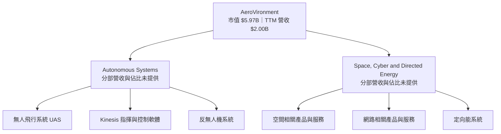
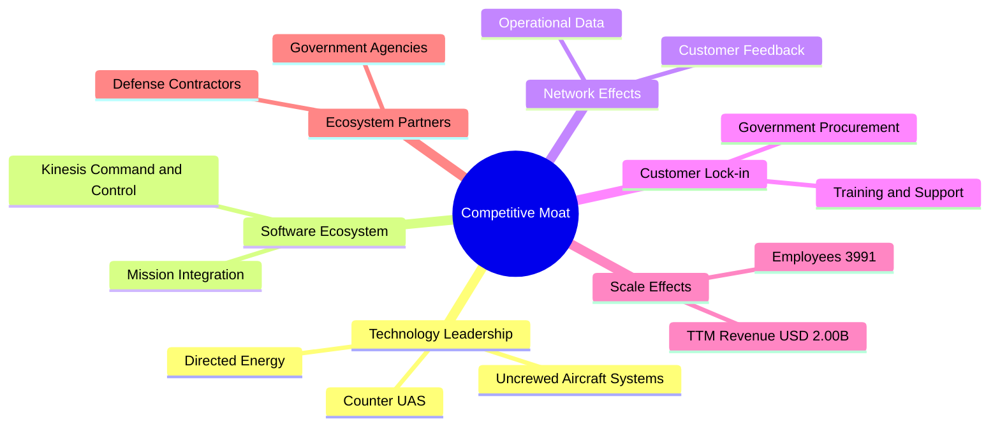
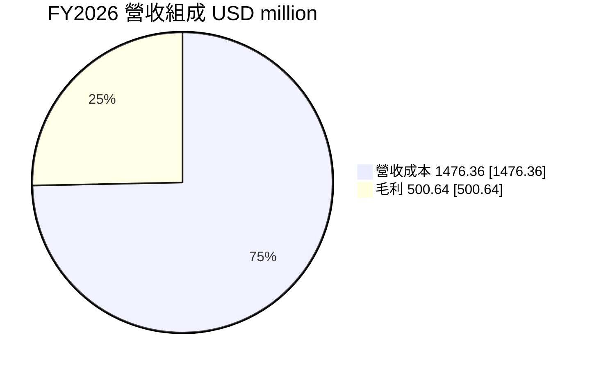
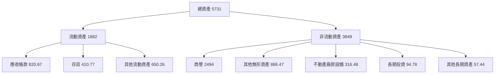
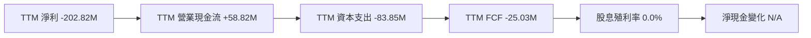
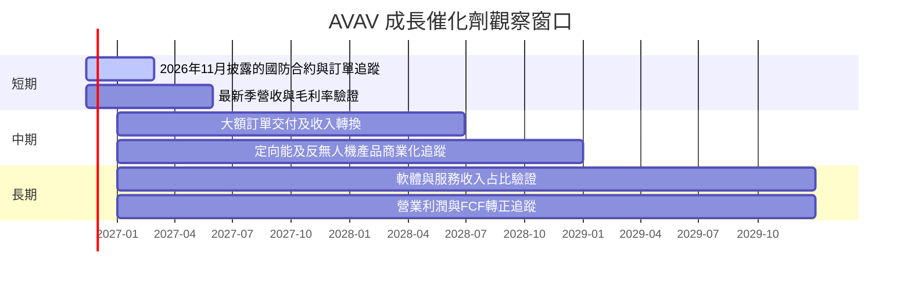
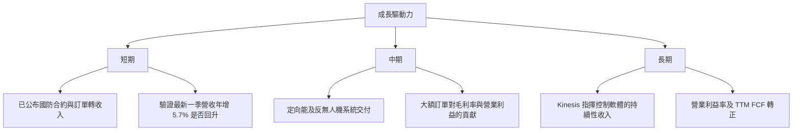
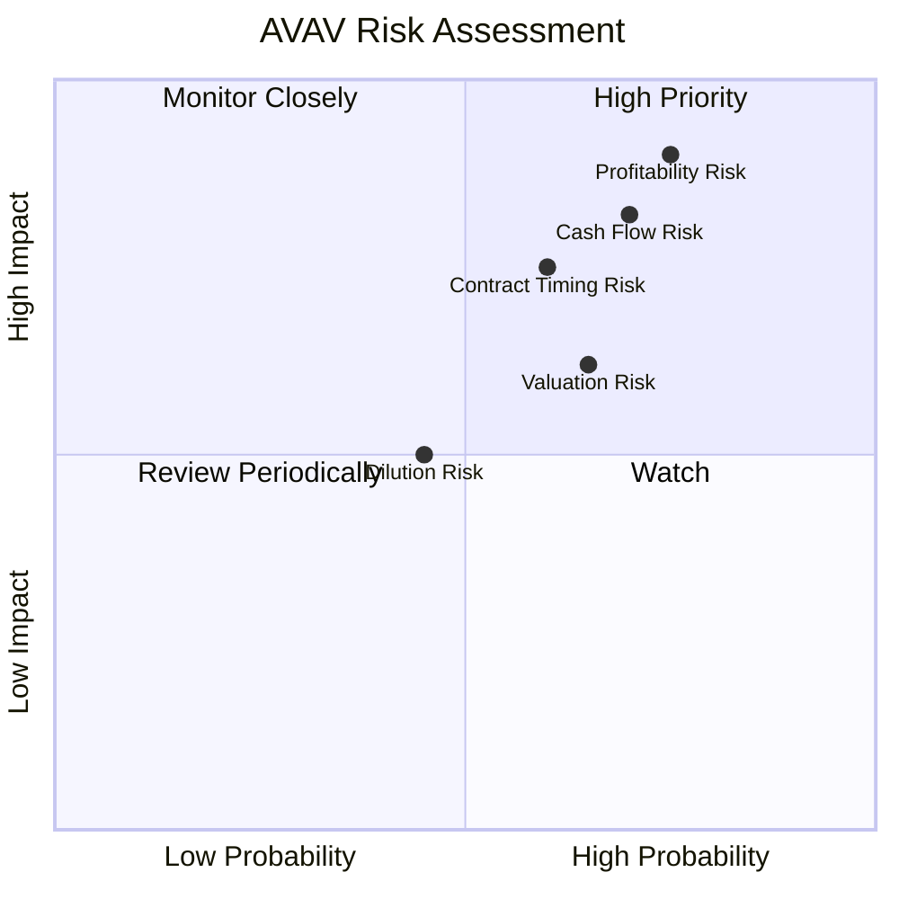
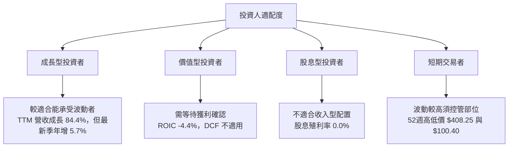

# AVAV 基本面深度分析報告
> **報告日期**：2026-11-14 ｜ **語言**：繁體中文 ｜ **數據來源**：SEC 申報資料 (XBRL)、Yahoo Finance、Finviz、StockAnalysis、Roic.ai ｜ **分析師**：CFA 級機構研究

## 目錄

| # | 章節 | 核心結論 |
|---|------|----------|
| 1 | 執行摘要 | 買入；加權合理價值 $144.78；MOS +18.8% |
| 2 | 公司概覽與商業模式 | 無人系統與國防科技業務具技術及客戶門檻；分部營收未提供 |
| 3 | 損益表深度分析 | TTM 營收 $2.00B、年增 84.4%；最新一季年增降至 5.7%，TTM 營業利益率為 -12.6% |
| 4 | 資產負債表分析 | 淨負債 $149.83M；現金及短期投資 $580.23M，短期流動性充足但資產併購後大幅擴張 |
| 5 | 現金流量深度分析 | TTM FCF -$25.03M、FCF Yield -0.42%；營運現金流尚正但資本支出較高 |
| 6 | 獲利能力與資本效率 | ROIC -4.4% 對 WACC 10.31%，目前未創造經濟價值 |
| 7 | 相對估值分析 | P/S 低於自身五年中位數；三種估值方法加權後高於現價 |
| 8 | DCF 內在價值評估 | TTM 營業利益為負，DCF 不適用；以相對估值與分析師共識三角驗證 |
| 9 | 成長催化劑 | 國防合約及定向能武器訂單提供機會；合約轉收入與利潤仍需追蹤 |
| 10 | 風險矩陣 | 獲利轉弱、現金流消耗、合約交付與估值預期是主要風險 |
| 11 | 投資建議 | 買入；以 $144.78 加權合理價值為基準，現價上行空間 +23.2% |

---

## 1. 執行摘要

### 1.0 一頁式投資儀表板（Portfolio Manager 30 秒速讀）

| 項目 | 內容 |
|------|------|
| **投資論點（3 句）** | ① TTM 營收達 **$2.00B、年增 84.4%**，擴張反映業務規模及訂單交付增加，但最新一季年增降至 **5.7%**，成長動能已有明顯放緩。② 估值方法加權後合理價值為 **$144.78**，較 2026-11-13 收盤價 **$117.52** 高 **23.2%**。③ ROIC **-4.4%** 低於 WACC **10.31%**，且 TTM FCF **-$25.03M**，買入論點依賴後續利潤與現金流改善，而非當前已成熟的獲利能力。 |
| **綜合評分** | **5.7/10**（引用 1.1 評分卡） |
| **財務健康** | 🟡 現金及短期投資 **$580.23M**、流動比率 **4.26**（Yahoo Finance），但淨負債 **$149.83M**、TTM FCF 為負。 |
| **ROIC vs WACC** | **-4.4% vs 10.31%**；目前差距 **-14.71 個百分點**，顯示尚未覆蓋資本成本。 |
| **FCF 趨勢** | TTM FCF **-$25.03M**；FCF Yield **-0.42%**。營業現金流為正，但資本支出超過營業現金流。 |
| **估值** | Forward P/E **26.66x**（Yahoo Finance）｜EV/EBITDA **28.43x**｜FCF Yield **-0.42%**（SEC 10-Q、價格資料庫及程式計算；估值資料源口徑可能不同） |
| **DCF 內在價值（基準）** | **N/A**；TTM 營業利益為負，不提供 DCF 價值，因此 DCF 折溢價亦為 N/A。 |
| **安全邊際（MOS）** | **+18.8%**＝(**加權合理價值 $144.78 − 現價 $117.52**) ÷ **加權合理價值 $144.78**；🟡 有限 |
| **預期報酬（基準情境 12M）** | **+23.2%**，以加權合理價值相對現價計算；這是估值差額，不是保證的 12 個月報酬。 |
| **關鍵風險（前二）** | TTM 營業利益率 **-12.6%**；TTM FCF **-$25.03M** 且資本支出高於營業現金流。 |
| **評級 + 信心度** | 🟢 **買入** ｜ 信心：中低；評級符合估值方法所得 MOS，但獲利及 DCF 能見度有限。 |

### 1.1 綜合評分卡（全報告唯一）

| 維度 | 評分（1–10） | 主要依據（引用數字與其來源章節） |
|------|--------------|----------------------------------|
| 成長性 | 7.0 | TTM 營收年增 84.4%，但最新一季年增為 5.7%，顯示基期與交付節奏造成成長波動（第 3 章）。 |
| 獲利能力 | 3.0 | TTM 營業利益率 -12.6%、ROIC -4.4%，Piotroski F-Score 為 4/9（第 3、6 章）。 |
| 財務健康 | 6.0 | 淨負債 $149.83M；現金及短期投資 $580.23M；CCC 由 135 天降至 92 天（第 4 章）。 |
| 估值 | 6.0 | MOS +18.8%；公司 P/S 2.9x，低於自身五年中位數 5.1x，但 FCF 為負且估值方法並非 DCF（第 7、8 章）。 |
| 護城河 | 7.0 | 無人系統、指揮控制軟體及防禦系統與政府客戶需求相關；但缺少市場份額、續約率與分部收入資料（第 2 章）。 |
| 管理層與資本配置 | 5.0 | FY2026 SBC $38.33M，年度資本支出 $86.22M，未提供足夠回購與併購回報資料，資本配置成效仍待現金流驗證（第 3、5 章）。 |
| **綜合評分** | **5.7** | 六項算術平均：(**7.0 + 3.0 + 6.0 + 6.0 + 7.0 + 5.0**) ÷ 6 = **5.7**（四捨五入至小數一位）。 |

### 1.2 五大投資論點 + 三大核心風險

| 類型 | 項目 | 具體依據 | 信心度 |
|------|------|----------|--------|
| 🟢 **投資論點①** | 國防需求及合約交付帶動規模 | TTM 營收 $2.00B、年增 84.4%；但此成長未同步轉成正營業利潤，需分辨有機成長與併購／交付時點影響。 | 🟡 中 |
| 🟢 **投資論點②** | 多產品線布局 | 公司業務包含無人機系統、反無人機及空間、網路與定向能相關業務，產品廣度可能降低單一產品依賴；各分部營收資料未提供。 | 🟡 中 |
| 🟢 **投資論點③** | CCC 改善 | CCC 由一年前 135 天降至 92 天，減少 43 天；若延續，可能降低成長所需營運資金。 | 🟡 中 |
| 🟢 **投資論點④** | 歷史估值相對收斂 | P/S 現為 2.9x，低於五年中位數 5.1x；但公司目前虧損，低倍數不必然代表低估。 | 🟡 中 |
| 🟢 **投資論點⑤** | 資產流動性仍有緩衝 | 現金及短期投資 $580.23M，對比總債務 $730.06M；仍為淨負債，但短期償債能力不只依靠營運現金流。 | 🟡 中 |
| 🟡 **風險①** | 獲利率及轉換能力不足 | TTM 營業利益率 -12.6%、ROIC -4.4%，FY2026 淨損 $265.12M；若營收無法轉化為正利潤，估值支撐會減弱。 | 🔴 高衝擊 |
| 🔴 **風險②** | 現金流與投資支出壓力 | TTM 營業現金流 $58.82M、資本支出 $83.85M，FCF 為 -$25.03M；持續負 FCF 會提高外部融資或延後投資的風險。 | 🔴 高衝擊 |
| 🟡 **風險③** | 訂單與交付節奏不穩 | 最新一季營收年增僅 5.7%，低於 TTM 年增 84.4%；營收若受政府預算、交付或驗收時點影響，季度波動可能擴大。 | 🟡 中 |

### 1.3 快速統計卡片

| 指標 | 公司實際值（期間） | 同業中位數 | 狀態 |
|------|--------------------|------------|------|
| 營收成長（TTM） | **84.4%** | — | 🟢 高成長，但受低基期及併購／交付時點影響 |
| 營收成長（最新一季年增） | **5.7%** | **35.7%** | 🔴 低於樣本同業中位數 |
| 毛利率（TTM） | **26.5%** | **23.0%** | 🟢 高於同業中位數 |
| 營業利益率（TTM） | **-12.6%** | — | 🔴 負值 |
| ROIC（TTM） | **-4.4%** | — | 🔴 低於 WACC |
| Forward P/E | **26.66x** | **24.1x** | 🟡 略高於 KTOS、LMT 中位數 |
| FCF Yield（TTM） | **-0.42%** | — | 🔴 FCF 為負 |
| Piotroski F-Score | **4 / 9** | — | 🟡 財務改善訊號有限 |

### 1.4 投資結論

╔══════════════════════════════════════════════════════════════════╗  
║                    📊 投資結論摘要                               ║  
╠══════════════════════════════════════════════════════════════════╣  
║  評級：買入（MOS +18.8%，符合 10%–25% 買入門檻）                 ║  
║  價格（2026-11-13 收盤）：$117.52                                 ║  
║  DCF 內在價值（基準）：N/A（TTM 營業利益為負）                   ║  
║  安全邊際 MOS：+18.8%（＝($144.78−$117.52)÷$144.78）             ║  
║  加權合理價值（8.8）：$144.78                                     ║  
║  綜合評分：5.7/10（引用 1.1）                                     ║  
║  適合投資人：可承受高波動、願意追蹤國防合約轉利潤的成長型投資人  ║  
╚══════════════════════════════════════════════════════════════════╝

---

## 2. 公司概覽與商業模式

### 2.1 業務結構與收入來源

公司資料顯示，AeroVironment 提供無人飛行系統、指揮控制軟體、反無人機系統及空間、網路與定向能相關產品與服務。分部營收與各業務佔比未提供，因此不推算分部金額或比例。

業務模式包括系統設計、製造、交付、維護與軟體支援。政府及國防客戶採購週期通常較長，合約與驗收時間會影響季度收入；沒有分部揭露時，無法量化軟體、服務或硬體的營收占比。

### 2.2 市場份額

市場份額數據未提供，亦沒有可引用的市場總額與年份資料，因此不繪製市占圖或填入比例。AVAV TTM 營收為 $2.00B、TTM 年增 84.4%，但最新一季年增率為 5.7%；相較 KTOS 最新一季 35.7% 及 LMT 11.3%，AVAV 最近一季成長落後這兩家同業。

### 2.3 競爭護城河分析

### 2.4 護城河強度

| 護城河項目 | 強度（強／中／弱） | 證據（引用數字或事實） | 會削弱它的情況 |
|------------|--------------------|------------------------|----------------|
| 技術與產品能力 | 中至強 | 業務涵蓋 UAS、反無人機、指揮控制及定向能；近期新聞提及 LOCUST X3 相關 $405M 國際訂單，但新聞標題不等同已認列營收。 | 競爭者快速追上、技術規格優勢無法轉為採購及毛利。 |
| 軟體與整合 | 中 | Kinesis 指揮控制軟體與硬體系統並行，可能提高任務整合價值；缺少軟體收入、續約率及客戶留存資料。 | 軟體無法形成持續性收入，或客戶採用競爭者平台。 |
| 政府客戶關係 | 中 | 公司向政府機構及企業供應系統、服務及支援；政府資格與任務經驗可能形成門檻。 | 國防預算延遲、合約轉由其他廠商取得、採購規格改變。 |
| 規模效應 | 中 | TTM 營收 $2.00B、員工 3,991 人；規模可能有助供應與研發，但 TTM 營業利益率為 -12.6%，尚未顯示規模已轉成利潤。 | 成本與整合費用隨規模同步增加，營業槓桿未出現。 |
| 網路效應 | 弱至中 | 任務資料與系統整合在理論上可能提升產品效用；沒有使用者、裝機量或資料網絡規模數字。 | 客戶間資料不能互通，或系統更換成本低。 |
| 生態夥伴 | 中 | 公司服務政府及企業客戶，並需融入國防供應鏈；合作夥伴及供應商依賴度未提供。 | 供應鏈瓶頸、關鍵零件受限或合作關係中斷。 |

1.1「護城河」評分為 **7.0/10**，依據是產品組合、政府客戶及系統整合特性；但市場份額、軟體經常性收入與客戶留存資料不足，且負營業利益率限制了對護城河變現能力的信心。

---

## 3. 損益表深度分析

### 3.1 年度收入成長趨勢（近 4 年）

以下使用年度損益表所列營收。FY2026 收入快速擴張，但營業利益由正轉負，顯示規模擴張未同步改善獲利。

╔══════════════════════════════════════════════════════════════════╗  
║              AeroVironment 年度收入趨勢（FY2023–FY2026）        ║  
╠══════════════════════════════════════════════════════════════════╣  
║ FY2023  $0.54B  █████░░░░░░░░░░░░░░░░  YoY：—                  ║  
║ FY2024  $0.72B  ███████░░░░░░░░░░░░░  YoY：+32.6% 🟢           ║  
║ FY2025  $0.82B  ████████░░░░░░░░░░░░  YoY：+14.5% 🟢           ║  
║ FY2026  $1.98B  ████████████████████  YoY：+140.9% 🟢          ║  
║                                                                  ║  
║ FY2023–FY2026 CAGR：((1.977 ÷ 0.54054)^(1/3)−1)＝約 +54.1%      ║  
╚══════════════════════════════════════════════════════════════════╝

TTM 營收 $2.00B，較前一 TTM 成長 84.4%，但最新一季年增只有 5.7%。因此不宜將單一年度或 TTM 高成長率直接外推；需要確認高基期下的訂單交付與新增合約是否能接續。

### 3.2 季度收入趨勢分析

| 季度 | 營收 | QoQ 成長 | YoY 成長 | 備註 |
|------|------:|---------:|---------:|------|
| 2025-10-31 | $472.51M | — | +150.72% | YoY 使用 StockAnalysis 季度數據。 |
| 2026-01-31 | $408.05M | -13.6% | +143.41% | QoQ = (408.05 ÷ 472.51) − 1。 |
| 2026-04-30 | $641.62M | +57.2% | +133.27% | QoQ = (641.62 ÷ 408.05) − 1；季度交付節奏可能造成波動。 |
| 2026-07-31 | $480.49M | -25.1% | +5.7% | 最新一季年增採 SEC 10-Q／程式計算數值；不可視為 TTM 成長率。 |

最新一季較前季下降，且年增率較此前三季大幅降低；這與國防承包商可能存在的交付與驗收時點波動相容，但僅憑現有資料不能確認具體原因。QoQ 變動衡量季度節奏，不宜與季節性調整後成長混為一談。

### 3.3 利潤率演變分析

| 利潤率指標 | FY2023 | FY2024 | FY2025 | FY2026 | 趨勢 | 評估 |
|------------|-------:|-------:|-------:|-------:|------|------|
| **毛利率** | 32.1% | 39.6% | 38.8% | 25.3% | FY2026 明顯收縮 | 🔴 |
| **營業利益率** | -4.2% | 10.0% | 7.2% | -3.6% | FY2026 由正轉負 | 🔴 |
| **淨利率** | -32.6% | 8.3% | 5.3% | -13.4% | FY2026 轉為大幅虧損 | 🔴 |

年度毛利率依毛利 ÷ 營收計算；年度營業與淨利率依年度損益表計算。另依 SEC 10-Q 計算的 TTM 營業利益率為 **-12.6%**，不同資料來源與期間口徑的營業利益率出現差異；本報告在涉及 TTM 時使用指定的 SEC 10-Q 計算值，FY 年度比較則列示年度損益表口徑。

**利潤率演變深度解析：** FY2026 毛利率由 FY2025 約 38.8% 降至約 25.3%，而營業利益由 FY2025 的 $59.15M 轉為 FY2026 的 -$70.29M。同期研發費用由 $100.73M 增至 $127.68M，增加 $26.95M，說明投入增加是費用壓力之一；但僅憑現有資料不能將毛利率下降全部歸因於研發，產品組合、併購與成本結構的分項影響均未提供。未來需觀察毛利率能否回升，以及新增收入能否帶來營業槓桿。

### 3.4 費用結構分析

FY2026 可由年度收入及毛利拆分營收成本與毛利；這不是完整營業費用分類，亦不代表研發、銷售及管理等項目的占比。

FY2026 營收 $1,977.00M、毛利 $500.64M，因此營收成本為 $1,476.36M（$1,977.00M − $500.64M）。年度營業利益為 -$70.29M，表示毛利不足以覆蓋營業費用；具體費用分項需要查閱完整 10-K 附註，現有摘要資料不足以進一步拆分。

### 3.5 季度 EPS 趨勢與盈餘品質（Quality of Earnings）

| 季度 | EPS 實際值 | 預期值 | 超預期／不及預期 | 已知季度淨利 |
|------|-----------:|-------:|------------------|-------------:|
| 2025-10-31 | -$0.34 | N/A | N/A；EPS 預期值為空 | -$17.10M |
| 2026-01-31 | -$3.15 | N/A | N/A；EPS 預期值為空 | -$243.82M |
| 2026-04-30 | -$0.48 | N/A | N/A；EPS 預期值為空 | -$24.10M |
| 2026-07-31 | -$0.10 | N/A | N/A；EPS 預期值為空 | -$5.07M |

EPS 實際值取 StockAnalysis 季度資料；盈餘驚喜資料中的 EPS Est 與 EPS Act 為缺失值，因此無法判斷四季是否超預期。2026-01-31 季度淨損顯著高於其他季度，但缺乏足以確認其一次性項目構成的附註，不能將其直接歸因為某一特定非經常性項目。

| 盈餘品質項目 | 數值／佔比 | 評估 |
|--------------|------------|------|
| 股權薪酬 SBC / 營收 | 近四季 SBC 約 $31.84M ÷ TTM 營收 $2,003M = **約 1.6%** | 🟡 SBC 不是最大費用項，但持續股權薪酬會稀釋現有股東。四季 SBC 由季度資料加總。 |
| SBC / 營業現金流 | 約 $31.84M ÷ $58.82M = **約 54.1%** | 🟡 SBC 規模相當於營業現金流約一半；SBC 為非現金費用，並不等於可分配股東的現金。 |
| FCF / 淨利（現金轉換率） | TTM FCF -$25.03M；TTM 淨利 -$202.82M；機械比值約 **12.3%** | 🔴 負淨利下此比值容易誤導，不應以正的比值解讀為良好現金轉換。 |
| 一次性／非經常性損益 | **N/A** | FY2026 淨損 -$265.12M，現有摘要未提供足夠明細來辨認或量化一次性項目。 |
| 有效稅率異常 | **N/A** | 未提供可核對的 TTM 所得稅費用及稅前利潤細項，不能計算有效稅率。 |
| 資本化支出 vs 費用化 | TTM 資本支出 $83.85M；資本化明細 N/A | 資本支出金額可得，但缺少資本化政策、無形資產新增及折舊攤銷細項，無法判斷是否存在成本遞延。 |

**盈餘品質結論：** 公司目前是虧損且 TTM FCF 為負，GAAP 盈餘並未提供正向估值錨。SBC 對營收占比約 1.6%，對營業現金流的相對規模卻約 54.1%；因此需要同時監控股數稀釋與營業現金流，而不能只看調整後盈利或營收成長。估值應優先參照收入倍數、並以毛利及 FCF 轉正作為確認條件。

---

## 4. 資產負債表分析

### 4.1 資產結構分解

截至 2026-08-01，總資產約 $5.731B；下圖列出可核對的主要項目，單位為 USD million。其餘項目合計以其他長期資產表示。

流動資產扣除應收帳款、存貨後的其他流動資產約 $650.26M，按 $1,882M − $820.97M − $410.77M 計算。非流動資產主要包括商譽及其他無形資產，合計 $3.380B，約占總資產 59.0%；這提高了對收購資產未來現金流與減損風險的關注。

### 4.2 流動性與營運資金分析

| 指標 | 最新 TTM | 一年前 TTM | 變化 | 解讀 |
|------|----------:|----------:|-----:|------|
| DSO 應收帳款天數 | 33 天 | 67 天 | -34 天 | 收款天數下降，可能反映應收回收或期間結構改善；仍需觀察政府客戶驗收與回款是否維持。 |
| DIO 存貨天數 | 102 天 | 113 天 | -11 天 | 存貨天數下降，但 102 天仍代表需要持續投入營運資金，需搭配交付與存貨備貨計畫解讀。 |
| DPO 應付帳款天數 | 43 天 | 44 天 | -1 天 | 基本持平，未顯示透過延長付款天數明顯改善現金循環。 |
| CCC 現金轉換週期 | 92 天 | 135 天 | -43 天 | 營運資金轉換週期縮短，降低資金占用；若成長重新加速仍可能帶來額外應收與庫存需求。 |

流動比率 **4.26**、速動比率 **3.185**（Yahoo Finance）顯示短期資產覆蓋流動負債的能力不弱。但比率高不等於現金可自由分配：現金及短期投資為 $580.23M，且 TTM FCF 為負。

### 4.3 債務結構分析

指定的 SEC 10-Q 計算值為總債務 $730.06M、現金及短期投資 $580.23M，淨負債 $149.83M。其他資料來源列示的總債務較高，口徑可能包含不同負債項目；此處採用指定的 SEC 10-Q 口徑。

╔══════════════════════════════════════════════════════════════════╗  
║                   AVAV 債務健康診斷                              ║  
╠══════════════════════════════════════════════════════════════════╣  
║  總債務：          $730.06M  ██████████████████░░                ║  
║  現金及短期投資：  $580.23M  ██████████████░░░░░░                ║  
║  淨負債：          $149.83M  ████░░░░░░░░░░░░░░░░  🟡           ║  
║                                                                  ║  
║  流動比率：4.26x（Yahoo Finance）                                ║  
║  Debt/EBITDA：不宜採用；TTM EBITDA 口徑與盈利為負／資料來源不一致 ║  
║  利息保障倍數：N/A（缺少可核對的利息費用與 EBIT 配套期間數據）   ║  
║  結論：短期流動性有緩衝；負 FCF 與淨負債使中期融資能力仍須監控  ║  
╚══════════════════════════════════════════════════════════════════╝

### 4.4 股東權益趨勢

FY2026 股東權益增加幅度很大，與資產負債表擴張同時發生；但股權增加不等於營運獲利，需區分發行、收購會計及留存損益的來源。

╔══════════════════════════════════════════════════════════════════╗  
║              歷年股東權益（USD billion）                        ║  
╠══════════════════════════════════════════════════════════════════╣  
║ FY2023  $0.551B  ███░░░░░░░░░░░░░░░░░                            ║  
║ FY2024  $0.823B  █████░░░░░░░░░░░░░░░                            ║  
║ FY2025  $0.887B  █████░░░░░░░░░░░░░░                            ║  
║ FY2026  $4.400B  ████████████████████                            ║  
╚══════════════════════════════════════════════════════════════════╝

FY2026 權益增加至 $4.40B，而 FY2025 為 $886.51M；同期間總資產由 $1.12B 擴大至 $5.72B。此變化幅度需要結合完整股本及併購附註解讀，不能單憑帳面權益增加判斷每股內在價值提升。

---

## 5. 現金流量深度分析

### 5.1 現金流量瀑布圖

以下為 TTM 指定口徑：FCF＝營業現金流減資本支出。淨利採 StockAnalysis TTM 數據作為補充，股息殖利率為 0.0%；回購及淨現金變化未提供。

營業現金流為正但低於資本支出，表示公司在維持或擴大產能及其他資本投資後仍未產生正 FCF。圖中不將資本支出後的剩餘現金直接等同可供股東分配金額，因為營運資金、融資及收購現金流未在此瀑布中完整列出。

### 5.2 FCF 轉換率趨勢

| 財年／期間 | 營業現金流 | 資本支出 | FCF | 淨利 | FCF / 淨利 |
|-----------|-----------:|---------:|----:|-----:|-----------:|
| FY2023 | $11.40M | $14.87M | -$3.47M | -$176.21M | 約 2.0%* |
| FY2024 | $15.29M | $24.48M | -$9.19M | $59.67M | -15.4% |
| FY2025 | -$1.32M | $22.82M | -$24.13M | $43.62M | -55.3% |
| FY2026 | -$78.40M | $86.22M | -$164.62M | -$265.12M | 約 62.1%* |
| TTM 至 2026-08-01 | $58.82M | $83.85M | -$25.03M | -$202.82M | 約 12.3%* |

\* 淨利為負時，FCF／淨利比例不具一般的現金轉換解讀，僅列示算術比值。FY2025 的 FCF 採現金流量表列示值；原始數據中個別 FCF 欄位可能有四捨五入或分類差異。年度與 TTM 的資本支出資料來源口徑可能不完全一致，不將兩者混為同一序列。

### 5.3 自由現金流趨勢

年度現金流量表列示 FY2026 FCF 為 -$164.62M；指定 TTM 計算值為 -$25.03M。兩個數字的期間不同，TTM 數字用於本報告 FCF Yield 與核心 TTM 評估。

╔══════════════════════════════════════════════════════════════════╗  
║         自由現金流：歷史年度值與最新 TTM（USD million）         ║  
╠══════════════════════════════════════════════════════════════════╣  
║ FY2023  -$3.47M    █░░░░░░░░░░░░░░░░░░░░  FCF Yield：N/A       ║  
║ FY2024  -$9.19M    ██░░░░░░░░░░░░░░░░░░░  FCF Yield：N/A       ║  
║ FY2025  -$24.13M   ███░░░░░░░░░░░░░░░░░░  FCF Yield：N/A       ║  
║ FY2026  -$164.62M  ████████████████████░  FCF Yield：N/A       ║  
║ TTM      -$25.03M  ███░░░░░░░░░░░░░░░░░░  FCF Yield：-0.42%    ║  
╠══════════════════════════════════════════════════════════════════╣  
║ FY2026 年度 FCF 顯著轉負；TTM 測值較年度值收斂，但仍為負。     ║  
╚══════════════════════════════════════════════════════════════════╝

### 5.4 資本配置評估

股息殖利率為 0.0%；回購金額、併購現金流與各項資本配置百分比未提供，因此不繪製比例圓餅圖。

| 資本配置項目 | 可得資料 | 評估 |
|--------------|----------|------|
| 資本支出 | TTM $83.85M；FY2026 $86.22M | TTM 資本支出高於營業現金流 $58.82M，短期內壓低 FCF。 |
| 股息 | 殖利率 0.0% | 目前未形成現金股息回報。 |
| 回購 | N/A | 無足夠回購資料，不能判斷回購是否抵銷 SBC 稀釋。 |
| 研發投入 | FY2026 $127.68M | 研發投入可支援產品開發，但仍須觀察新產品能否轉化為毛利及現金流。 |
| 留存／現金變化 | N/A | 無法把現金增減完整歸因至營運、融資或收購活動。 |

---

## 6. 獲利能力與資本效率

### 6.1 ROE / ROA / ROIC 趨勢

| 指標 | 最新可得值 | 其他期間數據 | 評估 |
|------|-----------:|--------------|------|
| ROE（TTM） | -4.6% | 歷年同口徑序列 N/A | 虧損拖累股東回報；杜邦分解顯示主要是負淨利率。 |
| ROA（TTM） | -0.1% | 歷年同口徑序列 N/A | 資產規模大幅擴張後尚未產生正資產回報。 |
| ROIC（TTM） | -4.4% | 歷年同口徑序列 N/A | 低於 10.31% WACC，現階段摧毀而非創造經濟價值。 |

沒有可核對的同口徑行業均值，因此不列行業比較欄。FY2026 資產與權益明顯擴張，資產基礎擴大而營業利益為負，解釋了資本效率數據疲弱的方向。

### 6.2 ROIC vs WACC 分析（核心價值創造判斷）

╔══════════════════════════════════════════════════════════════════╗  
║                ROIC vs WACC 深度分析                            ║  
╠══════════════════════════════════════════════════════════════════╣  
║ WACC 估算：                                                      ║  
║ ├── 無風險利率（10Y 美債）：5.15%                               ║  
║ ├── 市場風險溢酬 ERP：5.00%                                     ║  
║ ├── 原始 Beta：1.40；採用調整後 Beta：1.27                     ║  
║ ├── 股權成本 Ke：5.15% + 1.27 × 5.00% = 11.50%                 ║  
║ ├── 稅前債務成本 Kd：0.77%；稅後約 0.61%                        ║  
║ ├── 資本結構：股權 89.1%，債務 10.9%                            ║  
║ └── WACC：89.1% × 11.50% + 10.9% × 0.61% = 10.31%              ║  
║                                                                  ║  
║ ROIC（TTM）：-4.4%                                               ║  
║ EVA spread：-4.4% − 10.31% = -14.71 個百分點                   ║  
║                                                                  ║  
║ 結論：ROIC 低於 WACC；現階段尚未覆蓋資本成本，經濟價值為負。   ║  
╚══════════════════════════════════════════════════════════════════╝

計算式使用指定的資本成本輸入。Beta 採用調整後 1.27，原始 Beta 1.40；債務成本及資本結構權重均採成本資本資料中的口徑。WACC 與 ROIC 的差額為 -14.71 個百分點，表明現有營運績效不足以彌補投資人要求的資本回報。若未來營業利益及資產利用率改善，這一差距才有可能收斂。

### 6.3 杜邦三因素分解

| 因素 | 數值（TTM） | 解讀 |
|------|-------------|------|
| 淨利率 | -10.1% | 虧損是 ROE 為負的主要來源。 |
| 資產週轉率 | 0.35 | 每單位資產帶來約 0.35 單位營收；擴張後資產效率仍待改善。 |
| 權益乘數 | 1.30 | 槓桿不是主要支撐 ROE 的因素。 |
| **ROE** | **-4.6%** | **-10.1% × 0.35 × 1.30 = -4.6%**（依 QUALITY FIGURES 原值列示，乘積因四捨五入略有差異）。 |

ROE 的主要問題是負淨利率，而非過度槓桿。因分項數字均經四捨五入，列示乘積可能與原始未四捨五入 ROE 有微小差異。

### 6.4 財務體質：Piotroski F-Score

Piotroski F-Score 為 **4 / 9**。依 QUALITY FIGURES，九項測試均有列示結果：

| 測試 | 結果 | 解讀 |
|------|------|------|
| ROA > 0 | ❌ 未通過 | 公司仍未在 TTM 口徑產生正資產回報。 |
| 營業現金流 > 0 | ✅ 通過 | TTM 營業現金流為 $58.82M。 |
| ROA 高於一年前 | ❌ 未通過 | 資產回報未改善至通過條件。 |
| 營業現金流 > 淨利（應計品質） | ✅ 通過 | 現金流相對會計盈餘的測試通過；但不代表 FCF 為正。 |
| 長期負債 ÷ 總資產低於一年前 | ✅ 通過 | 長期負債相對資產的測試改善。 |
| 流動比率高於一年前 | ❌ 未通過 | 流動比率相較一年前未達改善條件。 |
| 稀釋股數未增加 | ❌ 未通過 | 股數增加顯示股東稀釋風險。 |
| 毛利率高於一年前 | ❌ 未通過 | 毛利率未改善，與 FY2026 年度毛利率下滑方向一致。 |
| 資產週轉率高於一年前 | ✅ 通過 | 資產週轉率相較一年前改善。 |

4/9 代表部分現金流、槓桿與週轉指標通過，但獲利、毛利率、流動比率及稀釋股數測試未通過；此分數不支持將高營收成長直接視為高品質成長。

---

## 7. 相對估值分析

### 7.1 同業估值比較表格

同業倍數取 Yahoo Finance Peer multiples。ONDS 為未盈利公司，部分倍數不具傳統解讀；Forward P/E 中位數依指定估值方法使用 KTOS 與 LMT 中位數 24.1x。

| 估值指標 | **AVAV** | **KTOS** | **ONDS** | **LMT** | AVAV 評估 |
|----------|---------:|---------:|---------:|---------:|-----------|
| **Trailing P/E** | N/A | 282.6x | N/A | 21.2x | 🔴 AVAV TTM 虧損，無法使用 P/E。 |
| **Forward P/E** | 26.66x | 30.3x | -33.3x | 17.9x | 🟡 AVAV 高於 KTOS、LMT 中位數 24.1x；ONDS 負值不適合納入。 |
| **P/S Ratio** | 2.98x | 3.9x | 9.2x | 1.7x | 🟢 AVAV 低於三家同業 P/S 中位數 3.9x，但獲利能力較弱。 |
| **EV/EBITDA** | 28.43x | 58.1x | -8.0x | 15.4x | 🟡 高於 LMT、低於 KTOS；ONDS 為負值而不可直接比較。 |
| **最新一季營收 YoY** | 5.7% | 35.7% | 1,558.6% | 11.3% | 🔴 AVAV 低於 KTOS 與 LMT；ONDS 成長率因基數與公司規模差異，解讀需審慎。 |
| **TTM 毛利率** | 26.5% | 23.0% | 36.4% | 11.7% | 🟢 高於 KTOS、LMT，但低於 ONDS。 |

同業比較顯示 AVAV 的收入倍數不算最高，但最新季度營收動能相對較弱，且營業利益率為負。相對倍數折價只有在公司能改善獲利時才有充分意義。

### 7.2 歷史估值區間分析

╔══════════════════════════════════════════════════════════════════╗  
║              AVAV 五年歷史 P/S 區間                             ║  
╠══════════════════════════════════════════════════════════════════╣  
║ 五年區間：3.0x ───────── 中位數 5.1x ───────── 13.4x             ║  
║ 現值：2.9x  ●（目前低於歷史區間下緣）                           ║  
║ 當前百分位：0%                                                   ║  
║                                                                  ║  
║ 解讀：目前 P/S 相較自身歷史偏低；但公司 TTM 營業利益率為 -12.6%，║  
║ 不能僅憑歷史倍數回歸假設推導其合理價值。                        ║  
╚══════════════════════════════════════════════════════════════════╝

### 7.3 情境價值（Bear / Base / Bull）

**N/A（DCF 無法計算：TTM 營業利益不為正）**。依規則不自行建立 DCF 情境或設定情境目標價。

### 7.4 相對估值隱含價格區間

以下按固定估值方法列示；股價為 **2026-11-13 收盤 $117.52**。

╔══════════════════════════════════════════════════════════════════╗  
║                  相對估值方法與現價位置                          ║  
╠══════════════════════════════════════════════════════════════════╣  
║ 同業 Forward P/E：$106.30  ── 現價 $117.52 ──                   ║  
║ 同業 P/S：       $152.78  ───────────────────────               ║  
║ 分析師共識：     $212.20  ─────────────────────────────────      ║  
╚══════════════════════════════════════════════════════════════════╝

| 方法 | 每股價值 | 依據 |
|------|---------:|------|
| 同業 Forward P/E | **$106.30** | KTOS、LMT 中位數 Forward P/E **24.1x** × AVAV Forward EPS **$4.41**。 |
| 同業 P/S | **$152.78** | KTOS、ONDS、LMT P/S 中位數 **3.9x** × AVAV TTM 營收，依固定模型換算每股價值。 |
| 分析師共識目標價 | **$212.20** | 23 位分析師平均目標價；此為外部參考，不等於基本面已達成的價值。 |

Forward P/E 方法隱含價值低於現價，而 P/S 及分析師共識高於現價，估值分歧反映公司未來盈利轉換仍不確定。

---

## 8. DCF 內在價值評估（Discounted Cash Flow）

### 8.0 估值推理鏈（Thinking Logic）

**本節結論：DCF 不適用，故不建立 DCF 模型、不提供 DCF 每股價值。** SEC 10-Q 計算的 TTM 營業利益率為 -12.6%，即 TTM 營業利益為負。將負營業利益直接延伸到未來折現，無法形成可靠的持續經營現金流估值；擅自假設利潤率轉正、營收 CAGR 或終值參數則會形成無法由現有資料驗證的模型。

AVAV 的價值可能來自現有無人系統與國防業務、空間／網路／定向能業務，以及未來利潤率回升後的現金流；但各分部營收占比、產品毛利、現金流及未來利潤率均未提供，不能量化各部分占比或指定主導估值變數。與其建立黑箱 DCF，本報告採用固定相對估值方法並在 8.8 計算唯一加權合理價值。

### 8.1 模型假設總表（Model Inputs）

**N/A（未建立 DCF：TTM 營業利益為負）。** 因模型不適用，不設定預測期、營收 CAGR、營業利潤率、稅率、Capex／營收、D&A／營收、營運資金、SBC 組合、稀釋率或永續成長率；亦不以假設值替代缺少的模型輸入。

### 8.2 折現率推導（WACC）

DCF 模型不適用，但 ROIC 比較所用資本成本採用同一組指定 WACC 輸入：

╔══════════════════════════════════════════════════════════════════╗  
║                    WACC 輸入（非 DCF 估值）                      ║  
╠══════════════════════════════════════════════════════════════════╣  
║ Rf：5.15% ｜ ERP：5.00% ｜ 原始 Beta：1.40                      ║  
║ 調整後 Beta：1.27 ｜ Ke：5.15% + 1.27 × 5.00% = 11.50%         ║  
║ 稅前 Kd：0.77% ｜ 稅率：21.0%                                  ║  
║ 股權／債務權重：89.1%／10.9%                                  ║  
║ WACC：89.1% × 11.50% + 10.9% × [0.77% × (1−21.0%)]             ║  
║      = 10.31%                                                   ║  
╚══════════════════════════════════════════════════════════════════╝

該 WACC 用於第 6.2 節 ROIC 對資本成本比較；因 DCF 模型為 N/A，不將其用作折現率推導內在價值。

### 8.3 逐年自由現金流預測（基準情境）

**N/A（DCF 無法計算：TTM 營業利益不為正）。** 不提供逐年營收、NOPAT、FCFF、折現因子、現值加總或代表年度演算，以免自行建立第二套 DCF。故無法計算模型 FCF CAGR、終期 FCF 利潤率或與歷史 FCF 的可比差距。

### 8.4 終值計算（Terminal Value）

**N/A（DCF 模型未建立，無預測期最後一年 FCFF、永續成長率 g 或可用終值基礎）。** 不推算 Gordon Growth 或退出倍數終值。

### 8.5 企業價值 → 每股內在價值（Bridge）

**N/A（沒有 DCF 企業價值與終值現值，故不能進行 EV 至股權價值的 DCF 橋接）。** 本節不計算 DCF 折溢價，也不計算安全邊際；MOS 僅於 8.8 以加權合理價值作分母計算。

### 8.6 敏感性分析（WACC × 永續成長率）

**N/A（DCF 模型為 N/A，缺少可作敏感度測試的 FCFF、終值及基準每股價值）。** 不建立 5×5 矩陣、三情境 DCF 或機率加權 DCF；也不推導 g、WACC 或利潤率的每單位敏感度。

### 8.7 反推 DCF（Reverse DCF：市場在預期什麼）

**N/A（DCF 模型為 N/A）。** 現價無法在不存在的基準 DCF 中反推單一營收 CAGR、利潤率、永續成長率或預測期長度；因此不提供無法複核的市場隱含營運假設。

### 8.8 估值三角驗證與安全邊際

| 估值方法 | 隱含每股價值 | 上行空間（÷現價） | 權重 | 說明 |
|----------|--------------:|------------------:|------:|------|
| 同業 Forward P/E | $106.30 | -9.5% | 30% | KTOS、LMT 中位數 24.1x × AVAV Forward EPS $4.41。 |
| 同業 P/S | $152.78 | +30.0% | 60% | KTOS、ONDS、LMT 中位數 P/S 3.9x × AVAV TTM 營收。 |
| 分析師共識目標價 | $212.20 | +80.6% | 10% | 23 位分析師的平均目標價。 |
| **加權合理價值** | **$144.78** | **+23.2%** | **100%** | 未納入 DCF：公司類型為未盈利，且 DCF 模型未計算。 |

**逐步演算（權重外顯）：**

加權合理價值  
= $106.30 × 30% + $152.78 × 60% + $212.20 × 10%  
= $31.890 + $91.668 + $21.220  
= **$144.778 ≈ $144.78**

MOS（價值作分母）  
= ($144.78 − $117.52) ÷ $144.78  
= $27.26 ÷ $144.78  
= **18.8%**

上行空間（現價作分母）  
= ($144.78 − $117.52) ÷ $117.52  
= $27.26 ÷ $117.52  
= **23.2%**

權重合計為 30% + 60% + 10% = **100%**。該權重由未盈利公司類型的固定方法設定；因 TTM 營業利益不為正，DCF 未列入可計算的方法。MOS 使用加權合理價值作分母；與 DCF 內在價值相關的折溢價為 N/A。

╔══════════════════════════════════════════════════════════════════╗  
║                  估值區間與安全邊際                              ║  
╠══════════════════════════════════════════════════════════════════╣  
║ $106.30 ───── $117.52 ───── [$144.78] ───── $152.78 ───── $212.20║  
║ 同業 Forward P/E  現價       加權合理值      同業 P/S     共識目標║  
║                                                                  ║  
║ 安全邊際 MOS = ($144.78 − $117.52) ÷ $144.78 = +18.8%          ║  
║ MOS 評估：🟡 有限（10%–25%）                                    ║  
║ 上行空間 = ($144.78 − $117.52) ÷ $117.52 = +23.2%               ║  
║                                                                  ║  
║ 建議買入區間：$100.40–$130.30（參考52週低點與MOS≥10%上限）      ║  
║ 合理持有參考：$130.30–$152.78（高於加權值後上行緩衝收窄）       ║  
║ 減碼考慮：高於 $212.20，須由獲利與現金流實現支撐                 ║  
╚══════════════════════════════════════════════════════════════════╝

買入區間上限 $130.30 由加權合理價值乘以 90% 推得：$144.78 × 0.90 = $130.302，四捨五入為 $130.30。區間下限取 52 週低點 $100.40 作為觀察參考，不代表保證支撐位。

> 🔎 **程式複算（Python，依本節各項自動重算）**
>
> 加權合理價值 = $106.30 × 30% + $152.78 × 60% + $212.20 × 10% = **$144.78**（權重合計 100%）
>
> 以價格 $117.52 計：MOS = **+18.8%**，上行空間 = **+23.2%**
>
> ✅ 與本節所寫數值一致。

### 8.9 DCF 模型的局限與失效條件

- **終值依賴度：** N/A；DCF 未建立，沒有可計算的終值占企業價值比例。
- **最脆弱的估值環節：** 加權價值中 60% 權重來自 P/S 方法，若營收成長不能轉為毛利、營業利潤與 FCF，收入倍數估值可能下修。
- **不適用情境：** TTM 營業利益率 -12.6%、TTM FCF -$25.03M，短期 DCF 可靠度低。此階段應以收入倍數、同業相對估值與營運現金流趨勢交叉驗證；若未來能穩定轉正，再考慮 DCF。
- **與第 10 章風險矩陣的連結：** 訂單延遲會壓低營收成長；成本超支或產品組合惡化會拖累毛利率；資本支出與營運資金需求上升會使 FCF 更負。上述因素均會削弱目前 P/S 估值依據。

### 8.10 複算檢核表（Audit Trail）

因 DCF MODEL 為 N/A，涉及 DCF 逐年預測、終值、橋接及敏感度的檢核不適用；其餘可核對項目如實列示。

| # | 檢核項目 | 檢查方式 | 結果 |
|---|----------|----------|------|
| 1 | DCF 高／中敏感度輸入均有推導 | DCF 未建立，沒有模型輸入 | N/A |
| 2 | 模型假設均有來源 | 未設定 DCF 假設 | N/A |
| 3 | WACC 算式與權重 | 89.1% + 10.9% = 100%；依輸入計算為 10.31% | ✅ |
| 4 | Kd 與債務權重範圍一致 | 此 WACC 直接採用資本成本輸入；無另建 DCF 負債口徑 | N/A |
| 5 | WACC 與第 6.2 節相同 | 均為 10.31% | ✅ |
| 6 | 預測年度數與 N 一致 | 沒有預測期 N | N/A |
| 7 | FY+1 FCFF 可複算 | 無 DCF 預測年度 | N/A |
| 8 | 預測期 PV 加總 | 無 DCF 預測現值 | N/A |
| 9 | WACC > g | 未設定 g | N/A |
| 10 | 終值採 FY+N 並折現 N 期 | 沒有終值 | N/A |
| 11 | DCF 橋接可複算 | 沒有 DCF EV | N/A |
| 12 | SBC 組合一致 | 未建 DCF，未套用 SBC 模型組合 | N/A |
| 13 | 敏感性基準格與 DCF 一致 | 無敏感性矩陣 | N/A |
| 14 | 矩陣有效格條件 | 無敏感性矩陣 | N/A |
| 15 | 三情境機率總和 | 無 DCF 情境 | N/A |
| 16 | 反推 DCF 單變數求解 | 無 DCF 模型 | N/A |
| 17 | MOS 與折溢價分母 | MOS 使用 8.8 加權值；DCF 折溢價為 N/A | ✅ |
| 18 | 報告完整到第 11 章 | 已列出第 1 至第 11 章 | ✅ |
| 19 | 加權合理價值等於加權總和 | $31.890 + $91.668 + $21.220 = $144.778 | ✅ |
| 20 | 評級符合 MOS 門檻 | MOS +18.8%，對應買入 | ✅ |

---

## 9. 成長催化劑

### 9.1 催化劑時間軸

下表以已披露新聞與業務資訊標示觀察窗口；具體收入貢獻及合約交付日期未提供。

已知近期新聞提及 $720M 國防 awards、$405M 國際 LOCUST 系統訂單等。但新聞標題所述 award、訂單或銷售額未必等於已簽署、已交付或已認列收入，應逐季以 SEC 申報資料及公司財測核實。

### 9.2 TAM 市場規模分析

**N/A（TAM 數據未提供）。** 無人機、反無人機及定向能市場規模與年份未提供可核對的公司或第三方數字，不估算 TAM 或滲透率。AVAV TTM 營收 $2.00B、年增 84.4%，但最新一季年增率降至 5.7%；成長空間應透過訂單轉換、產品交付與分部營收逐季驗證。

### 9.3 成長驅動力結構圖

---

## 10. 風險矩陣

### 10.1 風險評分矩陣

下圖座標為研究分析對風險可能性與衝擊程度的**定性判斷**，不是公司披露的統計機率；座標僅用於相對排序。

### 10.2 風險清單詳細分析

| # | 風險項目 | 發生機率 | 財務衝擊 | 風險評分 | 緩解措施 |
|---|----------|----------|----------|----------|----------|
| 1 | 🔴 **獲利率持續為負** | 中高；定性估計 | 若 TTM 營業利益率維持 -12.6%，營收擴張不能轉為營業利益，P/S 估值可能下降；無法可靠量化收入衝擊百分比。 | 🔴 高 | 逐季核對毛利率、研發及營業費用、營業利益；營業利益率連續兩季未改善時重新檢視估值。 |
| 2 | 🔴 **FCF 持續為負** | 中高；定性估計 | TTM FCF -$25.03M，資本支出 $83.85M 高於營業現金流 $58.82M；持續負 FCF 可能增加融資及稀釋需求。 | 🔴 高 | 監控營業現金流、Capex、FCF 及現金餘額；檢查資本支出是否產生相應產能與合約收入。 |
| 3 | 🟠 **合約與交付時點波動** | 中；定性估計 | 最新一季營收年增 5.7%，低於 TTM 84.4%；政府採購、驗收或交付延誤可能造成季度收入落差。 | 🟠 中高 | 分辨已授予合約、訂單、待交付及已認列營收；比較公司財測與季度實際收入。 |
| 4 | 🟡 **估值方法分歧及倍數壓縮** | 中；定性估計 | 同業 Forward P/E 隱含價值 $106.30，低於現價；P/S 隱含價值 $152.78。若盈利未改善，市場可能由 P/S 轉向較低盈利倍數定價。 | 🟠 中高 | 不以分析師共識單獨決策；同時追蹤 P/S、毛利率及 FCF。 |
| 5 | 🟡 **股數稀釋** | 中；定性估計 | F-Score 的稀釋股數測試未通過；FY2026 SBC $38.33M。 | 🟡 中 | 逐季檢查稀釋股數與 SBC／營收，並確認回購是否實際抵銷稀釋。 |

---

## 11. 投資建議

### 11.1 最終評級與評分

評級為 **買入**：加權合理價值 $144.78，對比 2026-11-13 收盤 $117.52，MOS 為 +18.8%，符合買入門檻，**不調整評級**。1.1 綜合評分為 **5.7/10**；成長性、獲利能力、財務健康、估值、護城河、管理層與資本配置六項分數分別為 **7.0、3.0、6.0、6.0、7.0、5.0**。由於 ROIC -4.4%、TTM FCF -$25.03M，評級信心為中低。

### 11.2 合理價值與隱含報酬率

DCF 為 N/A，因此本節只列可用的加權合理價值與其組成，不提供 DCF 情境目標價。

| 估值項目 | 每股價值 | 相對現價 $117.52 | 說明 |
|----------|---------:|----------------:|------|
| 同業 Forward P/E | $106.30 | -9.5% | 24.1x 同業中位數 × AVAV Forward EPS $4.41。 |
| 同業 P/S | $152.78 | +30.0% | 同業 P/S 中位數 3.9x × AVAV TTM 營收。 |
| 分析師共識目標價 | $212.20 | +80.6% | 23 位分析師平均目標價。 |
| **加權合理價值** | **$144.78** | **+23.2%** | 固定權重 30%／60%／10%，MOS +18.8%。 |

### 11.3 買入時機與觸發因素

╔══════════════════════════════════════════════════════════════════╗  
║                  ✅ 買入觸發因素 Checklist                      ║  
╠══════════════════════════════════════════════════════════════════╣  
║  逐步買入條件：                                                  ║  
║  ✅ 股價位於加權合理價值 $144.78 的 90% 以下，即約 $130.30 以下║  
║  ✅ 最新季報確認營收沒有連續下滑，並披露訂單交付進度          ║  
║  ✅ 毛利率較 TTM 26.5% 持平或改善，且營業利益率收斂至零附近  ║  
║                                                                  ║  
║  加碼觸發條件（出現以下任一並經財報確認）：                    ║  
║  ☐ TTM FCF 轉正，且不是單季營運資金釋放造成                    ║  
║  ☐ 營業利益率連續兩季改善，且收入成長伴隨毛利改善              ║  
║  ☐ 大額訂單在 SEC 申報或公司財報中確認已轉為交付與收入          ║  
║                                                                  ║  
║  減碼／重新檢視條件：                                            ║  
║  ☐ 最新季度營收年增連續兩季低於 5.7%                            ║  
║  ☐ TTM FCF 持續低於 -$25.03M，且現金下降或債務增加             ║  
║  ☐ 股數稀釋加速，SBC／營收持續高於目前約 1.6%                   ║  
╚══════════════════════════════════════════════════════════════════╝

上述買入價格門檻為估值參考，不是技術性支撐或保證買入點。若股價下跌但獲利及現金流同步惡化，不能只因接近 52 週低點而機械式加碼。

### 11.4 投資人適配度分析

### 11.5 每季財報監控清單（Quarterly Watch List）

| 監控指標 | 目前基準 | 加碼觸發參考 | 減碼／重新檢視參考 |
|----------|----------|--------------|--------------------|
| 營收成長 | TTM +84.4%；最新一季 YoY +5.7% | 最新季 YoY 回升並有已確認的交付或訂單支持 | 最新季 YoY 連續兩季低於 5.7% |
| 毛利率 | TTM 26.5%；FY2026 約 25.3% | TTM 毛利率高於 26.5% 且非單季一次性改善 | 連續兩季低於 25% |
| 營業利益率 | TTM -12.6%；最新一季 -2.3% | 連續兩季改善並接近或高於 0% | TTM 營業利益率進一步惡化 |
| 營業現金流 | TTM $58.82M | 維持為正且與淨利趨勢一致 | 轉為負值，或營運資金占用快速增加 |
| 資本支出與 FCF | Capex $83.85M；TTM FCF -$25.03M | FCF 轉正且非單靠一次性營運資金回收 | FCF 低於 -$25.03M 並持續惡化 |
| 現金與債務 | 現金及短期投資 $580.23M；淨負債 $149.83M | 淨負債下降且不靠股權稀釋 | 現金下降同時債務持續增加 |
| 應收、存貨與 CCC | DSO 33 天、DIO 102 天、CCC 92 天 | CCC 維持在 92 天附近或下降 | CCC 回升至一年前 135 天附近或以上 |
| SBC 與稀釋股數 | 近四季 SBC 約 $31.84M；F-Score 稀釋股數測試未通過 | SBC／營收下降，稀釋股數穩定 | SBC／營收上升且稀釋股數加速增加 |
| 公司財測與合約 | 缺少可核對的完整訂單交付表 | 新增訂單明確轉為可交付收入，且毛利假設可驗證 | 合約延遲、取消或財測下修 |

### 11.6 反面論證：什麼會證明論點錯誤（What Would Change My Mind）

╔══════════════════════════════════════════════════════════════════╗  
║              ⚠️ 論點失效條件（Disconfirming Evidence）           ║  
╠══════════════════════════════════════════════════════════════════╣  
║ 本投資論點在下列情況成立時應重新檢視或退出：                    ║  
║ ☐ 最新一季營收年增率連續兩季低於 5.7%，且公司未能提出訂單補充   ║  
║ ☐ TTM 營業利益率維持低於 -12.6%，或較目前進一步惡化             ║  
║ ☐ TTM FCF 低於 -$25.03M 且連續兩季營業現金流轉負                ║  
║ ☐ ROIC 持續低於 10.31% WACC，且營業利益率未朝正值改善           ║  
║ ☐ CCC 由 92 天升至或超過一年前的 135 天，顯示營運資金效率反轉   ║  
║ ☐ 股數稀釋持續增加，且 SBC／營收高於近四季約 1.6%               ║  
╚══════════════════════════════════════════════════════════════════╝

以上條件的核心在於檢驗「高收入成長能否轉成持續獲利與自由現金流」。若營收持續放緩、利潤率不改善或現金流進一步轉差，應重新評估目前以相對估值推導的 $144.78 加權合理價值，而非沿用買入結論。

> **免責聲明**：本報告為 AI 自動生成，僅供研究參考，不構成投資建議。投資有風險，入市需謹慎。

---

## 資料與來源

| 項目 | 內容 |
|------|------|
| 價格 | 117.52 USD，2026-11-13 收盤（Yahoo Finance 日線） |
| 財務報表 | SEC 10-Q filed 2026-09-10，最新季度 2026-08-01（FY2027 Q1） |
| 有回應的資料來源 | SEC 申報資料 (XBRL)、Yahoo Finance、Finviz、StockAnalysis、Roic.ai |
| 由程式計算 | TTM 數字、WACC、DCF 模型、估值方法與權重、加權合理價值、MOS、評級門檻、F-Score、杜邦分解、營運資金天數、綜合評分 |
| 撰寫模型 | openai / gpt-6-luna |

> 本區塊由產生報告的程式依實際取得的資料填寫，非模型撰寫。「由程式計算」的數字不是模型的估計；其餘判斷（評分、情境、策略）是模型的分析。
