# AVAV 基本面深度分析報告
> **報告日期**：2026-11-14 ｜ **語言**：繁體中文 ｜ **數據來源**：SEC 申報資料 (XBRL)、Yahoo Finance、Finviz、StockAnalysis、Roic.ai ｜ **分析師**：CFA 級機構研究

> **資料口徑說明**：本報告優先採用題示 VERIFIED FIGURES 中的價格、TTM 營收成長、營業利益率、現金、債務、資本支出、自由現金流及資本成本數據。資料包其他區段存在若干衝突，例如 TTM 營業利益率另列為 -0.6%、自由現金流另列為 -44.78M 美元、總債務另列為 850.82M 美元。本報告不將這些互相矛盾的數字混合；相關處明確標註口徑或採用 VERIFIED FIGURES 原值。單季最新營收年增率為 **5.7%**，不是 TTM 成長率。

---

## 目錄

| # | 章節 | 核心結論 |
|---|------|----------|
| 1 | 執行摘要 | 減碼；加權合理價值約 $105.34，MOS 約 -11.6% |
| 2 | 公司概覽與商業模式 | 無人系統與國防科技具專業門檻，但合併後整合與客戶集中度仍是限制 |
| 3 | 損益表深度分析 | TTM 營收 $2.00B、年增 84.4%；最新單季年增僅 5.7%，利潤率波動大 |
| 4 | 資產負債表分析 | VERIFIED 淨負債 $149.83M；流動比率高，但併購形成大量商譽與無形資產 |
| 5 | 現金流量深度分析 | TTM FCF -$25.03M、FCF Yield -0.42%；營收增長尚未轉成穩定現金 |
| 6 | 獲利能力與資本效率 | ROIC -4.4% 對 WACC 10.91%，目前摧毀經濟價值 |
| 7 | 相對估值分析 | 自身 P/S 位於 5 年區間低位；與同業比較仍受獲利和成長差異影響 |
| 8 | DCF 內在價值評估 | 基準 DCF 約 $57.57；高度依賴長期利潤率及終值假設 |
| 9 | 成長催化劑 | 國防訂單、反無人機、雷射防禦與自主系統可支持增長，但轉收入與毛利仍需驗證 |
| 10 | 風險矩陣 | 首要風險為執行／整合、訂單轉換與高估值下修 |
| 11 | 投資建議 | 減碼；基準價值約 $105.34，關注 FCF、營業利潤率與訂單轉換 |

---

## 1. 執行摘要

### 1.0 一頁式投資儀表板（Portfolio Manager 30 秒速讀）

| 項目 | 內容 |
|------|------|
| **投資論點（3 句）** | ① TTM 營收達 **$2.00B**、年增 **84.4%**，反映併購與國防系統需求擴張，但最新單季年增放緩至 **5.7%**。② TTM FCF 為 **-$25.03M**、ROIC 為 **-4.4%**，目前增長尚未轉化為正向資本回報。③ 股價 **$117.52** 高於本報告加權合理價值 **$105.34**；現價相對 DCF 基準值 **$57.57** 溢價約 **104.1%**。 |
| **護城河評分** | **6.0/10**：國防認證、任務系統與作戰部署經驗提供進入門檻；財務數據未能證明穩定高回報 |
| **管理層／資本配置評分** | **5.0/10**：擴張帶來營收提升，但 FY2026 營業利益 **-$70.29M**、FCF **-$164.62M**，整合成效仍待驗證 |
| **財務健康** | 🟡 VERIFIED 淨負債 **$149.83M**；現金及短期投資 **$580.23M**，具流動性緩衝，但 FCF 為負 |
| **ROIC vs WACC** | **-4.4% vs 10.91%**：目前經濟利潤為負，未創造足以覆蓋資本成本的回報 |
| **FCF 趨勢** | TTM FCF **-$25.03M**；FCF Yield **-0.42%**（VERIFIED FIGURES） |
| **估值** | Forward P/E **26.66x** ｜ EV/EBITDA **29.20x** ｜ FCF Yield **-0.42%**（按 VERIFIED TTM FCF） |
| **DCF 內在價值（基準）** | **$57.57** ｜ 現價相對 DCF 溢價約 **104.1%** |
| **安全邊際（MOS）** | **-11.6%**＝($105.34 − $117.52) ÷ $105.34 ｜ 🔴 以加權合理價值為基準，MOS 為負 |
| **預期報酬（基準情境 12M）** | **-10.4%**＝($105.34 − $117.52) ÷ $117.52 |
| **關鍵風險（前二）** | 營收增速快速放緩；整合／利潤率無法修復並延續負 FCF |
| **評級 + 信心度** | 🟠 **減碼** ｜ 信心：**中低**；數據來源間存在口徑衝突，估值對終值與利潤率敏感 |

**評級推導**：加權合理價值 **$105.34**，現價 **$117.52**，MOS 為 **-11.6%**，落在規則門檻的「減碼」區間（-25% 至 -10%）。此外，ROIC **-4.4%** 低於 WACC **10.91%**，而 TTM FCF 為負；因此未因質化因素向上調整評級。

### 1.1 核心評分儀表板

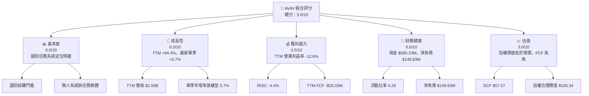

### 1.2 評分進度條視覺化

```text
╔══════════════════════════════════════════════════════════════╗
║                 AVAV 多維度評分儀表板（1-10分）              ║
╠══════════════════════════════════════════════════════════════╣
║ 基本面強度  6.0 ▓▓▓▓▓▓▓▓▓▓▓▓░░░░░░░░  ★★★☆☆            ║
║ 成長動能    6.5 ▓▓▓▓▓▓▓▓▓▓▓▓▓░░░░░░░  ★★★☆☆            ║
║ 獲利品質    3.5 ▓▓▓▓▓▓▓░░░░░░░░░░░░░  ★★☆☆☆            ║
║ 財務健康    6.0 ▓▓▓▓▓▓▓▓▓▓▓▓░░░░░░░░  ★★★☆☆            ║
║ 估值合理性  3.0 ▓▓▓▓▓▓░░░░░░░░░░░░░░  ★★☆☆☆            ║
║ 護城河深度  6.0 ▓▓▓▓▓▓▓▓▓▓▓▓░░░░░░░░  ★★★☆☆            ║
║ 管理層執行  5.0 ▓▓▓▓▓▓▓▓▓▓░░░░░░░░░░  ★★★☆☆            ║
║ 技術創新力  7.0 ▓▓▓▓▓▓▓▓▓▓▓▓▓▓░░░░░░  ★★★★☆            ║
╠══════════════════════════════════════════════════════════════╣
║ 綜合總分    5.0 ▓▓▓▓▓▓▓▓▓▓░░░░░░░░░░  ⚠️ 執行與估值待驗證 ║
╚══════════════════════════════════════════════════════════════╝
```

### 1.3 五大投資論點 + 三大核心風險

| 類型 | 項目 | 具體依據 | 信心度 |
|------|------|----------|--------|
| 🟢 **投資論點①** | 無人系統具國防任務相關性 | 公司提供 UAS、反無人機與自主系統；最近新聞資料提及 $720M 國防獎項及 $405M 國際雷射防禦訂單，但資料包未提供合同認列時程 | 🟡 中 |
| 🟢 **投資論點②** | 收入平台規模擴大 | TTM 營收 **$2.00B**、TTM 年增 **84.4%**；若併購業務整合、交付與毛利同步改善，規模可能提升營業槓桿 | 🟡 中 |
| 🟢 **投資論點③** | 自身估值相對歷史下降 | P/S **2.9x**，相較 5 年中位數 **5.1x**，且題示歷史百分位為 **0%**；估值折讓是否合理取決於利潤率能否回升 | 🟡 中 |
| 🟡 **投資論點④** | 流動性提供履約緩衝 | 現金及短期投資 **$580.23M**、流動比率 **4.26**，有助支應營運資金和交付需求 | 🟢 高 |
| 🟡 **投資論點⑤** | 機構持股比例高 | 機構持股 **90.4%**；可提升流動性，但不代表估值或業務風險較低 | 🟡 中 |
| 🟡 **風險①** | 最新單季增長顯著放慢 | 最新單季營收年增 **5.7%**，低於 TTM **84.4%**；可能反映比較基期、訂單時點或交付節奏變化 | 🟡 中 |
| 🔴 **風險②** | 利潤與現金流承壓 | TTM 營業利益率 **-12.6%**、ROIC **-4.4%**、FCF **-$25.03M**；獲利修復尚未獲現金流驗證 | 🔴 高 |
| 🔴 **風險③** | 併購整合與估值落差 | 商譽約 **$2.494B**、無形資產約 **$886.47M**；若收購業務未達預期，減損或整合費用可能持續壓抑利潤 | 🔴 高 |

### 1.4 快速統計卡片

| 指標 | 公司實際值 | 行業參照 | S&P 500 均值 | 狀態 |
|------|-------------|----------|--------------|------|
| 收入 YoY 成長 | **TTM +84.4%；最新單季 +5.7%** | N/A，細分領域口徑差異大 | N/A | 🟡 高 TTM、低單季 |
| 毛利率 | **TTM 26.5%** | LMT **11.7%**、KTOS **23.0%**、ONDS **36.4%** | N/A | 🟢 高於 KTOS/LMT，低於 ONDS |
| 淨利率 | **TTM -10.1%** | 同業差異大 | N/A | 🔴 |
| ROE | **-4.6%** | N/A | N/A | 🔴 |
| Forward P/E | **26.66x** | KTOS **30.3x**、LMT **17.9x** | N/A | 🟡 |
| FCF Yield | **-0.42%**（VERIFIED） | N/A | N/A | 🔴 |
| ROIC | **-4.4%** | N/A | N/A | 🔴 |

> 行業與 S&P 500 的統一均值未在提供資料中，故列為 N/A；不以不明口徑估計值替代。

### 1.5 投資結論

```text
╔══════════════════════════════════════════════════════════════════╗
║                       📊 投資結論摘要                            ║
╠══════════════════════════════════════════════════════════════════╣
║  評級：減碼（MOS -11.6%，落在 -25% 至 -10% 區間）               ║
║  價格（2026-11-13 收盤）：$117.52                               ║
║  DCF 內在價值（基準）：$57.57（現價溢價約 104.1%）              ║
║  安全邊際 MOS：-11.6%＝($105.34−$117.52)÷$105.34               ║
║  目標價區間：                                                    ║
║    悲觀情境：$63.00（相對現價 -46.4%）                           ║
║    基準情境：$105.34（相對現價 -10.4%）← 12 個月主要參考        ║
║    樂觀情境：$150.00（相對現價 +27.6%）                          ║
║  投資評分：5.0/10                                                ║
║  適合投資人：能承受高波動、願意追蹤國防訂單轉收入的成長型投資人   ║
╚══════════════════════════════════════════════════════════════════╝
```

---

## 2. 公司概覽與商業模式

### 2.1 業務結構與收入來源

公司概況資料顯示 AVAV 是國防科技供應商，主要涵蓋自主系統，以及太空、網路與定向能等領域。提供資料沒有分部營收與佔比，因此不臆測各業務金額；下圖以披露的業務類別呈現，比例標示為 N/A。

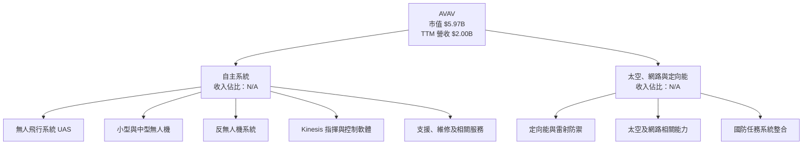

### 2.2 市場份額

題示資料沒有 AVAV 或競爭對手的同口徑市場銷售額、產品分類 TAM 或市場份額資料。為避免將不同產品市場混為一談，市場份額比例為 **N/A**，不製作虛構份額圓餅圖。可驗證的規模指標是 AVAV TTM 營收 **$2.00B**；同業 KTOS、ONDS、LMT 的營收增長與毛利數據見第 7 章。

### 2.3 競爭護城河分析

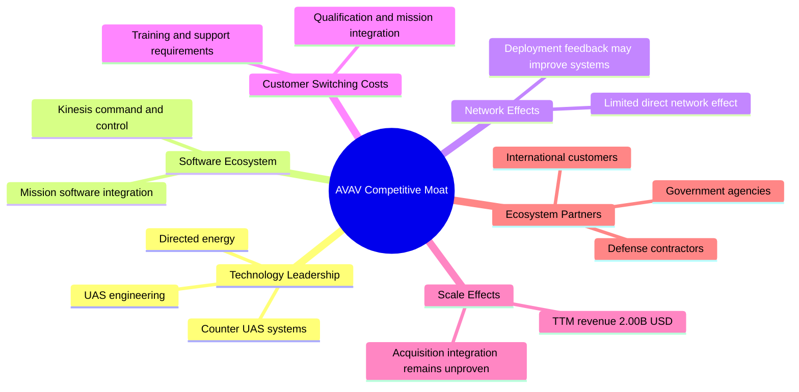

### 2.4 護城河強度評分

```text
╔══════════════════════════════════════════════════════════════╗
║                    AVAV 護城河強度評分                       ║
╠══════════════════════════════════════════════════════════════╣
║ 技術與產品能力   7.0/10 ▓▓▓▓▓▓▓▓▓▓▓▓▓▓░░░░░░ 🟢            ║
║ 軟體與系統整合   6.0/10 ▓▓▓▓▓▓▓▓▓▓▓▓░░░░░░░░ 🟡            ║
║ 網路效應         3.0/10 ▓▓▓▓▓▓░░░░░░░░░░░░░░ 🔴            ║
║ 客戶轉換成本     6.0/10 ▓▓▓▓▓▓▓▓▓▓▓▓░░░░░░░░ 🟡            ║
║ 規模效應         6.0/10 ▓▓▓▓▓▓▓▓▓▓▓▓░░░░░░░░ 🟡            ║
║ 生態夥伴         6.0/10 ▓▓▓▓▓▓▓▓▓▓▓▓░░░░░░░░ 🟡            ║
╠══════════════════════════════════════════════════════════════╣
║ 綜合護城河       6.0/10 ▓▓▓▓▓▓▓▓▓▓▓▓░░░░░░░░ 🟡            ║
╚══════════════════════════════════════════════════════════════╝
```

國防任務認證、系統整合、訓練與維護可能提高客戶轉換成本；但當前 **TTM ROIC -4.4%**、**TTM 營業利益率 -12.6%**，表示產品優勢尚未充分轉化為高於資本成本的經濟回報。護城河存在與護城河已獲利，是兩個不同判斷。

---

## 3. 損益表深度分析

### 3.1 年度收入成長趨勢（近 4 年）

| 財年 | 營收 | 年增率 | 毛利 | 營業利益 | 評估 |
|------|------:|------:|------:|------:|------|
| FY2023 | $540.54M | +21.3% | $173.51M | -$22.65M | 🟡 |
| FY2024 | $716.72M | +32.6% | $283.93M | $71.82M | 🟢 |
| FY2025 | $820.63M | +14.5% | $318.64M | $59.15M | 🟡 |
| FY2026 | $1.98B | +140.9% | $500.64M | -$70.29M | 🔴 |

```text
╔══════════════════════════════════════════════════════════════════╗
║                 AVAV 年度收入趨勢（FY2023-FY2026）               ║
╠══════════════════════════════════════════════════════════════════╣
║ FY2023  $0.54B  █████░░░░░░░░░░░░░░░░░  YoY +21.3% 🟡          ║
║ FY2024  $0.72B  ███████░░░░░░░░░░░░░░░  YoY +32.6% 🟢          ║
║ FY2025  $0.82B  ████████░░░░░░░░░░░░░░  YoY +14.5% 🟡          ║
║ FY2026  $1.98B  ████████████████████░░  YoY +140.9% 🟢         ║
╠══════════════════════════════════════════════════════════════════╣
║ FY2023-FY2026 營收 CAGR：約 54.1%；FY2026 高增長含併購及基期影響 ║
╚══════════════════════════════════════════════════════════════════╝
```

CAGR 算式：\((1,977 ÷ 540.54)^{1/3}-1 \approx 54.1\%\)。這個歷史 CAGR 不宜直接外推：FY2026 營收增長 **140.9%**，同時營業利益轉負，表示增長來源、併購成本與交付組合可能尚未形成穩定的獲利增長。

### 3.2 季度收入趨勢分析

| 季度 | 營收 | QoQ | YoY | 備註 |
|------|------:|----:|----:|------|
| 2025-10-31 | $472.51M | N/A | +150.72% | YoY 取資料包季度資料 |
| 2026-01-31 | $408.05M | -13.64% | +143.41% | 季度收入有交付時點波動 |
| 2026-04-30 | $641.62M | +57.24% | +133.27% | 高於前季，季度性／交付集中影響明顯 |
| 2026-08-01 | $480.49M | -25.11% | **+5.7%** | 最新季度 YoY；VERIFIED FIGURES |

QoQ 算式例：最新季度 \((480.49 ÷ 641.62)-1=-25.11\%\)。最新季度年增只有 **5.7%**，與 TTM 年增 **84.4%** 的落差很大，代表高 TTM 增速未延續至最新單季。後續應確認是否是基期、交付節奏或需求真正轉弱。

### 3.3 利潤率演變分析

| 利潤率指標 | FY2023 | FY2024 | FY2025 | FY2026 | 趨勢 | 評估 |
|------------|------:|------:|------:|------:|------|------|
| **毛利率** | 32.1% | 39.6% | 38.8% | 25.3% | FY2026 明顯下滑 | 🔴 |
| **營業利益率** | -4.2% | 10.0% | 7.2% | -3.6% | 轉負 | 🔴 |
| **淨利率** | -32.6% | 8.3% | 5.3% | -13.4% | FY2026 大額淨損 | 🔴 |

FY2026 毛利率以提供的年度毛利與營收計算：$500.64M ÷ $1.977B ≈ **25.3%**。同年營收快速增加但毛利率較 FY2025 的 **38.8%** 下滑約 **13.5 個百分點**，營業利益亦由 **$59.15M** 轉為 **-$70.29M**。可能原因包括產品組合、收購整合成本、交付成本及費用擴張；資料包沒有足夠分部毛利資料，無法拆解各因素貢獻。

VERIFIED TTM 營業利益率為 **-12.6%**，最新季度為 **-2.3%**；資料包其他財務區段另列 -0.6%。本報告以 VERIFIED 原值作核心分析，並將其他口徑視為資料衝突而不互換。

### 3.4 費用結構分析

FY2026 研發費用為 **$127.68M**，約為年度營收 **6.46%**（$127.68M ÷ $1.977B）。管理、銷售與其他營業費用的完整分項沒有提供，因此不以推算比例製作完整費用圓餅圖。

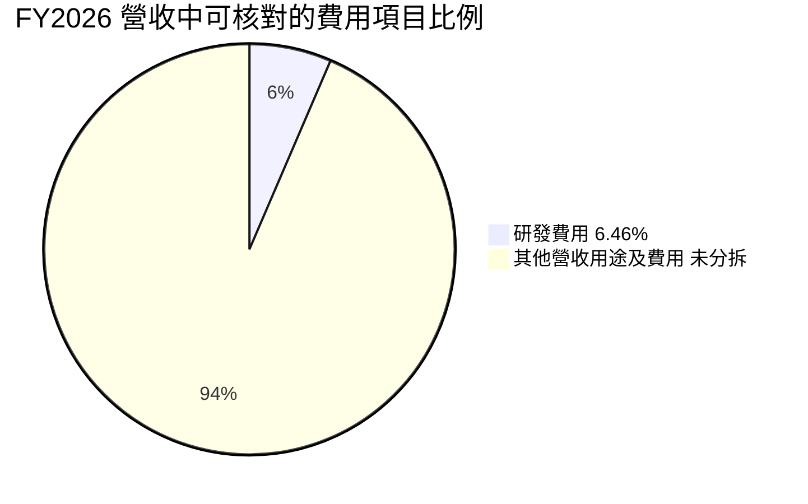

> 此圖只表示資料中可核對的研發費用與其餘未拆分部分，不代表其餘部分都是毛利或淨利。

```text
╔══════════════════════════════════════════════════════════════╗
║                 FY2026 研發投入指標                           ║
╠══════════════════════════════════════════════════════════════╣
║ 年度營收       $1.977B                                         ║
║ 研發費用       $127.68M                                        ║
║ 研發／營收     6.46%  ▓▓▓▓▓▓░░░░░░░░░░░░░░                   ║
║ 營業利益       -$70.29M                                        ║
║ 完整 SG&A 分項 N/A                                             ║
╚══════════════════════════════════════════════════════════════╝
```

### 3.5 季度 EPS 趨勢與盈餘品質（Quality of Earnings）

#### 最近四季 EPS

| 季度 | EPS 實際值（資料表） | 超預期／不及預期 | 可核對的原因或限制 |
|------|---------------------:|------------------|--------------------|
| 2025-10-31 | 約 -$0.34（季度資料來源） | N/A | EPS Est 與 EPS Act 欄位均為 nan |
| 2026-01-31 | 約 -$4.90（季度資料來源） | N/A | 大額淨損；估計值缺失，無法判斷 surprise |
| 2026-04-30 | 約 -$0.48（季度資料來源） | N/A | EPS Est 與 EPS Act 欄位均為 nan |
| 2026-08-01 | 約 -$0.10（季度資料來源） | N/A | EPS Est 與 EPS Act 欄位均為 nan |

**過去四季盈餘超預期分析：N/A。** 提供的 EPS Beats/Misses 資料沒有分析師預估值及可用實際值，不能判斷超預期或不及預期，更不能以空值推定 beat/miss。

| 盈餘品質項目 | 數值／佔比 | 評估 |
|--------------|------------|------|
| 股權薪酬 SBC／營收 | FY2026 SBC **$38.33M**；除以 FY2026 營收 $1.977B 約 **1.94%** | 🟡 SBC 不是主要收入成本，但仍稀釋股東；歷史 SBC 由 FY2023 $10.77M 增至 FY2026 $38.33M |
| SBC／營業現金流 | FY2026 營業現金流為 **-$78.40M**；比率不具一般經濟解讀 | 🔴 現金流為負，不能用正向轉換率解讀 |
| FCF／淨利 | TTM FCF **-$25.03M**；TTM 淨利資料口徑未統一 | N/A；不能用不同期間或不同來源拼接計算 |
| 一次性／非經常項目 | FY2026 淨利 **-$265.12M**，資料包未提供完整特殊項目調節 | N/A；需要 SEC 附註判定收購、減損與稅務影響 |
| 有效稅率異常 | N/A | 缺乏完整稅前所得與所得稅費用分項 |
| 資本化支出 vs 費用化 | TTM Capex **$83.85M**（VERIFIED）；資本化研發等資訊 N/A | 需核查收購無形資產、軟體資本化與攤銷政策 |

**盈餘品質結論**：FY2026 GAAP 淨利為 **-$265.12M**，TTM 營業利益率與 FCF 也均為負，現階段重點不是判定正盈利是否高估，而是公司尚未證明增長能轉為可持續的現金盈利。FY2026 SBC 約佔營收 **1.94%**，在模型中採 GAAP 營業利益率並假設固定股數，不再額外扣 SBC，避免重複計算。

---

## 4. 資產負債表分析

### 4.1 資產結構分解

截至資料所示 TTM 資產負債表，總資產約 **$5.731B**。其中商譽 **$2.494B**、其他無形資產 **$886.47M**，兩項合計約 **$3.380B**，佔總資產約 **59.0%**。這提高了併購資產未來減值的敏感度。

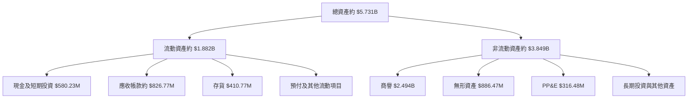

### 4.2 流動性指標分析

| 指標 | 最新值 | 歷史比較 | 參考值 | 評估 |
|------|-------:|----------|--------|------|
| 流動比率 | **4.26x** | FY2026 期末約 $1.89B 流動資產／$439.24M 流動負債，約 4.30x | 行業均值 N/A | 🟢 短期流動性充裕 |
| 速動比率 | **3.185x** | 依市場資料來源 | 行業均值 N/A | 🟢 |
| 現金及短期投資 | **$580.23M** | FY2026 年末現金及短期投資約 $632.3M | — | 🟡 |
| VERIFIED 總債務 | **$730.06M** | 與其他資料區段 $850.82M 不一致 | — | 🟡 以 VERIFIED 為主 |
| VERIFIED 淨負債 | **$149.83M** | 現金及短投 $580.23M 減總債務 $730.06M | — | 🟡 |

### 4.3 債務結構分析

```text
╔══════════════════════════════════════════════════════════════════╗
║                    AVAV 債務健康診斷                             ║
╠══════════════════════════════════════════════════════════════════╣
║  VERIFIED 總債務：      $730.06M  ███████████████░░░░░            ║
║  現金+短期投資：        $580.23M  ████████████░░░░░░░            ║
║  VERIFIED 淨負債：      $149.83M  ███░░░░░░░░░░░░░░░░ 🟡         ║
║                                                                  ║
║  流動比率：             4.26x    🟢                              ║
║  Debt/EBITDA：           N/A；TTM EBITDA 口徑存在來源差異          ║
║  Interest Coverage：    N/A；利息費用與 EBIT 口徑不足             ║
║                                                                  ║
║  資料警示：市場資料另列債務 $850.82M、淨負債 $270.60M；未混用。   ║
╚══════════════════════════════════════════════════════════════════╝
```

總債務與現金口徑不一致會影響企業價值橋接。本報告估值採 VERIFIED 的債務 **$730.06M** 與現金／短投 **$580.23M**；若實際總債務應為 $850.82M，內在股權價值需再下修，不能忽略此資料品質風險。

### 4.4 股東權益趨勢

| 財年 | 股東權益 |
|------|---------:|
| FY2023 | $550.97M |
| FY2024 | $822.75M |
| FY2025 | $886.51M |
| FY2026 | $4.40B |

```text
╔══════════════════════════════════════════════════════════════╗
║                 股東權益變化（年度資料）                       ║
╠══════════════════════════════════════════════════════════════╣
║ FY2023  $0.55B  ███░░░░░░░░░░░░░░░░░                         ║
║ FY2024  $0.82B  ████░░░░░░░░░░░░░░░░                         ║
║ FY2025  $0.89B  █████░░░░░░░░░░░░░░░                         ║
║ FY2026  $4.40B  ████████████████████                         ║
╚══════════════════════════════════════════════════════════════╝
```

FY2026 股東權益大幅增加，與資產規模由 FY2025 約 **$1.12B** 擴大至約 **$5.72B** 同期發生，應結合併購、發股與購買價分攤理解，不能直接當成內生盈利累積。

---

## 5. 現金流量深度分析

### 5.1 現金流量瀑布圖

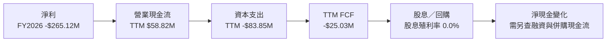

### 5.2 FCF 轉換率趨勢

| 年度 | 營業現金流 | 資本支出 | FCF | FCF／淨利 |
|------|-----------:|---------:|----:|-----------|
| FY2023 | $11.40M | $14.87M | -$3.47M | 淨利為負，比例不具解讀性 |
| FY2024 | $15.29M | $24.48M | -$9.19M | 約 -15.4%（FY2024 淨利 $59.67M） |
| FY2025 | -$1.32M | $22.82M | -$24.13M | 約 -55.3%（資料表四捨五入差異） |
| FY2026 | -$78.40M | $86.22M | -$164.62M | 淨利為負，正負比率易誤導 |
| TTM VERIFIED | $58.82M | $83.85M | **-$25.03M** | N/A；期間及淨利口徑未統一 |

FY2026 營業現金流轉為 **-$78.40M**，資本支出也增加至 **$86.22M**。這代表公司不只是帳面盈餘波動，營運資金與投資支出亦吸收現金。TTM VERIFIED FCF 稍好於 FY2026 年度值，但仍為負。

### 5.3 自由現金流趨勢

```text
╔══════════════════════════════════════════════════════════════════╗
║             自由現金流：年度資料與 VERIFIED TTM                 ║
╠══════════════════════════════════════════════════════════════════╣
║ FY2023   -$3.47M  ██░░░░░░░░░░░░░░░░░░  FCF Yield：N/A          ║
║ FY2024   -$9.19M  ███░░░░░░░░░░░░░░░░░  FCF Yield：N/A          ║
║ FY2025  -$24.13M  ██████░░░░░░░░░░░░░░  FCF Yield：N/A          ║
║ FY2026 -$164.62M  ████████████████████  FCF Yield：N/A          ║
║ TTM VERIFIED -$25.03M；FCF Yield -0.42%                          ║
╚══════════════════════════════════════════════════════════════════╝
```

### 5.4 資本配置評估

公司股息殖利率為 **0.0%**，資料沒有提供足以計算回購、留存與併購的完整資金配置明細。FY2026 資本支出 **$86.22M**，FY2026 SBC **$38.33M**；資本配置重點是研發、擴產與併購整合，而不是現金返還。

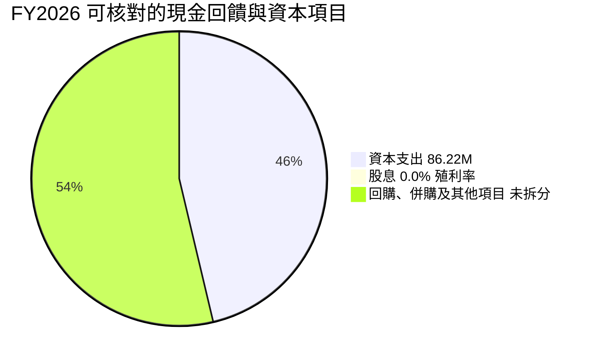

> 上圖不是資金用途佔比，因完整現金流用途分項未提供；股息為零，其他資金用途資料不足。

| 資本配置項目 | 可核對資訊 | 評估 |
|--------------|------------|------|
| 資本支出 | FY2026 $86.22M；TTM VERIFIED $83.85M | 🟡 維持交付與產能需要，但須追蹤投資回報 |
| 股息 | 殖利率 0.0% | 🟡 資本用於再投資 |
| 回購 | N/A | N/A |
| SBC | FY2026 $38.33M | 🟡 持續稀釋成本 |
| 併購 | FY2026 資產擴大，商譽 $2.494B | 🟡 須證明協同效益與回報 |

---

## 6. 獲利能力與資本效率

### 6.1 ROE / ROA / ROIC 趨勢

| 指標 | 最新資料值 | 歷史／參照 | 評估 |
|------|-----------:|------------|------|
| ROE | **-4.6%** | TTM | 🔴 |
| ROA | **-0.1%** | TTM | 🔴 |
| ROIC | **-4.4%** | TTM，VERIFIED | 🔴 |
| 行業均值 | N/A | 未提供同口徑數據 | — |

### 6.2 ROIC vs WACC 分析（核心價值創造判斷）

```text
╔══════════════════════════════════════════════════════════════════╗
║                    ROIC vs WACC 深度分析                         ║
╠══════════════════════════════════════════════════════════════════╣
║  WACC 估算：                                                     ║
║  ├── 無風險利率（10Y 美債）： 5.15%                             ║
║  ├── 市場風險溢酬 ERP：       5.00%                             ║
║  ├── Beta：                   1.40                              ║
║  ├── 股權成本 Ke：            5.15% + 1.40×5.00% = 12.15%       ║
║  │   VERIFIED 原值 Ke：       12.17%                            ║
║  ├── 債務成本（稅前）：       0.77%                             ║
║  ├── 債務成本（稅後）：       0.77%×(1−21%) = 0.6083%            ║
║  ├── 資本結構：股權 89.1%，債務 10.9%                           ║
║  └── WACC：                   10.91%                            ║
║                                                                  ║
║  ROIC（TTM，VERIFIED）：       -4.4%                             ║
║  EVA spread：                 -4.4%−10.91% = -15.31 個百分點     ║
║                                                                  ║
║  ROIC  -4.4%  ◀────────────── 負值                              ║
║  WACC  10.91% ▓▓▓▓▓▓▓▓▓▓▓▓▓▓▓▓▓▓▓▓                            ║
║  EVA  -15.31pp 🔴 目前摧毀經濟價值                              ║
╚══════════════════════════════════════════════════════════════════╝
```

題示 VERIFIED 資本成本給定股權成本 **12.17%**、稅前債務成本 **0.77%**、稅率 **21%**、股權／債務權重 **89.1%／10.9%**、WACC **10.91%**。本報告在 ROIC 與 DCF 中使用同一 WACC。依驗算，以四捨五入輸入計算會有數個基點尾差，故保留 VERIFIED WACC 原值。

**結論**：ROIC **-4.4%** 明顯低於 WACC **10.91%**。若未來不能把營業利潤轉正並提高資本周轉，營收增長本身並不能證明股東價值正在增加。

### 6.3 杜邦三因素分解

以 TTM 淨利率 **-10.1%**、ROE **-4.6%** 作方向性拆解。總資產週轉率及平均財務槓桿因 TTM 平均資產／權益未完整提供，不能精確反推。

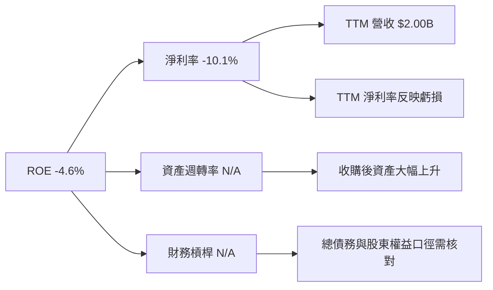

標準杜邦公式：ROE＝淨利率 × 資產週轉率 × 財務槓桿。資料不足時不以 ROE 倒推未知分項，避免製造表面精確度。

### 6.4 獲利能力儀表板

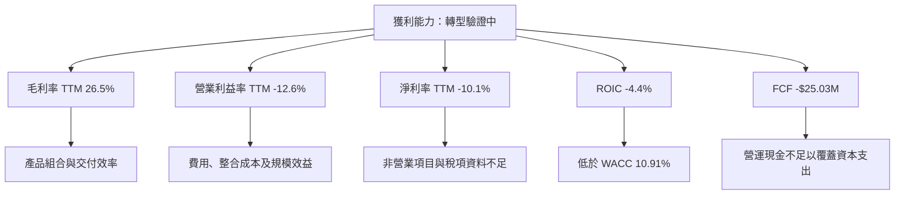

---

## 7. 相對估值分析

### 7.1 同業估值比較表格

同業倍數依題示 VERIFIED FIGURES 的 Peer multiples。AVAV 的本身倍數依市場估值欄位；部分口徑與 VERIFIED TTM 有差異，需以括號說明。

| 估值指標 | **AVAV** | **KTOS** | **ONDS** | **LMT** | 本公司評估 |
|----------|---------:|---------:|---------:|---------:|------------|
| **Trailing P/E** | N/A | 282.6x | N/A | 21.2x | 🔴 AVAV TTM EPS 為負 |
| **Forward P/E** | 26.66x | 30.3x | -258.0x | 17.9x | 🟡 位於盈利同業之間；預估 EPS 執行風險高 |
| **P/S Ratio** | 2.98x（VERIFIED 歷史估值表為 2.9x） | 3.9x | 9.1x | 1.7x | 🟡 低於 KTOS，仍高於 LMT |
| **EV/EBITDA** | 29.20x | 59.9x | -7.6x | 15.6x | 🔴 高於 LMT；AVAV TTM EBITDA 口徑波動 |
| **最新單季營收 YoY** | 5.7% | 35.7% | 1558.6% | 11.3% | 🔴 AVAV 單季增速相對慢 |
| **毛利率 TTM** | 26.5% | 23.0% | 36.4% | 11.7% | 🟢 高於 KTOS/LMT，低於 ONDS |

ONDS 極高增長與負 EV/EBITDA 反映其不同階段與風險，不能用單一倍數直接判定 AVAV 便宜或昂貴。AVAV Forward P/E **26.66x** 代表市場仍為未來盈利付出估值；若 forward EPS **$4.40823** 未實現，該倍數會失去參考性。

### 7.2 歷史估值區間分析

```text
╔══════════════════════════════════════════════════════════════════╗
║                 AVAV 自身歷史 P/S 估值位置                      ║
╠══════════════════════════════════════════════════════════════════╣
║ 5 年低位        3.0x  █░░░░░░░░░░░░░░░░░░░                    ║
║ 當前            2.9x  ●（VERIFIED 歷史估值表原值）             ║
║ 5 年中位數      5.1x  ███████░░░░░░░░░░░░░                    ║
║ 5 年高位       13.4x  ████████████████████                    ║
║ 當前百分位        0%  歷史區間最低端                            ║
╚══════════════════════════════════════════════════════════════════╝
```

注意：資料提供當前 P/S **2.9x**、區間 **3.0x–13.4x**、百分位 **0%**，當前值略低於所列區間低值，可能源自價格與季度／TTM 計算時點不同。此處照錄資料而不自行重算或更改百分位。估值下滑也可能反映利潤率與 FCF 走弱，不必然代表低估。

### 7.3 情境目標價（假設驅動，Bear / Base / Bull）

以未來 EPS 倍數法作為相對估值參考。Forward EPS 採資料包 **$4.40823**；情境 EPS 增長與退出倍數是估值假設，不是公司財測。

| 情境 | 營收 CAGR 假設 | 營業利潤率假設 | 退出 Forward P/E | 隱含目標價 | 相對現價 |
|------|---------------:|----------------:|-----------------:|-----------:|---------:|
| 🔴 悲觀 | 5% | 5% | 20x | $70.00 | -40.4% |
| 🟡 基準 | 15% | 10% | 24x | $105.80 | -10.0% |
| 🟢 樂觀 | 25% | 15% | 30x | $165.30 | +40.7% |

目標價推導方式：以 forward EPS **$4.40823** 作錨，對 EPS 採情境增長調整，再乘退出 P/E；例如基準假設以 EPS 約 **$4.41** 為錨、退出倍數 24x，基準價約為 **$105.80**。收入 CAGR／營業利潤率是情境成立的營運條件，不是由現有資料直接推得的確定值。

**倍數選擇說明**：AVAV TTM EPS 為 **-$4.05**，Trailing P/E 不適用；TTM FCF 亦為負，因此以 P/E 和 EV/EBITDA 只能作前瞻／同業參考，需同時看 EV/Sales 與 DCF，不能將單一倍數當作確定內在價值。

### 7.4 相對估值隱含價格區間

| 方法 | 假設／輸入 | 隱含股價 | 說明 |
|------|------------|---------:|------|
| Forward P/E | $4.40823 × 24.1x（KTOS 與 LMT forward P/E 簡單平均） | 約 $106.24 | 參考盈利型同業；未納入不同增長與風險 |
| EV/EBITDA | TTM EBITDA 約 $218M × 15.6x；扣淨負債後除股數 | 約 $64.08 | 使用 LMT 倍數作成熟防務參考，非同質業務 |
| EV/Sales | TTM 營收 $2.00B × 3.9x；扣淨負債後除股數 | 約 $151.80 | 3.9x 為 KTOS P/S 參考值 |
| FCF Yield | TTM FCF 為負 | N/A | 負 FCF 不適合用正向殖利率回推 |

```text
╔══════════════════════════════════════════════════════════════════╗
║              相對估值隱含股價概覽（美元／股）                    ║
╠══════════════════════════════════════════════════════════════════╣
║ EV/EBITDA       $64.08  ███████░░░░░░░░░░░░░                    ║
║ Forward P/E    $106.24  ███████████░░░░░░░░░                    ║
║ 現價           $117.52  ████████████░░░░░░░░                    ║
║ EV/Sales       $151.80  ███████████████░░░░░                    ║
║ 分析師均價      $212.20  ██████████████████████                  ║
╚══════════════════════════════════════════════════════════════════╝
```

---

## 8. DCF 內在價值評估（Discounted Cash Flow）

> **估值口徑**：使用 FCFF，以 WACC 折現取得 EV；單位除每股價值外均為美元。模型採明示假設，非管理層財測。由於歷史 FCF 為負，基準 DCF 對收入增長、利潤率修復與終值十分敏感，估值信心應低於有穩定正 FCF 的成熟公司。

### 8.0 估值推理鏈（Thinking Logic）

**Step 1 — 價值來源與主導變數**

AVAV 價值可拆為：自主系統與 UAS 現有業務（公司未提供分部佔比，佔比 N/A）、太空／網路／定向能等業務（佔比 N/A），以及訂單轉換成持續收入的選擇權。公司 TTM 營收 **$2.00B**，但最新單季年增僅 **5.7%**；TTM 營業利益率 **-12.6%**。因此主導估值的不是單純營收倍數，而是**營業利潤率能否由負轉正，以及正 FCF 能否持續**。

| 決策點 | 本報告採用 | 理由（含數字） | 曾考慮但否決 | 否決理由 |
|--------|-----------|----------------|--------------|----------|
| 現金流定義 | FCFF | 與 WACC 折現及 EV 橋接一致 | FCFE | 債務與資本結構可能隨併購變動 |
| 預測期 N | 5 年 | 足以建模由虧損到成熟利潤率的轉型，但不假設多年超高增長 | 10 年 | 近期單季 YoY 僅 5.7%，長期逐年預測誤差過大 |
| 終值方法 | Gordon Growth 主法，退出倍數交叉檢查 | 永續成長率 2.5%，低於 WACC 10.91% | 僅用高退出倍數 | 可能將當前防務溢價無限延伸 |
| EBIT 基礎 | GAAP | FY2026 GAAP 營業利益 -$70.29M，避免將 SBC 與整合費用忽略 | 非 GAAP EBIT | 未提供完整調整項目與收購費用調節 |

**Step 3 — 關鍵假設推導鏈**

- **營收 CAGR**：錨點＝FY2023–FY2026 歷史 CAGR 約 **54.1%**、TTM 年增 **84.4%**，但最新單季年增只有 **5.7%** → 調整＝降低併購高基期及季度放緩風險 → **採用 20%** → 曾考慮 30%，因單季增長已降至 5.7% 且沒有管理層財測資料，故不採。
- **期末營業利潤率**：錨點＝VERIFIED TTM **-12.6%**；FY2024 實際約 10.0%、FY2025 約 7.2%，FY2026 約 -3.6% → 調整＝假設整合及規模效益逐步改善，但不直接回到歷史最高值 → **採用 FY+5 15%** → 曾考慮 20%，因公司近年未持續證明該水準。
- **永續成長率 g**：錨點＝長期成熟市場通常需低於長期名目經濟增長 → 考慮公司國防產品長期需求但排除超高增長外推 → **採用 2.5%** → 否決 4%，因高於較保守的長期成熟假設，且會進一步提高終值佔比。
- **預測期 N**：錨點＝TTM 增速與最新單季增速差距大，且 FY2026 營業虧損 → **採用 5 年**作轉型期 → 否決 10 年，因逐年營運預測可見度不足。
- **Capex／營收**：錨點＝VERIFIED TTM Capex $83.85M ÷ TTM 營收 $2.003B ≈ **4.19%** → 四捨五入採 **4.2%** → 否決降至 3%，因 TTM 資本支出仍達上述比例。
- **D&A／營收**：資料包沒有一致 TTM D&A 數字 → 採**假設值 2.0%**，依據是模型需要呈現折舊攤銷，且不將其無資料地反推；這是低敏感度但非已核實事實。
- **ΔWC／營收增額**：應收帳款約 $826.77M、存貨 $410.77M，營運資金需求明顯 → 假設新增收入的 **10%** 投入營運資金；資料未提供可計算的歷史 ΔWC，屬模型假設。
- **有效稅率**：假設盈利年份採資料包預設 **21%**；虧損年份不認列當期稅盾，避免假定稅務利益可即時使用。
- **EBIT 與 SBC**：採 GAAP EBIT、固定股數，且不在 FCFF 再扣 SBC；股數年稀釋率為 0%。**本模型採用 (A)，故 SBC 影響已計入一次。**
- **年稀釋率**：歷史股數變化與回購資料不足；按組合 (A) 採固定股數 **50.82M**，不是宣稱未來不會稀釋，而是避免同一 SBC 成本重複扣除。
- **WACC**：採 VERIFIED **10.91%**；不自行調低，因 beta **1.40**、無風險利率 **5.15%** 與 ERP **5.00%** 均反映較高資本成本。
- **終值方法**：Gordon Growth 為主，退出倍數僅檢查；採 2.5% g，且 WACC 大於 g。

**Step 4 — 最脆弱一環**

最脆弱假設是從目前負營業利潤率轉為 FY+5 **15%**：若無法達成，終值及每股價值將大幅下降；若大幅超越，估值也會快速上修，這與 8.6 的利潤率敏感性一致。

**Step 5 — 計算路徑圖**

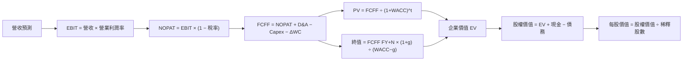

### 8.1 模型假設總表（Model Inputs）

| 假設項目 | 採用值 | 依據／來源 | 敏感度 |
|----------|--------|-------------|--------|
| 預測期長度 **N** | 5 年 | 最新單季 YoY 5.7%；轉型可見度有限 | 🟡 中 |
| 營收 CAGR | 20% | 低於歷史 FY2023–FY2026 CAGR 約 54.1%；高於最新單季 5.7% | 🔴 高 |
| 營業利潤率路徑 | -5%、2%、7%、12%、15% | 從 VERIFIED TTM -12.6% 修復；15% 低於直接採高成長無限延伸 | 🔴 高 |
| 有效稅率 | 正 EBIT 年份 21%；負 EBIT 年份 0% | 資料包預設稅率 21%；不預先認列虧損稅盾 | 🟢 低 |
| Capex／營收 | 4.2% | TTM 83.85M ÷ 2.003B＝4.19%，四捨五入 | 🟡 中 |
| D&A／營收 | 2.0% | **假設值**；TTM D&A 缺漏，未以反推方式補值 | 🟢 低 |
| ΔWC／新增營收 | 10.0% | **假設值**；應收及存貨規模大，缺少歷史 ΔWC 資料 | 🟢 低 |
| EBIT 基礎 | GAAP EBIT | 避免排除 SBC／整合成本造成偏樂觀 | 🟡 中 |
| SBC 處理 | 組合 (A)：GAAP EBIT、FCFF 不另扣 SBC | SBC 已列入 GAAP 費用；固定股數 50.82M | 🟡 中 |
| 年稀釋率 | 0%（估值模型股數固定） | 組合 (A)；不是對實際未來股數的預測 | 🟡 中 |
| 永續成長率 g | 2.5% | 長期成熟企業假設，低於 WACC 10.91% | 🔴 高 |
| 終值方法 | Gordon Growth 主法；EV/EBITDA 交叉檢查 | 兩者可比較長期價值，但同業與企業成熟度不同 | 🔴 高 |
| WACC | 10.91% | VERIFIED FIGURES 資本成本輸入 | 🔴 高 |

### 8.2 折現率推導（WACC）

```text
╔══════════════════════════════════════════════════════════════════╗
║                    WACC 推導（折現率）                           ║
╠══════════════════════════════════════════════════════════════════╣
║  股權成本 Ke（CAPM）：                                           ║
║  ├── 無風險利率 Rf： 5.15%（題示 10Y Treasury 輸入）            ║
║  ├── ERP：           5.00%（題示假設值）                        ║
║  ├── Beta：          1.40（題示參考值；市場 Beta 另列 1.403）     ║
║  ├── 規模／國別溢酬： 0.00%（無資料支持額外加計）                ║
║  └── Ke：題示 VERIFIED 原值 12.17%                              ║
║                                                                  ║
║  債務成本 Kd：                                                   ║
║  ├── 稅前 Kd：0.77%（題示利息／債務輸入）                       ║
║  ├── 稅率：21.0%                                                 ║
║  └── 稅後 Kd = 0.77%×(1−21.0%) = 0.6083%                        ║
║                                                                  ║
║  資本結構：                                                       ║
║  ├── E 權重：89.1%                                               ║
║  ├── D 權重：10.9%                                               ║
║  └── VERIFIED WACC：10.91%                                       ║
╚══════════════════════════════════════════════════════════════════╝
```

**逐步演算（WACC）**

1. **Ke（CAPM）**：題示原值 **12.17%**。以顯示的四捨五入數字計算 \(5.15\%+1.40×5.00\%=12.15\%\)，與題示 12.17% 差 0.02 個百分點；後續採用題示 VERIFIED 原值，不替換。
2. **稅前 Kd**：題示已給 **0.77%**；利息費用金額及平均計息負債明細沒有同口徑資料，故不另行反推。
3. **稅後 Kd**：\(0.77\%×(1-21\%)=0.77\%×0.79=0.6083\%\)。
4. **權重**：採題示 VERIFIED 股權權重 **89.1%**、債務權重 **10.9%**，兩者合計 **100.0%**。資本成本區塊沒有明示與權重完全同一期的市場市值／計息負債重算明細，故保留官方參考權重。
5. **WACC**：\(89.1\%×12.17\%+10.9\%×0.6083\%=10.844\%+0.066\%=10.910\%\)，採 **10.91%**。

> 由於 Kd、資本權重來自資料包而非本報告可重新建立的完整平均計息負債表，WACC 沿用 VERIFIED 值；該限制在稽核表中列明。

### 8.3 逐年自由現金流預測（基準情境）

基期使用 TTM 營收 **$2.003B**。預測期每年營收增長 20%。營業利潤率從 FY+1 **-5%** 線性修復至 FY+5 **15%**。FCFF 定義為：

**FCFF = NOPAT + D&A − Capex − ΔWC**

**四捨五入規則**：美元金額取 $0.001B；比率取 1 位小數；折現因子取 3 位小數。中間計算保留更多位數，因此表內尾差可有四捨五入影響。

| 年度（$B） | FY+1 | FY+2 | FY+3 | FY+4 | FY+5（＝FY+N） |
|------|------:|------:|------:|------:|------:|
| 營收 | 2.404 | 2.884 | 3.461 | 4.153 | 4.984 |
| 營收 YoY | 20.0% | 20.0% | 20.0% | 20.0% | 20.0% |
| 營業利潤率 | -5.0% | 2.0% | 7.0% | 12.0% | 15.0% |
| EBIT（GAAP） | -0.120 | 0.058 | 0.242 | 0.498 | 0.748 |
| − 稅 | 0.000 | (0.012) | (0.051) | (0.105) | (0.157) |
| = NOPAT | -0.120 | 0.046 | 0.191 | 0.394 | 0.591 |
| + D&A（營收 2.0%） | 0.048 | 0.058 | 0.069 | 0.083 | 0.100 |
| − Capex（營收 4.2%） | (0.101) | (0.121) | (0.145) | (0.174) | (0.209) |
| − ΔWC（新增營收 10%） | (0.040) | (0.048) | (0.058) | (0.069) | (0.083) |
| **= FCFF** | **-0.213** | **-0.066** | **0.058** | **0.233** | **0.398** |
| 折現因子 @10.91% | 0.902 | 0.813 | 0.733 | 0.661 | 0.596 |
| **FCFF 現值 PV** | **-0.192** | **-0.054** | **0.042** | **0.154** | **0.237** |

預測期 FCF 現值合計：

**-$0.192B − $0.054B + $0.042B + $0.154B + $0.237B = $0.187B**

**逐步演算（FY+1）**

1. **營收**＝$2.003B × (1 + 20%)＝**$2.404B**。
2. **EBIT**＝$2.404B × (-5%)＝**-$0.120B**。
3. **稅**＝因 EBIT 為負，模型不認列稅盾＝**$0.000B**。
4. **NOPAT**＝-$0.120B − $0.000B＝**-$0.120B**。
5. **D&A**＝$2.404B × 2.0%＝**$0.048B**。
6. **Capex**＝$2.404B × 4.2%＝**$0.101B**。
7. **ΔWC**＝($2.404B − $2.003B) × 10%＝$0.401B × 10%＝**$0.040B**。
8. **FCFF**＝-$0.120B + $0.048B − $0.101B − $0.040B＝**-$0.213B**。
9. **折現與 PV**：\(1÷(1+10.91\%)^1=0.902\)；-$0.213B × 0.902＝**-$0.192B**。

**合理性自檢**

- 預測期 FCF CAGR：因 FY+1 FCFF 為負、FY+5 為正，標準 CAGR **無法定義**；歷史 FY2023 至 FY2026 FCF 亦均為負，不能用正負值直接計 CAGR。
- FY+5 FCFF 利潤率＝$0.398B ÷ $4.984B＝約 **8.0%**；高於 VERIFIED 當前 TTM FCF 利潤率約 **-1.25%**（-$25.03M ÷ $2.003B），但沒有足夠同口徑同業 FCF 利潤率可比。
- FY+1、FY+2 FCFF 為負，會拉低預測期 PV；這與目前 TTM FCF 為負的現況一致，而非忽略轉型成本。

```text
╔══════════════════════════════════════════════════════════════════╗
║            自由現金流：歷史實際 vs 模型預測                      ║
╠══════════════════════════════════════════════════════════════════╣
║ FY2024(實)  -$0.009B  ██░░░░░░░░░░░░░░░░░░                     ║
║ FY2025(實)  -$0.024B  ███░░░░░░░░░░░░░░░░░                      ║
║ FY2026(實)  -$0.165B  ████████████████████                      ║
║ FY+1 (預)   -$0.213B  ███████████████████████                   ║
║ FY+5 (預)    $0.398B  █████████████████████████████              ║
╠══════════════════════════════════════════════════════════════════╣
║ 預測由負轉正，仰賴營業利潤率從 -5% 修復至 15%；為估值最大風險。 ║
╚══════════════════════════════════════════════════════════════════╝
```

### 8.4 終值計算（Terminal Value）

**適用性檢查**：WACC **10.91%** vs g **2.5%** → WACC > g？✅

| 方法 | 計算式 | 終值 TV | TV 現值 | 佔總 EV 比重 |
|------|--------|---------:|--------:|-------------:|
| Gordon Growth | FY+5 FCFF × (1+g) ÷ (WACC−g) | 約 $4.851B | 約 $2.889B | 約 93.9% |
| 退出倍數法 | FY+5 EBITDA × 15.6x | 約 $13.221B | 約 $7.878B | 交叉檢查；高於 Gordon 甚多 |

**逐步演算（Gordon Growth）**

1. FY+N 的 FCFF＝FY+5 **$0.398B**。
2. 分子＝$0.398B × (1 + 2.5%)＝**$0.408B**。
3. 分母＝10.91% − 2.5%＝**8.41%**；TV＝$0.408B ÷ 8.41%＝**約 $4.851B**。
4. PV(TV)＝$4.851B × 0.596＝**約 $2.889B**。
5. 終值佔比＝$2.889B ÷ 約 $3.076B＝**約 93.9%**。

退出倍數交叉檢查：FY+5 EBITDA 假設為 EBIT + D&A＝$0.748B + $0.100B＝**$0.848B**；  
**$0.848B × 15.6x＝約 $13.221B → × 0.596＝約 $7.878B**。15.6x 取自 LMT EV/EBITDA，屬較成熟防務同業參考，並不完全可比。與 Gordon Growth 差異顯著，因此主估值採 Gordon Growth，退出倍數只作上行情境檢查。

> 終值現值約佔 EV **93.9%**，本估值高度依賴終值假設，短期現金流貢獻有限。

### 8.5 企業價值 → 每股內在價值（Bridge）

```text
╔══════════════════════════════════════════════════════════════════╗
║              企業價值 → 每股內在價值 橋接表                      ║
╠══════════════════════════════════════════════════════════════════╣
║  預測期 FCF 現值合計              +$0.187B                       ║
║  終值現值 PV(TV)                  +$2.889B                       ║
║  ─────────────────────────────────────────────                  ║
║  = 企業價值 EV                     $3.076B                       ║
║  + 現金及短期投資                 +$0.580B                       ║
║  − 總債務                         −$0.730B                       ║
║  − 少數股東權益／其他              $0.000B（未提供；假設無）       ║
║  ─────────────────────────────────────────────                  ║
║  = 股權價值                        $2.926B                       ║
║  ÷ 稀釋後流通股數                  50.82M 股                     ║
║  ─────────────────────────────────────────────                  ║
║  ★ 每股 DCF 內在價值               $57.57                        ║
║    當前股價（2026-11-13 收盤）      $117.52                       ║
║    折溢價（現價÷內在價值−1）       +104.1%（溢價）               ║
╚══════════════════════════════════════════════════════════════════╝
```

**逐步演算（橋接）**

1. **EV**＝預測期 PV $0.187B + PV(TV) $2.889B＝**$3.076B**。
2. **股權價值**＝$3.076B + $0.58023B − $0.73006B − $0.000B＝**約 $2.926B**。
3. **每股內在價值**＝約 $2.926B ÷ 0.05082B 股＝**約 $57.57**。
4. **折溢價**＝$117.52 ÷ $57.57 − 1＝**約 +104.1% 溢價**。
5. **本節不計算 MOS**：安全邊際只以 8.8 加權合理價值為基準。

股數採市場資料提供的 **50.82M shares outstanding**，模型採 GAAP EBIT 加固定股數（組合 A）。現金／短投 **$580.23M**、債務 **$730.06M** 採 VERIFIED TTM 資料。資料包另有總債務 $850.82M，為口徑衝突，未混入本橋接。

### 8.6 敏感性分析（WACC × 永續成長率）

格內為每股 DCF 價值及相對現價的上行空間。基準模型以預測期現金流不變，僅改 WACC 與 g；金額因四捨五入可有小幅差異。

| g（列）／WACC（欄） | 9.91% | 10.41% | **10.91%（基準）** | 11.41% | 11.91% |
|-----------|------:|------:|------------------:|------:|------:|
| **3.5%** | $79.63（-32.2%） | $72.39（-38.4%） | $65.87（-43.9%） | $60.75（-48.3%） | $55.53（-52.8%） |
| **3.0%** | $73.61（-37.4%） | $67.25（-42.8%） | $61.45（-47.7%） | $56.91（-51.6%） | $52.21（-55.6%） |
| **2.5%（基準）** | $68.35（-41.8%） | $62.77（-46.6%） | **$57.57（-51.0%）** | $53.98（-54.1%） | $49.22（-58.1%） |
| **2.0%** | $63.80（-45.7%） | $58.79（-50.0%） | $54.13（-53.9%） | $50.44（-57.1%） | $46.54（-60.4%） |
| **1.5%** | $59.76（-49.2%） | $55.29（-52.9%） | $51.03（-56.6%） | $47.70（-59.4%） | $44.10（-62.5%） |

**逐步演算（非基準格：WACC 10.41%、g 2.0%）**

所選格 **WACC 10.41% > g 2.0% ✅**

1. 新 WACC 下預測期 PV 合計約 **$0.196B**（同一組 FCFF 改用新折現因子）。
2. 新 TV＝$0.398B × (1 + 2.0%) ÷ (10.41% − 2.0%)＝約 **$4.835B**；PV(TV)＝$4.835B × 0.610＝約 **$2.948B**。
3. EV＝$0.196B + $2.948B＝約 **$3.144B**；股權價值＝$3.144B + $0.58023B − $0.73006B＝約 **$2.994B**；每股＝$2.994B ÷ 0.05082B＝約 **$58.9**。矩陣以各年未四捨五入 FCFF／折現因子計算，顯示值為約 **$58.79**。

**三情境 DCF（改變營運假設）**

| 情境 | 營收 CAGR | 期末營業利潤率 | 永續成長 g | WACC | 每股內在價值 | 相對現價 | 主觀機率 |
|------|----------:|----------------:|-----------:|-----:|--------------:|---------:|---------:|
| 🔴 悲觀 | 10% | 8% | 1.5% | 11.91% | 約 $20 | -83.0% | 25% |
| 🟡 基準 | 20% | 15% | 2.5% | 10.91% | **$57.57** | -51.0% | 55% |
| 🟢 樂觀 | 30% | 20% | 3.0% | 9.91% | 約 $125 | +6.4% | 20% |
| **機率加權** | — | — | — | — | **約 $59.9** | **-49.0%** | **100%** |

三情境估值為依同一 FCFF 框架對營收、利潤率及 WACC 作情境化變動的近似值，不等同第 8.8 節使用的 DCF 機率加權輸入；第 8.8 權重採基準 DCF **$57.57**，以避免不同情境模型口徑未完整逐項展開造成假精確。

- **悲觀情境推導鏈**：10% CAGR → FY+5 營收約 $3.22B → 期末營業利潤率 8% → FCFF 約 $0.15B → g 1.5%、WACC 11.91% → 每股約 $20。前提是增長持續放緩且利潤率修復有限。
- **基準情境推導鏈**：20% CAGR → FY+5 營收 $4.984B → 期末營業利潤率 15% → FCFF $0.398B → 終值約 $4.851B → 每股 $57.57。前提是五年內完成由負利潤至雙位數利潤率的轉型。
- **樂觀情境推導鏈**：30% CAGR → FY+5 營收約 $7.43B → 期末營業利潤率 20% → 預測期末 FCFF 明顯上升 → g 3.0%、WACC 9.91% → 模型近似每股約 $125。前提是訂單快速轉收入、毛利與費用槓桿同步改善。

**敏感度結論（基準模型）**

- g 每增加 1 個百分點：$57.57 至約 $65.87，增加約 **$8.30／14.4%**。
- WACC 每增加 1 個百分點：$57.57 至約 $49.22，下降約 **$8.35／14.5%**。
- FY+5 營業利潤率每增加 1 個百分點、只改變 FY+5 利潤率：終值 FCFF 增加約 $4.984B×0.79×1%＝$0.039B；估值約增加 **$6.1／10.6%**。
- 影響最大者在測試區間內為 g／WACC；但營業利潤率是更根本的營運主導變數，與 8.0 Step 1 一致。終值佔比高使折現與永續假設放大其影響。

### 8.7 反推 DCF（Reverse DCF：市場在預期什麼）

現價為 **$117.52**。固定基準輸入：WACC **10.91%**、盈利年份稅率 **21%**、Capex／營收 **4.2%**、ΔWC／新增營收 **10%**、基準預測期 **5 年**、股數 **50.82M**；每次只放開一個變數。以下為模型迭代的近似解，並非管理層財測。

| 求解的變數（一次一個） | 其餘變數設定 | 市場隱含值（令 DCF 接近現價） | 公司歷史實際 | 判斷 |
|------------------------|--------------|------------------------------:|--------------|------|
| 未來 5 年營收 CAGR | 利潤率路徑、g 固定基準 | 約 **44%** | FY2023–FY2026 CAGR 約 54.1%；最新單季 YoY 5.7% | 🔴 近期增速不支持直接外推 |
| 期末營業利潤率 | 營收 CAGR 20%、g 2.5% | 約 **40%**（單獨放開 FY+5 利潤率的近似值） | 歷史年度最高約 10.0% | 🔴 明顯高於已觀察水準 |
| 永續成長率 g | CAGR 20%、期末利潤率 15% | 約 **8.7%** | —；低於 WACC 10.91% 但高於常態成熟經濟假設 | 🔴 長期假設偏高 |
| 預測期 N | 基準 CAGR、利潤率、g 固定 | 以 3–15 年逐年延伸時高度依賴假設，精確解 N 為 N/A | 護城河年限無法由財務數據量化 | 🟡 不宜以缺乏長期預測的 N 取代營運改善 |

**營收 CAGR 迭代示意**

| 試算 CAGR | FY+5 營收 | FY+5 FCFF | 每股價值（近似） | 對 $117.52 的判斷 |
|-------------|-----------:|----------:|-----------------:|------------------|
| 40% | 約 $10.77B | 約 $0.73B | 約 $108 | 偏低，往上試 |
| 42% | 約 $11.46B | 約 $0.78B | 約 $113 | 仍低於現價 |
| 約 44% | 約 $12.3B | 約 $0.83B | 約 $118 | 近似收斂，模型誤差受四捨五入影響 |

**反推結論**：在基準利潤率與其他輸入不變下，要支撐現價，模型約要求未來五年營收 CAGR 達 **44%**，同時 FY+5 營收約為目前 TTM 的 **6 倍**；或在基準增長下達到約 **40%** 期末營業利潤率。這些要求遠高於最近單季 **5.7%** YoY 與已觀察年度最高約 **10.0%** 營業利潤率，市場現價隱含的執行預期偏高。

### 8.8 估值三角驗證與安全邊際

| 估值方法 | 隱含每股價值 | 上行空間（÷現價） | 權重 | 說明 |
|----------|--------------:|-------------------:|------:|------|
| DCF（基準） | $57.57 | -51.0% | 25% | FCF 歷史偏弱，降低權重 |
| 同業 Forward P/E | $106.24 | -9.6% | 25% | KTOS 與 LMT forward P/E 簡單平均作參照 |
| EV/EBITDA 倍數 | $64.08 | -45.5% | 20% | 採 LMT 15.6x；成熟同業參照 |
| EV/Sales 倍數 | $151.80 | +29.2% | 20% | 採 KTOS P/S 3.9x，對盈利不足較不敏感 |
| 分析師共識目標價 | $212.20 | +80.6% | 10% | 23 位分析師平均；僅作參考 |
| **加權合理價值** | **$105.34** | **-10.4%** | **100%** | 估值平均結果，不事後調整 |

**逐步演算（權重外顯）**：

**$57.57×25% + $106.24×25% + $64.08×20% + $151.80×20% + $212.20×10%  
= $14.3925 + $26.5600 + $12.8160 + $30.3600 + $21.2200  
= $105.3485 ≈ $105.34**

DCF 權重設為 25%，因公司現金流歷史不穩且終值佔比約 93.9%；Forward P/E 與 EV/EBITDA 合計 45%，用來約束市場估值；分析師共識權重限制在 10%。

```text
╔══════════════════════════════════════════════════════════════════╗
║                    估值區間與安全邊際                            ║
╠══════════════════════════════════════════════════════════════════╣
║  $57.57 ───── $105.34 ───── [$117.52] ───── $151.80 ─── $212.20 ║
║  基準DCF       加權合理值       現價             EV/Sales   共識均價║
║                                                                  ║
║  MOS = ($105.34−$117.52)÷$105.34 = -11.6%                        ║
║  上行空間 = ($105.34−$117.52)÷$117.52 = -10.4%                  ║
║  折溢價（對 DCF）= $117.52÷$57.57−1 = +104.1%                    ║
║                                                                  ║
║  建議買入區間：$0 – $94.81（MOS 至少 10% 的價格上限）            ║
║  合理持有區間：$94.81 – $117.04（約為加權價值附近的 ±10%）       ║
║  減碼考慮區間：高於約 $117.04；目前 $117.52 已略超此區間          ║
╚══════════════════════════════════════════════════════════════════╝
```

MOS 計算：\(($105.34-$117.52)÷$105.34=-11.6\%\)。以加權合理價值的 90% 計算，MOS 10% 的買入上限為 **$94.81**。第 1 章與本節 MOS 使用同一加權合理價值與價格。

> 🔎 **程式複算（Python，依本節各項自動重算）**
>
> 加權合理價值 = $57.57 × 25% + $106.24 × 25% + $64.08 × 20% + $151.80 × 20% + $212.20 × 10% = **$105.35**（權重合計 100%）
>
> 以價格 $117.52 計：MOS = **-11.6%**，上行空間 = **-10.4%**
>
> ✅ 與本節所寫數值一致。

### 8.9 DCF 模型的局限與失效條件

- **終值依賴度**：終值現值約佔 EV **93.9%**，估值主要由 FY+5 之後的持續現金流決定。
- **最脆弱假設**：FY+5 營業利潤率 **15%**；若只達 8%，估值會明顯下修。另一脆弱假設是營收 CAGR **20%**，最新單季 YoY 為 **5.7%**，兩者落差大。
- **不適用情境**：公司 TTM FCF 為負、營業利益率為負，DCF 可靠度偏低。應同時追蹤 EV/Sales、訂單轉收入、毛利率、單位經濟性及併購資產回報，而非依賴單一 DCF 點估值。
- **與第 10 章風險矩陣的連結**：訂單延遲打擊收入 CAGR；產品組合或成本上升打擊營業利潤率；利率上升增加 WACC；併購整合失敗可能壓低終值與資產回報。

### 8.10 複算檢核表（Audit Trail）

| # | 檢核項目 | 檢查方式 | 結果 |
|---|----------|----------|------|
| 1 | 高／中敏感度輸入有推導 | 對照 8.0 與 8.1 | ✅ |
| 2 | 每項假設有來歷 | 明列 VERIFIED、財務資料或模型假設 | ✅ |
| 3 | WACC 算式 | 沿用 VERIFIED WACC；Ke 四捨五入有 0.02pp 尾差已說明 | ✅ |
| 4 | Kd 與債務權重範圍 | 參考值直接沿用；負債明細未提供，明確列為限制 | ⚠️ |
| 5 | WACC 與第 6.2 節一致 | 均為 10.91% | ✅ |
| 6 | 預測年度欄位數 | 5 個年度，對應 N=5，無省略 | ✅ |
| 7 | FY+1 九步算式 | 以完整中間值示範 | ✅ |
| 8 | 預測期 PV 加總 | -0.192 −0.054 +0.042 +0.154 +0.237＝0.187B | ✅ |
| 9 | WACC > g | 10.91% > 2.5% | ✅ |
| 10 | 終值基礎與折現期 | 以 FY+5 FCFF，折現 5 期 | ✅ |
| 11 | EV 到每股橋接 | 現金、債務、股數均列出 | ✅ |
| 12 | SBC 組合相容 | (A) GAAP EBIT、無 SBC 二次扣除、固定股數 | ✅ |
| 13 | 敏感性基準格 | 約 $57.57，與 8.5 相同 | ✅ |
| 14 | 敏感性矩陣有效性 | 所有 WACC 均高於 g | ✅ |
| 15 | 三情境機率 | 25%+55%+20%=100% | ✅ |
| 16 | 反推 DCF 一次放開一變數 | 已分列；部分為近似迭代 | ⚠️ |
| 17 | MOS 與折溢價口徑 | MOS 用加權合理價值；溢價用 DCF | ✅ |
| 18 | 報告完整至第 11 章 | 已完成 | ✅ |
| 19 | 加權合理價值加總 | 原始加總 $105.3485，列示約 $105.34 | ✅ |
| 20 | 評級符合 MOS 門檻 | MOS -11.6%，減碼 | ✅ |

**限制說明**：第 4 項受資料包未提供同口徑計息負債與平均負債明細影響，WACC 以 VERIFIED 參考值為準；第 16 項反推值採近似迭代，因完整季度財測與逐項現金流資料未提供，信心度降低。

---

## 9. 成長催化劑

### 9.1 催化劑時間軸

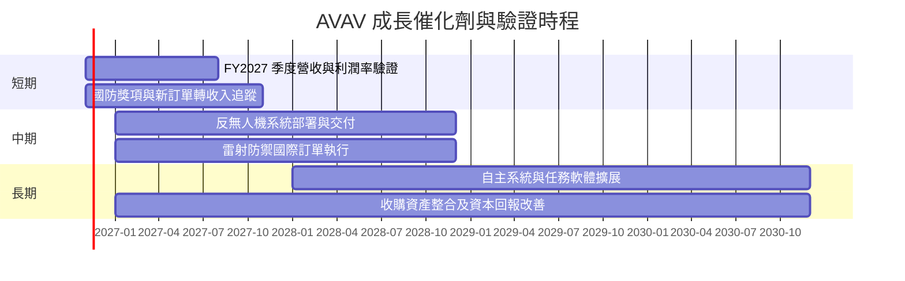

訂單時程只是追蹤框架，不代表已確認交付日期或收入認列承諾。資料包提及 $720M 防務獎項及 $405M 國際雷射防禦訂單，但缺乏訂單範圍、履約期與認列條件的完整披露。

### 9.2 TAM 市場規模分析

提供資料沒有 UAS、反無人機、定向能等分市場 TAM、滲透率或 AVAV 分部營收，故不填造市場規模數字。

```text
╔══════════════════════════════════════════════════════════════╗
║          TAM、市場滲透率與公司收入：可用資料狀態              ║
╠══════════════════════════════════════════════════════════════╣
║ 小型／中型 UAS TAM       N/A    市場滲透率 N/A  分部收入 N/A  ║
║ 反無人機系統 TAM         N/A    市場滲透率 N/A  分部收入 N/A  ║
║ 定向能／雷射防禦 TAM     N/A    市場滲透率 N/A  分部收入 N/A  ║
║ 太空與網路相關 TAM       N/A    市場滲透率 N/A  分部收入 N/A  ║
╠══════════════════════════════════════════════════════════════╣
║ 可驗證收入基準：TTM 總營收 $2.00B；TTM YoY +84.4%            ║
║ 最新季度單季 YoY +5.7%，應優先監控增長能否恢復。             ║
╚══════════════════════════════════════════════════════════════╝
```

### 9.3 成長驅動力結構圖

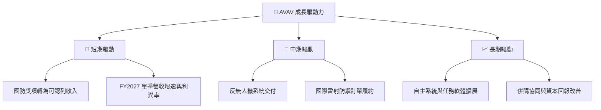

---

## 10. 風險矩陣

### 10.1 風險評分矩陣

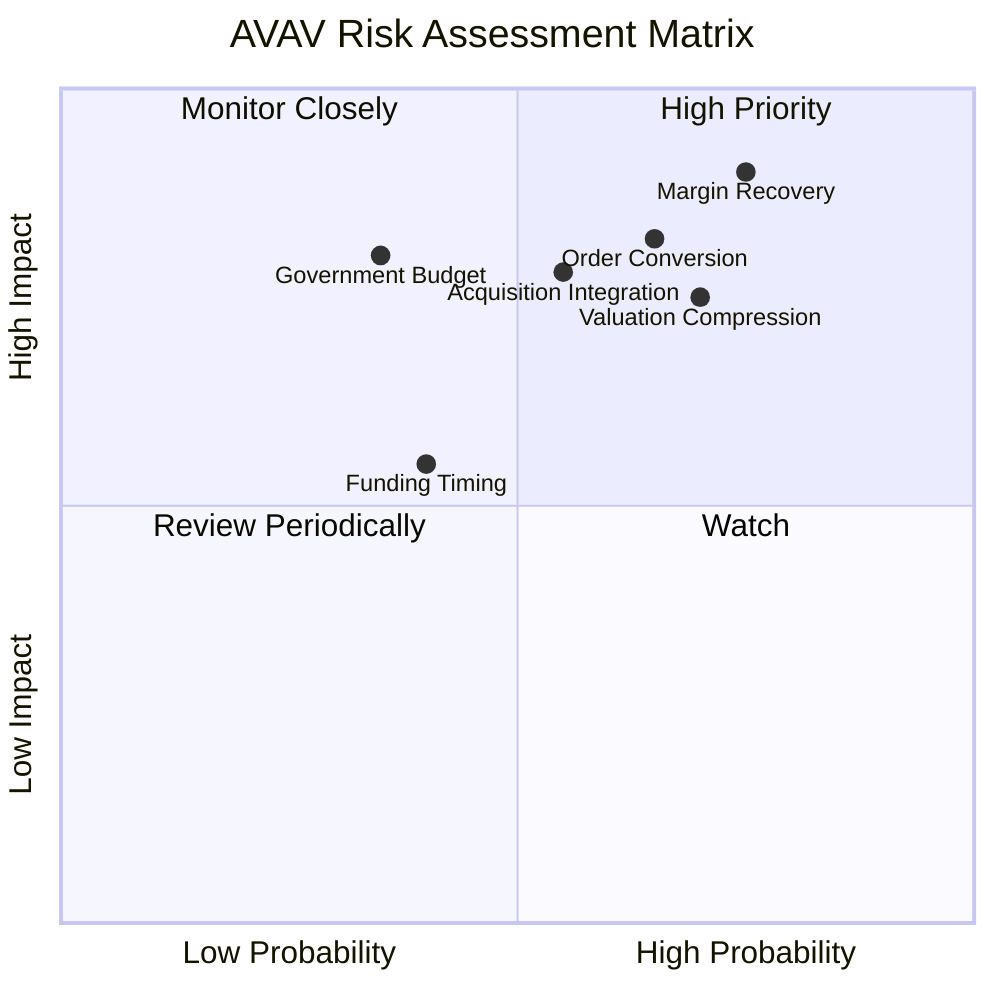

### 10.2 風險清單詳細分析

| # | 風險項目 | 發生機率 | 財務衝擊 | 風險評分 | 緩解措施 |
|---|----------|----------|----------|----------|----------|
| 1 | 🔴 **營業利潤率修復失敗** | 高（約 60%） | 若持續低於 0%，DCF 基準假設失效；估值可能進一步下調 | 🔴 8.5/10 | 逐季檢查毛利率、營業費用率與整合成本 |
| 2 | 🔴 **訂單轉收入延遲** | 中高（約 50%） | 最新單季 YoY 僅 5.7%；延遲可能使 CAGR 假設低於 20% | 🔴 8.0/10 | 跟蹤 backlog、交付、取消與收入認列 |
| 3 | 🔴 **併購整合／商譽減值** | 中（約 45%） | 商譽 $2.494B、無形資產 $886.47M；減值會壓低帳面資產及盈餘 | 🔴 7.5/10 | 比較收購業務實際收入、毛利與資本回報 |
| 4 | 🟡 **估值倍數收縮** | 中高（約 55%） | Forward P/E 26.66x；盈利預估下修可能同時壓低 EPS 與倍數 | 🟠 7.0/10 | 以每季盈利、FCF 和訂單驗證，而非只看訂單新聞 |
| 5 | 🟡 **政府預算、採購與地緣政治波動** | 中（約 35%） | 採購延期影響交付與現金流；資料未提供客戶集中度，量化收入衝擊 N/A | 🟠 6.5/10 | 監控預算、合約進度及國際訂單分散程度 |
| 6 | 🟡 **資產負債資料口徑差異** | 中（約 40%） | VERIFIED 債務 $730.06M，其他資料列 $850.82M；估值橋接可能偏差 | 🟠 6.0/10 | 以最新 10-Q 註釋與債務明細校正模型 |

發生機率為分析情境估計，不是公司揭露或統計模型結果。最大風險是營業利潤率修復：它同時影響現金流、終值與估值倍數。

---

## 11. 投資建議

### 11.1 最終綜合評級雷達圖

```text
╔══════════════════════════════════════════════════════════════╗
║                    AVAV 綜合評分雷達                          ║
╠══════════════════════════════════════════════════════════════╣
║ 基本面      6.0/10  ▓▓▓▓▓▓▓▓▓▓▓▓░░░░░░░░  ★★★☆☆          ║
║ 成長性      6.5/10  ▓▓▓▓▓▓▓▓▓▓▓▓▓░░░░░░░  ★★★☆☆          ║
║ 獲利能力    3.5/10  ▓▓▓▓▓▓▓░░░░░░░░░░░░░  ★★☆☆☆          ║
║ 財務健康    6.0/10  ▓▓▓▓▓▓▓▓▓▓▓▓░░░░░░░░  ★★★☆☆          ║
║ 估值合理性  3.0/10  ▓▓▓▓▓▓░░░░░░░░░░░░░░  ★★☆☆☆          ║
║ 護城河      6.0/10  ▓▓▓▓▓▓▓▓▓▓▓▓░░░░░░░░  ★★★☆☆          ║
║ 執行能力    5.0/10  ▓▓▓▓▓▓▓▓▓▓░░░░░░░░░░  ★★★☆☆          ║
╠══════════════════════════════════════════════════════════════╣
║ 綜合評分    5.0/10  ▓▓▓▓▓▓▓▓▓▓░░░░░░░░░░  🟡 觀望／減碼    ║
╚══════════════════════════════════════════════════════════════╝
```

### 11.2 目標價與隱含報酬率

| 情境 | 目標價 | 相對 $117.52 現價報酬 | 情境假設 | 參考機率 |
|------|-------:|----------------------:|----------|---------:|
| 🔴 悲觀 | $63.00 | -46.4% | 收入增長接近低雙位數以下，利潤率修復有限，估值向成熟防務倍數靠攏 | 25% |
| 🟡 基準 | **$105.34** | **-10.4%** | DCF、同業倍數、EV/Sales 與分析師共識加權 | 55% |
| 🟢 樂觀 | $150.00 | +27.6% | 訂單按期轉收入、毛利與營業利潤率改善、維持成長溢價 | 20% |

**最終評級：🟠 減碼。** MOS **-11.6%** 對應減碼門檻；TTM ROIC **-4.4%** 低於 WACC **10.91%**，TTM FCF **-$25.03M**。如果後續利潤率和 FCF 明顯改善，需重新評估，而不是只因國防訂單新聞上調內在價值。

### 11.3 買入時機與觸發因素

```text
╔══════════════════════════════════════════════════════════════════╗
║                  ✅ 買入觸發因素 Checklist                      ║
╠══════════════════════════════════════════════════════════════════╣
║  立即考慮加倉前需看到多數條件：                                  ║
║  ☐ 最新季度營收 YoY 由 5.7% 回升至至少 15%                       ║
║  ☐ TTM 營業利益率連續改善，並接近損益兩平                         ║
║  ☐ TTM FCF 轉正，且不是只靠一次性營運資金回收                     ║
║                                                                  ║
║  加碼觸發條件（任一組合達成）：                                  ║
║  ☐ 股價回落至約 $94.81 以下，對加權合理價值具至少 10% MOS         ║
║  ☐ 連續兩季毛利率與營業利益率改善，並有可核對的訂單交付佐證       ║
║                                                                  ║
║  減碼／退出觸發條件：                                             ║
║  ☐ 連續兩季單季營收 YoY 低於 5%                                  ║
║  ☐ TTM FCF 持續為負且營業利潤率未改善                            ║
║  ☐ 商譽／無形資產減損，或淨負債明顯超出 VERIFIED 口徑              ║
╚══════════════════════════════════════════════════════════════════╝
```

### 11.4 投資人適配度分析

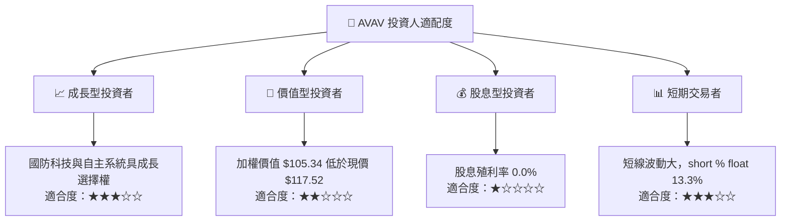

### 11.5 每季財報監控清單（Quarterly Watch List）

| 指標 | 目前基準 | 加碼觀察門檻 | 減碼／重新檢視門檻 |
|------|----------|--------------|--------------------|
| 單季營收 YoY | **5.7%** | ≥15%，且連續兩季 | 連續兩季 <5% |
| TTM 營收 | **$2.00B**，TTM YoY **84.4%** | 增長轉為穩定且排除併購基期效果 | TTM 成長快速回落且訂單轉換不佳 |
| TTM 營業利益率 | **-12.6%**（VERIFIED） | 持續改善並轉正 | 連續兩季惡化 |
| 最新季度營業利益率 | **-2.3%**（VERIFIED） | 轉正並證明可重複 | 顯著低於 -2.3% |
| TTM FCF | **-$25.03M** | 轉正且連續兩季維持 | FCF 惡化至更深負值 |
| TTM Capex | **$83.85M** | 投資產能帶來交付與現金流回報 | Capex 增加但收入／毛利不升 |
| 應收帳款與存貨 | 約 $826.77M／$410.77M | 相對營收增長受控 | 快於營收持續攀升，可能反映回款或交付風險 |
| SBC | FY2026 **$38.33M** | SBC／營收下降或股數稀釋穩定 | SBC 增速長期高於營收 |
| 國防訂單 | 新聞提及 $720M 獎項、$405M 國際訂單 | 確認履約時程、收入認列與毛利 | 延遲、取消或訂單不轉收入 |
| 現金與債務 | VERIFIED 現金 $580.23M、債務 $730.06M | 淨負債降低 | 淨負債上升且 FCF 續負 |

### 11.6 反面論證：什麼會證明論點錯誤（What Would Change My Mind）

```text
╔══════════════════════════════════════════════════════════════════╗
║             ⚠️ 論點失效條件（Disconfirming Evidence）             ║
╠══════════════════════════════════════════════════════════════════╣
║ 本報告的成長論點在下列情況發生時應重新檢視或退出：                ║
║  ☐ 最新單季營收 YoY 連續兩季低於 5%                              ║
║  ☐ TTM 營業利益率連續兩季惡化，且無明確整合改善證據               ║
║  ☐ FY2027 期間 TTM FCF 仍為負，且負值幅度擴大                     ║
║  ☐ ROIC 持續低於 WACC 10.91%，且營業利潤率未呈改善               ║
║  ☐ 訂單新聞未能轉為交付、收入與可見毛利                           ║
║  ☐ 商譽減損或債務核對後淨負債顯著高於 $149.83M                   ║
║  ☐ SBC／營收持續上升，並同時發生股數擴張                         ║
╚══════════════════════════════════════════════════════════════════╝
```

> **免責聲明**：本報告依據所提供資料與明示假設製作，僅供研究參考，不構成個人化投資建議。資料包存在債務、營業利益率與 FCF 等口徑差異；投資決策前應核對最新 SEC 申報文件及公司財報。投資有風險，入市需謹慎。