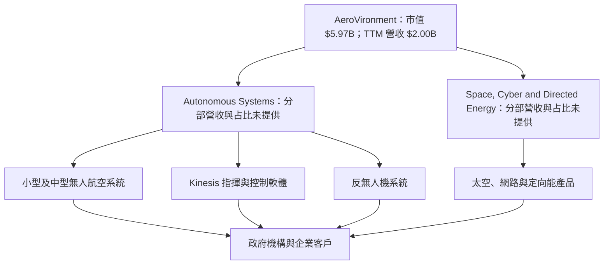
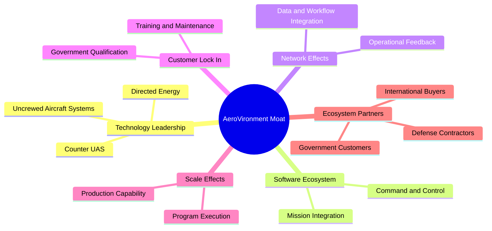
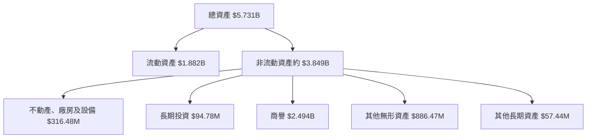
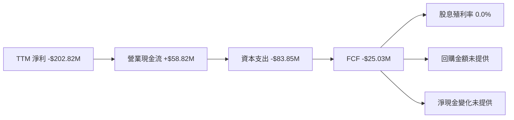
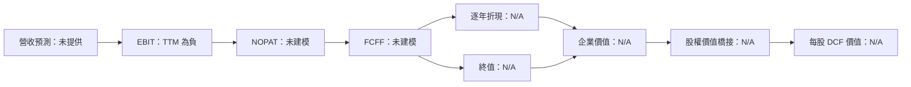
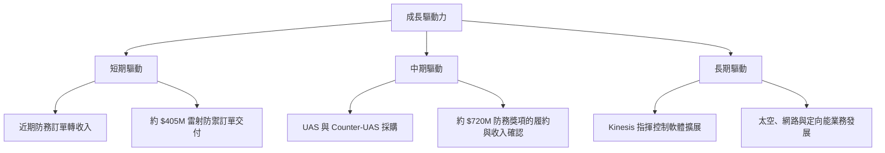
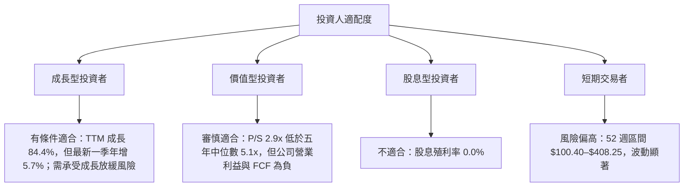

# AVAV 基本面深度分析報告
> **報告日期**：2026-11-15 ｜ **語言**：繁體中文 ｜ **數據來源**：SEC 申報資料 (XBRL)、Yahoo Finance、Finviz、StockAnalysis、Roic.ai ｜ **分析師**：CFA 級機構研究

## 目錄

| # | 章節 | 核心結論 |
|---|------|----------|
| 1 | 執行摘要 | 買入；加權合理價值 $144.78，MOS +18.8% |
| 2 | 公司概覽與商業模式 | 國防無人系統與相關技術平台具客戶認證及任務整合優勢；收入組成資料不足以量化各業務占比 |
| 3 | 損益表深度分析 | TTM 營收 $2.00B、TTM 成長 84.4%；最新一季年增放緩至 5.7%，TTM 營業利益率為 -12.6% |
| 4 | 資產負債表分析 | 核定數據為淨負債 $149.83M；現金與短期投資 $580.23M，流動比率 4.26 |
| 5 | 現金流量深度分析 | TTM FCF 為 -$25.03M，FCF Yield -0.42%；資本支出高於營業現金流 |
| 6 | 獲利能力與資本效率 | ROIC -4.4% 對比 WACC 10.31%，目前仍在摧毀股東價值 |
| 7 | 相對估值分析 | AVAV 自身 P/S 低於五年中位數；加權相對估值高於現價，但盈利及現金流仍有不確定性 |
| 8 | DCF 內在價值評估 | DCF 為 N/A：TTM 營業利益為負，不建立自行假設的現金流模型 |
| 9 | 成長催化劑 | 國防訂單與無人系統、反無人機及雷射防禦需求是主要催化劑；TAM 數字未提供 |
| 10 | 風險矩陣 | 獲利與現金流轉弱、併購整合及國防採購波動為主要風險 |
| 11 | 投資建議 | 買入；現價 $117.52，基於加權合理價值的買入參考區間為 $117.52–$130.30 |

---

## 1. 執行摘要

AVAV 的基本面呈現「營收規模快速擴大、但獲利與現金流尚未同步改善」的組合：TTM 營收為 **$2.00B**，年增 **84.4%**，但最新一季營收年增已降至 **5.7%**；TTM 營業利益率 **-12.6%**、ROIC **-4.4%**，均低於 **10.31% WACC**，TTM FCF 為 **-$25.03M**。以估值方法加權後合理價值 **$144.78**，較 2026-11-13 收盤價 **$117.52** 高出 **23.2%**，安全邊際（MOS）為 **18.8%**，故依規則 20 評級為**買入**；DCF 因 TTM 營業利益為負而不適用，不能將相對估值目標誤稱為 DCF 內在價值。

### 1.0 一頁式投資儀表板（Portfolio Manager 30 秒速讀）

| 項目 | 內容 |
|------|------|
| **投資論點（3 句）** | ① TTM 營收年增 **84.4%**，顯示業務規模因需求擴張及併購整合明顯放大。② 最新一季營收年增僅 **5.7%**，且 TTM 營業利益率 **-12.6%**，營收擴張尚未轉化成穩定獲利。③ 加權合理價值 **$144.78**，相對 **$117.52** 現價的上行空間為 **23.2%**，但 FCF 為 **-$25.03M**，需以獲利轉正作為估值驗證。 |
| **綜合評分** | **5.6/10**（引用 1.1 評分卡） |
| **財務健康** | 🟡 現金及短期投資 **$580.23M**，核定淨負債 **$149.83M**、流動比率 **4.26**；流動性尚可，惟 FCF 為負。 |
| **ROIC vs WACC** | **-4.4% vs 10.31%**；ROIC 低於資金成本，現階段摧毀股東價值。 |
| **FCF 趨勢** | TTM FCF **-$25.03M**；FCF Yield **-0.42%**。 |
| **估值** | Forward P/E **26.66x** ｜ EV/EBITDA **28.43x** ｜ FCF Yield **-0.42%**。 |
| **DCF 內在價值（基準）** | **N/A**；TTM 營業利益為負，無可採用的程式 DCF 基準價值，因此 DCF 折溢價亦為 N/A。 |
| **安全邊際（MOS）** | **+18.8%＝($144.78 − $117.52) ÷ $144.78**；基準為 8.8 加權合理價值，🟡有限。 |
| **預期報酬（基準情境 12M）** | DCF 基準情境 N/A；加權合理價值所隱含的上行空間為 **+23.2%**，不是保證報酬或獨立的 12 個月預測。 |
| **關鍵風險（前二）** | 最新一季營收年增降至 **5.7%**；TTM 營業利益率 **-12.6%**、FCF 為負。 |
| **評級 + 信心度** | 🟢 **買入** ｜ 信心：**中低**（相對估值有折價訊號，但 DCF 不適用且獲利尚未穩定）。 |

### 1.1 綜合評分卡（全報告唯一）

| 維度 | 評分（1–10） | 主要依據（引用數字與其來源章節） |
|------|--------------|----------------------------------|
| 成長性 | 7.0 | TTM 營收年增 **84.4%**，但最新一季年增 **5.7%**，成長動能呈現明顯放緩（第 3 章）。 |
| 獲利能力 | 3.0 | TTM 營業利益率 **-12.6%**、ROIC **-4.4%**，低於 WACC **10.31%**；F-Score **4/9**（第 3、6 章）。 |
| 財務健康 | 6.0 | 現金與短期投資 **$580.23M**、核定淨負債 **$149.83M**、流動比率 **4.26**；但 TTM FCF **-$25.03M**（第 4、5 章）。 |
| 估值 | 6.5 | MOS **18.8%**；公司 P/S **2.9x**，低於自身五年中位數 **5.1x**，但 DCF 不適用（第 7、8 章）。 |
| 護城河 | 6.0 | 具無人系統、指揮控制軟體及國防客戶任務整合能力；但缺少分部營收、續約率及市場份額資料（第 2 章）。 |
| 管理層與資本配置 | 5.0 | 2026 財年營收規模擴大，但年度營業利益為 **-$70.29M**、年度 FCF 為 **-$164.62M**；年度 SBC **$38.33M**（第 3、5 章）。 |
| **綜合評分** | **5.6** | 六項算術平均：**(7.0 + 3.0 + 6.0 + 6.5 + 6.0 + 5.0) ÷ 6 = 5.6**。 |

### 1.2 五大投資論點 + 三大核心風險

| 類型 | 項目 | 具體依據 | 信心度 |
|------|------|----------|--------|
| 🟢 **投資論點①** | 國防需求推動業務規模擴大 | TTM 營收 **$2.00B**，TTM 年增 **84.4%**；公司提供 UAS、反無人機及相關系統。增長需進一步區分內生訂單與併購貢獻。 | 🟡 中 |
| 🟢 **投資論點②** | 最新報價相對估值低於自身長期中位數 | P/S **2.9x**，低於五年中位數 **5.1x**；歷史區間為 **3.0x–13.4x**。不過當期營業虧損使低倍數不必然代表低估。 | 🟡 中 |
| 🟢 **投資論點③** | 現金及流動性提供短期緩衝 | 現金及短期投資 **$580.23M**，流動比率 **4.26**；可支持營運及投資，但仍須監控現金消耗。 | 🟡 中 |
| 🟢 **投資論點④** | 訂單新聞可能帶來未來收入可見度 | 新聞資料提到國防訂單，包括約 **$720M** 防務獎項及 **$405M** 雷射防禦系統訂單；訂單轉收入時間與毛利貢獻未提供。 | 🟡 中 |
| 🟢 **投資論點⑤** | 估值方法加權後有正上行空間 | 同業 Forward P/E、同業 P/S 與分析師共識加權為 **$144.78**，相對現價上行空間 **23.2%**。 | 🟡 中 |
| 🟡 **風險①** | 營收成長急速降溫 | 最新一季營收年增 **5.7%**，遠低於 TTM 年增 **84.4%**；若後續季度未恢復，市場可能下修成長估值。 | 🟡 中 |
| 🔴 **風險②** | 獲利及現金轉換未跟上營收 | TTM 營業利益率 **-12.6%**、ROIC **-4.4%**、FCF **-$25.03M**；若持續，稀釋股東回報並限制再投資能力。 | 🔴 高 |
| 🔴 **風險③** | 併購與整合風險 | FY2026 資產負債表商譽升至 **$2.494B**、無形資產 **$929.83M**，相較 FY2025 大幅上升；若預期協同效益未實現，可能導致減損及利潤壓力。 | 🟡 中 |

### 1.3 快速統計卡片

| 指標 | 公司實際值（期間） | 同業中位數 | 狀態 |
|------|--------------------|------------|------|
| 營收成長（TTM） | **84.4%** | — | 🟢 |
| 營收成長（最新一季年增） | **5.7%** | **35.7%** | 🔴 |
| 毛利率（TTM） | **26.5%** | **23.0%** | 🟢 |
| 營業利益率（TTM） | **-12.6%** | — | 🔴 |
| ROIC（TTM） | **-4.4%** | — | 🔴 |
| Forward P/E | **26.66x** | **24.1x**¹ | 🟡 |
| FCF Yield（TTM） | **-0.42%** | — | 🔴 |
| Piotroski F-Score | **4 / 9** | — | 🟡 |

¹同業 Forward P/E 中位數由 KTOS 與 LMT 計算；同業估值見第 7 章。

### 1.4 投資結論

```text
╔══════════════════════════════════════════════════════════════════╗
║                    📊 投資結論摘要                               ║
╠══════════════════════════════════════════════════════════════════╣
║  評級：買入（依加權合理價值 MOS +18.8%）                         ║
║  價格（2026-11-13 收盤）：$117.52                                ║
║  DCF 內在價值（基準）：N/A（TTM 營業利益為負）                   ║
║  安全邊際 MOS：+18.8%（＝($144.78−$117.52)÷$144.78）            ║
║  加權合理價值（8.8）：$144.78                                    ║
║  綜合評分：5.6/10（引用 1.1）                                    ║
║  適合投資人：能承受國防科技股波動、接受短期獲利與現金流不穩者    ║
╚══════════════════════════════════════════════════════════════════╝
```

---

## 2. 公司概覽與商業模式

### 2.1 業務結構與收入來源

公司提供無人航空系統、指揮控制軟體、反無人機系統，以及太空、網路與定向能相關產品。財務資料未提供各部門營收、占比或軟體服務收入拆分，因此不虛構分部金額與占比。



### 2.2 市場份額

市場份額數據未提供，近期新聞亦未提供可核實的公司市場占有率及統計年份，因此不呈現市場份額圖表。以規模和成長看，公司 TTM 營收 **$2.00B**，但最新一季年增 **5.7%**，低於 KTOS、ONDS、LMT 最新一季成長數據的中位數 **35.7%**；各公司產品範圍不同，這項比較只能視為收入動能參考，不能直接等同市占變化。

### 2.3 競爭護城河分析



### 2.4 護城河強度

| 護城河項目 | 強度（強／中／弱） | 證據（引用數字或事實） | 會削弱它的情況 |
|------------|--------------------|------------------------|----------------|
| 技術與產品 | 中 | 公司產品涵蓋 UAS、反無人機及定向能；近期新聞提及 **$405M** 雷射防禦系統訂單。細項技術性能與競標勝率未提供。 | 替代技術進步、性能落後或系統可靠度不達標。 |
| 軟體與任務整合 | 中 | 公司提供 Kinesis 指揮控制軟體；軟體收入及客戶續約率未提供，故難以量化經常性收入與轉換成本。 | 客戶改用競品平台、互通性標準改變或軟體服務採購下降。 |
| 網路效應 | 弱至中 | 國防系統可因部署與維護累積操作經驗，但活躍系統數及數據網路效應指標未提供。 | 客戶間資料無法共享、系統缺乏跨平台互通。 |
| 客戶鎖定 | 中 | 政府採購、測試認證、訓練與維護可能形成轉換成本；客戶集中度與續約率資料未提供。 | 預算削減、採購延後或政府轉向其他供應商。 |
| 規模效應 | 中 | TTM 營收 **$2.00B**，規模較 FY2025 的 **$820.63M** 擴大；但 FY2026 營業利益為 **-$70.29M**，尚未顯示規模已轉化為穩定利潤。 | 併購整合複雜、產能擴張成本或低毛利大型專案占比上升。 |
| 生態夥伴 | 中 | 業務依賴政府、國防承包商及國際客戶；新聞提及美國及中東訂單，但合作收入占比未提供。 | 主要客戶採購轉移、出口限制或供應鏈中斷。 |

1.1「護城河」評分 **6.0/10**，反映產品及國防採購整合具一定進入障礙，但可量化的軟體續約、市占與客戶留存證據不足。

---

## 3. 損益表深度分析

### 3.1 年度收入成長趨勢（近 4 年）

年度營收取自年度損益表；FY2026 營收大幅增加，但資產負債表中的商譽與無形資產也同步擴大，顯示不能把全部增長直接解讀為有機成長。

```text
╔══════════════════════════════════════════════════════════════════╗
║              AeroVironment 年度收入趨勢（FY2023–FY2026）        ║
╠══════════════════════════════════════════════════════════════════╣
║  FY2023  $540.54M  ██████░░░░░░░░░░░░░░░░░░  YoY：基期          ║
║  FY2024  $716.72M  ████████░░░░░░░░░░░░░░░░  YoY：+32.6% 🟢     ║
║  FY2025  $820.63M  █████████░░░░░░░░░░░░░░░  YoY：+14.5% 🟡     ║
║  FY2026  $1.98B    ████████████████████████  YoY：約+140.9% 🟢  ║
╠══════════════════════════════════════════════════════════════════╣
║  FY2023–FY2026 營收 CAGR：約 +54.1%                             ║
╚══════════════════════════════════════════════════════════════════╝
```

CAGR 計算：\((1,977 ÷ 540.54)^{1/3} − 1 ≈ 54.1\%\)。FY2026 年度營收 **$1.977B** 相較 FY2025 **$820.63M** 增幅約 **140.9%**；然而最新 TTM 年增 **84.4%**、最新單季年增僅 **5.7%**，說明年度高成長率不能直接外推至未來。

### 3.2 季度收入趨勢分析

| 季度 | 營收 | QoQ 成長 | YoY 成長 | 備註 |
|------|------:|---------:|---------:|------|
| 2025-10-31 | $472.51M | — | +150.72% | 與前季相比的資料未列於所提供的近四季表格。 |
| 2026-01-31 | $408.05M | -13.64% | +143.41% | 季度營收回落，但仍高於去年同期。 |
| 2026-04-30 | $641.62M | +57.24% | +133.27% | 單季收入大幅上升；需留意專案交付的季節性及集中度。 |
| 2026-08-01 | $480.49M | -25.11% | +5.7% | QoQ 以 480.49 ÷ 641.62 − 1 計算；YoY 使用 SEC/程式核定單季年增率。 |

季度波動可能受國防專案交付節奏影響，但現有資料不足以拆解交付、併購及產品組合的各自貢獻。最新一季年增放緩是比 TTM 成長率更需追蹤的邊際訊號。

### 3.3 利潤率演變分析

| 利潤率指標 | FY2023 | FY2024 | FY2025 | FY2026 | 趨勢 | 評估 |
|------------|-------:|-------:|-------:|-------:|------|------|
| **毛利率** | 32.1% | 39.6% | 38.8% | 25.3% | FY2026 明顯下滑 | 🔴 |
| **營業利益率** | -4.2% | 10.0% | 7.2% | -3.6% | FY2024、FY2025 正值後轉負 | 🔴 |
| **淨利率** | -32.6% | 8.3% | 5.3% | -13.4% | FY2026 出現大幅淨損 | 🔴 |

毛利率、營業利益率及淨利率由年度損益表相除計算，四捨五入至小數一位。FY2026 毛利率下降與年度收入急劇擴大同時發生；年度 R&D 支出由 FY2025 **$100.73M** 增至 FY2026 **$127.68M**，增幅約 **26.8%**，也加重費用負擔。資料不足以判定成本變化中有多少來自產品組合、整合費用或價格因素，因此不把利潤率惡化歸因於單一原因。

需特別留意資料來源差異：程式核定 TTM 營業利益率為 **-12.6%**，但其他市場資料欄位顯示 TTM 約 **-0.6%**。本報告依規則優先採用核定值 **-12.6%**；這個差異應在正式投資決策前以 SEC 10-Q 的 TTM EBIT 與期間口徑覆核。

### 3.4 費用結構分析

完整營業費用分項及 TTM 成本明細不足，無法製作可核實的費用圓餅圖。已知 FY2026 R&D 為 **$127.68M**、FY2025 為 **$100.73M**，同比增加 **26.8%**；FY2026 營業利益為 **-$70.29M**，顯示研發投入與其他營業費用尚未由毛利充分覆蓋。由於缺少銷管費、整合費、無形資產攤銷等完整明細，不將差額自行分配至費用類別。

### 3.5 季度 EPS 趨勢與盈餘品質（Quality of Earnings）

EPS 資料來源列出的四個季度實際 EPS 為 -$0.10、-$0.48、-$3.15、-$0.34；但分析師 EPS 預估及 surprise 欄均為 N/A，因此不能判定超預期或不及預期。資料來源對 2026-01-31 EPS 亦出現 -$3.15 與 -$4.90 的差異，應以 SEC 申報資料進一步核對。

| 盈餘品質項目 | 數值/佔比 | 評估 |
|--------------|-----------|------|
| 股權薪酬 SBC / 營收 | 近四季 SBC 合計 **$31.84M** ÷ TTM 營收 **$2,003M** ≈ **1.59%** | 🟡 SBC 不算可忽略；若持續發行股權薪酬，會稀釋現有股東。 |
| SBC / 營業現金流 | **$31.84M ÷ $58.82M ≈ 54.1%** | 🟡 SBC 相對營業現金流占比高；SBC 本身是非現金費用，但經濟成本會反映於股數稀釋。 |
| FCF / 淨利（現金轉換率） | N/A（TTM 淨利為負，且不同來源期間口徑不一） | 🔴 在淨利為負時，FCF／淨利比率不適合解讀為一般現金轉換率；TTM FCF 本身為 **-$25.03M**。 |
| 一次性/非經常性損益 | 有重大年度淨損；具體非經常性項目拆分 N/A | 🟡 FY2026 淨利 **-$265.12M**，但缺少調整項目明細，不能自行判斷有多少是一次性。 |
| 有效稅率異常 | N/A | TTM 有虧損且未提供可核對的稅前利潤與稅費拆分，無法判定是否有稅務利益。 |
| 資本化支出 vs 費用化 | FY2026 Capex **$86.22M**（年度報表列示）；資本化政策細節 N/A | Capex 會影響現金流而非當期全額費用；缺少資本化政策細節，不判定其是否遞延成本。 |

**盈餘品質結論**：目前 GAAP 淨利為負，FCF 也為負，故不存在「帳面獲利已轉化為可分配現金」的證據。TTM SBC 約為營收的 **1.59%**，占營業現金流約 **54.1%**，其非現金性不能抹去稀釋成本。估值不宜只看 Forward P/E 或分析師目標價，仍須等待營業利潤與 FCF 改善。

---

## 4. 資產負債表分析

### 4.1 資產結構分解

以下採用 TTM 資產負債表相關數據；金額以財務數據列示為準，細項加總可能因四捨五入略有差異。



商譽與無形資產合計約 **$3.380B**，占總資產約 **59.0%**（以資產負債表細項除以總資產計算）。此結構提升併購後減損與協同效益實現風險的重要性。

### 4.2 流動性與營運資金分析

| 流動性指標 | 最新值 | 歷史參考 | 評估 |
|------------|-------:|----------|------|
| 流動比率 | 4.26 | 年度資料 FY2026 流動資產 $1.89B、流動負債 $439.24M | 🟢 短期帳面流動性充足；但應收及存貨占用仍須追蹤。 |
| Quick Ratio | 3.185 | N/A | 🟢 高於 1，顯示扣除部分流動資產後仍有流動性緩衝。 |
| 現金及短期投資 | $580.23M | FY2026 年度現金 $377.32M；與 TTM 時點不同 | 🟡 現金資源具緩衝，但不能抵銷持續負 FCF。 |

**營運資金天數：**

| 指標 | 最新 TTM | 一年前 TTM | 變化 | 解讀 |
|------|----------:|----------:|------:|------|
| DSO 應收帳款天數 | 33 天 | 67 天 | -34 天 | 🟢 收款天數縮短，對現金回收有利；需確認是否來自期末餘額變化或客戶付款條款。 |
| DIO 存貨天數 | 102 天 | 113 天 | -11 天 | 🟢 存貨天數下降，但 102 天仍代表有相當營運資金投入存貨。 |
| DPO 應付帳款天數 | 43 天 | 44 天 | -1 天 | 🟡 變化小，供應商付款週期大致穩定。 |
| CCC 現金轉換週期 | 92 天 | 135 天 | -43 天 | 🟢 營運資金週期縮短，有利現金轉換；但 TTM FCF 仍為負。 |

營運資金天數照抄 QUALITY FIGURES 的程式計算值，不另行重算。應收及存貨餘額仍較大，故 DSO、DIO 改善須與後續現金流共同觀察。

### 4.3 債務結構分析

資料來源在債務口徑上存在差異：核定數據為總債務 **$730.06M**、淨負債 **$149.83M**；另一市場資料欄位列總債務 **$850.82M**、淨負債 **$270.60M**。本報告的淨負債、WACC 與摘要採用核定數據；不同口徑可能涉及租賃或其他債務分類，需以同一期 SEC 資產負債表確認。

```text
╔══════════════════════════════════════════════════════════════════╗
║                   AeroVironment 債務健康診斷                    ║
╠══════════════════════════════════════════════════════════════════╣
║  總債務（核定口徑）：          $730.06M                          ║
║  現金及短期投資：              $580.23M                          ║
║  淨負債：                      $149.83M                          ║
║  流動比率：                    4.26x                             ║
║  Debt/EBITDA：                 N/A（TTM EBITDA 口徑不一致）       ║
║  利息保障倍數：                N/A（利息費用資料未提供）         ║
║                                                                  ║
║  判讀：短期流動性尚可，但並非淨現金公司；FCF 為負會增加        ║
║  對未來融資及營運資金管理的依賴。                                ║
╚══════════════════════════════════════════════════════════════════╝
```

不以應付帳款等無息負債推算債務成本，也不以不一致的 EBITDA 口徑製作 Debt/EBITDA。

### 4.4 股東權益趨勢

```text
╔══════════════════════════════════════════════════════════════════╗
║                 股東權益趨勢（年度財報列示）                    ║
╠══════════════════════════════════════════════════════════════════╣
║  FY2023  $550.97M  ███████░░░░░░░░░░░░░░░░░░                    ║
║  FY2024  $822.75M  ███████████░░░░░░░░░░░░░░                    ║
║  FY2025  $886.51M  ████████████░░░░░░░░░░░░                    ║
║  FY2026  $4.40B    ██████████████████████████                    ║
╠══════════════════════════════════════════════════════════════════╣
║  FY2026 股東權益大幅增加；同期間商譽及無形資產亦顯著提高。      ║
║  需區分交易融資、發股及經營累積對權益變動的各自影響。            ║
╚══════════════════════════════════════════════════════════════════╝
```

FY2025 至 FY2026 股東權益由 **$886.51M** 增至 **$4.40B**，但資料未提供股本、收購對價及其他權益變動的完整調節表，不能把權益增加解讀成營運獲利累積。

---

## 5. 現金流量深度分析

### 5.1 現金流量瀑布圖

採用核定 TTM OCF、Capex 與 FCF，依定義為營業現金流減資本支出。淨利採 StockAnalysis TTM 數據，來源及口徑不同，僅作背景參考。



### 5.2 FCF 轉換率趨勢

| 年度／期間 | FCF | 淨利 | FCF / 淨利 | 評估 |
|------------|----:|-----:|-----------:|------|
| FY2023 | -$3.47M | -$176.21M | 不具經濟可比性 | 淨利大幅為負且 FCF 為負。 |
| FY2024 | -$9.19M | $59.67M | 約 -15.4% | 有帳面獲利但 FCF 為負，現金轉換偏弱。 |
| FY2025 | -$24.13M | $43.62M | 約 -55.3% | FCF 惡化，資本支出及營運現金流需拆解。 |
| FY2026 | -$164.62M | -$265.12M | 約 62.1%¹ | 兩者皆負，比例不能視為正向現金轉換。 |
| TTM | -$25.03M | 淨利來源口徑不一致 | N/A | 使用核定 TTM FCF；不混用不同期間淨利計算比率。 |

¹單純以年度 FCF ÷ 年度淨利計算；兩項均為負，經濟意義有限。年度 FCF 來自年度現金流量表，核定 TTM FCF 則由 TTM OCF 減 Capex 得出，兩者期間不同，不可互換。

### 5.3 自由現金流趨勢

```text
╔══════════════════════════════════════════════════════════════════╗
║                  自由現金流：歷史實際與 TTM                     ║
╠══════════════════════════════════════════════════════════════════╣
║  FY2023  -$3.47M     ████░░░░░░░░░░░░░░░░░░░░░  FCF 為負        ║
║  FY2024  -$9.19M     ███████░░░░░░░░░░░░░░░░░░  FCF 為負        ║
║  FY2025  -$24.13M    ███████████████░░░░░░░░░  FCF 為負        ║
║  FY2026  -$164.62M   ████████████████████████  FCF 為負        ║
║  TTM     -$25.03M    依核定 TTM OCF − Capex 計算               ║
╠══════════════════════════════════════════════════════════════════╣
║  TTM FCF Yield：-0.42%；年度 FCF 與 TTM FCF 期間口徑不同。       ║
╚══════════════════════════════════════════════════════════════════╝
```

### 5.4 資本配置評估

資本配置的完整圓餅圖需要可比的回購、Capex、股息與併購支出拆分；目前未提供足夠且同口徑的完整資料，故不製作比例圖。

| 項目 | 可用數據 | 評估 |
|------|----------|------|
| 資本支出 | 核定 TTM **$83.85M**；FY2026 年度表列 **$86.22M** | TTM 口徑下 Capex 高於 OCF，令 FCF 為負。 |
| 股息 | 殖利率 **0.0%** | 未見現金股息回報。 |
| 回購 | N/A | 回購金額與淨股數變化拆分未提供。 |
| 股權薪酬 | FY2026 **$38.33M** | 會產生稀釋成本；需持續追蹤稀釋股數。 |
| 留存與併購 | FY2026 商譽及無形資產顯著增加 | 支持併購與整合活動可能影響資產配置，但交易層級現金用途未完整列示。 |

---

## 6. 獲利能力與資本效率

### 6.1 ROE / ROA / ROIC 趨勢

| 指標 | 最新 TTM | 可用歷史資訊 | 評估 |
|------|---------:|--------------|------|
| ROE | -4.6% | DuPont TTM 為 -4.6% | 🔴 股東資本目前未產生正報酬。 |
| ROA | -0.1% | F-Score 測試指出 ROA 未大於零 | 🔴 資產盈利能力偏弱。 |
| ROIC | -4.4% | 10 年歷史數據只有早期年份，與目前資產結構不可直接比較 | 🔴 低於 WACC 10.31%。 |

行業均值資料未提供，不列估計的產業平均值。FY2026 大幅增加的商譽及無形資產，也使跨期資本效率比較需要區分收購前後的資產基礎。

### 6.2 ROIC vs WACC 分析（核心價值創造判斷）

```text
╔══════════════════════════════════════════════════════════════════╗
║                ROIC vs WACC 深度分析                            ║
╠══════════════════════════════════════════════════════════════════╣
║  WACC（核定採用值）：10.31%                                      ║
║  ├── 無風險利率（10Y 美債）：5.15%                              ║
║  ├── 市場風險溢酬 ERP：5.00%                                    ║
║  ├── 原始 Beta（Yahoo）：1.40                                   ║
║  ├── 調整後 Beta：1.27（⅔×1.40 + ⅓×1.00）                      ║
║  ├── 股權成本 Ke：11.50%                                        ║
║  ├── 稅前債務成本：0.77%；稅率 21.0%                            ║
║  ├── 股權／債務權重：89.1%／10.9%                               ║
║  └── WACC：10.31%                                               ║
║                                                                  ║
║  ROIC（TTM）：-4.4%                                             ║
║  EVA spread = ROIC − WACC = -4.4% − 10.31% = -14.71 個百分點   ║
║                                                                  ║
║  結論：ROIC 低於資金成本，當期經濟利潤為負，摧毀股東價值。      ║
║  TTM 營業利益率為 -12.6%，且 TTM FCF 為 -$25.03M，與此判斷一致。║
╚══════════════════════════════════════════════════════════════════╝
```

債務成本稅後為 **0.77% × (1 − 21.0%) = 0.6083%**，約 **0.61%**。採用核定 WACC，不另建立一套折現率；債務成本的原始利息費用與計息負債拆分未提供，故不能獨立重建稅前 Kd 的分子及完整債務口徑。

### 6.3 杜邦三因素分解

| 因素 | 數值（TTM） | 解讀 |
|------|-------------|------|
| 淨利率 | -10.1% | 淨損是 ROE 為負的主要來源。 |
| 資產週轉率 | 0.35 | 每單位資產帶來的營收有限；收購後資產基礎擴大也會影響週轉率。 |
| 權益乘數 | 1.30 | 槓桿不是 ROE 負值的主要原因。 |
| **ROE** | **-4.6%** | 核定 DuPont：**-10.1% × 0.35 × 1.30 = -4.6%**。 |

### 6.4 財務體質：Piotroski F-Score

Piotroski F-Score 為 **4/9**。以下九項測試結果照抄品質指標計算結果。

| 測試 | 結果 | 解讀 |
|------|------|------|
| ROA > 0 | ❌ 未通過 | 資產報酬尚未轉正。 |
| 營業現金流 > 0 | ✅ 通過 | TTM 營業現金流 **$58.82M** 為正。 |
| ROA 高於一年前 | ❌ 未通過 | 盈利能力未見改善。 |
| 營業現金流 > 淨利（應計品質） | ✅ 通過 | 指標通過，但淨利為負時應避免過度解讀。 |
| 長期負債 ÷ 總資產低於一年前 | ✅ 通過 | 此項依程式採用的前後期口徑通過；債務明細需與財報核對。 |
| 流動比率高於一年前 | ❌ 未通過 | 流動比率未改善。 |
| 稀釋股數未增加 | ❌ 未通過 | 股數增加代表既有股東可能被稀釋。 |
| 毛利率高於一年前 | ❌ 未通過 | 毛利率相較一年前下降。 |
| 資產週轉率高於一年前 | ✅ 通過 | 資產利用效率此項改善。 |

4/9 表示基本面訊號混合，不足以支持已進入穩定盈利週期的判斷。

---

## 7. 相對估值分析

### 7.1 同業估值比較表格

公司本身估值依市場估值欄位；同業倍數採 Yahoo Finance 的 Peer multiples。個別同業估值因業務結構與盈利階段不同，不能只用倍數排名作直接投資結論。

| 估值指標 | **AVAV** | **KTOS** | **ONDS** | **LMT** | 本公司評估 |
|----------|---------:|---------:|---------:|---------:|-----------|
| **Trailing P/E** | N/A | 282.6x | N/A | 21.2x | 🔴 AVAV TTM 虧損，P/E 無解讀性。 |
| **Forward P/E** | 26.66x | 30.3x | -33.3x | 17.9x | 🟡 AVAV 高於 KTOS、LMT 中位數 **24.1x**；與 ONDS 負值比較不具意義。 |
| **P/S Ratio** | 2.9x | 3.9x | 9.2x | 1.7x | 🟡 AVAV 低於三家同業中位數 **3.9x**，但較 LMT 高。 |
| **EV/EBITDA** | 28.43x | 58.1x | -8.0x | 15.4x | 🟡 AVAV 高於 LMT、低於 KTOS；ONDS EBITDA 為負，不能作一般倍數比較。 |
| **最新一季營收年增** | 5.7% | 35.7% | 1558.6% | 11.3% | 🔴 AVAV 低於同業中位數 **35.7%**；ONDS 高增幅基期可能不同。 |
| **毛利率（TTM）** | 26.5% | 23.0% | 36.4% | 11.7% | 🟢 AVAV 高於 KTOS、LMT，但低於 ONDS。 |

### 7.2 歷史估值區間分析

歷史估值區塊提供 P/S 而非 P/E，因此不以 P/E 作圖。

```text
╔══════════════════════════════════════════════════════════════════╗
║                    AVAV 自身歷史估值：P/S                      ║
╠══════════════════════════════════════════════════════════════════╣
║  五年區間：3.0x ├──────────────────────────────┤ 13.4x          ║
║  五年中位數：5.1x                                                ║
║  現值：2.9x  ●（資料庫百分位：0%）                               ║
╠══════════════════════════════════════════════════════════════════╣
║  現值低於報列歷史區間下緣 3.0x；可能涉及資料日期或四捨五入口徑。  ║
║  採用程式列示的現值、中位數、區間及百分位，不自行修正。          ║
╚══════════════════════════════════════════════════════════════════╝
```

### 7.3 情境價值（Bear / Base / Bull）

N/A（DCF 無法計算：核定 TTM 營業利益為負，財務資料未提供程式 DCF 情境模型，因此不自行設定悲觀、基準或樂觀 DCF 目標價。）

### 7.4 相對估值隱含價格區間

```text
╔══════════════════════════════════════════════════════════════════╗
║             相對估值法隱含每股價值與現價位置                    ║
╠══════════════════════════════════════════════════════════════════╣
║  $106.30             $117.52             $144.78       $152.78  ║
║  同業 Forward P/E    現價                加權合理值    同業 P/S ║
║  -9.5% 上行          ─────────────────────────────────────────  ║
║  分析師共識目標價：$212.20（上行 +80.6%）                       ║
╚══════════════════════════════════════════════════════════════════╝
```

| 方法 | 每股價值 | 推導依據 |
|------|---------:|----------|
| 同業 Forward P/E | $106.30 | KTOS、LMT 同業中位數 **24.1x** × AVAV Forward EPS **$4.41**。 |
| 同業 P/S | $152.78 | KTOS、ONDS、LMT 同業 P/S 中位數 **3.9x** × AVAV TTM 營收。 |
| 分析師共識目標價 | $212.20 | 23 位分析師平均目標價。 |

相對估值區間顯示方法間分歧較大：同業 Forward P/E 隱含價低於現價，而同業 P/S 與分析師共識高於現價。營業虧損使 P/S 與分析師共識較依賴未來毛利、費用控制及營收持續性。

---

## 8. DCF 內在價值評估（Discounted Cash Flow）

### 8.0 估值推理鏈（Thinking Logic：在算之前先想清楚）

**核定 DCF 模型為 N/A，原因是 TTM 營業利益為負；依指定估值資料規則，不建立自行預測的 DCF。** 因此以下列出模型適用性、缺失項目及可檢驗的估值依據，不虛構預測期、營收 CAGR、終值、敏感度矩陣或每股 DCF 價值。

**Step 1 — 價值來源與主導變數**

AVAV 的長期價值理論上取決於現有 UAS 與防務系統收入、反無人機及定向能等成長業務，以及相關軟體和服務的經常性收入；但財務資料沒有各業務營收拆分，故各自占比為 N/A。就目前可見財務數據，主導價值的關鍵是公司能否把 TTM **$2.00B** 營收、**26.5%** 毛利率轉化為正營業利益與正 FCF，而非單純延伸過去 TTM **84.4%** 成長率。

**Step 2 — 模型選擇**

| 決策點 | 本報告採用 | 理由（含數字） | 曾考慮但否決 | 否決理由 |
|--------|-----------|----------------|--------------|----------|
| 現金流定義 | N/A | TTM 營業利益為負，指定 DCF 模型不可用。 | FCFF 自建預測 | 不符合已核定模型規則，且缺少完整預測輸入。 |
| 預測期 N | N/A | 核定 DCF MODEL 為 N/A。 | 任意設定 5–10 年 | 沒有資料支持選取特定年限。 |
| 終值方法 | N/A | 無程式提供的逐年 FCFF 與終值。 | Gordon Growth／退出倍數 | 不能在缺少現金流模型時自行生成終值。 |
| EBIT 基礎 | N/A | TTM EBIT 為負，無法使用核定 DCF。 | GAAP 或非 GAAP EBIT 預測 | 缺少可用模型與相容的 SBC／股數假設。 |

**Step 3 — 關鍵假設推導鏈**

營收 CAGR、期末營業利潤率、預測期、Capex、D&A、營運資金、SBC、稀釋率、永續成長率及終值方法均因 DCF MODEL 為 N/A 而未計算。不能把歷史營收 CAGR **54.1%** 或 TTM 成長 **84.4%** 直接當成估值預測。

**Step 4 — 最脆弱的一環**

目前最脆弱的是「營收增長能否轉化為正營業利潤與正 FCF」；若營業利潤率持續為負，基於銷售倍數的估值也可能下修。量化的 DCF 下行情境 N/A，不能假裝有可靠的每股下跌目標。

**Step 5 — 計算路徑圖**



### 8.1 模型假設總表（Model Inputs）

| 假設項目 | 採用值 | 依據 / 來源 | 敏感度 |
|----------|--------|-------------|--------|
| 預測期長度 N | N/A | DCF MODEL 為 N/A；無核定預測期。 | 🔴 高 |
| 營收 CAGR（預測期） | N/A | 無可採用的核定 DCF 假設；歷史 CAGR 不作模型預測。 | 🔴 高 |
| 營業利潤率（期末） | N/A | 核定 TTM 營業利益為負。 | 🔴 高 |
| 有效稅率 | N/A | DCF 未建模；資本成本區塊的 21.0% 為 WACC 預設稅率，不代表 DCF 預測稅率。 | 🟢 低 |
| Capex / 營收 | N/A | 無核定 DCF 假設。 | 🟡 中 |
| 折舊攤銷 D&A / 營收 | N/A | 無核定 DCF 假設。 | 🟢 低 |
| 營運資金變動 / 營收增額 | N/A | 無核定 DCF 假設。 | 🟢 低 |
| EBIT 基礎 | N/A | 不建立 DCF 模型。 | 🟡 中 |
| 股權薪酬 SBC 處理 | N/A | 無 DCF 現金流預測，不能指定 SBC 的模型處理組合。 | 🟡 中 |
| 年稀釋率（股數） | N/A | 無核定股數預測。 | 🟡 中 |
| 永續成長率 g | N/A | 無核定 DCF 假設。 | 🔴 高 |
| 終值方法 | N/A | 無核定 DCF 終值。 | 🔴 高 |
| WACC | **10.31%** | 程式核定資本成本；詳見 8.2。此處僅引用，不用於自建 DCF。 | 🔴 高 |

現金流定義本應採 FCFF 配合 WACC，但因核定 DCF 不可用，故不展開逐年模型。SBC 組合亦不適用，不能虛構「(A)/(B)/(C)」模型計算。

### 8.2 折現率推導（WACC）

以下完整列出核定資本成本輸入；**WACC 採用 10.31%**，與第 6.2 節相同。Beta 採調整後 **1.27**，不是原始 Beta **1.40**。

```text
╔══════════════════════════════════════════════════════════════════╗
║                    WACC 推導（折現率）                           ║
╠══════════════════════════════════════════════════════════════════╣
║  股權成本 Ke（CAPM）：                                           ║
║  ├── 無風險利率 Rf（10Y 美債）：5.15%                           ║
║  ├── 市場風險溢酬 ERP：5.00%                                     ║
║  ├── 原始 Beta（Yahoo）：1.40                                    ║
║  ├── 調整後 Beta：⅔×1.40 + ⅓×1.00 = 1.27                        ║
║  ├── 額外規模／國別溢酬：未另加                                  ║
║  └── Ke = 5.15% + 1.27×5.00% = 11.50%（核定值）                 ║
║                                                                  ║
║  債務成本 Kd：                                                    ║
║  ├── 稅前 Kd（核定）：0.77%                                      ║
║  ├── 稅率：21.0%                                                 ║
║  └── 稅後 Kd = 0.77%×(1−21.0%) = 0.6083% ≈ 0.61%               ║
║                                                                  ║
║  資本結構（核定權重）：                                           ║
║  ├── 股權權重 E：89.1%                                           ║
║  ├── 債務權重 D：10.9%                                           ║
║  └── WACC = 89.1%×11.50% + 10.9%×0.6083% = 10.31%              ║
╚══════════════════════════════════════════════════════════════════╝
```

逐步演算：

1. **Ke（CAPM）**：無額外溢酬資料；採核定 Beta 與輸入值，**5.15% + 1.27 × 5.00% = 11.50%**（使用區塊核定結果）。
2. **稅前 Kd**：核定 **0.77%**；利息費用金額及平均計息負債拆分未提供，無法自行重建原始除法。
3. **稅後 Kd**：**0.77% × (1 − 21.0%) = 0.77% × 0.79 = 0.6083%**。
4. **權重**：市值 **$5.97B**、核定債務 **$730.06M**；核定股權／債務權重 **89.1%／10.9%**。股價採 **2026-11-13 收盤 $117.52**；權重直接使用核定值，不另以存在口徑衝突的股數／債務資料重建。
5. **WACC**：**89.1% × 11.50% + 10.9% × 0.6083% = 10.2465% + 0.0663% = 10.3128% ≈ 10.31%**。

Rf 日期與利息費用原始值未在資本成本資料中提供；ERP 為假設值 **5.00%**。依規則使用核定 WACC，不自行換成其他數字。

### 8.3 逐年自由現金流預測（基準情境）

N/A（DCF MODEL 為 N/A：TTM 營業利益不為正，不能建立核定逐年 FCFF 預測。因無預測年數及現金流假設，不列逐年表格、折現因子、PV 合計或自行演算的代表年度。）

### 8.4 終值計算（Terminal Value）

N/A（無核定 DCF 的 FY+N FCFF、永續成長率或退出倍數，故無法計算終值、終值現值與企業價值占比。）

### 8.5 企業價值 → 每股內在價值（Bridge）

N/A（缺少核定 DCF 企業價值與預測期現金流，不計算 DCF 每股價值及 DCF 折溢價。全報告 MOS 仍只以第 8.8 節加權合理價值為基準。）

### 8.6 敏感性分析（WACC × 永續成長率）

N/A（核定 DCF MODEL 未提供敏感度矩陣；不自行建模或填造每股價值。）

### 8.7 反推 DCF（Reverse DCF：市場在預期什麼）

N/A（核定 DCF MODEL 未提供反推 DCF；沒有一條可供求解的固定模型方程式，不以現價自行反解營收 CAGR、利潤率、永續成長率或預測年限。）

### 8.8 估值三角驗證與安全邊際

| 估值方法 | 隱含每股價值 | 上行空間（÷現價） | 權重 | 說明 |
|----------|--------------:|------------------:|------:|------|
| 同業 Forward P/E | $106.30 | -9.5% | 30% | 同業中位數 **24.1x** × Forward EPS **$4.41**。 |
| 同業 P/S | $152.78 | +30.0% | 60% | KTOS、ONDS、LMT 同業 P/S 中位數 **3.9x** × TTM 營收。 |
| 分析師共識目標價 | $212.20 | +80.6% | 10% | 23 位分析師平均目標價；僅作參考。 |
| **加權合理價值** | **$144.78** | **+23.2%** | **100%** | 不含 DCF；公司類型為不獲利公司，權重依既定估值方法。 |

逐步演算（以美元／股計）：

**$106.30 × 30% + $152.78 × 60% + $212.20 × 10% = $31.89 + $91.668 + $21.22 = $144.778 ≈ $144.78**。

MOS 與上行空間：

- **MOS = ($144.78 − $117.52) ÷ $144.78 = $27.26 ÷ $144.78 = 18.8%**。
- **上行空間 = ($144.78 − $117.52) ÷ $117.52 = $27.26 ÷ $117.52 = 23.2%**。
- DCF 方法未提供可用值，因此估值組合中沒有 DCF 權重；上述三種方法權重合計 **100%**。

```text
╔══════════════════════════════════════════════════════════════════╗
║                  估值區間與安全邊際                              ║
╠══════════════════════════════════════════════════════════════════╣
║  $106.30 ───── $117.52 ───── [$144.78] ───── $152.78 ── $212.20 ║
║  Forward P/E    現價          加權合理值       P/S       共識目標 ║
║                                                                  ║
║  安全邊際 MOS = ($144.78−$117.52)÷$144.78 = 18.8%               ║
║  MOS 評估：🟡 10%–25% 有限                                      ║
║  上行空間 = ($144.78−$117.52)÷$117.52 = 23.2%                   ║
║                                                                  ║
║  買入參考區間：$117.52–$130.30（按 MOS ≥ 10% 推算上限）          ║
║  合理持有區間：約 $130.30–$159.26（MOS 約 +10% 至 -10%）         ║
║  減碼考慮區間：高於約 $159.26（MOS 低於 -10%）                  ║
╚══════════════════════════════════════════════════════════════════╝
```

買入參考上限計算：**$144.78 × (1 − 10%) = $130.302 ≈ $130.30**。合理持有區間上緣計算：**$144.78 × (1 + 10%) = $159.258 ≈ $159.26**。以上是依加權合理價值與 MOS 門檻換算的參考價位，不是 DCF 情境目標價。

> 🔎 **程式複算（Python，依本節各項自動重算）**
>
> 加權合理價值 = $106.30 × 30% + $152.78 × 60% + $212.20 × 10% = **$144.78**（權重合計 100%）
>
> 以價格 $117.52 計：MOS = **+18.8%**，上行空間 = **+23.2%**
>
> ✅ 與本節所寫數值一致。

### 8.9 DCF 模型的局限與失效條件

- **終值依賴度**：N/A；沒有核定 DCF，不能計算終值占 EV 比率。
- **最脆弱的估值假設**：本報告沒有 DCF 基準假設。相對估值最敏感的營運條件是營收成長能否持續、以及毛利能否轉化為營業利潤；最新一季營收年增 **5.7%**、TTM 營業利益率 **-12.6%**，是重要反向證據。
- **不適用情境**：公司目前 TTM 營業利益為負、TTM FCF 為負，傳統 DCF 可靠度不足。短期應以同業 P/S、Forward P/E 及訂單轉收入／利潤的實際數據交叉檢驗；若分部與專案資料可得，再考慮分部估值。
- **與第 10 章風險矩陣的連結**：防務採購延遲會影響營收假設；成本及產品組合惡化會壓低營業利潤率；併購整合不順會影響費用、商譽及現金流。

### 8.10 複算檢核表（Audit Trail：輸出前自我驗算）

| # | 檢核項目 | 檢查方式 | 結果 |
|---|----------|----------|------|
| 1 | 所有 DCF 高／中敏感度輸入都有完整四段式推導 | DCF 無可用模型，輸入均列 N/A | N/A（模型未提供） |
| 2 | 每個假設都有來歷 | 8.1 逐項說明 N/A 原因；WACC 另列核定來源 | ✅ |
| 3 | WACC 五步算式齊全且相乘相加正確 | 核定組成重列並計算稅後 Kd、WACC | ✅（受核定輸入限制） |
| 4 | Kd 分母與權重中的 D 範圍一致 | 利息費用、平均計息負債及租賃負債拆分未提供 | ⚠️ 無法完全獨立核驗；採核定 WACC |
| 5 | WACC 與第 6.2 節同值 | 兩處均採 **10.31%** | ✅ |
| 6 | 逐年表格年度數等於 N | DCF N/A，無逐年表格 | N/A |
| 7 | 代表年度 FCFF 與 PV 可複算 | 無核定預測假設 | N/A |
| 8 | 預測期 PV 逐項加總正確 | 無核定預測期 PV | N/A |
| 9 | WACC > g | g 未提供 | N/A |
| 10 | 終值使用 FY+N 現金流並折現 N 期 | 無核定終值 | N/A |
| 11 | EV 至每股價值橋接可複算 | 無核定 EV／股權價值 | N/A |
| 12 | SBC 三要素組合相容 | DCF 未建模，不指定 EBIT、SBC 扣除或稀釋組合 | N/A |
| 13 | 敏感性矩陣基準格等於 DCF 每股價值 | 無核定矩陣 | N/A |
| 14 | 矩陣有效格符合 WACC > g | 無核定矩陣 | N/A |
| 15 | 三情境機率加總 100% | DCF 情境未提供 | N/A |
| 16 | 反推 DCF 每列只放開一個變數且有軌跡 | 反推模型未提供 | N/A |
| 17 | MOS 基準為加權合理價值、DCF 折溢價基準為 DCF | MOS 使用 **$144.78**；DCF 折溢價 N/A | ✅ |
| 18 | 報告完整輸出至第 11 章 | 已列出 11 個章節 | ✅ |
| 19 | 加權合理價值等於估值方法加權總和 | **$31.89 + $91.668 + $21.22 = $144.778 ≈ $144.78** | ✅ |
| 20 | 評級符合 MOS 門檻 | MOS **18.8%** 對應買入 | ✅ |

---

## 9. 成長催化劑

### 9.1 催化劑時間軸

新聞資料提供近期國防訂單及合約相關報導，但沒有完整公告日期、交付排程及收入確認時間，故不以猜測日期製作 Gantt 時間軸。

| 時間範圍 | 催化劑 | 可核實資料 | 對財務的驗證點 |
|----------|--------|------------|----------------|
| 短期 | 美國及國際防務訂單轉收入 | 新聞提及約 **$720M** 防務獎項；訂單金額不等於已確認收入 | 後續營收、訂單交付與應收帳款回收。 |
| 短期至中期 | LOCUST X3／雷射防禦系統需求 | 新聞提及約 **$405M** 國際訂單 | 是否如期交付、毛利率及現金收款。 |
| 中期 | 反無人機與無人系統採購擴張 | 公司業務涵蓋 UAS、Counter-UAS；市場 TAM 數值未提供 | 訂單成長能否抵銷最新單季營收增速放緩。 |
| 長期 | 軟體與跨系統整合 | 公司提供 Kinesis 指揮控制軟體 | 軟體收入、續約率、服務毛利率資料目前未提供。 |

### 9.2 TAM 市場規模分析

N/A（TAM 數據未提供：目前資料沒有可引用的市場規模金額、來源及年份，故不估算 TAM 或滲透率。）公司 TTM 營收 **$2.00B**，TTM 年增 **84.4%**，但最新一季年增為 **5.7%**；未來成長空間須由訂單轉化、交付與分部收入資料驗證。

### 9.3 成長驅動力結構圖



---

## 10. 風險矩陣

### 10.1 風險評分矩陣

公司未提供各風險發生機率或損失分布等可量化數據；為避免把主觀估算冒充財務事實，不製作具有虛構機率座標的 quadrantChart。下表採定性排序，依已知財務與業務資訊識別風險。

### 10.2 風險清單詳細分析

| # | 風險項目 | 發生機率 | 財務衝擊 | 風險評分 | 緩解措施 |
|---|----------|----------|----------|----------|----------|
| 1 | 🔴 **獲利與現金流持續轉弱** | 中至高；TTM 營業利益率 **-12.6%**、FCF **-$25.03M** | 高；若持續將壓低估值、消耗現金並可能提高融資需求 | 🔴 高 | 追蹤季度毛利率、營業利益率、OCF 減 Capex；若 FCF 持續惡化，重新評估相對估值。 |
| 2 | 🔴 **訂單交付與政府採購時程波動** | 中；最新一季營收年增僅 **5.7%**，單季營收 QoQ 下滑 **25.11%** | 高；延遲可能影響收入確認、產能利用率與營運資金 | 🔴 高 | 核對訂單、交付、收入確認與收款進度；避免以新聞中的訂單總額直接推算營收。 |
| 3 | 🟡 **併購整合、商譽及無形資產減損** | 中；FY2026 商譽 **$2.494B**、無形資產 **$929.83M** | 高；整合不及預期可能帶來減損及費用壓力 | 🟡 中高 | 監控整合成本、毛利、現金流及無形資產攤銷；以有機成長與併購成長分拆評估。 |
| 4 | 🟡 **客戶與合約集中** | N/A（客戶集中度未提供） | 中至高；大型專案延遲可能造成季度收入波動 | 🟡 中 | 取得主要客戶占比、訂單取消條款及合約交付期限資料。 |
| 5 | 🟡 **股權稀釋與資本配置效率** | 中；F-Score「稀釋股數未增加」未通過；FY2026 SBC **$38.33M** | 中；稀釋降低每股營收及每股現金流 | 🟡 中 | 每季檢查稀釋股數、SBC／營收及併購融資方式。 |
| 6 | 🟡 **估值方法分歧與執行風險** | 中；同業 Forward P/E 隱含 **$106.30**，共識目標價 **$212.20** | 中至高；多種方法差距大，價格對預期變化敏感 | 🟡 中 | 不只依賴分析師共識；以實際營業利潤、FCF 與同業倍數變動更新估值。 |

---

## 11. 投資建議

### 11.1 最終評級與評分

MOS **18.8%** 落在規則 20 的 **10% 至 25%** 區間，評級為**買入**，不作質化升降級。1.1 的綜合評分為 **5.6/10**：成長性 **7.0**、獲利能力 **3.0**、財務健康 **6.0**、估值 **6.5**、護城河 **6.0**、管理層與資本配置 **5.0**；該分數描述公司品質與估值的整體印象，不取代 MOS 評級。

### 11.2 合理價值與隱含報酬率

| 估值項目 | 每股價值 | 相對 2026-11-13 收盤價 $117.52 | 說明 |
|----------|---------:|--------------------------------:|------|
| 加權合理價值 | **$144.78** | **+23.2%** 上行空間 | 由同業 Forward P/E、同業 P/S、分析師共識按核定權重加權。 |
| DCF 悲觀情境 | N/A | N/A | DCF MODEL 未提供；TTM 營業利益為負。 |
| DCF 基準情境 | N/A | N/A | 同上。 |
| DCF 樂觀情境 | N/A | N/A | 同上。 |

### 11.3 買入時機與觸發因素

```text
╔══════════════════════════════════════════════════════════════════╗
║                  ✅ 買入觸發因素 Checklist                      ║
╠══════════════════════════════════════════════════════════════════╣
║  逐步建立部位的確認條件：                                        ║
║  ✅ 股價位於加權合理價值 MOS ≥10% 對應區間，參考上限 $130.30。  ║
║  ✅ 最新季度營收成長維持正值，並觀察是否高於目前單季年增 5.7%。  ║
║  ✅ 毛利率與營業利益率改善，降低 TTM 營業利益率 -12.6% 的拖累。  ║
║  ✅ 合約交付後 OCF 改善，並使 TTM FCF 朝正值收斂。              ║
║                                                                  ║
║  加碼觸發條件（需以後續財報確認）：                              ║
║  ☐ 連續季度營收年增率回升，且不只是單季大額合約認列。            ║
║  ☐ TTM FCF 轉正，或 OCF 持續高於資本支出。                      ║
║  ☐ 商譽及無形資產整合後，營業利潤率與 ROIC 有明確改善。          ║
║                                                                  ║
║  減碼／重新檢視條件：                                            ║
║  ☐ 營收年增連續兩季低於 5.7%，或轉為負成長。                    ║
║  ☐ TTM FCF 低於目前 -$25.03M 且現金持續下降。                   ║
║  ☐ 股價高於約 $159.26，即依加權價值計算 MOS 低於 -10%。          ║
║  ☐ 併購整合未改善獲利，或出現重大商譽／無形資產減損。            ║
╚══════════════════════════════════════════════════════════════════╝
```

### 11.4 投資人適配度分析



### 11.5 每季財報監控清單（Quarterly Watch List）

| 監控指標 | 最新參考值 | 觸發加碼／改善訊號 | 觸發減碼／惡化訊號 |
|----------|-----------:|---------------------|---------------------|
| 營收年增率 | 最新一季 **5.7%**；TTM **84.4%** | 單季年增回升且多季延續 | 連續兩季低於 **5.7%** 或轉負 |
| 毛利率 | TTM **26.5%** | 毛利率逐季改善並超過目前 TTM 水準 | 毛利率低於 **26.5%** 且下滑延續 |
| 營業利益率 | TTM 核定 **-12.6%**；最新一季 **-2.3%** | 以核定口徑觀察 TTM 虧損收窄並轉正 | 虧損率擴大或與收入增長背離 |
| 營業現金流 | TTM **$58.82M** | OCF 維持正值且轉化為正 FCF | OCF 轉負並伴隨現金快速下降 |
| Capex／FCF | TTM Capex **$83.85M**；FCF **-$25.03M** | Capex 支持產能且 FCF 缺口收窄 | Capex 增加但營收、毛利及 FCF 未改善 |
| 存貨 | DIO **102 天**，一年前 **113 天** | DIO 穩定或下降，並配合交付增加 | DIO 反彈且應收帳款或現金流惡化 |
| 營運資金 | CCC **92 天**，一年前 **135 天** | CCC 維持改善趨勢 | CCC 再度擴大並伴隨 FCF 惡化 |
| 股權稀釋／SBC | 近四季 SBC 約 **$31.84M**；F-Score 稀釋股數測試未通過 | 稀釋股數增幅下降、SBC 占比下降 | SBC 與稀釋持續上升、每股指標落後總額指標 |
| 訂單與指引 | 新聞提及 **$720M** 防務獎項及 **$405M** 國際雷射防禦訂單 | 合約按期履行並轉為收入與現金 | 訂單延遲、取消或交付後毛利／收款不佳 |

### 11.6 反面論證：什麼會證明論點錯誤（What Would Change My Mind）

```text
╔══════════════════════════════════════════════════════════════════╗
║              ⚠️ 論點失效條件（Disconfirming Evidence）           ║
╠══════════════════════════════════════════════════════════════════╣
║  本投資論點在下列情況成立時應重新檢視或退出：                    ║
║  ☐ 單季營收年增連續兩季低於目前 5.7%，或轉為負成長。             ║
║  ☐ TTM 營業利益率維持 -12.6% 或進一步惡化，且無收窄趨勢。        ║
║  ☐ TTM FCF 低於目前 -$25.03M，並且現金與短期投資持續下降。      ║
║  ☐ ROIC 長期低於 WACC 10.31%，顯示資本投入未轉化為經濟回報。     ║
║  ☐ DSO、DIO 或 CCC 反向惡化，並出現存貨累積或收款延遲。          ║
║  ☐ 併購整合未帶來利潤改善，且商譽及無形資產出現重大減損。        ║
║  ☐ 稀釋股數持續增加，SBC 對每股價值的稀釋抵銷營收增長。          ║
╚══════════════════════════════════════════════════════════════════╝
```

---

> **免責聲明**：本報告為 AI 自動生成，僅供研究參考，不構成投資建議。投資有風險，入市需謹慎。

---

## 資料與來源

| 項目 | 內容 |
|------|------|
| 價格 | 117.52 USD，2026-11-13 收盤（Yahoo Finance 日線） |
| 財務報表 | SEC 10-Q filed 2026-09-10，最新季度 2026-08-01（FY2027 Q1） |
| 有回應的資料來源 | SEC 申報資料 (XBRL)、Yahoo Finance、Finviz、StockAnalysis、Roic.ai |
| 由程式計算 | TTM 數字、WACC、DCF 模型、估值方法與權重、加權合理價值、MOS、評級門檻、F-Score、杜邦分解、營運資金天數、綜合評分 |
| 撰寫模型 | openai / gpt-6-luna |

> 本區塊由產生報告的程式依實際取得的資料填寫，非模型撰寫。「由程式計算」的數字不是模型的估計；其餘判斷（評分、情境、策略）是模型的分析。
