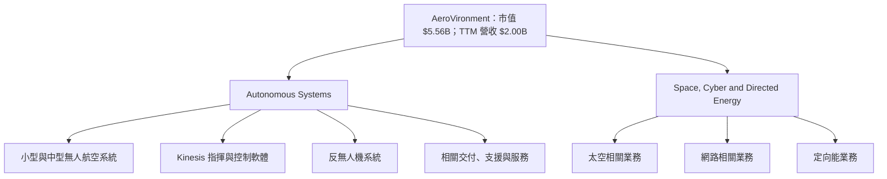
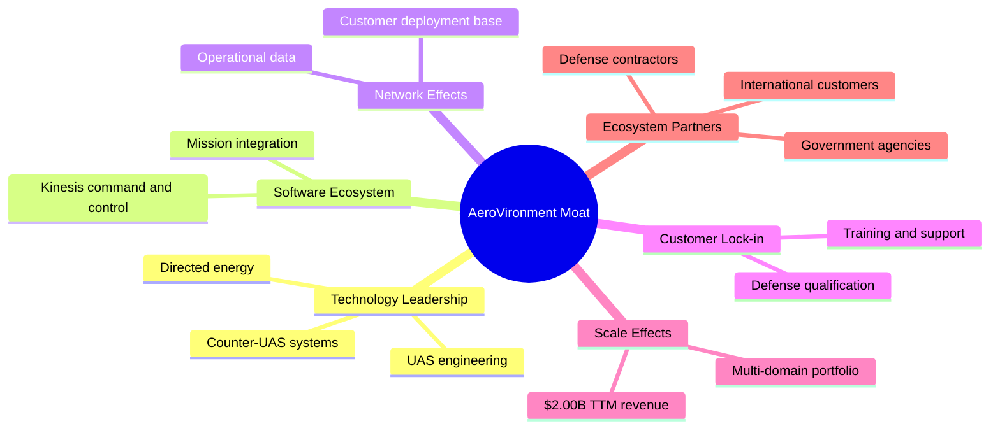
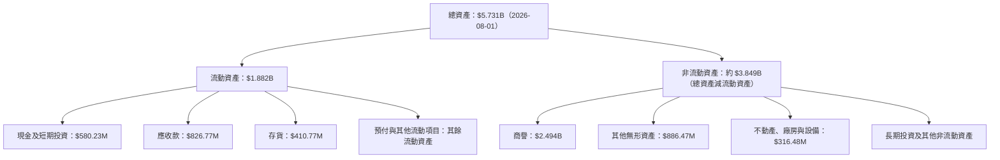
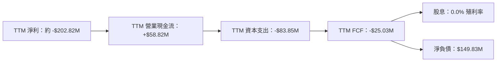
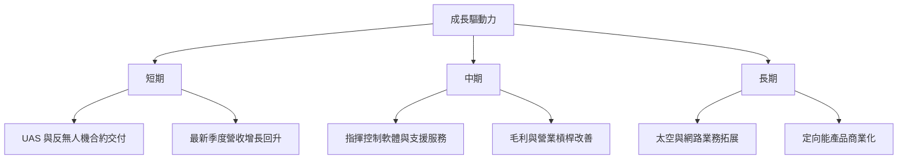
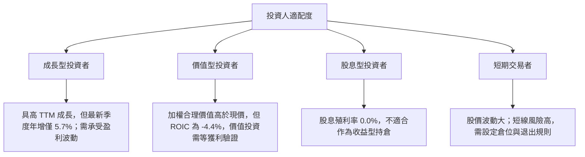

# AVAV 基本面深度分析報告
> **報告日期**：2026-11-17 ｜ **語言**：繁體中文 ｜ **數據來源**：SEC 申報資料 (XBRL)、Yahoo Finance、Finviz、StockAnalysis、Roic.ai ｜ **分析師**：CFA 級機構研究

## 目錄

| # | 章節 | 核心結論 |
|---|------|----------|
| 1 | 執行摘要 | 買入；加權合理價值 $137.15，MOS 20.2% |
| 2 | 公司概覽與商業模式 | 國防無人系統與相關軟體、服務具專業門檻；收入分部占比未提供 |
| 3 | 損益表深度分析 | TTM 營收 $2.00B、年增 84.4%；最新一季年增放緩至 5.7%，TTM 營業利益率為 -12.6% |
| 4 | 資產負債表分析 | 淨負債 $149.83M；現金及短期投資 $580.23M，流動性充足但營運資金仍重要 |
| 5 | 現金流量深度分析 | TTM FCF -$25.03M、FCF Yield -0.45%；現金流尚未支撐估值 |
| 6 | 獲利能力與資本效率 | ROIC -4.4% 低於 WACC 10.21%，目前摧毀股東價值 |
| 7 | 相對估值分析 | 加權估值高於現價；相對自身歷史 P/S 偏低，但盈利尚未穩定 |
| 8 | DCF 內在價值評估 | DCF N/A：TTM 營業利益為負，不建立自製 DCF |
| 9 | 成長催化劑 | 國防無人系統需求與新業務可支持成長；市場規模及訂單轉收入時程資料不足 |
| 10 | 風險矩陣 | 獲利、現金流、合約與執行風險是主要監控項目 |
| 11 | 投資建議 | 依 MOS 評級買入；建議以基本面改善確認與分批建倉控制風險 |

## 1. 執行摘要

### 1.0 一頁式投資儀表板（Portfolio Manager 30 秒速讀）

| 項目 | 內容 |
|------|------|
| **投資論點（3 句）** | ① TTM 營收達 **$2.00B、年增 84.4%**，反映業務規模擴大，但最新一季年增僅 **5.7%**，須確認高成長能否延續。② 現金及短期投資 **$580.23M**、流動比率 **4.26**，提供短期財務緩衝；但 TTM FCF 為 **-$25.03M**。③ 同業估值及分析師共識計算的加權合理價值為 **$137.15**，相對 2026-11-16 收盤價 $109.50 有 **25.3% 上行空間**，但 ROIC 仍為負。 |
| **綜合評分** | **5.5/10**（引用 1.1 評分卡，不另評分） |
| **財務健康** | 🟡 現金與短期投資 $580.23M、流動比率 4.26；但淨負債 $149.83M、TTM FCF 為負 |
| **ROIC vs WACC** | **-4.4% vs 10.21%**；資本報酬低於資本成本，現階段摧毀股東價值 |
| **FCF 趨勢** | FY2026 FCF -$164.62M；TTM FCF -$25.03M，改善但仍為負；TTM FCF Yield **-0.45%** |
| **估值** | Forward P/E **24.84x** ｜ EV/EBITDA **26.57x** ｜ FCF Yield **-0.45%** |
| **DCF 內在價值（基準）** | **N/A**；TTM 營業利益為負，不能由程式提供的 DCF 模型計算基準內在價值。DCF 折溢價亦為 N/A |
| **安全邊際（MOS）** | **+20.2%**＝($137.15 − $109.50) ÷ $137.15；以 **8.8 加權合理價值**為基準，🟡有限 |
| **預期報酬（基準情境 12M）** | DCF 基準情境 **N/A**；相對加權合理價值的上行空間為 **+25.3%**，並非 DCF 情境報酬 |
| **關鍵風險（前二）** | 最新一季營收年增降至 5.7%；TTM 營業利益率 -12.6%、FCF 為負 |
| **評級 + 信心度** | 🟢 **買入**（依 MOS 20.2%；信心：中低，盈利與現金流尚未證實估值） |

**評級依據**：加權合理價值 $137.15，高於現價 $109.50；依定義 MOS = ($137.15 − $109.50) ÷ $137.15 = 20.2%，落在 10% 至 25% 的買入區間。另一方面，ROIC -4.4% 明顯低於 WACC 10.21%，TTM FCF -$25.03M，因此不評為強烈買入。

### 1.1 綜合評分卡（全報告唯一）

| 維度 | 評分（1–10） | 主要依據（引用數字與其來源章節） |
|------|--------------|----------------------------------|
| 成長性 | 7.0 | TTM 營收年增 84.4%，但最新一季年增降至 5.7%（第 3 章） |
| 獲利能力 | 2.0 | TTM 營業利益率 -12.6%、ROIC -4.4%、Piotroski F-Score 4/9（第 3、6 章） |
| 財務健康 | 6.0 | 現金及短期投資 $580.23M、流動比率 4.26，但淨負債 $149.83M（第 4 章） |
| 估值 | 6.0 | MOS 20.2%；公司 P/S 2.7x 低於自身五年中位數 5.1x，但 DCF 無法估算（第 7、8 章） |
| 護城河 | 7.0 | 無人系統、軟體與國防客戶導入具專業門檻；但市場份額、續約率及分部毛利資料未提供（第 2 章） |
| 管理層與資本配置 | 5.0 | FY2026 SBC $38.33M、稀釋股數未通過 F-Score 測試，且 FY2026 FCF -$164.62M（第 3、5、6 章） |
| **綜合評分** | **5.5** | 六項算術平均：**(7.0 + 2.0 + 6.0 + 6.0 + 7.0 + 5.0) ÷ 6 = 5.5** |

### 1.2 五大投資論點 + 三大核心風險

| 類型 | 項目 | 具體依據 | 信心度 |
|------|------|----------|--------|
| 🟢 **投資論點①** | TTM 營收規模大幅擴張 | TTM 營收 **$2.00B**、年增 **84.4%**；但增速主要應以最新季度 **5.7%** 作為近期趨勢參照，而非直接外推 TTM 高增長 | 🟡 中 |
| 🟢 **投資論點②** | 國防與無人系統需求提供市場支撐 | 公司涵蓋小型及中型 UAS、反無人機、指揮控制軟體及太空、網路與定向能業務；提供資料未含各業務收入分拆 | 🟡 中 |
| 🟢 **投資論點③** | 流動性可承受短期波動 | 現金及短期投資 **$580.23M**，流動比率 **4.26**；提供一定緩衝，但不足以消除持續負 FCF 風險 | 🟢 高 |
| 🟢 **投資論點④** | 同業估值法顯示有重估空間 | 同業 Forward P/E 隱含價值 **$101.15**、同業 P/S 隱含價值 **$142.64**、分析師共識 **$212.20**，加權為 **$137.15** | 🟡 中 |
| 🟢 **投資論點⑤** | 營運資金效率指標改善 | CCC 從一年前 **135 天**降至 **92 天**，主要來自 DSO 從 67 天降至 33 天（第 4 章） | 🟡 中 |
| 🟡 **風險①** | 盈利能力與現金流尚未轉正 | TTM 營業利益率 **-12.6%**、ROIC **-4.4%**、FCF **-$25.03M**；若無法改善，估值可能持續受壓 | 🔴 高衝擊 |
| 🔴 **風險②** | 最近單季成長明顯放緩 | 最新一季營收年增 **5.7%**，低於 TTM 年增 84.4%；若後續季度延續低增長，市場可能下修成長假設 | 🔴 高 |
| 🟡 **風險③** | 收購、整合與稀釋風險 | FY2026 總資產由 FY2025 $1.12B 增至 $5.72B，商譽升至 $2.49B；F-Score 顯示稀釋股數未通過測試 | 🟡 中高 |

### 1.3 快速統計卡片

| 指標 | 公司實際值（期間） | 同業中位數 | 狀態 |
|------|--------------------|------------|------|
| 營收成長（TTM） | **84.4%** | — | 🟢 高增長，但含基期與業務組合效應 |
| 營收成長（最新一季年增） | **5.7%** | **35.7%**（KTOS、ONDS、LMT 中位數） | 🔴 低於同業中位數 |
| 毛利率（TTM） | **26.5%** | **23.0%**（三家中位數） | 🟢 高於同業中位數 |
| 營業利益率（TTM） | **-12.6%** | — | 🔴 負值 |
| ROIC（TTM） | **-4.4%** | — | 🔴 低於 WACC |
| Forward P/E | **24.84x** | **22.95x**（KTOS、LMT 中位數） | 🟡 略高於同業中位數 |
| FCF Yield（TTM） | **-0.45%** | — | 🔴 負值 |
| Piotroski F-Score | **4 / 9** | — | 🟡 財務品質偏弱 |

### 1.4 投資結論

```text
╔══════════════════════════════════════════════════════════════════╗
║                    📊 投資結論摘要                               ║
╠══════════════════════════════════════════════════════════════════╣
║  評級：買入（MOS 20.2%，符合規則 20；未作質化調整）              ║
║  價格（2026-11-16 收盤）：$109.50                                ║
║  DCF 內在價值（基準）：N/A（TTM 營業利益為負）                    ║
║  DCF 折溢價：N/A                                                  ║
║  安全邊際 MOS：+20.2%＝($137.15−$109.50)÷$137.15                 ║
║  加權合理價值（8.8）：$137.15                                     ║
║  DCF 情境價值：N/A（DCF MODEL 未提供可用模型）                    ║
║  綜合評分：5.5/10（引用 1.1）                                     ║
║  適合投資人：能承受高波動、願意追蹤季度營運與現金流的成長型投資人║
╚══════════════════════════════════════════════════════════════════╝
```

## 2. 公司概覽與商業模式

### 2.1 業務結構與收入來源

AeroVironment（AVAV）為美國國防科技公司，提供無人航空系統及相關軟體、服務，並經營太空、網路及定向能業務。TTM 營收為 **$2.00B**，市值 **$5.56B**。分部收入與占比未提供，因此不以未經證實的比例拆分。



分部營收、軟體與服務收入、毛利率及訂單轉收入資料均未提供，無法量化各板塊的成長貢獻或經常性收入比重。

### 2.2 市場份額

市場份額數據未提供，無法可靠量化 AVAV 在全球或美國無人系統市場的占比。公司 TTM 營收 **$2.00B**、TTM 年增 **84.4%**，規模高於若干專注無人系統的較小公司，但最新一季年增率僅 **5.7%**，顯示不能僅用 TTM 成長推論短期需求仍在加速。

### 2.3 競爭護城河分析



### 2.4 護城河強度

| 護城河項目 | 強度（強／中／弱） | 證據（引用數字或事實） | 會削弱它的情況 |
|------------|--------------------|------------------------|----------------|
| 技術與產品 | 中 | 業務包含 UAS、反無人機、指揮控制、太空、網路與定向能產品；具工程與任務整合要求 | 技術替代、競品性能提升或採購轉向低價供應商 |
| 軟體生態系統 | 中 | 公司提供 Kinesis 指揮與控制軟體；軟體收入與客戶留存數據未提供 | 軟硬體整合優勢無法轉化為續約、附加銷售或較高毛利 |
| 網路效應 | 弱至中 | 政府與商業客戶部署可能帶來操作經驗，但用戶數與資料網路效應未量化 | 客戶部署互不相連，新增客戶未提升既有客戶產品價值 |
| 客戶鎖定 | 中 | 國防系統驗證、訓練與支援通常增加更換成本；未提供續約率或合約期限 | 採購規格改變、競標失利或平台替換 |
| 規模效應 | 中 | TTM 營收 **$2.00B**；但 TTM 營業利益率 **-12.6%**，規模尚未反映為盈利 | 成本擴張快於收入，或收入集中在低毛利合約 |
| 生態夥伴 | 中 | 客戶包括政府機構、企業及海外市場；具體夥伴與收入占比未提供 | 供應鏈限制、出口管制或客戶自製能力提升 |

1.1「護城河」評分為 **7.0/10**，理由是產品與國防導入具專業門檻，但尚缺市場份額、續約率、分部毛利與軟體收入占比等量化證據。

## 3. 損益表深度分析

### 3.1 年度收入成長趨勢（近4年）

年度營收依財務報表列示；柱狀長度為視覺比較，數字才是實際財務資料。

```text
╔══════════════════════════════════════════════════════════════════╗
║       AeroVironment 年度收入趨勢（FY2023–FY2026）               ║
╠══════════════════════════════════════════════════════════════════╣
║  FY2023  $0.541B  ███████░░░░░░░░░░░░░░░░  YoY: +21.27% 🟢     ║
║  FY2024  $0.717B  █████████░░░░░░░░░░░░░░  YoY: +32.59% 🟢     ║
║  FY2025  $0.821B  ██████████░░░░░░░░░░░░░  YoY: +14.50% 🟢     ║
║  FY2026  $1.977B  ████████████████████████  YoY: +140.89% 🟢   ║
╠══════════════════════════════════════════════════════════════════╣
║  FY2023 至 FY2026 營收 CAGR：約 54.1%                           ║
║  計算：(1.977 ÷ 0.54054)^(1/3) − 1 ≈ 54.1%                     ║
╚══════════════════════════════════════════════════════════════════╝
```

FY2026 營收大幅上升，令近三年 CAGR 顯著提高；但最新一季年增只有 **5.7%**，故 FY2026 的成長不應直接視為未來的穩態增長率。年度高增長與季度放緩並存，可能反映合併範圍、交付時點及較高比較基期，現有資料不足以精確分解各項影響。

### 3.2 季度收入趨勢分析

| 季度 | 營收 | QoQ 成長 | YoY 成長 | 備註 |
|------|------:|---------:|---------:|------|
| 2025-10-31 | $472.51M | +15.8% | +150.72% | QoQ 比較 2025-08-02 季 $454.68M；YoY 採 StockAnalysis 列示值 |
| 2026-01-31 | $408.05M | -13.6% | +143.41% | 低於前季，但同比仍受比較基期影響 |
| 2026-04-30 | $641.62M | +57.2% | +133.27% | 季度交付可能有波動，不能視為線性增長 |
| 2026-08-01 | $480.49M | -25.2% | +5.7% | 最新季度年增率為單季 YoY；明顯低於前三季 |

QoQ 計算以相鄰季度營收計算，例如最新季度：($480.49M ÷ $641.62M) − 1 = **-25.2%**。季度營收波動較大，應以多季累計與合約交付狀況共同判讀；最新一季同比放緩是需要持續驗證的訊號。

### 3.3 利潤率演變分析

| 利潤率指標 | FY2023 | FY2024 | FY2025 | FY2026 | 趨勢 | 評估 |
|------------|-------:|-------:|-------:|-------:|------|------|
| **毛利率** | 32.1% | 39.6% | 38.8% | 25.3% | FY2026 明顯下滑 | 🔴 |
| **營業利益率** | -4.2% | 10.0% | 7.2% | -3.6% | FY2026 由正轉負 | 🔴 |
| **淨利率** | -32.6% | 8.3% | 5.3% | -13.4% | FY2026 受大額淨損影響 | 🔴 |

計算依年度財務報表：毛利率＝毛利÷營收；營業利益率＝營業利益÷營收；淨利率＝淨利÷營收。FY2026 毛利率由 FY2025 約 **38.8%** 降至約 **25.3%**，同時營收擴張但營業利益轉為 **-$70.29M**。這表示收入增加尚未同步轉化為毛利與營業槓桿。產品組合、合約成本、整合費用及產能投入可能相關，但分項成本與管理層歸因未提供，不能將某一因素視為已證實原因。

需注意，財務資料不同彙整來源對 TTM 營業利益率有 **-12.6%** 與 **-0.6%** 的差異。本報告涉及 TTM 評估時依 SEC 申報資料計算區塊採用 **-12.6%**；年度 FY2026 利潤率則以年度損益表計算。

### 3.4 費用結構分析

費用細項（銷售管理費、研發費、整合費用等）未提供足以核對的完整拆分，因此不製作費用圓餅圖或比例圖。可確認 FY2026 研發費用為 **$127.68M**，約占年度營收 **6.5%**（$127.68M ÷ $1,977M）；研發投入有助產品開發，但在毛利率與營業利益轉負時，也增加短期獲利壓力。研究發展以外的費用構成需以正式 10-K/10-Q 細項確認。

### 3.5 季度 EPS 趨勢與盈餘品質（Quality of Earnings）

提供的 EPS surprise 歷史中，最近四季的 EPS 預估與實際值均為缺失，因此無法判定超預期或不及預期。StockAnalysis 列示的季度 EPS 包含 2026-08-01 約 **-$0.10**、2026-04-30 **-$0.48**；更早季度資料在來源間不一致，不以其作為驚喜幅度依據。

| 盈餘品質項目 | 數值/佔比 | 評估 |
|--------------|-----------|------|
| 股權薪酬 SBC / 營收 | FY2026：約 **1.9%**（$38.33M ÷ $1,977M） | 🟡 對股東有稀釋成本；F-Score 顯示稀釋股數未通過測試 |
| SBC / 營業現金流 | 估計 **54.1%**（近四季 SBC 合計約 $31.84M ÷ TTM OCF $58.82M） | 🟡 SBC 占營業現金流比重不低；SBC 合計為依季度資料加總的估計值 |
| FCF / 淨利（現金轉換率） | 約 **12.3%**（-$25.03M ÷ -$202.82M） | 🔴 同為負值的比率不代表轉換品質良好；現金流與淨利均未轉正 |
| 一次性/非經常性損益 | FY2026 淨損 **-$265.12M**、營業損失 **-$70.29M**；具體一次性項目 N/A | 🟡 淨損幅度較營業損失大，需查閱申報附註分辨非營業及一次性項目 |
| 有效稅率異常 | N/A（缺少可核對的 TTM 稅前所得與所得稅費用） | 🟡 無法判定稅務利益是否帶動盈餘 |
| 資本化支出 vs 費用化 | FY2026 資本支出 **$86.22M**；資本化與費用化政策細項 N/A | 🟡 Capex 明顯增加，但無法量化是否存在成本資本化延後認列 |

**盈餘品質結論**：FY2026 淨損、負 FCF 與營業利益率為負，顯示目前並非高品質且可持續的盈利狀態。SBC 雖占年度營收約 1.9%，仍會稀釋股東；在營業現金流僅 $58.82M 的 TTM 基礎上，季度資料推得的 SBC 估計約占其 54.1%。因此，估值應重視現金流轉正與稀釋控制，不宜單靠 Forward P/E 作出判斷。

## 4. 資產負債表分析

### 4.1 資產結構分解



非流動資產約 **$3.849B** 為總資產減流動資產的算術差額。商譽與其他無形資產合計約 **$3.380B**，占總資產相當比重，反映資產負債表對收購形成資產較敏感；若相關業務現金流低於預期，須留意減損風險。

### 4.2 流動性與營運資金分析

| 指標 | 最新 TTM | 一年前 TTM | 變化 | 解讀 |
|------|----------|------------|------|------|
| 流動比率 | 4.26 | N/A | N/A | 流動資產對短期負債有緩衝；一年前比較值未提供 |
| 速動比率 | 3.185 | N/A | N/A | 不計存貨後仍有流動性緩衝 |
| DSO 應收帳款天數 | 33 天 | 67 天 | -34 天 | 收款天數下降，對現金周轉有利；仍需留意政府與大型客戶付款時點 |
| DIO 存貨天數 | 102 天 | 113 天 | -11 天 | 存貨周轉略有改善，但仍需觀察存貨是否對應已確認需求 |
| DPO 應付帳款天數 | 43 天 | 44 天 | -1 天 | 大致穩定，未顯示明顯延長付款以支持現金流 |
| CCC 現金轉換週期 | 92 天 | 135 天 | -43 天 | 周期縮短，主要來自 DSO 下降；有助降低營運資金占用 |

營運資金天數依 QUALITY FIGURES 的程式計算數字引用。雖然 CCC 改善，但最新 TTM FCF 仍為 **-$25.03M**；因此營運資金效率改善尚未充分抵銷資本支出與營運需求。

### 4.3 債務結構分析

```text
╔══════════════════════════════════════════════════════════════════╗
║                AeroVironment 債務健康診斷                        ║
╠══════════════════════════════════════════════════════════════════╣
║  總債務：          $730.06M   ████████████████████               ║
║  現金及短期投資：  $580.23M   ████████████████                   ║
║  淨負債：          $149.83M   淨負債，非淨現金                    ║
║                                                                  ║
║  流動比率：        4.26x      🟢 短期流動性有緩衝                 ║
║  Debt/EBITDA：     N/A        TTM EBITDA 絕對值資料口徑不一致     ║
║  利息保障倍數：    N/A        利息費用及可比 EBIT 資料未提供       ║
║  WACC 採用債務成本：稅前 0.77%（資本成本輸入）                    ║
╚══════════════════════════════════════════════════════════════════╝
```

總債務及淨負債採成本資本資料中的 **$730.06M** 與 **-$149.83M 淨現金**口徑。其他彙整資料列示總債務 $850.82M、淨負債 $270.60M，與申報資料口徑不一致；因此本報告在資本成本與淨負債分析中優先採用已核對的 $730.06M 及 $149.83M。利息保障倍數不以缺失的利息費用或不一致的 EBIT 數據推算。

### 4.4 股東權益趨勢

```text
╔══════════════════════════════════════════════════════════════════╗
║                股東權益年度變化（美元）                          ║
╠══════════════════════════════════════════════════════════════════╣
║  FY2023  $550.97M  ███                                           ║
║  FY2024  $822.75M  █████                                         ║
║  FY2025  $886.51M  █████                                         ║
║  FY2026  $4.40B    ████████████████████████                      ║
╚══════════════════════════════════════════════════════════════════╝
```

FY2026 股東權益升至 **$4.40B**，同時總資產由 FY2025 **$1.12B** 升至 **$5.72B**，商譽與無形資產亦大幅增加。這與公司資產負債表規模擴張同時發生，但資料不足以將增幅拆分為收購、發股或其他特定來源；後續應核對股權變動表及收購附註。

## 5. 現金流量深度分析

### 5.1 現金流量瀑布圖



淨利與營業現金流並非簡單逐項相加；此圖展示現金流相關指標及方向。TTM FCF 依定義為營業現金流減資本支出：**$58.82M − $83.85M = -$25.03M**。公司無股息，故目前未以股息分配現金。

### 5.2 FCF 轉換率趨勢

| 財年 | FCF | 淨利 | FCF / 淨利 | 解讀 |
|------|----:|----:|-----------:|------|
| FY2023 | -$3.47M | -$176.21M | 約 2.0% | 分子分母均為負，比例不能視為正向現金轉換 |
| FY2024 | -$9.19M | $59.67M | 約 -15.4% | 有帳面淨利但 FCF 為負 |
| FY2025 | -$24.13M | $43.62M | 約 -55.3% | 現金轉換轉弱 |
| FY2026 | -$164.62M | -$265.12M | 約 62.1% | 雖然比率為正，FCF 與淨利仍均為負 |

負淨利時 FCF/淨利比率容易造成誤讀，應同時看現金流的絕對值。FY2026 FCF 大幅轉負，顯示營業現金流與資本支出不足以支持當期投資需求。

### 5.3 自由現金流趨勢

```text
╔══════════════════════════════════════════════════════════════════╗
║                自由現金流趨勢（年度實際）                        ║
╠══════════════════════════════════════════════════════════════════╣
║  FY2023   -$3.47M     ◀█░░░░░░░░░░░░░░░░░░░░░░░                 ║
║  FY2024   -$9.19M     ◀██░░░░░░░░░░░░░░░░░░░░░░                 ║
║  FY2025  -$24.13M     ◀████░░░░░░░░░░░░░░░░░░░░                 ║
║  FY2026 -$164.62M     ◀████████████████████████                 ║
╠══════════════════════════════════════════════════════════════════╣
║  TTM FCF（OCF − Capex）：-$25.03M ｜ TTM FCF Yield：-0.45%       ║
╚══════════════════════════════════════════════════════════════════╝
```

FY2026 FCF 惡化幅度較大，但最新 TTM FCF **-$25.03M** 已較 FY2026 全年改善。該改善是否可持續，取決於營運現金流能否增加、資本支出是否回落，以及收入交付與收款時點；現有資料無法區分各項貢獻。

### 5.4 資本配置評估

| 資本配置項目 | 可確認數據 | 評估 |
|--------------|------------|------|
| 資本支出 | FY2026 **$86.22M**；TTM **$83.85M** | 資本投入高於 TTM 營業現金流 $58.82M |
| 股息 | 殖利率 **0.0%** | 未見現金股息回報 |
| 股權薪酬 | FY2026 SBC **$38.33M** | 需關注稀釋成本 |
| 回購 | N/A（回購金額未提供） | 不對回購政策作推論 |
| 收購與投資 | FY2026 總資產、商譽及無形資產大幅增加；具體現金支付拆分未提供 | 需追蹤收購後盈利與商譽減損風險 |

資本配置各項的完整金額拆分不足，不製作資金占比圓餅圖。當前優先事項應是證明增長投資能轉化為較高營業利潤率及正 FCF。

## 6. 獲利能力與資本效率

### 6.1 ROE / ROA / ROIC 趨勢

| 指標 | 最新 TTM | 歷史趨勢資料 | 評估 |
|------|---------:|---------------|------|
| ROE | -4.6% | 過去各年可比序列未提供 | 🔴 負值 |
| ROA | -0.1%（彙整資料）；F-Score 測試未通過 | 完整歷史序列未提供 | 🔴 獲利資產效率偏弱 |
| ROIC | -4.4% | ROIC.AI 有部分歷史回報資料，但口徑不宜與 TTM 直接拼接 | 🔴 低於 WACC 10.21% |

資料彙整來源的 TTM ROA 為 **-0.1%**，而杜邦計算得到的 ROE 為 **-4.6%**；不同來源與期末資產口徑可能造成差異。本報告不以不一致的歷史序列製作行業均值比較。

### 6.2 ROIC vs WACC 分析（核心價值創造判斷）

```text
╔══════════════════════════════════════════════════════════════════╗
║                ROIC vs WACC 深度分析                            ║
╠══════════════════════════════════════════════════════════════════╣
║  WACC（採用資本成本資料）：10.21%                                ║
║  ├── 無風險利率（10Y 美債）：5.12%                               ║
║  ├── 市場風險溢酬（假設）：5.00%                                 ║
║  ├── Beta 原始值：1.40；調整後採用值：1.27                       ║
║  ├── 股權成本（資料列示）：11.46%                                ║
║  ├── 稅前債務成本：0.77%；稅率：21.0%                            ║
║  ├── 股權／債務權重：88.4%／11.6%                                ║
║  └── ✅ 採用 WACC：10.21%                                        ║
║                                                                  ║
║  ROIC（TTM）：-4.4%                                               ║
║  EVA 利差：ROIC − WACC = -4.4% − 10.21% = -14.61 個百分點        ║
║                                                                  ║
║  ROIC  -4.4%   負值                                               ║
║  WACC  10.21%  資本成本                                           ║
║  結論：目前 ROIC 低於 WACC，資本投入尚未產生足以補償資本成本的報酬║
╚══════════════════════════════════════════════════════════════════╝
```

成本資本資料列示 Ke **11.46%**、稅前 Kd **0.77%**、E/D 權重 **88.4%/11.6%** 與 WACC **10.21%**。由於輸入項目已四捨五入，若直接以展示精度回算，可能與程式使用的未四捨五入輸入略有尾差；本報告採用指定 WACC **10.21%**，不另建立替代折現率。Beta 使用調整後 **1.27**；調整方式為 **⅔ × 原始 Beta 1.40 + ⅓ × 1.00**，結果約 1.27。

投資含義明確：ROIC **-4.4%** 不只是低於 WACC，而是負報酬；如果公司不能改善營業利潤、控制投入資本並轉正 FCF，收入成長本身不等於價值創造。

### 6.3 杜邦三因素分解

| 因素 | 數值（TTM） | 解讀 |
|------|-------------|------|
| 淨利率 | -10.1% | 負淨利是 ROE 為負的主要原因 |
| 資產週轉率 | 0.35 | 每單位資產產生的營收有限；新增資產需轉化為收入與獲利 |
| 權益乘數 | 1.30 | 槓桿程度不高，負 ROE 並非主要由高財務槓桿造成 |
| **ROE** | **-4.6%** | QUALITY FIGURES 列示：-10.1% × 0.35 × 1.30 = -4.6% |

### 6.4 財務體質：Piotroski F-Score

**Piotroski F-Score：4 / 9**。以下照列品質指標各項結果：

| 測試 | 結果 | 解讀 |
|------|------|------|
| ROA > 0 | ❌ 未通過 | 當前資產回報尚未轉正 |
| 營業現金流 > 0 | ✅ 通過 | TTM 營業現金流為正，但不足以覆蓋資本支出 |
| ROA 高於一年前 | ❌ 未通過 | 盈利能力未顯示同比改善 |
| 營業現金流 > 淨利（應計品質） | ✅ 通過 | 相對應計盈餘測試通過，但不代表 FCF 為正 |
| 長期負債 ÷ 總資產低於一年前 | ✅ 通過 | 長期負債相對資產比率改善 |
| 流動比率高於一年前 | ❌ 未通過 | 流動性比率未改善 |
| 稀釋股數未增加 | ❌ 未通過 | 股東持股可能被稀釋 |
| 毛利率高於一年前 | ❌ 未通過 | 毛利率承壓，與 FY2026 年度降幅一致 |
| 資產週轉率高於一年前 | ✅ 通過 | 資產利用效率相對改善 |

4/9 表示部分現金流、負債與資產效率指標通過，但盈利、毛利率與稀釋項目未通過；整體並非強勢財務品質訊號。

## 7. 相對估值分析

### 7.1 同業估值比較表格

| 估值指標 | **AVAV** | **KTOS** | **ONDS** | **LMT** | 本公司評估 |
|----------|---------:|---------:|---------:|--------:|-----------|
| **Trailing P/E** | N/A | 263.8x | N/A | 20.8x | 🔴 AVAV TTM EPS 為負，P/E 不具可比性 |
| **Forward P/E** | 24.84x | 28.3x | -30.4x | 17.6x | 🟡 AVAV 高於同業中位數 22.95x |
| **P/S Ratio** | 2.78x | 3.6x | 8.4x | 1.7x | 🟡 AVAV 介於傳統大型承包商與高成長小型股之間 |
| **EV/EBITDA（TTM）** | 26.57x | 53.4x | -7.1x | 15.2x | 🟡 AVAV 高於 LMT、低於 KTOS；ONDS EBITDA 為負，參考性有限 |
| **最新季度營收 YoY** | 5.7% | 35.7% | 1,558.6% | 11.3% | 🔴 AVAV 低於三家中位數 35.7% |
| **毛利率（TTM）** | 26.5% | 23.0% | 36.4% | 11.7% | 🟢 AVAV 高於 KTOS 與 LMT，低於 ONDS |

Peer multiples 依 Yahoo Finance 同業資料。ONDS 的季度增長率數值極高且基期可能偏低，不應將其直接視為可持續基準。AVAV 的 Forward P/E 接近但高於同業中位數；由於盈利仍為負，估值對未來 EPS 預測與利潤修復相當敏感。

### 7.2 歷史估值區間分析

```text
╔══════════════════════════════════════════════════════════════════╗
║                  AVAV 五年歷史 P/S 估值                          ║
╠══════════════════════════════════════════════════════════════════╣
║  五年區間：3.0x ─────────────────────────────── 13.4x           ║
║  五年中位數：5.1x                                                ║
║  當前 P/S：2.7x（低於資料列示的歷史區間下緣）                    ║
║  當前百分位排名：0%                                               ║
╚══════════════════════════════════════════════════════════════════╝
```

歷史估值資料列示當前 P/S **2.7x**、五年中位數 **5.1x**、區間 **3.0x–13.4x**、百分位 **0%**。當前倍數低於資料列示區間下緣，可能反映價格下跌或資料口徑、期間取樣差異；在未核對原始估值序列前，不把這種差異解讀為確定的低估訊號。

### 7.3 情境價值（Bear / Base / Bull）

**N/A（DCF 無法計算：TTM 營業利益為負，程式未提供可用 DCF MODEL；不得自行設定 DCF 情境價值）。**

### 7.4 相對估值隱含價格區間

```text
╔══════════════════════════════════════════════════════════════════╗
║               相對估值隱含每股價值與現價位置                     ║
╠══════════════════════════════════════════════════════════════════╣
║  $101.15 ───── $109.50 ───────── $142.64 ───────── $212.20       ║
║  Forward P/E      現價             P/S             分析師共識     ║
╚══════════════════════════════════════════════════════════════════╝
```

| 估值方法 | 每股價值 | 依據 |
|----------|---------:|------|
| 同業 Forward P/E | **$101.15** | KTOS、LMT 同業中位數 **22.9x** × Forward EPS **$4.41** |
| 同業 P/S | **$142.64** | KTOS、ONDS、LMT 同業中位數 **3.6x** × TTM 營收基礎 |
| 分析師共識目標價 | **$212.20** | 23 位分析師平均目標價；屬外部參考值 |

P/S 法隱含價值高於現價，Forward P/E 法則低於現價，顯示估值結果對盈利是否恢復及收入倍數取值高度敏感。分析師共識目標價與其他方法差距較大，不能視為確定的基本面價值。

## 8. DCF 內在價值評估（Discounted Cash Flow）

**DCF MODEL：N/A。** 程式未建立 DCF 的原因為 TTM 營業利益不為正；在負營業利益基礎上直接預測並折現，會把未有依據的利潤修復路徑當成模型結果。因此本章不自行另建 DCF，也不提供 DCF 內在價值、敏感度矩陣、三情境或反推 DCF 數字。

### 8.0 估值推理鏈（Thinking Logic）

**Step 1 — 價值由哪些變數決定？**  
AVAV 的價值主要取決於現有 UAS 與反無人機業務能否維持收入、太空／網路／定向能等業務能否形成第二成長來源，以及收入增長能否轉化為正營業利潤與正 FCF。TTM 總營收 **$2.00B** 已知，但分部占比未提供，故不能把各項業務拆成可估值的收入比例；當前最關鍵變數是營業利潤率與現金流轉正，而非僅是營收增速。

**Step 2 — 模型選擇**

| 決策點 | 本報告採用 | 理由 | 曾考慮但否決 | 否決理由 |
|--------|-----------|------|--------------|----------|
| 現金流估值 | 不提供 DCF 數值 | TTM 營業利益為負，程式 DCF MODEL 標示 N/A | 自行搭建 FCFF 預測 | 無可靠轉正年份、利潤率路徑及營運資金假設，會形成黑箱 |
| 預測期 N | N/A | DCF 模型未提供 | 自行設定 5–10 年 | 會違反模型唯一性要求 |
| 終值方法 | N/A | 無可用的 DCF 預測期現金流 | Gordon Growth／退出倍數 | 無 FY+N FCFF 或 EBITDA 可供計算 |
| EBIT 基礎 | N/A | 不建立 DCF | GAAP／非 GAAP | 無逐年盈利假設可供推導 |

**Step 3 — 假設推導鏈**  
DCF MODEL 為 N/A，因此沒有可逐項核對的營收 CAGR、期末營業利潤率、永續成長率、Capex/營收、D&A、營運資金或稀釋假設。此處不臆造假設，也不以同業倍數替代 DCF。

**Step 4 — 最脆弱環節**  
最脆弱之處是收入增長能否轉化為正營業利潤與正 FCF；目前 TTM 營業利益率 **-12.6%**、ROIC **-4.4%**、FCF **-$25.03M**，若轉正延遲，估值應更多依賴相對估值而不是 DCF。

**Step 5 — 計算路徑圖**  
因模型未提供 DCF 現金流與終值，不繪製假設數字的 DCF 路徑圖。

### 8.1 模型假設總表（Model Inputs）

**N/A（數據未提供：DCF MODEL 因 TTM 營業利益為負而不可用，故沒有可引用的預測期及逐年假設）。**

### 8.2 折現率推導（WACC）

以下列示程式計算的資本成本輸入，作為第 6.2 節 ROIC 比較依據；本節不以其另行建構 DCF。

```text
╔══════════════════════════════════════════════════════════════════╗
║                    WACC 資料輸入（DCF 不適用）                    ║
╠══════════════════════════════════════════════════════════════════╣
║  無風險利率 Rf（10Y 美債）：5.12%                                ║
║  市場風險溢酬 ERP（假設）：5.00%                                 ║
║  原始 Beta：1.40；調整後 Beta：1.27                              ║
║  股權成本 Ke（資料列示）：11.46%                                 ║
║  稅前債務成本 Kd：0.77%；稅率：21.0%                             ║
║  股權／債務權重：88.4%／11.6%                                    ║
║  採用 WACC：10.21%（依資本成本資料）                              ║
╚══════════════════════════════════════════════════════════════════╝
```

資料列示的 CAPM 為 **5.12% + 1.27 × 5.00% = 11.46%**（使用未四捨五入 Beta 計算）。稅後債務成本由所列輸入計算為 **0.77% × (1 − 21.0%) = 0.6083%**。由於權重與組成數字展示至有限小數位，直接用展示值回算 WACC 會有約 0.01 個百分點尾差；本報告依指定值採 **10.21%**，不以四捨五入輸入覆寫。Rf 的精確觀察日期未提供；ERP 為模型假設，無風險利率的精確日期與 ERP 來源亦未提供，應視為估值輸入而非公司實際數據。

### 8.3 逐年自由現金流預測（基準情境）

**N/A（數據未提供：DCF MODEL 不可用，沒有 FY+1 至 FY+N 現金流預測）。** 不提供逐年營收、EBIT、NOPAT、Capex、ΔWC、FCFF、折現因子或 PV，亦不計算預測期現值。

### 8.4 終值計算（Terminal Value）

**N/A（缺少有效的預測期 FCFF 與 FY+N EBITDA；Gordon Growth 及退出倍數終值均無法計算）。** 不套用永續成長率或退出倍數。

### 8.5 企業價值 → 每股內在價值（Bridge）

| 橋接項目 | 數值 |
|----------|------|
| 預測期 FCF 現值合計 | N/A |
| 終值現值 | N/A |
| 企業價值 EV | N/A |
| 現金及短期投資 | $580.23M（2026-08-01） |
| 總債務 | $730.06M（資本成本資料口徑） |
| 稀釋股數 | 50.82M 股（市場資料） |
| DCF 每股內在價值 | **N/A** |
| 現價 | $109.50（2026-11-16 收盤） |
| DCF 折溢價 | **N/A** |

EV 與股權價值缺少 DCF 預測期現值及終值，無法完成橋接。此處不計算 MOS；全報告的 MOS 僅採 8.8 加權合理價值為分母。

### 8.6 敏感性分析（WACC × 永續成長率）

**N/A（DCF MODEL 未提供基準現金流或敏感度矩陣）。** 不自行填入 WACC、永續成長率或每股價值情境。

### 8.7 反推 DCF（Reverse DCF：市場在預期什麼）

**N/A（無可用 DCF 模型，無法以現價 $109.50 反解營收 CAGR、營業利潤率、永續成長率或預測期）。** 以現價反推多個未知數亦不具唯一解；本報告不提供未經模型支持的市場隱含假設。

### 8.8 估值三角驗證與安全邊際

| 估值方法 | 隱含每股價值 | 上行空間（÷現價） | 權重 | 說明 |
|----------|--------------|-------------------|------|------|
| 同業 Forward P/E | $101.15 | -7.6% | 30% | 同業中位數 22.9x × Forward EPS $4.41 |
| 同業 P/S | $142.64 | +30.3% | 60% | KTOS、ONDS、LMT 同業中位數 3.6x × TTM 營收 |
| 分析師共識目標價 | $212.20 | +93.8% | 10% | 23 位分析師平均目標價，作參考而非主要估值錨 |
| **加權合理價值** | **$137.15** | **+25.3%** | **100%** | 不含 DCF；公司類型為不盈利公司，權重依固定估值方法 |

**逐步演算**：

- 加權合理價值  
  = **$101.15 × 30% + $142.64 × 60% + $212.20 × 10%**  
  = **$30.345 + $85.584 + $21.220**  
  = **$137.149**  
  = **$137.15**（四捨五入至美分）。
- 權重合計：**30% + 60% + 10% = 100%**。
- MOS：**($137.15 − $109.50) ÷ $137.15 = $27.65 ÷ $137.15 = 20.2%**。
- 上行空間：**($137.15 − $109.50) ÷ $109.50 = $27.65 ÷ $109.50 = 25.3%**。

公司類型為不盈利公司，因此估值方法按指定權重採同業 Forward P/E、同業 P/S 與分析師共識。沒有 DCF 方法納入，亦沒有自行增刪或調整任何方法權重。

```text
╔══════════════════════════════════════════════════════════════════╗
║                  估值區間與安全邊際                              ║
╠══════════════════════════════════════════════════════════════════╣
║  $101.15 ─── $109.50 ─────── [$137.15] ─────── $142.64 ─ $212.20║
║  Forward P/E   現價          加權合理值        P/S     共識目標價║
║                                                                  ║
║  安全邊際 MOS = ($137.15 − $109.50) ÷ $137.15 = 20.2%           ║
║  MOS 評估：🟡 10%–25% 有限                                       ║
║  上行空間 = ($137.15 − $109.50) ÷ $109.50 = 25.3%               ║
║  DCF 基準值、DCF 折溢價：N/A                                     ║
║                                                                  ║
║  建議買入區間：$100.40 – $123.44                                 ║
║  合理持有區間：$123.44 – $137.15                                 ║
║  減碼考慮區間：高於 $137.15 時重新檢視估值與盈利進度             ║
╚══════════════════════════════════════════════════════════════════╝
```

買入區間上限 **$123.44** 為加權合理價值折讓 10% 的價格：**$137.15 × (1 − 10%) = $123.435**，四捨五入為 $123.44；區間下緣 **$100.40** 參照資料列示的 52 週低點，屬價格觀察參考，不是 DCF 價值。

> 🔎 **程式複算（Python，依本節各項自動重算）**
>
> 加權合理價值 = $101.15 × 30% + $142.64 × 60% + $212.20 × 10% = **$137.15**（權重合計 100%）
>
> 以價格 $109.50 計：MOS = **+20.2%**，上行空間 = **+25.3%**
>
> ✅ 與本節所寫數值一致。

### 8.9 DCF 模型的局限與失效條件

- **終值依賴度**：N/A，DCF 模型未提供終值，無法計算其占 EV 比重。
- **最脆弱的估值依據**：相對估值的盈利與收入基礎。若 Forward EPS $4.41 未能實現，同業 Forward P/E 的 $101.15 隱含價值亦會下修；若營收成長放緩，P/S 估值 $142.64 亦可能下調。
- **不適用情境**：TTM 營業利益率 -12.6%、ROIC -4.4%、FCF -$25.03M，短期 DCF 對利潤轉正假設高度敏感。現階段應以同業 EV/Sales 或 P/S、合約交付與單位經濟性作輔助，待盈利及現金流恢復後再使用 DCF。
- **與第 10 章風險矩陣連結**：合約延遲會影響營收增長；成本超支會壓低 EBIT 利潤率；資本支出與收款延遲則可能使 FCF 更負。

### 8.10 複算檢核表（Audit Trail）

| # | 檢核項目 | 檢查方式 | 結果 |
|---|----------|----------|------|
| 1 | 所有高／中敏感度 DCF 假設都有四段式推導 | DCF MODEL 為 N/A，無假設可核對 | N/A |
| 2 | 每個 DCF 假設都有來歷 | 未自行設定 DCF 假設 | N/A |
| 3 | WACC 五步算式及回算 | 採用資本成本資料的 WACC 10.21%；展示精度存在約 0.01 個百分點尾差，未另行覆寫 | 🟡 |
| 4 | Kd 分母與債務權重口徑一致 | 引用提供的成本資本輸入；未重新建構債務分母 | N/A |
| 5 | WACC 與第 6.2 節相同 | 兩處均為 10.21% | ✅ |
| 6 | 逐年表格年度數等於 N | DCF 模型未提供 | N/A |
| 7 | FY+1 九步算式可複算 | 無 FY+1 模型輸入 | N/A |
| 8 | 預測期 PV 加總 | 無預測期 PV | N/A |
| 9 | WACC > g | 無 g 假設 | N/A |
| 10 | 終值以 FY+N 現金流為基礎 | 無終值 | N/A |
| 11 | EV 至每股價值橋接 | DCF EV 缺失，無法橋接 | N/A |
| 12 | SBC 基礎、扣除及稀釋假設相容 | 未建立 DCF，未重複扣除 SBC | N/A |
| 13 | 敏感性矩陣基準格等於 DCF 內在價值 | 無矩陣 | N/A |
| 14 | 矩陣僅列有效 WACC > g 格 | 無矩陣 | N/A |
| 15 | 三情境機率總和 | DCF 情境未提供 | N/A |
| 16 | 反推 DCF 每列只放開一個變數 | 未進行反推 DCF | N/A |
| 17 | MOS 分母採 8.8 加權價值，折溢價採 DCF | MOS $137.15 為分母；DCF 折溢價 N/A | ✅ |
| 18 | 報告完整至第 11 章 | 已完成 | ✅ |
| 19 | 加權合理價值等於方法加權之和 | $30.345 + $85.584 + $21.220 = $137.149，即 $137.15 | ✅ |
| 20 | 評級符合 MOS 門檻 | MOS 20.2%，評級買入 | ✅ |

## 9. 成長催化劑

### 9.1 催化劑時間軸

具體合約交付日期與已公告的項目時程未提供，故不以缺乏依據的日期繪製 Gantt 圖。

| 時間範圍 | 潛在催化劑 | 可驗證指標 |
|----------|------------|------------|
| 短期：未來數季 | 最新一季收入增長是否由 5.7% 回升；大型合約交付節奏 | 季度營收 YoY、訂單／積壓訂單、管理層財測 |
| 中期：未來 1–3 年 | UAS、反無人機、軟體與服務能否擴大交付並改善毛利 | 毛利率、營業利益率、軟體與服務收入拆分 |
| 長期：3 年以上 | 太空、網路與定向能業務能否形成可觀收入與回報 | 分部營收、資本投入回報、ROIC、FCF |

短中長期分類是監控框架，不代表已知的合約時程或公司財測。

### 9.2 TAM 市場規模分析

**N/A（TAM 數據未提供）。** 新聞摘要提及市場研究與產業成長主題，但沒有可直接核實的 TAM 數值、來源年份與公司收入對應關係，因此不估算市場滲透率。AVAV 的 TTM 營收為 **$2.00B**、TTM 年增 **84.4%**，但最新一季年增 **5.7%**，後續成長空間需以可確認訂單、收入交付與分部披露驗證。

### 9.3 成長驅動力結構圖



目前缺少各業務板塊營收、訂單與利潤率資料，圖示列出的是業務方向，並非定量預測。

## 10. 風險矩陣

### 10.1 風險評分矩陣

風險發生機率與財務衝擊的量化評分沒有公司或資料庫提供的統一數據，本報告不以主觀數字製作 quadrantChart。下表以定性分類表示優先監控順序。

| 優先級 | 風險 | 發生機率（定性） | 潛在衝擊 |
|--------|------|------------------|----------|
| 最高 | 營收成長持續放緩 | 中高 | 高 |
| 最高 | 營業利潤與 FCF 無法轉正 | 高 | 高 |
| 高 | 大型合約交付、成本或驗收延遲 | 中 | 高 |
| 中高 | 收購形成的商譽與無形資產減損 | 中 | 中高 |
| 中 | 股權稀釋及利率／估值波動 | 中 | 中 |

### 10.2 風險清單詳細分析

| # | 風險項目 | 發生機率 | 財務衝擊 | 風險評估 | 緩解措施 |
|---|----------|----------|----------|----------|----------|
| 1 | 🔴 **營運盈利持續為負** | 中高；TTM 營業利益率 -12.6% | 高；ROIC -4.4% 低於 WACC 10.21% | 🔴 優先監控 | 追蹤毛利率、營業費用率與 ROIC；若連續數季無改善，重新評估估值 |
| 2 | 🔴 **自由現金流持續為負** | 高；TTM FCF -$25.03M、FY2026 -$164.62M | 高；資本支出高於營業現金流 | 🔴 優先監控 | 按季核對營業現金流、Capex、應收帳款與存貨；關注資本支出回報 |
| 3 | 🟠 **收入成長與交付波動** | 中高；最新季度 YoY 5.7%，季度營收 QoQ -25.2% | 高；可能引發收入及估值倍數下修 | 🟠 高 | 追蹤季度收入、訂單、交付及管理層展望；避免以單季高點年化 |
| 4 | 🟠 **商譽及無形資產減損** | 中；FY2026 商譽 $2.494B、其他無形資產 $886.47M | 中高；減損可能擴大淨損與降低帳面權益 | 🟠 中高 | 閱讀收購會計附註，追蹤被收購業務收入、毛利與現金流 |
| 5 | 🟡 **股權稀釋與 SBC** | 中；FY2026 SBC $38.33M，稀釋股數測試未通過 | 中；每股盈餘與每股現金流可能被稀釋 | 🟡 中 | 逐季追蹤稀釋股數、SBC/營收與每股 FCF |
| 6 | 🟡 **國防採購、預算與供應鏈風險** | 定性中；資料未提供合約集中度 | 中高；可能造成驗收延誤或成本超支 | 🟡 中 | 追蹤客戶集中度、合約毛利、出口限制與關鍵零組件交期 |

## 11. 投資建議

### 11.1 最終評級與評分

依 8.8 加權合理價值 **$137.15** 與 2026-11-16 收盤價 **$109.50** 計算，MOS 為 **20.2%**，故依規則 20 評級為 **買入**，沒有作一級質化調整。1.1 綜合評分為 **5.5/10**；其中成長性 7.0、獲利能力 2.0、財務健康 6.0、估值 6.0、護城河 7.0、管理層與資本配置 5.0。

### 11.2 合理價值與隱含報酬率

| 估值項目 | 每股價值 | 相對現價 $109.50 | 機率／權重 | 說明 |
|----------|---------:|-----------------:|------------:|------|
| 加權合理價值 | **$137.15** | **+25.3% 上行空間** | 估值方法權重合計 100% | 同業 Forward P/E 30%、同業 P/S 60%、分析師共識 10% |
| DCF 悲觀情境 | N/A | N/A | N/A | DCF MODEL 未提供 |
| DCF 基準情境 | N/A | N/A | N/A | DCF MODEL 未提供 |
| DCF 樂觀情境 | N/A | N/A | N/A | DCF MODEL 未提供 |

**買入區間參考**：$100.40–$123.44。上限由加權合理價值折讓 10% 推導；下限參照 52 週低點，不代表基本面保證支撐。由於區間涵蓋盈利及 FCF 尚未轉正的風險，建議分批而非一次性建倉。

### 11.3 買入時機與觸發因素

```text
╔══════════════════════════════════════════════════════════════════╗
║                  ✅ 買入觸發因素 Checklist                      ║
╠══════════════════════════════════════════════════════════════════╣
║  逐步建倉前優先確認：                                            ║
║  ☐ 下一季收入年增高於最新一季 5.7%，且不是單一季度交付造成       ║
║  ☐ 毛利率止跌；FY2026 年度毛利率約 25.3%為基準觀察點             ║
║  ☐ TTM 營業利益率由 -12.6% 明確改善                              ║
║  ☐ TTM FCF 由 -$25.03M 轉正，或連續改善且 Capex 有明確回報        ║
║                                                                  ║
║  加碼觸發條件：                                                  ║
║  ☐ 股價不高於 $123.44，且營收與現金流指標同步改善                ║
║  ☐ CCC 維持在 92 天附近或更低，未以延長付款週期粉飾改善           ║
║  ☐ 稀釋股數增長與 SBC/營收比重下降                               ║
║                                                                  ║
║  減碼／重新檢視條件：                                            ║
║  ☐ 最新季度營收年增連續兩季低於 5.7%                             ║
║  ☐ TTM FCF 較 -$25.03M 再度明顯惡化                              ║
║  ☐ 營業利益率繼續惡化，或 ROIC 長期低於 WACC 10.21%              ║
║  ☐ 股價大幅高於 $137.15 加權合理價值，但盈利與現金流未改善       ║
╚══════════════════════════════════════════════════════════════════╝
```

以上為研究監控門檻，不是對公司公布財測的轉述。

### 11.4 投資人適配度分析



### 11.5 每季財報監控清單（Quarterly Watch List）

| 監控指標 | 最新基準 | 加碼觀察條件 | 減碼／重新評估條件 |
|----------|----------|--------------|--------------------|
| 營收 YoY | 最新一季 **5.7%** | 後續季度高於 5.7%，並有訂單或交付支持 | 連續兩季低於 5.7% |
| 毛利率 | TTM **26.5%**；FY2026 約 **25.3%** | TTM 毛利率回升且合約品質改善 | 毛利率持續低於 FY2026 約 25.3% |
| 營業利益率 | TTM **-12.6%** | 連續季度改善、逐步趨近盈虧平衡 | 進一步惡化或高增收仍無營業槓桿 |
| 營業現金流 | TTM **$58.82M** | 持續為正並高於必要資本支出 | 轉為負值或收款顯著惡化 |
| Capex | TTM **$83.85M** | Capex 能轉化為產能與收入增長 | Capex 增加但營收、毛利及現金流無改善 |
| FCF | TTM **-$25.03M** | FCF 轉正或連續改善 | FCF 明顯低於 -$25.03M 且無明確投資回報 |
| 應收、存貨與 CCC | DSO 33 天、DIO 102 天、CCC 92 天 | CCC 維持或改善，存貨與交付相符 | DSO／DIO 上升並伴隨 FCF 惡化 |
| SBC 與稀釋股數 | FY2026 SBC $38.33M；F-Score 稀釋測試未通過 | SBC/營收下降、稀釋放緩 | SBC 增長快於營收、稀釋加速 |
| 管理層財測與訂單 | 最新一季年增 5.7%；詳細訂單數據 N/A | 後續財測有收入與利潤率支撐 | 下調財測、合約延期或成本超支 |

### 11.6 反面論證：什麼會證明論點錯誤（What Would Change My Mind）

```text
╔══════════════════════════════════════════════════════════════════╗
║              ⚠️ 論點失效條件（Disconfirming Evidence）           ║
╠══════════════════════════════════════════════════════════════════╣
║  本投資論點在下列情況成立時應重新檢視或退出：                    ║
║  ☐ 最新一季營收年增 5.7%以下的情況連續兩季延續                   ║
║  ☐ TTM 營業利益率低於目前 -12.6%，且毛利率同步下降               ║
║  ☐ TTM FCF 低於目前 -$25.03M，且營業現金流無法覆蓋 Capex         ║
║  ☐ ROIC 長期維持 -4.4%附近或更低，仍顯著低於 WACC 10.21%         ║
║  ☐ CCC 從目前 92 天反向擴大，並由 DSO／DIO 上升所推動             ║
║  ☐ FY2026 商譽 $2.494B 與無形資產 $886.47M 對應業務未達預期       ║
║  ☐ SBC $38.33M 與稀釋股數持續增長，未帶來相稱的每股盈利改善       ║
╚══════════════════════════════════════════════════════════════════╝
```

上述條件若出現，會削弱「收入規模擴張最終轉化為股東價值」的核心多頭論點；應重新估算合理價值，並檢視是否仍符合買入評級。

> **免責聲明**：本報告為 AI 自動生成，僅供研究參考，不構成投資建議。投資有風險，入市需謹慎。

---

## 資料與來源

| 項目 | 內容 |
|------|------|
| 價格 | 109.50 USD，2026-11-16 收盤（Yahoo Finance 即時報價（該交易日已收盤）） |
| 財務報表 | SEC 10-Q filed 2026-09-10，最新季度 2026-08-01（FY2027 Q1） |
| 有回應的資料來源 | SEC 申報資料 (XBRL)、Yahoo Finance、Finviz、StockAnalysis、Roic.ai |
| 由程式計算 | TTM 數字、WACC、DCF 模型、估值方法與權重、加權合理價值、MOS、評級門檻、F-Score、杜邦分解、營運資金天數、綜合評分 |
| 撰寫模型 | openai / gpt-6-luna |

> 本區塊由產生報告的程式依實際取得的資料填寫，非模型撰寫。「由程式計算」的數字不是模型的估計；其餘判斷（評分、情境、策略）是模型的分析。
