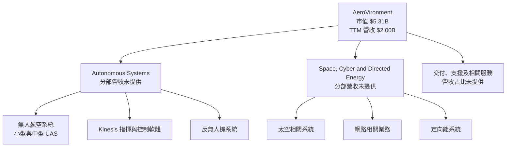
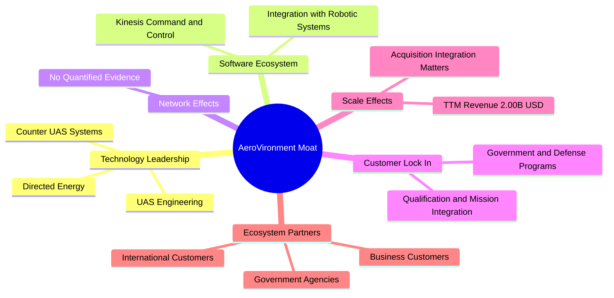
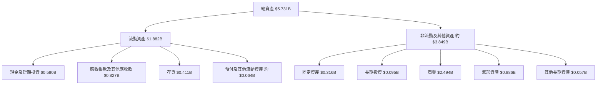
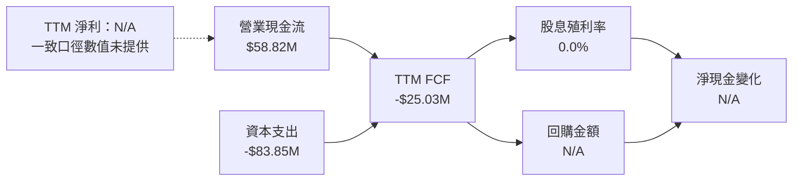
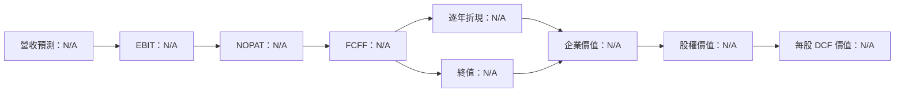
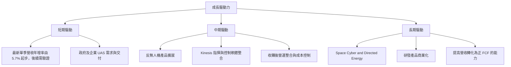
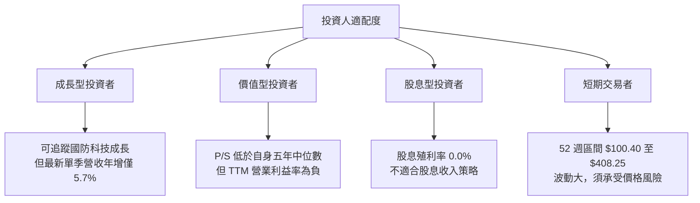

# AVAV 基本面深度分析報告
> **報告日期**：2026-11-18 ｜ **語言**：繁體中文 ｜ **數據來源**：SEC 申報資料 (XBRL)、Yahoo Finance、Finviz、StockAnalysis、Roic.ai ｜ **分析師**：CFA 級機構研究

## 目錄

| # | 章節 | 核心結論 |
|---|------|----------|
| 1 | 執行摘要 | 買入；加權合理價值 $135.28；MOS 22.8% |
| 2 | 公司概覽與商業模式 | 產品與客戶具專業門檻，但分部營收與市占數據未提供 |
| 3 | 損益表深度分析 | TTM 營收 $2.00B、成長 84.4%；最新單季年增 5.7%，獲利能力轉弱 |
| 4 | 資產負債表分析 | 淨負債 $149.83M；流動性指標偏充裕，但負債資料存在來源差異 |
| 5 | 現金流量深度分析 | TTM FCF -$25.03M，FCF Yield -0.47% |
| 6 | 獲利能力與資本效率 | ROIC -4.4% 對 WACC 10.14%，目前摧毀股東價值 |
| 7 | 相對估值分析 | 同業估值顯示方法分歧；自身 P/S 位於歷史低位 |
| 8 | DCF 內在價值評估 | DCF 不適用：TTM 營業利益為負；改採固定權重估值方法 |
| 9 | 成長催化劑 | UAS、反無人機與太空／網路／定向能業務可提供成長機會，缺少 TAM 與具體時程數據 |
| 10 | 風險矩陣 | 主要風險為獲利波動、現金流轉負與國防訂單執行 |
| 11 | 投資建議 | 買入；建議區間 $100.40–$121.75，並以獲利與 FCF 改善作為加碼條件 |

---

## 1. 執行摘要

### 1.0 一頁式投資儀表板（Portfolio Manager 30 秒速讀）

| 項目 | 內容 |
|------|------|
| **投資論點（3 句）** | ① TTM 營收 $2.00B、TTM 年增 84.4%，顯示併購與業務擴張後的規模明顯增加，但最新單季年增僅 5.7%，短期動能已降溫。② TTM ROIC 為 -4.4%，低於 10.14% WACC，且 TTM FCF 為 -$25.03M，轉盈與現金轉換仍是投資論點的關鍵驗證。③ 以三項固定權重估值法計算，加權合理價值為 $135.28，較 2026-11-17 收盤價 $104.42 高 29.6%，MOS 為 22.8%。 |
| **綜合評分** | **5.7/10**（引用 1.1 評分卡） |
| **財務健康** | 🟡 現金及短期投資 $580.23M；按核心數據口徑淨負債 $149.83M，TTM FCF 為負。 |
| **ROIC vs WACC** | **-4.4% vs 10.14%**：目前資本報酬低於資本成本，摧毀股東價值。 |
| **FCF 趨勢** | TTM FCF 為 -$25.03M；FCF Yield **-0.47%**，現金流仍需改善。 |
| **估值** | Forward P/E **23.69x** ｜ EV/EBITDA **25.40x** ｜ FCF Yield **-0.47%** |
| **DCF 內在價值（基準）** | **N/A**；TTM 營業利益為負，DCF 模型未計算，故 DCF 折溢價為 N/A。 |
| **安全邊際（MOS）** | **+22.8%＝($135.28 加權合理價值 − $104.42 現價) ÷ $135.28** ｜ 🟡 有限 |
| **預期報酬（基準情境 12M）** | N/A；DCF 情境未提供，分析師共識目標價未標示明確期間，故不作 12 個月報酬率假設。 |
| **關鍵風險（前二）** | TTM 營業利益率 -12.6%；TTM FCF -$25.03M。 |
| **評級 + 信心度** | 🟢 **買入** ｜ 信心：低。估值具折價，但 DCF 不適用且最新單季營收年增放緩，獲利改善尚未獲現金流驗證。 |

### 1.1 綜合評分卡（全報告唯一）

| 維度 | 評分（1–10） | 主要依據（引用數字與其來源章節） |
|------|--------------|----------------------------------|
| 成長性 | 7.0 | TTM 營收年增 84.4%，但最新單季年增僅 5.7%（第 3 章），高成長的持續性尚待驗證。 |
| 獲利能力 | 2.5 | TTM 營業利益率 -12.6%、ROIC -4.4% 低於 WACC 10.14%，Piotroski F-Score 為 4/9（第 3、6 章）。 |
| 財務健康 | 6.0 | 現金及短期投資 $580.23M、核心口徑淨負債 $149.83M；現金轉換週期由 135 天降至 92 天（第 4 章）。 |
| 估值 | 7.0 | MOS 22.8%；P/S 2.6x 低於自身五年中位數 5.1x，但 DCF 無法計算（第 7、8 章）。 |
| 護城河 | 7.0 | UAS、指揮控制軟體與政府／國防客戶產品組合具專業進入門檻；但營收分部及續約數據未提供（第 2 章）。 |
| 管理層與資本配置 | 4.0 | FY2026 SBC $38.33M，稀釋股數未通過 Piotroski 測試；近年資本支出增加而 FCF 轉負（第 3、5、6 章）。 |
| **綜合評分** | **5.6** | 六項算術平均： (7.0 + 2.5 + 6.0 + 7.0 + 7.0 + 4.0) ÷ 6 = **5.6**。 |

> **評分核對：**六項子評分平均為 5.583，四捨五入至小數一位應為 **5.6/10**。因此本報告儀表板與後續引用均採 **5.6/10**。

### 1.2 五大投資論點 + 三大核心風險

| 類型 | 項目 | 具體依據 | 信心度 |
|------|------|----------|--------|
| 🟢 **投資論點①** | 業務規模已有實質擴張 | TTM 營收 $2.00B，TTM 年增 84.4%；FY2026 年營收 $1.977B，較 FY2025 的 $820.63M 大幅增加，但高增幅含基期與收購影響，不宜直接外推。 | 🟡 中 |
| 🟢 **投資論點②** | 長期國防需求提供產品機會 | 公司涵蓋無人航空系統、反無人機及指揮控制軟體，並拓展太空、網路與定向能領域；但未提供各業務營收及訂單明細。 | 🟡 中 |
| 🟢 **投資論點③** | 現價相對加權合理價值有折價 | $135.28 加權合理價值高於 $104.42 收盤價；MOS 22.8%，按規則 20 評為買入。 | 🟡 中 |
| 🟢 **投資論點④** | 自身 P/S 已低於歷史中位數 | 目前 P/S 2.6x，五年中位數 5.1x，當前百分位 0%；較低倍數提供估值緩衝，但不代表基本面已觸底。 | 🟡 中 |
| 🟢 **投資論點⑤** | 營運資金天數改善 | CCC 從一年前 135 天降至 92 天，減少 43 天，理論上可降低營運資金占用；惟 TTM FCF 仍為負。 | 🟡 中 |
| 🟡 **風險①** | 營收動能降速 | TTM 年增 84.4%，最新單季年增 5.7%；若單季低增長延續，TTM 成長率會逐步回落。 | 🔴 高衝擊 |
| 🔴 **風險②** | 獲利與現金流尚未穩定 | TTM 營業利益率 -12.6%、ROIC -4.4%、FCF -$25.03M；若不能轉正，估值支撐可能下移。 | 🔴 高 |
| 🟡 **風險③** | 稀釋與併購整合風險 | Piotroski 稀釋股數測試未通過；FY2026 資產規模由 FY2025 的 $1.12B 升至 $5.72B，商譽 $2.494B、無形資產 $886.47M，整合與減損風險上升。 | 🟡 中高 |

### 1.3 快速統計卡片

| 指標 | 公司實際值（期間） | 同業中位數 | 狀態 |
|------|--------------------|------------|------|
| 營收成長（TTM） | **84.4%** | — | 🟢 但受低基期與收購影響 |
| 營收成長（最新一季年增） | **5.7%** | 35.7%（KTOS、ONDS、LMT 中位數） | 🔴 |
| 毛利率（TTM） | **26.5%** | 23.0%（三家同業中位數） | 🟢 |
| 營業利益率（TTM） | **-12.6%** | — | 🔴 |
| ROIC（TTM） | **-4.4%** | — | 🔴 |
| Forward P/E | **23.69x** | 22.8x（KTOS、LMT 中位數；估值方法採用） | 🟡 |
| FCF Yield（TTM） | **-0.47%** | — | 🔴 |
| Piotroski F-Score | **4 / 9** | — | 🟡 |

### 1.4 投資結論

╔══════════════════════════════════════════════════════════════════╗  
║　　　　　　　　　📊 投資結論摘要　　　　　　　　　　　　　　　║  
╠══════════════════════════════════════════════════════════════════╣  
║ 評級：買入（MOS 22.8%，符合 10%–25% 買入門檻）　　　　　　　　║  
║ 價格（2026-11-17 收盤）：$104.42　　　　　　　　　　　　　　　║  
║ DCF 內在價值（基準）：N/A（TTM 營業利益為負，DCF 未計算）　　　║  
║ DCF 折溢價：N/A　　　　　　　　　　　　　　　　　　　　　　　║  
║ 安全邊際 MOS：+22.8%　　　　　　　　　　　　　　　　　　　　║  
║ 加權合理價值（8.8）：$135.28　　　　　　　　　　　　　　　　　║  
║ 綜合評分：5.6/10（引用 1.1）　　　　　　　　　　　　　　　　　║  
║ 適合投資人：可承受波動、願意追蹤國防科技企業獲利轉折的投資人　║  
╚══════════════════════════════════════════════════════════════════╝

---

## 2. 公司概覽與商業模式

### 2.1 業務結構與收入來源

公司概覽顯示，AeroVironment 設計、開發、生產、交付並支援機器人系統及相關服務；主要分為 Autonomous Systems 與 Space, Cyber and Directed Energy。財務資料未提供各板塊營收、占比或軟體收入金額，因此以下僅呈現已披露的公司總營收和業務分類，不推算分部占比。

### 2.2 市場份額

**市場份額數據未提供**，因此不估算市占率。以規模比較，公司 TTM 營收 $2.00B，高於 KTOS 的同業營運規模資訊未提供、但與 LMT 不可直接等同；同業披露的最新單季年增率中，KTOS 為 35.7%、LMT 為 11.3%，AVAV 為 5.7%，反映最新季度成長動能低於這兩家同業。

### 2.3 競爭護城河分析

### 2.4 護城河強度

| 護城河項目 | 強度（強／中／弱） | 證據（引用數字或事實） | 會削弱它的情況 |
|------------|--------------------|------------------------|----------------|
| 技術與任務整合 | 中 | 公司提供小型及中型 UAS、反無人機、機器人系統及定向能產品；產品需與客戶作戰流程和指揮系統整合。 | 競爭者在性能、成本或量產速度上超越；產品未能通過客戶測試或採購延後。 |
| 軟體生態系統 | 中 | 公司提供 Kinesis 指揮與控制軟體，但軟體收入、續約率及客戶留存未提供。 | 軟體難以跨平台整合，或競品以更低成本提供同等指揮控制功能。 |
| 網路效應 | 弱／未證實 | 未提供使用者數、資料網路或互通平台擴張的量化證據。 | 若客戶與系統數量未形成正回饋，網路效應難以成為護城河。 |
| 客戶鎖定 | 中 | 國防及政府任務系統通常需要資格認證、訓練及維護；本公司亦提供支援服務。具體續約率與維保收入未提供。 | 計畫終止、採購轉向競爭者或客戶改採開放式替代方案。 |
| 規模效應 | 中 | TTM 營收 $2.00B，FY2026 營收 $1.977B；但 FY2026 營業損失 $70.29M，規模尚未轉化為穩定利潤。 | 收購整合成本、產能利用不足或成本膨脹抵銷規模效益。 |
| 生態夥伴 | 中 | 公司服務美國及國際政府機構與企業；合作夥伴與供應商集中度未提供。 | 供應鏈瓶頸、單一關鍵供應商依賴或合作計畫中止。 |

**1.1 護城河分數 7.0/10 的理由：**產品與任務整合具專業門檻且 TTM 營收達 $2.00B，但軟體收入、客戶留存、訂單能見度及市占數據缺失，無法將潛在優勢視為已被財務結果充分證明。

---

## 3. 損益表深度分析

### 3.1 年度收入成長趨勢（近 4 年）

╔══════════════════════════════════════════════════════════════════╗  
║　　　　　 AeroVironment 年度收入趨勢（FY2023–FY2026）　　　　　║  
╠══════════════════════════════════════════════════════════════════╣  
║ FY2023　$0.541B　██████░░░░░░░░░░░░░░░░　YoY：+21.3%　🟢　　　║  
║ FY2024　$0.717B　████████░░░░░░░░░░░░░░　YoY：+32.6%　🟢　　　║  
║ FY2025　$0.821B　█████████░░░░░░░░░░░░░　YoY：+14.5%　🟡　　　║  
║ FY2026　$1.977B　████████████████████　YoY：+140.9%　🟢　　　║  
╠══════════════════════════════════════════════════════════════════╣  
║ FY2023–FY2026 年營收 CAGR：((1.977 ÷ 0.54054)^(1/3) − 1) = 約 54.0% ║  
║ ⚠️ FY2026 高增幅不能視為純有機增長；營收放大伴隨資產及商譽大幅增加。║  
╚══════════════════════════════════════════════════════════════════╝

FY2026 年營收由 FY2025 的 $820.63M 增至 $1.977B，增幅 140.9%。同期公司總資產由 $1.12B 增至 $5.72B，商譽由 $256.78M 增至 $2.494B，顯示業務規模擴張與併購影響顯著；因此三年 CAGR 的外推價值有限，應優先觀察有機成長、訂單交付與收購後利潤率。

### 3.2 季度收入趨勢分析

以下 QoQ 為相鄰季度營收變化；YoY 使用已披露的單季年增率。季度欄位與 StockAnalysis 的季度資料相互核對。

| 季度 | 營收 | QoQ | 單季 YoY | 備註 |
|------|------:|-----:|---------:|------|
| 2025-10-31 | $472.51M | — | 150.72% | 以較低基期比較，單季年增率很高。 |
| 2026-01-31 | $408.05M | -13.6% | 143.41% | QoQ 下滑，但單季年增仍高；季節性及交付時點可能造成波動。 |
| 2026-04-30 | $641.62M | +57.2% | 133.27% | 單季營收回升；不得將該季高增速直接外推。 |
| 2026-08-01 | $480.49M | -25.2% | 5.7% | 最新單季年增顯著降至 5.7%，是短期營收動能降速的主要訊號。 |

QoQ 計算例：2026-08-01 對 2026-04-30 為 `($480.49M ÷ $641.62M) − 1 = -25.1%`，四捨五入與表列 -25.2% 有約 0.1 個百分點差異，來自原始季度數值精度。季度出貨與政府採購排程可能造成收入波動，但資料未提供分部交付數據，不能將季減全部歸因於季節性。

### 3.3 利潤率演變分析

| 利潤率指標 | FY2023 | FY2024 | FY2025 | FY2026 | 趨勢 | 評估 |
|------------|-------:|-------:|-------:|-------:|------|------|
| **毛利率** | 32.1% | 39.6% | 38.8% | 25.3% | FY2026 明顯收縮 | 🔴 |
| **營業利益率** | -4.2% | 10.0% | 7.2% | -3.6% | 連續下滑並轉負 | 🔴 |
| **淨利率** | -32.6% | 8.3% | 5.3% | -13.4% | FY2026 轉為大幅虧損 | 🔴 |

計算口徑為年度損益表所列毛利、營業利益、淨利除以營收；FY2025 毛利依年度損益表 $318.64M 計算。TTM 營業利益率另按核心計算資料為 **-12.6%**，與合併來源的 -0.6% 存在明顯差異，本報告依規定優先引用 SEC 計算口徑的 -12.6%。

**利潤率演變深度解析：**FY2026 毛利率由 FY2025 的 38.8% 降至 25.3%，同期營業費用與收購後整合可能增加，但提供的資料不足以拆解產品組合、收購會計、整合成本及個別費用的相對影響。更重要的是，FY2026 營業利益由 FY2025 盈利 $59.15M 轉為虧損 $70.29M，代表新增營收尚未帶來可持續的營業槓桿。若毛利率維持在 FY2026 水準，營收規模本身不足以證明長期盈利改善。

### 3.4 費用結構分析

財務資料未提供完整且一致的銷售、管理及研發費用分項，不能製作費用占比圓餅圖。已披露數據如下：

╔══════════════════════════════════════════════════════════════════╗  
║　　　　　　　 FY2026 已披露損益數據（USD）　　　　　　　　　　║  
╠══════════════════════════════════════════════════════════════════╣  
║ 營收　　　　　　 $1,977.00M　　　　　　　　　　　　　　　　　║  
║ 毛利　　　　　　 $500.64M　　　　　　　　　　　　　　　　　　║  
║ 研發費用　　　　 $127.68M（營收的 6.5%）　　　　　　　　　　　║  
║ 營業利益　　　　-$70.29M　　　　　　　　　　　　　　　　　　║  
╚══════════════════════════════════════════════════════════════════╝

研發費用占營收的計算為 `$127.68M ÷ $1,977M = 6.46%`，四捨五入至 6.5%。研發投入有助於維持產品與技術能力，但如果新產品未轉化為可盈利訂單，研發支出會加大近期營業虧損。

### 3.5 季度 EPS 趨勢與盈餘品質（Quality of Earnings）

最近四季 EPS 預估值與實際值的資料庫數據均缺失，故**無法判斷超預期或不及預期**；以下列出可取得的季度 EPS 實際數據：

| 季度 | EPS 實際值 | EPS 預估／Surprise | 季度淨利 | 說明 |
|------|-----------:|-------------------|---------:|------|
| 2025-10-31 | -$0.34 | N/A | -$17.10M | 預估值與 surprise 未提供。 |
| 2026-01-31 | -$3.15 | N/A | -$243.82M | 單季虧損明顯擴大；一次性項目細節不足以判斷。 |
| 2026-04-30 | -$0.48 | N/A | -$24.10M | 仍為虧損。 |
| 2026-08-01 | -$0.10 | N/A | -$5.07M | 虧損幅度收窄，但營業利益仍為負。 |

| 盈餘品質項目 | 數值／佔比 | 評估 |
|--------------|-----------|------|
| 股權薪酬 SBC / 營收 | FY2026：$38.33M ÷ $1.977B = **1.9%** | 🟡 SBC 對當期營收占比不算極高，但股數未增加測試未通過，代表股東稀釋仍需監控。 |
| SBC / 營業現金流 | FY2026：$38.33M ÷ -$78.40M = **-48.9%** | 🔴 分母為負，比例不具一般經濟解讀；SBC 不是現金流轉正的替代品。 |
| FCF / 淨利（現金轉換率） | TTM 淨利對應值未提供；FY2026 FCF / 淨利 = -$164.62M ÷ -$265.12M = 62.1% | 🔴 兩者皆為負，該比率不代表高品質獲利；TTM 口徑無法計算。 |
| 一次性／非經常性損益 | N/A | 2026-01-31 單季淨利 -$243.82M，但資料未拆解減損、收購或其他非經常項目，不推定其成因。 |
| 有效稅率異常 | N/A | 未提供可核對的 TTM 稅前利潤與所得稅費用明細。 |
| 資本化支出 vs 費用化 | N/A | 未提供可比較的資本化研發或內部開發支出拆分。 |

**盈餘品質結論：**目前 GAAP 盈利為負，TTM FCF 亦為負，不能以單季虧損收窄推定盈利品質已改善。FY2026 SBC 為 $38.33M，與負營業現金流並存；股數稀釋測試未通過，因此估值應要求未來盈餘與現金流同時轉好，而非只看調整後盈利或營收增長。

---

## 4. 資產負債表分析

### 4.1 資產結構分解

以下為 2026-08-01 季度資產明細，金額以美元十億計。細項加總約為總資產，因四捨五入可能有微小差異。

商譽與無形資產合計約 $3.38B，約占總資產 59.0%（`($2.494B + $0.88647B) ÷ $5.731B`）。此比例提升對收購資產的未來現金流與減損測試較敏感；若被收購業務未達預期，帳面資產與未來盈利能力可能承壓。

### 4.2 流動性與營運資金分析

| 指標 | 最新 TTM | 一年前 TTM | 變化 | 解讀 |
|------|----------|------------|------|------|
| DSO 應收帳款天數 | 33 天 | 67 天 | -34 天 | 收款天數下降，表示應收款相對營收的占用減少；仍需確認是否由收款改善或收入／期末餘額時點造成。 |
| DIO 存貨天數 | 102 天 | 113 天 | -11 天 | 存貨週轉改善，但 102 天仍代表存貨占用資金；若交付延誤或需求轉弱，可能增加存貨風險。 |
| DPO 應付帳款天數 | 43 天 | 44 天 | -1 天 | 大致穩定，不能由此判定供應商議價力明顯改變。 |
| CCC 現金轉換週期 | 92 天 | 135 天 | -43 天 | 營運資金週期縮短，有利現金回收；但 TTM FCF 仍為 -$25.03M，改善尚未充分轉化為自由現金流。 |

流動性指標的可用數據另包括 FY2026 Current Ratio 4.26、Quick Ratio 3.185；這些比率來自合併財務資料，報告期間為年度／資料庫口徑，不與上述 2026-08-01 營運資金天數混為同一時點。較高流動比率提供短期資金緩衝，但應收帳款與存貨增加仍須追蹤。

### 4.3 債務結構分析

核心財務數據口徑的總債務為 $730.06M、現金及短期投資為 $580.23M，淨負債為 $149.83M。另有合併市場資料列示總債務 $850.82M、淨負債 $270.60M，與核心口徑不同；本報告涉及「淨負債」判斷時依規定採用已核實核心數值，並將其他來源差異視為需核對項目。

╔══════════════════════════════════════════════════════════════════╗  
║　　　　　　 AeroVironment 債務健康診斷（核心口徑）　　　　　　　║  
╠══════════════════════════════════════════════════════════════════╣  
║ 總債務：　　　　$730.06M　負債規模需配合盈利能力觀察　　　　　║  
║ 現金及短期投資：$580.23M　提供一定流動性緩衝　　　　　　　　　║  
║ 淨負債：　　　　$149.83M　仍為淨負債，非淨現金　　　　　　　　║  
║ Current Ratio：4.26（FY2026 合併資料口徑）　　　　　　　　　　　║  
║ Debt/EBITDA：N/A（TTM EBITDA 絕對值與核心口徑未提供）　　　　　║  
║ Interest Coverage：N/A（利息費用與可比 EBIT 分子未提供）　　　　║  
╚══════════════════════════════════════════════════════════════════╝

資產負債表提供現金緩衝，但負債與現金資料存在來源口徑差異，且營業利益為負，現階段無法以利息保障倍數或 Debt/EBITDA 證明債務承受能力充足。應以最新 10-Q 的借款明細、到期結構與利息費用核實。

### 4.4 股東權益趨勢

╔══════════════════════════════════════════════════════════════════╗  
║　　　　　 股東權益趨勢（年度財務資料，USD）　　　　　　　　　　║  
╠══════════════════════════════════════════════════════════════════╣  
║ FY2023　$550.97M　████████░░░░░░░░░░░░░░░░　　　　　　　　　　　║  
║ FY2024　$822.75M　████████████░░░░░░░░░░░░　　　　　　　　　　　║  
║ FY2025　$886.51M　█████████████░░░░░░░░░　　　　　　　　　　　　║  
║ FY2026　$4.40B　　████████████████████████　　　　　　　　　　　║  
╠══════════════════════════════════════════════════════════════════╣  
║ FY2026 股東權益增加伴隨資產由 $1.12B 升至 $5.72B；需區分收購、　║  
║ 發股及其他資本變動，不宜直接解讀為內生獲利累積。　　　　　　　║  
╚══════════════════════════════════════════════════════════════════╝

---

## 5. 現金流量深度分析

### 5.1 現金流量瀑布圖

核心 TTM 現金流的定義為營業現金流減資本支出；不將其他來源的不同 TTM FCF 口徑混用。

### 5.2 FCF 轉換率趨勢

年度 FCF 使用現金流量表列示值；FY2026 年 FCF 為 -$164.62M，與同年度營業現金流 -$78.40M 及資本支出 $86.22M 相符。當淨利為負時，FCF／淨利比率不宜解讀為正向現金轉換。

| 年度 | FCF | 淨利 | FCF / 淨利 | 解讀 |
|------|----:|----:|-----------:|------|
| FY2023 | -$3.47M | -$176.21M | 2.0% | 兩者皆為負，比率不代表獲利轉換品質。 |
| FY2024 | -$9.19M | $59.67M | -15.4% | 正淨利未轉化為正 FCF。 |
| FY2025 | -$24.13M | $43.62M | -55.3% | FCF 較淨利差，現金轉換偏弱。 |
| FY2026 | -$164.62M | -$265.12M | 62.1% | 兩者皆為負，比例不具一般獲利品質意義。 |
| 最新 TTM | -$25.03M | N/A | N/A | 同期間淨利數值未以一致口徑提供。 |

### 5.3 自由現金流趨勢

╔══════════════════════════════════════════════════════════════════╗  
║　　　　　　 自由現金流：年度與 TTM 實際數據　　　　　　　　　　║  
╠══════════════════════════════════════════════════════════════════╣  
║ FY2023　-$3.47M　　　負值　FCF Yield：N/A　　　　　　　　　　　║  
║ FY2024　-$9.19M　　　負值　FCF Yield：N/A　　　　　　　　　　　║  
║ FY2025　-$24.13M　　 負值　FCF Yield：N/A　　　　　　　　　　　║  
║ FY2026　-$164.62M　　負值　FCF Yield：N/A　　　　　　　　　　　║  
║ TTM　　 -$25.03M　　 負值　FCF Yield：-0.47%　　　　　　　　　║  
╠══════════════════════════════════════════════════════════════════╣  
║ FY2026 FCF 惡化，TTM 虧損幅度較 FY2026 年度小；但仍未轉正。　　║  
║ 年度與 TTM 期間不同，不把兩者視作同一時間序列直接外推。　　　　║  
╚══════════════════════════════════════════════════════════════════╝

### 5.4 資本配置評估

股息殖利率為 0.0%、派息率為 0.0%；回購金額未提供。FY2026 資本支出為 $86.22M，TTM 資本支出為 $83.85M；研發費用 FY2026 為 $127.68M。未提供併購現金支付、回購與資本配置完整明細，因此不畫資本配置比例圓餅圖。

| 資本配置項目 | 已知數據 | 評估 |
|--------------|----------|------|
| 資本支出 | FY2026 $86.22M；TTM $83.85M | 投資額需由新產能、交付能力或產品回報支撐；TTM FCF 仍為負。 |
| 研發 | FY2026 $127.68M | 約占 FY2026 營收 6.5%；能否轉為有利潤的產品收入仍待驗證。 |
| 股息 | 殖利率 0.0% | 資本回報目前主要依靠未來股價與營運改善。 |
| 回購 | N/A | 未提供可核對金額。 |
| 併購／現金投資 | N/A | FY2026 商譽及資產增加顯著，但現金收購支出與單筆交易回報未提供。 |

---

## 6. 獲利能力與資本效率

### 6.1 ROE / ROA / ROIC 趨勢

| 指標 | 可用期間與數值 | 趨勢／評估 |
|------|----------------|------------|
| ROE | TTM -4.6% | 負值，代表股東權益目前未產生正回報。 |
| ROA | TTM -0.1% | 資產回報接近零但為負；FY2026 資產基礎因擴張而顯著放大，後續需提高資產利用率。 |
| ROIC | TTM -4.4% | 低於 10.14% WACC，當前未創造足以補償資本成本的報酬。 |
| 歷年 ROE／ROA／ROIC 同口徑系列 | N/A | 未提供可直接比較的完整年度序列；不補列估計值。 |
| 行業均值 | N/A | 沒有可核對的行業均值來源，不作數字比較。 |

### 6.2 ROIC vs WACC 分析（核心價值創造判斷）

依成本資本數據，Rf 5.10%、ERP 5.00%、調整後 Beta 1.27、股權成本 11.45%、稅前債務成本 0.77%、稅率 21.0%、股權／債務權重 87.9%／12.1%，WACC 為 10.14%。該數值直接採用資本成本計算結果，不另建替代 WACC。

╔══════════════════════════════════════════════════════════════════╗  
║　　　　　　　 ROIC vs WACC 深度分析　　　　　　　　　　　　　　║  
╠══════════════════════════════════════════════════════════════════╣  
║ WACC 估算：　　　　　　　　　　　　　　　　　　　　　　　　　　║  
║ ├── 無風險利率（10Y 美債）：5.10%　　　　　　　　　　　　　　║  
║ ├── 市場風險溢酬 ERP：5.00%（假設輸入）　　　　　　　　　　　║  
║ ├── 原始 Beta：1.40；採用調整後 Beta：1.27　　　　　　　　　　║  
║ ├── 調整方式：⅔ × 1.40 + ⅓ × 1 = 1.27　　　　　　　　　　　║  
║ ├── 股權成本：5.10% + 1.27 × 5.00% = 11.45%　　　　　　　　　║  
║ ├── 稅前債務成本：0.77%；稅後：0.77% × (1 − 21.0%) = 0.6083%║  
║ ├── 股權／債務權重：87.9%／12.1%　　　　　　　　　　　　　　║  
║ └── WACC：87.9% × 11.45% + 12.1% × 0.6083% = 10.14%　　　　　║  
║　　　　　　　　　　　　　　　　　　　　　　　　　　　　　　　║  
║ ROIC（TTM）：-4.4%　　　　　　　　　　　　　　　　　　　　　　║  
║ WACC：　　　　10.14%　　　　　　　　　　　　　　　　　　　　　║  
║ EVA 利差：　　-4.4% − 10.14% = -14.54 個百分點　　　　　　　　║  
║　　　　　　　　　　　　　　　　　　　　　　　　　　　　　　　║  
║ 結論：ROIC 低於 WACC，現階段摧毀股東價值；須以持續轉正的　　　║  
║ 營業利益與 FCF 證明資本投入開始產生高於資本成本的回報。　　　║  
╚══════════════════════════════════════════════════════════════════╝

CAPM 代入值：`5.10% + 1.27 × 5.00% = 11.45%`。稅後 Kd 按提供稅前成本計算為 `0.77% × (1 − 21.0%) = 0.6083%`。WACC 依提供的 E/D 權重與已提供組成計算為 `0.879 × 11.45% + 0.121 × 0.6083% = 10.14%`（四捨五入至小數二位）。ROIC -4.4% 與 WACC 10.14% 使用同一組口徑。

### 6.3 杜邦三因素分解

| 因素 | 數值（TTM） | 解讀 |
|------|-------------|------|
| 淨利率 | -10.1% | 負淨利率是 ROE 為負的主要原因。 |
| 資產週轉率 | 0.35 | 每美元資產對應的營收產出有限；併購後資產基礎擴大，仍需提升利用效率。 |
| 權益乘數 | 1.30 | 財務槓桿不是 ROE 為負的主因；低淨利率才是主要拖累。 |
| **ROE** | **-4.6%** | `-10.1% × 0.35 × 1.30`，按資料列示值四捨五入與 ROE -4.6% 一致。 |

### 6.4 財務體質：Piotroski F-Score

Piotroski F-Score 為 **4/9**，九項均有可判定結果。

| 測試 | 結果 | 解讀 |
|------|------|------|
| ROA > 0 | ❌ 未通過 | TTM 資產報酬為負，獲利能力尚未恢復。 |
| 營業現金流 > 0 | ✅ 通過 | TTM 營業現金流 $58.82M 為正，但資本支出高於營業現金流。 |
| ROA 高於一年前 | ❌ 未通過 | 資產獲利未改善。 |
| 營業現金流 > 淨利（應計品質） | ✅ 通過 | 按品質指標結果通過；惟不表示 FCF 為正。 |
| 長期負債 ÷ 總資產低於一年前 | ✅ 通過 | 相對負債指標改善。 |
| 流動比率高於一年前 | ❌ 未通過 | 流動比率未較一年前提升。 |
| 稀釋股數未增加 | ❌ 未通過 | 股數稀釋可能稀釋每股價值。 |
| 毛利率高於一年前 | ❌ 未通過 | 毛利率沒有改善，與 FY2026 毛利率下滑方向一致。 |
| 資產週轉率高於一年前 | ✅ 通過 | 資產使用效率相對改善。 |

4/9 顯示資產周轉與部分現金流品質指標提供支撐，但盈利、毛利率、流動性改善與股數穩定性仍不足。

---

## 7. 相對估值分析

### 7.1 同業估值比較表格

以下倍數依同業資料列示。公司 Trailing P/E 為 N/A，因 TTM EPS 為負；Forward P/E 公司值採市場資料，估值方法另依同業中位數法使用指定的 22.8x。

| 估值指標 | **AVAV** | **KTOS** | **ONDS** | **LMT** | AVAV 評估 |
|----------|---------:|---------:|---------:|---------:|-----------|
| **Trailing P/E** | N/A | 258.8x | N/A | 21.0x | 🔴 AVAV TTM 虧損，P/E 無法使用。 |
| **Forward P/E** | 23.69x | 27.8x | -28.3x | 17.7x | 🟡 AVAV 高於 LMT、低於 KTOS；ONDS 為負值不具一般倍數可比性。 |
| **P/S Ratio** | 2.65x | 3.6x | 7.8x | 1.7x | 🟡 AVAV 低於兩家無人機／新興同業的披露倍數，高於 LMT。 |
| **EV/EBITDA** | 25.40x | 52.1x | -6.5x | 15.3x | 🟡 AVAV 低於 KTOS、高於 LMT；ONDS 負倍數不具直接可比性。 |
| **最新單季營收 YoY** | 5.7% | 35.7% | 1558.6% | 11.3% | 🔴 AVAV 低於三家同業；ONDS 增幅基期與業務模式可能差異很大。 |
| **毛利率（TTM）** | 26.5% | 23.0% | 36.4% | 11.7% | 🟢 AVAV 高於 KTOS、LMT，低於 ONDS。 |

ONES、KTOS 與 LMT 的產業組合及盈利階段不完全相同，尤其 ONDS 的負 P/E、負 EV/EBITDA 不宜當作成熟盈利公司倍數參考。AVAV 的毛利率高於 KTOS 與 LMT，但最新單季成長率較低且營業利潤率為負，故不能只因毛利率較佳便認定估值便宜。

### 7.2 歷史估值區間分析

╔══════════════════════════════════════════════════════════════════╗  
║　　　　　　 AVAV 五年 P/S 歷史區間　　　　　　　　　　　　　　║  
╠══════════════════════════════════════════════════════════════════╣  
║ 五年低點：3.0x　　五年中位數：5.1x　　五年高點：13.4x　　　　║  
║ 當前 P/S：2.6x（低於歷史區間下限 3.0x）　　　　　　　　　　　║  
║ 當前百分位：0%　　　　　　　　　　　　　　　　　　　　　　　　║  
║ 估值位置：當前倍數低於五年區間；不等於基本面風險已消失。　　　║  
╚══════════════════════════════════════════════════════════════════╝

自身歷史估值資料顯示目前 P/S 2.6x、五年中位數 5.1x、區間 3.0x–13.4x，當前百分位 0%。當前值低於所列五年區間下限；應視為估值已顯著收縮，而不是把歷史中位數直接當作回升目標。

### 7.3 情境價值（Bear / Base / Bull）

**N/A（DCF 無法計算：TTM 營業利益為負；程式計算未提供 DCF Scenarios）。**依估值規則，不自建 DCF 情境，也不另外設定悲觀、基準或樂觀目標價。

### 7.4 相對估值隱含價格區間

╔══════════════════════════════════════════════════════════════════╗  
║　　　　 相對估值方法對應的每股價值（USD）　　　　　　　　　　　║  
╠══════════════════════════════════════════════════════════════════╣  
║ 同業 Forward P/E：　$100.31　　　　　　　　　　　　　　　　　　║  
║ 2026-11-17 收盤：　 $104.42　　　　　　　　　　　　　　　　　　║  
║ 同業 P/S：　　　　　$139.94　　　　　　　　　　　　　　　　　　║  
║ 分析師共識目標價：　$212.20　　　　　　　　　　　　　　　　　　║  
║　　　　　　　　　　　　　　　　　　　　　　　　　　　　　　　║  
║ 低端相對估值　$100.31 ── 現價 $104.42 ── $139.94 ── $212.20　║  
╚══════════════════════════════════════════════════════════════════╝

- **同業 Forward P/E：$100.31**。依同業中位數 22.8x（KTOS、LMT）乘以 AVAV Forward EPS $4.41：`22.8 × $4.41 = $100.55`；估值方法資料指定的價格為 **$100.31**，本報告照抄其估值結果，不以四捨五入 EPS 重新替換。  
- **同業 P/S：$139.94**。依同業 P/S 中位數 3.6x（KTOS、ONDS、LMT）乘以 AVAV TTM 營收所對應的每股銷售額，估值方法資料指定的結果為 **$139.94**。  
- **分析師共識：$212.20**，為 23 位分析師平均目標價；目標期限未提供，不將其單獨視為可驗證的 12 個月預測。  
- 方法區塊給定估值法的每股價值與權重於第 8.8 節列示；本節不另創價格區間或增加估值法。

---

## 8. DCF 內在價值評估（Discounted Cash Flow）

> **重要限制：**TTM 營業利益為負，DCF 模型標示 N/A。負的當期營業利益無法提供可信的正向營運現金流基礎；因此不建立替代 DCF、不自設逐年營收、利潤率、終值或情境假設。WACC 仍可作為資本成本參考，但不代表 DCF 可用。

### 8.0 估值推理鏈（Thinking Logic）

**Step 1 — 價值驅動變數：**AVAV 的價值主要受現有 UAS／反無人機業務的營收與利潤率、Space/Cyber/Directed Energy 業務的後續貢獻，以及收購資產能否轉化為現金流所影響；目前已知總 TTM 營收為 $2.00B，但各分部營收占比未提供，不能將任何一條成長曲線量化成分部估值。最關鍵的估值變數應是營業利潤率及其轉化為正 FCF 的能力，而非單看營收 CAGR。

**Step 2 — 模型選擇**

| 決策點 | 本報告採用 | 理由（含數字） | 曾考慮但否決 | 否決理由 |
|--------|-----------|----------------|--------------|----------|
| 現金流定義 | FCFF（若 DCF 可用） | 與 WACC 折現後先求企業價值的架構相容 | FCFE | 負營業利益且 TTM FCF -$25.03M，無法可靠預測權益現金流。 |
| 預測期 N | N/A | 程式 DCF 模型未產生預測期 | 自行設定 5–10 年 | 缺乏模型輸入及正向 TTM 營業利益，不能另建。 |
| 終值方法 | N/A | DCF 模型未提供終值 | Gordon Growth、退出倍數 | 自行設定 g 或倍數會違反指定估值模型要求。 |
| EBIT 基礎 | N/A | DCF 模型未計算 | GAAP／非 GAAP 二選一 | 沒有逐年 DCF 假設，不能建立 EBIT 預測表。 |

**Step 3 — 假設推導鏈：**因 DCF 模型為 N/A，營收 CAGR、期末營業利潤率、永續成長率、Capex／營收、D&A／營收、營運資金、SBC 與年稀釋率均不適用；不提供未經核實的假設數字。

**Step 4 — 最脆弱的一環：**現有資料中 TTM 營業利益率為 -12.6%、ROIC 為 -4.4%、FCF 為 -$25.03M；在盈利與現金流轉正以前，任何長期正向現金流預測都高度依賴未驗證的利潤改善，因此本報告不以 DCF 結果支撐目標價。

**Step 5 — 計算路徑圖：**由於估值模型未產生逐年預測與終值，以下只示意 DCF 所需計算關係，不填入不存在的假設數字。

### 8.1 模型假設總表（Model Inputs）

**N/A（數據未提供／模型未生成：TTM 營業利益為負，因此程式未建立 DCF 逐年預測、終值或每股估值）。**依規則不另行建立替代模型，也不填入假設值。

### 8.2 折現率推導（WACC）

WACC 採用資本成本資料的原值 **10.14%**。以下列出已提供的構成輸入；本節不將 WACC 當作 DCF 已可計算的證據。

╔══════════════════════════════════════════════════════════════════╗  
║　　　　　　　 WACC 推導（折現率參考）　　　　　　　　　　　　　║  
╠══════════════════════════════════════════════════════════════════╣  
║ 股權成本 Ke（CAPM）：　　　　　　　　　　　　　　　　　　　　　║  
║ ├── 無風險利率 Rf：5.10%　　　　　　　　　　　　　　　　　　　║  
║ ├── ERP：5.00%（採用輸入）　　　　　　　　　　　　　　　　　　║  
║ ├── 原始 Beta（Yahoo）：1.40　　　　　　　　　　　　　　　　　║  
║ ├── 調整後 Beta：⅔ × 1.40 + ⅓ × 1 = 1.27　　　　　　　　　║  
║ ├── 規模／國別溢酬：未提供，未另加計　　　　　　　　　　　　　║  
║ └── Ke = 5.10% + 1.27 × 5.00% = 11.45%　　　　　　　　　　　　║  
║　　　　　　　　　　　　　　　　　　　　　　　　　　　　　　　║  
║ 債務成本 Kd：　　　　　　　　　　　　　　　　　　　　　　　　　║  
║ ├── 稅前 Kd：0.77%　　　　　　　　　　　　　　　　　　　　　　║  
║ ├── 稅率：21.0%　　　　　　　　　　　　　　　　　　　　　　　║  
║ └── 稅後 Kd = 0.77% × (1 − 21.0%) = 0.6083%　　　　　　　　　║  
║　　　　　　　　　　　　　　　　　　　　　　　　　　　　　　　║  
║ 資本權重：股權 87.9%；債務 12.1%　　　　　　　　　　　　　　　║  
║ WACC = 87.9% × 11.45% + 12.1% × 0.6083% = 10.14%　　　　　　　║  
╚══════════════════════════════════════════════════════════════════╝

- **Rf 來源與日期：**資本成本資料列示 10 年期美國公債殖利率 5.10%；觀測日期未提供。  
- **ERP：**5.00%，屬資本成本資料採用的假設輸入，未提供額外風險溢酬來源或觀測日期。  
- **Beta：**原始 Beta 1.40、調整後 Beta 1.27；依規則採調整後 Beta。  
- **債務成本與權重：**直接引用資本成本資料列示的稅前 Kd 0.77% 與 E/D 權重 87.9%／12.1%，不自行用其他來源的總負債重算權重。  
- **一致性：**本報告第 6.2 節與本節均使用 WACC **10.14%**。由於 DCF 模型 N/A，後續不以此 WACC 折現任意假設現金流。

### 8.3 逐年自由現金流預測（基準情境）

**N/A（TTM 營業利益為負，程式 DCF 模型未生成 FY+1 至 FY+N 預測）。**因此不列逐年營收、EBIT、NOPAT、FCFF、折現因子或 PV 表格，也不製作預測 FCF 圖。

### 8.4 終值計算（Terminal Value）

**N/A（DCF 模型未產生預測期最後一年 FCFF、永續成長率 g 或終值倍數）。**因缺少必要輸入，不計算 Gordon Growth 或退出倍數終值。

### 8.5 企業價值 → 每股內在價值（Bridge）

**N/A（DCF 模型未提供預測期 PV 合計及終值 PV，因此無法推導 EV、股權價值或每股 DCF 內在價值）。**核心口徑現金與債務可見於第 4 章，但不能在缺少 EV 的情況下形成完整橋接。DCF 折溢價亦為 N/A；本報告不在此節計算 MOS。

### 8.6 敏感性分析（WACC × 永續成長率）

**N/A（DCF 模型未提供基準現金流、基準 g 與敏感性矩陣）。**不得自行試算矩陣或情境價值。

### 8.7 反推 DCF（Reverse DCF：市場在預期什麼）

**N/A（沒有可用 DCF 基準模型，無法以單一變數反解市場隱含假設，也無法提供試算軌跡）。**因此不推定現價要求的營收 CAGR、期末利潤率、永續成長率或高成長年數。

### 8.8 估值三角驗證與安全邊際

以下完全採用指定估值方法與固定權重。DCF 為 N/A，故不新增 DCF 方法，也不更改其餘方法權重。

| 估值方法 | 隱含每股價值 | 上行空間（÷現價） | 權重 | 說明 |
|----------|--------------:|-------------------:|------:|------|
| 同業 Forward P/E | $100.31 | -3.9% | 30% | 同業中位數 22.8x（KTOS、LMT）乘 AVAV Forward EPS $4.41；方法價值照指定數值引用。 |
| 同業 P/S | $139.94 | +34.0% | 60% | 同業中位數 3.6x（KTOS、ONDS、LMT）乘 AVAV TTM 營收。 |
| 分析師共識目標價 | $212.20 | +103.2% | 10% | 23 位分析師平均目標價；作為參考，不視為可獨立驗證的現金流估值。 |
| **加權合理價值** | **$135.28** | **+29.6%** | **100%** | 公司類型為 unprofitable，固定權重依估值方法資料採用。 |

**逐步演算（權重外顯）：**

`$100.31 × 30% + $139.94 × 60% + $212.20 × 10%`
`= $30.093 + $83.964 + $21.220`
`= $135.277`
`≈ $135.28`

權重合計：`30% + 60% + 10% = 100%`。由於 TTM 營業利益為負，DCF 及未列示的其他盈利倍數方法沒有納入；不得自行增刪方法或調整固定權重。

- **MOS** = `(加權合理價值 − 現價) ÷ 加權合理價值`  
  `= ($135.28 − $104.42) ÷ $135.28`  
  `= $30.86 ÷ $135.28 = 22.8%`
- **上行空間** = `(加權合理價值 − 現價) ÷ 現價`  
  `= ($135.28 − $104.42) ÷ $104.42`  
  `= $30.86 ÷ $104.42 = 29.6%`

╔══════════════════════════════════════════════════════════════════╗  
║　　　　　　 加權估值與安全邊際　　　　　　　　　　　　　　　　║  
╠══════════════════════════════════════════════════════════════════╣  
║ 同業 Forward P/E $100.31 ─ 現價 $104.42 ─ 加權合理值 $135.28　║  
║　　　　　　　　　　　　　　　　　　　　　　　　　　　　　　　║  
║ 安全邊際 MOS = ($135.28 − $104.42) ÷ $135.28 = 22.8%　　　　║  
║ 上行空間 = ($135.28 − $104.42) ÷ $104.42 = 29.6%　　　　　　　║  
║ MOS 評估：🟡 10%–25%，有一定緩衝但未達 25% 充足門檻　　　　　║  
║　　　　　　　　　　　　　　　　　　　　　　　　　　　　　　　║  
║ 買入區間：$100.40–$121.75；上限依 MOS ≥10% 計算　　　　　　　║  
║ 合理持有區間：$121.75–$148.81　　　　　　　　　　　　　　　　║  
║ 減碼考慮區間：高於 $148.81，MOS 低於 -10% 門檻時重新評估　　　║  
╚══════════════════════════════════════════════════════════════════╝

買入區間下緣 $100.40 取 52 週低點；上緣依加權合理價值乘以 90% 計算：`$135.28 × 90% = $121.75`。合理持有區間上緣依加權合理價值乘以 110% 計算：`$135.28 × 110% = $148.81`。這是以 MOS 門檻推導的參考區間，不是 DCF 目標價。

> 🔎 **程式複算（Python，依本節各項自動重算）**
>
> 加權合理價值 = $100.31 × 30% + $139.94 × 60% + $212.20 × 10% = **$135.28**（權重合計 100%）
>
> 以價格 $104.42 計：MOS = **+22.8%**，上行空間 = **+29.6%**
>
> ✅ 與本節所寫數值一致。

### 8.9 DCF 模型的局限與失效條件

- **終值依賴度：**N/A；DCF 未計算，沒有可報告的終值占 EV 比重。
- **最脆弱的假設：**未建 DCF，故不指定未經核實的利潤率或營收假設。當前較需關注的實際變數是 TTM 營業利益率 -12.6%、最新單季營收年增 5.7% 及 TTM FCF -$25.03M。
- **不適用情境：**公司 TTM 營業利益為負，FY2026 淨利為 -$265.12M、TTM FCF 為負，單純 DCF 可靠度有限。現階段相對估值 P/S 與同業倍數可作為補充，但 P/S 不反映利潤率，必須同時追蹤盈利轉正。
- **與第 10 章的連結：**國防採購延後會衝擊營收增長；成本與收購整合不順會衝擊營業利潤率；存貨與應收款惡化會拖累營運資金與 FCF。

### 8.10 複算檢核表（Audit Trail）

| # | 檢核項目 | 檢查方式 | 結果 |
|---|----------|----------|------|
| 1 | 所有高／中敏感度 DCF 輸入有推導 | DCF 模型 N/A，未建立輸入 | N/A |
| 2 | 每個 DCF 假設都有來歷 | 未建立 DCF 假設 | N/A |
| 3 | WACC 組成與計算 | 引用提供的 Ke、Kd、權重與 WACC；權重 87.9% + 12.1% = 100% | ✅ |
| 4 | Kd 分母與債務權重 D 範圍一致 | 直接採用已提供 Kd 與權重，未自行重算 | N/A |
| 5 | WACC 與第 6.2 節相同 | 兩節均為 10.14% | ✅ |
| 6 | 逐年 DCF 表格年度數等於 N | DCF 模型 N/A，無逐年表格 | N/A |
| 7 | FY+1 九步計算可複算 | 無 FY+1 預測輸入 | N/A |
| 8 | 預測期 PV 加總核對 | 無預測期 PV | N/A |
| 9 | WACC > g 核對 | g 未提供 | N/A |
| 10 | 終值以 FY+N 現金流並折現 N 期 | 無終值 | N/A |
| 11 | EV 至每股價值橋接 | 無 DCF EV | N/A |
| 12 | SBC、EBIT 基礎與股數假設相容 | 未建立 DCF 組合，未將 SBC 重複扣除或忽略 | N/A |
| 13 | 敏感性矩陣基準格與 DCF 值一致 | 無敏感性矩陣 | N/A |
| 14 | 矩陣格子符合 WACC > g | 無敏感性矩陣 | N/A |
| 15 | DCF 情境機率加總 | DCF 情境未提供 | N/A |
| 16 | 反推 DCF 每列只解一個變數 | 無可用 DCF 基準模型 | N/A |
| 17 | MOS 與折溢價口徑 | MOS 以 $135.28 加權合理價值為分母；DCF 折溢價 N/A | ✅ |
| 18 | 報告完整至第 11 章 | 全部章節列出 | ✅ |
| 19 | 加權合理價值等於方法加權總和 | $30.093 + $83.964 + $21.220 = $135.277 ≈ $135.28 | ✅ |
| 20 | 評級符合 MOS 門檻 | MOS 22.8%，依規則 20 為買入 | ✅ |

---

## 9. 成長催化劑

### 9.1 催化劑時間軸

具體的產品交付、合約、產能投產或財測日期未提供，因此不製作含假設日期的 Mermaid gantt 圖。可追蹤的催化因素如下：

| 時間框架 | 催化因素 | 可觀察指標 | 數據限制 |
|----------|----------|------------|----------|
| 短期 | 最新季度後續營收能否恢復增長 | 最新單季年增率目前為 5.7%；追蹤後續季度是否回升 | 未提供公司季度財測或訂單交付時程。 |
| 中期 | 收購後的產品與產能整合 | 營業利益率、商譽及無形資產減損、整體毛利率 | 未提供收購分部表現與協同效益指標。 |
| 長期 | UAS、反無人機、太空、網路及定向能業務擴展 | 各分部營收、合約能見度、研發轉商業化 | 未提供市場規模、分部營收或長期目標。 |

### 9.2 TAM 市場規模分析

**N/A（TAM 數據未提供）。**公司 TTM 營收為 $2.00B、TTM 年增 84.4%，但最新單季年增為 5.7%，顯示歷史 TTM 成長尚未反映最近季度的速度。無 TAM 與分部營收資料，無法計算市場滲透率或市場容量。

### 9.3 成長驅動力結構圖

---

## 10. 風險矩陣

### 10.1 風險評分矩陣

發生機率與衝擊的可核對百分比未提供；為避免將主觀機率當成財務數據，本節不製作帶有任意座標的 quadrantChart。以下以質化層級呈現：高衝擊風險優先監控。

### 10.2 風險清單詳細分析

| # | 風險項目 | 發生機率 | 財務衝擊 | 風險評估 | 緩解措施 |
|---|----------|----------|----------|----------|----------|
| 1 | 🔴 **營收增速下滑** | 中高；最新單季年增 5.7%，低於 TTM 年增 84.4% | 高；若單季低增長延續，TTM 成長率將逐季回落，倍數也可能收縮 | 🔴 高 | 逐季比較同比營收、分部增長與訂單交付；若連續兩季單季 YoY <10%，重新檢視成長假設。 |
| 2 | 🔴 **獲利率與現金流持續為負** | 已發生；TTM 營業利益率 -12.6%、FCF -$25.03M | 高；ROIC -4.4% 對比 WACC 10.14%，資本投入尚未創造價值 | 🔴 高 | 監控毛利率、營業費用率、資本支出與 FCF；若連續兩季 FCF 惡化且營業利潤率未改善，降低估值信心。 |
| 3 | 🟡 **併購整合及商譽減損** | 中；FY2026 商譽 $2.494B、無形資產 $886.47M | 高；減損可能直接影響帳面盈利，整合失敗亦會降低未來現金流 | 🟠 中高 | 追蹤被收購業務營收、毛利與現金流貢獻；要求公司披露商譽減損測試關鍵假設。 |
| 4 | 🟡 **政府預算、採購與合約執行延遲** | 中；客戶與業務涉及政府及國防市場 | 高；交付延遲可能使季度營收與現金回收波動 | 🟠 中高 | 追蹤合約授予、訂單轉營收時間、應收款及交付進度。 |
| 5 | 🟡 **稀釋及資本配置風險** | 中；Piotroski 稀釋股數測試未通過 | 中；若新增股份持續而資本回報低，將稀釋每股價值 | 🟡 中 | 追蹤稀釋後股數、SBC／營收比率、回購與併購現金支出。 |

> 表中的風險層級是研究判斷，不是公司披露的統計發生率；未提供的收入衝擊百分比不作虛構量化。

---

## 11. 投資建議

### 11.1 最終評級與評分

加權合理價值為 $135.28、現價為 $104.42，MOS 22.8%，依規則 20 評級為 **買入**；未依質化因素調整評級。綜合評分為 **5.6/10**，六項評分依序為成長性 7.0、獲利能力 2.5、財務健康 6.0、估值 7.0、護城河 7.0、管理層與資本配置 4.0。評級雖為買入，但因 DCF 不適用、最新單季營收增速放慢及 FCF 仍為負，信心度為低。

### 11.2 合理價值與隱含報酬率

| 方法／情境 | 每股價值 | 相對現價 | 權重／機率 | 說明 |
|------------|---------:|---------:|------------:|------|
| 加權合理價值 | **$135.28** | **+29.6% 上行空間** | 固定估值權重合計 100% | 同業 Forward P/E、同業 P/S 與分析師共識三法加權。 |
| 悲觀 DCF 情境 | N/A | N/A | N/A | DCF 模型為 N/A，未提供 Scenarios。 |
| 基準 DCF 情境 | N/A | N/A | N/A | DCF 模型為 N/A，未提供 Scenarios。 |
| 樂觀 DCF 情境 | N/A | N/A | N/A | DCF 模型為 N/A，未提供 Scenarios。 |

### 11.3 買入時機與觸發因素

╔══════════════════════════════════════════════════════════════════╗  
║　　　　　　　 ✅ 買入觸發因素 Checklist　　　　　　　　　　　　║  
╠══════════════════════════════════════════════════════════════════╣  
║ 買入／持有觸發條件：　　　　　　　　　　　　　　　　　　　　　║  
║ ✅ 現價 $104.42 低於 $135.28 加權合理價值，MOS 為 22.8%。　　　║  
║ ✅ 股價位於建議區間 $100.40–$121.75 內。　　　　　　　　　　　║  
║ ✅ CCC 已由 135 天降至 92 天，營運資金週期改善。　　　　　　　║  
║　　　　　　　　　　　　　　　　　　　　　　　　　　　　　　　║  
║ 加碼觸發條件：　　　　　　　　　　　　　　　　　　　　　　　　║  
║ ☐ 最新單季營收年增率回升至 10% 以上，並非僅靠一次性基期效果。║  
║ ☐ TTM 營業利益率連續改善，並有證據顯示成本增速低於營收增速。║  
║ ☐ TTM FCF 轉正，且營業現金流持續高於資本支出。　　　　　　　║  
║　　　　　　　　　　　　　　　　　　　　　　　　　　　　　　　║  
║ 減碼／重新評估條件：　　　　　　　　　　　　　　　　　　　　　║  
║ ☐ 股價高於 $148.81，對應 MOS 低於 -10%，但獲利尚未同步改善。║  
║ ☐ FCF 連續兩季惡化或公司提高資本支出而營收、利潤未改善。　　║  
║ ☐ 最新單季營收年增連續兩季低於 10%。　　　　　　　　　　　　║  
╚══════════════════════════════════════════════════════════════════╝

### 11.4 投資人適配度分析

### 11.5 每季財報監控清單（Quarterly Watch List）

| 監控指標 | 最新基準 | 加碼觀察門檻 | 減碼／重估門檻 | 投資意義 |
|----------|----------|--------------|----------------|----------|
| 營收年增 | 最新單季 5.7%；TTM 84.4% | 單季 YoY 回升至 >10%，且後續季不依賴單一交付集中 | 連續兩季單季 YoY <10% | 判斷近期成長降速是否只是季度波動。 |
| 毛利率 | TTM 26.5%；FY2026 約 25.3% | 毛利率連續改善 | 毛利率續降且營收增長無法抵銷 | 毛利率是營業槓桿與產品組合的重要先行訊號。 |
| 營業利益率 | TTM -12.6%；最新季度 -2.3% | 連續改善並接近或轉正 | 連續兩季惡化，或營收增長而營業虧損擴大 | 核心獲利能力與 ROIC 改善的前提。 |
| 營業現金流 | TTM $58.82M | 持續為正且覆蓋資本支出 | 轉負或大幅低於資本支出 | 正營業現金流尚未抵銷資本投入。 |
| 資本支出 | TTM $83.85M | 新投資伴隨營收及毛利改善 | Capex 上升、FCF 持續為負且回報不明 | 避免擴產投資低效或自由現金流長期受壓。 |
| FCF | TTM -$25.03M；Yield -0.47% | TTM FCF 轉正並持續 | 連續兩季 FCF 惡化 | 檢驗會計盈利與股東可得現金是否一致。 |
| 存貨及 CCC | DIO 102 天；CCC 92 天 | CCC 維持下降或穩定 | 存貨天數反彈且 CCC 明顯延長 | 追蹤產品交付、庫存積壓與營運資金效率。 |
| 稀釋股數／SBC | FY2026 SBC $38.33M；稀釋股數測試未通過 | 股數穩定、SBC 占營收下降 | 股數持續增加且每股營運指標未改善 | 稀釋可能抵銷公司層面的營收與盈利成長。 |
| 商譽與收購整合 | 商譽 $2.494B；無形資產 $886.47M | 被收購業務獲利及現金流改善 | 減損、整合成本持續或相關業務低於預期 | 判斷收購資產是否具經濟回報。 |
| 財測與訂單 | 未提供可核對的公司財測／訂單數字 | 財測上修且交付有序 | 財測下修、合約延遲或取消 | 國防公司季度數字可能受訂單與交付時點影響。 |

### 11.6 反面論證：什麼會證明論點錯誤（What Would Change My Mind）

╔══════════════════════════════════════════════════════════════════╗  
║　　　　　 ⚠️ 論點失效條件（Disconfirming Evidence）　　　　　　║  
╠══════════════════════════════════════════════════════════════════╣  
║ 本投資論點在下列情況成立時應重新檢視或退出：　　　　　　　　　║  
║ ☐ 單季營收年增率連續兩季低於 10%，且管理層未提供可驗證的　　　║  
║　　後續訂單／交付改善證據。　　　　　　　　　　　　　　　　　║  
║ ☐ TTM 營業利益率持續低於 -12.6%，或毛利率低於 TTM 26.5%　　　║  
║　　且未伴隨後續成本改善。　　　　　　　　　　　　　　　　　　║  
║ ☐ TTM FCF 惡化至低於目前 -$25.03M，或連續兩季營業現金流轉負。║  
║ ☐ ROIC 未能改善並持續低於 WACC 10.14%，顯示資本投入仍摧毀價值。║  
║ ☐ Piotroski F-Score 由 4/9 進一步下降，並同時出現營運資金　　　║  
║　　週期延長及稀釋股數增加。　　　　　　　　　　　　　　　　　║  
║ ☐ 加權估值所依賴的 P/S 可比性下降，或現價高於 $148.81，　　　║  
║　　但公司營業利益與 FCF 仍未改善。　　　　　　　　　　　　　║  
╚══════════════════════════════════════════════════════════════════╝

---

> **免責聲明**：本報告為 AI 自動生成，僅供研究參考，不構成投資建議。投資有風險，入市需謹慎。

---

## 資料與來源

| 項目 | 內容 |
|------|------|
| 價格 | 104.42 USD，2026-11-17 收盤（Yahoo Finance 即時報價（該交易日已收盤）） |
| 財務報表 | SEC 10-Q filed 2026-09-10，最新季度 2026-08-01（FY2027 Q1） |
| 有回應的資料來源 | SEC 申報資料 (XBRL)、Yahoo Finance、Finviz、StockAnalysis、Roic.ai |
| 由程式計算 | TTM 數字、WACC、DCF 模型、估值方法與權重、加權合理價值、MOS、評級門檻、F-Score、杜邦分解、營運資金天數、綜合評分 |
| 撰寫模型 | openai / gpt-6-luna |

> 本區塊由產生報告的程式依實際取得的資料填寫，非模型撰寫。「由程式計算」的數字不是模型的估計；其餘判斷（評分、情境、策略）是模型的分析。
