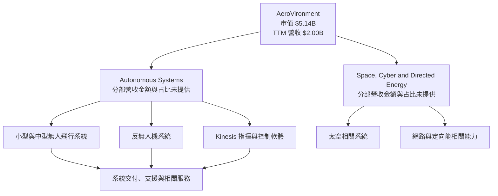
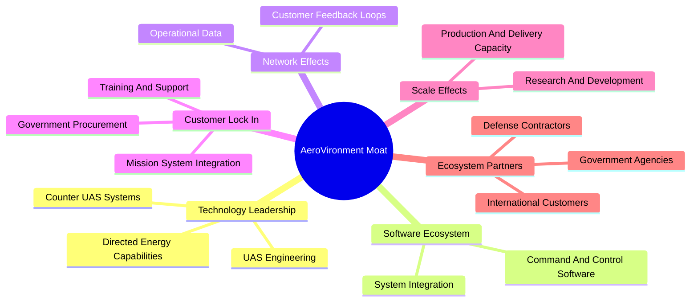
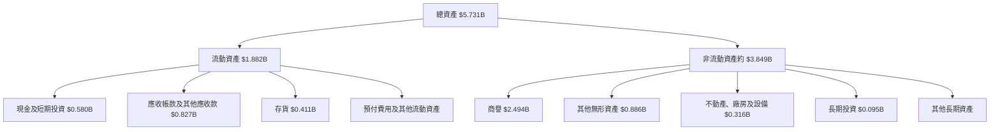
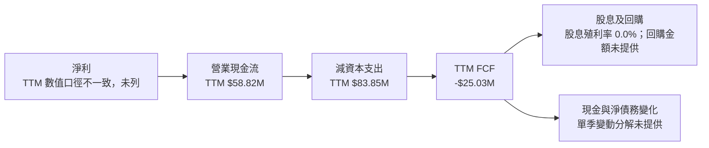
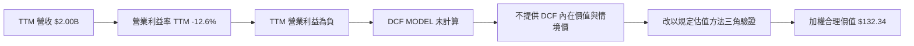
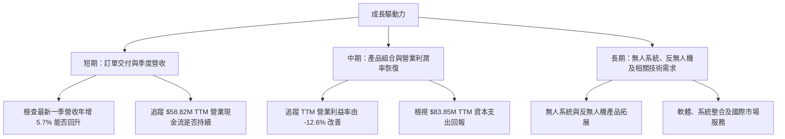
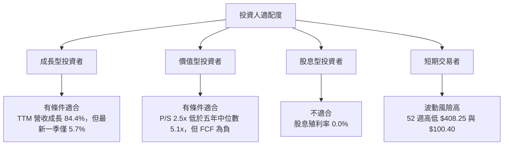

# AVAV 基本面深度分析報告
> **報告日期**：2026-11-19 ｜ **語言**：繁體中文 ｜ **數據來源**：SEC 申報資料 (XBRL)、Yahoo Finance、Finviz、StockAnalysis、Roic.ai ｜ **分析師**：CFA 級機構研究

> **資料口徑說明**：凡涉及 TTM 營收成長、TTM 營業利益率、ROIC、TTM 自由現金流、淨負債、成本資本、同業倍數、歷史估值與估值方法，以下優先引用程式計算值。其他來源存在若干期間或口徑差異，例如總債務、TTM 營業利益率與 FCF；本報告不混用不同口徑反推數字，並在相關章節揭露差異。

## 目錄

| # | 章節 | 核心結論 |
|---|------|----------|
| 1 | 執行摘要 | 買入；加權合理價值 $132.34，MOS 23.6% |
| 2 | 公司概覽與商業模式 | 國防無人系統與相關技術具專業門檻；分部營收占比未提供 |
| 3 | 損益表深度分析 | TTM 營收 $2.00B、TTM 成長 84.4%；最新一季年增降至 5.7%，TTM 營業利益率為 -12.6% |
| 4 | 資產負債表分析 | 最新現金與短期投資 $580.23M，淨負債 $149.83M；流動性比率高 |
| 5 | 現金流量深度分析 | TTM FCF 為 -$25.03M、FCF Yield -0.49%；FY2026 年度 FCF 明顯為負 |
| 6 | 獲利能力與資本效率 | ROIC -4.4% 低於 WACC 10.07%，目前摧毀經濟價值 |
| 7 | 相對估值分析 | P/S 低於自身五年中位數；加權估值高於現價但同業相對估值訊號不一致 |
| 8 | DCF 內在價值評估 | DCF 不適用：TTM 營業利益為負；採用規定的相對估值與共識估值三角驗證 |
| 9 | 成長催化劑 | 國防需求、產品訂單與併購後業務整合是重要觀察項；TAM 與明確交付時間表未提供 |
| 10 | 風險矩陣 | 獲利轉弱、現金流轉負、併購整合與估值假設為主要風險 |
| 11 | 投資建議 | 依 MOS 評級買入；以 $132.34 為加權合理價值，現價 $101.11 |

## 1. 執行摘要

AVAV 的 TTM 營收為 **$2.00B**，較前一 TTM 成長 **84.4%**，但最新一季營收年增僅 **5.7%**；同期 TTM 營業利益率 **-12.6%**、ROIC **-4.4%**，低於 **10.07% WACC**，而 TTM FCF 為 **-$25.03M**。估值方面，規定估值方法得出的加權合理價值為 **$132.34**，相對 2026-11-18 收盤價 **$101.11**，MOS 為 **23.6%**、上行空間為 **30.9%**。依 MOS 門檻，評級為**買入**；ROIC 仍為負、近期成長明顯放緩且 FCF 為負，故信心度為**中低**，而非將成長潛力直接等同於已實現獲利。

### 1.0 一頁式投資儀表板（Portfolio Manager 30 秒速讀）

| 項目 | 內容 |
|------|------|
| **投資論點（3 句）** | ① TTM 營收 $2.00B、年增 84.4%，顯示擴張幅度大，但最新一季年增降至 5.7%。② 最新現金與短期投資 $580.23M，流動比率 4.26，短期流動性尚可。③ 加權合理價值 $132.34 高於現價 $101.11，但 ROIC -4.4%、TTM FCF -$25.03M，估值上行仍須由獲利與現金流轉正驗證。 |
| **綜合評分** | **5.9/10**（引用 1.1 評分卡） |
| **財務健康** | 🟡 現金與短期投資 $580.23M、流動比率 4.26；但淨負債 $149.83M，TTM FCF 為負 |
| **ROIC vs WACC** | **-4.4% vs 10.07%**：目前低於資本成本，經濟價值為負 |
| **FCF 趨勢** | TTM FCF 為 -$25.03M；TTM FCF Yield **-0.49%** |
| **估值** | Forward P/E **22.94x** ｜ EV/EBITDA **24.63x** ｜ FCF Yield **-0.49%** |
| **DCF 內在價值（基準）** | **N/A**；TTM 營業利益為負，程式模型未計算 DCF，不能計算 DCF 折溢價 |
| **安全邊際（MOS）** | **+23.6%＝($132.34 − $101.11) ÷ $132.34**，基準為 8.8 加權合理價值；🟡 10%–25% 有限 |
| **預期報酬（基準情境 12M）** | **+30.9%**，以加權合理價值 $132.34 相對現價計算；非 DCF 情境預測 |
| **關鍵風險（前二）** | 最新一季營收年增降至 5.7%；TTM 營業利益率 -12.6%、TTM FCF 為負 |
| **評級 + 信心度** | 🟢 **買入** ｜ 信心：**中低** |

### 1.1 綜合評分卡（全報告唯一）

| 維度 | 評分（1–10） | 主要依據（引用數字與其來源章節） |
|------|--------------|----------------------------------|
| 成長性 | 8.0 | TTM 營收年增 84.4%，但最新一季年增 5.7%；見第 3 章 |
| 獲利能力 | 2.0 | TTM 營業利益率 -12.6%、ROIC -4.4%、Piotroski 4/9；見第 3、6 章 |
| 財務健康 | 6.5 | 現金與短期投資 $580.23M、流動比率 4.26，但淨負債 $149.83M；見第 4 章 |
| 估值 | 7.0 | MOS 23.6%；P/S 2.5x，低於自身五年中位數 5.1x，但仍須留意負 FCF；見第 7、8 章 |
| 護城河 | 7.0 | 國防無人系統、控制軟體與政府客戶關係有專業門檻；分部營收與續約數據未提供；見第 2 章 |
| 管理層與資本配置 | 5.0 | FY2026 SBC $38.33M，FY2026 FCF -$164.62M；併購後資產規模快速增加，回報尚未證實；見第 3–5 章 |
| **綜合評分** | **5.9** | 六項算術平均：**(8.0 + 2.0 + 6.5 + 7.0 + 7.0 + 5.0) ÷ 6 = 5.9** |

### 1.2 五大投資論點 + 三大核心風險

| 類型 | 項目 | 具體依據 | 信心度 |
|------|------|----------|--------|
| 🟢 **投資論點①** | 營收規模擴張 | TTM 營收 $2.00B，較前一 TTM 成長 84.4%；但 FY2026 年營收 $1.98B，成長含併購與比較基期影響，需追蹤有機成長 | 🟡 中 |
| 🟢 **投資論點②** | 國防無人系統需求具有延續性 | 公司提供 UAS、反無人機與相關指揮控制軟體；客戶需求與國防採購周期相關，產品及系統整合能力可能形成競爭門檻 | 🟡 中 |
| 🟢 **投資論點③** | 流動性可支撐營運及投資 | 現金與短期投資 $580.23M，流動比率 4.26、速動比率 3.185 | 🟢 中高 |
| 🟢 **投資論點④** | 相對自身歷史的 P/S 偏低 | 當前 P/S 2.5x，低於五年中位數 5.1x，處於提供資料所列歷史區間下緣以下 | 🟡 中 |
| 🟢 **投資論點⑤** | 估值方法加權後高於市價 | 同業 Forward P/E、同業 P/S 與分析師共識加權合理價值 $132.34，較現價 $101.11 高 30.9% | 🟡 中 |
| 🟡 **風險①** | 成長減速與獲利未跟上 | 最新一季營收年增 5.7%，TTM 營業利益率 -12.6%，ROIC -4.4% | 🔴 高衝擊 |
| 🔴 **風險②** | 現金流與資本密集度 | TTM FCF -$25.03M；FY2026 年度 FCF -$164.62M，投資擴張若未轉化為營運現金流，估值支撐會減弱 | 🔴 高衝擊 |
| 🟡 **風險③** | 併購整合及股東稀釋 | FY2026 商譽由前一年 $256.78M 增至 $2.494B，無形資產升至 $929.83M；F-Score 的稀釋股數測試未通過 | 🟡 中高 |

### 1.3 快速統計卡片

| 指標 | 公司實際值（期間） | 同業中位數 | 狀態 |
|------|--------------------|------------|------|
| 營收成長（TTM） | **84.4%** | — | 🟢；但含併購與基期效應 |
| 營收成長（最新一季年增） | **5.7%** | **35.7%**（KTOS、ONDS、LMT 中位數） | 🔴 |
| 毛利率（TTM） | **26.5%** | **23.0%**（KTOS、ONDS、LMT 中位數） | 🟢 |
| 營業利益率（TTM） | **-12.6%** | — | 🔴 |
| ROIC（TTM） | **-4.4%** | — | 🔴 |
| Forward P/E | **22.94x** | **22.2x**（KTOS、LMT 中位數） | 🟡 |
| FCF Yield（TTM） | **-0.49%** | — | 🔴 |
| Piotroski F-Score | **4 / 9** | — | 🟡 |

### 1.4 投資結論

```text
╔══════════════════════════════════════════════════════════════════╗
║                    📊 投資結論摘要                               ║
╠══════════════════════════════════════════════════════════════════╣
║  評級：買入（MOS 23.6%，依規則 20；不調整一級）                  ║
║  價格（2026-11-18 收盤）：$101.11                                ║
║  DCF 內在價值（基準）：N/A（TTM 營業利益為負）                   ║
║  安全邊際 MOS：+23.6%＝($132.34−$101.11)÷$132.34                ║
║  加權合理價值（8.8）：$132.34                                    ║
║  綜合評分：5.9/10（引用 1.1）                                   ║
║  適合投資人：能承受國防股政策、交付與獲利波動的中長期投資人      ║
╚══════════════════════════════════════════════════════════════════╝
```

## 2. 公司概覽與商業模式

### 2.1 業務結構與收入來源

公司資料指出，AeroVironment 提供自主系統、太空、網路與定向能等產品及服務，並涉及小型與中型無人飛行系統、反無人機及指揮控制軟體。不過，提供的財務資料沒有各分部營收、分部毛利或軟體／服務收入金額，因此不將業務占比或收入金額自行拆分。



業務模式主要依賴硬體系統、軟體及支援服務向政府機構與企業客戶提供產品。分部營收占比、訂閱型收入比重及合約續約指標未提供，故無法量化經常性收入的穩定度。

### 2.2 市場份額

市場份額數據未提供，因此不呈現份額圖或自行推算滲透率。可用的相對規模資訊是 AVAV TTM 營收 $2.00B，最新一季年增 5.7%；KTOS、ONDS、LMT 最新一季年增分別為 35.7%、1,558.6%、11.3%。其中 ONDS 的高成長率與 AVAV 的規模及成熟度不可直接等量比較，且同業資料未提供分部產品可比性。

### 2.3 競爭護城河分析



### 2.4 護城河強度

| 護城河項目 | 強度（強／中／弱） | 證據（引用數字或事實） | 會削弱它的情況 |
|------------|--------------------|------------------------|----------------|
| 技術與系統整合 | 中 | 業務涵蓋 UAS、反無人機與指揮控制軟體；FY2026 研發費用 $127.68M | 技術替代、產品性能落後或新產品認證延誤 |
| 軟體生態系統 | 中 | 公司提供 Kinesis 指揮控制軟體；軟體收入及用戶數未提供 | 軟體無法與既有系統整合，或客戶轉用替代平台 |
| 網路效應 | 弱至中 | 客戶部署及任務回饋可能改善產品，但活躍用戶與資料規模未提供 | 未能跨客戶、跨系統形成可量化資料優勢 |
| 客戶鎖定 | 中 | 政府採購、訓練與任務整合可能提高轉換成本；合約續約率未提供 | 國防採購轉向競品，或客戶自建／改採開放式系統 |
| 規模效應 | 中 | TTM 營收 $2.00B、員工 3,991 人，具備一定研發與交付規模 | 擴產、整合成本超過規模效益，並使營業利益率維持負值 |
| 生態夥伴 | 中 | 客戶涵蓋政府機構與企業，並在美國及國際市場營運；夥伴營收占比未提供 | 供應鏈受限、採購預算變動或合作依賴度過高 |

**1.1「護城河」評分為 7.0/10**：產品技術、系統整合及政府採購經驗支持一定進入門檻，但缺少分部營收、續約、軟體收入與市場份額數字，護城河強度尚無法由經常性收入或客戶留存加以驗證。

## 3. 損益表深度分析

### 3.1 年度收入成長趨勢（近 4 年）

以下年度數字按提供的年度損益表列示；FY2026 營收為 $1.98B。FY2023 至 FY2026 的三年 CAGR 為估算值，計算方式為期末營收除以期初營收後取三次方根。

```text
╔══════════════════════════════════════════════════════════════════╗
║            AeroVironment 年度收入趨勢（FY2023-FY2026）          ║
╠══════════════════════════════════════════════════════════════════╣
║  FY2023  $0.541B  ██████░░░░░░░░░░░░░░░░░░░░  YoY:  +21.3%    ║
║  FY2024  $0.717B  █████████░░░░░░░░░░░░░░░░░  YoY:  +32.6%    ║
║  FY2025  $0.821B  ██████████░░░░░░░░░░░░░░░░  YoY:  +14.5%    ║
║  FY2026  $1.977B  ██████████████████████████  YoY: +140.9%    ║
╠══════════════════════════════════════════════════════════════════╣
║  FY2023-FY2026 三年收入 CAGR：約 54.1%                          ║
║  FY2026 高增幅須與併購後營收和有機成長分開觀察                  ║
╚══════════════════════════════════════════════════════════════════╝
```

計算：FY2026 YoY = `$1,977M ÷ $820.63M − 1 = 140.9%`；三年 CAGR = `($1,977M ÷ $540.54M)^(1/3) − 1 ≈ 54.1%`。FY2026 商譽升至 $2.494B、無形資產升至 $929.83M，顯示公司資產結構發生大幅變化，FY2026 的收入跳升不宜全數視為既有業務自然加速。

### 3.2 季度收入趨勢分析

| 財季 | 營收 | QoQ 成長 | YoY 成長 | 備註 |
|------|------:|---------:|---------:|------|
| 2025-10-31 | $472.51M | N/A | +133.27% | QoQ 前一季資料未列於指定的近四季比較序列 |
| 2026-01-31 | $408.05M | -13.6% | +143.41% | 季營收回落，但較去年同季高 |
| 2026-04-30 | $641.62M | +57.2% | +150.72% | 最近四季最高；可能有季節與交付節奏影響 |
| 2026-07-31 | $480.49M | -25.1% | +5.7% | 年增明顯放緩，須追蹤後續訂單與交付 |

QoQ 計算以相鄰季度營收直接計算，例如 2026-07-31：`$480.49M ÷ $641.62M − 1 = -25.1%`。最新一季仍較去年同期增加 5.7%，但與此前三季超過 130% 的年增率相比，成長動能顯著降溫；這可能反映高基期、交付時點差異及併購併表基數變化，單季資料不足以判斷是否為持續性需求轉弱。

### 3.3 利潤率演變分析

| 利潤率指標 | FY2023 | FY2024 | FY2025 | FY2026 | 趨勢 | 評估 |
|------------|-------:|-------:|-------:|-------:|------|------|
| **毛利率** | 32.1% | 39.6% | 38.8% | 25.3% | FY2026 明顯收縮 | 🔴 |
| **營業利益率** | -4.2% | 10.0% | 7.2% | -3.6% | 由正轉負 | 🔴 |
| **淨利率** | -32.6% | 8.3% | 5.3% | -13.4% | FY2026 轉為大幅虧損 | 🔴 |

年度比率由年度收入、毛利、營業利益與淨利計算。例如 FY2026 毛利率 `500.64 ÷ 1,977 = 25.3%`，營業利益率 `-70.29 ÷ 1,977 = -3.6%`。此外，規定 TTM 數據為 TTM 營業利益率 **-12.6%**、最新一季營業利益率 **-2.3%**。其他合併來源列有不同期間／口徑的營業利益率，因此不將其與上述年度或規定 TTM 數字混為一談。

**利潤率演變深度解析**：FY2026 毛利率由前一年度約 38.8% 降至 25.3%，可能反映產品組合、併購後業務結構、交付成本或整合成本改變；資料未提供分部毛利，無法將變化定量歸因。營業利益由 FY2025 的 $59.15M 轉為 FY2026 的 -$70.29M，顯示費用及整合成本未能由新增營收吸收。FY2026 研發費用增至 $127.68M，較 FY2025 的 $100.73M 增加約 26.7%；研發投入可能支持新產品，但在營業利潤轉正前，尚未形成可確認的營業槓桿。

### 3.4 費用結構分析

完整 SG&A、銷售費用、整合成本及分部成本明細未提供，不能用不完整項目繪製費用占比圓餅圖。已知 FY2026 研發費用為 $127.68M，FY2025 為 $100.73M，增加約 26.7%；FY2026 營業利益為 -$70.29M，表明僅憑研發費用不足以解釋營業虧損，其他營業費用明細仍需由 SEC 申報資料核對。

### 3.5 季度 EPS 趨勢與盈餘品質（Quality of Earnings）

**過去四季超預期／不及預期分析**：EPS 估計值與實際值資料均為缺失，因此不能判定是否超預期或不及預期。可用的 StockAnalysis 季度 EPS 數據列為 2025-10-31 **-$0.34**、2026-01-31 **-$3.15**、2026-04-30 **-$0.48**、2026-07-31 **-$0.10**；這些數字無法與缺失的市場一致預期比較。

| 盈餘品質項目 | 數值／佔比 | 評估 |
|--------------|-----------|------|
| 股權薪酬 SBC / 營收 | 近四季已列季度 SBC 合計 $31.84M；除以相應四季收入 $2,002.67M，約 **1.6%** | 🟡 絕對金額不低；SBC 會稀釋股東，且 F-Score 稀釋股數測試未通過 |
| SBC / 營業現金流 | `$31.84M ÷ $58.82M ≈ 54.1%` | 🟡 佔 TTM 營業現金流逾半；SBC 為非現金費用，但股東承擔稀釋成本 |
| FCF / 淨利（現金轉換率） | **N/A（不具經濟解讀性）**；TTM FCF -$25.03M，淨利來源口徑不一致且公司處於虧損 | 🔴 虧損期間以兩個負值計算比率容易產生誤導 |
| 一次性／非經常性損益 | FY2026 淨利 -$265.12M，遠低於營業虧損 -$70.29M；明細未提供 | 🟡 可能含非營業或一次性因素，但無法量化，不能視為已剔除 |
| 有效稅率異常 | **N/A**；未提供同一 TTM 期間的所得稅費用與稅前利潤明細 | 🟡 無法判定虧損是否受稅務利益影響 |
| 資本化支出 vs 費用化 | FY2026 資本支出 $86.22M；研發費用 $127.68M；資本化研發與取得無形資產明細未提供 | 🟡 資本支出較高；無法據此認定有成本遞延或利潤美化 |

SBC 計算使用所列四季數字：`$4.93M + $10.27M + $8.07M + $8.57M = $31.84M`；對應四季營收合計為 `$480.49M + $641.62M + $408.05M + $472.51M = $2,002.67M`。這是依所列季度資料計算，並不替代 SEC 申報中的同一 TTM SBC 數值。

**盈餘品質結論**：公司處於營業虧損與負 FCF 階段，GAAP 淨利不代表已具穩定經濟盈餘；本期的主要問題不是單純現金轉換率偏低，而是營業獲利及現金流尚未穩定轉正。SBC 近四季約占營收 1.6%、占營業現金流約 54.1%，估值時不應將非現金性質誤解為對股東沒有成本。

## 4. 資產負債表分析

### 4.1 資產結構分解

以下依 StockAnalysis 最新 TTM 資產結構列示，單位為美元；總資產 $5.731B。流動資產占比約 32.8%，商譽與無形資產合計約 $3.380B，約占總資產 59.0%，使資產價值對併購資產的可回收性較敏感。



### 4.2 流動性與營運資金分析

| 指標 | 最新值 | 歷史比較 | 評估 |
|------|-------:|----------|------|
| 流動比率 | 4.26 | 提供資料未列同口徑歷史序列 | 🟢 短期帳面流動性高 |
| 速動比率 | 3.185 | 提供資料未列同口徑歷史序列 | 🟢 不依賴存貨亦有較高流動資產覆蓋 |
| 現金與短期投資 | $580.23M | FY2026 年度資料列現金及短期投資 $632.30M | 🟡 較 FY2026 年末減少，但期間口徑需注意 |
| 淨負債 | $149.83M | 規定 TTM 口徑 | 🟡 公司仍為淨負債，而非淨現金 |

**營運資金天數（照錄品質指標）**

| 指標 | 最新 TTM | 一年前 TTM | 變化 | 解讀 |
|------|----------:|-----------:|------:|------|
| DSO 應收帳款天數 | 33 天 | 67 天 | -34 天 | 🟢 收款天數縮短；營收快速擴張背景下仍須觀察應收帳款絕對額與回款品質 |
| DIO 存貨天數 | 102 天 | 113 天 | -11 天 | 🟢 存貨天數下降，但目前仍需關注存貨增加是否匹配交付需求 |
| DPO 應付帳款天數 | 43 天 | 44 天 | -1 天 | 🟡 大致持平，沒有明顯延後支付供應商的跡象 |
| CCC 現金轉換週期 | 92 天 | 135 天 | -43 天 | 🟢 現金循環縮短；依公式 33 + 102 − 43 = 92 天 |

### 4.3 債務結構分析

```text
╔══════════════════════════════════════════════════════════════════╗
║                   AeroVironment 債務健康診斷                     ║
╠══════════════════════════════════════════════════════════════════╣
║  總債務（規定 TTM）：  $730.06M  ████████████████████            ║
║  現金+短期投資：      $580.23M  ████████████████                 ║
║  淨負債：             $149.83M  ████                             ║
║                                                                  ║
║  流動比率：4.26x      🟢 短期流動資產覆蓋充足                   ║
║  速動比率：3.185x     🟢 扣除存貨後仍具流動性                   ║
║  Debt/EBITDA：        N/A（TTM 營業與 EBITDA 口徑不穩定）        ║
║  利息保障倍數：       N/A（TTM 營業利益為負）                    ║
║                                                                  ║
║  注意：另一資料來源列總債務 $850.82M；本節遵守規定 TTM 口徑      ║
╚══════════════════════════════════════════════════════════════════╝
```

淨負債算式為 `$730.06M − $580.23M = $149.83M`。另一來源的總債務為 $850.82M、淨負債為 $270.60M，與規定 TTM 的數字不一致；由於期間、納入債務項目可能不同，本報告不將兩者合併使用。因 TTM 營業利益為負，利息保障倍數不能提供有意義的正值。

### 4.4 股東權益趨勢

```text
╔══════════════════════════════════════════════════════════════════╗
║                 AeroVironment 股東權益變化                       ║
╠══════════════════════════════════════════════════════════════════╣
║  FY2023  $550.97M  █████                                          ║
║  FY2024  $822.75M  ███████                                        ║
║  FY2025  $886.51M  ████████                                       ║
║  FY2026  $4.400B   ██████████████████████████████████████         ║
╠══════════════════════════════════════════════════════════════════╣
║  FY2026 權益大幅增加，且商譽及無形資產同步擴張；須檢視併購入帳與 ║
║  未來商譽減損風險，不能單憑帳面權益增加判定股東價值已提升。    ║
╚══════════════════════════════════════════════════════════════════╝
```

## 5. 現金流量深度分析

### 5.1 現金流量瀑布圖

TTM 淨利資料在不同來源及期間存在差異，故不填入無法對齊的淨利數字；FCF 依規定以營業現金流減資本支出計算。



### 5.2 FCF 轉換率趨勢

| 財年 | FCF | 淨利 | FCF／淨利 | 解讀 |
|------|----:|-----:|----------:|------|
| FY2023 | -$3.47M | -$176.21M | 不適宜比較 | 淨利大幅虧損，兩者均為負 |
| FY2024 | -$9.19M | $59.67M | -15.4% | 有會計獲利但 FCF 為負，投資與營運資金耗用抵消盈利 |
| FY2025 | -$24.13M | $43.62M | -55.3% | FCF 轉負加深，現金轉換弱 |
| FY2026 | -$164.62M | -$265.12M | 62.1%* | 兩者均為負，比例不代表良好現金轉換 |
| TTM | -$25.03M | N/A（來源口徑不一致） | N/A | 不以不一致淨利口徑計算 |

\* FY2026 比率是 `-$164.62M ÷ -$265.12M = 62.1%` 的算術結果；淨利與 FCF 同為負值，因此不適用一般正向現金轉換率的解讀。

### 5.3 自由現金流趨勢

```text
╔══════════════════════════════════════════════════════════════════╗
║               自由現金流：年度實際與最新 TTM                    ║
╠══════════════════════════════════════════════════════════════════╣
║  FY2023  -$3.47M    ██                                           ║
║  FY2024  -$9.19M    ████                                         ║
║  FY2025  -$24.13M   ████████                                     ║
║  FY2026  -$164.62M  ████████████████████████████████████████     ║
║  TTM     -$25.03M   █████████                                    ║
╠══════════════════════════════════════════════════════════════════╣
║  TTM FCF Yield：-0.49%；FY2026 FCF 明顯轉差，最新 TTM 較 FY2026  ║
║  年度有所改善，但仍未轉正。                                    ║
╚══════════════════════════════════════════════════════════════════╝
```

規定 TTM FCF 的計算為 `$58.82M − $83.85M = -$25.03M`。另有來源所列資本支出 $103.60M、FCF -$44.78M；兩種來源數值不同，因此本報告的 TTM FCF 與 FCF Yield 一律採規定口徑，不以另一來源取代。

### 5.4 資本配置評估

股息殖利率為 0.0%，派息率為 0.0%；未提供回購金額或併購現金支出的可比細分，不適合用缺乏分項數字的比例圓餅圖。

| 資本配置項目 | 可用數據 | 評估 |
|--------------|----------|------|
| 資本支出 | TTM $83.85M；FY2026 $86.22M | 投資支出相對 TTM 營業現金流 $58.82M 偏高，是 TTM FCF 為負的直接算術原因 |
| 研發投入 | FY2026 $127.68M | 支持產品開發，但尚未轉化為 FY2026 正營業利益 |
| 股息 | 殖利率 0.0% | 資本留在企業內，適合高再投資階段；不提供股息收入 |
| 回購 | 金額未提供 | 不判定是否有大規模回購或抵銷稀釋 |
| 併購與整合 | FY2026 商譽 $2.494B、無形資產 $929.83M | 資產增長顯示併購影響重大；應檢視後續營收協同、現金回報與減值風險 |

## 6. 獲利能力與資本效率

### 6.1 ROE / ROA / ROIC 趨勢

| 指標 | 最新數值 | 歷史／補充資料 | 評估 |
|------|---------:|----------------|------|
| ROE（TTM） | -4.6% | DuPont 指標亦為 -4.6% | 🔴 股東權益目前未產生正報酬 |
| ROA（TTM） | -0.1%（市場資料來源） | Piotroski 測試顯示 ROA > 0 未通過 | 🔴 資產回報低或為負 |
| ROIC（TTM） | -4.4% | 低於 WACC 10.07% | 🔴 資本配置尚未覆蓋資本成本 |
| 行業均值比較 | N/A（可比口徑數據未提供） | — | 不填入未有來源的均值 |

### 6.2 ROIC vs WACC 分析（核心價值創造判斷）

資本成本的風險溢酬、Beta、權重與 WACC 直接採成本資本資料。其 ROIC 與 WACC 的差額為 `-4.4% − 10.07% = -14.47 個百分點`，顯示按目前 TTM 獲利能力，企業回報低於投資人要求報酬。

```text
╔══════════════════════════════════════════════════════════════════╗
║                  ROIC vs WACC 深度分析                           ║
╠══════════════════════════════════════════════════════════════════╣
║  WACC（成本資本資料）：                                         ║
║  ├── 無風險利率（10Y 美債）：       5.07%                        ║
║  ├── 市場風險溢酬 ERP：              5.00%                        ║
║  ├── Beta 原始值：                   1.40                         ║
║  ├── Beta 調整值：                   1.27                         ║
║  ├── 股權成本：                      11.41%                       ║
║  ├── 稅前債務成本：                  0.77%                        ║
║  ├── 稅率：                          21.0%                        ║
║  ├── 股權／債務權重：                87.6%／12.4%                  ║
║  └── ✅ WACC：                       10.07%                       ║
║                                                                  ║
║  ROIC（TTM，規定口徑）：          -4.4%                           ║
║  WACC：                           10.07%                          ║
║  EVA 差額：                       -4.4% - 10.07% = -14.47 pp     ║
║                                                                  ║
║  ROIC  -4.4%   低於資本成本  🔴                                  ║
║  WACC  10.07%  股東要求報酬率                                    ║
║                                                                  ║
║  結論：現階段 ROIC 低於 WACC，尚未創造足以覆蓋資本成本的回報。  ║
╚══════════════════════════════════════════════════════════════════╝
```

Beta 調整方式為 `⅔ × 1.40 + ⅓ = 1.27`。成本資本資料列示股權成本 11.41%、稅前債務成本 0.77%、稅率 21.0% 與股權／債務權重 87.6%／12.4%，其 WACC 為 10.07%。本報告不以不同期間的帳面負債自行重建或替換 WACC。若未來營業利益率與資產利用效率改善，使 ROIC 高於 10.07%，才可認為企業開始以營運回報創造正 EVA。

### 6.3 杜邦三因素分解

以下照錄 QUALITY FIGURES 的杜邦指標，不以其他淨利口徑重新計算。

| 因素 | 數值（TTM） | 解讀 |
|------|-------------|------|
| 淨利率 | -10.1% | 虧損是 ROE 為負的主要來源 |
| 資產週轉率 | 0.35 | 每一單位資產創造的收入有限；併購後資產基數擴大 |
| 權益乘數 | 1.30 | 槓桿程度不高，負 ROE 並非主要由高財務槓桿造成 |
| **ROE** | **-4.6%** | **-10.1% × 0.35 × 1.30 = -4.6%** |

### 6.4 財務體質：Piotroski F-Score

| 測試 | 結果 | 解讀 |
|------|------|------|
| ROA > 0 | ❌ 未通過 | TTM 獲利能力尚未轉正 |
| 營業現金流 > 0 | ✅ 通過 | TTM 營業現金流 $58.82M 為正 |
| ROA 高於一年前 | ❌ 未通過 | 資產獲利能力未改善 |
| 營業現金流 > 淨利（應計品質） | ✅ 通過 | 測試顯示現金流高於淨利；虧損期間仍須謹慎解讀 |
| 長期負債 ÷ 總資產低於一年前 | ✅ 通過 | 槓桿相對改善 |
| 流動比率高於一年前 | ❌ 未通過 | 流動性比率未高於前期 |
| 稀釋股數未增加 | ❌ 未通過 | 股數增加會稀釋每股價值 |
| 毛利率高於一年前 | ❌ 未通過 | 毛利率測試未通過，與 FY2026 毛利率下降一致 |
| 資產週轉率高於一年前 | ✅ 通過 | 資產運用效率測試通過 |
| **Piotroski F-Score** | **4 / 9** | **整體品質訊號偏弱，仍有四項正面測試** |

## 7. 相對估值分析

### 7.1 同業估值比較表格

同業倍數照列 Peer multiples 數據；AVAV 本身使用市場資料中的倍數。Peer 中位數只採規定估值方法所列的口徑。

| 估值指標 | **AVAV** | **KTOS** | **ONDS** | **LMT** | AVAV 評估 |
|----------|---------:|---------:|---------:|-------:|-----------|
| **Trailing P/E** | N/A | 252.0x | N/A | 20.5x | 🔴 AVAV TTM 虧損，不能用 trailing P/E |
| **Forward P/E** | 22.94x | 27.0x | -28.5x | 17.4x | 🟡 同業中位數 22.2x；AVAV 約相近，但前瞻盈餘實現仍是關鍵 |
| **P/S Ratio** | 2.57x（歷史表列 2.5x） | 3.5x | 7.9x | 1.7x | 🟡 位於不同商業模式同業之間；Peer 中位數 3.5x |
| **EV/EBITDA** | 24.63x | 50.4x | -6.5x | 15.0x | 🟡 同業倍數離散且 AVAV TTM 獲利資料口徑不穩，參考性有限 |
| **最新一季營收年增** | 5.7% | 35.7% | 1,558.6% | 11.3% | 🔴 AVAV 低於三家同業；ONDS 數值基期與公司規模不同 |
| **毛利率（TTM）** | 26.5% | 23.0% | 36.4% | 11.7% | 🟢 高於 KTOS、LMT，低於 ONDS |

Forward P/E 同業中位數的規定估值法使用 KTOS 與 LMT 中位數 **22.2x**；Peer P/S 中位數為 **3.5x**。相對估值不代表同業具有完全相同的業務組合、風險或盈餘品質，尤其 ONDS 最新一季年增 1,558.6% 不宜直接作為 AVAV 成長基準。

### 7.2 歷史估值區間分析

```text
╔══════════════════════════════════════════════════════════════════╗
║               AVAV 五年歷史 P/S 位置（TTM）                     ║
╠══════════════════════════════════════════════════════════════════╣
║  五年區間：3.0x ───────────────────────────── 13.4x            ║
║  五年中位數：5.1x                                                ║
║  當前 P/S：2.5x                                                  ║
║  當前百分位：0%                                                  ║
╠══════════════════════════════════════════════════════════════════╣
║  當前倍數低於提供的五年區間下限；低估訊號需與負 FCF、負 ROIC    ║
║  及最新一季營收放緩一併解讀。                                   ║
╚══════════════════════════════════════════════════════════════════╝
```

當前 P/S 2.5x 低於五年區間 3.0x–13.4x，百分位為 0%。但價格倍數下降可能是市場對成長放緩、獲利下滑及併購整合風險重新定價，不應只以低於歷史中位數便推論估值必然回歸。

### 7.3 情境價值（Bear / Base / Bull，照抄 DCF MODEL 的 Scenarios）

**N/A（DCF 無法計算：TTM 營業利益為負，規定 DCF MODEL 未提供情境估值）**。因此本報告不提供自行設定的悲觀、基準或樂觀 DCF 目標價。

### 7.4 相對估值隱含價格區間

```text
╔══════════════════════════════════════════════════════════════════╗
║                 相對估值方法與每股價值                          ║
╠══════════════════════════════════════════════════════════════════╣
║  $97.89         $101.11        $132.34       $136.25   $212.20 ║
║  Forward P/E     現價          加權合理值     同業 P/S  分析師共識║
╚══════════════════════════════════════════════════════════════════╝
```

- **同業 Forward P/E：$97.89**，以 KTOS、LMT 同業中位數 **22.2x × Forward EPS $4.41** 回推。
- **同業 P/S：$136.25**，以 KTOS、ONDS、LMT 的 P/S 中位數 **3.5x** 乘以公司 TTM 營收後回推每股價值。
- **分析師共識目標價：$212.20**，為 23 位分析師目標價平均值；分析師目標價僅作參考，不等於可驗證的基本面價值。

同業 Forward P/E 推值略低於現價，而同業 P/S 與分析師共識推值高於現價，顯示估值結果對採用的指標敏感，需以獲利與現金流改善驗證。

## 8. DCF 內在價值評估（Discounted Cash Flow）

> **DCF MODEL：N/A**。TTM 營業利益為負，程式估值模型未計算 DCF；負的營業獲利直接向前折現不適合提供具經濟意義的企業價值。本章不另行建立 DCF，也不虛構逐年現金流、終值、敏感度或情境價格。

### 8.0 估值推理鏈（Thinking Logic）

**Step 1 — AVAV 的價值來源**  
公司價值應由現有 UAS 與反無人機業務、軟體及相關系統服務，以及太空、網路與定向能業務共同構成；目前可用數字只有公司 TTM 營收 $2.00B，各業務占比未提供，因此不能以分部收入比例拆估。最重要的可驗證變數是營業利益率與 FCF 能否轉正，因目前 TTM 營業利益率 -12.6%、FCF -$25.03M。

**Step 2 — 模型選擇**

| 決策點 | 本報告採用 | 理由（含數字） | 曾考慮但否決 | 否決理由 |
|--------|-----------|----------------|--------------|----------|
| 現金流定義 | 不建立 DCF | TTM 營業利益為負，DCF MODEL 明確未計算 | FCFF 自行預測 | 缺乏可核驗的逐年營運假設，且規定不得另建模型 |
| 預測期 N | N/A | 沒有可使用的程式 DCF 預測期 | 自行選擇年數 | 會形成未經驗證的模型輸入 |
| 終值方法 | N/A | 沒有 DCF 終值 | Gordon Growth／退出倍數 | 無法以負 TTM 營業獲利給出規定模型數字 |
| EBIT 基礎 | N/A | 不執行 DCF 預測 | GAAP／非 GAAP EBIT | 不自行建立預測，避免不透明假設 |

**Step 3 — 關鍵假設推導鏈**  
營收 CAGR、期末營業利潤率、永續成長率、Capex／營收、D&A、營運資金、SBC 處理、股數稀釋、預測期與終值方法均為 **N/A**，原因是程式 DCF MODEL 未提供，且不得另建模型。不能以歷史營收 CAGR 54.1% 或同業倍數替代缺失的 DCF 輸入。

**Step 4 — 最脆弱環節**  
多頭假設最脆弱的一環是把收入擴張轉成正向營業獲利與 FCF；若營業利益率持續為負，現有相對估值所隱含的每股價值仍有下修風險。

**Step 5 — 計算路徑圖**



### 8.1 模型假設總表（Model Inputs）

| 假設項目 | 採用值 | 依據／來源 | 敏感度 |
|----------|--------|-------------|--------|
| 預測期長度 N | N/A | DCF MODEL 未計算 | N/A |
| 營收 CAGR（預測期） | N/A | DCF MODEL 未計算；FY2023–FY2026 歷史 CAGR 約 54.1% 不可直接視為預測 | N/A |
| 營業利潤率（期末） | N/A | TTM 營業利益率 -12.6%，但模型未提供轉正假設 | N/A |
| 有效稅率 | N/A | DCF 模型未提供可採用稅率 | N/A |
| Capex / 營收 | N/A | DCF 模型未提供；已知 TTM Capex $83.85M | N/A |
| 折舊攤銷 D&A / 營收 | N/A | DCF 模型未提供 | N/A |
| 營運資金變動 / 營收增額 | N/A | DCF 模型未提供 | N/A |
| EBIT 基礎 | N/A | 不建立 DCF | N/A |
| 股權薪酬 SBC 處理 | N/A | 不建立 DCF，不選用 SBC 模型組合 | N/A |
| 年稀釋率（股數） | N/A | DCF 模型未提供股數預測 | N/A |
| 永續成長率 g | N/A | DCF 模型未提供 | N/A |
| 終值方法 | N/A | DCF 模型未提供 | N/A |
| WACC | **10.07%** | 成本資本資料列示；見 8.2。只引用，不代入未提供的 DCF | N/A |

### 8.2 折現率推導（WACC）

DCF 未執行，但為與第 6.2 節保持一致，列示成本資本資料及計算核對。Beta 原始值 1.40，使用調整後 Beta 1.27；成本資本資料未提供 10 年期美債利率觀察日期以外的精確歷史來源日期，因此不另行添加日期。

```text
╔══════════════════════════════════════════════════════════════════╗
║                    WACC 推導（折現率）                           ║
╠══════════════════════════════════════════════════════════════════╣
║  股權成本 Ke（CAPM）：                                           ║
║  ├── 無風險利率 Rf：                 5.07%                       ║
║  ├── 市場風險溢酬 ERP：              5.00%                       ║
║  ├── 原始 Beta：                     1.40                        ║
║  ├── 調整後 Beta：                   1.27                        ║
║  ├── 規模／國別溢酬：                未另加                     ║
║  └── Ke = 5.07% + 1.27 × 5.00% = 11.42%（資料列示 11.41%）      ║
║                                                                  ║
║  債務成本：                                                      ║
║  ├── 稅前 Kd：                       0.77%                       ║
║  ├── 稅率：                          21.0%                       ║
║  └── 稅後 Kd = 0.77% × (1−21.0%) = 0.6083%                      ║
║                                                                  ║
║  資本結構權重：股權 87.6%／債務 12.4%                            ║
║  ✅ 採用 WACC：10.07%（直接採成本資本資料的列示值）              ║
╚══════════════════════════════════════════════════════════════════╝
```

**逐步演算（WACC 核對）**

1. **Ke（CAPM）**：`5.07% + 1.27 × 5.00% = 11.42%`；成本資本資料列示值為 **11.41%**，差異來自輸入精度四捨五入，本報告後續採用資料列示的 Ke 11.41%。
2. **稅前 Kd**：成本資本資料列示為 **0.77%**；利息費用與平均計息負債的明細未提供，不另行反推。
3. **稅後 Kd**：`0.77% × (1 − 21.0%) = 0.6083%`。
4. **資本權重**：股權 **87.6%**、債務 **12.4%**；`87.6% + 12.4% = 100.0%`。成本資本資料未提供權重計算所用的完整稀釋股數與計息負債明細，故不另建一套權重。
5. **WACC 核對**：`87.6% × 11.41% + 12.4% × 0.6083% = 9.99516% + 0.07543% = 10.07059% ≈ 10.07%`。後續 ROIC 比較與本節採用相同 WACC。

### 8.3 逐年自由現金流預測（基準情境）

**N/A（DCF MODEL 未計算：TTM 營業利益為負）**。因此不列 FY+1 至 FY+N 預測表，也不計算預測期 FCF 現值、代表年度算式或預測 FCF CAGR。

### 8.4 終值計算（Terminal Value）

**N/A（DCF MODEL 未計算）**。無 WACC 與 g 的模型組合及 FY+N FCFF，故不計算 Gordon Growth 終值或退出倍數終值。

### 8.5 企業價值 → 每股內在價值（Bridge）

**N/A（DCF MODEL 未計算）**。因此 DCF 基準內在價值、DCF 折溢價及由 DCF 導出的企業價值橋接均不可得。依 MOS 定義，本報告不在此節另算安全邊際；MOS 僅採 8.8 的加權合理價值為基準。

### 8.6 敏感性分析（WACC × 永續成長率）

**N/A（DCF MODEL 未計算）**。缺少基準 FCFF、終值與每股內在價值，不製作 WACC × g 矩陣、DCF 情境估值或敏感度彈性。

### 8.7 反推 DCF（Reverse DCF：市場在預期什麼）

**N/A（DCF MODEL 未計算）**。沒有可供逐一求解的 DCF 方程式，故不反推營收 CAGR、利潤率、永續成長率或預測期，也不以當前價格編造市場隱含經營假設。

### 8.8 估值三角驗證與安全邊際

| 估值方法 | 隱含每股價值 | 上行空間（÷現價） | 權重 | 說明 |
|----------|--------------:|-------------------:|------:|------|
| 同業 Forward P/E | $97.89 | -3.2% | 30% | KTOS、LMT 同業中位數 22.2x × AVAV Forward EPS $4.41 |
| 同業 P/S | $136.25 | +34.8% | 60% | KTOS、ONDS、LMT 同業 P/S 中位數 3.5x × TTM 營收回推 |
| 分析師共識目標價 | $212.20 | +109.9% | 10% | 23 位分析師平均目標價；僅作參考 |
| **加權合理價值** | **$132.34** | **+30.9%** | **100%** | 不含 DCF；不增刪估值方法或調整權重 |

**逐步演算（權重外顯）**

`$97.89 × 30% + $136.25 × 60% + $212.20 × 10%`  
`= $29.367 + $81.750 + $21.220`  
`= $132.337 ≈ $132.34`

公司類型為 **unprofitable**，權重依指定類型固定。DCF 不在可計算的估值方法中，故未納入；同業 EV/EBITDA 亦不在規定的三項方法中，故不另增方法。

```text
╔══════════════════════════════════════════════════════════════════╗
║                  估值區間與安全邊際                              ║
╠══════════════════════════════════════════════════════════════════╣
║  $97.89 ─── $101.11 ───────── [$132.34] ───────── $136.25      ║
║  同業P/E       現價              加權合理值           同業P/S    ║
║                                                                  ║
║  MOS = ($132.34 − $101.11) ÷ $132.34 = 23.6%                   ║
║  上行空間 = ($132.34 − $101.11) ÷ $101.11 = 30.9%               ║
║  MOS 評估：🟡 10%–25% 有限                                      ║
║                                                                  ║
║  建議買入參考上限：$119.11（$132.34 × 90%，對應 MOS 10%）       ║
║  DCF 基準價、悲觀 DCF、樂觀 DCF：N/A                             ║
╚══════════════════════════════════════════════════════════════════╝
```

**區間計算說明**：以 MOS 10% 作為買入參考門檻，價格上限為 `$132.34 × (1 − 10%) = $119.106 ≈ $119.11`。此為基於加權合理價值與門檻的算術推導，不是 DCF 目標價。現價 $101.11 低於該參考上限，但 MOS 尚未達到 25% 的「強烈買入」門檻。

> 🔎 **程式複算（Python，依本節各項自動重算）**
>
> 加權合理價值 = $97.89 × 30% + $136.25 × 60% + $212.20 × 10% = **$132.34**（權重合計 100%）
>
> 以價格 $101.11 計：MOS = **+23.6%**，上行空間 = **+30.9%**
>
> ✅ 與本節所寫數值一致。

### 8.9 DCF 模型的局限與失效條件

- **終值依賴度**：N/A；未建立 DCF，沒有終值占 EV 比重可供量化。
- **最脆弱的假設**：本報告沒有 DCF 假設；投資論點的關鍵驗證點是營業獲利與現金流能否恢復。若 TTM FCF 持續為負、TTM 營業利益率仍為負，則以同業 P/S 推算的每股價值可能缺乏獲利支撐。
- **不適用情境說明**：TTM 營業利益為負、TTM FCF -$25.03M，單靠 DCF 難以給出可靠估值。本報告依規定採用同業 P/S、同業 Forward P/E 與分析師共識交叉驗證；後續應增加分部獲利、單位經濟性與併購後現金回報分析。
- **與第 10 章風險矩陣的連結**：訂單或交付延誤影響營收；毛利率持續下降影響獲利恢復；Capex 與營運資金需求擴張會進一步壓低 FCF；併購資產表現不佳則可能造成商譽或無形資產減值。

### 8.10 複算檢核表（Audit Trail）

| # | 檢核項目 | 檢查方式 | 結果 |
|---|----------|----------|------|
| 1 | DCF 高／中敏感度輸入完整四段式推導 | DCF MODEL 未提供，沒有可列輸入 | N/A（不建立 DCF） |
| 2 | 每個 DCF 假設都有來歷 | 8.1 缺失項目明確標示 N/A | ✅ |
| 3 | WACC 算式與權重核對 | 8.2 列出成本資本數據、權重合計及算式 | ✅（採用值依規定為 10.07%） |
| 4 | Kd 分母與債務權重範圍一致 | 平均計息負債明細未提供，不另推 Kd | N/A（直接引用成本資本資料） |
| 5 | WACC 與第 6.2 節一致 | 兩處均為 10.07% | ✅ |
| 6 | 逐年表格年度數等於 N | DCF 未計算，無逐年表格 | N/A |
| 7 | FY+1 九步演算可複算 | DCF 未計算 | N/A |
| 8 | 預測期 PV 加總 | DCF 未計算 | N/A |
| 9 | WACC > g | g 未提供 | N/A |
| 10 | 終值以 FY+N FCFF 為基礎並折現 N 期 | DCF 未計算 | N/A |
| 11 | EV 至每股價值橋接 | DCF 未計算 | N/A |
| 12 | SBC 三要素組合相容 | 不建立 DCF，未選用 SBC 模型組合 | N/A |
| 13 | 敏感性矩陣基準格等於 8.5 DCF 價值 | 無 DCF 矩陣與基準值 | N/A |
| 14 | 敏感性矩陣格子符合 WACC > g | 無 DCF 矩陣 | N/A |
| 15 | 三情境機率合計 | DCF 情境未提供 | N/A |
| 16 | Reverse DCF 一列只放開一個變數 | 未執行反推 | N/A |
| 17 | MOS 基準為 8.8 加權合理價值；折溢價以 DCF 為基準 | MOS 為 8.8 的 $132.34；DCF 折溢價明確標示 N/A | ✅ |
| 18 | 報告完整至第 11 章 | 已列至第 11 章 | ✅ |
| 19 | 加權合理價值等於估值方法加權總和 | `$29.367 + $81.750 + $21.220 = $132.337 ≈ $132.34` | ✅ |
| 20 | 評級符合 MOS 門檻 | MOS 23.6% 對應買入 | ✅ |

未修正項目均與 DCF MODEL 明確未計算有關；本報告沒有自行補建模型或填入 DCF 估值，故 DCF 結論信心度不適用。加權相對估值的主要限制是方法結果差異較大，應以後續獲利及現金流數據更新。

## 9. 成長催化劑

### 9.1 催化劑時間軸

公司近期明確催化劑日期、交付排程與管理層財測未提供，因此不製作具體日期的 Gantt 圖，避免將推測日期當成事實。可追蹤的時間序列是下一次季度財報、訂單交付情況、營業利潤率改善與 FCF 轉正。

### 9.2 TAM 市場規模分析

**N/A（TAM 數據未提供）**。公司 TTM 營收為 $2.00B、TTM 成長 84.4%，但最新一季年增為 5.7%；要判斷市場空間與公司滲透率，仍須有 UAS、反無人機、定向能等各市場 TAM 及分部營收數據。

### 9.3 成長驅動力結構圖



## 10. 風險矩陣

### 10.1 風險評分矩陣

未提供公司層面的風險事件發生機率數據。依規則不以主觀估計值繪製帶有數字座標的 quadrantChart；以下用定性分級列出主要風險，並在 11.6 提供可量化的監控門檻。

### 10.2 風險清單詳細分析

| # | 風險項目 | 發生機率 | 財務衝擊 | 風險評估 | 緩解措施 |
|---|----------|----------|----------|----------|----------|
| 1 | 🔴 **成長減速與需求波動** | 中高；最新一季年增 5.7% | 若低成長持續，營收預期及 P/S 估值可能下修 | 🔴 高 | 追蹤分部收入、訂單、交付及下一季同比成長；目前分部數據未提供 |
| 2 | 🔴 **營業利潤率持續為負** | 已發生；TTM -12.6%，最新一季 -2.3% | 若無法轉正，Forward EPS $4.41 及 Forward P/E 估值基礎可能無法實現 | 🔴 高 | 追蹤毛利率、營業費用與調整後營業利益，並要求連續季度改善 |
| 3 | 🔴 **FCF 為負與資本支出壓力** | 已發生；TTM FCF -$25.03M | 若 FCF 惡化，資金需求增加、債務或股權融資風險上升 | 🔴 高 | 追蹤 OCF、Capex、存貨、應收帳款及營運資金天數 |
| 4 | 🟡 **併購整合與資產減值** | 中；商譽 $2.494B、無形資產 $929.83M | 協同效益低於預期可能拖累毛利、營業利益並引發減值 | 🔴 高衝擊 | 檢視併購業務的有機成長、現金回報與商譽減值測試 |
| 5 | 🟡 **稀釋與 SBC 成本** | 已有稀釋測試未通過；近四季 SBC 約 $31.84M | 每股價值增長可能落後公司整體營收增長 | 🟡 中 | 追蹤稀釋股數增幅、SBC／營收及回購抵銷程度 |
| 6 | 🟡 **國防採購、預算與交付風險** | 中；採購與政府預算具有周期性 | 合約延遲、預算變更會使季度營收與現金流波動 | 🟡 中高 | 關注訂單履約、客戶集中度與合約資金撥付；相關細項未提供 |
| 7 | 🟡 **來源與期間口徑差異** | 已觀察到 | TTM FCF、總債務、營業利益率不同來源不一致，可能造成估值誤判 | 🟡 中 | 更新時以 SEC 10-Q／10-K 的同一報告期逐項對齊 |

## 11. 投資建議

### 11.1 最終評級與評分

依加權合理價值 $132.34 與 2026-11-18 收盤價 $101.11 計算，MOS 為 **23.6%**，按規則 20 對應**買入**，不作一級調整。1.1 綜合評分為 **5.9/10**；六項分數為成長性 8.0、獲利能力 2.0、財務健康 6.5、估值 7.0、護城河 7.0、管理層與資本配置 5.0。

### 11.2 合理價值與隱含報酬率

| 方法／情境 | 每股價值 | 相對現價 $101.11 | 機率 |
|------------|---------:|-----------------:|------|
| **加權合理價值（8.8）** | **$132.34** | **+30.9%** | 不適用 |
| DCF 悲觀情境 | N/A | N/A | N/A |
| DCF 基準情境 | N/A | N/A | N/A |
| DCF 樂觀情境 | N/A | N/A | N/A |

加權合理價值來自同業 Forward P/E 30%、同業 P/S 60%、分析師共識 10% 的規定權重。因 DCF MODEL 未提供，三種 DCF 情境及機率均不估算。

### 11.3 買入時機與觸發因素

```text
╔══════════════════════════════════════════════════════════════════╗
║                  ✅ 買入觸發因素 Checklist                      ║
╠══════════════════════════════════════════════════════════════════╣
║  立即買入條件（需配合風險承受度）：                              ║
║  ✅ 現價 $101.11 低於加權合理價值 $132.34                        ║
║  ✅ 現價低於 MOS 10% 的參考上限 $119.11                         ║
║  ☐ 最新一季年增 5.7% 後，後續財季成長企穩或改善                  ║
║  ☐ TTM 營業利益率由 -12.6% 明確改善並朝損益兩平                  ║
║                                                                  ║
║  加碼觸發條件（出現以下一項或多項）：                            ║
║  ☐ TTM FCF 由 -$25.03M 轉正，且不是單靠一次性營運資金變動        ║
║  ☐ 毛利率停止下滑，營業費用增速低於營收增速                      ║
║  ☐ 稀釋股數增幅下降，SBC／營收低於目前約 1.6%                    ║
║                                                                  ║
║  減碼／重新檢視條件：                                            ║
║  ☐ 加權合理價值更新後，MOS 低於 -10%                             ║
║  ☐ 連續兩季營收年增低於 5.7%                                     ║
║  ☐ TTM FCF 進一步低於 -$25.03M，且營業現金流轉負                 ║
║  ☐ TTM 營業利益率惡化，ROIC 長期低於 10.07% WACC                 ║
╚══════════════════════════════════════════════════════════════════╝
```

### 11.4 投資人適配度分析



### 11.5 每季財報監控清單（Quarterly Watch List）

| 監控項目 | 最新基準 | 加碼／正面觸發 | 減碼／負面觸發 |
|----------|---------|---------------|---------------|
| 營收成長 | TTM +84.4%；最新一季年增 +5.7% | 最新季度年增回升並連續兩季改善 | 連續兩季低於 5.7% |
| 毛利率 | TTM 26.5% | 毛利率止跌，並伴隨營收成長改善 | 進一步下滑且營收增長未補償 |
| 營業利益率 | TTM -12.6%；最新一季 -2.3% | 逐季改善，接近或高於損益兩平 | 回到更深負值，或改善不能延續 |
| 營業現金流 | TTM $58.82M | 持續為正且與營業利益改善一致 | 轉負或主要靠應收、存貨變動短期美化 |
| Capex 與 FCF | TTM Capex $83.85M、FCF -$25.03M | FCF 轉正且資本支出帶來更高營運回報 | FCF 持續惡化或資本支出上升但營收停滯 |
| 應收與存貨天數 | DSO 33 天、DIO 102 天 | CCC 維持或低於 92 天 | DSO、DIO 連續上升，CCC 高於 92 天且擴大 |
| SBC 與股數 | 近四季季度 SBC 合計約 $31.84M；稀釋股數測試未通過 | SBC／營收下降、稀釋放緩 | 股數持續增加並超過營收與每股盈餘增幅 |
| 財測與訂單 | 管理層財測及訂單明細未提供 | 管理層上修且有可核實交付支撐 | 取消、延遲或降低財測 |

### 11.6 反面論證：什麼會證明論點錯誤（What Would Change My Mind）

```text
╔══════════════════════════════════════════════════════════════════╗
║              ⚠️ 論點失效條件（Disconfirming Evidence）           ║
╠══════════════════════════════════════════════════════════════════╣
║  本投資論點在下列情況成立時應重新檢視或退出：                    ║
║  ☐ 最新一季營收年增連續兩季低於 5.7%，且訂單或財測同步下修       ║
║  ☐ TTM 營業利益率未能由 -12.6% 改善，或再度顯著惡化              ║
║  ☐ TTM FCF 持續低於 -$25.03M，且營業現金流轉負                  ║
║  ☐ ROIC 長期低於 WACC 10.07%，且沒有清晰的轉正路徑               ║
║  ☐ CCC 高於目前 92 天並持續延長，反映收款或存貨周轉惡化          ║
║  ☐ 股權稀釋持續加速，且 SBC／營收高於目前約 1.6%                 ║
║  ☐ 併購資產未帶來可驗證的營收、毛利或現金流，並出現重大減值      ║
╚══════════════════════════════════════════════════════════════════╝
```

> **免責聲明**：本報告為 AI 自動生成，僅供研究參考，不構成投資建議。投資有風險，入市需謹慎。

---

## 資料與來源

| 項目 | 內容 |
|------|------|
| 價格 | 101.11 USD，2026-11-18 收盤（Yahoo Finance 即時報價（該交易日已收盤）） |
| 財務報表 | SEC 10-Q filed 2026-09-10，最新季度 2026-08-01（FY2027 Q1） |
| 有回應的資料來源 | SEC 申報資料 (XBRL)、Yahoo Finance、Finviz、StockAnalysis、Roic.ai |
| 由程式計算 | TTM 數字、WACC、DCF 模型、估值方法與權重、加權合理價值、MOS、評級門檻、F-Score、杜邦分解、營運資金天數、綜合評分 |
| 撰寫模型 | openai / gpt-6-luna |

> 本區塊由產生報告的程式依實際取得的資料填寫，非模型撰寫。「由程式計算」的數字不是模型的估計；其餘判斷（評分、情境、策略）是模型的分析。
