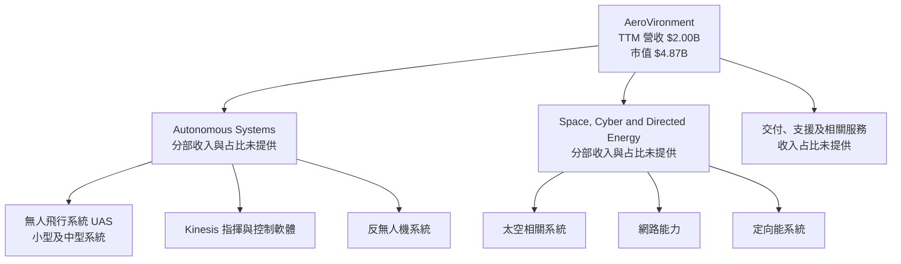
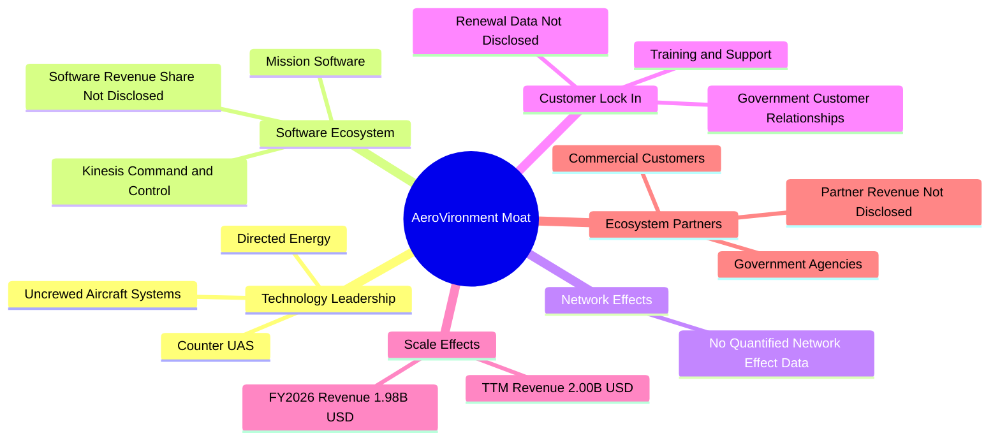
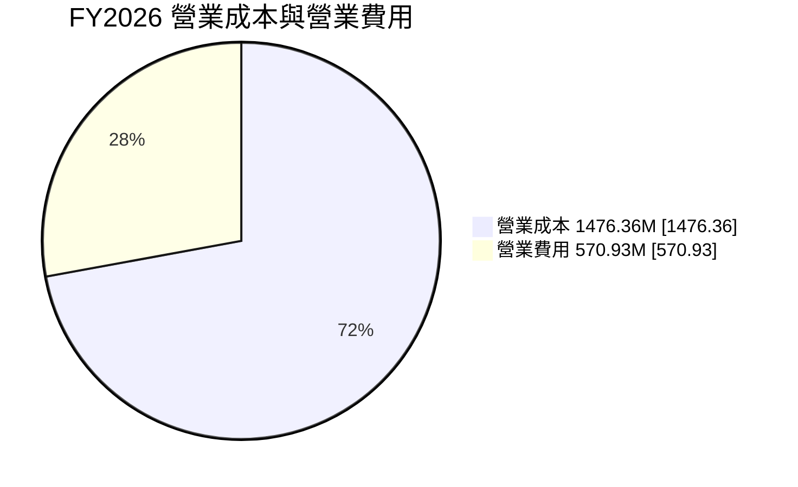
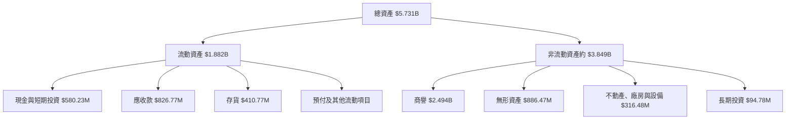
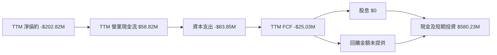
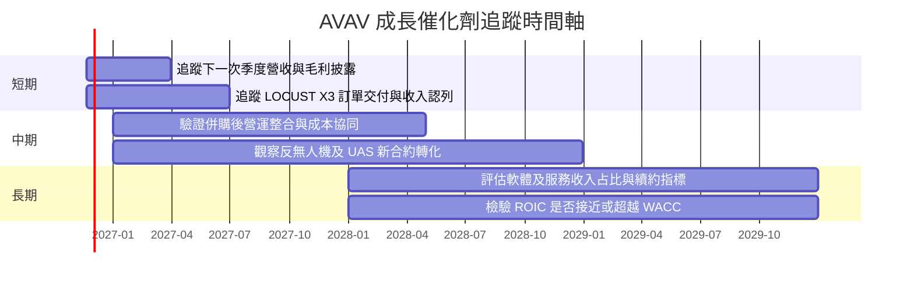
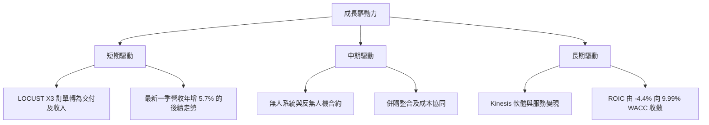
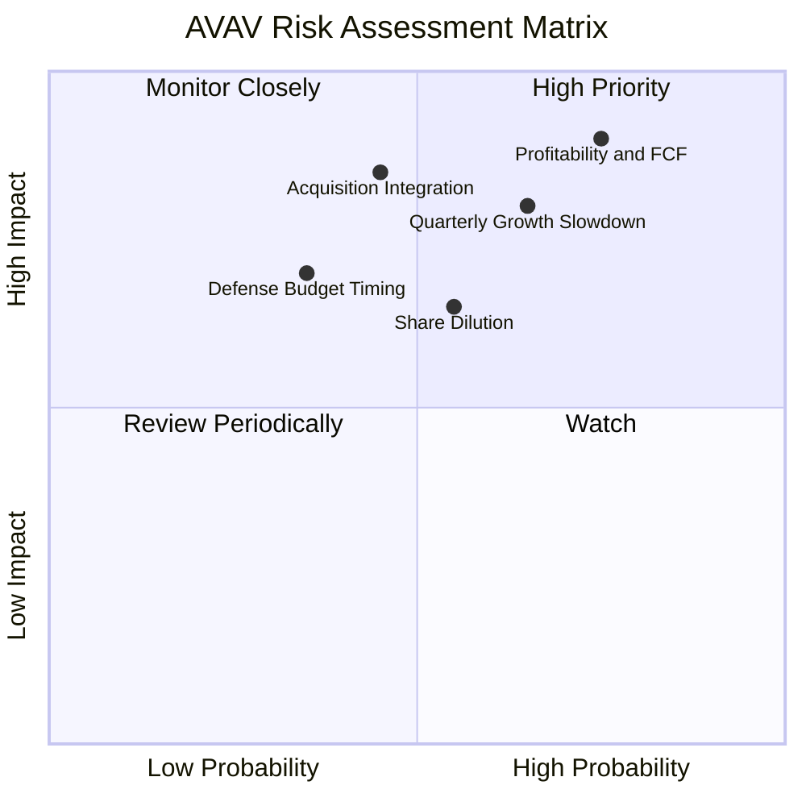
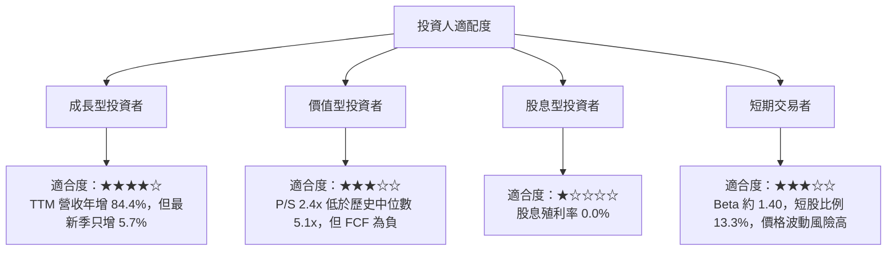

# AVAV 基本面深度分析報告
> **報告日期**：2026-11-20 ｜ **語言**：繁體中文 ｜ **數據來源**：SEC 申報資料 (XBRL)、Yahoo Finance、Finviz、StockAnalysis、Roic.ai ｜ **分析師**：CFA 級機構研究

## 目錄

| # | 章節 | 核心結論 |
|---|------|----------|
| 1 | 執行摘要 | 買入；加權合理價值 $130.26；MOS 26.4% |
| 2 | 公司概覽與商業模式 | 無人系統及國防科技供應商；業務分部收入未提供，護城河主要來自技術與客戶關係 |
| 3 | 損益表深度分析 | TTM 營收 $2.00B、年增 84.4%；但最新單季年增降至 5.7%，TTM 營業利益率為負 |
| 4 | 資產負債表分析 | 淨負債 $149.83M；現金與短期投資 $580.23M，流動比率 4.26 |
| 5 | 現金流量深度分析 | TTM FCF 為 -$25.03M、FCF Yield -0.51%；自由現金流尚未轉正 |
| 6 | 獲利能力與資本效率 | ROIC -4.4%，低於 WACC 9.99%，目前摧毀股東價值 |
| 7 | 相對估值分析 | 現價低於同業 P/S 中位數，亦低於自身五年 P/S 中位數 |
| 8 | DCF 內在價值評估 | 因 TTM 營業利益為負，DCF 模型不適用；以固定權重的相對估值及共識目標價交叉驗證 |
| 9 | 成長催化劑 | 國防無人系統需求及 LOCUST X3 訂單提供催化，但 TAM 數字未提供 |
| 10 | 風險矩陣 | 獲利與現金流、單季成長放緩、併購整合與稀釋為主要風險 |
| 11 | 投資建議 | 評級買入；以 $130.26 為加權合理價值，建議持續追蹤利潤率與 FCF |

---

## 1. 執行摘要

### 1.0 一頁式投資儀表板（Portfolio Manager 30 秒速讀）

| 項目 | 內容 |
|------|------|
| **投資論點（3 句）** | ① TTM 營收達 **$2.00B、年增 84.4%**，但最新一季年增僅 **5.7%**，顯示增長動能有明顯降溫。② 現金與短期投資 **$580.23M**，對照總債務 **$730.06M**，形成淨負債 **$149.83M**；流動比率 **4.26** 提供短期流動性緩衝。③ TTM ROIC **-4.4%**、WACC **9.99%**，且 TTM FCF **-$25.03M**，因此估值上行要由營運獲利修復支撐，不能只依賴營收成長。 |
| **綜合評分** | **5.8/10**（引用 1.1 評分卡；六項算術平均） |
| **財務健康** | 🟡 現金充足、流動比率 4.26，但淨負債 $149.83M、TTM FCF 為負 |
| **ROIC vs WACC** | **-4.4% vs 9.99%**；目前資本回報低於資本成本，摧毀股東價值 |
| **FCF 趨勢** | TTM FCF **-$25.03M**，尚未轉正；TTM FCF Yield **-0.51%** |
| **估值** | Forward P/E **21.76x** ｜ EV/EBITDA **23.43x** ｜ FCF Yield **-0.51%** |
| **DCF 內在價值（基準）** | **N/A**；TTM 營業利益為負，不能以虧損期營業利益建立有效 DCF；現價相對 DCF 折溢價 N/A |
| **安全邊際（MOS）** | **+26.4%＝($130.26 − $95.91) ÷ $130.26**；以第 8.8 節加權合理價值為基準 🟢 |
| **預期報酬（基準情境 12M）** | DCF 基準情境 N/A；以加權合理價值衡量的隱含上行空間為 **+35.8%**，非 DCF 12 個月預測 |
| **關鍵風險（前二）** | 最新單季營收年增僅 5.7%；TTM 營業利益率及 FCF 均為負 |
| **評級 + 信心度** | 🟢 **買入** ｜ 信心：中低；估值方法指向上行，但獲利與現金流尚未驗證 |

### 1.1 綜合評分卡（全報告唯一）

| 維度 | 評分（1–10） | 主要依據（引用數字與其來源章節） |
|------|--------------|----------------------------------|
| 成長性 | 7.0 | TTM 營收年增 84.4%，但最新一季年增降至 5.7%（第 3 章）；年度營收 FY2026 增長 140.9% |
| 獲利能力 | 3.0 | TTM 營業利益率 -12.6%、ROIC -4.4%，低於 9.99% WACC；F-Score 4/9（第 6 章） |
| 財務健康 | 6.0 | 現金與短期投資 $580.23M、淨負債 $149.83M、流動比率 4.26；CCC 由 135 天降至 92 天（第 4 章） |
| 估值 | 7.0 | MOS +26.4%；P/S 2.4x 低於自身五年中位數 5.1x，但 FCF 為負且 DCF 不適用（第 7–8 章） |
| 護城河 | 7.0 | 無人機、反無人機及指揮控制軟體產品組合，並有國防客戶與訂單線索；分部營收與續約數據未提供（第 2 章） |
| 管理層與資本配置 | 5.0 | FY2026 SBC $38.33M、股數測試未通過；現金與資產規模受併購後擴張影響，回購數據未提供（第 3、5 章） |
| **綜合評分** | **5.8** | 六項算術平均：(7.0 + 3.0 + 6.0 + 7.0 + 7.0 + 5.0) ÷ 6 = **5.8** |

### 1.2 五大投資論點 + 三大核心風險

| 類型 | 項目 | 具體依據 | 信心度 |
|------|------|----------|--------|
| 🟢 **投資論點①** | 營收規模擴張 | TTM 營收 $2.00B、年增 84.4%；FY2026 年營收 $1.98B，較 FY2025 的 $820.63M 增長 140.9%。擴張顯示產品交付及併購後業務規模上升，但最新單季成長已放緩。 | 🟢 高 |
| 🟢 **投資論點②** | 估值低於自身歷史 | 現價 $95.91 對應 P/S 2.4x，低於五年中位數 5.1x，並低於同業 P/S 中位數 3.4x；若利潤率恢復，估值有重評空間。 | 🟢 中 |
| 🟢 **投資論點③** | 短期流動性尚可 | 現金與短期投資 $580.23M、流動比率 4.26；即使目前 FCF 為負，仍有流動性緩衝。 | 🟢 中 |
| 🟢 **投資論點④** | 現金轉換週期改善 | CCC 由一年前 135 天降至 92 天，DSO 由 67 天降至 33 天，有助減少營運資金占用；存貨天數仍達 102 天。 | 🟡 中 |
| 🟢 **投資論點⑤** | 國防無人系統需求 | 新聞標題提及 $405M LOCUST X3 訂單；如能轉化為交付與現金回收，可改善訂單能見度。單筆訂單的毛利、交付期間及收入認列尚未提供。 | 🟡 中 |
| 🟡 **風險①** | 獲利及 FCF 尚未建立 | TTM 營業利益率 -12.6%、ROIC -4.4%、FCF -$25.03M；營收擴張若不能轉化成正毛利與現金流，估值支撐會減弱。 | 🔴 高衝擊 |
| 🔴 **風險②** | 單季成長顯著放緩 | 最新一季營收年增 5.7%，遠低於 TTM 84.4%；若後續季度仍低增長，市場可能下修對長期增長的預期。 | 🔴 高 |
| 🟡 **風險③** | 併購與股權稀釋 | 商譽由 FY2025 的 $256.78M 增至 FY2026 的 $2.494B；F-Score 顯示稀釋股數未通過測試。若整合效益低於預期，商譽減損與每股價值稀釋風險上升。 | 🟡 中高 |

### 1.3 快速統計卡片

| 指標 | 公司實際值（期間） | 同業中位數 | 狀態 |
|------|--------------------|------------|------|
| 營收成長（TTM） | **84.4%** | — | 🟢 |
| 營收成長（最新一季年增） | **5.7%** | **35.7%** | 🔴 |
| 毛利率（TTM） | **26.5%** | **23.0%** | 🟢 |
| 營業利益率（TTM） | **-12.6%** | — | 🔴 |
| ROIC（TTM） | **-4.4%** | — | 🔴 |
| Forward P/E | **21.76x** | **21.8x** | 🟡 |
| FCF Yield（TTM） | **-0.51%** | — | 🔴 |
| Piotroski F-Score | **4 / 9** | — | 🟡 |

> 同業最新季度營收年增中位數以 KTOS 35.7%、ONDS 1,558.6%、LMT 11.3% 計算；中位數為 35.7%。TTM FCF Yield 採程式依 SEC 申報資料計算的 -0.51%；其他市場資料欄位另列 -0.92%，兩者口徑不一致，本文涉及 FCF Yield 時採用前者。

### 1.4 投資結論

```text
╔══════════════════════════════════════════════════════════════════╗
║                    📊 投資結論摘要                               ║
╠══════════════════════════════════════════════════════════════════╣
║  評級：買入（MOS 26.4%，但 ROIC -4.4% 低於 WACC 9.99%）          ║
║  價格（2026-11-19 收盤）：$95.91                                 ║
║  DCF 內在價值（基準）：N/A（TTM 營業利益為負）                   ║
║  安全邊際 MOS：+26.4%（＝($130.26−$95.91)÷$130.26）             ║
║  加權合理價值（8.8）：$130.26                                    ║
║  DCF 情境價值：N/A（DCF 模型未建立，不提供情境目標價）           ║
║  綜合評分：5.8/10（引用 1.1）                                    ║
║  適合投資人：能承受獲利波動、以中長期國防無人系統需求為主題者    ║
╚══════════════════════════════════════════════════════════════════╝
```

---

## 2. 公司概覽與商業模式

### 2.1 業務結構與收入來源

AeroVironment 提供國防與商業用途的無人系統及相關服務。公司披露的主要業務包括 Autonomous Systems，以及 Space, Cyber and Directed Energy。財務資料沒有列出最新分部營收與占比，因此不推算各板塊貢獻。



產品組合涵蓋硬體、軟體與支援服務，理論上可形成由平台銷售延伸至維護、訓練與任務軟體的客戶關係。但服務收入占比、續約率、訂單積壓與分部毛利率未提供，故無法量化經常性收入或交叉銷售效益。

### 2.2 市場份額

市場份額數據未提供，亦無可引用的市場規模及年份，故不繪製市場份額圖表。以公司規模觀察，AVAV TTM 營收為 $2.00B，較 KTOS 的最新一季營收年增 35.7% 表現出不同的增長節奏；AVAV 最新一季年增 5.7%，低於該同業。單季增長與 TTM 增長差距亦表示公司營收仍受大型交付時點影響。

### 2.3 競爭護城河分析



### 2.4 護城河強度

| 護城河項目 | 強度（強／中／弱） | 證據（引用數字或事實） | 會削弱它的情況 |
|------------|--------------------|------------------------|----------------|
| 技術與產品組合 | 中至強 | 覆蓋 UAS、反無人機、指揮控制軟體及定向能；TTM 營收 $2.00B | 新技術替代、競品性能或價格優勢擴大 |
| 軟體生態 | 中 | Kinesis 為產品組合的一部分；軟體收入、毛利及續約率未提供 | 軟體未形成客戶黏著、產品只以硬體專案銷售 |
| 客戶鎖定 | 中 | 公司提供交付與支援，且涉及政府機構客戶；客戶集中度與續約率未提供 | 國防採購改由競品、平台更換成本下降 |
| 規模效應 | 中 | FY2026 營收 $1.98B、員工 3,991 人 | 營收成長未轉化為正營業利益與現金流 |
| 網路效應 | 弱／未證實 | 未提供使用者數、資料網絡或平台互補性指標 | 軟體使用者及平台互通未形成累積優勢 |
| 生態夥伴 | 中／未量化 | 客戶涵蓋政府機構與商業客戶；合作夥伴營收貢獻未提供 | 供應鏈瓶頸、合作方轉向競品或自製 |

1.1 評分卡中的「護城河」評分為 **7.0/10**，依據是多產品線、政府客戶關係與 $2.00B TTM 營收規模；由於軟體收入、續約率及市場份額未提供，評分未假設已形成強網路效應。

---

## 3. 損益表深度分析

### 3.1 年度收入成長趨勢（近 4 年）

FY2023 至 FY2026 營收 CAGR 約 **54.1%**，計算為 \((1.977B ÷ 540.54M)^{1/3} - 1\)。FY2026 高增長包含業務規模及併購後變化，不宜直接外推為未來常態。

```text
╔══════════════════════════════════════════════════════════════════╗
║          AeroVironment 年度收入趨勢（FY2023–FY2026）             ║
╠══════════════════════════════════════════════════════════════════╣
║  FY2023  $540.54M  ███████░░░░░░░░░░░░░░  YoY：—              ║
║  FY2024  $716.72M  █████████░░░░░░░░░░░░░  YoY：+32.6% 🟢      ║
║  FY2025  $820.63M  ██████████░░░░░░░░░░░░  YoY：+14.5% 🟡      ║
║  FY2026    $1.98B  ██████████████████████  YoY：+140.9% 🟢     ║
╠══════════════════════════════════════════════════════════════════╣
║  FY2023–FY2026 營收 CAGR：約 +54.1%                             ║
║  FY2026 高增長與併購及交付規模增加相關；最新季年增降至 5.7%。   ║
╚══════════════════════════════════════════════════════════════════╝
```

### 3.2 季度收入趨勢分析

| 季度 | 營收 | QoQ 成長 | YoY 成長 | 備註 |
|------|------|----------|----------|------|
| 2025-10-31 | $472.51M | — | — | 所提供季度表未列上一季可比數字；StockAnalysis 的季度日期標示與表格存在格式錯置，避免錯配年度 |
| 2026-01-31 | $408.05M | -13.6% | 約 +143.4% | QoQ 以 $408.05M ÷ $472.51M − 1 計算；YoY 採季度資料列示的 143.41% |
| 2026-04-30 | $641.62M | +57.2% | 約 +133.3% | QoQ 以 $641.62M ÷ $408.05M − 1 計算；YoY 採季度資料列示的 133.27% |
| 2026-07-31 | $480.49M | -25.2% | +5.7% | 最新季 YoY 以 VERIFIED 數據為準；季度營收高低波動反映交付時點與比較基期差異 |

季度 YoY 百分比在不同來源的季度標籤與期間有不一致，因此最新一季年增率採 SEC 申報計算值 **5.7%**；其他季度的季度成長僅作趨勢參考。最新季營收較前季下降 25.2%，但單季 QoQ 易受國防合約交貨時點影響，不能單獨視為需求衰退證據。

### 3.3 利潤率演變分析

下表依年度損益表營收與毛利、營業利益計算；TTM 營業利益率另依 SEC 計算值列示，兩者來源口徑有顯著差異，見表後說明。

| 利潤率指標 | FY2023 | FY2024 | FY2025 | FY2026 | 趨勢 | 評估 |
|------------|--------|--------|--------|--------|------|------|
| **毛利率** | 32.1% | 39.6% | 38.8% | 25.3% | FY2026 明顯下降 | 🔴 |
| **營業利益率** | -4.2% | 10.0% | 7.2% | -3.6% | FY2026 轉負 | 🔴 |
| **淨利率** | -32.6% | 8.3% | 5.3% | -13.4% | FY2026 大幅轉負 | 🔴 |

FY2026 毛利率以毛利 $500.64M 除以營收 $1.977B 計算，約 25.3%，低於 FY2025 約 38.8%。可能原因包括併購後產品組合改變、交付成本與合約組合差異；現有資料沒有足夠分部毛利資料，不能把單一原因當作已驗證結論。FY2026 營業利益轉為 -$70.29M，反映毛利下滑及費用增加共同壓縮營業槓桿。

資料口徑須特別注意：財務數據另列「營業利益率 TTM -12.6%、最新季度 -2.3%」，而合併市場資料列示 TTM -0.6%、最新季度 -0.6%；按 TTM 營收 $2.00B 及 StockAnalysis 營業利益約 -$12M 推算也接近 -0.6%。由於估值與品質指標規則要求採 SEC 計算的 VERIFIED 數字，本文在 TTM 指標表採 **-12.6%**，並將跨來源差異列為分析限制，不以其他來源替代。

### 3.4 費用結構分析

FY2026 成本結構可由營收、毛利與營業利益推導：營業成本約 **$1,476.36M**（$1,977M − $500.64M），營業費用合計約 **$570.93M**（$500.64M − (-$70.29M)）。研發費用為 $127.68M；其他營業費用明細未提供。



```text
╔══════════════════════════════════════════════════════════════════╗
║                    FY2026 費用結構摘要                           ║
╠══════════════════════════════════════════════════════════════════╣
║  營收                  $1,977.00M                               ║
║  營業成本              $1,476.36M  ████████████████████         ║
║  毛利                    $500.64M                               ║
║  營業費用合計            $570.93M  ████████                     ║
║    其中：研發            $127.68M  ██（非營業費用完整拆分）     ║
║  營業利益                -$70.29M                               ║
╚══════════════════════════════════════════════════════════════════╝
```

### 3.5 季度 EPS 趨勢與盈餘品質（Quality of Earnings）

| 季度 | EPS 實際值 | EPS 預估 | 超預期／不及預期 | 季度淨利 | 說明 |
|------|-----------:|---------:|------------------|---------:|------|
| 2025-10-31 | -$0.34 | N/A | N/A | -$17.10M | EPS 預估資料為空值，不能判斷是否超預期 |
| 2026-01-31 | -$3.15 | N/A | N/A | -$243.82M | 單季大額虧損；特殊項目明細未提供 |
| 2026-04-30 | -$0.48 | N/A | N/A | -$24.10M | 虧損較前季收斂，但仍未轉正 |
| 2026-07-31 | -$0.10 | N/A | N/A | -$5.07M | 淨損縮小；EPS 預估與 surprise 欄皆為 nan |

財報資料未提供可用的四季 EPS consensus estimate，因此不能誠實地分類為「超預期」或「不及預期」；只能分析實際盈餘趨勢。EPS 與淨利均為負，最新季虧損較 2026 年 1 月季收斂，但尚不足以確認獲利已持續改善。

| 盈餘品質項目 | 數值／佔比 | 評估 |
|--------------|-----------|------|
| 股權薪酬 SBC / 營收 | FY2026 SBC $38.33M ÷ FY2026 營收 $1,977M = **1.94%** | 🟡 對股東有稀釋成本；F-Score 的稀釋股數測試未通過 |
| SBC / 營業現金流 | FY2026 SBC $38.33M ÷ TTM OCF $58.82M = **65.2%** | 🔴 期間口徑不完全一致，作為近似參照；顯示 SBC 相對現金流規模不低 |
| FCF / 淨利（現金轉換率） | 依 TTM FCF -$25.03M 與 TTM 淨利約 -$202.82M 計，算術比率約 **12.3%** | 🔴 兩者皆為負，該比率不具一般正向現金轉換率的解讀意義 |
| 一次性／非經常性損益 | FY2026 淨損 -$265.12M，營業損失 -$70.29M；差額約 -$194.83M | 🔴 有重大營業外或一次性損失可能；具體項目拆分 N/A，不能斷言由某項單獨造成 |
| 有效稅率異常 | N/A | N/A（缺少可用的 TTM 所得稅費用及稅前所得分解） |
| 資本化支出 vs 費用化 | FY2026 Capex $86.22M；資本化研發及軟體支出明細 N/A | 🟡 不能判斷是否有資本化成本造成當期費用低估 |

**盈餘品質結論：**AVAV 目前 GAAP 獲利為負，且 TTM FCF 亦為負，不存在以高 GAAP 淨利掩蓋低現金流的典型情況；較大的疑點是營業利益、淨利與不同資料源的 TTM 口徑不一致，以及年度淨利包含重大非營業損失。FY2026 SBC 相當於營收 1.94%，不是極端比例，但在虧損及股數增加下，仍降低每股股東回報。估值應給予較高風險折讓，直到營業利潤與 FCF 穩定轉正。

---

## 4. 資產負債表分析

### 4.1 資產結構分解

以下採 StockAnalysis TTM 資產資料，總資產 $5.731B。細項數字受四捨五入及分類差異影響，圖示不應視為精確會計勾稽表。



資產規模由 FY2025 的 $1.12B 擴大至 FY2026 的 $5.72B，商譽亦由 $256.78M 增至 $2.494B，反映併購後資產結構顯著改變。商譽與無形資產合計約占總資產較大比重，未來整合不如預期時，減損風險值得監控。

### 4.2 流動性與營運資金分析

| 指標 | 最新 TTM | 一年前 TTM | 變化 | 解讀 |
|------|----------|------------|------|------|
| 流動比率 | 4.26 | N/A | N/A | 流動資產相對流動負債緩衝充足；一年前同口徑數據未提供 |
| 速動比率 | 3.185 | N/A | N/A | 扣除存貨後仍有流動性緩衝 |
| DSO 應收帳款天數 | 33 天 | 67 天 | -34 天 | 收款天數縮短，對營運現金占用有利；可能受期末應收款時點影響 |
| DIO 存貨天數 | 102 天 | 113 天 | -11 天 | 存貨周轉改善，但 102 天仍代表一定資金留在庫存 |
| DPO 應付帳款天數 | 43 天 | 44 天 | -1 天 | 付款期大致穩定，沒有明顯延長供應商融資 |
| CCC 現金轉換週期 | 92 天 | 135 天 | -43 天 | 現金轉換週期改善，主要來自 DSO 下降及 DIO 下降 |

上述營運資金天數採程式計算品質指標，不重新計算。營運資金改善方向有利，但最新 TTM 現金流仍為負，表示收款效率改善尚未充分抵銷資本支出、合約交付及其他營運資金需求。

### 4.3 債務結構分析

```text
╔══════════════════════════════════════════════════════════════════╗
║                   AVAV 債務健康診斷                              ║
╠══════════════════════════════════════════════════════════════════╣
║  總債務（SEC計算口徑）：  $730.06M  ████████████████████         ║
║  現金+短期投資：          $580.23M  ████████████████             ║
║  淨負債：                 $149.83M  ████                         ║
║                                                                  ║
║  流動比率：               4.26x     🟢 短期流動性充足            ║
║  淨現金／淨負債：          淨負債    🟡 仍有淨負債                 ║
║  Debt/EBITDA：            N/A（EBITDA口徑衝突且獲利為負）         ║
║  利息保障倍數：           N/A（利息費用及一致口徑 EBIT 不足）      ║
╚══════════════════════════════════════════════════════════════════╝
```

資料來源之間的債務與現金流口徑存在差異：SEC 計算的總債務 $730.06M、淨負債 $149.83M 與市場資料列示總債務 $850.82M、淨負債 $270.60M 不一致。本文在淨負債分析採指定的 SEC 計算值；若以另一市場來源衡量，槓桿與淨負債均更高。由於 TTM EBITDA／營業利益存在負值或來源差異，不以 Debt/EBITDA 或利息保障倍數給出虛假的精確結論。

### 4.4 股東權益趨勢

```text
╔══════════════════════════════════════════════════════════════════╗
║                 AVAV 歷年股東權益變化                            ║
╠══════════════════════════════════════════════════════════════════╣
║  FY2023  $550.97M  ████░░░░░░░░░░░░░░░░                         ║
║  FY2024  $822.75M  ██████░░░░░░░░░░░░░░                         ║
║  FY2025  $886.51M  ███████░░░░░░░░░░░░░                         ║
║  FY2026    $4.40B  ████████████████████                         ║
╠══════════════════════════════════════════════════════════════════╣
║  FY2026 權益跳升主要伴隨資產與商譽大幅擴張；不可單純視為內生留存 ║
╚══════════════════════════════════════════════════════════════════╝
```

FY2026 股東權益由 $886.51M 增至 $4.40B，而總資產由 $1.12B 增至 $5.72B。此變化與併購及股本擴張相符，但股權發行、收購對價與其他權益變動的完整勾稽明細未提供，因此不把權益增加全視為營運留存盈餘。

---

## 5. 現金流量深度分析

### 5.1 現金流量瀑布圖

以下 FCF 依 SEC 計算口徑：營業現金流 $58.82M 減資本支出 $83.85M，等於 -$25.03M。



淨利與營業現金流之間受非現金項目、營運資金與一次性項目影響；現有資料未提供完整逐項調節表，圖中連線只表示現金流關係，不代表淨利直接等於營業現金流。

### 5.2 FCF 轉換率趨勢

| 年度 | 營業現金流 | Capex | FCF | 淨利 | FCF／淨利 |
|------|-----------:|------:|----:|----:|----------|
| FY2023 | $11.40M | $14.87M | -$3.47M | -$176.21M | 算術比率 +2.0%，負淨利下不具一般轉換率意義 |
| FY2024 | $15.29M | $24.48M | -$9.19M | $59.67M | -15.4% |
| FY2025 | -$1.32M | $22.82M | -$24.13M | $43.62M | -55.3% |
| FY2026 | -$78.40M | $86.22M | -$164.62M | -$265.12M | 約 +62.1%，兩者皆負，解讀受限 |
| TTM | $58.82M | $83.85M | -$25.03M | N/A（期間口徑淨利資料來源不一致） | N/A |

年報現金流資料與 TTM SEC 計算值不完全一致，故不把 FY2026 年報 FCF 與 TTM FCF 混為同一期間。整體看來，FY2024 至 FY2026 FCF 持續為負；TTM OCF 已回正，但尚不足以覆蓋 Capex。

### 5.3 自由現金流趨勢

```text
╔══════════════════════════════════════════════════════════════════╗
║               自由現金流：歷史實際與最新 TTM                     ║
╠══════════════════════════════════════════════════════════════════╣
║  FY2024  -$9.19M    ░░░░░░░░░░░░░░░░░░░░  FCF為負              ║
║  FY2025 -$24.13M    ░░░░░░░░░░░░░░░░░░░░  FCF為負              ║
║  FY2026 -$164.62M   ░░░░░░░░░░░░░░░░░░░░  FCF為負              ║
║  TTM     -$25.03M   ░░░░░░░░░░░░░░░░░░░░  Yield：-0.51%        ║
╠══════════════════════════════════════════════════════════════════╣
║  FY2026 年報口徑與 TTM SEC 計算口徑不同；TTM FCF 尚未轉正。     ║
╚══════════════════════════════════════════════════════════════════╝
```

資本支出增加可能支持產能、設備與交付能力，但在尚未看到正 FCF 前，不能把高 Capex 自動視為已創造高回報的投資。

### 5.4 資本配置評估

股息殖利率為 0.0%，沒有股息分配；回購金額未提供，不能推算資本返還占比。FY2026 Capex $86.22M、研發費用 $127.68M，反映公司仍投入研發與產能，但併購現金流及收購對價明細不足。

| 資本配置項目 | 已知數據 | 評估 |
|--------------|----------|------|
| 研發 | FY2026 $127.68M | 🟢 支持產品開發；回報需由後續訂單和毛利驗證 |
| 資本支出 | FY2026 $86.22M；TTM $83.85M | 🟡 需監控投資轉化為交付與現金流的速度 |
| 股息 | 殖利率 0.0% | 🟡 資本保留於業務，不適合股息收益型投資人 |
| 回購 | N/A | N/A（回購數據未提供） |
| 併購 | FY2026 商譽 $2.494B，FY2025 為 $256.78M | 🟡 規模擴大，但整合回報與商譽減損風險需追蹤 |

---

## 6. 獲利能力與資本效率

### 6.1 ROE / ROA / ROIC 趨勢

| 指標 | 最新 TTM | 歷史資料 | 評估 |
|------|----------|----------|------|
| ROE | -4.6% | 可用期間序列 N/A | 🔴 目前股東權益回報為負 |
| ROA | -0.1%（市場資料）；品質測試顯示 ROA 未大於零 | 可比年度序列 N/A | 🔴 資產尚未產生正淨利回報 |
| ROIC | -4.4% | 可比年度序列 N/A | 🔴 低於 9.99% WACC |
| 行業均值 | N/A | 沒有可引用且同口徑的行業均值 | 不列作比較 |

ROE、ROA、ROIC 的年度計算口徑與平均投入資本資料不完整，不以期末餘額自行重算歷史序列。對目前價值創造的判斷，採同一套 TTM ROIC 與資本成本數據。

### 6.2 ROIC vs WACC 分析（核心價值創造判斷）

```text
╔══════════════════════════════════════════════════════════════════╗
║                ROIC vs WACC 深度分析                            ║
╠══════════════════════════════════════════════════════════════════╣
║  WACC（成本資本數據）：                                          ║
║  ├── 無風險利率（10Y美債）：  5.05%                              ║
║  ├── 市場風險溢酬（ERP）：    5.00%                              ║
║  ├── 原始 Beta：              1.40                               ║
║  ├── 調整後 Beta：            1.27                               ║
║  ├── 股權成本：               11.40%                             ║
║  ├── 稅前債務成本：            0.77%                             ║
║  ├── E／D 權重：              87.0%／13.0%                       ║
║  └── WACC：                    9.99%                              ║
║                                                                  ║
║  ROIC（TTM）：               -4.4%                               ║
║  EVA Spread = ROIC − WACC：  -4.4% − 9.99% = -14.39 個百分點      ║
║                                                                  ║
║  ROIC   -4.4%  ◀ 負值                                            ║
║  WACC    9.99% ━━━━━━━━━━━━━━━━━                                 ║
║                                                                  ║
║  📊 結論：目前投入資本回報低於資本成本，正在摧毀股東價值。      ║
╚══════════════════════════════════════════════════════════════════╝
```

依資本成本輸入，股權成本核對為 \(5.05\% + 1.27 \times 5.00\% = 11.40\%\)。資料提供 WACC **9.99%**，本文直接採用，不另建立替代 WACC。ROIC 與 WACC 差額為 **-14.39 個百分點**；由於 ROIC 為負，公司的首要財務任務是將合約毛利與費用結構改善至足以覆蓋資本成本，而不只是擴大營收。

### 6.3 杜邦三因素分解

| 因素 | 數值（TTM） | 解讀 |
|------|-------------|------|
| 淨利率 | -10.1% | 淨利為負，是 ROE 為負的主要來源 |
| 資產週轉率 | 0.35 | 每單位資產產生的營收有限，併購後資產基礎大幅增加 |
| 權益乘數 | 1.30 | 槓桿並非 ROE 負值的主要來源 |
| **ROE** | **-4.6%** | -10.1% × 0.35 × 1.30 = 約 -4.6% |

ROE 的負值主要由負淨利率驅動，而非依賴高財務槓桿。資產週轉率 0.35 亦表示併購後新增資產仍須提高營收貢獻與利潤效率。

### 6.4 財務體質：Piotroski F-Score

**Piotroski F-Score：4 / 9**。下表照錄九項測試結果；代表在已列的九項測試中四項通過，另五項未通過。

| 測試 | 結果 | 解讀 |
|------|------|------|
| ROA > 0 | ❌ 未通過 | TTM 獲利能力仍為負 |
| 營業現金流 > 0 | ✅ 通過 | TTM 營業現金流 $58.82M 為正 |
| ROA 高於一年前 | ❌ 未通過 | 資產回報尚未呈現同比改善 |
| 營業現金流 > 淨利（應計品質） | ✅ 通過 | 現金流相對會計淨利較好，但公司仍虧損 |
| 長期負債 ÷ 總資產低於一年前 | ✅ 通過 | 相對槓桿指標改善 |
| 流動比率高於一年前 | ❌ 未通過 | 流動性比率未同比改善 |
| 稀釋股數未增加 | ❌ 未通過 | 股數增加可能稀釋每股價值 |
| 毛利率高於一年前 | ❌ 未通過 | 毛利率同比測試未通過，與交付及產品組合風險相符 |
| 資產週轉率高於一年前 | ✅ 通過 | 資產利用效率同比有所改善 |

F-Score 4/9 反映公司有部分現金流與資產效率改善，但獲利品質、毛利率、流動性變化及股數稀釋仍是弱項。

---

## 7. 相對估值分析

### 7.1 同業估值比較表格

公司估值倍數採市場資料；同業倍數依 Yahoo Finance 同業數據。ONDS 因虧損而沒有可用 trailing P/E，負 forward P/E 不具傳統盈利倍數可比性。

| 估值指標 | **AVAV** | **KTOS** | **ONDS** | **LMT** | 本公司評估 |
|----------|---------:|---------:|---------:|---------:|-----------|
| **Trailing P/E** | N/A | 247.1x | N/A | 20.3x | 🔴 AVAV TTM 虧損，該倍數無法使用 |
| **Forward P/E** | 21.76x | 26.5x | -27.3x | 17.2x | 🟡 AVAV 約等於同業中位數 21.8x；ONDS 負值不具可比性 |
| **P/S Ratio** | 2.43x | 3.4x | 7.5x | 1.7x | 🟢 AVAV 低於同業中位數 3.4x |
| **EV/EBITDA** | 23.43x | 49.2x | -6.1x | 14.9x | 🟡 高於 LMT；KTOS 高倍數及 ONDS 負值使中位數解讀有限 |
| **最新單季營收 YoY** | 5.7% | 35.7% | 1,558.6% | 11.3% | 🔴 AVAV 低於三家同業中位數 35.7% |
| **毛利率（TTM）** | 26.5% | 23.0% | 36.4% | 11.7% | 🟢 高於同業中位數 23.0% |

同業 P/S 中位數為 3.4x；AVAV 目前 P/S 2.43x，表面上相對便宜。但 P/S 折價若源自利潤率低、現金流負或單季增長放緩，未必會自動收斂。Forward P/E 21.76x 接近同業可比中位數，市場對預期 EPS 已給予一定評價。

### 7.2 歷史估值區間分析

財務數據提供的是五年歷史 **P/S**，沒有歷史 P/E 區間及百分位，因此不以 P/S 冒充 P/E。

```text
╔══════════════════════════════════════════════════════════════════╗
║              AVAV 自身歷史 P/S 估值位置                          ║
╠══════════════════════════════════════════════════════════════════╣
║  五年低位： 3.0x   ████░░░░░░░░░░░░░░░░                         ║
║  當前：     2.4x   ███░░░░░░░░░░░░░░░░░  百分位：0%             ║
║  五年中位： 5.1x   ████████░░░░░░░░░░░░                         ║
║  五年高位：13.4x   ████████████████████                         ║
╠══════════════════════════════════════════════════════════════════╣
║  當前 P/S 低於五年區間下緣；不代表基本面已觸底或估值必然回歸。  ║
║  歷史 P/E 區間：N/A（數據未提供）                                ║
╚══════════════════════════════════════════════════════════════════╝
```

### 7.3 情境價值（Bear / Base / Bull）

**N/A（DCF 無法計算：TTM 營業利益為負，DCF MODEL 未提供情境輸出）**。依規則不另設營收 CAGR、利潤率或情境目標價。

### 7.4 相對估值隱含價格區間

```text
╔══════════════════════════════════════════════════════════════════╗
║              相對估值隱含每股價值                                ║
╠══════════════════════════════════════════════════════════════════╣
║  $95.91 ─── $96.30 ───────── $133.59 ─────────── $212.20         ║
║  現價        同業 Forward P/E   同業 P/S            分析師共識     ║
╚══════════════════════════════════════════════════════════════════╝
```

| 估值方法 | 每股價值 | 依據 | 相對現價 |
|----------|---------:|------|---------:|
| 同業 Forward P/E | $96.30 | KTOS、LMT 同業中位數 21.8x × AVAV Forward EPS $4.41 | +0.4% |
| 同業 P/S | $133.59 | KTOS、ONDS、LMT 同業 P/S 中位數 3.4x × AVAV TTM 營收 | +39.3% |
| 分析師共識目標價 | $212.20 | 23 位分析師平均目標價 | +121.2% |

P/E 方法的推導基礎是同業中位數倍數，而不是 AVAV 自身目前倍數；分析師共識對 AVAV 高於其他兩種相對估值方法，應視為市場預期參考，不能忽略公司當前負營業利益與負 FCF 的風險。

---

## 8. DCF 內在價值評估（Discounted Cash Flow）

### 8.0 估值推理鏈（Thinking Logic）

AVAV 的價值長期應由現有無人系統業務的營收與毛利、指揮控制軟體及服務的附加價值，以及新產品的訂單轉化共同決定；但各板塊收入占比未提供，不能將各來源拆成帶有假設占比的估值項目。

本次不提供 DCF 基準值：SEC 計算的 TTM 營業利益率為 **-12.6%**，且資料明確標示 TTM 營業利益不為正。以負營業利益建立現金流預測，需自行假設何時轉正、未來利潤率、營運資金、Capex、終值與稀釋股數；但官方 DCF MODEL 為 N/A，依分析規則不可自行補造模型。這使 DCF 不能作為本報告的基準內在價值，也不能合法輸出 8.6 的敏感度、三情境與 8.7 反推 DCF 數字。

| 決策點 | 本報告採用 | 理由 | 曾考慮但否決 | 否決理由 |
|--------|-----------|------|--------------|----------|
| 現金流定義 | FCFF DCF：N/A | TTM 營業利益為負，程式模型未提供有效預測 | 自行估算 FCFF | 會自行引入無來源的利潤率、再投資與終值假設 |
| 預測期 N | N/A | 官方模型未計算 | 任意設 5–10 年 | 缺少逐年假設及程式模型輸出 |
| 終值方法 | N/A | DCF 未建立 | Gordon Growth／退出倍數 | 無可用 FY+N FCFF 或 EBITDA |
| EBIT 基礎 | N/A | 不進行 DCF 預測 | 自行選 GAAP 或非 GAAP | 無完整預測可供一致處理 SBC |

**Step 3 — 假設推導鏈：**預測期、營收 CAGR、利潤率、永續成長率、Capex、D&A、營運資金、SBC 與稀釋等均屬模型輸入；因 DCF MODEL 為 N/A，採用值、替代值及逐項推導均為 N/A，不能以歷史數字靜默填補。

**Step 4 — 最脆弱的一環：**最脆弱的是何時及以何種幅度恢復正營業利益；若恢復速度低於市場預期，加權估值中以 P/S 為主的價值亦可能下修。

**Step 5 — 計算路徑：**模型不適用，故不繪製會暗示存在 DCF 輸出的數字流程圖。

### 8.1 模型假設總表（Model Inputs）

**N/A（數據未提供：DCF MODEL 因 TTM 營業利益非正而未計算；依規則不自行建立預測期及現金流假設。）**

### 8.2 折現率推導（WACC）

雖然 DCF 不適用，仍列出供第 6.2 節資本成本比較使用的同一 WACC。此數值直接採用成本資本資料，不另行推算替代 WACC。

```text
╔══════════════════════════════════════════════════════════════════╗
║                    WACC 推導（折現率）                           ║
╠══════════════════════════════════════════════════════════════════╣
║  股權成本 Ke（CAPM）：                                           ║
║  ├── 無風險利率 Rf（10Y 美債）：      5.05%                     ║
║  ├── 市場風險溢酬 ERP：               5.00%                     ║
║  ├── 原始 Beta（Yahoo）：             1.40                      ║
║  ├── 調整後 Beta：                    1.27                      ║
║  └── Ke = 5.05% + 1.27 × 5.00% = 11.40%                        ║
║                                                                  ║
║  債務成本：                                                      ║
║  ├── 稅前 Kd：                        0.77%                     ║
║  ├── 稅率：                           21.0%                     ║
║  └── 稅後 Kd：0.77% × (1 − 21.0%) = 0.6083%                     ║
║                                                                  ║
║  資本結構（直接採用成本資本資料）：                              ║
║  ├── 股權權重 E：                     87.0%                     ║
║  ├── 債務權重 D：                     13.0%                     ║
║  └── WACC：0.87 × 11.40% + 0.13 × 0.6083% = 9.9971% ≈ 9.99%    ║
╚══════════════════════════════════════════════════════════════════╝
```

成本資本資料提供的是原始 Beta 1.40、調整後 Beta 1.27；調整方式為 \(2/3 \times 1.40 + 1/3 \times 1 = 1.2667\)，四捨五入為 1.27。Rf 日期在成本資本資料中未標示，故不虛構日期；ERP 為所列假設值 5.00%。權重直接採用來源提供的 87.0%／13.0%，不以市值或債務資料重新反推；利息費用金額及 Kd 的平均計息負債分母未提供，故不補造逐筆債務權重。採用 WACC 仍為 **9.99%**，與第 6.2 節一致。

### 8.3 逐年自由現金流預測（基準情境）

**N/A（DCF MODEL 未提供逐年預測；原因為 TTM 營業利益非正。）**因此不存在可照抄的 FY+1 至 FY+N 表格、FCFF、現值合計或逐步演算；亦不以管理層財測或任意 CAGR 自建替代模型。

### 8.4 終值計算（Terminal Value）

**N/A（沒有有效的 FY+N FCFF、終值成長率 g 或預測期 N；不可計算 Gordon Growth 或退出倍數終值。）**

### 8.5 企業價值 → 每股內在價值（Bridge）

**N/A（DCF 企業價值、預測期現值及終值未計算，因此 DCF 基準每股內在價值及其折溢價均為 N/A。）**

### 8.6 敏感性分析（WACC × 永續成長率）

**N/A（DCF MODEL 未提供敏感度矩陣；若自行填入 WACC 與 g 的格子，即屬另建模型。）**

### 8.7 反推 DCF（Reverse DCF：市場在預期什麼）

**N/A（DCF 基準模型未建立，不能以現價反解營收 CAGR、利潤率、永續成長率或預測期。）**

### 8.8 估值三角驗證與安全邊際

本公司類型為 **unprofitable**，因此依固定估值權重採用同業 Forward P/E 30%、同業 P/S 60%、分析師共識 10%。DCF 基準值未計算，不在此表另加估值方法。

| 估值方法 | 隱含每股價值 | 上行空間（÷現價） | 權重 | 說明 |
|----------|--------------|-------------------|------|------|
| 同業 Forward P/E | $96.30 | +0.4% | 30% | 同業中位數 21.8x × AVAV Forward EPS $4.41 |
| 同業 P/S | $133.59 | +39.3% | 60% | KTOS、ONDS、LMT 同業中位數 3.4x × AVAV TTM 營收 |
| 分析師共識目標價 | $212.20 | +121.2% | 10% | 23 位分析師平均目標價；作參考而非主要估值依據 |
| **加權合理價值** | **$130.26** | **+35.8%** | **100%** | DCF 因 TTM 營業利益為負而無法計算 |

**逐步演算：**

- 同業 Forward P/E 貢獻：\($96.30 \times 30\% = $28.89\)
- 同業 P/S 貢獻：\($133.59 \times 60\% = $80.154\)
- 分析師共識貢獻：\($212.20 \times 10\% = $21.22\)
- 加權值：\($28.89 + $80.154 + $21.22 = $130.264\)，四捨五入至美分為 **$130.26**
- 權重核對：\(30\% + 60\% + 10\% = 100\%\)
- MOS：\(($130.26 - $95.91) ÷ $130.26 = $34.35 ÷ $130.26 = 26.37\% \approx +26.4\%\)
- 上行空間：\(($130.26 - $95.91) ÷ $95.91 = $34.35 ÷ $95.91 = 35.80\% \approx +35.8\%\)

MOS 使用加權合理價值作分母；上行空間使用現價作分母，兩者不可互換。第 8.8 節 MOS **+26.4%** 為全報告唯一 MOS 基準，與 1.0 儀表板一致。

```text
╔══════════════════════════════════════════════════════════════════╗
║                  估值區間與安全邊際                              ║
╠══════════════════════════════════════════════════════════════════╣
║  $96.30 ─────── $95.91 ───────── [$130.26] ─────── $133.59       ║
║  Forward P/E    現價             加權合理值       同業 P/S        ║
║                                                                  ║
║  安全邊際 MOS = ($130.26 − $95.91) ÷ $130.26 = +26.4%            ║
║  MOS 評估：🟢 ≥25% 充足（相對估值交叉驗證，不是 DCF 保證）       ║
║  上行空間 = ($130.26 − $95.91) ÷ $95.91 = +35.8%                ║
║                                                                  ║
║  建議買入區間：$95.91–$117.23（上限對應 MOS 約 10%）             ║
║  合理持有區間：$117.23–$143.29                                   ║
║  減碼考慮區間：高於 $143.29；非 DCF 樂觀情境目標價               ║
╚══════════════════════════════════════════════════════════════════╝
```

買入區間上限計算為 \(130.26 \times (1-10\%) = $117.234\)，四捨五入為 $117.23；現價 $95.91 低於該上限。持有區間以加權合理值上下 10% 作參考，並非 DCF 情境價值。

> 🔎 **程式複算（Python，依本節各項自動重算）**
>
> 加權合理價值 = $96.30 × 30% + $133.59 × 60% + $212.20 × 10% = **$130.26**（權重合計 100%）
>
> 以價格 $95.91 計：MOS = **+26.4%**，上行空間 = **+35.8%**
>
> ✅ 與本節所寫數值一致。

### 8.9 DCF 模型的局限與失效條件

- **終值依賴度：** N/A；沒有 DCF 終值，因此不能報出終值占 EV 比例。
- **最脆弱的估值假設：** 目前相對估值最脆弱之處在於 P/S 是否能維持同業折價收斂。若營收成長停滯或毛利率繼續低於 TTM 26.5%，同業 P/S 推導的 $133.59 可能下修。
- **不適用情境：** TTM 營業利益率為負、TTM FCF 為負，且年度營業利益波動大；DCF 可靠度不足。應以 P/S、訂單轉收入、合約毛利、每股現金流及商譽回報作為主要追蹤指標。
- **與第 10 章風險連結：** 交付延誤會打擊收入確認與營運資金；產品組合或成本上升會下修毛利率；併購整合失敗可能造成商譽減損與每股價值下降。

### 8.10 複算檢核表（Audit Trail）

因 DCF MODEL 為 N/A，凡涉及 DCF 預測表、終值及敏感度的檢核，均如實標示不適用；8.8 相對估值、加權價值與 MOS 則依提供數字核對。

| # | 檢核項目 | 檢查方式 | 結果 |
|---|----------|----------|------|
| 1 | 所有高／中敏感度 DCF 輸入具四段式推導 | DCF 未建立，無輸入可核驗 | N/A |
| 2 | 每個 DCF 假設都有來歷 | DCF 假設未提供，未自行填值 | N/A |
| 3 | WACC 算式及權重 | 87% + 13% = 100%；按所列成本計算約 9.997% | ✅ 採用來源值 9.99% |
| 4 | Kd 分母與債務權重範圍一致 | Kd 與權重明細輸入未提供；權重照來源採用 | N/A（不自建 WACC） |
| 5 | WACC 與第 6.2 節一致 | 兩處皆為 9.99% | ✅ |
| 6 | 逐年表格年度數等於 N | DCF 無 N 或逐年表格 | N/A |
| 7 | FY+1 九步算式可複算 | 無 FY+1 預測 | N/A |
| 8 | 預測期 PV 加總 | 無預測現值 | N/A |
| 9 | WACC > g | g 未提供 | N/A |
| 10 | 終值以 FY+N 現金流折現 | 無 FY+N 現金流 | N/A |
| 11 | DCF 橋接可複算 | EV 與 DCF 股權價值未計算 | N/A |
| 12 | SBC、EBIT 基礎及股數處理相容 | DCF 未建模，未重複或漏扣 SBC | N/A |
| 13 | 敏感度矩陣基準格與 DCF 一致 | 無矩陣 | N/A |
| 14 | 矩陣只在 WACC > g 時顯示數字 | 無矩陣 | N/A |
| 15 | 三情境機率合計 100% | DCF 情境未提供 | N/A |
| 16 | 反推 DCF 每列只放開一個變數 | 反推 DCF 未計算 | N/A |
| 17 | MOS 基準及現價折溢價分母正確 | MOS 用 $130.26；DCF 折溢價 N/A | ✅ |
| 18 | 報告完整至第 11 章 | 已完整列出 11 章 | ✅ |
| 19 | 8.8 加權合理價值等於加權總和 | $28.89 + $80.154 + $21.22 = $130.264 | ✅ 四捨五入 $130.26 |
| 20 | 評級符合 MOS 門檻 | MOS 26.4%；ROIC -4.4% ≤ WACC 9.99%，依規則為買入 | ✅ |

---

## 9. 成長催化劑

### 9.1 催化劑時間軸

以下時間為研究追蹤窗口，不代表公司已發布的財務指引或確定交付日期。



近期新聞標題提及 **$405M LOCUST X3 訂單**，但目前資料沒有提供交付期間、毛利率與收入認列方式。投資者應將「訂單取得」與「現金實現」分開追蹤，不應把訂單全額直接視為近期營收或利潤。

### 9.2 TAM 市場規模分析

**N/A（TAM 數據未提供）。** AVAV TTM 營收 $2.00B、TTM 年增 84.4%，反映業務規模擴大；但最新一季年增只有 5.7%，說明增長並非在所有期間同步延續。無市場規模、年份與來源可供引用，因此不估算滲透率或 TAM。

### 9.3 成長驅動力結構圖



---

## 10. 風險矩陣

### 10.1 風險評分矩陣

下列位置為分析師對相對機率與影響的定性評估，不是公司披露的統計機率。



### 10.2 風險清單詳細分析

| # | 風險項目 | 發生機率 | 財務衝擊 | 風險評分 | 緩解措施 |
|---|----------|----------|----------|----------|----------|
| 1 | 🔴 **獲利與 FCF 修復失敗** | 中高；分析師定性估計 | 高；TTM 營業利益率 -12.6%，FCF -$25.03M | 🔴 8.5/10 | 每季追蹤營業利益率、Capex 與 FCF；若收入成長但現金流持續惡化，降低估值假設 |
| 2 | 🔴 **單季營收增速下滑** | 中高；最新季年增 5.7% | 中高；低於同業最新季營收成長中位數 35.7% | 🔴 8.0/10 | 核對新訂單、交付節奏及季度財測；避免由 TTM 84.4% 單一高增長外推 |
| 3 | 🟡 **併購整合與商譽減損** | 中；分析師定性估計 | 高；FY2026 商譽 $2.494B，較 FY2025 $256.78M 大幅提高 | 🟠 7.5/10 | 追蹤收購業務營收、毛利與現金流；留意 10-K 的減值測試與併購對價明細 |
| 4 | 🟡 **股權稀釋與 SBC** | 中；F-Score 稀釋股數測試未通過 | 中；FY2026 SBC $38.33M，相當於營收 1.94% | 🟡 6.5/10 | 每季比較稀釋股數、SBC 及每股營收；要求獲利成長快於股數擴張 |
| 5 | 🟡 **政府採購與合約時程** | 中；國防合約受採購週期影響 | 中高；交付延遲可造成季度營收與現金流波動 | 🟡 6.5/10 | 監控訂單積壓、取消條款、交付進度及營運資金天數 |
| 6 | 🟡 **估值方法依賴相對倍數** | 高；DCF 無法計算 | 中高；估值對 P/S 中位數與分析師預期敏感 | 🟡 6.5/10 | 以季度毛利率、營業利益率與 FCF 轉正作為估值驗證，不只依據目標價 |

---

## 11. 投資建議

### 11.1 最終評級與評分

依加權合理價值 $130.26、現價 $95.91 計算，MOS 為 **26.4%**；由於 ROIC **-4.4%** 未高於 WACC **9.99%**，規則 20 的評級為 **買入**，不調整一級。1.1 評分卡的六項分數為成長性 7.0、獲利能力 3.0、財務健康 6.0、估值 7.0、護城河 7.0、管理層與資本配置 5.0，綜合評分 **5.8/10**。

### 11.2 合理價值與隱含報酬率

| 估值方法 | 每股價值 | 相對 2026-11-19 收盤價 $95.91 | 機率／權重 |
|----------|---------:|-------------------------------:|-----------:|
| 同業 Forward P/E | $96.30 | +0.4% | 30% 權重 |
| 同業 P/S | $133.59 | +39.3% | 60% 權重 |
| 分析師共識目標價 | $212.20 | +121.2% | 10% 權重 |
| **加權合理價值** | **$130.26** | **+35.8% 上行空間** | **100%** |
| DCF 悲觀／基準／樂觀情境 | N/A | N/A | DCF MODEL 未計算 |

加權合理價值不是保證達成的 12 個月目標價；分析師共識 $212.20 遠高於兩種相對倍數結果，因而僅以 10% 權重納入。DCF 因營業利益為負而不提供情境價格。

### 11.3 買入時機與觸發因素

```text
╔══════════════════════════════════════════════════════════════════╗
║                  ✅ 買入觸發因素 Checklist                      ║
╠══════════════════════════════════════════════════════════════════╣
║  現價附近可考慮分批布局，前提是持續驗證：                        ║
║  ✅ 現價 $95.91 低於加權合理價值 $130.26                         ║
║  ✅ 現價低於建議區間上限 $117.23                                 ║
║  ☐ 最新單季營收年增由 5.7% 回升並連續兩季改善                    ║
║  ☐ TTM 營業利益率由負值改善，且財務來源口徑一致                 ║
║                                                                  ║
║  加碼觸發條件（出現以下任一並由財報確認）：                      ║
║  ☐ TTM FCF 轉正，且營業現金流持續高於 Capex                     ║
║  ☐ 毛利率連續兩季改善，並伴隨營業費用率下降                     ║
║  ☐ 新增訂單轉化為營收與現金回收，而非只增加應收款或存貨         ║
║                                                                  ║
║  減碼／重新評估觸發條件：                                        ║
║  ☐ 股價高於 $143.29 且營業利益、FCF 未同步改善                   ║
║  ☐ 營收成長持續放緩且毛利率進一步下降                           ║
║  ☐ 商譽減損、股數快速增加或債務淨額明顯上升                     ║
╚══════════════════════════════════════════════════════════════════╝
```

買入區間以加權合理價值計算：MOS 至少 10% 時價格上限為 $117.23；在目前 $95.91，估值條件符合買入區間，但獲利與現金流尚未確認，較適合分批而非一次性重倉。

### 11.4 投資人適配度分析



### 11.5 每季財報監控清單（Quarterly Watch List）

| 監控指標 | 最新基準 | 加碼訊號 | 減碼／重新評估訊號 |
|----------|----------|----------|--------------------|
| 營收成長 | 最新季度年增 5.7%；TTM 年增 84.4% | 最新季年增連續兩季回升，並由訂單或交付支持 | 連續兩季低於 5.7%，且公司下修財測 |
| 毛利率 | TTM 26.5%；年度 FY2026 約 25.3% | 季度毛利率連續改善 | 同比下降且原因非短期產品組合 |
| 營業利益率 | SEC 計算 TTM -12.6%；最新季 -2.3% | 連續改善並接近損益兩平 | 連續兩季惡化或費用成長快於營收 |
| 營業現金流 | TTM $58.82M | 保持正值並高於 Capex | TTM 轉負或回款惡化 |
| Capex | TTM $83.85M | 投資後交付、毛利或產能利用改善 | Capex 增加但營收與現金流未改善 |
| FCF | TTM -$25.03M；Yield -0.51% | TTM FCF 轉正並持續兩季 | 虧損擴大或 FCF 再度顯著惡化 |
| 存貨及現金轉換週期 | DIO 102 天；CCC 92 天 | DIO 與 CCC 續降且不損害交付 | DIO 上升、應收款增加、CCC 回升至一年前 135 天以上 |
| SBC 與稀釋股數 | FY2026 SBC $38.33M；稀釋股數測試未通過 | 股數成長低於每股營收及每股現金流增速 | 股數持續增加而每股指標未改善 |
| 商譽及併購回報 | FY2026 商譽 $2.494B | 收購業務毛利與現金流貢獻提高 | 減損、整合延誤或收購業務未達預期 |
| 財測與訂單 | LOCUST X3 訂單新聞標題提及 $405M；交付期未提供 | 訂單如期轉收入並回款 | 交付延期、取消或營運資金占用急升 |

### 11.6 反面論證：什麼會證明論點錯誤（What Would Change My Mind）

```text
╔══════════════════════════════════════════════════════════════════╗
║              ⚠️ 論點失效條件（Disconfirming Evidence）           ║
╠══════════════════════════════════════════════════════════════════╣
║  本投資論點在下列可觀察條件成立時應重新檢視或退出：              ║
║  ☐ 最新季度營收年增連續兩季低於 5.7%，且沒有新訂單補足           ║
║  ☐ TTM 毛利率低於目前 26.5%，並伴隨營業利益率進一步惡化         ║
║  ☐ TTM FCF 持續為負，或營業現金流低於 Capex                     ║
║  ☐ ROIC 長期低於 WACC 9.99%，且沒有明確的獲利修復趨勢           ║
║  ☐ 商譽 $2.494B 對應的收購業務未產生可驗證現金流或出現減損      ║
║  ☐ 稀釋股數持續增加，且每股營收、每股現金流未同步改善           ║
║  ☐ 加權合理價值所依據的同業倍數下滑，且公司營收／毛利也走弱     ║
╚══════════════════════════════════════════════════════════════════╝
```

> **免責聲明**：本報告為 AI 自動生成，僅供研究參考，不構成投資建議。投資有風險，入市需謹慎。

---

## 資料與來源

| 項目 | 內容 |
|------|------|
| 價格 | 95.91 USD，2026-11-19 收盤（Yahoo Finance 即時報價（該交易日已收盤）） |
| 財務報表 | SEC 10-Q filed 2026-09-10，最新季度 2026-08-01（FY2027 Q1） |
| 有回應的資料來源 | SEC 申報資料 (XBRL)、Yahoo Finance、Finviz、StockAnalysis、Roic.ai |
| 由程式計算 | TTM 數字、WACC、DCF 模型、估值方法與權重、加權合理價值、MOS、評級門檻、F-Score、杜邦分解、營運資金天數、綜合評分 |
| 撰寫模型 | openai / gpt-6-luna |

> 本區塊由產生報告的程式依實際取得的資料填寫，非模型撰寫。「由程式計算」的數字不是模型的估計；其餘判斷（評分、情境、策略）是模型的分析。
