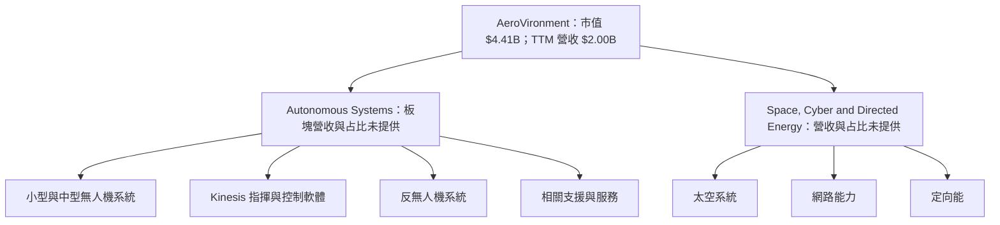
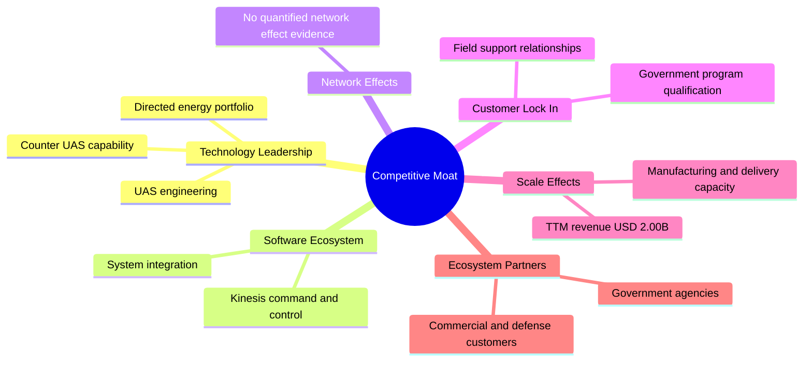
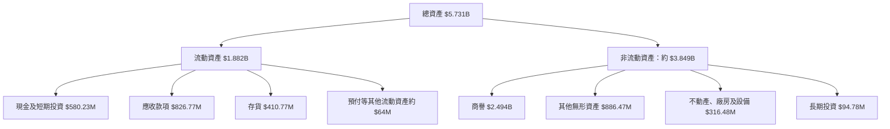
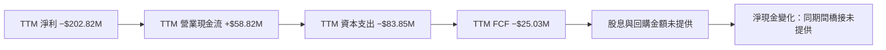
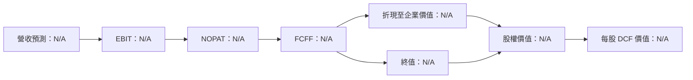
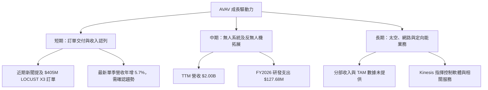
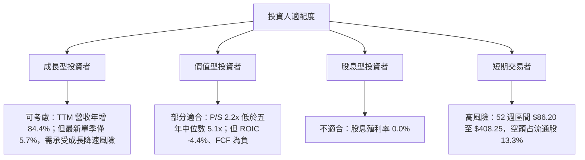

# AVAV 基本面深度分析報告
> **報告日期**：2026-11-21 ｜ **語言**：繁體中文 ｜ **數據來源**：SEC 申報資料 (XBRL)、Yahoo Finance、Finviz、StockAnalysis、Roic.ai ｜ **分析師**：CFA 級機構研究

## 目錄

| # | 章節 | 核心結論 |
|---|------|----------|
| 1 | 執行摘要 | 買入；加權合理價值 $121.04；MOS +28.3% |
| 2 | 公司概覽與商業模式 | 國防無人系統與太空、網路、定向能業務；市場份額未提供 |
| 3 | 損益表深度分析 | TTM 營收 $2.00B、成長 84.4%；營業利益率為負 |
| 4 | 資產負債表分析 | 淨負債 $149.83M；現金及短期投資 $580.23M |
| 5 | 現金流量深度分析 | TTM FCF −$25.03M，FCF Yield −0.57% |
| 6 | 獲利能力與資本效率 | ROIC −4.4% 低於 WACC 9.74%，目前摧毀股東價值 |
| 7 | 相對估值分析 | P/S 2.2x，低於自身五年中位數 5.1x；估值方法結果分歧 |
| 8 | DCF 內在價值評估 | DCF 不適用；以固定權重三角驗證得加權合理價值 $121.04 |
| 9 | 成長催化劑 | 無人系統需求與 LOCUST X3 訂單提供成長選項；TAM 數據未提供 |
| 10 | 風險矩陣 | 獲利轉負、現金流與執行風險、股價波動為主要風險 |
| 11 | 投資建議 | 買入；分批部署，持續監測利潤率、FCF、營運資金與稀釋 |

---

## 1. 執行摘要

AVAV 的 TTM 營收為 **$2.00B、年增 84.4%**，但最新單季營收年增僅 **5.7%**；TTM 營業利益率 **−12.6%**、ROIC **−4.4%**，且 TTM FCF **−$25.03M**。按同業 Forward P/E、同業 P/S 與分析師共識加權後，合理價值為 **$121.04**，相對 2026-11-20 收盤價 **$86.79** 的 MOS 為 **+28.3%**。依規則 20，MOS 雖達 25% 以上，但 ROIC 低於 WACC，因此評級為 **買入**，不是強烈買入；DCF 因 TTM 營業利益為負而不適用。

### 1.0 一頁式投資儀表板（Portfolio Manager 30 秒速讀）

| 項目 | 內容 |
|------|------|
| **投資論點（3 句）** | ① TTM 營收達 **$2.00B、年增 84.4%**，但最新單季年增降至 **5.7%**，成長速度須重新驗證。② 公司現金及短期投資 **$580.23M**，高於可觀察的融資負債單項並提供資金緩衝，但仍有 **$149.83M 淨負債**。③ 固定估值方法加權價值 **$121.04**，較現價 **$86.79** 高 **39.5%**；惟 ROIC **−4.4%**、FCF **−$25.03M**，獲利與現金轉換尚未支持更高信心。 |
| **綜合評分** | **5.8/10**（引用 1.1） |
| **財務健康** | 🟡 現金與短期投資 **$580.23M**、流動比率 **4.26**；但淨負債 **$149.83M**、TTM FCF 為負。 |
| **ROIC vs WACC** | **−4.4% vs 9.74%**：差距 **−14.14 個百分點**，目前摧毀股東價值。 |
| **FCF 趨勢** | TTM FCF **−$25.03M**；FCF Yield **−0.57%**。年度現金流波動大，不宜只看單季轉正。 |
| **估值** | Forward P/E **19.7x** ｜ EV/EBITDA **21.3x** ｜ FCF Yield **−0.57%**。 |
| **DCF 內在價值（基準）** | **N/A**；TTM 營業利益為負，不建構 DCF，故 DCF 折溢價不適用。 |
| **安全邊際（MOS）** | **+28.3%＝($121.04 − $86.79) ÷ $121.04**（加權合理價值基準，引用 8.8）｜ 🟢 MOS 高於 25%。 |
| **預期報酬（基準情境 12M）** | DCF 情境為 N/A。相對加權合理價值的隱含上行空間為 **+39.5%**，並非經時間調整的 12 個月報酬預測。 |
| **關鍵風險（前二）** | 營收成長從 TTM **84.4%** 降至最新單季 **5.7%**；TTM 營業利益率 **−12.6%**、FCF **−$25.03M**。 |
| **評級 + 信心度** | 🟢 **買入** ｜ 信心：中低；DCF 不適用、盈利能力未證明，估值仰賴相對估值方法。 |

### 1.1 綜合評分卡（全報告唯一）

| 維度 | 評分（1–10） | 主要依據（引用數字與其來源章節） |
|------|--------------|----------------------------------|
| 成長性 | 7.5 | TTM 營收年增 **84.4%**，但最新單季年增 **5.7%**，成長趨勢存在降速訊號（第 3 章）。 |
| 獲利能力 | 2.5 | TTM 營業利益率 **−12.6%**、ROIC **−4.4%**，Piotroski F-Score **4/9**（第 3、6 章）。 |
| 財務健康 | 6.0 | 現金及短期投資 **$580.23M**、淨負債 **$149.83M**、流動比率 **4.26**；CCC 為 **92 天**（第 4 章）。 |
| 估值 | 7.0 | MOS **+28.3%**；P/S **2.2x**，低於自身五年中位數 **5.1x**，但 DCF 不適用且估值方法分歧（第 7、8 章）。 |
| 護城河 | 7.0 | 政府與國防應用、無人系統產品及控制軟體構成差異化，但無客戶集中度、續約率或市場份額數據（第 2 章）。 |
| 管理層與資本配置 | 4.5 | FY2026 SBC **$38.33M**、股數測試未通過，FY2026 FCF **−$164.62M**；歷史投資與整合回報缺乏足夠拆分（第 3、5 章）。 |
| **綜合評分** | **5.8** | 六項算術平均：(**7.5 + 2.5 + 6.0 + 7.0 + 7.0 + 4.5**) ÷ 6 = **5.75，四捨五入 5.8**。 |

### 1.2 五大投資論點 + 三大核心風險

| 類型 | 項目 | 具體依據 | 信心度 |
|------|------|----------|--------|
| 🟢 **投資論點①** | TTM 營收已擴大 | TTM 營收 **$2.00B**、年增 **84.4%**；年報營收從 FY2023 **$540.54M** 增至 FY2026 **$1.98B**。代表業務規模快速放大，但最新單季年增降至 5.7%。 | 🟢 中 |
| 🟢 **投資論點②** | 國防無人系統具結構性需求 | 公司提供 UAS、反無人機、指揮控制軟體等產品；近期新聞提及 **$405M LOCUST X3 訂單**，但訂單條款與認列期程未提供。 | 🟡 中 |
| 🟢 **投資論點③** | 資產負債表有流動性緩衝 | 現金及短期投資 **$580.23M**，流動比率 **4.26**、速動比率 **3.185**。可支應營運與投資，但不等同穩定自由現金流。 | 🟢 中 |
| 🟢 **投資論點④** | 相對自身歷史估值折價 | P/S **2.2x**，低於五年中位數 **5.1x**；然而當前獲利率轉負，歷史倍數不必然可回歸。 | 🟡 中 |
| 🟢 **投資論點⑤** | 加權估值高於現價 | 固定方法加權合理價值 **$121.04**，相對現價上行空間 **39.5%**；分析師共識是其中 10% 權重來源。 | 🟡 中低 |
| 🟡 **風險①** | 成長急降速 | TTM 年增 **84.4%**，最新單季年增僅 **5.7%**。若後續訂單無法補足基期及交付變化，估值倍數可能繼續收縮。 | 🟡 中 |
| 🔴 **風險②** | 營運獲利與現金流轉弱 | TTM 營業利益率 **−12.6%**、ROIC **−4.4%**、FCF **−$25.03M**，營收擴張尚未轉成股東可得現金。 | 🔴 高 |
| 🔴 **風險③** | 股價與融資波動 | 股價由 52 週高點 **$408.25** 降至 **$86.79**；空頭占流通股 **13.3%**，可能加劇波動。 | 🔴 高 |

### 1.3 快速統計卡片

| 指標 | 公司實際值（期間） | 同業中位數 | 狀態 |
|------|--------------------|------------|------|
| 營收成長（TTM） | **84.4%** | — | 🟢 |
| 營收成長（最新一季年增） | **5.7%** | **35.7%**（三家公司中位數） | 🔴 |
| 毛利率（TTM） | **26.5%** | **23.0%** | 🟢 |
| 營業利益率（TTM） | **−12.6%** | — | 🔴 |
| ROIC（TTM） | **−4.4%** | — | 🔴 |
| Forward P/E | **19.7x** | **20.5x**（KTOS、LMT 中位數） | 🟡 |
| FCF Yield（TTM） | **−0.57%** | — | 🔴 |
| Piotroski F-Score | **4 / 9** | — | 🟡 |

> 估值與財務資料不同來源有差異：Yahoo Finance／Finviz 合併欄位列出營業利益率 TTM **−0.6%**、資本支出 **$103.60M**、FCF **−$44.78M**；SEC 申報資料計算欄列示營業利益率 TTM **−12.6%**、資本支出 **$83.85M**、FCF **−$25.03M**。涉及規則指定指標時，本報告以 SEC 申報資料計算的 VERIFIED FIGURES 為準，並將差異視為資料一致性風險。

### 1.4 投資結論

```text
╔══════════════════════════════════════════════════════════════════╗
║                    📊 投資結論摘要                               ║
╠══════════════════════════════════════════════════════════════════╣
║  評級：買入（MOS +28.3%，但 ROIC -4.4% 低於 WACC 9.74%）       ║
║  價格（2026-11-20 收盤）：$86.79                                ║
║  DCF 內在價值（基準）：N/A（TTM 營業利益為負）                  ║
║  安全邊際 MOS：+28.3%（＝($121.04−$86.79)÷$121.04）           ║
║  加權合理價值（8.8）：$121.04                                    ║
║  綜合評分：5.8/10（引用 1.1）                                    ║
║  適合投資人：可承受高波動、重視國防科技成長且採分批布局者       ║
╚══════════════════════════════════════════════════════════════════╝
```

---

## 2. 公司概覽與商業模式

### 2.1 業務結構與收入來源

AeroVironment 設計、開發、製造、交付及支援無人系統與相關服務。已知業務包含 Autonomous Systems，以及 Space, Cyber and Directed Energy；公司概覽還提及小型及中型 UAS、Kinesis 指揮與控制軟體、反無人機等。各板塊營收及占比未提供，因此不將總營收任意分配至業務線。



### 2.2 市場份額

市場份額數據未提供，故不繪製市場份額圖或推估市占率。AVAV TTM 營收 **$2.00B**，規模高於 ONDS 的市場定位但低於大型傳統國防承包商的業務規模；對照同業最新單季營收成長，AVAV **5.7%** 低於 KTOS **35.7%**、ONDS **1,558.6%** 與 LMT **11.3%**，但各公司規模與業務組合差異大，不能直接以增速排序競爭力。

### 2.3 競爭護城河分析



### 2.4 護城河強度

| 護城河項目 | 強度（強／中／弱） | 證據（引用數字或事實） | 會削弱它的情況 |
|------------|--------------------|------------------------|----------------|
| 技術與產品組合 | 中 | 涵蓋 UAS、反無人機、指揮控制軟體及定向能；研發費 FY2026 **$127.68M**。 | 技術迭代落後、競品成本更低或實戰表現不符需求。 |
| 軟體生態系統 | 中 | 公司提供 Kinesis 指揮控制軟體；軟體收入、續約及附加率未提供。 | 軟硬體整合黏著度不足、客戶轉換成本降低。 |
| 網路效應 | 弱／證據有限 | 未提供使用者數、資料網路規模或平台交易量。 | 若軟體部署不形成跨客戶或跨系統效益，網路效應難以建立。 |
| 客戶鎖定 | 中 | 國防計畫通常具資格、整合、訓練與維護流程；公司亦提供相關支援服務。 | 計畫取消、採購延遲、替代供應商通過認證。 |
| 規模效應 | 中 | TTM 營收 **$2.00B**，員工 **3,991 人**；但 TTM 營業利益率 **−12.6%**，尚未顯示規模轉成穩定盈利。 | 擴張帶來固定成本、供應鏈或整合成本，無法提高毛利與營業槓桿。 |
| 生態夥伴 | 中 | 客群包含美國及國際政府機構與企業；客戶集中度、合作夥伴收入未提供。 | 政府預算改變、供應鏈限制或關鍵合作終止。 |

護城河評分 **7.0/10** 的理由：產品與政府需求具進入門檻，且 FY2026 研發支出為 **$127.68M**；但市場份額、續約、客戶集中度與軟體經常性收入資料不足，現階段不能把技術壁壘等同已驗證的高回報護城河。

---

## 3. 損益表深度分析

### 3.1 年度收入成長趨勢（近4年）

年度收入採財務報表年度數據；FY2026 以 StockAnalysis 列示的 **$1.977B** 計算成長率。圖中條長為相對年度營收的視覺比例，不代表市場份額。

```text
╔══════════════════════════════════════════════════════════════════╗
║              AeroVironment 年度收入趨勢（FY2023-FY2026）         ║
╠══════════════════════════════════════════════════════════════════╣
║  FY2023  $0.541B  █████░░░░░░░░░░░░░░░░░░  YoY：+32.6%  🟢    ║
║  FY2024  $0.717B  ████████░░░░░░░░░░░░░░░  YoY：+32.6%  🟢    ║
║  FY2025  $0.821B  █████████░░░░░░░░░░░░░░  YoY：+14.5%  🟡    ║
║  FY2026  $1.977B  ████████████████████████  YoY：+140.9% 🟢   ║
║                                                                  ║
║  FY2023-FY2026 CAGR = (1.977 ÷ 0.54054)^(1/3) − 1 = 約 54.1%   ║
╚══════════════════════════════════════════════════════════════════╝
```

FY2026 的營收跳升幅度遠高於前兩年，代表交付、業務組合及公司規模發生明顯變化；單年度高成長不宜直接外推。更重要的是最新單季年增率僅 **5.7%**，可能反映比較基期上升、交付時間差或訂單節奏轉變，後續需追蹤訂單與收入認列能否再加速。

### 3.2 季度收入趨勢分析

以下 QoQ 以相鄰列示季度收入計算；YoY 優先引用季度資料來源列示的單季年增率。FY2026 Q2–Q4 等標示與單季數字來自不同季度欄位，季度會計期間名稱可能因來源標記而有差異，應以公司正式季報核對。

| 季度 | 營收 | QoQ | YoY（單季） | 備註 |
|------|------:|-----:|------------:|------|
| 2025-10-31 | $472.51M | — | +150.7% | 同比成長高，受低基期影響。 |
| 2026-01-31 | $408.05M | −13.6% | +143.4% | 季度收入較前季下降，但同比仍高。 |
| 2026-04-30 | $641.62M | +57.2% | +133.3% | 交付節奏造成季度收入大幅回升。 |
| 2026-08-01 | $480.49M | −25.2% | +5.7% | 最新季度增速明顯降檔，需關注後續訂單轉收入。 |

### 3.3 利潤率演變分析

以下按年度損益表列示的營收、毛利、營業利益與淨利計算。FY2026 TTM 營業利益率與其他合併來源存在資料差異；TTM 規則指定值 **−12.6%** 仍作為統一比較基準。

| 利潤率指標 | FY2023 | FY2024 | FY2025 | FY2026 | 趨勢 | 評估 |
|------------|-------:|-------:|-------:|-------:|------|------|
| **毛利率** | 32.1% | 39.6% | 38.8% | 25.3% | FY2026 回落約 13.5 個百分點 | 🔴 |
| **營業利益率** | −4.2% | 10.0% | 7.2% | −3.6% | 先改善後轉負 | 🔴 |
| **淨利率** | −32.6% | 8.3% | 5.3% | −13.4% | FY2026 顯著轉負 | 🔴 |

計算示例：FY2026 毛利率 = **$500.64M ÷ $1,977M = 25.3%**；營業利益率 = **−$70.29M ÷ $1,977M = −3.6%**。FY2026 毛利率與營業利益率同時惡化，表示營收擴大並未同步提高單位經濟效益，可能與產品組合、交付成本、整合支出及研發投入有關；現有資料無法精確拆分各因素貢獻。季度毛利率由最新季 **$124.60M ÷ $480.49M = 25.9%**，與 FY2026 年度毛利率接近，尚未顯示明確快速修復。

### 3.4 費用結構分析

費用項目缺少完整且一致的 TTM 分項資料，故不繪製比例圓餅圖，避免將不同期間或不同會計口徑拼成一個費用結構。可確認 FY2026 研發費用為 **$127.68M**，約占營收 **6.5%**（$127.68M ÷ $1.977B）；此支出支持產品與技術更新，但當期營業利益仍為負，短期成本回收尚未完成。

```text
╔══════════════════════════════════════════════════════════════════╗
║                費用結構：可確認的 FY2026 數據                    ║
╠══════════════════════════════════════════════════════════════════╣
║  研發費用：$127.68M ÷ 營收 $1.977B = 6.5%                       ║
║  FY2026 營業利益：−$70.29M；完整費用明細占比未提供               ║
║  結論：研發投入可支持後續產品，但當期獲利轉化仍待證明             ║
╚══════════════════════════════════════════════════════════════════╝
```

### 3.5 季度 EPS 趨勢與盈餘品質（Quality of Earnings）

EPS 預估與實際值的四季歷史均為缺失值，因此無法判定超預期或不及預期；不能將空值轉寫成「未達預期」。季度實際淨利如下，反映盈利波動；資料亦未提供一致的單季 diluted EPS 歷史，故不以年報 EPS 替代季報 EPS。

| 季度 | 實際淨利 | EPS 預估／實際與驚喜幅度 |
|------|---------:|-------------------------|
| 2025-10-31 | −$17.10M | N/A（估計值與實際 EPS 缺失） |
| 2026-01-31 | −$243.82M | N/A（估計值與實際 EPS 缺失） |
| 2026-04-30 | −$24.10M | N/A（估計值與實際 EPS 缺失） |
| 2026-08-01 | −$5.07M | N/A（估計值與實際 EPS 缺失） |

| 盈餘品質項目 | 數值/佔比 | 評估 |
|--------------|-----------|------|
| 股權薪酬 SBC / 營收 | FY2026 **$38.33M ÷ $1.977B = 1.94%** | 🟡 SBC 並非營收主體，但會稀釋股東權益；Piotroski 稀釋股數測試未通過。 |
| SBC / 營業現金流 | FY2026 OCF **−$78.40M**；算術比率 **−48.9%** | 🔴 OCF 為負，該比率不具通常「覆蓋倍數」意義；SBC 不是現金流出，不能以此比率判定現金覆蓋。 |
| FCF / 淨利（現金轉換率） | TTM FCF **−$25.03M**；TTM 淨利 **−$202.82M**，算術比率 **12.3%** | 🔴 分子、分母皆為負，12.3% 不是正向現金轉換率，不能解讀為盈餘含金量良好。 |
| 一次性/非經常性損益 | FY2026 淨利 **−$265.12M**，TTM **−$202.82M**；分項未提供 | 🟡 無足夠資料判斷是否受重大一次性損益影響；不得假設扣除或加回。 |
| 有效稅率異常 | N/A（未提供 TTM 稅前所得及所得稅費用） | 🟡 無法判斷虧損是否由稅務利益或異常稅率主導。 |
| 資本化支出 vs 費用化 | TTM Capex **$83.85M**；資本化研發等分項 N/A | 🟡 有資本支出，但無法由提供資訊判斷成本是否過度資本化。 |

**盈餘品質結論**：公司目前為虧損狀態，GAAP 獲利無法作為穩健估值錨。TTM FCF 雖較淨利虧損幅度小，但兩者皆為負值，且年度 OCF、資本支出起伏大，故不能宣稱盈餘有正向現金轉換。SBC 約占 FY2026 營收 **1.94%**，仍是實際股東成本之一，股數測試未通過也提示稀釋不能忽略。

---

## 4. 資產負債表分析

### 4.1 資產結構分解

採用 2026-08-01 TTM 資產負債表列示數據；細項因四捨五入與來源整理存在微差，未提供的資產分類不臆測補足。



### 4.2 流動性與營運資金分析

流動比率及速動比率採財務摘要來源，營運資金天數則照抄品質指標計算值，兩者口徑不同。

| 流動性指標 | 最新值 | 前期比較 | 評估 |
|------------|-------:|-----------|------|
| 流動比率 | **4.26** | 歷史同口徑序列未提供 | 🟢 短期資產覆蓋流動負債能力較高，但須考慮應收款及存貨可變現性。 |
| 速動比率 | **3.185** | 歷史同口徑序列未提供 | 🟢 除存貨後仍有流動性緩衝。 |
| 現金及短期投資 | **$580.23M** | 一年前同口徑數值未提供 | 🟡 具備資金，但相對總債務仍為淨負債。 |

**營運資金天數**

| 指標 | 最新 TTM | 一年前 TTM | 變化 | 解讀 |
|------|----------:|-----------:|-----:|------|
| DSO 應收帳款天數 | **33 天** | **67 天** | **−34 天** | 收款天數縮短，營運資金占用改善；但需檢查政府客戶付款節奏與應收款餘額。 |
| DIO 存貨天數 | **102 天** | **113 天** | **−11 天** | 存貨天數下降，代表庫存周轉改善；但目前仍需監控存貨規模與交付匹配。 |
| DPO 應付帳款天數 | **43 天** | **44 天** | **−1 天** | 對供應商付款時點大致穩定，沒有明顯延長付款以支撐現金的訊號。 |
| CCC 現金轉換週期 | **92 天** | **135 天** | **−43 天** | 現金轉換週期改善；DSO 與 DIO 下降是主要貢獻，不能單憑此認定自由現金流已改善至正值。 |

### 4.3 債務結構分析

計息負債、現金與淨負債採 VERIFIED FIGURES；其他 Yahoo Finance 欄位列出的總債務較高，與 SEC 計算口徑不一致，本節不混用。

```text
╔══════════════════════════════════════════════════════════════════╗
║                   AVAV 債務健康診斷                               ║
╠══════════════════════════════════════════════════════════════════╣
║  總債務：        $730.06M   ████████████████████                 ║
║  現金+短期投資： $580.23M   ████████████████                     ║
║  淨負債：        $149.83M   █████░░░░░░░░░░░░░                   ║
║                                                                  ║
║  淨負債計算：$730.06M − $580.23M = $149.83M                      ║
║  Debt/EBITDA：N/A（TTM 營業利益為負；EBITDA 倍數不宜作償債錨）   ║
║  利息保障倍數：N/A（利息費用及一致口徑 EBIT 未提供）             ║
║  評估：流動性有緩衝，但不是淨現金公司；需觀察虧損期間現金消耗     ║
╚══════════════════════════════════════════════════════════════════╝
```

### 4.4 股東權益趨勢

以下採年度資產負債表股東權益。FY2026 增幅明顯，伴隨總資產、商譽及無形資產擴大；未有完整交易與股權發行拆分，不能把增幅全部視為內生獲利累積。

```text
╔══════════════════════════════════════════════════════════════════╗
║                   AVAV 股東權益變化                               ║
╠══════════════════════════════════════════════════════════════════╣
║  FY2023  $550.97M  ███████░░░░░░░░░░░░░░░                       ║
║  FY2024  $822.75M  ██████████░░░░░░░░░░░                        ║
║  FY2025  $886.51M  ███████████░░░░░░░░░                         ║
║  FY2026  $4.40B    █████████████████████████                     ║
║                                                                  ║
║  FY2025 至 FY2026 增幅與資產負債表規模變化顯著，須追查併購及發股 ║
╚══════════════════════════════════════════════════════════════════╝
```

---

## 5. 現金流量深度分析

### 5.1 現金流量瀑布圖

完整且同一期間的淨利、現金流、股息／回購及淨現金變化橋接數據未齊，故以可確認的 TTM 指標表達，不填補缺失節點金額。



### 5.2 FCF 轉換率趨勢

| 期間 | 營業現金流 | 資本支出 | FCF | 淨利 | FCF/淨利 |
|------|-----------:|---------:|----:|-----:|---------:|
| FY2023 | $11.40M | $14.87M | −$3.47M | −$176.21M | 2.0%（負數／負數，無正向轉換含義） |
| FY2024 | $15.29M | $24.48M | −$9.19M | $59.67M | −15.4% |
| FY2025 | −$1.32M | $22.82M | −$24.13M | $43.62M | −55.3% |
| FY2026 | −$78.40M | $86.22M | −$164.62M | −$265.12M | 62.1%（兩項皆負，不代表良好轉換） |
| TTM 至 2026-08-01 | $58.82M | $83.85M | **−$25.03M** | −$202.82M | 12.3%（負值比率，不適用常態解讀） |

年度現金流量表的 FY2026 FCF **−$164.62M** 與 TTM FCF **−$25.03M** 期間不同；不可混為同一數據。FY2026 年度 OCF 為負，TTM OCF 回到正值，顯示現金流期間波動大，資本支出也較高。

### 5.3 自由現金流趨勢

```text
╔══════════════════════════════════════════════════════════════════╗
║                 自由現金流：年度實際與最新 TTM                    ║
╠══════════════════════════════════════════════════════════════════╣
║  FY2023   −$3.47M    ◀█░░░░░░░░░░░░░░░░░░░░   負值              ║
║  FY2024   −$9.19M    ◀██░░░░░░░░░░░░░░░░░░░░  負值              ║
║  FY2025  −$24.13M    ◀████░░░░░░░░░░░░░░░░░░ 負值              ║
║  FY2026 −$164.62M    ◀███████████████████████ 負值              ║
║  TTM    −$25.03M    ◀████░░░░░░░░░░░░░░░░░░ FCF Yield −0.57%  ║
╠══════════════════════════════════════════════════════════════════╣
║  FY2026 年度與 TTM 期間不同；最新 TTM FCF 仍為負，現金轉換未穩定 ║
╚══════════════════════════════════════════════════════════════════╝
```

### 5.4 資本配置評估

回購、股息與完整投資支出拆分未提供，不繪製比例圓餅圖。可確認 FY2026 Capex **$86.22M**，約為 FY2026 營收的 **4.4%**；FY2026 SBC 為 **$38.33M**。股息殖利率 **0.0%**，沒有現金股息回報。FY2026 FCF 大幅為負，說明營收擴大期間資本與營運資金需求可能較高，資本配置成效須以未來營業利潤、現金流及每股股數變化共同檢驗。

---

## 6. 獲利能力與資本效率

### 6.1 ROE / ROA / ROIC 趨勢

歷史 ROIC／ROA 逐年一致口徑資料未完整提供，僅呈現有來源的 TTM 指標，避免將年度與 TTM 混接。

| 指標 | 最新 TTM | 歷史趨勢可比資料 | 評估 |
|------|---------:|------------------|------|
| ROE | **−4.6%** | N/A（品質指標提供當前 TTM） | 🔴 股東權益尚未獲得正報酬。 |
| ROA | **−0.1%** | Piotroski 測試顯示 ROA 未大於 0，且未高於一年前 | 🔴 資產回報接近零但仍為負。 |
| ROIC | **−4.4%** | 長期一致口徑序列未提供 | 🔴 低於 WACC 9.74%。 |

行業均值沒有可核實數據，故不列行業均值比較。FY2026 年度營業利益 **−$70.29M**、TTM ROIC **−4.4%**，表示即使收入大幅增加，目前尚未把投入資本轉成高於資本成本的稅後營運利潤。

### 6.2 ROIC vs WACC 分析（核心價值創造判斷）

```text
╔══════════════════════════════════════════════════════════════════╗
║                ROIC vs WACC 深度分析                             ║
╠══════════════════════════════════════════════════════════════════╣
║  資本成本（採用程式計算值）：                                     ║
║  ├── 無風險利率（10Y 美債）：       4.91%                         ║
║  ├── 市場風險溢酬 ERP：             5.00%                         ║
║  ├── 原始 Beta：                    1.40                          ║
║  ├── 調整後 Beta：                  1.27                          ║
║  ├── 股權成本 Ke：                  11.26%                        ║
║  ├── 稅前債務成本：                 0.77%                         ║
║  ├── 股權／債務權重：               85.8% / 14.2%                 ║
║  └── WACC：                         9.74%                         ║
║                                                                  ║
║  ROIC（TTM）：                    −4.40%                          ║
║  EVA spread = ROIC − WACC：       −4.40% − 9.74% = −14.14pp      ║
║                                                                  ║
║  ROIC  −4.40%  ◀░░░░░░░░░░░░░░░░░░░░░░░░░                       ║
║  WACC   9.74%    ██████████░░░░░░░░░░░░░░                        ║
║  結論：目前 ROIC 低於資本成本，尚未創造正經濟利潤               ║
╚══════════════════════════════════════════════════════════════════╝
```

WACC 依指定資本成本數據採用 **9.74%**，與第 8 章折現率規定一致。此處不重新估算 ROIC；依據為 TTM ROIC **−4.4%**。ROIC 與 WACC 的差額是 **−14.14 個百分點**，代表現有營運回報不足以補償資本提供者所要求的回報。當前是價值摧毀，而未來是否改善取決於營收轉化成正營業利潤及現金流的速度。

### 6.3 杜邦三因素分解

| 因素 | 數值（TTM） | 解讀 |
|------|-------------|------|
| 淨利率 | **−10.1%** | 淨利為負，是 ROE 為負的主要來源。 |
| 資產週轉率 | **0.35** | 每單位資產創造的收入有限；資產規模近期擴大也提高分母。 |
| 權益乘數 | **1.30** | 槓桿並非 ROE 負值的主要放大來源；負淨利率是核心因素。 |
| **ROE** | **−4.6%** | 按品質指標提供的杜邦列：−10.1% × 0.35 × 1.30，等於約 −4.6%。 |

### 6.4 財務體質：Piotroski F-Score

Piotroski F-Score 為 **4/9**；逐項結果照列品質指標。這反映現金流品質及資產周轉部分通過，但盈利、毛利與流動性變化仍有弱點。

| 測試 | 結果 | 解讀 |
|------|------|------|
| ROA > 0 | ❌ 未通過 | 當期資產回報為負。 |
| 營業現金流 > 0 | ✅ 通過 | TTM OCF 為 **$58.82M**。 |
| ROA 高於一年前 | ❌ 未通過 | 資產盈利改善未被證明。 |
| 營業現金流 > 淨利（應計品質） | ✅ 通過 | 現金流高於淨利；但淨利為負，解讀需保守。 |
| 長期負債 ÷ 總資產低於一年前 | ✅ 通過 | 相對負債率測試改善。 |
| 流動比率高於一年前 | ❌ 未通過 | 流動比率未改善至通過標準。 |
| 稀釋股數未增加 | ❌ 未通過 | 股權稀釋是每股價值風險。 |
| 毛利率高於一年前 | ❌ 未通過 | 毛利率未改善，FY2026 年度毛利率降至約 **25.3%**。 |
| 資產週轉率高於一年前 | ✅ 通過 | 資產效率相對改善。 |

---

## 7. 相對估值分析

### 7.1 同業估值比較表格

同業倍數使用 Yahoo Finance 同業資料；公司估值採市場資料。ONDS 的負 Forward P/E 與負 EV/EBITDA 不具通常盈利倍數解讀。

| 估值指標 | **AVAV** | **KTOS** | **ONDS** | **LMT** | 本公司評估 |
|----------|---------:|---------:|---------:|--------:|-----------|
| **Trailing P/E** | N/A（TTM EPS −$4.05） | 224.1x | N/A | 20.1x | 🔴 AVAV 虧損，無法以歷史 P/E 做常規比較。 |
| **Forward P/E** | **19.7x** | 24.0x | −24.3x | 17.0x | 🟡 相對 KTOS、LMT 不高；ONDS 為負值不適合納入中位數。 |
| **P/S Ratio** | **2.2x** | 3.1x | 6.7x | 1.7x | 🟡 高於 LMT、低於 KTOS 與 ONDS。 |
| **EV/EBITDA** | **21.3x** | 43.4x | −5.2x | 14.7x | 🟡 高於 LMT；AVAV 的盈利指標波動降低該倍數可比性。 |
| **最新單季營收年增** | **5.7%** | 35.7% | 1,558.6% | 11.3% | 🔴 AVAV 最新單季成長低於三家同業列示值。 |
| **毛利率（TTM）** | **26.5%** | 23.0% | 36.4% | 11.7% | 🟢 高於 KTOS 與 LMT，低於 ONDS。 |

同業 Forward P/E 中位數採可用的 KTOS **24.0x** 與 LMT **17.0x**，中位數為 **20.5x**；ONDS 的負值不納入該 Forward P/E 中位數。Forward P/E 相對估值方法亦使用此 **20.5x** 中位數，而非 AVAV 自身倍數。

### 7.2 歷史估值區間分析

歷史估值資料提供的是 P/S，而非 P/E，故不改以其他倍數替代。

```text
╔══════════════════════════════════════════════════════════════════╗
║                   AVAV 五年歷史 P/S 區間                          ║
╠══════════════════════════════════════════════════════════════════╣
║  五年區間：3.0x ├──────────────────────────────┤ 13.4x           ║
║  五年中位數：5.1x                                                 ║
║  當前：2.2x  ◀ 低於五年區間下限                                  ║
║  當前百分位：0%                                                   ║
╠══════════════════════════════════════════════════════════════════╣
║  評估：市場定價低於自身歷史區間；但公司目前虧損，歷史倍數未必可回歸║
╚══════════════════════════════════════════════════════════════════╝
```

### 7.3 情境價值（Bear / Base / Bull）

**N/A（DCF 無法計算：TTM 營業利益為負，DCF MODEL 未提供基準與情境值）**。不自行建立悲觀、基準或樂觀 DCF 目標價。

### 7.4 相對估值隱含價格區間

```text
╔══════════════════════════════════════════════════════════════════╗
║               相對估值方法與現價位置                             ║
╠══════════════════════════════════════════════════════════════════╣
║  $86.79 現價 ── $90.44 同業 Forward P/E ── $121.15 同業 P/S      ║
║                                    └── $212.20 分析師共識         ║
╚══════════════════════════════════════════════════════════════════╝
```

| 方法 | 每股隱含價值 | 依據 |
|------|-------------:|------|
| 同業 Forward P/E | **$90.44** | KTOS、LMT 同業中位數 **20.5x × Forward EPS $4.41**。 |
| 同業 P/S | **$121.15** | KTOS、ONDS、LMT 同業 P/S 中位數 **3.1x × TTM 營收**，依固定方法計算。 |
| 分析師共識目標價 | **$212.20** | 23 位分析師平均目標價；作為參考權重，不是獨立營運現金流估值。 |

---

## 8. DCF 內在價值評估（Discounted Cash Flow）

### 8.0 估值推理鏈（Thinking Logic）

**Step 1 — 價值來源與主導變數**

AVAV 的營收可拆成 Autonomous Systems 與 Space, Cyber and Directed Energy 等業務，但各板塊營收占比未提供；因此無法可信地分配「主業底盤」與「新業務選擇權」的營收比重。可確認的整體 TTM 營收為 **$2.00B**。在目前營業利益率為負的情況下，最影響估值的核心變數是能否恢復正向營業利潤與自由現金流；但公司 TTM 營業利益為負，程式模型明確將 DCF 列為 N/A，故不應從未驗證的長期利潤率假設推導內在價值。

**Step 2 — 模型選擇**

| 決策點 | 本報告採用 | 理由（含數字） | 曾考慮但否決 | 否決理由 |
|--------|-----------|----------------|--------------|----------|
| 現金流定義 | DCF 不適用 | TTM 營業利益率 **−12.6%**，營業利益不為正 | FCFF 或 FCFE 自建模型 | 缺少可用的 DCF MODEL，且以虧損營業利潤直接預測會產生任意結果 |
| 預測期 N | N/A | 唯一指定模型為 N/A | 自設 5–10 年 | 缺乏模型預測與可驗證的獲利基礎 |
| 終值方法 | N/A | 不存在可採用的基準 FCFF | Gordon Growth／退出倍數 | 無法由負的當期營業獲利推導唯一終值 |
| EBIT 基礎 | N/A | DCF 未建構 | GAAP／非 GAAP | 不得另建模型或暗中調整 SBC |

**Step 3 — 關鍵假設推導鏈**

DCF MODEL 標示 N/A，因此預測期、營收 CAGR、期末營業利潤率、永續成長率、資本支出、折舊、營運資金、SBC 處理及稀釋股數等模型輸入皆未提供。本報告不以公司歷史營收 CAGR 或同業倍數擅自補成 DCF 假設。

**Step 4 — 最脆弱的一環**

最脆弱的投資假設是營收放大能否轉化為正營業利潤及正 FCF；若單季年增持續接近或低於 **5.7%**，而營業利益率仍為負，則相對估值也可能下修。由於 DCF 無法計算，沒有可引用的敏感度矩陣量化其每股下跌幅度。

**Step 5 — 計算路徑圖**



### 8.1 模型假設總表（Model Inputs）

**DCF MODEL：N/A — TTM operating income is not positive; a loss discounted forward is not a value.** 以下為模型輸入可用性清單，不構成自建 DCF。

| 假設項目 | 採用值 | 依據 / 來源 | 敏感度 |
|----------|--------|-------------|--------|
| 預測期長度 N | N/A | DCF MODEL 未提供；不得自設 | N/A |
| 營收 CAGR（預測期） | N/A | DCF MODEL 未提供 | N/A |
| 營業利潤率（期末） | N/A | TTM 營業利益率為負，無模型預測 | N/A |
| 有效稅率 | DCF 稅率 N/A | 模型未提供；WACC 預設稅率 21% 不可移作 DCF 假設 | N/A |
| Capex / 營收 | N/A | 模型未提供；已知 TTM Capex **$83.85M** 不足以補出未來比例 | N/A |
| 折舊攤銷 D&A / 營收 | N/A | 模型未提供 | N/A |
| 營運資金變動 / 營收增額 | N/A | 模型未提供 | N/A |
| EBIT 基礎 | N/A | 沒有 DCF 計算 | N/A |
| 股權薪酬 SBC 處理 | N/A | 沒有 DCF 計算 | N/A |
| 年稀釋率（股數） | N/A | 模型未提供；Piotroski 股數測試未通過 | N/A |
| 永續成長率 g | N/A | 模型未提供 | N/A |
| 終值方法 | N/A | 模型未提供 | N/A |
| WACC | **9.74%** | 指定資本成本數據；此為資本成本輸入，不代表 DCF 可用 | N/A |

FCFF 公式本應為 **NOPAT + D&A − Capex − ΔWC**，但因模型輸入不完整及 TTM 營業利益為負，本報告不計算 FCFF 預測。SBC 組合 A/B/C 未套用；不能在沒有 DCF 的前提下宣稱已完成 SBC 一次性處理。

### 8.2 折現率推導（WACC）

依指定資本成本資料採用 WACC **9.74%**。10 年期美債殖利率為 **4.91%**，ERP 為假設 **5.00%**；原始 Beta **1.40**，採用調整後 Beta **1.27**，其調整方式為 **⅔ × 1.40 + ⅓ × 1.00 = 1.27**。不另加規模或國別溢酬。

```text
╔══════════════════════════════════════════════════════════════════╗
║                    WACC 推導（折現率）                            ║
╠══════════════════════════════════════════════════════════════════╣
║  股權成本 Ke（CAPM）：                                           ║
║  ├── 無風險利率 Rf：                  4.91%                      ║
║  ├── 市場風險溢酬 ERP：               5.00%（假設值）            ║
║  ├── 原始 Beta／調整後 Beta：          1.40／1.27                 ║
║  ├── 規模／國別溢酬：                  0.00%（不另加）           ║
║  └── Ke：4.91% + 1.27 × 5.00% =     11.26%                      ║
║                                                                  ║
║  債務成本：                                                       ║
║  ├── 稅前 Kd：                         0.77%                      ║
║  ├── 稅率：                            21.0%                      ║
║  └── 稅後 Kd：0.77% × (1−21.0%) =      0.61%                     ║
║                                                                  ║
║  資本權重：股權 85.8%／債務 14.2%                                ║
║  WACC：85.8% × 11.26% + 14.2% × 0.61% = 約 9.74%                 ║
╚══════════════════════════════════════════════════════════════════╝
```

**逐步演算（WACC）**

1. **Ke（CAPM）** = 4.91% + 1.27 × 5.00% = 4.91% + 6.35% = **11.26%**。
2. **稅前 Kd**：指定數據為利息 ÷ 債務 **0.77%**；利息費用金額及平均計息負債拆分未提供，故無法另行逐筆還原，採用指定值。
3. **稅後 Kd** = 0.77% × (1 − 21.0%) = 0.77% × 0.79 = **0.6083%**，呈列為 **0.61%**。
4. **權重**：指定資本權重為股權 **85.8%**、債務 **14.2%**；兩者相加 **100.0%**。市值權重的原始市值與債務範圍拆分未完整提供，採用指定權重，不另以其他債務口徑重算。
5. **WACC** = 85.8% × 11.26% + 14.2% × 0.6083% = 9.66108% + 0.08638% = **9.74746%**，按指定呈列值採用 **9.74%**。使用已四捨五入的中間數可能產生小幅尾差。

### 8.3 逐年自由現金流預測（基準情境）

**N/A（無逐年預測）**：DCF MODEL 未提供任何預測年度、收入、EBIT、FCFF 或折現值；依規定不自建模型、不填假設數字。

### 8.4 終值計算（Terminal Value）

**N/A（無 DCF 預測期 FCFF、永續成長率 g 或終值資料）**。因此不計算 Gordon Growth 或退出倍數終值，也不計算終值占 EV 比重。

### 8.5 企業價值 → 每股內在價值（Bridge）

```text
╔══════════════════════════════════════════════════════════════════╗
║              企業價值 → 每股內在價值 橋接表                      ║
╠══════════════════════════════════════════════════════════════════╣
║  預測期 FCF 現值合計            N/A                              ║
║  終值現值 PV(TV)                N/A                              ║
║  = 企業價值 EV                  N/A                              ║
║  + 現金及短期投資               $580.23M（單獨數據）              ║
║  − 總債務                       $730.06M（單獨數據）              ║
║  = 股權價值                     N/A                              ║
║  ÷ 稀釋後流通股數               N/A（DCF 口徑未提供）             ║
║  ★ 每股 DCF 內在價值            N/A                              ║
║  當前股價（2026-11-20 收盤）     $86.79                           ║
║  折溢價                         N/A（DCF 基準價值不存在）         ║
╚══════════════════════════════════════════════════════════════════╝
```

本節不計算 DCF 內在價值及 DCF 折溢價；同樣不計算 DCF 安全邊際。安全邊際唯一基準為 8.8 的加權合理價值。

### 8.6 敏感性分析（WACC × 永續成長率）

**N/A（DCF MODEL 未提供敏感度矩陣；缺少基準 FCFF、g 與終值）**。不以自行建立的數值矩陣替代指定模型。

### 8.7 反推 DCF（Reverse DCF：市場在預期什麼）

**N/A（DCF MODEL 未提供反推結果）**。單一股價方程式不能同時解出多個營運假設；在沒有基準 DCF 模型時，無法依固定其他輸入的方式回推成長率或利潤率。

### 8.8 估值三角驗證與安全邊際

| 估值方法 | 隱含每股價值 | 上行空間（÷現價） | 權重 | 說明 |
|----------|--------------:|-------------------:|-----:|------|
| 同業 Forward P/E | **$90.44** | **+4.2%** | **30%** | KTOS、LMT Forward P/E 中位數 **20.5x × Forward EPS $4.41**。 |
| 同業 P/S | **$121.15** | **+39.6%** | **60%** | KTOS、ONDS、LMT 同業中位數 P/S **3.1x**，依固定相對估值方法計算。 |
| 分析師共識目標價 | **$212.20** | **+144.5%** | **10%** | 23 位分析師平均目標價；共識分散可能高，僅作小權重參考。 |
| **加權合理價值** | **$121.04** | **+39.5%** | **100%** | 未加入 DCF；指定公司類型為 unprofitable，方法與權重照固定規則。 |

**逐步演算（權重）**

加權合理價值  
= **$90.44 × 30% + $121.15 × 60% + $212.20 × 10%**  
= **$27.132 + $72.690 + $21.220**  
= **$121.042**  
= **$121.04**（四捨五入至美分；權重合計 100%）。

本組固定權重依公司類型「unprofitable」設定。DCF、EV/EBITDA 等未列方法不得自行加入；估值方法中也沒有 DCF 基準價值。

**安全邊際與買賣區間**

```text
╔══════════════════════════════════════════════════════════════════╗
║                  估值區間與安全邊際                              ║
╠══════════════════════════════════════════════════════════════════╣
║  $86.79 現價 ───────── $121.04 加權合理價值                      ║
║                                                                  ║
║  MOS = ($121.04 − $86.79) ÷ $121.04 = +28.3%                    ║
║  MOS 評估：🟢 高於 25%                                            ║
║  上行空間 = ($121.04 − $86.79) ÷ $86.79 = +39.5%                ║
║  DCF 基準價值：N/A；故 DCF 折溢價不適用                          ║
║                                                                  ║
║  建議買入區間：$86.79 – $108.94                                  ║
║  合理持有區間：$108.94 – $133.14                                 ║
║  減碼考慮區間：高於 $133.14；應結合基本面與估值重新評估          ║
╚══════════════════════════════════════════════════════════════════╝
```

買入區間上限以加權合理價值的 **90%** 計算：$121.04 × 90% = **$108.936**，四捨五入為 **$108.94**；現價低於該上限。合理持有區間上緣以 MOS 為 −10% 的價格換算：$121.04 × 110% = **$133.144**，四捨五入為 **$133.14**。以上區間為加權估值推導出的價格帶，不代表 DCF 價值或保證回報。

> 🔎 **程式複算（Python，依本節各項自動重算）**
>
> 加權合理價值 = $90.44 × 30% + $121.15 × 60% + $212.20 × 10% = **$121.04**（權重合計 100%）
>
> 以價格 $86.79 計：MOS = **+28.3%**，上行空間 = **+39.5%**
>
> ✅ 與本節所寫數值一致。

### 8.9 DCF 模型的局限與失效條件

- **終值依賴度**：N/A；沒有 DCF 終值或 EV，不能計算終值占比。
- **最脆弱假設**：沒有 DCF 預測假設。對多頭論點而言，最關鍵的是營收成長能否再加速，以及營業利益率能否由負轉正；截至最新 TTM，營業利益率為 **−12.6%**。
- **不適用情境說明**：公司 TTM 營業利益為負，且 TTM FCF **−$25.03M**，高再投資或整合波動降低 DCF 可用性。現階段宜以同業 P/S、Forward P/E、營收與毛利率趨勢交叉追蹤，而非將 DCF 單點結果當作目標價。
- **與第 10 章風險連結**：訂單延遲或交付失誤可能壓低營收成長；成本超支與毛利惡化將延後轉盈；存貨與應收款回收變差會增加營運資金需求、壓低 FCF。

### 8.10 複算檢核表（Audit Trail）

| # | 檢核項目 | 檢查方式 | 結果 |
|---|----------|----------|------|
| 1 | 所有高／中敏感度 DCF 假設完成推導 | DCF MODEL 為 N/A，沒有模型假設可推導 | N/A |
| 2 | 每個模型假設都有來源 | 未建立 DCF 輸入；缺漏均標示 N/A | ✅ |
| 3 | WACC 五步與權重 | 指定資本成本值、權重及四捨五入尾差已列示 | ✅（採用指定 9.74%） |
| 4 | Kd 分母與債務權重範圍一致 | 原始利息、平均負債拆分不足；採用指定成本與權重 | N/A（無法獨立還原） |
| 5 | WACC 與第 6.2 節同值 | 兩處均採 **9.74%** | ✅ |
| 6 | 預測年度數與省略符號 | 無逐年 DCF 預測表 | N/A |
| 7 | FY+1 FCFF 與 PV 演算 | 模型未提供 | N/A |
| 8 | 預測期 PV 加總 | 模型未提供 | N/A |
| 9 | WACC > g | g 未提供 | N/A |
| 10 | 終值基期與折現期 | 模型未提供 | N/A |
| 11 | EV 至每股價值橋接 | DCF EV 與稀釋股數未提供 | N/A |
| 12 | SBC 組合 A/B/C | 沒有 DCF 模型，未宣稱採用任何組合 | N/A |
| 13 | 敏感度矩陣基準格 | 模型未提供 | N/A |
| 14 | 矩陣有效格及 WACC ≤ g 處理 | 矩陣未提供 | N/A |
| 15 | 三情境機率與加權 | DCF 情境未提供 | N/A |
| 16 | 反推 DCF 每列只放開一變數 | 反推模型未提供 | N/A |
| 17 | MOS 基準一致、DCF 折溢價使用 DCF 值 | MOS 僅用 $121.04；DCF 折溢價標 N/A | ✅ |
| 18 | 報告完整至第 11 章 | 已列至第 11 章 | ✅ |
| 19 | 加權合理價值等於各方法加總 | $27.132 + $72.690 + $21.220 = $121.042 | ✅ |
| 20 | 評級符合 MOS 門檻 | MOS +28.3% 且 ROIC −4.4% ≤ WACC 9.74%，評級買入 | ✅ |

---

## 9. 成長催化劑

### 9.1 催化劑時間軸

可確認的催化劑包括近期新聞提及的 **$405M LOCUST X3 訂單**，但新聞摘錄沒有提供下單日期、交貨節點或收入認列計畫，故不虛構季度時間表。其他產品及業務成長時間點亦未提供。

### 9.2 TAM 市場規模分析

**N/A（TAM 數據未提供）**。AVAV TTM 營收 **$2.00B**、TTM 成長 **84.4%**，顯示近年規模快速擴大；但最新單季年增率降至 **5.7%**，成長空間須以實際訂單、交付與分部收入數據確認，不能以沒有來源的 TAM 金額代替。

### 9.3 成長驅動力結構圖



---

## 10. 風險矩陣

### 10.1 風險評分矩陣

財務資料未提供可核實的風險事件機率，因此不以未經證實的百分比繪製定量象限圖。以下依已知財務證據排序主要風險，表內機率為定性判斷，不是統計預測。

| 優先序 | 風險 | 定性機率 | 潛在衝擊 |
|--------|------|----------|----------|
| 1 | 營收成長急速降溫或訂單延遲 | 中至高 | 高：最新單季年增 **5.7%**，低於 TTM **84.4%**。 |
| 2 | 營業獲利與 FCF 長期未轉正 | 高 | 高：TTM 營業利益率 **−12.6%**、FCF **−$25.03M**、ROIC **−4.4%**。 |
| 3 | 交付、成本與存貨執行風險 | 中 | 中至高：DIO **102 天**，雖較一年前下降 11 天，仍需防止交付延誤或存貨累積。 |
| 4 | 股價波動及空頭壓力 | 高 | 高：股價接近 52 週低點，空頭占流通股 **13.3%**。 |
| 5 | 融資與併購整合風險 | 中 | 中：淨負債 **$149.83M**，FY2026 資產規模顯著擴大，整合回報拆分未提供。 |

### 10.2 風險清單詳細分析

下表的財務衝擊方向與觀察門檻依公司目前數據設定；發生機率為定性分析，並非歷史統計值。

| # | 風險項目 | 發生機率 | 財務衝擊 | 風險評分 | 緩解措施 |
|---|----------|----------|----------|----------|----------|
| 1 | 🔴 **營收成長低於市場預期** | 中高；無法量化 | 高；低於最新單季年增 **5.7%** 可能壓低銷售倍數 | 🔴 高 | 逐季追蹤訂單、交付、分部營收與 backlog；避免以單年 84.4% TTM 成長率外推。 |
| 2 | 🔴 **負利潤率與 FCF 持續** | 高；當前已存在 | 高；營業利益率 **−12.6%**、FCF **−$25.03M** | 🔴 高 | 要求觀察毛利率、固定費用占比、OCF 與 Capex，確認改善是否連續而非單季波動。 |
| 3 | 🟡 **庫存與應收款占用資金** | 中 | 中；DIO **102 天**、DSO **33 天**，營運資金惡化可加深 FCF 壓力 | 🟡 中 | 追蹤 DSO/DIO/CCC 變化，以及存貨是否與已確認交付排程相符。 |
| 4 | 🔴 **估值與市場情緒波動** | 高 | 高；52 週股價區間 **$86.20–$408.25**，最大區間變動幅度大 | 🔴 高 | 分批進場，使用財務指標設定再評估條件，避免以分析師目標價替代風險控管。 |
| 5 | 🟡 **稀釋與資本配置效率** | 中 | 中；FY2026 SBC **$38.33M**，F-Score 股數測試未通過 | 🟡 中 | 監控稀釋股數、SBC 占營收及併購資產回報，要求每股而非僅總營收成長。 |

---

## 11. 投資建議

### 11.1 最終評級與評分

按 8.8 加權合理價值 **$121.04** 與 2026-11-20 收盤價 **$86.79** 計算，MOS 為 **+28.3%**；但 ROIC **−4.4%** 低於 WACC **9.74%**，依規則 20 評級為 **買入**。未因質化因素調整評級。1.1 綜合評分為 **5.8/10**，六項依序為成長性 **7.5**、獲利能力 **2.5**、財務健康 **6.0**、估值 **7.0**、護城河 **7.0**、管理層與資本配置 **4.5**。

### 11.2 合理價值與隱含報酬率

| 方法 | 每股價值 | 相對現價（$86.79） | 權重／說明 |
|------|---------:|-------------------:|------------|
| 同業 Forward P/E | **$90.44** | **+4.2%** | 30% |
| 同業 P/S | **$121.15** | **+39.6%** | 60% |
| 分析師共識目標價 | **$212.20** | **+144.5%** | 10% |
| **加權合理價值** | **$121.04** | **+39.5% 上行空間** | **100%** |
| DCF 悲觀／基準／樂觀情境 | N/A | N/A | DCF MODEL 未提供，且 TTM 營業利益為負 |

### 11.3 買入時機與觸發因素

```text
╔══════════════════════════════════════════════════════════════════╗
║                  ✅ 買入觸發因素 Checklist                       ║
╠══════════════════════════════════════════════════════════════════╣
║  目前可考慮分批布局：                                            ║
║  ☑ 2026-11-20 收盤價 $86.79 低於加權合理價值 $121.04            ║
║  ☑ MOS +28.3%，高於規則 20 的 25% 門檻                         ║
║  ☑ 現金及短期投資 $580.23M，流動比率 4.26                       ║
║                                                                  ║
║  加碼觸發條件：                                                   ║
║  ☐ 最新單季營收年增回升並連續兩季高於 10%                        ║
║  ☐ TTM 營業利益率由 -12.6% 持續改善，且至少一季轉正             ║
║  ☐ TTM FCF 轉正並在後續季度維持正值                             ║
║  ☐ DSO、DIO、CCC 不再惡化，訂單可見度與交付同步改善              ║
║                                                                  ║
║  減碼／重新檢視條件：                                             ║
║  ☐ 最新單季營收年增連續兩季低於 5.7%                             ║
║  ☐ 毛利率低於最新 TTM 26.5%，且營業利益率進一步下滑              ║
║  ☐ 淨負債明顯增加、現金及短期投資快速下降                        ║
║  ☐ 稀釋股數加速上升，或重要訂單取消／交付延誤                    ║
╚══════════════════════════════════════════════════════════════════╝
```

### 11.4 投資人適配度分析



### 11.5 每季財報監控清單（Quarterly Watch List）

| 監控項目 | 目前基準 | 加碼觸發 | 減碼／再評估觸發 |
|----------|----------|----------|-------------------|
| 單季營收年增 | **5.7%** | 連續兩季高於 **10%**，且收入由實際交付支持 | 連續兩季低於 **5.7%** |
| 毛利率 | TTM **26.5%**；最新季度約 **25.9%** | 連續改善並高於 TTM 基準 | 低於 TTM 基準且成本未改善 |
| 營業利益率 | TTM **−12.6%**；最新季度 **−2.3%** | 單季轉正且非單一一次性因素 | 最新季度較 **−2.3%** 明顯惡化，或 TTM 虧損擴大 |
| OCF、Capex、FCF | TTM OCF **$58.82M**；Capex **$83.85M**；FCF **−$25.03M** | TTM FCF 轉正且有連續性 | FCF 虧損擴大或 OCF 再轉負 |
| DSO／DIO／CCC | **33／102／92 天** | CCC 維持或縮短 | CCC 回升至一年前 **135 天**附近或以上 |
| SBC 與稀釋股數 | FY2026 SBC **$38.33M**；稀釋股數測試未通過 | SBC 占營收下降、股數增長受控 | SBC 占營收上升或每股成長落後總營收成長 |
| 現金、短期投資與債務 | **$580.23M／$730.06M**，淨負債 **$149.83M** | 淨負債下降且現金流改善 | 淨負債增加、流動性比率持續下滑 |
| 訂單與財測 | LOCUST X3 新聞提及 **$405M 訂單**；實際認列節奏未提供 | 交付、訂單與財測同步上修 | 延遲、取消或財測下修 |

### 11.6 反面論證：什麼會證明論點錯誤（What Would Change My Mind）

```text
╔══════════════════════════════════════════════════════════════════╗
║              ⚠️ 論點失效條件（Disconfirming Evidence）           ║
╠══════════════════════════════════════════════════════════════════╣
║  本投資論點在下列情況成立時應重新檢視或退出：                    ║
║  ☐ 單季營收年增連續兩季低於最新基準 5.7%                         ║
║  ☐ TTM 毛利率持續低於 26.5%，且營業利益率未改善                 ║
║  ☐ TTM FCF 虧損持續擴大，或 OCF 再度轉負                        ║
║  ☐ ROIC 持續低於 WACC 9.74%，且未呈改善趨勢                     ║
║  ☐ 淨負債高於目前 $149.83M 且現金及短期投資同步下降             ║
║  ☐ 訂單取消、交付延遲或稀釋加速，使每股價值無法跟上營收成長      ║
╚══════════════════════════════════════════════════════════════════╝
```

> **免責聲明**：本報告為 AI 自動生成，僅供研究參考，不構成投資建議。投資有風險，入市需謹慎。

---

## 資料與來源

| 項目 | 內容 |
|------|------|
| 價格 | 86.79 USD，2026-11-20 收盤（Yahoo Finance 日線） |
| 財務報表 | SEC 10-Q filed 2026-09-10，最新季度 2026-08-01（FY2027 Q1） |
| 有回應的資料來源 | SEC 申報資料 (XBRL)、Yahoo Finance、Finviz、StockAnalysis、Roic.ai |
| 由程式計算 | TTM 數字、WACC、DCF 模型、估值方法與權重、加權合理價值、MOS、評級門檻、F-Score、杜邦分解、營運資金天數、綜合評分 |
| 撰寫模型 | openai / gpt-6-luna |

> 本區塊由產生報告的程式依實際取得的資料填寫，非模型撰寫。「由程式計算」的數字不是模型的估計；其餘判斷（評分、情境、策略）是模型的分析。
