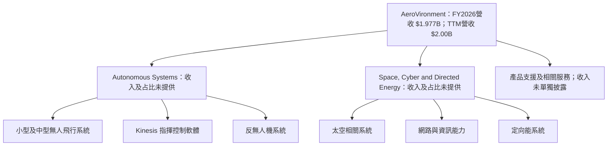
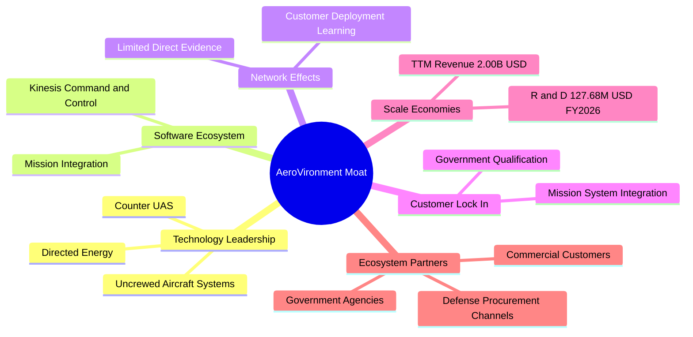
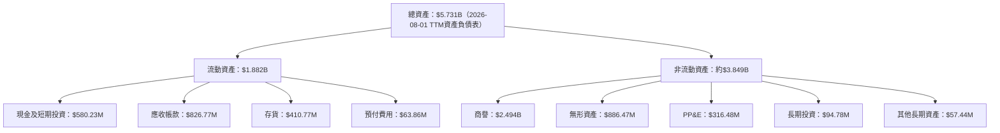
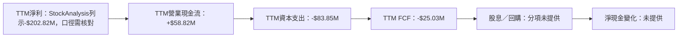
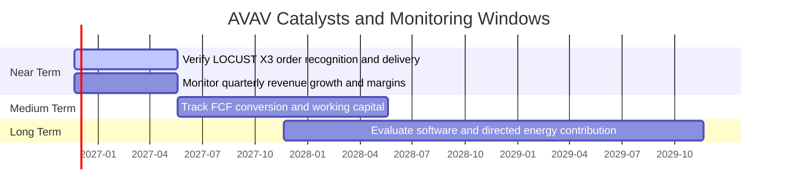
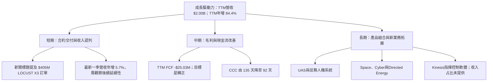
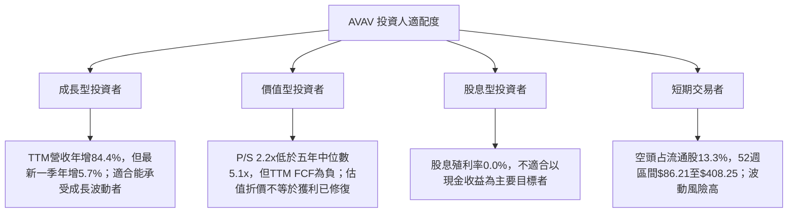

# AVAV 基本面深度分析報告
> **報告日期**：2026-11-21 ｜ **語言**：繁體中文 ｜ **數據來源**：SEC 申報資料 (XBRL)、Yahoo Finance、Finviz、StockAnalysis、Roic.ai ｜ **分析師**：CFA 級機構研究

## 目錄

| # | 章節 | 核心結論 |
|---|------|----------|
| 1 | 執行摘要 | 買入；加權合理價值 $121.04，MOS +28.3% |
| 2 | 公司概覽與商業模式 | 無人系統及相關軟體、服務具有政府採購與任務整合門檻，但產品組合占比資料不足 |
| 3 | 損益表深度分析 | TTM 營收 $2.00B、TTM 成長 84.4%；最新一季年增 5.7%，營業利益仍為負 |
| 4 | 資產負債表分析 | 淨負債 $149.83M；現金與短期投資 $580.23M，流動性尚可但營運資金仍需追蹤 |
| 5 | 現金流量深度分析 | TTM FCF -$25.03M、FCF Yield -0.57%；營收擴張尚未轉化成正自由現金流 |
| 6 | 獲利能力與資本效率 | ROIC -4.4% 對 WACC 9.74%，目前仍在摧毀股東價值 |
| 7 | 相對估值分析 | AVAV P/S 2.2x，低於自身五年中位數 5.1x；同業估值顯示方法間分歧大 |
| 8 | DCF 內在價值評估 | DCF N/A：TTM 營業利益為負；以相對估值與分析師共識加權得 $121.04 |
| 9 | 成長催化劑 | 無人系統需求與新聞所述 LOCUST X3 訂單具催化可能，合約交付節奏與收入占比未提供 |
| 10 | 風險矩陣 | 獲利與現金流轉弱、合約交付波動、估值及股價波動為主要風險 |
| 11 | 投資建議 | 買入；現價 $86.79，依加權合理價值推導的 MOS 10% 買入上限約 $108.94 |

---

## 1. 執行摘要

AVAV 的營收規模快速擴張：TTM 營收為 **$2.00B**，TTM 年增 **84.4%**；但最新一季營收年增只有 **5.7%**，且 TTM 營業利益率為 **-12.6%**、ROIC 為 **-4.4%**，相對 **9.74% WACC** 尚未創造資本報酬。TTM FCF 為 **-$25.03M**，因此不能用正向獲利假設建立可信的 DCF。估值上，三種可計算方法加權得到每股 **$121.04**；以 **2026-11-20 收盤價 $86.79** 計算，MOS 為 **+28.3%**。依規則 20，MOS 雖高於 25%，但 ROIC 低於 WACC，評級為 **買入**，而非強烈買入。

### 1.0 一頁式投資儀表板（Portfolio Manager 30 秒速讀）

| 項目 | 內容 |
|------|------|
| **投資論點（3 句）** | ① TTM 營收 $2.00B、年增 84.4%，顯示業務規模大幅增加。② 最新一季年增降至 5.7%，TTM 營業利益率 -12.6%，成長轉化成獲利仍未證實。③ 加權合理價值 $121.04 對照 2026-11-20 收盤 $86.79，MOS +28.3%，但 TTM FCF -$25.03M 提高估值不確定性。 |
| **綜合評分** | **5.5/10**（引用 1.1；六項算術平均） |
| **財務健康** | 🟡 現金與短期投資 $580.23M、流動比率 4.26；但淨負債 $149.83M，TTM FCF 為負 |
| **ROIC vs WACC** | **-4.4% vs 9.74%**；ROIC 低於資本成本，現階段摧毀股東價值 |
| **FCF 趨勢** | FY2026 年度 FCF -$164.62M；最新 TTM FCF -$25.03M，改善但未轉正；TTM FCF Yield **-0.57%** |
| **估值** | Forward P/E 約 **19.7x**（市場資料）；EV/EBITDA **21.3x**（市場資料）；FCF Yield **-0.57%**（VERIFIED FIGURES） |
| **DCF 內在價值（基準）** | **N/A**；TTM 營業利益為負，DCF 模型不適用。DCF 折溢價亦為 N/A |
| **安全邊際（MOS）** | **+28.3%＝($121.04 − $86.79) ÷ $121.04**；基準為加權合理價值 $121.04，🟢 >25% |
| **預期報酬（基準情境 12M）** | DCF 基準情境 N/A；加權合理價值所示上行空間 **+39.5%**，不等同於保證的 12 個月報酬 |
| **關鍵風險（前二）** | 最新一季營收年增只有 5.7%；ROIC -4.4%、TTM FCF -$25.03M，成長與資本回報尚未同步 |
| **評級 + 信心度** | 🟢 **買入** ｜ 信心：**中低**；估值折價支撐評級，獲利及現金流的不確定性限制信心 |

### 1.1 綜合評分卡（全報告唯一）

| 維度 | 評分（1–10） | 主要依據（引用數字與其來源章節） |
|------|--------------|----------------------------------|
| 成長性 | 7.5 | TTM 營收年增 84.4%，但最新一季年增 5.7%；見第 3 章 |
| 獲利能力 | 2.0 | TTM 營業利益率 -12.6%、ROIC -4.4%，Piotroski F-Score 4/9；見第 3、6 章 |
| 財務健康 | 5.0 | 淨負債 $149.83M、現金與短期投資 $580.23M、CCC 92 天；見第 4 章 |
| 估值 | 7.0 | MOS +28.3%，P/S 2.2x 低於五年中位數 5.1x；見第 7、8 章 |
| 護城河 | 7.0 | 無人系統、控制軟體及政府採購整合可形成轉換與認證門檻，但未有市場份額或軟體收入占比數據；見第 2 章 |
| 管理層與資本配置 | 4.5 | FY2026 SBC $38.33M、股數未能通過 Piotroski 稀釋股數測試，且年度 FCF -$164.62M；見第 3、5、6 章 |
| **綜合評分** | **5.5** | 六項算術平均：$(7.5+2.0+5.0+7.0+7.0+4.5)÷6=5.5$ |

### 1.2 五大投資論點 + 三大核心風險

| 類型 | 項目 | 具體依據 | 信心度 |
|------|------|----------|--------|
| 🟢 **投資論點①** | TTM 規模擴張 | TTM 營收 $2.00B、年增 84.4%；但最新一季年增 5.7%，需要判斷前期高增長是否可持續 | 🟡 中 |
| 🟢 **投資論點②** | 相對自身歷史的估值折價 | P/S 2.2x，低於五年中位數 5.1x，並低於歷史區間下緣 3.0x；可能反映股價下跌，也可能反映市場對獲利品質的折價 | 🟡 中 |
| 🟢 **投資論點③** | 現金及短期投資提供流動性緩衝 | 現金與短期投資 $580.23M，流動比率 4.26 | 🟡 中 |
| 🟢 **投資論點④** | 無人系統與任務軟體具整合性 | 公司提供 UAS、指揮控制軟體及相關服務；若客戶需系統整合與任務支援，轉換供應商成本可能偏高 | 🟡 中 |
| 🟢 **投資論點⑤** | 新型定向能系統訂單新聞提供催化可能 | 近期新聞標題提及 $405M LOCUST X3 訂單；尚缺合約交付期程、認列方式與營收占比 | 🟡 中低 |
| 🟡 **風險①** | 成長降速而獲利仍為負 | 最新一季營收年增 5.7%，營業利益率 -2.3%；若營收成長再放緩，固定成本吸收能力可能惡化 | 🔴 高衝擊 |
| 🔴 **風險②** | FCF 與資本效率未改善 | TTM FCF -$25.03M、ROIC -4.4% 對 WACC 9.74%；若資本投入長期無法轉化為正現金流，合理價值應下修 | 🔴 高衝擊 |
| 🟡 **風險③** | 股價波動及空頭部位較高 | 24 個月價格由 2025-10 月 $369.91 降至 2026-11 月 $86.79；空頭占流通股 13.3% | 🟡 中高 |

### 1.3 快速統計卡片

| 指標 | 公司實際值（期間） | 同業中位數 | 狀態 |
|------|--------------------|------------|------|
| 營收成長（TTM） | **84.4%** | — | 🟢 |
| 營收成長（最新一季年增） | **5.7%** | 35.7%（KTOS、ONDS、LMT 中位數） | 🔴 |
| 毛利率（TTM） | **26.5%** | 23.0%（同業中位數 23.0%） | 🟢 |
| 營業利益率（TTM） | **-12.6%** | — | 🔴 |
| ROIC（TTM） | **-4.4%** | — | 🔴 |
| Forward P/E | **19.7x** | 20.5x（KTOS、LMT 中位數） | 🟡 |
| FCF Yield（TTM） | **-0.57%** | — | 🔴 |
| Piotroski F-Score | **4 / 9** | — | 🟡 |

> 同業最新一季營收年增中位數為 **35.7%**，計算自 KTOS 35.7%、ONDS 1,558.6%、LMT 11.3%；ONDS 的極高增長會推高中位數附近的分布解讀，且三家公司規模與基期不同，不能直接視為可比成長門檻。

### 1.4 投資結論

```text
╔══════════════════════════════════════════════════════════════════╗
║                    📊 投資結論摘要                               ║
╠══════════════════════════════════════════════════════════════════╣
║  評級：買入（MOS +28.3%，但 ROIC -4.4% 低於 WACC 9.74%）         ║
║  價格（2026-11-20 收盤）：$86.79                                 ║
║  DCF 內在價值（基準）：N/A（TTM 營業利益為負）                   ║
║  DCF 折溢價：N/A                                                  ║
║  安全邊際 MOS：+28.3%（＝($121.04−$86.79)÷$121.04）             ║
║  加權合理價值（8.8）：$121.04                                    ║
║  DCF 情境價值：N/A（DCF MODEL 未計算，故不提供情境目標價）       ║
║  綜合評分：5.5/10（引用 1.1）                                    ║
║  適合投資人：可承受高波動、接受獲利與現金流尚未穩定的成長型投資人║
╚══════════════════════════════════════════════════════════════════╝
```

---

## 2. 公司概覽與商業模式

### 2.1 業務結構與收入來源

AVAV 為美國國防科技供應商，財務資料列出 Autonomous Systems 及 Space, Cyber and Directed Energy 兩個業務板塊；亦提供小型與中型無人飛行系統、指揮控制軟體、反無人機系統及相關產品與服務。公司年營收可引用值為 FY2026 **$1.977B**，TTM **$2.00B**；各板塊收入與占比未提供，因此不推估分部貢獻。



> Mermaid 業務圖中的營收數字取自 FY2026 年營收資料；各業務板塊的金額與比例未提供，故不以圖示推估。

### 2.2 市場份額

市場份額數據未提供。AVAV 的 TTM 營收為 $2.00B，TTM 成長 84.4%，但最新一季年增率降至 5.7%；同業最新一季年增中位數為 35.7%，AVAV 最近一季增速低於該中位數。沒有市場總量與產品分類營收，無法據此估算市占率。

### 2.3 競爭護城河分析



### 2.4 護城河強度

| 護城河項目 | 強度（強／中／弱） | 證據（引用數字或事實） | 會削弱它的情況 |
|------------|--------------------|------------------------|----------------|
| 技術與任務整合 | 中 | 產品涵蓋 UAS、反無人機、指揮控制軟體及定向能；FY2026 R&D $127.68M | 技術迭代落後、可靠性或成本不具競爭力 |
| 軟體生態系統 | 中 | 公司提供 Kinesis 指揮控制軟體；軟體營收與經常性收入占比未提供 | 軟體未形成獨立續約收入，或客戶可低成本替代 |
| 客戶鎖定 | 中 | 政府與任務系統採購涉及認證、訓練及整合，可能增加轉換成本；具體合約年期未提供 | 客戶重新競標、任務需求改變或競爭者取得資格 |
| 網路效應 | 弱至中 | 客戶部署經驗或任務資料可能累積，但資料未量化客戶與平台網路效應 | 缺乏跨客戶共享效益，系統依單一專案交付 |
| 規模效應 | 中 | TTM 營收 $2.00B，FY2026 R&D $127.68M | 低毛利訂單、整合成本或併購相關費用抵銷規模效益 |
| 生態夥伴 | 中 | 公司面向政府機構與企業客戶；合作夥伴和通路營收資料未提供 | 供應鏈受限、合作關係改變或政府採購延宕 |

**1.1 護城河分數為 7.0/10**：產品與軟體組合及政府採購整合支持中等以上的進入門檻，但沒有市占率、分部收入或軟體經常性收入數字驗證其持久性。

---

## 3. 損益表深度分析

### 3.1 年度收入成長趨勢（近 4 年）

年度財務表列示 FY2023–FY2026 營收；FY2026 採 StockAnalysis 年營收 $1.977B，以便與其列示的年增率一致。年度財務資料不同來源的 FY2026 營收數字有小幅差異，評估年增率時採用同一組序列。

```text
╔══════════════════════════════════════════════════════════════════╗
║              AVAV 年度收入趨勢（FY2023-FY2026）                 ║
╠══════════════════════════════════════════════════════════════════╣
║  FY2023  $0.541B  █████░░░░░░░░░░░░░░░░░░░  YoY: +21.3% 🟢   ║
║  FY2024  $0.717B  ████████░░░░░░░░░░░░░░░░  YoY: +32.6% 🟢   ║
║  FY2025  $0.821B  █████████░░░░░░░░░░░░░░░  YoY: +14.5% 🟡   ║
║  FY2026  $1.977B  ████████████████████████  YoY: +140.9% 🟢  ║
║                                                                  ║
║  FY2023 至 FY2026 CAGR：((1.977 ÷ 0.54054)^(1/3) − 1) ≈ 54.1%  ║
╚══════════════════════════════════════════════════════════════════╝
```

FY2026 營收跳升，代表規模擴張顯著，但不能單憑單年增幅判定有機成長。TTM 成長 84.4% 與最新一季年增 5.7% 的差異，顯示高成長基期或交付節奏可能造成期間間落差；公司未提供本資料可引用的有機成長與併購拆分，應以後續季度確認收入延續性。

### 3.2 季度收入趨勢分析

| 季度（截至） | 營收 | QoQ 成長 | YoY 成長 | 備註 |
|--------------|------|----------|----------|------|
| 2025-10-31 | $472.51M | +182.0%（對比 2025-07-31 的 $167.64M） | +150.72% | 對比上一季低基期，QoQ 變化大 |
| 2026-01-31 | $408.05M | -13.6% | +143.41% | 年增率仍高，但季營收回落 |
| 2026-04-30 | $641.62M | +57.2% | +133.27% | 季度交付可能集中；不宜直接年化 |
| 2026-08-01 | $480.49M | -25.1% | +5.68% | 最新一季年增明顯放緩 |

QoQ 公式為「當季營收 ÷ 前一季營收 − 1」；YoY 取單季年增率資料。季營收受合約交付節奏影響可能較大，最新一季年增從前三季逾 130% 降到 5.68%，是本報告核心監控訊號。另有季度表把期末標為 2026-07-31，而 SEC 申報資訊標示最新季度截至 2026-08-01；分析以提供的單季財務數值為準。

### 3.3 利潤率演變分析

| 利潤率指標 | FY2023 | FY2024 | FY2025 | FY2026 | 趨勢 | 評估 |
|------------|--------|--------|--------|--------|------|------|
| **毛利率** | 32.1% | 39.6% | 38.8% | 25.3% | FY2026 明顯下降 | 🔴 |
| **營業利益率** | -4.2% | 10.0% | 7.2% | -3.6% | 連續兩年轉弱，FY2026 為負 | 🔴 |
| **淨利率** | -32.6% | 8.3% | 5.3% | -13.4% | FY2026 淨損擴大 | 🔴 |

計算口徑：毛利率＝毛利 ÷ 營收；營業利益率＝營業利益 ÷ 營收；淨利率＝淨利 ÷ 營收。TTM 淨利率為 -10.1%；TTM 營業利益率按 SEC 優先數字為 -12.6%，與另一組合併財務資料所列 -0.6% 不一致。此處引用 VERIFIED FIGURES 的 -12.6%，並將差異列為資料限制，而非自行調整。

**利潤率演變深度解析：**FY2026 毛利率由 FY2025 約 38.8% 降至約 25.3%，同期毛利 $500.64M、營業利益 -$70.29M。毛利率下降可能與產品組合、合約階段、產能擴張或成本有關，但分部毛利與管理層原因未提供，不能將某一原因當成已驗證事實。FY2026 R&D 增至 $127.68M，較 FY2025 $100.73M 增約 26.8%；研發支出可能支持新產品，但亦會壓低短期利潤，後續須觀察收入增長能否吸收固定成本。

### 3.4 費用結構分析

費用細項如銷售與管理費、重整費用、併購相關成本及各分部成本未完整提供，故不繪製會暗示精確分配的圓餅圖。可量化項目包括：

```text
╔══════════════════════════════════════════════════════════════════╗
║              FY2026 已知費用與獲利項目                          ║
╠══════════════════════════════════════════════════════════════════╣
║  營收                 $1,977M                                   ║
║  毛利                   $500.64M                                 ║
║  R&D                    $127.68M（約營收 6.5%）                  ║
║  營業利益               -$70.29M                                 ║
║  毛利減營業利益          約 $570.93M（其他營業費用合計推算）    ║
║  非 R&D 費用拆分        未提供                                   ║
╚══════════════════════════════════════════════════════════════════╝
```

$570.93M 由毛利減營業利益推得，只代表其他營業費用的合計差額，不代表單一費用項目；未將其分配至未披露的費用分類。

### 3.5 季度 EPS 趨勢與盈餘品質（Quality of Earnings）

| 季度（截至） | EPS 預估 | EPS 實際 | 盈餘結果 | 可引用的單季淨利 |
|--------------|----------|----------|----------|------------------|
| 2026-07-31 | N/A | N/A | 超預期／不及預期無法判定 | -$5.07M |
| 2026-04-30 | N/A | N/A | 超預期／不及預期無法判定 | -$24.10M |
| 2026-01-31 | N/A | N/A | 超預期／不及預期無法判定 | -$243.82M |
| 2025-10-31 | N/A | N/A | 超預期／不及預期無法判定 | -$17.10M |

四季 EPS Est 與 EPS Act 均為缺漏值，不能把空值視作未達標，也不能據此聲稱連續 beat 或 miss。季度淨利表顯示 Q3 FY2026 淨損較大，但非營業項目細節未提供。

| 盈餘品質項目 | 數值/佔比 | 評估 |
|--------------|-----------|------|
| 股權薪酬 SBC / 營收 | FY2026：$38.33M ÷ $1,977M = **1.94%** | 🟡 對每股持股有稀釋成本；FY2026 SBC 同比 FY2025 $21.46M 增加約 78.6% |
| SBC / 營業現金流 | FY2026 OCF 為 -$78.40M，正值 SBC 除以負 OCF 不具解讀性 | 🔴 OCF 為負，無法以現金流覆蓋 SBC 衡量 |
| FCF / 淨利（現金轉換率） | TTM FCF -$25.03M；TTM 淨利未在 VERIFIED FIGURES 提供，StockAnalysis 顯示 TTM 淨利 -$202.82M | N/A（雙負值比率易誤導，且來源口徑有差異） |
| 一次性/非經常性損益 | 明細未提供 | N/A；FY2026 淨損 -$265.12M、營業損失 -$70.29M，差額不能在缺乏附註時指定為一次性項目 |
| 有效稅率異常 | N/A | 稅前所得與所得稅明細未提供，無法判斷稅務利益是否影響盈餘 |
| 資本化支出 vs 費用化 | FY2026 Capex $86.22M（年度表列支出）；資本化政策細節未提供 | Capex 為現金流支出，不足以判斷成本是否不當資本化 |

**盈餘品質結論：**FY2026 與 TTM 的營業獲利及自由現金流均為負，帳面淨損並未被正 FCF 支持。FY2026 SBC 為營收 1.94%，股權薪酬造成實際稀釋成本；Piotroski 稀釋股數測試未通過。現階段估值不宜只看 Forward P/E，應優先要求毛利率、營業利益率與 FCF 同步改善。

---

## 4. 資產負債表分析

### 4.1 資產結構分解



資產分項合計因資料顯示四捨五入可能有小幅差異。商譽與無形資產合計約 **$3.380B**，約占 $5.731B 總資產 **59.0%**；這使未來若相關業務現金流不及預期，商譽及無形資產減損可能成為風險，但不能僅據此推定將發生減損。

### 4.2 流動性與營運資金分析

| 指標 | 最新 TTM | 一年前 TTM | 變化 | 解讀 |
|------|----------|------------|------|------|
| 流動比率 | 4.26 | N/A | N/A | 短期資產相對流動負債有緩衝；一年前相同口徑未提供 |
| 速動比率 | 3.185 | N/A | N/A | 排除部分流動資產後仍有流動性緩衝 |
| DSO 應收帳款天數 | 33 天 | 67 天 | -34 天 | 收款天數大幅下降，可能反映回款效率改善；仍需與合約付款節點核對 |
| DIO 存貨天數 | 102 天 | 113 天 | -11 天 | 存貨天數下降，方向有利，但絕對水準仍應追蹤產品交付與存貨適配 |
| DPO 應付帳款天數 | 43 天 | 44 天 | -1 天 | 付款天數大致穩定，未顯示明顯延長付款以支撐現金流 |
| CCC 現金轉換週期 | 92 天 | 135 天 | -43 天 | 現金轉換週期縮短，營運資金占用相較一年前減少 |

營運資金天數照抄 QUALITY FIGURES 的計算結果，未重算。CCC 改善是正面訊號，但應收帳款餘額達 $826.77M，仍需結合收入認列和合約回款追蹤。

### 4.3 債務結構分析

VERIFIED FIGURES 的總債務為 **$730.06M**；另一組合併市場資料列示 $850.82M。兩者定義或期間存在差異，本分析按指定優先級採用 $730.06M，不混用兩套數值。

```text
╔══════════════════════════════════════════════════════════════════╗
║                   AVAV 債務健康診斷                              ║
╠══════════════════════════════════════════════════════════════════╣
║  總債務：        $730.06M                                        ║
║  現金＋短期投資：$580.23M                                        ║
║  淨負債：        $149.83M ＝ $730.06M − $580.23M                ║
║                                                                  ║
║  流動比率：      4.26x  🟢                                       ║
║  速動比率：      3.185x 🟢                                       ║
║  Debt/EBITDA：   不採用：TTM營業利益為負，EBITDA資料口徑不一致  ║
║  利息保障倍數：  N/A（利息費用與可比EBIT口徑未提供）             ║
╚══════════════════════════════════════════════════════════════════╝
```

公司有淨負債，但現金與短期投資覆蓋約 **79.5%** 總債務（$580.23M ÷ $730.06M）。這能提供流動性緩衝，卻不等於低財務風險：目前營業利益為負，利息保障倍數無法用正營業利益評估。

### 4.4 股東權益趨勢

```text
╔══════════════════════════════════════════════════════════════════╗
║                AVAV 歷年股東權益（財年結束）                     ║
╠══════════════════════════════════════════════════════════════════╣
║  FY2023  $0.551B  ███░░░░░░░░░░░░░░░░░░░░░                     ║
║  FY2024  $0.823B  █████░░░░░░░░░░░░░░░░░░░░                     ║
║  FY2025  $0.887B  █████░░░░░░░░░░░░░░░░░░░░                     ║
║  FY2026  $4.400B  █████████████████████████                     ║
╚══════════════════════════════════════════════════════════════════╝
```

FY2026 股東權益由 FY2025 $886.51M 增至 $4.40B，增幅遠高於此前年度變化；同期總資產由 $1.12B 增至 $5.72B。資料未提供此變化的權益、併購或發股完整拆分，因此不將增加全部歸因於單一事項。需留意股東權益大增並未伴隨 FY2026 正營業利益，帳面資本擴大仍須由未來營運回報支撐。

---

## 5. 現金流量深度分析

### 5.1 現金流量瀑布圖

最新 TTM 數據可提供營業現金流、資本支出及 FCF；股息、回購及現金淨變化的 TTM 分項未提供，因此圖中不推算這些項目。



### 5.2 FCF 轉換率趨勢

| 財年／期間 | 營業現金流 | 資本支出 | FCF | 淨利 | FCF/淨利 |
|------------|------------|----------|-----|------|----------|
| FY2023 | $11.40M | $14.87M | -$3.47M | -$176.21M | N/M（淨利為負） |
| FY2024 | $15.29M | $24.48M | -$9.19M | $59.67M | -15.4% |
| FY2025 | -$1.32M | $22.82M | -$24.13M | $43.62M | -55.3% |
| FY2026 | -$78.40M | $86.22M | -$164.62M | -$265.12M | N/M（雙負值比率不具直觀意義） |
| TTM 至 2026-08-01 | $58.82M | $83.85M | -$25.03M | N/A（優先數據未提供） | N/A |

年度表中資本支出欄以正值列作支出金額；計算 FCF 時使用 OCF − Capex。歷年 FCF 均為負，FY2026 年度尤其明顯；最新 TTM FCF 相對 FY2026 全年收窄，代表現金流有改善，但尚未轉正。

### 5.3 自由現金流趨勢

```text
╔══════════════════════════════════════════════════════════════════╗
║                  AVAV 自由現金流趨勢                             ║
╠══════════════════════════════════════════════════════════════════╣
║  FY2023  -$3.47M    ◀░░░░░░░░░░░░░░░░░░░░░░░░░░              ║
║  FY2024  -$9.19M    ◀█░░░░░░░░░░░░░░░░░░░░░░░░              ║
║  FY2025 -$24.13M    ◀███░░░░░░░░░░░░░░░░░░░░░              ║
║  FY2026 -$164.62M   ◀█████████████████████████              ║
║  TTM    -$25.03M    ◀████░░░░░░░░░░░░░░░░░░░░              ║
║                                                                  ║
║  TTM FCF Yield：-0.57%（依 VERIFIED FIGURES，市值為分母）       ║
╚══════════════════════════════════════════════════════════════════╝
```

年度 FCF 與 TTM FCF 不能視為同一期間；TTM FCF 由最新 12 個月營業現金流減資本支出計算，按 VERIFIED FIGURES 為 -$25.03M。另一合併財務區塊列示資本支出 $103.60M、FCF -$44.78M，與優先數字不一致，本報告不混用。

### 5.4 資本配置評估

資本配置金額中，只有資本支出與 SBC 的歷史數值可引用；回購、股息、併購支付及留存現金的完整分項沒有可比明細，因此不畫資本配置圓餅圖。

| 資本配置項目 | 可引用數據 | 評估 |
|--------------|------------|------|
| 資本支出 | FY2026 $86.22M；FY2025 $22.82M | FY2026 投資支出增加，需觀察後續產能與產品交付是否轉化為現金流 |
| 股權薪酬 | FY2026 $38.33M；FY2025 $21.46M | SBC 增長高於收入增長幅度，增加股東稀釋成本 |
| 股息 | 股息殖利率 0.0% | 無現金股息回饋 |
| 回購、併購、其他投資 | 分項未提供 | N/A，不推估比例 |
| 淨資本配置結果 | FY2026 年度 FCF -$164.62M；TTM FCF -$25.03M | 資本投入後現金生成尚未轉正 |

---

## 6. 獲利能力與資本效率

### 6.1 ROE / ROA / ROIC 趨勢

| 指標 | 目前可用數值 | 評估 |
|------|--------------|------|
| ROE（TTM） | -4.6% | 股東權益報酬為負 |
| ROA（TTM） | -0.1%（合併市場資料） | 資產使用尚未產生正向淨報酬；與 Piotroski 的 ROA 未通過方向一致 |
| ROIC（TTM） | -4.4% | 低於 9.74% WACC，正在摧毀價值 |
| 歷年 ROIC | N/A（本資料未提供一致口徑完整年度序列） | 不以不同來源零散數字自行拼接 |
| 行業均值 | 不列示 | 未提供可驗證的同業 ROIC 對照 |

### 6.2 ROIC vs WACC 分析（核心價值創造判斷）

```text
╔══════════════════════════════════════════════════════════════════╗
║                ROIC vs WACC 深度分析                            ║
╠══════════════════════════════════════════════════════════════════╣
║  WACC 輸入（Cost of capital）：                                  ║
║  ├── 無風險利率（10Y美債）：4.91%                                ║
║  ├── 市場風險溢酬 ERP：5.00%                                     ║
║  ├── 原始 Beta：1.40；調整後 Beta：1.27                          ║
║  ├── 股權成本 = 4.91% + 1.27×5.00% = 11.26%                    ║
║  ├── 稅前債務成本：0.77%；稅後約 0.61%                           ║
║  ├── 股權／債務權重：85.8%／14.2%                               ║
║  └── 採用 WACC：9.74%（VERIFIED FIGURES）                       ║
║                                                                  ║
║  ROIC（TTM）：-4.4%                                              ║
║  EVA spread = ROIC − WACC = -4.4% − 9.74% = -14.14 pp           ║
║                                                                  ║
║  ROIC  -4.4%  ◀ 負報酬，低於資本成本                            ║
║  WACC   9.74%  ━━━━━━━━━━━━━━━━ 資金成本基準                     ║
║  EVA   -14.14pp 🔴 摧毀股東價值                                 ║
╚══════════════════════════════════════════════════════════════════╝
```

股權成本依提供的 CAPM 輸入計算：$4.91\% + 1.27 \times 5.00\%=11.26\%$。稅後債務成本按 0.77% × (1−21%) 約為 0.61%。以已四捨五入的權重與組成試算，$85.8\%\times11.26\%+14.2\%\times0.61\%\approx9.75\%$；與資料列示 WACC **9.74%** 相差約 0.01 個百分點，可能來自底層未四捨五入輸入。估值與資本效率分析均採用 VERIFIED FIGURES 的 **9.74%**，不另建替代 WACC。

**價值創造判斷：**ROIC -4.4% 低於 WACC 9.74%，spread 為 -14.14 個百分點。現階段公司投入資本尚未獲得足以覆蓋資金成本的回報；未來只有在營業利潤轉正、資本周轉提升且新增投資回報超過 WACC 時，才能扭轉此結論。

### 6.3 杜邦三因素分解

| 因素 | 數值（TTM） | 解讀 |
|------|-------------|------|
| 淨利率 | -10.1% | 負淨利率是 ROE 為負的主要原因 |
| 資產週轉率 | 0.35 | 每單位資產所產生營收有限；併購後總資產擴大亦會影響此比率 |
| 權益乘數 | 1.30 | 槓桿未顯示為 ROE 的主要放大來源 |
| **ROE** | **-4.6%** | QUALITY FIGURES 列示：-10.1% × 0.35 × 1.30 = -4.6% |

ROE 主要受負淨利率拖累，不是靠高財務槓桿掩蓋營運弱勢。三因素乘積按展示值計算可能因四捨五入與底層精度有微小差異，採用 QUALITY FIGURES 所列 ROE -4.6%。

### 6.4 財務體質：Piotroski F-Score

Piotroski F-Score 為 **4/9**；逐項結果照 QUALITY FIGURES 列示。

| 測試 | 結果 | 解讀 |
|------|------|------|
| ROA > 0 | ❌ 未通過 | 資產報酬仍為負 |
| 營業現金流 > 0 | ✅ 通過 | 最新 TTM 營業現金流 $58.82M 為正 |
| ROA 高於一年前 | ❌ 未通過 | 資產報酬未改善 |
| 營業現金流 > 淨利（應計品質） | ✅ 通過 | 現金流相對會計淨利表現較佳，但仍不代表 FCF 為正 |
| 長期負債 ÷ 總資產低於一年前 | ✅ 通過 | 相對槓桿方向改善 |
| 流動比率高於一年前 | ❌ 未通過 | 流動比率比較未改善 |
| 稀釋股數未增加 | ❌ 未通過 | 股數增加可能稀釋每股經濟利益 |
| 毛利率高於一年前 | ❌ 未通過 | 與 FY2026 毛利率下降一致 |
| 資產週轉率高於一年前 | ✅ 通過 | 資產利用效率指標改善 |

4/9 反映現金流、負債比率及資產週轉有部分正面訊號，但獲利、毛利率與股數變化仍是短板。

---

## 7. 相對估值分析

### 7.1 同業估值比較表格

| 估值指標 | **AVAV** | **KTOS** | **ONDS** | **LMT** | AVAV 評估 |
|----------|----------|---------|---------|---------|-----------|
| **Trailing P/E** | N/A（TTM EPS -$4.05） | 224.1x | N/A | 20.1x | 🔴 AVAV 尚未有正 TTM EPS |
| **Forward P/E** | 19.7x（市場資料） | 24.0x | -24.3x | 17.0x | 🟡 AVAV 接近同業中位數 20.5x，但 ONDS 為負數，不納入該中位數 |
| **P/S Ratio** | 2.2x | 3.1x | 6.7x | 1.7x | 🟢 AVAV 低於三者中位數 3.1x |
| **EV/EBITDA** | 21.3x（市場資料） | 43.4x | -5.2x | 14.7x | 🟡 AVAV 高於同業中位數 14.7x；ONDS EBITDA 為負，倍數解讀有限 |
| **最新一季營收 YoY** | 5.7% | 35.7% | 1,558.6% | 11.3% | 🔴 AVAV 低於三家同業 |

Peer multiples 來源為 Yahoo Finance；AVAV 的市場倍數取合併市場資料，與 Peer multiples 的來源及口徑不完全一致。Forward P/E 同業中位數為 KTOS 24.0x 與 LMT 17.0x 的中位數 **20.5x**；相對 P/S 中位數為 KTOS、ONDS、LMT 的 **3.1x**。ONES 極高營收年增與負 EBITDA 顯示比較須考慮基期與獲利差異。

### 7.2 歷史估值區間分析

資料提供的是歷史 **P/S**，不是 P/E；因此依可用指標呈現，不推估 P/E 歷史百分位。

```text
╔══════════════════════════════════════════════════════════════════╗
║             AVAV 五年 P/S 歷史區間（TTM）                        ║
╠══════════════════════════════════════════════════════════════════╣
║  歷史低點：3.0x        現值：2.2x        歷史中位數：5.1x        ║
║  歷史區間：3.0x ├──────────────────────────────┤ 13.4x            ║
║  現值 2.2x：低於五年區間下緣；當前百分位排名 0%                 ║
╚══════════════════════════════════════════════════════════════════╝
```

P/S 低於歷史區間下緣且百分位排名 0%，反映市場對近期經營或股價的重新定價；低估值不自動等於低風險，因為 FY2026 營業利益為負、TTM FCF 為負，營收倍數可能合理反映獲利折價。

### 7.3 情境價值（Bear / Base / Bull，照抄 DCF MODEL 的 Scenarios）

**N/A（DCF 無法計算：TTM 營業利益不為正，DCF MODEL 未提供悲觀、基準與樂觀情境數值）。**不自行設定情境目標價、成長率、退出倍數或機率。

### 7.4 相對估值隱含價格區間

以下每股價值與權重依估值方法資料列示；價格均為 USD。

```text
╔══════════════════════════════════════════════════════════════════╗
║             相對估值隱含價格與市場位置                          ║
╠══════════════════════════════════════════════════════════════════╣
║  $86.79 現價 ── $90.44 Forward P/E ───── $121.15 同業 P/S       ║
║                         └──────────── $212.20 分析師共識           ║
╚══════════════════════════════════════════════════════════════════╝
```

- **同業 Forward P/E：$90.44**，依同業中位數 **20.5x**（KTOS 24.0x、LMT 17.0x）乘以公司 Forward EPS **$4.41**。$20.5 \times $4.41 = $90.405，資料列示的每股估值為 $90.44；採用指定估值方法原值。
- **同業 P/S：$121.15**，依 KTOS、ONDS、LMT 的同業 P/S 中位數 **3.1x** 及公司 TTM 營收計算；估值方法提供的每股價值照用。
- **分析師共識目標價：$212.20**，來自 23 位分析師平均目標價。該數字為市場預測，不等同於可驗證的現金流內在價值。

---

## 8. DCF 內在價值評估（Discounted Cash Flow）

> **DCF MODEL：N/A。**SEC 申報資料計算的 TTM 營業利益不為正，程式模型未提供逐年預測、終值、橋接、敏感性矩陣或反推 DCF。依方法限制，不另建 DCF，也不提供虛構的 DCF 每股價值、情境價值或敏感度結果。

### 8.0 估值推理鏈（Thinking Logic）

**Step 1 — AVAV 的價值由哪些變數決定？**  
理論上，公司價值取決於現有無人系統業務的獲利與現金流、Space/Cyber/Directed Energy 等業務的成長，以及軟體與服務的持續收入；但分部營收及占比未提供，不能可靠拆分各項價值。現有可驗證錨點為 TTM 營收 $2.00B、TTM 營業利益率 -12.6% 及 FCF -$25.03M。估值目前最主導的變數不是終值假設，而是公司能否將營收轉化為正營業利益及正 FCF。

**Step 2 — 採用何種模型、為什麼？**

| 決策點 | 本報告採用 | 理由（含數字） | 曾考慮但否決 | 否決理由 |
|--------|-----------|----------------|--------------|----------|
| 現金流定義 | 不適用 | TTM 營業利益為負；程式提供 DCF MODEL：N/A | FCFF／FCFE 自建模型 | 不符合禁止自行建模規則，且負營業利益使模型結果不具可靠性 |
| 預測期 N | N/A | 程式未提供預測期 | 自行設 5–10 年 | 缺乏管理層財測及模型依據 |
| 終值方法 | N/A | 沒有有效正營業利益模型 | Gordon Growth／退出倍數 | 無程式提供的年度 FCFF 或終值輸入 |
| EBIT 基礎 | N/A | 不建立 DCF | GAAP／非 GAAP | 無逐年 EBIT 預測可供計算 |

**Step 3 — 關鍵假設推導鏈**  
營收 CAGR、期末營業利潤率、稅率、Capex/營收、D&A/營收、營運資金變動、SBC、股數稀釋、永續成長率與終值方法均未由 DCF MODEL 提供。由於 DCF 明確為 N/A，不能替這些項目填入自行估計數值。ROIC/WACC 使用已提供資料，見 6.2。

**Step 4 — 推理鏈最脆弱的一環**  
最脆弱處是把營收規模增長轉化為可持續的正營業利潤與現金流；若毛利率持續下降或營運費用無法被規模效應吸收，基於營收倍數的合理價值也會下修。

**Step 5 — 計算路徑**  
由於模型無有效輸出，不繪製會暗示可計算 DCF 價值的數字流程圖。此報告採用已提供的相對估值與分析師共識交叉驗證。

### 8.1 模型假設總表（Model Inputs）

**N/A（數據未提供：DCF MODEL 無逐年預測假設，且原因為 TTM 營業利益不為正）。**本節不自行補入 N、營收 CAGR、利潤率、稅率、Capex、D&A、營運資金、SBC、稀釋率、永續成長率或終值假設。

### 8.2 折現率參考（WACC）

本節列出已提供的資本成本作為第 6.2 節的交叉參照，**不代表以此建立 DCF**。

```text
╔══════════════════════════════════════════════════════════════════╗
║                 WACC 輸入（僅作資本成本參考）                    ║
╠══════════════════════════════════════════════════════════════════╣
║  無風險利率 Rf：4.91%                                            ║
║  ERP：5.00%                                                      ║
║  原始 Beta：1.40                                                 ║
║  調整後 Beta：1.27 = ⅔×1.40 + ⅓×1.00                            ║
║  股權成本：4.91% + 1.27×5.00% = 11.26%                          ║
║  稅前債務成本：0.77%；預設稅率 21.0%                             ║
║  稅後債務成本：0.77%×(1−21.0%) = 0.6083% ≈ 0.61%                ║
║  股權／債務權重：85.8%／14.2%                                   ║
║  採用 WACC：9.74%（照用 Cost of capital 數值）                  ║
╚══════════════════════════════════════════════════════════════════╝
```

輸入值由 Cost of capital 資料列示；無風險利率的具體觀測日及 ERP 的外部來源細節未提供，不另加自訂溢酬。採用 Beta used (adjusted) 1.27，原始 Beta 1.40。以已四捨五入權重和組成重算約為 9.75%，與指定 WACC 9.74% 有約 0.01 個百分點的展示精度差，分析仍以 9.74% 為準。由於沒有 DCF 模型，以下不作預測期 FCF 折現。

### 8.3 逐年自由現金流預測（基準情境）

**N/A（DCF MODEL 未提供逐年 FCFF 預測；TTM 營業利益為負）。**不列 FY+1 至 FY+N 表格、不推算預測期現值合計，也不繪製歷史實際與模型預測的混合圖表。

### 8.4 終值計算（Terminal Value）

**N/A（沒有 DCF 預測期末 FCFF、永續成長率或退出倍數）。**因此無法執行 WACC 與 g 的適用性比較，也不計算 Gordon Growth 或退出倍數終值。

### 8.5 企業價值 → 每股內在價值（Bridge）

**N/A（沒有預測期現金流現值與終值，無法橋接 EV 至股權價值及每股價值）。**DCF 折溢價亦為 N/A。此處不計算 MOS；全報告 MOS 只使用 8.8 的加權合理價值。

### 8.6 敏感性分析（WACC × 永續成長率）

**N/A（DCF MODEL 未提供敏感性矩陣；不存在可引用的基準每股 DCF 價值）。**不自行填入 WACC/g 矩陣、情境價值或彈性數字。

### 8.7 反推 DCF（Reverse DCF：市場在預期什麼）

**N/A（沒有有效 DCF 基準模型與逐年現金流，無法以現價 $86.79 反解單一營運變數）。**不以自建試算取代程式模型。可查核的市場參考是 Forward EPS $4.40823、Forward P/E 約 19.7x，但此為市場倍數，不是反推 DCF 結果。

### 8.8 估值三角驗證與安全邊際

| 估值方法 | 隱含每股價值 | 上行空間（÷現價） | 權重 | 說明 |
|----------|--------------|-------------------|------|------|
| 同業 Forward P/E | $90.44 | +4.2% | 30% | 同業中位數 20.5x × Forward EPS $4.41 |
| 同業 P/S | $121.15 | +39.6% | 60% | 同業中位數 3.1x × 公司 TTM 營收；方法資料已換算為每股價值 |
| 分析師共識目標價 | $212.20 | +144.5% | 10% | 23 位分析師平均目標價；屬參考值 |
| **加權合理價值** | **$121.04** | **+39.5%** | **100%** | 公司類型為 unprofitable；固定權重照列 |

逐步演算：

\[
90.44 \times 30\% + 121.15 \times 60\% + 212.20 \times 10\%
\]

\[
= 27.132 + 72.690 + 21.220 = 121.042 \approx \mathbf{\$121.04}
\]

權重合計：$30\%+60\%+10\%=100\%$。因公司分類為 unprofitable，估值方法未納入 DCF，也沒有新增估值方法。

- **MOS**＝$(加權合理價值 − 現價) ÷ 加權合理價值$  
  $=(121.04−86.79)÷121.04=34.25÷121.04=28.3\%$
- **上行空間**＝$(加權合理價值 − 現價) ÷ 現價$  
  $=(121.04−86.79)÷86.79=34.25÷86.79=39.5\%$
- **折溢價**按 DCF 基準價值定義，但 DCF 基準價值 N/A，故折溢價 N/A。

```text
╔══════════════════════════════════════════════════════════════════╗
║                  估值區間與安全邊際                              ║
╠══════════════════════════════════════════════════════════════════╣
║  $86.79 ───────────── [$121.04] ───────────── $212.20            ║
║  現價                加權合理價值                 分析師共識       ║
║                                                                  ║
║  安全邊際 MOS = (121.04 − 86.79) ÷ 121.04 = +28.3%              ║
║  MOS 評估：🟢 >25% 充足                                           ║
║  上行空間 = (121.04 − 86.79) ÷ 86.79 = +39.5%                   ║
║  DCF 基準價值及折溢價：N/A                                       ║
║                                                                  ║
║  建議買入區間：$86.79 – $108.94（MOS ≥ 10% 的估值門檻）         ║
║  合理持有區間：$108.94 – $133.14（約對應 MOS -10% 至 +10%）     ║
║  減碼考慮區間：高於 $133.14；非 DCF 樂觀情境目標價               ║
╚══════════════════════════════════════════════════════════════════╝
```

買入區間上限的推導：$121.04 \times (1-10\%) = $108.936 \approx $108.94$。持有區間上下界由加權合理價值上下 10% 推導：$121.04\times0.9=$108.936；$121.04\times1.1=$133.144。這些是依估值門檻推導的監控區間，不是 DCF 情境價值。

> 🔎 **程式複算（Python，依本節各項自動重算）**
>
> 加權合理價值 = $90.44 × 30% + $121.15 × 60% + $212.20 × 10% = **$121.04**（權重合計 100%）
>
> 以價格 $86.79 計：MOS = **+28.3%**，上行空間 = **+39.5%**
>
> ✅ 與本節所寫數值一致。

### 8.9 DCF 模型的局限與失效條件

- **終值依賴度：**N/A，DCF 沒有終值或企業價值輸出。
- **最脆弱的估值假設：**不是可列出的 DCF 輸入，而是相對估值中 P/S 同業中位數 3.1x 能否適用於 AVAV。若近期營收放緩而毛利率仍低於 FY2025 水準，$121.15 的同業 P/S 估值可能下修。
- **不適用情境：**TTM 營業利益率 -12.6%、FCF -$25.03M，且獲利有波動，DCF 的現金流外推不可靠。較適合以 P/S、Forward P/E（若前瞻 EPS 可實現）及未來逐季驗證的單位經濟性輔助判斷；如分部資料完整，再評估 SOTP。
- **與第 10 章風險矩陣的連結：**收入增長放緩會影響同業 P/S 可比性；毛利率下滑會削弱盈利轉換；Capex 高於營業現金流會使 FCF 持續為負。

### 8.10 複算檢核表（Audit Trail）

| # | 檢核項目 | 檢查方式 | 結果 |
|---|----------|----------|------|
| 1 | 高／中敏感度 DCF 輸入均有推導 | DCF MODEL 為 N/A，無模型輸入可推導 | N/A（不建模） |
| 2 | 每個 DCF 假設均有來歷 | 未自行補假設 | ✅ |
| 3 | WACC 算式與權重 | 權重 85.8%+14.2%=100%；展示值試算約 9.75%，採用原值 9.74% | ✅（保留約 0.01pp 精度差） |
| 4 | Kd 分母與 D 範圍一致 | 不建立 DCF 的 WACC；列示資本成本原始輸入，未自行改造負債口徑 | N/A（DCF 未使用） |
| 5 | WACC 與第 6.2 節相同 | 均採用 9.74% | ✅ |
| 6 | 預測年度數等於 N | DCF MODEL 無 N | N/A |
| 7 | FY+1 FCFF 與 PV 可複算 | 無 FY+1 預測數字 | N/A |
| 8 | 預測期 PV 加總 | 無預測期現值 | N/A |
| 9 | WACC > g | 未提供 g | N/A |
| 10 | 終值以 FY+N 為基礎並折現 N 期 | 無終值模型 | N/A |
| 11 | EV 至每股價值橋接 | 無 DCF EV | N/A |
| 12 | SBC、EBIT 基礎與股數假設相容 | 無 DCF SBC／股數假設 | N/A |
| 13 | 敏感性矩陣基準格等於 DCF 價值 | 無矩陣 | N/A |
| 14 | 矩陣 WACC > g 條件 | 無矩陣 | N/A |
| 15 | 三情境機率合計 | 未提供 DCF 情境 | N/A |
| 16 | 反推 DCF 一次只解一個變數 | 無反推模型 | N/A |
| 17 | MOS 分母為 8.8 加權合理價值；折溢價以 DCF 為基準 | MOS $121.04；DCF 折溢價 N/A | ✅ |
| 18 | 報告完整至第 11 章 | 逐章檢核 | ✅ |
| 19 | 加權合理價值等於方法加權總和 | $27.132+$72.690+$21.220=$121.042，四捨五入 $121.04 | ✅ |
| 20 | 評級符合 MOS 門檻 | MOS 28.3%、ROIC -4.4% ≤ WACC 9.74%，評級買入 | ✅ |

---

## 9. 成長催化劑

### 9.1 催化劑時間軸

資料未提供 LOCUST X3 訂單正式交付期程、分期收入認列或下一次公司財測日期；下圖為**投資監控時間窗**，不是公司公布的合約排程。



短期核心是確認新聞所述 $405M LOCUST X3 訂單是否進入正式交付與收入認列，以及最新一季 5.7% 的單季年增是否延續。中期則看 FCF 是否由負轉正、毛利率能否回升；長期需要更多分部披露，驗證軟體、太空、網路及定向能業務的收入貢獻。

### 9.2 TAM 市場規模分析

**N/A（TAM 數據未提供）。**公司 TTM 營收為 $2.00B、TTM 年增 84.4%，但最新一季年增只有 5.7%。在缺少可引用 TAM、產品市占與分部收入的情況下，不以外部印象估算市場容量或滲透率。

### 9.3 成長驅動力結構圖



---

## 10. 風險矩陣

### 10.1 風險評分矩陣

沒有可驗證的公司風險事件發生機率資料；為避免把主觀概率畫成精確量化結果，不使用帶有數值座標的 quadrantChart。以下以高、中、低質化評估排序。

### 10.2 風險清單詳細分析

| # | 風險項目 | 發生機率 | 財務衝擊 | 風險評分 | 緩解措施 |
|---|----------|----------|----------|----------|----------|
| 1 | 🔴 營收成長放緩、利潤率仍負 | 中高 | 高；最新一季營收年增 5.7%，TTM 營業利益率 -12.6% | 🔴 高 | 每季追蹤單季 YoY、毛利率與營業利益率；若營收續弱且利潤率未改善，重估 P/S |
| 2 | 🔴 現金流轉換與資本效率不足 | 中高 | 高；TTM FCF -$25.03M、ROIC -4.4% 對 WACC 9.74% | 🔴 高 | 追蹤 Capex、營運現金流及 CCC；確認投資支出能帶來交付與現金回收 |
| 3 | 🟠 國防採購、合約交付及認列時間變動 | 中 | 高；季度營收在 $408.05M 至 $641.62M 間波動 | 🟠 中高 | 區分訂單、出貨、收入認列與現金回款；避免將單季高增年化 |
| 4 | 🟠 商譽及無形資產減損 | 中 | 中高；商譽 $2.494B、無形資產 $886.47M，合計約占總資產 59.0% | 🟠 中高 | 追蹤併購資產相關業務收入、減損測試與未來現金流假設 |
| 5 | 🟠 股本稀釋與 SBC 上升 | 中 | 中；FY2026 SBC $38.33M，占營收 1.94%，稀釋股數測試未通過 | 🟠 中 | 追蹤稀釋股數、SBC/營收及每股營收、每股 FCF |
| 6 | 🟡 高波動與空頭部位 | 高 | 中高；空頭占流通股 13.3%，52 週區間 $86.21–$408.25 | 🟡 中高 | 分批建倉、限制單一持倉風險，避免以單日價格波動替代基本面判斷 |

---

## 11. 投資建議

### 11.1 最終評級與評分

評級為 **買入**：MOS 為 +28.3%，按門檻原本可達強烈買入，但 ROIC -4.4% 低於 WACC 9.74%，因此依規則 20 評級為買入，不作額外質化調整。綜合評分 **5.5/10**，引用 1.1 六項分數：成長性 7.5、獲利能力 2.0、財務健康 5.0、估值 7.0、護城河 7.0、管理層與資本配置 4.5。

### 11.2 合理價值與隱含報酬率

| 價值參考 | 每股價值 | 相對現價 $86.79 | 權重／機率 | 解讀 |
|----------|----------|------------------|------------|------|
| 同業 Forward P/E | $90.44 | +4.2% | 權重 30% | 以 KTOS、LMT 中位數倍數與 AVAV Forward EPS 計算 |
| 同業 P/S | $121.15 | +39.6% | 權重 60% | 同業中位數 P/S 方法 |
| 分析師共識目標價 | $212.20 | +144.5% | 權重 10% | 23 位分析師平均值 |
| **加權合理價值** | **$121.04** | **+39.5%** | **100%** | MOS +28.3% |
| DCF 悲觀情境 | N/A | N/A | N/A | DCF MODEL 未提供 |
| DCF 基準情境 | N/A | N/A | N/A | DCF MODEL 未提供 |
| DCF 樂觀情境 | N/A | N/A | N/A | DCF MODEL 未提供 |

分析師共識 $212.20 明顯高於兩種同業相對估值結果，權重僅 10%；不應將其視為本報告的核心價值錨。加權合理價值 $121.04 的上行空間為 +39.5%，但公司仍有負營業利益與負 FCF，估值結果對營收倍數適用性敏感。

### 11.3 買入時機與觸發因素

```text
╔══════════════════════════════════════════════════════════════════╗
║                  ✅ 買入觸發因素 Checklist                      ║
╠══════════════════════════════════════════════════════════════════╣
║  建倉／持有條件：                                                ║
║  ✅ 現價 $86.79 低於加權合理價值 $121.04                         ║
║  ✅ P/S 2.2x，低於自身五年中位數 5.1x                            ║
║  ✅ CCC 由 135 天降至 92 天，營運資金週期改善                    ║
║                                                                  ║
║  加碼觸發條件（任一或多項確認）：                                ║
║  ☐ 單季營收年增回升至 20% 以上，且不是單一季度集中交付           ║
║  ☐ TTM 營業利益率由 -12.6% 持續改善並接近損益兩平               ║
║  ☐ TTM FCF 轉正，且不是主要由營運資金短暫釋放所致               ║
║  ☐ 毛利率回升，並確認營收成長可帶來營業槓桿                     ║
║                                                                  ║
║  減碼／停損觸發條件（出現任一即重估）：                          ║
║  ☐ 連續兩季單季營收年增低於 5%                                   ║
║  ☐ TTM FCF 低於目前 -$25.03M 且債務持續增加                     ║
║  ☐ ROIC 長期維持負值，且營業利益率沒有明確改善                   ║
║  ☐ 現價高於 $133.14，且毛利、獲利及現金流沒有同步改善           ║
╚══════════════════════════════════════════════════════════════════╝
```

上述門檻是投資監控條件，不是公司財測。營收成長 20%、5% 及價格 $133.14 均為分析師設定的監控線；價格 $133.14 由加權合理價值上方 10% 得出。

### 11.4 投資人適配度分析



### 11.5 每季財報監控清單（Quarterly Watch List）

| 監控指標 | 最新基準 | 加碼訊號 | 減碼／重新評估訊號 |
|----------|----------|----------|---------------------|
| 單季營收年增 | 最新一季 5.7% | 回升至 20% 以上並延續至少兩季 | 連續兩季低於 5% |
| TTM 營收成長 | 84.4% | 成長能由訂單交付與有機需求共同支持 | TTM 成長快速下降且季度訂單不足 |
| 毛利率 | TTM 26.5%；FY2026 約 25.3% | 季度毛利率連續改善 | 毛利率續降且收入未加速 |
| 營業利益率 | TTM -12.6%；最新一季 -2.3% | 逐季改善並接近或轉正 | 最新季度轉差、且費用增速持續高於毛利 |
| 營業現金流 | TTM $58.82M | OCF 連續維持正值並覆蓋 Capex | OCF 轉負或回款週期惡化 |
| FCF | TTM -$25.03M | TTM FCF 轉正 | FCF 低於 -$25.03M 且連續惡化 |
| Capex | TTM $83.85M | Capex 伴隨新增收入及產能利用率提升 | Capex 增加但收入、毛利與現金回收停滯 |
| CCC | 92 天；一年前 135 天 | 維持縮短或穩定 | CCC 回升至 135 天以上並伴隨應收或庫存增加 |
| 存貨 | DIO 102 天 | DIO 持平或下降，且交付增長 | DIO 上升、交付減慢或存貨減值 |
| 稀釋與 SBC | FY2026 SBC $38.33M、營收占比 1.94% | SBC/營收下降，稀釋股數趨穩 | SBC/營收持續上升、每股營收增長落後 |
| 財測與訂單 | 最新新聞標題提及 $405M LOCUST X3 訂單 | 正式披露交付期程、收入認列與現金回款 | 訂單延遲、取消或交付未轉化為收入 |

### 11.6 反面論證：什麼會證明論點錯誤（What Would Change My Mind）

```text
╔══════════════════════════════════════════════════════════════════╗
║              ⚠️ 論點失效條件（Disconfirming Evidence）           ║
╠══════════════════════════════════════════════════════════════════╣
║  本投資論點在下列情況成立時應重新檢視或退出：                    ║
║  ☐ 單季營收年增連續兩季低於 5%，且訂單交付沒有補回               ║
║  ☐ TTM 毛利率低於目前 26.5%，營業利益率未同步改善                ║
║  ☐ TTM FCF 持續低於目前 -$25.03M，或連續兩個季度轉差            ║
║  ☐ ROIC 長期低於 9.74% WACC，且營業利益仍為負                    ║
║  ☐ CCC 回升至一年前 135 天以上，同時應收帳款或存貨增加            ║
║  ☐ SBC/營收高於 FY2026 的 1.94%，稀釋股數仍持續增加              ║
║  ☐ 商譽及無形資產出現重大減損，或其相關業務未達預期              ║
║  ☐ 現價低於 $86.79 且基本面指標同步惡化，應重估合理價值與部位    ║
╚══════════════════════════════════════════════════════════════════╝
```

---

> **免責聲明**：本報告為 AI 自動生成，僅供研究參考，不構成投資建議。投資有風險，入市需謹慎。

---

## 資料與來源

| 項目 | 內容 |
|------|------|
| 價格 | 86.79 USD，2026-11-20 收盤（Yahoo Finance 日線） |
| 財務報表 | SEC 10-Q filed 2026-09-10，最新季度 2026-08-01（FY2027 Q1） |
| 有回應的資料來源 | SEC 申報資料 (XBRL)、Yahoo Finance、Finviz、StockAnalysis、Roic.ai |
| 由程式計算 | TTM 數字、WACC、DCF 模型、估值方法與權重、加權合理價值、MOS、評級門檻、F-Score、杜邦分解、營運資金天數、綜合評分 |
| 撰寫模型 | openai / gpt-6-luna |

> 本區塊由產生報告的程式依實際取得的資料填寫，非模型撰寫。「由程式計算」的數字不是模型的估計；其餘判斷（評分、情境、策略）是模型的分析。
