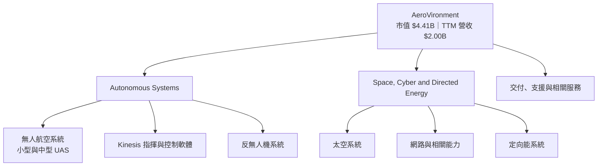
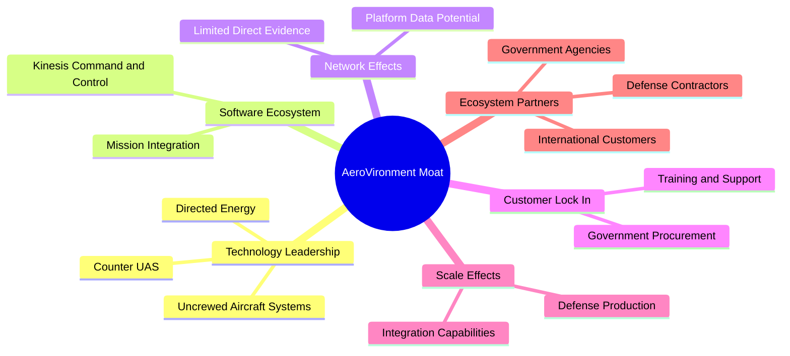
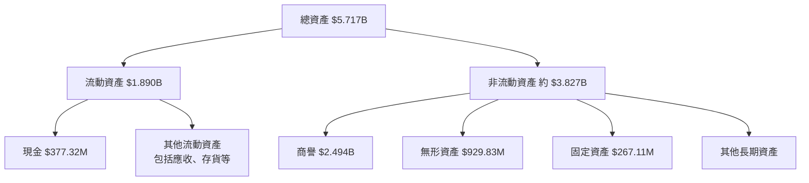
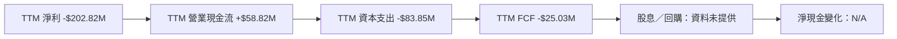
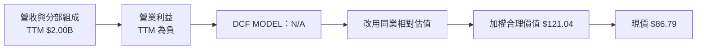
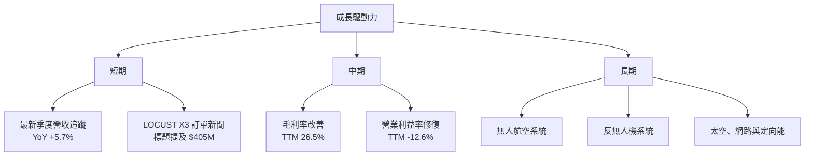
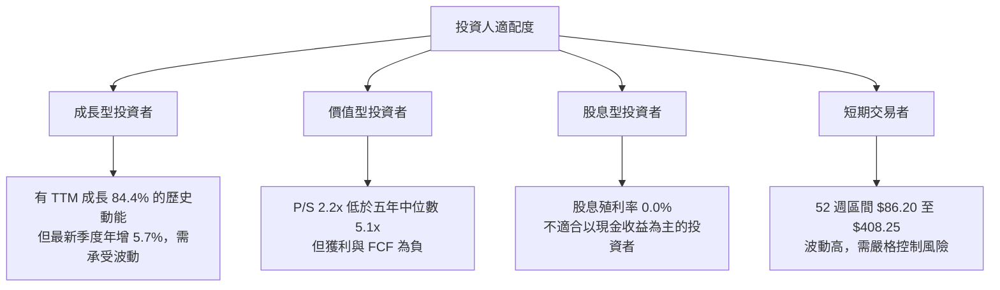

# AVAV 基本面深度分析報告
> **報告日期**：2026-11-23 ｜ **語言**：繁體中文 ｜ **數據來源**：SEC 申報資料 (XBRL)、Yahoo Finance、Finviz、StockAnalysis、Roic.ai ｜ **分析師**：CFA 級機構研究

## 目錄

| # | 章節 | 核心結論 |
|---|------|----------|
| 1 | 執行摘要 | 買入；加權合理價值 $121.04；MOS +28.3% |
| 2 | 公司概覽與商業模式 | 無人系統與國防科技定位具差異化，但缺乏可量化市占與分部營收資料 |
| 3 | 損益表深度分析 | TTM 營收 $2.00B、TTM 成長 84.4%；最新一季年增降至 5.7%，營業利益率為負 |
| 4 | 資產負債表分析 | 淨負債 $149.83M；流動性比率高，應收及存貨仍需追蹤 |
| 5 | 現金流量深度分析 | TTM FCF -$25.03M，營業現金流不足以覆蓋資本支出 |
| 6 | 獲利能力與資本效率 | ROIC -4.4% 低於 WACC 9.74%，目前為摧毀價值 |
| 7 | 相對估值分析 | 現有 P/S 低於自身五年中位數；相對同業估值結論分歧 |
| 8 | DCF 內在價值評估 | DCF N/A：TTM 營業利益為負，不建立自有 DCF 模型 |
| 9 | 成長催化劑 | LOCUST X3 訂單新聞提供催化線索，但營收轉化時程尚未量化 |
| 10 | 風險矩陣 | 獲利、現金流與營收成長降速為主要風險 |
| 11 | 投資建議 | 買入評級；現價低於加權合理價值，須以訂單轉收入與獲利修復為驗證條件 |

---

## 1. 執行摘要

AVAV 的 2026-11-20 收盤價為 **$86.79**；TTM 營收 **$2.00B**、TTM 營收年增 **84.4%**，但最新一季營收年增僅 **5.7%**。更重要的是，TTM 營業利益率為 **-12.6%**、ROIC 為 **-4.4%**，低於 **9.74% WACC**；TTM FCF 為 **-$25.03M**。估值方法加權後合理價值為 **$121.04**，MOS 為 **+28.3%**，但因 ROIC 低於 WACC，依 MOS 門檻評級為「買入」而非「強烈買入」。DCF 因 TTM 營業利益為負而不適用，因此本報告不提供 DCF 內在價值或 DCF 情境目標價。

### 1.0 一頁式投資儀表板（Portfolio Manager 30 秒速讀）

| 項目 | 內容 |
|------|------|
| **投資論點（3 句）** | ① TTM 營收年增 **84.4%**，但最新一季年增放緩至 **5.7%**，成長延續性尚待驗證。② 公司 TTM ROIC **-4.4%**、WACC **9.74%**，目前投入資本未創造股東價值。③ 加權合理價值 **$121.04** 高於現價 **$86.79**，但 TTM FCF 為 **-$25.03M**，估值上行依賴獲利與現金流修復。 |
| **綜合評分** | **5.7/10**（引用 1.1 評分卡） |
| **財務健康** | 🟡 現金及短期投資 **$580.23M**，但總債務 **$730.06M**、淨負債 **$149.83M**；流動比率 **4.26**。 |
| **ROIC vs WACC** | **-4.4% vs 9.74%**；差距 **-14.14 個百分點**，目前摧毀價值。 |
| **FCF 趨勢** | TTM FCF **-$25.03M**；FCF Yield **-0.57%**。 |
| **估值** | Forward P/E **19.688175x** ｜ EV/EBITDA **21.319x** ｜ FCF Yield **-0.57%**（TTM） |
| **DCF 內在價值（基準）** | **N/A**（TTM 營業利益為負，DCF 模型不可用）｜ DCF 折溢價 **N/A** |
| **安全邊際（MOS）** | **+28.3%**＝($121.04 − $86.79) ÷ $121.04（基準為 8.8 加權合理價值）｜ 🟢 高於 25% |
| **預期報酬（基準情境 12M）** | DCF 基準情境 **N/A**；以加權合理價值計算的上行空間為 **+39.5%**，不是 DCF 目標報酬。 |
| **關鍵風險（前二）** | 最新一季營收年增降至 **5.7%**；TTM 營業利益率 **-12.6%**、FCF **-$25.03M**。 |
| **評級 + 信心度** | 🟢 **買入**（依 MOS 應為強烈買入，但 ROIC -4.4% 低於 WACC 9.74%，故按規則 20 為買入；未再作質化降級）｜信心：中低 |

### 1.1 綜合評分卡（全報告唯一）

| 維度 | 評分（1–10） | 主要依據（引用數字與其來源章節） |
|------|--------------|----------------------------------|
| 成長性 | 8.0 | TTM 營收年增 **84.4%**，但最新一季年增 **5.7%**（第 3 章），成長勢頭減速。 |
| 獲利能力 | 2.0 | TTM 營業利益率 **-12.6%**、ROIC **-4.4%**，低於 WACC **9.74%**；F-Score **4/9**（第 3、6 章）。 |
| 財務健康 | 6.0 | 淨負債 **$149.83M**、流動比率 **4.26**；CCC 從 **135 天**降至 **92 天**（第 4 章）。 |
| 估值 | 7.0 | MOS **28.3%**；P/S **2.2x**，低於自身五年中位數 **5.1x**，但同業估值及獲利風險仍需折價（第 7、8 章）。 |
| 護城河 | 7.0 | UAS、反無人機、指揮控制軟體及國防客戶關係構成產品與整合優勢；但無市占、續約或分部毛利數據可驗證（第 2 章）。 |
| 管理層與資本配置 | 4.0 | FY2026 SBC **$38.33M**，稀釋股數測試未通過；FY2026 營業現金流 **-$78.40M**、資本支出 **$86.22M**（第 3、5 章）。 |
| **綜合評分** | **5.7** | 六項算術平均：(**8.0 + 2.0 + 6.0 + 7.0 + 7.0 + 4.0**) ÷ 6 = **5.7**。 |

### 1.2 五大投資論點 + 三大核心風險

| 類型 | 項目 | 具體依據 | 信心度 |
|------|------|----------|--------|
| 🟢 **投資論點①** | TTM 營收規模擴張 | TTM 營收 **$2.00B**、年增 **84.4%**；但最新一季年增 **5.7%**，因此需區分併購／基期效應與持續性內生成長。 | 🟡 中 |
| 🟢 **投資論點②** | 國防無人系統需求提供長期市場支撐 | 公司提供 UAS、反無人機及相關軟體與服務；近期新聞提到 **$405M LOCUST X3 訂單**，惟訂單收入認列時程未提供。 | 🟡 中 |
| 🟢 **投資論點③** | CCC 明顯改善 | CCC 從一年前 **135 天**降至 **92 天**，主要是 DSO 降低 **34 天**，有助縮短營運資金占用。 | 🟢 中高 |
| 🟢 **投資論點④** | 現價低於自身歷史 P/S 中位數 | P/S **2.2x**，低於五年中位數 **5.1x**；惟目前利潤率轉負，不能單純視作估值均值回歸。 | 🟡 中 |
| 🟢 **投資論點⑤** | 資產流動性尚可 | 現金與短期投資 **$580.23M**，流動比率 **4.26**；仍須兼顧 **$730.06M** 債務與負 FCF。 | 🟡 中 |
| 🟡 **風險①** | 營收成長減速 | TTM 年增 **84.4%**，最新一季年增僅 **5.7%**；若後續低成長持續，市場可能下修成長估值。 | 🔴 高衝擊 |
| 🔴 **風險②** | 獲利與現金流尚未轉正 | TTM 營業利益率 **-12.6%**、FCF **-$25.03M**、ROIC **-4.4%**；估值依賴未來利潤率修復。 | 🔴 高 |
| 🟡 **風險③** | 併購後整合、稀釋與商譽風險 | FY2026 資產負債表商譽約 **$2.494B**；稀釋股數測試未通過，整合與資產減損風險須持續檢視。 | 🟡 中高 |

### 1.3 快速統計卡片

| 指標 | 公司實際值（期間） | 同業中位數 | 狀態 |
|------|--------------------|------------|------|
| 營收成長（TTM） | **84.4%** | — | 🟢 高成長，但最新季減速 |
| 營收成長（最新一季年增） | **5.7%** | **35.7%** | 🔴 低於同業中位數 |
| 毛利率（TTM） | **26.5%** | **23.0%** | 🟢 高於中位數 |
| 營業利益率（TTM） | **-12.6%** | — | 🔴 負值 |
| ROIC（TTM） | **-4.4%** | — | 🔴 低於 WACC |
| Forward P/E | **19.688175x** | **20.5x** | 🟢 略低於同業中位數 |
| FCF Yield（TTM） | **-0.57%** | — | 🔴 負值 |
| Piotroski F-Score | **4 / 9** | — | 🟡 中低 |

### 1.4 投資結論

```text
╔══════════════════════════════════════════════════════════════════╗
║                    📊 投資結論摘要                               ║
╠══════════════════════════════════════════════════════════════════╣
║  評級：買入（MOS 28.3%，但 ROIC -4.4% < WACC 9.74%）             ║
║  價格（2026-11-20 收盤）：$86.79                                 ║
║  DCF 內在價值（基準）：N/A（TTM 營業利益為負）                    ║
║  安全邊際 MOS：+28.3%（以加權合理價值 $121.04 為分母）            ║
║  加權合理價值（8.8）：$121.04                                    ║
║  DCF 情境價值：N/A（DCF 模型不適用）                              ║
║  綜合評分：5.7/10（引用 1.1）                                    ║
║  適合投資人：能承受高波動、願意追蹤獲利與現金流改善的成長型投資人║
╚══════════════════════════════════════════════════════════════════╝
```

---

## 2. 公司概覽與商業模式

### 2.1 業務結構與收入來源

公司資料將 AeroVironment 描述為國防科技供應商，主要業務涵蓋 Autonomous Systems，以及 Space, Cyber and Directed Energy。現有財務資料未披露各業務收入金額或占比，因此以下只呈現業務關係，不推估分部占比。



### 2.2 市場份額

**市場份額數據未提供**，因此不繪製市占圖，也不推估市場占比。公司 TTM 營收為 **$2.00B**，TTM 年增 **84.4%**，但最新一季年增為 **5.7%**；同業資料顯示 KTOS、ONDS 的最新季度營收成長分別為 **35.7%**、**1,558.6%**，LMT 為 **11.3%**。這些差異反映各公司規模與基期不同，不能直接視為市占排序。

### 2.3 競爭護城河分析



### 2.4 護城河強度

| 護城河項目 | 強度（強／中／弱） | 證據（引用數字或事實） | 會削弱它的情況 |
|------------|--------------------|------------------------|----------------|
| 技術與產品組合 | 中 | 涵蓋 UAS、反無人機、指揮控制軟體與定向能；公司員工 **3,991 人**。未提供產品別收入、研發成果或市占數字。 | 競品性能追上、產品更新延誤、研發投入無法商業化。 |
| 軟體生態系統 | 中 | Kinesis 指揮控制軟體列於業務描述；未提供軟體收入、訂閱收入或留存率。 | 軟體未形成持續收入、客戶改採跨廠商平台。 |
| 網路效應 | 弱至中 | 軟硬體整合可能形成資料與任務流程優勢，但資料未量化網路效應。 | 客戶採購碎片化、系統互通標準降低轉換成本。 |
| 客戶鎖定 | 中 | 政府機構及企業客戶、交付與支援業務有助延續合作；客戶集中度及續約率未提供。 | 預算削減、計畫取消、採購轉向其他供應商。 |
| 規模效應 | 中 | TTM 營收 **$2.00B**；FY2026 年收入 **$1.977B**。但 FY2026 營業利益為 **-$70.29M**，規模尚未轉為營業槓桿。 | 併購整合成本、產能利用率不足或成本增幅高於收入。 |
| 生態夥伴 | 中 | 客戶包括政府機構與國際市場，且產品需整合至任務體系；合作夥伴數與收入貢獻未提供。 | 關鍵供應鏈受限、夥伴替代或出口限制。 |

1.1「護城河」評分 **7.0/10**，依據是產品與國防應用的整合門檻，但缺乏市占、軟體經常性收入及客戶留存數據，故不給予更高評價。

---

## 3. 損益表深度分析

### 3.1 年度收入成長趨勢（近4年）

FY2023 至 FY2026 收入分別為 **$540.54M、$716.72M、$820.63M、$1.977B**；FY2026 年增 **140.89%**。三年 CAGR 約為 **54.1%**，計算為 \((1.977 ÷ 0.54054)^{1/3} - 1\)。此高速增長不能直接外推：最新季度年增已回落至 **5.7%**。

```text
╔══════════════════════════════════════════════════════════════════╗
║             AeroVironment 年度收入趨勢（FY2023-FY2026）          ║
╠══════════════════════════════════════════════════════════════════╣
║  FY2023  $0.541B  ██████░░░░░░░░░░░░░░░░  YoY：+21.27% 🟢       ║
║  FY2024  $0.717B  ████████░░░░░░░░░░░░░░  YoY：+32.59% 🟢       ║
║  FY2025  $0.821B  █████████░░░░░░░░░░░░░  YoY：+14.50% 🟢       ║
║  FY2026  $1.977B  ██████████████████████  YoY：+140.89% 🟢      ║
╠══════════════════════════════════════════════════════════════════╣
║  FY2023-FY2026 三年收入 CAGR：約 +54.1%                          ║
║  注意：FY2026 大幅增長與最新一季年增 5.7% 顯示成長速度不連續。   ║
╚══════════════════════════════════════════════════════════════════╝
```

### 3.2 季度收入趨勢分析

QoQ 以相鄰季度收入計算；YoY 使用同季比較。最新季度年增率遵循 SEC 10-Q 核心數據，標示為**單季年增**，不與 TTM 成長混用。

| 季度 | 營收 | QoQ | YoY | 備註 |
|------|------|-----|-----|------|
| 2025-10-31 | $472.51M | N/A | N/A | 財務資料未列出可比前季完整收入序列。 |
| 2026-01-31 | $408.05M | -13.6% | +143.4% | 比前季低；同季年增高，受較低比較基期影響。 |
| 2026-04-30 | $641.62M | +57.2% | +133.3% | 季度收入明顯增加，但不宜把單季波動當作穩態成長率。 |
| 2026-07-31 | $480.49M | -25.1% | **+5.7%** | 最新單季年增明顯降速，是確認需求與交付持續性的關鍵訊號。 |

### 3.3 利潤率演變分析

| 利潤率指標 | FY2023 | FY2024 | FY2025 | FY2026 | 趨勢 | 評估 |
|------------|--------|--------|--------|--------|------|------|
| **毛利率** | 32.1% | 39.6% | 38.8% | 25.3% | FY2026 明顯下滑 | 🔴 |
| **營業利益率** | -4.2% | 10.0% | 7.2% | -3.6% | 由正轉負 | 🔴 |
| **淨利率** | -32.6% | 8.3% | 5.3% | -13.4% | FY2026 淨損擴大 | 🔴 |

FY2026 毛利率下降至約 **25.3%**（$500.64M ÷ $1.977B），相較 FY2025 約 **38.8%**，下滑約 **13.5 個百分點**。營業利益從 FY2025 **+$59.15M** 轉為 FY2026 **-$70.29M**；收入成長未轉化為更高營業利潤，可能與成本結構、產品組合及擴張／整合費用相關，但現有資料不足以拆解各因素金額。TTM 營業利益率按 SEC 核心數據為 **-12.6%**，與其他整合來源的 **-0.6%** 存在差異；本報告對指定 TTM 指標採用 SEC 計算值，避免混用口徑。

### 3.4 費用結構分析

SEC 資料未提供足以在同一期間拆解營業費用各項占比的完整明細，故不繪製費用圓餅圖，避免將不完整資料錯配成費用結構。已知 FY2026 研發費用為 **$127.68M**，FY2025 為 **$100.73M**，年增約 **26.7%**；研發增加有助產品開發，但在營業利益為負時，也要求未來收入增長能吸收固定費用。

### 3.5 季度 EPS 趨勢與盈餘品質（Quality of Earnings）

| 季度 | EPS 實際值 | 超預期／不及預期 | 解讀 |
|------|------------:|------------------|------|
| 2025-10-31 | -$0.34 | N/A | EPS 估計值缺失，無法判定 beat／miss。 |
| 2026-01-31 | -$3.15 | N/A | EPS 估計值缺失；淨損受該季淨利 **-$243.82M** 影響。 |
| 2026-04-30 | -$0.48 | N/A | EPS 估計值缺失；淨利 **-$24.10M**。 |
| 2026-07-31 | -$0.10 | N/A | EPS 估計值缺失；淨利 **-$5.07M**。 |

近四季 EPS 預估與實際值均缺乏可用的分析師一致預期數字，不能把資料表中的 nan 當作超預期或不及預期訊號。

| 盈餘品質項目 | 數值／佔比 | 評估 |
|--------------|-----------|------|
| 股權薪酬 SBC / 營收 | FY2026：$38.33M ÷ $1.977B = **1.94%** | 🟡 SBC 對收入占比可控，但仍造成股東稀釋。 |
| SBC / 營業現金流 | FY2026 SBC **$38.33M**；TTM 營業現金流 **$58.82M**，比率約 **65.2%** | 🔴 期間並非完全一致，僅作量級參考；SBC 相對現金流不低。 |
| FCF / 淨利（現金轉換率） | TTM 淨利 **-$202.82M**；TTM FCF **-$25.03M**；算術比率約 **12.3%** | 🔴 分子、分母同為負數，正比值不代表獲利轉現金良好，不能作一般正淨利公司的轉換率解讀。 |
| 一次性／非經常性損益 | N/A（未提供可核實拆分） | 無法判定淨損中一次性項目占比。 |
| 有效稅率異常 | N/A（未提供足以核實的 TTM 稅前所得與稅費拆解） | 不以預設稅率反推本期有效稅率。 |
| 資本化支出 vs 費用化 | TTM 資本支出 **$83.85M**；資本化明細 N/A | Capex 已納入 FCF；缺少資本化與費用化明細，無法判定是否延遲成本。 |

**盈餘品質結論**：TTM 虧損、負 FCF 與 SBC 占營業現金流的高比例，顯示當前 GAAP 獲利含金量偏弱。FY2026 資本支出 **$86.22M**、營業現金流 **-$78.40M**，也說明帳面收入增長尚未形成可持續的自由現金流。

---

## 4. 資產負債表分析

### 4.1 資產結構分解

以下採 2026-04-30 年度資產負債表數據，單位為美元；各細項與總額可能受四捨五入影響。



FY2026 總資產由 FY2025 **$1.121B** 增至 **$5.717B**，同時商譽與無形資產顯著增加。這會提升資產減損與併購整合風險；現有資料無法把資產增加精確拆成單一交易的影響。

### 4.2 流動性與營運資金分析

| 指標 | 最新 TTM | 一年前 TTM | 變化 | 解讀 |
|------|----------|------------|------|------|
| 流動比率 | 4.26 | N/A | N/A | 流動資產對短期負債覆蓋尚可；年度資產負債表口徑略有差異，未自行重算。 |
| DSO 應收帳款天數 | 33 天 | 67 天 | -34 天 | 收款週期縮短，營運資金占用下降；仍需追蹤應收帳款金額與政府付款時點。 |
| DIO 存貨天數 | 102 天 | 113 天 | -11 天 | 庫存周轉改善，但 102 天仍代表交付與存貨管理是現金流的重要變數。 |
| DPO 應付帳款天數 | 43 天 | 44 天 | -1 天 | 付款天數大致穩定，未見以延長付款期限顯著支撐現金流。 |
| CCC 現金轉換週期 | 92 天 | 135 天 | -43 天 | 收款與存貨週期改善帶動 CCC 降低，有利營運資金效率。 |

### 4.3 債務結構分析

採用 SEC 核心數據：現金及短期投資 **$580.23M**、總債務 **$730.06M**、淨現金欄位 **-$149.83M**，即淨負債 **$149.83M**。其他資料來源列出的總債務數字不同，本報告此處依核心財務數據固定採用上述口徑。

```text
╔══════════════════════════════════════════════════════════════════╗
║                   AeroVironment 債務健康診斷                     ║
╠══════════════════════════════════════════════════════════════════╣
║  總債務：        $730.06M  ████████████████████  🟡              ║
║  現金+短期投資： $580.23M  ████████████████░░░░  🟢              ║
║  淨負債：        $149.83M  ████░░░░░░░░░░░░░░░░  🟡              ║
║                                                                  ║
║  流動比率：      4.26x     🟢                                    ║
║  Debt/EBITDA：   不宜解讀（TTM 營業利益為負；EBITDA 口徑不一）    ║
║  利息保障倍數：  N/A（利息費用與可比期間營業利益資料不足）        ║
╚══════════════════════════════════════════════════════════════════╝
```

### 4.4 股東權益趨勢

| 財年結束日 | 股東權益 | YoY 變化 |
|------------|----------:|---------:|
| 2023-04-30 | $550.97M | N/A |
| 2024-04-30 | $822.75M | +49.3% |
| 2025-04-30 | $886.51M | +7.7% |
| 2026-04-30 | $4.400B | +396.6% |

```text
╔══════════════════════════════════════════════════════════════════╗
║                股東權益變化（年度資產負債表）                     ║
╠══════════════════════════════════════════════════════════════════╣
║  FY2023  $0.551B  ███░░░░░░░░░░░░░░░░░                           ║
║  FY2024  $0.823B  ████░░░░░░░░░░░░░░░░                           ║
║  FY2025  $0.887B  █████░░░░░░░░░░░░░░░                           ║
║  FY2026  $4.400B  ████████████████████                           ║
║  FY2026 增幅顯著；應與商譽、無形資產及併購後資本結構一併觀察。  ║
╚══════════════════════════════════════════════════════════════════╝
```

---

## 5. 現金流量深度分析

### 5.1 現金流量瀑布圖

TTM 營業現金流 **$58.82M** 減資本支出 **$83.85M**，得到 FCF **-$25.03M**。TTM 淨利採 StockAnalysis 報告值 **-$202.82M**。股息與回購的 TTM 金額未提供。



### 5.2 FCF 轉換率趨勢

| 財年 | FCF | 淨利 | FCF / 淨利 | 解讀 |
|------|-----:|-----:|-----------:|------|
| FY2023 | -$3.47M | -$176.21M | +2.0% | 兩者均為負，比例不代表正向轉換。 |
| FY2024 | -$9.19M | +$59.67M | -15.4% | 有淨利但 FCF 為負，資本支出及營運資金影響需留意。 |
| FY2025 | -$24.13M | +$43.62M | -55.3% | 現金轉換偏弱。 |
| FY2026 | -$164.62M | -$265.12M | +62.1% | 同為負值且虧損擴大，比例不宜解讀為高轉換。 |

### 5.3 自由現金流趨勢

| 期間 | 營業現金流 | 資本支出 | FCF |
|------|-----------:|---------:|----:|
| FY2023 | $11.40M | $14.87M | -$3.47M |
| FY2024 | $15.29M | $24.48M | -$9.19M |
| FY2025 | -$1.32M | $22.82M | -$24.13M |
| FY2026 | -$78.40M | $86.22M | -$164.62M |
| TTM（至 2026-08-01） | $58.82M | $83.85M | **-$25.03M** |

```text
╔══════════════════════════════════════════════════════════════════╗
║              FCF 趨勢（年度實際；金額單位 $M）                   ║
╠══════════════════════════════════════════════════════════════════╣
║  FY2023  -$3.47M   ░░░░░░░░░░░░░░░░░░░░  FCF Yield：N/A          ║
║  FY2024  -$9.19M   ░░░░░░░░░░░░░░░░░░░░  FCF Yield：N/A          ║
║  FY2025 -$24.13M   ░░░░░░░░░░░░░░░░░░░░  FCF Yield：N/A          ║
║  FY2026 -$164.62M  ░░░░░░░░░░░░░░░░░░░░  FCF Yield：N/A          ║
║  TTM    -$25.03M   ░░░░░░░░░░░░░░░░░░░░  FCF Yield：-0.57%       ║
║  年度及 TTM 期間不同；TTM FCF 引用 SEC 核心定義 OCF−Capex。       ║
╚══════════════════════════════════════════════════════════════════╝
```

### 5.4 資本配置評估

資本配置圓餅圖所需的回購、股息、再投資及留存現金占比資料不完整，因此不繪製比例圖。可確認的現金流項目如下：

| 項目 | 數據 | 判讀 |
|------|------:|------|
| FY2026 資本支出 | $86.22M | 相較 FY2025 **$22.82M** 增加，反映投資及產能投入上升；尚未帶來正 FCF。 |
| FY2026 SBC | $38.33M | 為非現金費用，但對股東有稀釋成本。 |
| 股息殖利率 | 0.0% | 未見股息現金回報。 |
| 回購金額 | N/A | 未提供，不推估。 |
| FY2026 營業現金流 | -$78.40M | 年度現金流承壓，與 TTM **+$58.82M** 不同，呈現期間波動。 |

---

## 6. 獲利能力與資本效率

### 6.1 ROE / ROA / ROIC 趨勢

| 指標 | 可用期間數值 | 評估 |
|------|--------------|------|
| ROE（TTM） | -4.6% | 負值，股東權益尚未產生正報酬。 |
| ROA（TTM） | -0.1% | 資產報酬略為負值。 |
| ROIC（TTM） | -4.4% | 低於資本成本，當前資本投入未創造價值。 |
| 歷年可比 ROIC／ROA／ROE 完整序列 | N/A | 未提供一致口徑的完整歷史數列。 |

### 6.2 ROIC vs WACC 分析（核心價值創造判斷）

```text
╔══════════════════════════════════════════════════════════════════╗
║                 ROIC vs WACC 深度分析                            ║
╠══════════════════════════════════════════════════════════════════╣
║  資本成本（採用程式計算數值）：WACC = 9.74%                      ║
║  ├── 無風險利率（10Y 美債）：4.91%                               ║
║  ├── 市場風險溢酬 ERP：5.00%                                     ║
║  ├── 原始 Beta：1.40；調整後 Beta：1.27                          ║
║  ├── 股權成本：11.26%                                           ║
║  ├── 稅前債務成本：0.77%；預設稅率：21.0%                        ║
║  ├── 資本結構權重：股權 85.8%／債務 14.2%                        ║
║  └── WACC：9.74%                                                ║
║                                                                  ║
║  ROIC（TTM）：-4.4%                                              ║
║  EVA 代理差額 = ROIC − WACC = -4.4% − 9.74% = -14.14 個百分點    ║
║                                                                  ║
║  ROIC  -4.4%  ← 低於資本成本                                    ║
║  WACC   9.74%  ← 股東與債權人要求報酬                           ║
║                                                                  ║
║  結論：目前 ROIC 低於 WACC，投入資本呈現價值毀損；需靠營業利益率║
║        回升與現金流改善，才可能扭轉此結論。                     ║
╚══════════════════════════════════════════════════════════════════╝
```

資金成本計算採用資料庫提供的成本資本輸入。以顯示的四捨五入值重算，股權成本為 \(4.91\% + 1.27 \times 5.00\% = 11.26\%\)；稅後債務成本為 \(0.77\% \times (1-21.0\%) = 0.6083\%\)。權重代入後約為 \(85.8\% \times 11.26\% + 14.2\% \times 0.6083\% = 9.75\%\)；採用程式提供的 **9.74%**，差異約 **0.01 個百分點**，來自輸入值顯示精度。原始 Beta **1.40** 調整方式為 \(2/3 \times 1.40 + 1/3 \times 1 = 1.2667\)，四捨五入為 **1.27**。

### 6.3 杜邦三因素分解

| 因素 | 數值（TTM） | 解讀 |
|------|-------------|------|
| 淨利率 | -10.1% | 淨利為負，是 ROE 轉負的主要因素。 |
| 資產週轉率 | 0.35 | 資產轉換為收入效率有限；收購後資產基礎擴大也會影響週轉。 |
| 權益乘數 | 1.30 | 財務槓桿程度不高，ROE 並非主要靠槓桿撐起。 |
| **ROE** | **-4.6%** | **-10.1% × 0.35 × 1.30 = -4.59% ≈ -4.6%**。 |

### 6.4 財務體質：Piotroski F-Score

Piotroski F-Score 為 **4 / 9**。各項測試依品質指標原值列示：

| 測試 | 結果 | 解讀 |
|------|------|------|
| ROA > 0 | ❌ 未通過 | TTM ROA 為負，尚未以資產創造正淨利。 |
| 營業現金流 > 0 | ✅ 通過 | TTM 營業現金流為 **$58.82M**。 |
| ROA 高於一年前 | ❌ 未通過 | 指標未改善至通過條件。 |
| 營業現金流 > 淨利（應計品質） | ✅ 通過 | 現金流高於淨利，但需注意淨利為負的解讀限制。 |
| 長期負債 ÷ 總資產低於一年前 | ✅ 通過 | 槓桿測試通過。 |
| 流動比率高於一年前 | ❌ 未通過 | 雖現行流動比率為 **4.26**，同比測試仍未通過。 |
| 稀釋股數未增加 | ❌ 未通過 | 股數增加可能稀釋每股經濟利益。 |
| 毛利率高於一年前 | ❌ 未通過 | FY2026 毛利率相較前期下降。 |
| 資產週轉率高於一年前 | ✅ 通過 | 資產周轉改善測試通過。 |

整體 F-Score 顯示現金流、負債與資產效率部分指標較正面，但獲利、毛利率、流動性同比及股數稀釋測試仍偏弱。

---

## 7. 相對估值分析

### 7.1 同業估值比較表格

公司估值採 Yahoo Finance／市場資料；同業倍數採資料庫所列 KTOS、ONDS、LMT。P/E 中位數只由可用同業數字計算；Trailing P/E 中 ONDS 不適用。

| 估值指標 | **AVAV** | **KTOS** | **ONDS** | **LMT** | 本公司評估 |
|----------|---------:|---------:|---------:|---------:|-----------|
| **Trailing P/E** | N/A | 224.1x | N/A | 20.1x | 🔴 AVAV 為虧損，無法比較正向 P/E。 |
| **Forward P/E** | 19.688175x | 24.0x | -24.3x | 17.0x | 🟡 AVAV 低於正值同業中位數 **20.5x**；ONDS 負值倍數不適合直接當作常態比較。 |
| **P/S Ratio** | 2.2024364x | 3.1x | 6.7x | 1.7x | 🟡 AVAV 高於 LMT、低於 KTOS 與 ONDS。 |
| **EV/EBITDA** | 21.319x | 43.4x | -5.2x | 14.7x | 🟡 AVAV 高於 LMT、低於 KTOS；ONDS EBITDA 為負，倍數解讀有限。 |
| **最新季度營收年增** | 5.7% | 35.7% | 1,558.6% | 11.3% | 🔴 AVAV 落後三家同業的當季年增數據。 |
| **毛利率（TTM）** | 26.5% | 23.0% | 36.4% | 11.7% | 🟢 AVAV 高於 KTOS、LMT，低於 ONDS。 |

同業市值、業務組合與盈利階段差異很大，估值倍數僅作相對參考。尤其 AVAV TTM 營業利益為負，Forward P/E 對未來盈利預估較敏感。

### 7.2 歷史估值區間分析

歷史估值資料提供的是 **P/S**，並非 P/E；依要求引用 P/S 歷史區間，不自行替換成其他倍數。

```text
╔══════════════════════════════════════════════════════════════════╗
║               P/S 歷史位置（五年 TTM）                           ║
╠══════════════════════════════════════════════════════════════════╣
║  五年低點：3.0x     五年中位數：5.1x     五年高點：13.4x         ║
║  現在：2.2x         百分位：0%                                  ║
║                                                                  ║
║  2.2x ── 低於歷史範圍下緣 3.0x；位置偏低，但非盈利改善證據。     ║
║  解讀：歷史低估值可能反映成長降速、負營業利益與負 FCF。         ║
╚══════════════════════════════════════════════════════════════════╝
```

### 7.3 情境價值（Bear / Base / Bull）

**N/A（DCF 無法計算：TTM 營業利益不為正）**。財務數據未提供 DCF MODEL 情境輸入，因此不自建情境目標價，也不以分析師共識代替 DCF 情境值。

### 7.4 相對估值隱含價格區間

```text
╔══════════════════════════════════════════════════════════════════╗
║                 相對估值參考（每股價值）                         ║
╠══════════════════════════════════════════════════════════════════╣
║  $86.79 現價 ── $90.44 同業 Forward P/E ── $121.15 同業 P/S      ║
║                   └──────────── $212.20 分析師共識               ║
╚══════════════════════════════════════════════════════════════════╝
```

| 方法 | 每股價值 | 相對現價 | 依據 |
|------|---------:|---------:|------|
| 同業 Forward P/E | $90.44 | +4.2% | KTOS、LMT 同業中位數 **20.5x** × AVAV Forward EPS **$4.41**。 |
| 同業 P/S | $121.15 | +39.6% | KTOS、ONDS、LMT 同業中位數 P/S **3.1x** × TTM 營收，依程式方法計算。 |
| 分析師共識目標價 | $212.20 | +144.5% | **23 位分析師**平均目標價；屬市場預期參考，並非獨立基本面驗證。 |

---

## 8. DCF 內在價值評估（Discounted Cash Flow）

### 8.0 估值推理鏈（Thinking Logic）

**模型適用性先決條件**：TTM 營業利益率為 **-12.6%**，代表 TTM 營業利益為負；以當前負營業利益直接向前折現，不能可靠代表成熟期現金流價值。依指定模型規則，DCF MODEL 為 N/A，本報告不建立替代 DCF。

AVAV 的經濟價值可從三個可驗證方向理解：既有無人系統與國防業務（分部收入占比未披露）、空間／網路／定向能等其他業務（分部占比未披露）、軟體與支援服務（收入占比未披露）。目前唯一可核實的公司整體收入錨點是 TTM **$2.00B**。在沒有分部收入、正向 TTM 營業利益及模型輸入的情況下，無法量化各業務對估值的貢獻或建立可信的終值。

| 決策點 | 本報告採用 | 理由（含數字） | 曾考慮但否決 | 否決理由 |
|--------|-----------|----------------|--------------|----------|
| 現金流定義 | FCFF DCF 不適用 | TTM 營業利益為負，DCF MODEL 明確為 N/A。 | 自建 FCFF | 需自行假設未來利潤率、資本支出與營運資金，違反模型資料限制。 |
| 預測期 N | N/A | 缺少可引用的 DCF 預測期輸入。 | 任選 5–10 年 | 沒有模型或管理層財測支撐。 |
| 終值方法 | N/A | DCF 不成立，故不計 Gordon Growth 或退出倍數終值。 | 主觀指定終值 | 無正向營業利益與終值輸入。 |
| EBIT 基礎 | N/A | 不進入 DCF 預測。 | 另建 GAAP EBIT 模型 | 不允許自建模型。 |

**關鍵假設推導鏈**：營收 CAGR、期末營業利潤率、永續成長率、預測期、Capex／營收、D&A／營收、營運資金變動、SBC 處理與年稀釋率，均因 DCF MODEL 為 N/A 而**沒有採用值**；不以歷史營收成長率自行填入 DCF。最脆弱的一環是未來營業利益率何時轉正；在無法建立 DCF 的情況下，估值需依賴同業相對估值，不能用假設值製造單一內在價值。



### 8.1 模型假設總表（Model Inputs）

| 假設項目 | 採用值 | 依據／來源 | 敏感度 |
|----------|--------|-------------|--------|
| 預測期長度 N | N/A | DCF MODEL：N/A；未提供預測年數。 | N/A |
| 營收 CAGR（預測期） | N/A | 不自建預測；TTM 成長率 **84.4%** 不等於可持續預測 CAGR。 | N/A |
| 營業利潤率（期末） | N/A | TTM 營業利益率 **-12.6%**；沒有可引用的模型轉正假設。 | N/A |
| 有效稅率 | N/A | DCF 未計算；21.0% 是資本成本輸入的預設稅率，不等同公司未來 DCF 稅率。 | N/A |
| Capex / 營收 | N/A | TTM Capex **$83.85M**，但不自行推導 DCF 比率。 | N/A |
| 折舊攤銷 D&A / 營收 | N/A | DCF 模型輸入未提供。 | N/A |
| 營運資金變動 / 營收增額 | N/A | DCF 模型輸入未提供。 | N/A |
| EBIT 基礎 | N/A | 不進入 DCF。 | N/A |
| 股權薪酬 SBC 處理 | N/A | 不進入 DCF；不宣稱採用 A／B／C 組合。 | N/A |
| 年稀釋率（股數） | N/A | DCF 股數假設未提供。 | N/A |
| 永續成長率 g | N/A | 無 DCF 模型輸入。 | N/A |
| 終值方法 | N/A | DCF MODEL 不適用。 | N/A |
| WACC | **9.74%（僅資本成本參考）** | 成本資本資料；未用於本公司 DCF。 | N/A |

**FCF 定義**：財務報表 TTM FCF 定義為營業現金流減資本支出，即 **$58.82M − $83.85M = -$25.03M**。這不是以 WACC 折現的預測 FCFF。

### 8.2 折現率推導（WACC）

本節列示資本成本資料供 ROIC 比較；因 DCF MODEL 為 N/A，WACC 不用於本報告的 DCF 折現。

```text
╔══════════════════════════════════════════════════════════════════╗
║                    WACC 資料（非 DCF 折現）                      ║
╠══════════════════════════════════════════════════════════════════╣
║  股權成本 Ke（CAPM）：                                            ║
║  ├── 無風險利率 Rf：4.91%                                        ║
║  ├── ERP：5.00%                                                   ║
║  ├── Beta 原始值：1.40；調整後採用：1.27                         ║
║  ├── 規模／國別溢酬：未另加計                                     ║
║  └── Ke = 4.91% + 1.27 × 5.00% = 11.26%                          ║
║                                                                  ║
║  債務成本：稅前 0.77%；預設稅率 21.0%                             ║
║  稅後 Kd = 0.77% × (1 − 21.0%) = 0.6083%                         ║
║                                                                  ║
║  資本結構：股權 85.8%；債務 14.2%                                ║
║  採用 WACC：9.74%                                                 ║
║  以顯示精度重算約 9.75%；採用值與重算差約 0.01 個百分點。        ║
╚══════════════════════════════════════════════════════════════════╝
```

| WACC 組成 | 數值 | 說明 |
|----------|------:|------|
| 無風險利率 | 4.91% | 10 年期美國公債輸入值；資料未提供該殖利率的觀測日期。 |
| ERP | 5.00% | 資料庫假設值，並非公司特定歷史實現值。 |
| Beta | 原始 1.40；調整後 1.27 | 採調整後 Beta：\(2/3 \times 1.40 + 1/3 \times 1 = 1.2667 \approx 1.27\)。 |
| 股權成本 Ke | 11.26% | \(4.91\% + 1.27 \times 5.00\% = 11.26\%\)。 |
| 稅前債務成本 | 0.77% | 財務資料提供值。 |
| 稅後債務成本 | 0.6083% | \(0.77\% \times (1-21.0\%)=0.6083\%\)。 |
| E／D 權重 | 85.8%／14.2% | 市值與債務的資本結構權重。 |
| **WACC** | **9.74%** | 後續 ROIC 比較採用同一數值。 |

### 8.3 逐年自由現金流預測（基準情境）

**N/A（DCF MODEL：TTM 營業利益為負；資料未提供逐年 DCF 假設、FCFF 預測、折現因子或現值）**。因此不填逐年預測表、不計預測期 FCF 現值，也不以歷史 FCF 替代預測值。

### 8.4 終值計算（Terminal Value）

**N/A（DCF MODEL 不適用）**。沒有可用的 FY+N FCFF、永續成長率或退出倍數輸入，故不計算 Gordon Growth 終值或退出倍數終值。

### 8.5 企業價值 → 每股內在價值（Bridge）

**N/A（DCF MODEL 不適用）**。沒有預測期現金流現值與終值，不能推導 DCF 企業價值、股權價值或每股內在價值。DCF 折溢價亦為 **N/A**。

### 8.6 敏感性分析（WACC × 永續成長率）

**N/A（DCF MODEL 不適用；未提供敏感性矩陣）**。不自行設定 WACC、g 或每股價值矩陣，也不提供自建三情境 DCF。

### 8.7 反推 DCF（Reverse DCF：市場在預期什麼）

**N/A（DCF MODEL 不適用）**。缺少可固定的基準 DCF 輸入及反推模型結果，無法用單一未知數求解現價隱含假設，亦不建立自行試算軌跡。

### 8.8 估值三角驗證與安全邊際

本公司類型為未盈利公司；依固定方法權重採同業 Forward P/E **30%**、同業 P/S **60%**、分析師共識 **10%**。DCF、EV/EBITDA 方法未列入本次估值方法清單，因此不另加方法，也不調整權重。

| 估值方法 | 隱含每股價值 | 上行空間（÷現價） | 權重 | 說明 |
|----------|--------------:|-------------------:|------|------|
| 同業 Forward P/E | $90.44 | +4.2% | 30% | 同業中位數 **20.5x** × Forward EPS **$4.41**。 |
| 同業 P/S | $121.15 | +39.6% | 60% | 同業中位數 **3.1x** × TTM 營收，程式提供之每股價值。 |
| 分析師共識目標價 | $212.20 | +144.5% | 10% | 23 位分析師平均目標價；參考性較高，不代表基本面已實現。 |
| **加權合理價值** | **$121.04** | **+39.5%** | **100%** | 依固定權重計算，未作事後調整。 |

加權演算：  
\[
\$90.44 \times 30\% + \$121.15 \times 60\% + \$212.20 \times 10\%
= \$27.132 + \$72.690 + \$21.220
= \$121.042 \approx \mathbf{\$121.04}
\]

MOS 與上行空間分母不同，分別計算如下：

\[
MOS = (\$121.04-\$86.79) \div \$121.04
= \$34.25 \div \$121.04
= 28.3\%
\]

\[
上行空間 = (\$121.04-\$86.79) \div \$86.79
= \$34.25 \div \$86.79
= 39.5\%
\]

\[
折溢價（相對 DCF）= N/A
\]
DCF 基準價值不存在，故不以相對估值價值替代 DCF 折溢價。

```text
╔══════════════════════════════════════════════════════════════════╗
║                  估值區間與安全邊際                              ║
╠══════════════════════════════════════════════════════════════════╣
║  現價 $86.79 ─── Forward P/E $90.44 ─── [加權價值 $121.04]       ║
║                                    └── P/S $121.15               ║
║  分析師共識：$212.20；DCF：N/A                                   ║
║                                                                  ║
║  MOS = ($121.04 − $86.79) ÷ $121.04 = +28.3%                    ║
║  上行空間 = ($121.04 − $86.79) ÷ $86.79 = +39.5%                ║
║                                                                  ║
║  MOS 評估：🟢 高於 25%                                           ║
║  買入參考上限（MOS 至少 10%）：$121.04 × 90% = $108.94          ║
║  建議買入區間：現價 $86.79 至 $108.94                            ║
║  MOS -10% 對應價格：$121.04 × 110% = $133.14                    ║
║  減碼考慮：高於 $133.14 時，MOS 將低於 -10%。                    ║
╚══════════════════════════════════════════════════════════════════╝
```

> 🔎 **程式複算（Python，依本節各項自動重算）**
>
> 加權合理價值 = $90.44 × 30% + $121.15 × 60% + $212.20 × 10% = **$121.04**（權重合計 100%）
>
> 以價格 $86.79 計：MOS = **+28.3%**，上行空間 = **+39.5%**
>
> ✅ 與本節所寫數值一致。

### 8.9 DCF 模型的局限與失效條件

- **終值依賴度**：N/A；無法計算終值占 EV 比例。
- **最脆弱的假設**：本報告沒有採用 DCF 假設，因此不提供假設變動後的 DCF 價值。基本面上最需驗證的是最新季度年增 **5.7%** 能否回升，以及 TTM 營業利益率 **-12.6%** 能否轉正。
- **不適用情境說明**：TTM 營業利益為負，且 TTM FCF 為 **-$25.03M**；DCF 可靠度不足。現階段相對估值、收入成長品質、分部單位經濟與現金流轉正進度更適合做交叉檢驗。
- **與第 10 章風險矩陣的連結**：營收減速影響收入預期；毛利率下降與成本上升影響營業利潤率；Capex 與營運資金增加則可能使 FCF 惡化。

### 8.10 複算檢核表（Audit Trail）

| # | 檢核項目 | 檢查方式 | 結果 |
|---|----------|----------|------|
| 1 | 所有高／中敏感度 DCF 輸入都有完整推導 | DCF MODEL 為 N/A，未採用 DCF 輸入 | N/A |
| 2 | 每個 DCF 假設都有來歷 | 未建立 DCF，缺少輸入不作假設 | ✅ |
| 3 | WACC 算式與權重 | 權重 85.8% + 14.2% = 100%；顯示精度重算約 9.75%，採用程式值 9.74% | ⚠️ 顯示精度差約 0.01 個百分點 |
| 4 | Kd 分母與債務權重範圍一致 | 採用提供的成本資本彙總值，無可供本報告獨立重建的完整計息負債平均餘額 | N/A |
| 5 | WACC 與第 6.2 節相同 | 兩處採用 9.74% | ✅ |
| 6 | 逐年預測期年度數等於 N | DCF MODEL 為 N/A，無預測年度 | N/A |
| 7 | FY+1 FCFF 與 PV 可複算 | 無 DCF 預測列 | N/A |
| 8 | 預測期 PV 加總 | 無預測期現值 | N/A |
| 9 | WACC > g | g 未提供 | N/A |
| 10 | 終值以 FY+N 現金流計算 | 無終值輸入 | N/A |
| 11 | EV 至每股價值橋接 | 無 DCF EV 與股權價值 | N/A |
| 12 | SBC 三要素組合相容 | 不建立 DCF 組合 A／B／C | N/A |
| 13 | 敏感性基準格等於 DCF 每股價值 | 無敏感性矩陣 | N/A |
| 14 | 敏感性矩陣有效格與 N/A 格正確 | 未建立矩陣 | N/A |
| 15 | 三情境機率合計 100% | 無 DCF 情境 | N/A |
| 16 | 反推 DCF 每列僅一變數且有軌跡 | 未建立反推模型 | N/A |
| 17 | MOS 分母為 8.8 加權合理價值 | 1.0 與 8.8 均採 MOS **28.3%**；DCF 折溢價為 N/A | ✅ |
| 18 | 報告完整至第 11 章 | 本報告包含 11 章 | ✅ |
| 19 | 加權合理價值為方法加權總和 | $90.44×30% + $121.15×60% + $212.20×10% = $121.042，顯示 $121.04 | ✅ |
| 20 | 評級符合 MOS 門檻及 ROIC 條件 | MOS 28.3%，但 ROIC -4.4% ≤ WACC 9.74%，評級為買入 | ✅ |

---

## 9. 成長催化劑

### 9.1 催化劑時間軸

財務資料未提供訂單交付排程、營收認列時點或明確產品上市日期，故不以假設日期製作甘特圖。可追蹤的催化事項如下：

| 時間範圍 | 催化事項 | 已知數據／驗證重點 |
|----------|----------|------------------|
| 短期：未來財報 | 最新季度成長能否恢復 | 最新季度營收 **$480.49M**、年增 **5.7%**；需觀察後續季度年增率與訂單轉收入。 |
| 短中期 | LOCUST X3 訂單轉化 | 新聞標題提及 **$405M** 訂單；須確認 SEC 申報或公司公告、交付進度與收入認列。 |
| 中期 | 毛利與營業槓桿修復 | TTM 毛利率 **26.5%**、營業利益率 **-12.6%**；需確認收入增長是否改善毛利與固定成本吸收。 |
| 長期 | 無人系統、反無人機及太空／定向能產品擴張 | 業務方向明確，但分部 TAM 與分部收入未提供，量化催化價值尚不可得。 |

### 9.2 TAM 市場規模分析

**N/A（TAM 數據未提供）**。公司 TTM 營收為 **$2.00B**，TTM 年增 **84.4%**，但最新季度年增為 **5.7%**；目前只能確認公司營收規模與成長趨勢，不能在缺乏來源與年份的情況下推估 TAM 或市場滲透率。

### 9.3 成長驅動力結構圖



---

## 10. 風險矩陣

### 10.1 風險評分矩陣

資料未提供各風險的可驗證發生機率或衝擊百分比；以下不填主觀機率座標，也不以虛構數字製作 quadrantChart。風險優先級依財務暴露與已觀察到的數據判斷。

| 風險 | 優先級 | 依據 |
|------|--------|------|
| 獲利與現金流持續為負 | 🔴 高 | TTM 營業利益率 **-12.6%**；TTM FCF **-$25.03M**；ROIC **-4.4%**。 |
| 營收成長大幅減速 | 🔴 高 | TTM 營收年增 **84.4%**，最新一季年增 **5.7%**。 |
| 併購整合、商譽及稀釋 | 🟡 中高 | FY2026 商譽 **$2.494B**；Piotroski 稀釋股數測試未通過。 |
| 應收及存貨營運資金 | 🟡 中 | 最新 DSO **33 天**、DIO **102 天**；CCC 雖改善至 **92 天**，仍占用資金。 |
| 高波動與市場預期落差 | 🟡 中高 | 股價 52 週高點 **$408.25**、低點 **$86.20**；短倉占流通股 **13.3%**。 |

### 10.2 風險清單詳細分析

| # | 風險項目 | 發生機率 | 財務衝擊 | 風險評估 | 緩解措施 |
|---|----------|----------|----------|----------|----------|
| 1 | 🔴 **營業虧損與負 FCF 延續** | N/A（無可靠機率數據） | 已觀察到 TTM 營業利益率 **-12.6%**、FCF **-$25.03M** | 🔴 高 | 每季追蹤毛利率、營業利益率、Capex 及 OCF；若 FCF 持續惡化，重新評估估值。 |
| 2 | 🔴 **最新季度收入成長降速** | N/A | 最新季度年增 **5.7%**，低於 TTM 年增 **84.4%**；實際衝擊需看後續訂單轉收入 | 🔴 高 | 追蹤核心業務訂單、交付、季度收入與財測變化。 |
| 3 | 🟡 **商譽與無形資產減損／併購整合** | N/A | FY2026 商譽 **$2.494B**；減損金額未提供 | 🟡 中高 | 追蹤商譽減損測試、併購業務收入與營業利潤貢獻。 |
| 4 | 🟡 **營運資金及庫存占用** | N/A | DIO **102 天**、CCC **92 天**；較前一年改善，但營運資金仍有需求 | 🟡 中 | 監察應收與存貨成長是否快於收入，並追蹤客戶回款及交付。 |
| 5 | 🟡 **股價波動與空頭部位** | N/A | 52 週區間 **$86.20–$408.25**；Short % Float **13.3%** | 🟡 中高 | 控制持倉規模，避免將單一分析師共識目標價視為估值底部。 |

---

## 11. 投資建議

### 11.1 最終評級與評分

評級為 **買入**：加權合理價值 **$121.04**、MOS **28.3%**，但 ROIC **-4.4%** 低於 WACC **9.74%**，故按規則 20 不評為強烈買入。公司綜合評分為 **5.7/10**，六項依序為成長性 **8.0**、獲利能力 **2.0**、財務健康 **6.0**、估值 **7.0**、護城河 **7.0**、管理層與資本配置 **4.0**；分數反映成長與估值尚可，但獲利、現金流及資本效率偏弱。

### 11.2 合理價值與隱含報酬率

| 估值項目 | 每股價值 | 相對現價 $86.79 | 機率／權重 |
|----------|---------:|----------------:|------------|
| 同業 Forward P/E | $90.44 | +4.2% | 30% 權重 |
| 同業 P/S | $121.15 | +39.6% | 60% 權重 |
| 分析師共識 | $212.20 | +144.5% | 10% 權重 |
| **加權合理價值** | **$121.04** | **+39.5% 上行空間** | 100% |
| DCF 悲觀／基準／樂觀情境 | N/A | N/A | DCF 模型不適用 |

### 11.3 買入時機與觸發因素

```text
╔══════════════════════════════════════════════════════════════════╗
║                  ✅ 買入觸發因素 Checklist                      ║
╠══════════════════════════════════════════════════════════════════╣
║  現階段可考慮分批布局：                                          ║
║  ✅ 現價 $86.79 低於加權合理價值 $121.04                         ║
║  ✅ 按加權合理價值計算，MOS 為 +28.3%                            ║
║  ✅ 流動比率 4.26；CCC 由 135 天降至 92 天                       ║
║                                                                  ║
║  加碼觸發條件：                                                  ║
║  ☐ 最新季度營收年增重新高於 20%，且訂單交付支持該趨勢            ║
║  ☐ TTM 營業利益率連續改善並接近損益兩平                          ║
║  ☐ TTM FCF 轉正，且不是單靠延後付款或短期營運資金變化             ║
║                                                                  ║
║  減碼／停損觸發條件：                                            ║
║  ☐ 營收年增連續兩季低於 5%                                       ║
║  ☐ TTM FCF 低於 -$50M，或淨負債明顯高於 $149.83M                 ║
║  ☐ 加權合理價值不變時，股價高於 $133.14（MOS 低於 -10%）         ║
╚══════════════════════════════════════════════════════════════════╝
```

買入區間參考為 **$86.79–$108.94**；上限依加權合理價值的 10% MOS 推導：\($121.04 \times 90\% = $108.94\)。這是估值參考，不保證價格會到達或維持於該區間。

### 11.4 投資人適配度分析



### 11.5 每季財報監控清單（Quarterly Watch List）

| 指標 | 目前基準 | 加碼觀察門檻 | 減碼／重新檢視門檻 |
|------|----------|--------------|--------------------|
| 營收年增 | 最新單季 **5.7%**；TTM **84.4%** | 單季年增回升至 **20% 以上**，並由實際交付支持 | 連續兩季低於 **5%** |
| 毛利率 | TTM **26.5%** | 季度毛利率連續改善 | 毛利率明顯低於 TTM 基準且持續惡化 |
| 營業利益率 | TTM **-12.6%**；最新季 **-2.3%** | 持續向損益兩平改善 | TTM 虧損率擴大或最新季轉差 |
| 營業現金流 | TTM **$58.82M** | 多季維持正值，且覆蓋 Capex | 轉負並連續惡化 |
| Capex | TTM **$83.85M** | 資本支出帶來收入或產能利用改善 | Capex 上升而收入、毛利未改善 |
| FCF | TTM **-$25.03M**；FCF Yield **-0.57%** | TTM FCF 轉正 | TTM FCF 低於 **-$50M** |
| DSO／DIO／CCC | **33／102／92 天** | CCC 維持或低於 **92 天** | CCC 回升至 **135 天以上** |
| 訂單與財測 | LOCUST X3 新聞標題提及 **$405M**，未提供認列排程 | 公告確認交付、收入認列與毛利貢獻 | 訂單延誤、取消或未形成收入增長 |
| SBC／稀釋股數 | FY2026 SBC **$38.33M**；稀釋股數測試未通過 | 股數增幅下降、每股經濟利益改善 | 股數持續增加但收入與 FCF 未同步增長 |

### 11.6 反面論證：什麼會證明論點錯誤（What Would Change My Mind）

```text
╔══════════════════════════════════════════════════════════════════╗
║              ⚠️ 論點失效條件（Disconfirming Evidence）           ║
╠══════════════════════════════════════════════════════════════════╣
║  本投資論點在下列情況成立時應重新檢視或退出：                    ║
║  ☐ 最新季度營收年增連續兩季低於 5%                               ║
║  ☐ TTM 營業利益率進一步惡化，且連續數季未見收斂                 ║
║  ☐ TTM FCF 低於 -$50M，或營業現金流連續轉負                    ║
║  ☐ ROIC 持續低於 WACC 9.74%，且營業利益未改善                   ║
║  ☐ CCC 回升至 135 天以上，代表營運資金改善反轉                   ║
║  ☐ 稀釋股數持續增加，但收入、每股盈餘及現金流未同步改善          ║
║  ☐ LOCUST X3 等大型訂單未能轉化為可驗證交付與收入                ║
╚══════════════════════════════════════════════════════════════════╝
```

> **免責聲明**：本報告為 AI 自動生成，僅供研究參考，不構成投資建議。投資有風險，入市需謹慎。

---

## 資料與來源

| 項目 | 內容 |
|------|------|
| 價格 | 86.79 USD，2026-11-20 收盤（Yahoo Finance 日線） |
| 財務報表 | SEC 10-Q filed 2026-09-10，最新季度 2026-08-01（FY2027 Q1） |
| 有回應的資料來源 | SEC 申報資料 (XBRL)、Yahoo Finance、Finviz、StockAnalysis、Roic.ai |
| 由程式計算 | TTM 數字、WACC、DCF 模型、估值方法與權重、加權合理價值、MOS、評級門檻、F-Score、杜邦分解、營運資金天數、綜合評分 |
| 撰寫模型 | openai / gpt-6-luna |

> 本區塊由產生報告的程式依實際取得的資料填寫，非模型撰寫。「由程式計算」的數字不是模型的估計；其餘判斷（評分、情境、策略）是模型的分析。
