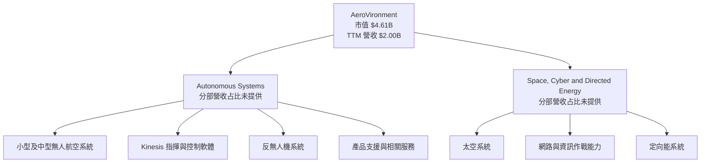
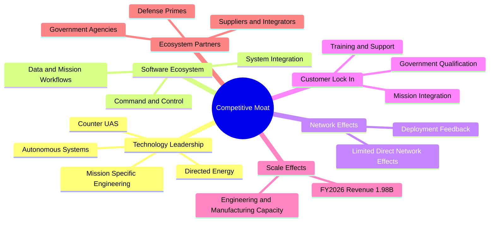
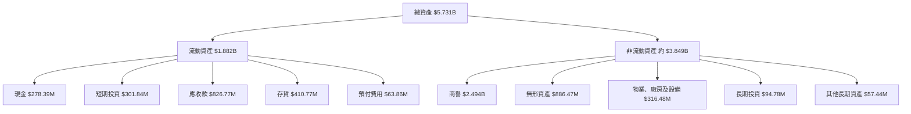
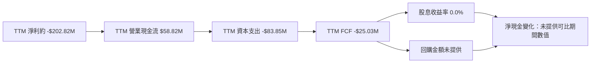
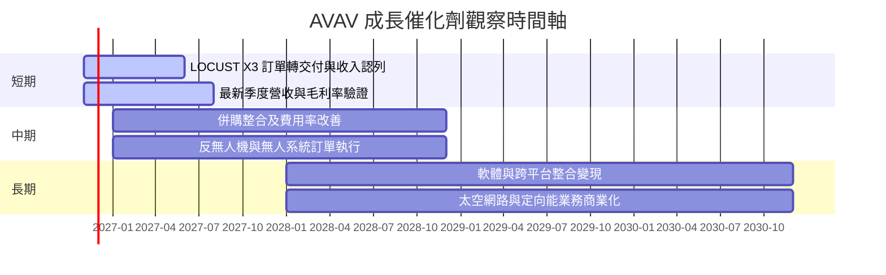
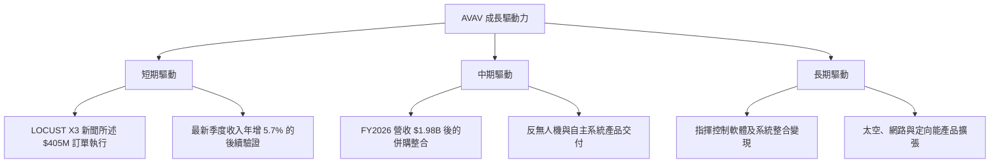
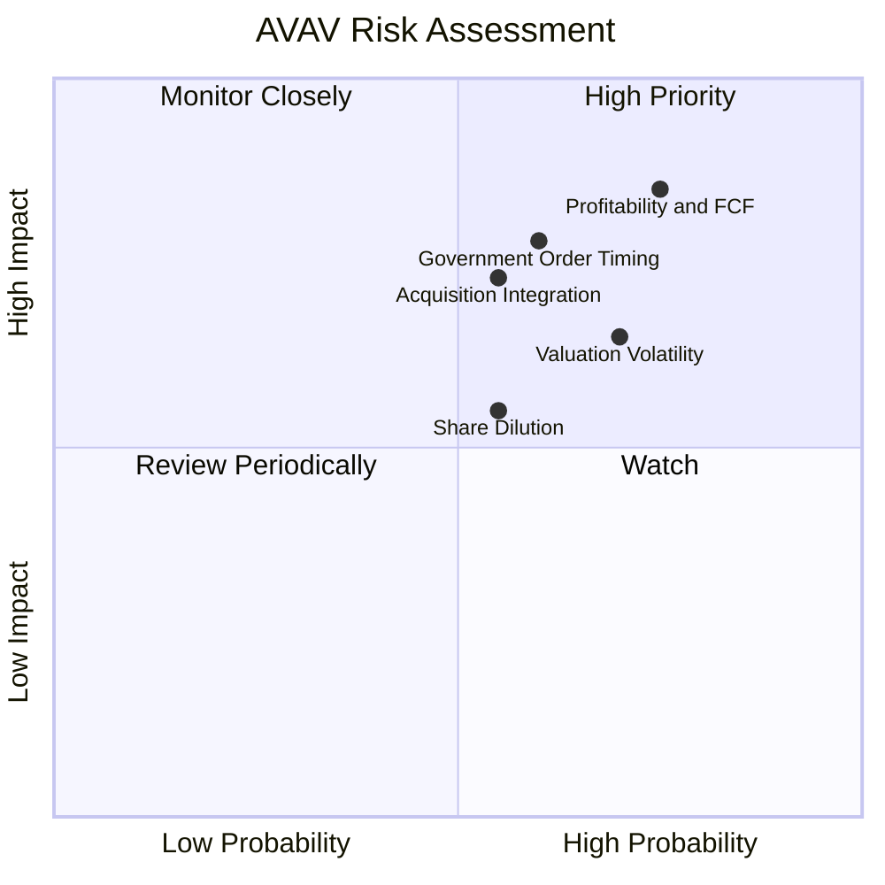
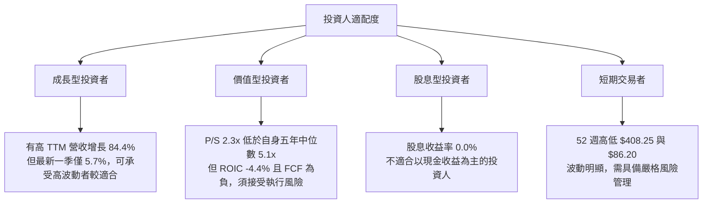

# AVAV 基本面深度分析報告
> **報告日期**：2026-11-24 ｜ **語言**：繁體中文 ｜ **數據來源**：SEC 申報資料 (XBRL)、Yahoo Finance、Finviz、StockAnalysis、Roic.ai ｜ **分析師**：CFA 級機構研究

## 目錄

| # | 章節 | 核心結論 |
|---|------|----------|
| 1 | 執行摘要 | 買入；加權合理價值 $126.50；MOS +28.3% |
| 2 | 公司概覽與商業模式 | 無人系統與防務科技具技術及客戶黏著優勢；分部收入占比未提供 |
| 3 | 損益表深度分析 | TTM 營收 $2.00B、年增 84.4%；TTM 營業利益率 -12.6% |
| 4 | 資產負債表分析 | 淨負債 $149.83M；流動比率 4.26，短期流動性尚可 |
| 5 | 現金流量深度分析 | TTM FCF -$25.03M、FCF Yield -0.54%；現金流轉正仍待驗證 |
| 6 | 獲利能力與資本效率 | ROIC -4.4% 低於 WACC 9.80%，目前仍在摧毀股東價值 |
| 7 | 相對估值分析 | P/S 2.3x 低於五年區間；相對估值法支持 $94.13–$212.20 |
| 8 | DCF 內在價值評估 | DCF 不適用：TTM 營業利益為負；採用非 DCF 三角驗證 |
| 9 | 成長催化劑 | LOCUST X3 $405M 訂單是近期催化劑；訂單轉營收與毛利仍需驗證 |
| 10 | 風險矩陣 | 獲利與現金流、政府訂單集中及估值波動為主要風險 |
| 11 | 投資建議 | 依 MOS 評為買入；買入區間上限約 $113.85，需密切追蹤利潤率與 FCF |

---

## 1. 執行摘要

AVAV 的 TTM 營收達 **$2.00B、年增 84.4%**，但最新一季年增率僅 **5.7%**；同期 TTM 營業利益率 **-12.6%**、ROIC **-4.4%**，低於 **9.80% WACC**，而 TTM FCF 為 **-$25.03M**。相對估值方法加權後的合理價值為 **$126.50**，較 **2026-11-23 收盤價 $90.67** 高；MOS 為 **+28.3%**。依 MOS 門檻應為買入，而 ROIC 低於 WACC 不符合「強烈買入」所需條件，因此最終評級為 **買入**，未作質化上調或下調。DCF 因 TTM 營業利益為負而不計算；本報告不以 DCF 情境目標價替代其缺失。

### 1.0 一頁式投資儀表板（Portfolio Manager 30 秒速讀）

| 項目 | 內容 |
|------|------|
| **投資論點（3 句）** | ① TTM 營收 **$2.00B、年增 84.4%**，公司規模快速擴張，但最新一季年增率降至 **5.7%**。② P/S 為 **2.3x**，低於自身五年中位數 **5.1x**，反映市場已大幅折價。③ TTM ROIC **-4.4%**、FCF **-$25.03M**，成長尚未轉化為正向資本回報與自由現金流。 |
| **綜合評分** | **5.8/10**（引用 1.1 評分卡） |
| **財務健康** | 🟡 現金及短期投資 **$580.23M**，但總債務 **$730.06M**、淨負債 **$149.83M**；流動比率 **4.26**。 |
| **ROIC vs WACC** | **-4.4% vs 9.80%**：目前摧毀股東價值，差距 **-14.2 個百分點**。 |
| **FCF 趨勢** | TTM FCF **-$25.03M**；FCF Yield **-0.54%**。營業現金流為正，但資本支出較高，FCF 尚未轉正。 |
| **估值** | Forward P/E **20.568x** ｜ EV/EBITDA **22.217x** ｜ FCF Yield **-0.54%**。 |
| **DCF 內在價值（基準）** | **N/A**；TTM 營業利益為負，未建立 DCF。折溢價亦不適用。 |
| **安全邊際（MOS）** | **+28.3%＝($126.50 − $90.67) ÷ $126.50**（加權合理價值基準，來自 8.8）｜ 🟢 MOS ≥25%。 |
| **預期報酬（基準情境 12M）** | DCF 基準情境 N/A；加權合理價值所示上行空間 **+39.5%**，不等同保證報酬或 DCF 情境。 |
| **關鍵風險（前二）** | 營業利益率轉負且 FCF 為負；最新季度營收年增由 FY2026 多季高成長降至 **5.7%**。 |
| **評級 + 信心度** | 🟢 **買入** ｜ 信心：**中低**（相對估值支持，但盈利與現金流未驗證）。 |

### 1.1 綜合評分卡（全報告唯一）

| 維度 | 評分（1–10） | 主要依據（引用數字與其來源章節） |
|------|--------------|----------------------------------|
| 成長性 | 8.0 | TTM 營收年增 **84.4%**，但最新一季年增 **5.7%**，動能有放緩跡象（第 3 章）。 |
| 獲利能力 | 2.0 | TTM 營業利益率 **-12.6%**、ROIC **-4.4%**，低於 WACC **9.80%**；F-Score **4/9**（第 3、6 章）。 |
| 財務健康 | 6.0 | 現金及短期投資 **$580.23M**、淨負債 **$149.83M**、流動比率 **4.26**；CCC **92 天**（第 4 章）。 |
| 估值 | 7.5 | MOS **+28.3%**；P/S **2.3x**，低於五年中位數 **5.1x**，但獲利品質不足以支持高信心估值（第 7、8 章）。 |
| 護城河 | 7.0 | 無人機與反無人機系統、軟體和政府客戶關係有進入門檻；未提供可核實的市場份額及分部收入（第 2 章）。 |
| 管理層與資本配置 | 4.5 | 股權薪酬 FY2026 **$38.33M**；稀釋股數測試未通過；FY2026 CFO **-$78.40M**（第 3、5、6 章）。 |
| **綜合評分** | **5.8** | 六項算術平均：**(8.0 + 2.0 + 6.0 + 7.5 + 7.0 + 4.5) ÷ 6 = 5.83 ≈ 5.8**。 |

### 1.2 五大投資論點 + 三大核心風險

| 類型 | 項目 | 具體依據 | 信心度 |
|------|------|----------|--------|
| 🟢 **投資論點①** | TTM 營收規模快速擴大 | TTM 營收 **$2.00B**、年增 **84.4%**；年度營收由 FY2023 **$540.54M** 增至 FY2026 **$1.98B**。 | 🟢 高 |
| 🟢 **投資論點②** | 自身估值已低於歷史區間 | P/S **2.3x**，低於五年中位數 **5.1x**，亦低於歷史區間低點 **3.0x**；目前百分位為 **0%**。 | 🟡 中 |
| 🟢 **投資論點③** | 防務需求與訂單提供營收催化 | 新聞標題提及 **$405M LOCUST X3 訂單**；若按期交付並維持合理毛利，可能支撐後續營收。 | 🟡 中 |
| 🟢 **投資論點④** | 短期流動性具緩衝 | 現金及短期投資 **$580.23M**，流動比率 **4.26**；可吸收短期營運資金波動。 | 🟢 高 |
| 🟢 **投資論點⑤** | 對同業估值存在折價 | P/S **2.3x**，低於 KTOS **3.3x** 與 ONDS **7.2x**；但低估值可能反映盈利與執行風險。 | 🟡 中 |
| 🟡 **風險①** | 成長未轉為獲利 | TTM 營業利益率 **-12.6%**、淨利率 **-10.1%**、ROIC **-4.4%**；擴張若未帶來營業槓桿，估值可能繼續受壓。 | 🔴 高衝擊 |
| 🔴 **風險②** | 現金流及資本支出風險 | TTM FCF **-$25.03M**、FCF Yield **-0.54%**；FY2026 CFO **-$78.40M**，若持續投資但回款延遲，可能增加融資需求。 | 🔴 高衝擊 |
| 🟡 **風險③** | 訂單與季度成長波動 | 最新一季營收年增 **5.7%**，低於 TTM 年增 **84.4%**；防務交付時點可令季度收入大幅波動。 | 🟡 中度 |

### 1.3 快速統計卡片

| 指標 | 公司實際值（期間） | 同業中位數 | 狀態 |
|------|--------------------|------------|------|
| 營收成長（TTM） | **84.4%** | — | 🟢 |
| 營收成長（最新一季年增） | **5.7%** | **35.7%** | 🔴 |
| 毛利率（TTM） | **26.5%** | **23.0%** | 🟢 |
| 營業利益率（TTM） | **-12.6%** | — | 🔴 |
| ROIC（TTM） | **-4.4%** | — | 🔴 |
| Forward P/E | **20.568x** | **21.4x** | 🟡 |
| FCF Yield（TTM） | **-0.54%** | — | 🔴 |
| Piotroski F-Score | **4 / 9** | — | 🟡 |

> **口徑說明：**SEC 財報與合併資料來源中有若干 TTM 利潤率、總債務及資本支出數字不一致。本報告對本卡及涉及「VERIFIED FIGURES」指定的指標，採用 SEC 申報資料的程式計算數值：營業利益率 **-12.6%**、債務 **$730.06M**、TTM 資本支出 **$83.85M**、FCF **-$25.03M**、FCF Yield **-0.54%**。其他來源的不同數值不與此口徑混算。

### 1.4 投資結論

```text
╔══════════════════════════════════════════════════════════════════╗
║                    📊 投資結論摘要                               ║
╠══════════════════════════════════════════════════════════════════╣
║  評級：買入（MOS +28.3%；ROIC -4.4% 低於 WACC 9.80%，非強烈買入）║
║  價格（2026-11-23 收盤）：$90.67                                 ║
║  DCF 內在價值（基準）：N/A（TTM 營業利益為負）                  ║
║  安全邊際 MOS：+28.3%＝($126.50−$90.67)÷$126.50                 ║
║  加權合理價值（8.8）：$126.50                                    ║
║  綜合評分：5.8/10（引用 1.1）                                    ║
║  適合投資人：能承受國防訂單波動、重視中長期成長的投資人          ║
╚══════════════════════════════════════════════════════════════════╝
```

---

## 2. 公司概覽與商業模式

### 2.1 業務結構與收入來源

AeroVironment 提供無人系統及相關防務科技，財務資料列示的業務板塊包括 **Autonomous Systems**，以及 **Space, Cyber and Directed Energy**。公司另提供小型及中型無人航空系統、指揮控制軟體、反無人機及相關服務。資料未提供各分部營收與占比，因此不臆測收入分布。



### 2.2 市場份額

市場份額數據未提供，無可引用的市場份額比例或年份，因此不繪製市場份額圖。以規模比較，AVAV TTM 營收 **$2.00B**，高於或接近部分無人機及防務科技公司，但分部和市場定義不同，不能直接將公司總營收視作無人機市場占比。最新一季營收年增 **5.7%**，低於 KTOS **35.7%**、LMT **11.3%**；ONDS 的 **1,558.6%** 年增率則有較低基期風險，不宜直接視作可持續的同質比較。

### 2.3 競爭護城河分析



### 2.4 護城河強度

| 護城河項目 | 強度（強／中／弱） | 證據（引用數字或事實） | 會削弱它的情況 |
|------------|--------------------|------------------------|----------------|
| 技術與產品能力 | 中至強 | 涵蓋無人航空、反無人機、指揮控制及定向能等領域；FY2026 研發費用 **$127.68M**。 | 技術快速商品化、競爭對手性能追平或採購規格改變。 |
| 軟體生態系統 | 中 | 產品包括 Kinesis 指揮控制軟體；軟體可深化使用者工作流程，但軟體收入占比未提供。 | 軟體採用率低，或產品互通性使客戶容易轉換供應商。 |
| 網路效應 | 弱至中 | 系統部署與任務資料可能形成回饋，但未提供客戶數、部署數或網路效應量化資料。 | 無法形成可跨客戶複用的平台或資料優勢。 |
| 客戶鎖定 | 中 | 政府及防務系統需測試、資格認證、訓練及整合，通常帶來轉換摩擦。客戶集中度數據未提供。 | 競標失利、採購延後，或政府轉向替代規格。 |
| 規模效應 | 中 | FY2026 營收 **$1.98B**，FY2023 **$540.54M**；規模擴大理論上有利產能與供應鏈議價。 | FY2026 毛利率降至約 **25.3%**，顯示規模增長尚未轉化為穩定的營業槓桿。 |
| 生態夥伴 | 中 | 業務面向政府機構與企業，並須與防務整合及供應鏈合作；具體合作收入未提供。 | 關鍵零件短缺、合作商更換或項目整合失敗。 |

護城河評分理由：技術、政府採購資格與任務整合提供一定進入門檻，但收入組成、客戶黏著與軟體經常性收入缺乏量化證據，因此 1.1 評分卡給予 **7.0/10**。

---

## 3. 損益表深度分析

### 3.1 年度收入成長趨勢（近 4 年）

| 財年 | 營收 | YoY 成長 |
|------|------:|---------:|
| FY2023 | $540.54M | +32.6% |
| FY2024 | $716.72M | +32.6% |
| FY2025 | $820.63M | +14.5% |
| FY2026 | $1.98B | +141.2% |

```text
╔══════════════════════════════════════════════════════════════════╗
║              AeroVironment 年度收入趨勢（FY2023-FY2026）        ║
╠══════════════════════════════════════════════════════════════════╣
║  FY2023  $0.54B  █████░░░░░░░░░░░░░░░░░░░░  YoY +32.6%         ║
║  FY2024  $0.72B  ███████░░░░░░░░░░░░░░░░░░░  YoY +32.6%         ║
║  FY2025  $0.82B  ████████░░░░░░░░░░░░░░░░░░  YoY +14.5%         ║
║  FY2026  $1.98B  ████████████████████░░░░░░  YoY +141.2%        ║
║                                                                  ║
║  FY2023-FY2026 營收 CAGR：約 54.2%                               ║
╚══════════════════════════════════════════════════════════════════╝
```

FY2023–FY2026 CAGR 約 **54.2%**，計算為 \((1.977 ÷ 0.54054)^{1/3}-1\)。FY2026 的大幅增長主要反映併購與合併範圍擴大；資產負債表中商譽由 FY2025 **$256.78M** 增至 FY2026 **$2.494B**、無形資產由 **$48.71M** 增至 **$929.83M**，也支持公司業務規模發生重大變化的判斷。這種增長不能單純外推為有機成長，需觀察後續季度收入與獲利整合。

### 3.2 季度收入趨勢分析

| 季度 | 營收 | QoQ 成長 | YoY 成長 | 備註 |
|------|------:|---------:|---------:|------|
| 2025-10-31 | $472.51M | N/A | +150.72% | QoQ 前一期收入未在所列季度資料中提供；YoY 引用 StockAnalysis。 |
| 2026-01-31 | $408.05M | -13.6% | +143.41% | 相較 2025-10 季下降，但較去年同期高。 |
| 2026-04-30 | $641.62M | +57.2% | +133.27% | 季度交付集中，季節性及項目進度可能放大 QoQ 波動。 |
| 2026-08-01 | $480.49M | -25.1% | +5.7% | 最新季度年增率明顯低於此前高增長季度。 |

QoQ 按相鄰季度營收計算，例如最新季度 \((480.49 ÷ 641.62)-1=-25.1\%\)。最新一季較去年同期高 **5.7%**，但相對前三個已列 FY2026 季度的高 YoY 增長，動能明顯降溫。防務公司單季收入會受交付與驗收時點影響，故應結合訂單交付、未完成合約及毛利率觀察，而非只按單季收入趨勢推定全年。

### 3.3 利潤率演變分析

| 利潤率指標 | FY2023 | FY2024 | FY2025 | FY2026 | 趨勢 | 評估 |
|------------|-------:|-------:|-------:|-------:|------|------|
| **毛利率** | 32.1% | 39.6% | 38.8% | 25.3% | FY2026 下滑約 13.5 個百分點 | 🔴 |
| **營業利益率** | -4.2% | 10.0% | 7.2% | -3.6% | FY2026 轉負 | 🔴 |
| **淨利率** | -32.6% | 8.3% | 5.3% | -13.4% | FY2026 轉為大幅虧損 | 🔴 |

利潤率由 FY2024–FY2025 的正值轉為 FY2026 負值，與營收大幅擴張並不同步。FY2026 營收約 **$1.98B**、毛利 **$500.64M**，但營業虧損 **$70.29M**、淨虧損 **$265.12M**。併購後商譽與無形資產大幅增加，可能帶來整合、攤銷或其他費用壓力，但現有數據未提供足夠費用明細，不能把虧損單一歸因於某項因素。往後若收入組合改善、整合費用下降，毛利率有機會回升；反之，FY2026 的規模擴張也可能只是低利潤業務併入。

### 3.4 費用結構分析

財務資料有 FY2026 研發費用 **$127.68M**，約占 FY2026 營收 **6.5%**；但未完整提供銷售、一般及行政費用、攤銷、併購相關費用等可互相核對的費用明細，因此不繪製費用結構圓餅圖，以免將不完整項目誤作完整分布。

```text
╔══════════════════════════════════════════════════════════════════╗
║                    FY2026 可辨識費用項目                        ║
╠══════════════════════════════════════════════════════════════════╣
║  研發費用：$127.68M，占營收約 6.5%                              ║
║  FY2026 營收：$1.98B                                             ║
║  其他費用細分：未提供，不據此推算各項費用占比                   ║
╚══════════════════════════════════════════════════════════════════╝
```

### 3.5 季度 EPS 趨勢與盈餘品質（Quality of Earnings）

**過去四季盈餘表現：**

| 季度 | EPS（StockAnalysis） | EPS 預估 | 超預期／不及預期 |
|------|----------------------:|---------:|------------------|
| 2026-08-01 | -$0.10 | N/A | 無法判定：分析師預估資料為 N/A。 |
| 2026-04-30 | -$0.48 | N/A | 無法判定：分析師預估資料為 N/A。 |
| 2026-01-31 | -$3.15 | N/A | 無法判定：分析師預估資料為 N/A。 |
| 2025-11-01 | -$0.34 | N/A | 無法判定：分析師預估資料為 N/A。 |

EPS 資料有跨來源差異，且 EPS Est、EPS Act 的 beat/miss 欄位均為缺失，因此不能把資料標成超預期或不及預期。最新四季均為負 EPS；2026 年 1 月季度的較大虧損與同期公布的 **-$243.82M** 淨損相符，仍需以公司申報資料核實各期非經常項目與攤薄股數。

| 盈餘品質項目 | 數值／佔比 | 評估 |
|--------------|-----------|------|
| 股權薪酬 SBC / 營收 | 約 **1.6%**（TTM SBC 約 $31.84M ÷ TTM 營收 $2.00B） | 🟡 SBC 可稀釋股東；比例不算極端，但稀釋股數測試未通過。 |
| SBC / 營業現金流 | 約 **54.1%**（$31.84M ÷ $58.82M） | 🔴 SBC 規模相對營業現金流不低，現金流對股東的經濟含量須扣除稀釋考量。 |
| FCF / 淨利（現金轉換率） | 數學比值約 **12.3%**（-$25.03M ÷ 約 -$202.82M） | 🔴 淨利為負時此比值失去一般「轉換率」意義；核心訊號是淨利及 FCF 均為負。 |
| 一次性／非經常性損益 | 具體金額 N/A | 未提供完整非經常項目明細，無法判斷是否有一次性損益美化或壓低盈餘。 |
| 有效稅率異常 | N/A | TTM 有效稅率未提供；FY2026 稅額細分不足，不能判斷稅率是否由稅務利益帶動。 |
| 資本化支出 vs 費用化 | TTM 資本支出 **$83.85M**；資本化政策細節 N/A | 未提供資本化與費用化拆分，不能判斷成本遞延程度。 |

**盈餘品質結論：**最新 TTM 營業利益率為負、淨利率為 **-10.1%**，TTM FCF 亦為負；目前不是「GAAP 淨利高估」的正獲利案例，而是會計盈虧與現金流均需改善。SBC 約為營業現金流的 **54.1%**，即使在現金流計算中作為非現金費用加回，也仍對現有股東形成稀釋成本。估值宜重視可持續毛利、營業利潤率和自由現金流，而非單看營收增長或前瞻 EPS。

---

## 4. 資產負債表分析

### 4.1 資產結構分解

以下依 StockAnalysis 最新資產負債表列示；未提供項目不推算。



非流動資產為總資產減流動資產，即 **$5.731B − $1.882B = 約 $3.849B**。其中商譽及無形資產合計約 **$3.380B**，占總資產約 **59.0%**，使減值與併購資產可回收性成為重要風險。此項占比是由公布資產項目計算，不代表未來必然減值。

### 4.2 流動性與營運資金分析

| 流動性指標 | 最新值 | 評估 |
|------------|-------:|------|
| 流動比率 | **4.26** | 🟢 短期帳面流動資產高於流動負債，但應收與存貨比重亦高。 |
| 速動比率 | **3.185** | 🟢 排除存貨後仍有流動性緩衝。 |
| 現金及短期投資 | **$580.23M** | 🟡 可提供營運緩衝，但低於總債務。 |
| 淨負債 | **$149.83M** | 🟡 槓桿可控與否仍取決於獲利恢復及現金流。 |

**營運資金天數：**

| 指標 | 最新 TTM | 一年前 TTM | 變化 | 解讀 |
|------|----------|------------|------|------|
| DSO 應收帳款天數 | **33 天** | **67 天** | **-34 天** | 🟢 收款周期縮短；可能反映收款改善或營收／應收組合變動，不能僅由天數斷定原因。 |
| DIO 存貨天數 | **102 天** | **113 天** | **-11 天** | 🟢 存貨周轉改善，但 102 天仍需配合交付與訂單計畫追蹤。 |
| DPO 應付帳款天數 | **43 天** | **44 天** | **-1 天** | 大致持平，未顯示顯著延長付款期。 |
| CCC 現金轉換週期 | **92 天** | **135 天** | **-43 天** | 🟢 營運資金占用周期縮短，對營運現金流有利。 |

DSO、DIO、DPO、CCC 均引用 QUALITY FIGURES 的統一計算值。CCC 改善是正面訊號，但單季營收可能使天數受基期影響；後續仍需驗證是否能同步改善 FCF。

### 4.3 債務結構分析

負債口徑以程式計算的 VERIFIED FIGURES 為準。其他彙整資料列出不同總債務數字，故不在同一表中混算。Debt/EBITDA 及利息保障倍數未提供可一致核實的分子與利息費用，故不計算。

```text
╔══════════════════════════════════════════════════════════════════╗
║                  AeroVironment 債務健康診斷                      ║
╠══════════════════════════════════════════════════════════════════╣
║  總債務：        $730.06M   ████████████████████                 ║
║  現金及短期投資：$580.23M   ████████████████                     ║
║  淨負債：        $149.83M   ████                                 ║
║                                                                  ║
║  流動比率：      4.26x       🟢 短期流動性具緩衝                 ║
║  Debt/EBITDA：   N/A（口徑資料不足，且盈利指標不穩定）            ║
║  利息保障倍數： N/A（利息費用數據未提供）                        ║
║  結論：負債高於現金，但現金及短期投資仍覆蓋約 79.5% 總債務。       ║
╚══════════════════════════════════════════════════════════════════╝
```

現金覆蓋債務比例為 **$580.23M ÷ $730.06M = 約 79.5%**；淨負債 **$149.83M** 不等同高槓桿，但在 TTM FCF 為負時，債務償付能力仍依賴營運現金流維持以及政府合約回款。

### 4.4 股東權益趨勢

| 財年 | 股東權益 | 同比變化 |
|------|---------:|---------:|
| FY2023 | $550.97M | — |
| FY2024 | $822.75M | +49.3% |
| FY2025 | $886.51M | +7.7% |
| FY2026 | $4.40B | +396.6% |

```text
╔══════════════════════════════════════════════════════════════════╗
║                   股東權益變化                                  ║
╠══════════════════════════════════════════════════════════════════╣
║  FY2023  $0.55B  ███░░░░░░░░░░░░░░░░░░░░░                     ║
║  FY2024  $0.82B  █████░░░░░░░░░░░░░░░░░░░░                     ║
║  FY2025  $0.89B  █████░░░░░░░░░░░░░░░░░░░░                     ║
║  FY2026  $4.40B  ████████████████████████                       ║
╚══════════════════════════════════════════════════════════════════╝
```

FY2026 股東權益大幅上升，與總資產及商譽、無形資產增加同時發生，不能直接視作由留存盈餘累積而成。併購或融資導致的資產與權益擴張，應與商譽減值風險、股數稀釋及未來 ROIC 一併評估。

---

## 5. 現金流量深度分析

### 5.1 現金流量瀑布圖



### 5.2 FCF 轉換率趨勢

| 財年 | 營業現金流 | 資本支出 | FCF | 淨利 | FCF / 淨利 |
|------|-----------:|---------:|----:|-----:|-----------:|
| FY2023 | $11.40M | $14.87M | -$3.47M | -$176.21M | 數學比率約 2.0%，經濟意義有限 |
| FY2024 | $15.29M | $24.48M | -$9.19M | $59.67M | -15.4% |
| FY2025 | -$1.32M | $22.82M | -$24.13M | $43.62M | -55.3% |
| FY2026 | -$78.40M | $86.22M | -$164.62M | -$265.12M | 約 62.1%，因分子分母皆負而不代表良好轉換 |
| 最新 TTM | $58.82M | $83.85M | -$25.03M | 約 -$202.82M | 約 12.3%，負淨利下不可作一般轉換率解讀 |

歷史 FCF 口徑來自年度現金流資料；最新 TTM FCF 僅採用 SEC 申報資料程式計算的 **-$25.03M**。年度與 TTM 資料不可混用或據此反推不同版本的資本支出。

### 5.3 自由現金流趨勢

```text
╔══════════════════════════════════════════════════════════════════╗
║                     自由現金流趨勢                              ║
╠══════════════════════════════════════════════════════════════════╣
║  FY2023  -$3.47M   ██████████████████░░  FCF 為負               ║
║  FY2024  -$9.19M   ███████████████░░░░░  FCF 為負               ║
║  FY2025 -$24.13M   █████████░░░░░░░░░░░  FCF 為負               ║
║  FY2026 -$164.62M  █░░░░░░░░░░░░░░░░░░░  FCF 為負               ║
║  最新TTM -$25.03M  █████████░░░░░░░░░░░  FCF Yield -0.54%       ║
║                                                                  ║
║  FY2026 CFO -$78.40M；最新 TTM CFO +$58.82M，現金流有所改善，    ║
║  但 TTM Capex $83.85M 仍高於 CFO，FCF 尚未轉正。                ║
╚══════════════════════════════════════════════════════════════════╝
```

FY2026 的資本支出及營運現金流資料顯示現金流承壓；最新 TTM 營業現金流回升至正值，但仍不足以覆蓋資本支出。若新增產能和研發投資能轉化為交付與利潤，負 FCF 可能是過渡性；若營收放緩而資本支出維持高位，則可能進一步壓縮投資能力。

### 5.4 資本配置評估

分紅收益率 **0.0%**、派息率 **0.0%**；FY2026 研發費用 **$127.68M**，FY2026 資本支出 **$86.22M**。回購及完整投資支出分項未提供，不繪製資本配置圓餅圖。

| 資本用途 | 可引用數據 | 評估 |
|----------|------------|------|
| 研發 | FY2026 **$127.68M** | 支持新產品與技術更新，但尚需以訂單交付及毛利回報驗證投入效益。 |
| 資本支出 | FY2026 **$86.22M**；最新 TTM **$83.85M** | 投資強度不低，應追蹤新增產能利用率及 FCF 回報。 |
| 股息 | 股息收益率 **0.0%** | 未以現金股息回饋股東。 |
| 股票回購 | N/A | 回購金額資料未提供。 |
| 併購 | 商譽 FY2026 **$2.494B**，FY2025 **$256.78M** | 併購規模顯著；後續應監控整合、資產減值及每股盈餘增厚效果。 |

---

## 6. 獲利能力與資本效率

### 6.1 ROE / ROA / ROIC 趨勢

| 指標 | 最新 TTM | 歷史趨勢資料 | 評估 |
|------|---------:|--------------|------|
| ROE | **-4.6%** | N/A（品質指標只提供最新 TTM 一致口徑） | 🔴 股東資本目前未取得正回報。 |
| ROA | **-0.1%** | N/A | 🔴 資產擴張尚未轉化為正資產回報。 |
| ROIC | **-4.4%** | N/A | 🔴 明顯低於 WACC **9.80%**。 |

行業均值未提供，不填估計值。歷史年度淨利和資產數據不等同品質指標使用的 TTM ROA／ROIC 定義，故不混算作同口徑趨勢。

### 6.2 ROIC vs WACC 分析（核心價值創造判斷）

```text
╔══════════════════════════════════════════════════════════════════╗
║                  ROIC vs WACC 深度分析                          ║
╠══════════════════════════════════════════════════════════════════╣
║  WACC 來源：Cost of capital 程式計算，8.2 與此處使用同一數值     ║
║  ├── 無風險利率（10Y 美債）：          4.92%                     ║
║  ├── 市場風險溢酬（假設）：            5.00%                     ║
║  ├── 原始 Beta：                       1.40                      ║
║  ├── 調整後 Beta：                     1.27                      ║
║  ├── 股權成本 Ke（提供值）：           11.26%                    ║
║  ├── 稅前債務成本：                    0.77%                     ║
║  ├── 稅率：                            21.0%                     ║
║  ├── 股權／債務權重：                  86.3%／13.7%               ║
║  └── WACC：                            9.80%                     ║
║                                                                  ║
║  ROIC：                                 -4.4%                    ║
║  ROIC − WACC：                         -14.2 個百分點             ║
║                                                                  ║
║  ROIC  -4.4%  ◀ 低於資本成本                                  🔴  ║
║  WACC   9.80% ────────────────────────────                      ║
║                                                                  ║
║  結論：ROIC 低於 WACC，公司目前未覆蓋資本成本，正在摧毀股東價值。║
╚══════════════════════════════════════════════════════════════════╝
```

原始 Beta **1.40** 調整為 **1.27**，採用資料所列公式 **⅔ × 1.40 + ⅓ = 1.27**。CAPM 分項使用已提供的股權成本 **11.26%**；以展示至兩位小數的 Rf、Beta、ERP 重算會因輸入精度產生約 0.01 個百分點尾差，故不以四捨五入後的輸入替代程式提供的 WACC。依程式提供的資本結構權重及成本，採用 **9.80% WACC**。

ROIC **-4.4%** 比 WACC **9.80%** 低 **14.2 個百分點**。這不是估值模型的小幅差異，而是目前經營回報尚未覆蓋資金成本的明確訊號。價值創造的關鍵在於將收入增長轉成正的營業利潤及較高的資本回報。

### 6.3 杜邦三因素分解

| 因素 | 數值（TTM） | 解讀 |
|------|-------------|------|
| 淨利率 | **-10.1%** | 虧損是 ROE 為負的主要來源。 |
| 資產週轉率 | **0.35x** | 每單位資產產生的收入有限；併購後資產基數擴大可能使週轉率承壓。 |
| 權益乘數 | **1.30x** | 槓桿並非負 ROE 的主要原因。 |
| **ROE** | **-4.6%** | **-10.1% × 0.35 × 1.30 = -4.585% ≈ -4.6%**。 |

ROE 為負主要由負淨利率驅動，並非依靠高槓桿放大；下一步改善應聚焦營業成本、費用控制及併購資產的收入回報。

### 6.4 財務體質：Piotroski F-Score

Piotroski F-Score 為 **4/9**。下表逐項照錄品質指標結果。

| 測試 | 結果 | 解讀 |
|------|------|------|
| ROA > 0 | ❌ 未通過 | 資產回報仍為負。 |
| 營業現金流 > 0 | ✅ 通過 | TTM 營業現金流為 **$58.82M**。 |
| ROA 高於一年前 | ❌ 未通過 | 相較一年前未改善。 |
| 營業現金流 > 淨利（應計品質） | ✅ 通過 | 現金流高於淨利；但淨利為負時仍須留意虧損性質。 |
| 長期負債 ÷ 總資產低於一年前 | ✅ 通過 | 相較一年前改善。 |
| 流動比率高於一年前 | ❌ 未通過 | 短期比率未改善，但目前流動比率仍為 **4.26**。 |
| 稀釋股數未增加 | ❌ 未通過 | 股數稀釋是現有股東每股價值的風險。 |
| 毛利率高於一年前 | ❌ 未通過 | 毛利率未改善，與 FY2026 毛利率下滑相符。 |
| 資產週轉率高於一年前 | ✅ 通過 | 資產週轉率相較一年前改善。 |

4/9 代表部分現金流、負債和周轉指標通過，但獲利、毛利及稀釋指標仍偏弱；在 FCF 尚未轉正前，單一 F-Score 不宜被視作財務狀況已全面改善。

---

## 7. 相對估值分析

### 7.1 同業估值比較表格

AVAV 的 Forward P/E、P/S、EV/EBITDA 取市場資料；同業倍數採 Peer multiples。比較公司為 KTOS、ONDS、LMT。

| 估值指標 | **AVAV** | **KTOS** | **ONDS** | **LMT** | 本公司評估 |
|----------|---------:|---------:|---------:|---------:|-----------|
| **Trailing P/E** | N/A | 237.5x | N/A | 20.1x | 🔴 AVAV TTM 虧損，無法用 trailing P/E 比較。 |
| **Forward P/E** | **20.568x** | 25.5x | -26.0x | 17.2x | 🟡 AVAV 低於 KTOS、高於 LMT；ONDS 負倍數不具傳統獲利解讀。 |
| **P/S Ratio** | **2.3x** | 3.3x | 7.2x | 1.7x | 🟢 低於 KTOS、ONDS；高於 LMT。 |
| **EV/EBITDA** | **22.217x** | 46.8x | -5.7x | 14.9x | 🟡 高於 LMT、低於 KTOS；ONDS EBITDA 為負，倍數比較有限。 |
| **最新一季營收 YoY** | **5.7%** | 35.7% | 1,558.6% | 11.3% | 🔴 AVAV 最新季增速低於三家同業提供值。 |
| **TTM 毛利率** | **26.5%** | 23.0% | 36.4% | 11.7% | 🟢 高於 KTOS、LMT；低於 ONDS。 |

同業中位數：最新一季營收年增中位數為 **35.7%**；毛利率中位數為 **23.0%**。P/S 中位數為 **3.3x**，用於相對估值時依程式給定方法採用。各公司的產品組合、規模和盈利階段不同，倍數差距不是單純的便宜或昂貴結論。

### 7.2 歷史估值區間分析

```text
╔══════════════════════════════════════════════════════════════════╗
║               P/S 歷史區間（TTM，五年）                         ║
╠══════════════════════════════════════════════════════════════════╣
║  歷史低點       現值        五年中位數                 歷史高點  ║
║   3.0x          2.3x         5.1x                       13.4x    ║
║   ├─────────────●───────────────●─────────────────────────┤      ║
║  現值百分位：0%（低於歷史區間低點）                             ║
╚══════════════════════════════════════════════════════════════════╝
```

現值 P/S **2.3x** 低於五年區間 **3.0x–13.4x** 的歷史低點，百分位為 **0%**。這通常意味市場已降低對成長、獲利或估值倍數的預期；不能只因處於歷史低位便認定必然均值回歸，因為 TTM 營業利益率 **-12.6%**、FCF 為負，可能是折價的基本面原因。

### 7.3 情境價值（Bear / Base / Bull）

**N/A（DCF 無法計算：TTM 營業利益為負；程式未提供 DCF MODEL 的 Scenarios，因此不給悲觀、基準或樂觀 DCF 情境價值。）**

### 7.4 相對估值隱含價格區間

```text
╔══════════════════════════════════════════════════════════════════╗
║             相對估值法隱含每股價值                               ║
╠══════════════════════════════════════════════════════════════════╣
║  $90.67 現價 ── $94.13 同業 Forward P/E ── $128.41 同業 P/S      ║
║                                   └──────── $212.20 分析師共識    ║
╚══════════════════════════════════════════════════════════════════╝
```

| 方法 | 每股價值 | 依據 |
|------|---------:|------|
| 同業 Forward P/E | **$94.13** | KTOS、LMT 同業中位數 Forward P/E **21.4x** × AVAV Forward EPS **$4.41**。 |
| 同業 P/S | **$128.41** | KTOS、ONDS、LMT 同業中位數 P/S **3.3x** × AVAV TTM 營收；依程式計算的股數及企業價值橋接。 |
| 分析師共識目標價 | **$212.20** | **23 位分析師**平均目標價；作為參考，並非獨立的盈利估值模型。 |

---

## 8. DCF 內在價值評估（Discounted Cash Flow）

### 8.0 估值推理鏈

**本章判斷：DCF MODEL 為 N/A，原因是 TTM 營業利益不為正；將虧損直接折現會產生不具經濟意義的現金流估值。**因此，不能提供基準 DCF 每股價值、DCF 情境、敏感性矩陣或 Reverse DCF。若未來營業利益與現金流恢復正值，可再建立含營收、利潤率、再投資與終值假設的 DCF。

AVAV 價值的主要可驗證來源是既有防務系統與服務、無人系統相關新訂單，以及合併後業務的整合與獲利能力；現有分部營收占比未提供，無法量化各來源貢獻。以目前資料，估值採用程式列出的同業 Forward P/E、同業 P/S 與分析師共識法，不自建 DCF。

**8.0–8.7 及 8.9 的共同限制：**程式明確標示 DCF MODEL N/A；若自行補入預測期、利潤率、WACC敏感度或終值，就會把假設冒充成可驗證的模型輸出。因此以下相關小節保留標題並註明 N/A；WACC 僅在第 6.2 節作為資本成本比較使用。

### 8.1 模型假設總表（Model Inputs）

**N/A（DCF MODEL 未建立：TTM 營業利益不為正。程式未提供預測期、營收 CAGR、期末營業利潤率、稅率、Capex／營收、D&A、營運資金、終值或稀釋股數假設；本報告不另建模型。）**

### 8.2 折現率推導（WACC）

**N/A（本節不作 DCF 折現，因 DCF MODEL 為 N/A。）**資本成本程式提供的 **WACC 9.80%**、無風險利率 **4.92%**、ERP **5.00%**、原始 Beta **1.40**、調整後 Beta **1.27**、股權成本 **11.26%**、稅前債務成本 **0.77%** 及 E/D 權重 **86.3%／13.7%**，已在第 6.2 節引用；沒有以另一個 WACC 建立 DCF。

### 8.3 逐年自由現金流預測（基準情境）

**N/A（TTM 營業利益不為正；程式未生成逐年 DCF FCFF 預測。本報告不自行估算預測年度、FCF、折現因子或現值。）**

### 8.4 終值計算（Terminal Value）

**N/A（沒有有效的 DCF 預測現金流或預測期末年度，故不計算 Gordon Growth 終值或退出倍數終值。）**

### 8.5 企業價值 → 每股內在價值（Bridge）

**N/A（沒有 DCF 企業價值及終值可供橋接，故不給 DCF 每股內在價值或 DCF 折溢價。）**本節不計算 MOS；全報告 MOS 僅採 8.8 的加權合理價值作分母。

### 8.6 敏感性分析（WACC × 永續成長率）

**N/A（未建立 DCF 基準現金流，無法計算 WACC × g 敏感性矩陣，也無 DCF 三情境可供比較。）**

### 8.7 反推 DCF（Reverse DCF：市場在預期什麼）

**N/A（未建立 DCF 模型，無法在固定其他輸入後反解營收 CAGR、期末營業利潤率、永續成長率或預測期年數。）**

### 8.8 估值三角驗證與安全邊際

估值方法、價值及權重採程式提供的固定權重；AVAV 分類為未獲利公司。DCF 因 TTM 營業利益為負未計入。

| 估值方法 | 隱含每股價值 | 上行空間（÷現價） | 權重 | 說明 |
|----------|--------------:|-------------------:|------:|------|
| 同業 Forward P/E | **$94.13** | **+3.8%** | **30%** | KTOS、LMT 中位數 Forward P/E **21.4x** × Forward EPS **$4.41**。 |
| 同業 P/S | **$128.41** | **+41.6%** | **60%** | KTOS、ONDS、LMT 同業中位數 P/S **3.3x**，乘以 AVAV TTM 營收並按程式方法折算每股價值。 |
| 分析師共識目標價 | **$212.20** | **+134.0%** | **10%** | 23 位分析師平均目標價；權重有限，不能視作基本面保證。 |
| **加權合理價值** | **$126.50** | **+39.5%** | **100%** | 未獲利公司類型的固定權重；DCF 未納入。 |

**逐步演算（權重外顯）：**

\[
\$94.13\times30\%+\$128.41\times60\%+\$212.20\times10\%
=\$28.239+\$77.046+\$21.220
=\$126.505
\]

程式列示加權合理價值為 **$126.50**；以上述逐項顯示至美分的輸入直接計算為 **$126.505**，存在 **$0.005** 的顯示精度尾差。全報告依程式列示值 **$126.50** 統一引用，不作事後調整。

\[
\text{MOS}=(\$126.50-\$90.67)\div\$126.50
=\$35.83\div\$126.50
=+28.3\%
\]

\[
\text{上行空間}=(\$126.50-\$90.67)\div\$90.67
=\$35.83\div\$90.67
=+39.5\%
\]

MOS 分母為加權合理價值；上行空間分母為現價，兩者不可混用。

```text
╔══════════════════════════════════════════════════════════════════╗
║                  估值區間與安全邊際                              ║
╠══════════════════════════════════════════════════════════════════╣
║  $90.67 現價 ── $94.13 P/E ── [$126.50 加權合理值] ── $128.41 P/S║
║                                              $212.20 分析師共識  ║
║                                                                  ║
║  安全邊際 MOS = ($126.50 − $90.67) ÷ $126.50 = +28.3%          ║
║  MOS 評估：🟢 >25% 充足（但基本面風險仍高）                       ║
║  上行空間 = ($126.50 − $90.67) ÷ $90.67 = +39.5%                ║
║                                                                  ║
║  建議買入區間：$90.67–$113.85                                    ║
║  合理持有區間：$113.85–$139.15                                   ║
║  減碼考慮區間：高於 $139.15，重新檢視估值與盈利兌現               ║
╚══════════════════════════════════════════════════════════════════╝
```

依 MOS 至少 10% 的價格上限為 **$126.50 × (1 − 10%) = $113.85**。持有區間上界按 MOS -10% 對應 **$126.50 × 1.10 = $139.15** 計算；此為風險管理參考線，不是 DCF 價值或保證價格。

> 🔎 **程式複算（Python，依本節各項自動重算）**
>
> 加權合理價值 = $94.13 × 30% + $128.41 × 60% + $212.20 × 10% = **$126.50**（權重合計 100%）
>
> 以價格 $90.67 計：MOS = **+28.3%**，上行空間 = **+39.5%**
>
> ✅ 與本節所寫數值一致。

### 8.9 DCF 模型的局限與失效條件

**N/A（無 DCF 模型及終值，故無終值占企業價值比例、DCF 敏感度或 DCF 假設可作局限量化。）**但以相對估值作替代時，仍有明確限制：

- **獲利能力不足：**TTM 營業利益率 **-12.6%**、ROIC **-4.4%**，相對估值隱含價格對未來 EPS、毛利和同業倍數敏感。
- **成長可持續性：**TTM 營收年增 **84.4%**，最新一季年增只有 **5.7%**；若成長放緩持續，P/S 同業比較所代表的收入價值可能下降。
- **最脆弱的假設：**FY2026 大幅擴張能否轉為正營業利潤。若營業利益率仍為負且 FCF 持續負值，$128.41 的同業 P/S 估值支撐將減弱。
- **風險連結：**政府採購延遲影響收入及應收；成本超支影響毛利與營業利潤率；併購資產減值可能進一步拖累 GAAP 盈餘。

### 8.10 複算檢核表（Audit Trail）

| # | 檢核項目 | 檢查方式 | 結果 |
|---|----------|----------|------|
| 1 | 高／中敏感度 DCF 假設四段式推導 | DCF 未建立，無假設可推導 | N/A |
| 2 | DCF 假設均有來源 | 不適用；未自建假設 | N/A |
| 3 | WACC 五步算式 | WACC 只用於第 6.2 節，未輸入 DCF | N/A |
| 4 | Kd 分母及債務權重範圍一致 | 不在 DCF 中重算 | N/A |
| 5 | WACC 與第 6.2 節同值 | 採用程式提供 **9.80%** | ✅ |
| 6 | 逐年 DCF 欄位與預測期 N 一致 | DCF 無預測期 | N/A |
| 7 | FY+1 FCFF 與 PV 可複算 | 未建立 DCF 現金流 | N/A |
| 8 | 預測期 PV 加總 | 未建立 DCF 預測 | N/A |
| 9 | WACC > g | 未設定 g | N/A |
| 10 | 終值以 FY+N 現金流為基礎 | 無終值 | N/A |
| 11 | EV 至每股價值橋接 | 無 DCF EV | N/A |
| 12 | SBC、EBIT 基礎與稀釋組合相容 | 無 DCF 模型組合 | N/A |
| 13 | 敏感性矩陣基準格與 DCF 內在價值一致 | 未建立矩陣 | N/A |
| 14 | 矩陣有效格符合 WACC > g | 未建立矩陣 | N/A |
| 15 | DCF 情境機率加總為 100% | 未建立 DCF 情境 | N/A |
| 16 | Reverse DCF 每列只放開一變數 | 未建立 Reverse DCF | N/A |
| 17 | MOS、折溢價基準符合定義 | MOS 使用 8.8 加權合理價值；DCF 折溢價不適用 | ✅ |
| 18 | 報告輸出至第 11 章 | 本報告包含第 1 至第 11 章 | ✅ |
| 19 | 加權合理價值與列示方法加總一致 | 顯示值計算 $126.505；程式列示 $126.50，尾差 $0.005 | ⚠️ |
| 20 | 評級符合 MOS 門檻 | MOS +28.3%，ROIC < WACC，按規則為買入 | ✅ |

---

## 9. 成長催化劑

### 9.1 催化劑時間軸



### 9.2 TAM 市場規模分析

**N/A（TAM 市場規模數據未提供。）**AVAV TTM 營收為 **$2.00B**、年增 **84.4%**，FY2026 營收為 **$1.98B**；但最新一季年增 **5.7%**，顯示短期增速較 TTM 大幅放緩。公司涵蓋無人系統、反無人機、太空、網路與定向能等多個方向，市場機會的大小及其可服務比例仍須依可引用的 TAM、訂單及分部營收披露評估。

### 9.3 成長驅動力結構圖



短期最可觀察的催化劑是 LOCUST X3 訂單能否按期交付並形成收入；新聞標題所述 **$405M** 是訂單線索，不應直接視為已認列營收或利潤。中長期則要看跨產品線整合、營收品質與毛利是否改善，相關分部數據目前不足以量化。

---

## 10. 風險矩陣

### 10.1 風險評分矩陣

下圖位置為研究上的定性判斷，機率與衝擊座標不是公司披露的統計機率。



### 10.2 風險清單詳細分析

| # | 風險項目 | 發生機率 | 財務衝擊 | 風險評分 | 緩解措施 |
|---|----------|----------|----------|----------|----------|
| 1 | 🔴 **獲利與 FCF 持續偏弱** | 高（分析判斷約 60%–75%） | 高：TTM 營業利益率 **-12.6%**、FCF **-$25.03M**；若延續，估值倍數或繼續下修。 | 🔴 高 | 追蹤季度毛利率、營業費用率、CFO 與 Capex；若收入增長但利潤率持續轉差，降低估值信心。 |
| 2 | 🔴 **政府訂單與交付時點波動** | 中高（約 50%–70%） | 高：最新季度營收 YoY **5.7%**，大幅低於 TTM **84.4%**；訂單推遲會令收入及現金回收延期。 | 🔴 高 | 追蹤訂單轉換、交付進度、應收帳款與 DSO；現有 DSO **33 天**，若連續上升需重估回款質量。 |
| 3 | 🟡 **併購整合與資產減值** | 中（約 35%–55%） | 高：FY2026 商譽 **$2.494B**、無形資產 **$929.83M**；整合不佳可能造成費用或減值。 | 🔴 高 | 監控併購業務收入、毛利、整合費用與減值測試披露。 |
| 4 | 🟡 **股權稀釋與 SBC** | 中（約 35%–55%） | 中：TTM SBC 約 **$31.84M**，約為營業現金流 **54.1%**；F-Score 稀釋股數測試未通過。 | 🟡 中高 | 追蹤稀釋股數、SBC/營收及每股收入增長，要求公司增長能抵銷稀釋。 |
| 5 | 🟡 **估值與股價波動** | 中高（約 50%–70%） | 中高：股價由 52 週高點 **$408.25** 回落至 **$90.67**；短倉占流通股 **13.3%**。 | 🟡 中高 | 分批建倉、設定基本面而非單純價格停損；追蹤訂單、盈利與市場估值變化。 |

機率區間為分析師定性估計，不是歷史統計頻率，也不是財務報表數據。風險排序以「獲利轉化」和「政府合約交付」對估值及現金流的潛在影響為主。

---

## 11. 投資建議

### 11.1 最終評級與評分

加權合理價值 **$126.50** 對照 2026-11-23 收盤價 **$90.67**，MOS **+28.3%**；依規則 20，若 ROIC 高於 WACC 可符合強烈買入，但 AVAV 的 ROIC **-4.4%** 低於 WACC **9.80%**，因此評級為 **買入**。綜合評分引用 1.1 的 **5.8/10**；其反映收入增長與估值折價，但同時扣分於負利潤率、負 FCF 及資本回報不足。

### 11.2 合理價值與隱含報酬率

| 估值方法／情境 | 每股價值 | 相對現價 | 機率／權重 |
|----------------|---------:|---------:|-----------:|
| 同業 Forward P/E | $94.13 | +3.8% | 30% |
| 同業 P/S | $128.41 | +41.6% | 60% |
| 分析師共識目標價 | $212.20 | +134.0% | 10% |
| **加權合理價值** | **$126.50** | **+39.5%** | **100%** |
| DCF 悲觀／基準／樂觀 | N/A | N/A | DCF MODEL 未提供 |

分析師共識 $212.20 比相對估值法差異顯著，為 23 位分析師的平均目標價，可能反映更樂觀的長期增長及利潤回升假設；在公司尚未恢復正營業利益與 FCF 前，不應把此數字當作基準目標價。

### 11.3 買入時機與觸發因素

```text
╔══════════════════════════════════════════════════════════════════╗
║                  ✅ 買入觸發因素 Checklist                      ║
╠══════════════════════════════════════════════════════════════════╣
║  可考慮分批買入的條件：                                         ║
║  ✅ 股價仍低於 MOS 10% 對應上限 $113.85                          ║
║  ✅ 最新一季營收年增率止跌回升，並有訂單交付作支持               ║
║  ✅ 毛利率與營業利益率連續改善，非僅靠營收擴張                   ║
║                                                                  ║
║  加碼觸發條件（須同時檢視估值）：                                ║
║  ☐ TTM 營業現金流持續為正，且 FCF 轉正                           ║
║  ☐ TTM 營業利益率轉正，ROIC 朝 WACC 9.80% 收斂                   ║
║  ☐ LOCUST X3 訂單按期交付，且毛利率沒有明顯惡化                 ║
║                                                                  ║
║  減碼／重新檢視條件：                                            ║
║  ☐ 最新季度營收年增率連續兩季低於 5.7%                           ║
║  ☐ TTM FCF 低於 -$25.03M 且營業現金流轉負                       ║
║  ☐ 股價高於 $139.15，已進入 MOS 低於 -10% 的參考區間            ║
║  ☐ 併購資產發生重大減值或稀釋股數持續快於每股收入增長           ║
╚══════════════════════════════════════════════════════════════════╝
```

### 11.4 投資人適配度分析



### 11.5 每季財報監控清單（Quarterly Watch List）

| 監控指標 | 目前基準 | 觸發加碼的改善訊號 | 觸發減碼／重新評估的訊號 |
|----------|----------|-------------------|-------------------------|
| 營收年增率 | 最新季度 **5.7%**；TTM **84.4%** | 最新季度年增回升至 **15% 以上**，並由實際交付支持。門檻為研究監控線，不是公司財測。 | 連續兩季低於最新 **5.7%**。 |
| 毛利率 | TTM **26.5%** | 連續改善，且增量營收沒有拉低整體毛利率。 | TTM 毛利率低於 **23.0%**（現有同業中位數參考）。 |
| 營業利益率 | TTM **-12.6%**；最新季 **-2.3%** | TTM 營業利益率明顯收斂至零，並最終轉正。 | 最新季度惡化，或 TTM 仍無改善而收入減速。 |
| 營業現金流 | TTM **$58.82M** | CFO 持續為正並逐步覆蓋資本支出。 | CFO 轉負，或正現金流只靠營運資金短期釋放。 |
| 資本支出與 FCF | TTM Capex **$83.85M**；FCF **-$25.03M** | TTM FCF 轉正，並非單靠減少投資或拉長付款期。 | FCF 明顯低於 **-$25.03M** 且 Capex 未轉化為交付收入。 |
| 存貨與 CCC | DIO **102 天**；CCC **92 天** | DIO 與 CCC 下降且營收未受影響。 | DIO 或 CCC 連續上升，並伴隨收入年增放緩。 |
| SBC 與稀釋股數 | TTM SBC 約 **$31.84M**；F-Score 稀釋測試未通過 | 股數增長放緩，SBC 占營收下降。 | 稀釋持續快於營收／每股收入增長。 |
| 併購整合與商譽 | FY2026 商譽 **$2.494B** | 被併購業務持續貢獻營收、毛利與現金流。 | 出現重大減值或整合支出持續拖累營業利潤。 |
| 訂單與公司財測 | LOCUST X3 新聞提及 **$405M** 訂單；管理層財測細節未提供 | 訂單轉化、交付時程及毛利符合公司披露。 | 訂單延遲、取消或收入認列落後於交付計畫。 |

### 11.6 反面論證：什麼會證明論點錯誤（What Would Change My Mind）

```text
╔══════════════════════════════════════════════════════════════════╗
║              ⚠️ 論點失效條件（Disconfirming Evidence）           ║
╠══════════════════════════════════════════════════════════════════╣
║  本投資論點在下列情況成立時應重新檢視或退出：                    ║
║                                                                  ║
║  ☐ 最新季度營收年增率連續兩季低於 5.7%，且沒有交付時點解釋       ║
║  ☐ TTM 營業利益率未較 -12.6% 改善，或最新季度 -2.3% 再度惡化     ║
║  ☐ FCF 長期低於目前 -$25.03M，且營業現金流轉為負值              ║
║  ☐ ROIC 持續低於 WACC 9.80%，且管理層無法提出可驗證改善路徑     ║
║  ☐ DSO 由目前 33 天持續大幅上升、CCC 由 92 天反轉惡化             ║
║  ☐ 併購商譽及無形資產出現重大減值，或併購業務未能改善毛利       ║
║  ☐ 股數稀釋持續增加，且每股營收與每股現金流未同步提升           ║
╚══════════════════════════════════════════════════════════════════╝
```

若上述條件出現，尤其是「收入放緩、利潤率未改善、FCF 持續為負」同時成立，則相對估值所隱含的 **$126.50** 合理價值需要下修，買入評級亦應重新檢視。

> **免責聲明**：本報告為 AI 自動生成，僅供研究參考，不構成投資建議。投資有風險，入市需謹慎。

---

## 資料與來源

| 項目 | 內容 |
|------|------|
| 價格 | 90.67 USD，2026-11-23 收盤（Yahoo Finance 日線） |
| 財務報表 | SEC 10-Q filed 2026-09-10，最新季度 2026-08-01（FY2027 Q1） |
| 有回應的資料來源 | SEC 申報資料 (XBRL)、Yahoo Finance、Finviz、StockAnalysis、Roic.ai |
| 由程式計算 | TTM 數字、WACC、DCF 模型、估值方法與權重、加權合理價值、MOS、評級門檻、F-Score、杜邦分解、營運資金天數、綜合評分 |
| 撰寫模型 | openai / gpt-6-luna |

> 本區塊由產生報告的程式依實際取得的資料填寫，非模型撰寫。「由程式計算」的數字不是模型的估計；其餘判斷（評分、情境、策略）是模型的分析。
