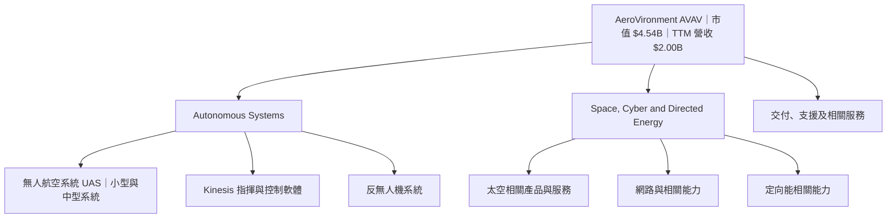
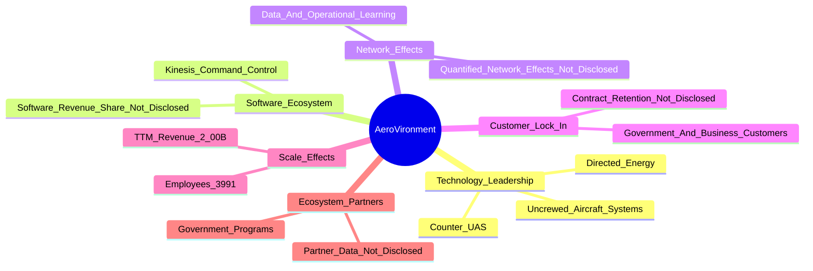
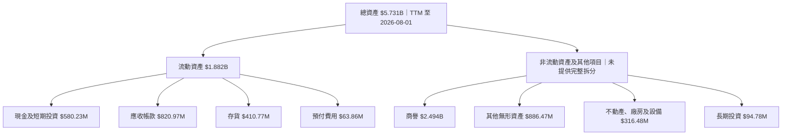
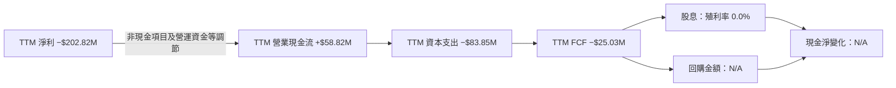
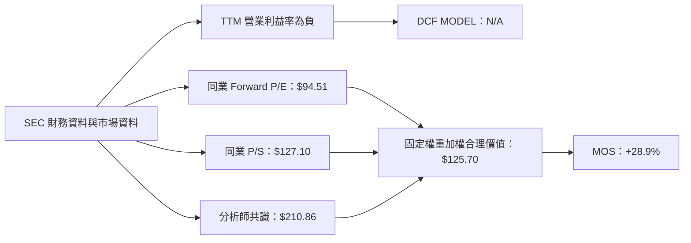
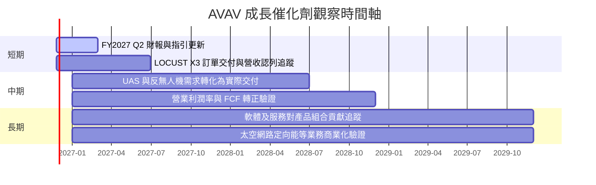
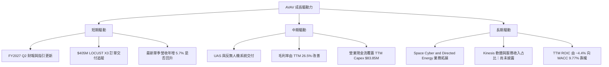
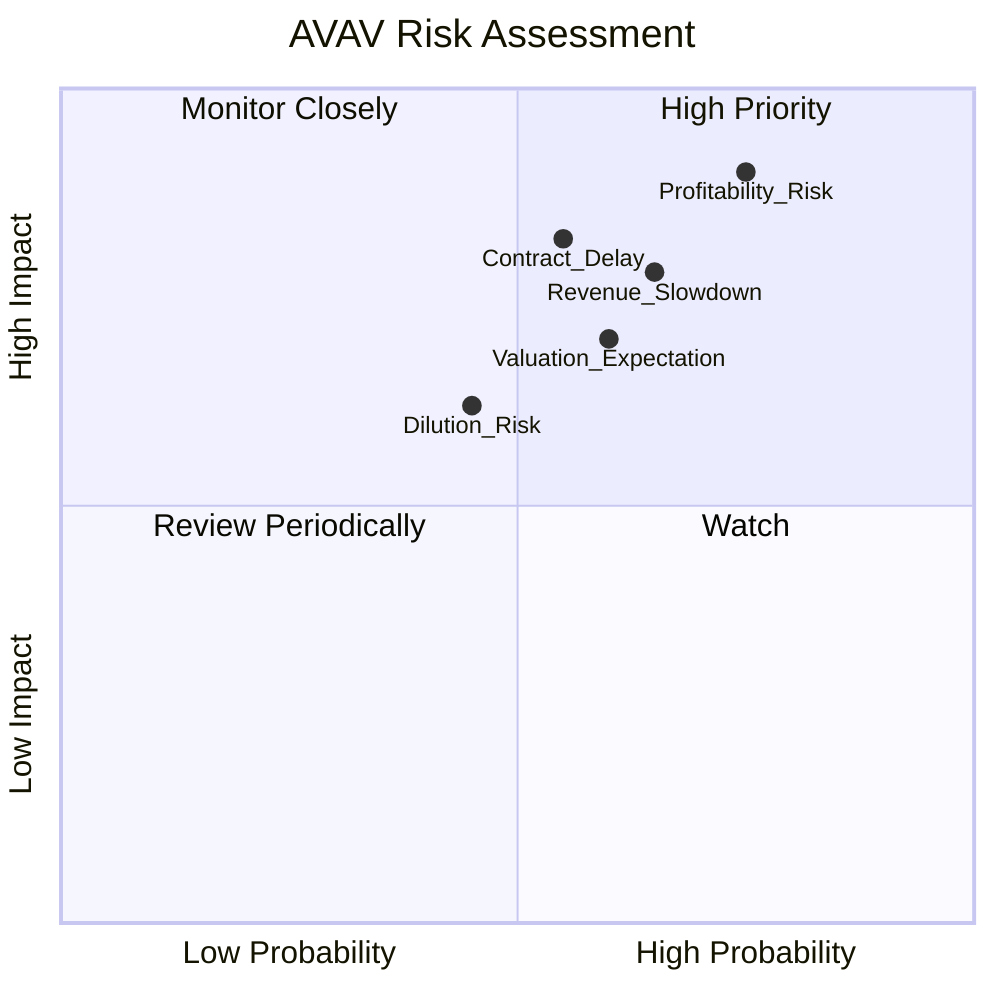
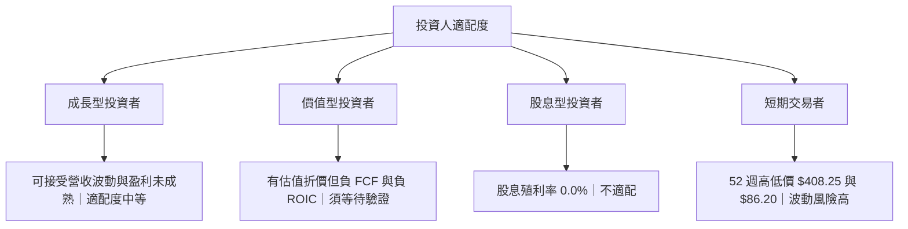

# AVAV 基本面深度分析報告
> **報告日期**：2026-11-25 ｜ **語言**：繁體中文 ｜ **數據來源**：SEC 申報資料 (XBRL)、Yahoo Finance、Finviz、StockAnalysis、Roic.ai ｜ **分析師**：CFA 級機構研究

## 目錄

| # | 章節 | 核心結論 |
|---|------|----------|
| 1 | 執行摘要 | 買入；加權合理價值 $125.70；MOS +28.9% |
| 2 | 公司概覽與商業模式 | 國防無人系統與相關技術供應商；細分營收與市場份額未提供 |
| 3 | 損益表深度分析 | TTM 營收 $2.00B、TTM 成長 +84.4%；獲利能力仍受壓 |
| 4 | 資產負債表分析 | 淨負債 $149.83M；流動比率 4.26，短期流動性充足 |
| 5 | 現金流量深度分析 | TTM FCF −$25.03M，FCF Yield −0.55% |
| 6 | 獲利能力與資本效率 | ROIC −4.4% 低於 WACC 9.77%，目前摧毀股東價值 |
| 7 | 相對估值分析 | P/S 低於自身歷史區間；估值方法指向 $94.51–$210.86 |
| 8 | DCF 內在價值評估 | DCF 不適用；以固定權重方法加權估值，合理價值 $125.70 |
| 9 | 成長催化劑 | 國防無人系統需求、$405M LOCUST X3 訂單報導；TAM 數據未提供 |
| 10 | 風險矩陣 | 獲利與現金流轉弱、訂單執行與估值預期為主要風險 |
| 11 | 投資建議 | 買入但須以季度獲利改善驗證；監控毛利、FCF、稀釋與訂單轉換 |

---

## 1. 執行摘要

最新收盤價為 **2026-11-24 的 $89.40**。AVAV TTM 營收為 **$2.00B**，TTM 年增 **84.4%**，但最新單季年增率僅 **5.7%**；TTM 營業利益率為 **−12.6%**、ROIC 為 **−4.4%**、TTM FCF 為 **−$25.03M**。固定權重估值方法計得加權合理價值 **$125.70**，相對現價的安全邊際（MOS）為 **+28.9%**，但 ROIC 低於 WACC 9.77%，因此按規則 20 評級為 **買入**，而非強烈買入。主要多頭依據是估值方法計算的折價與國防無人系統需求；主要反方證據是營業虧損、負 FCF 及近期營收增速明顯放緩。

### 1.0 一頁式投資儀表板（Portfolio Manager 30 秒速讀）

| 項目 | 內容 |
|------|------|
| **投資論點（3 句）** | ① TTM 營收 $2.00B、TTM 年增 84.4%，反映公司營收規模近期大幅擴張，但最新一季年增僅 5.7%，增速能否延續仍需驗證。 ② 加權合理價值 $125.70，高於 2026-11-24 收盤 $89.40，MOS +28.9%。 ③ TTM FCF 為 −$25.03M、ROIC −4.4% 低於 WACC 9.77%，營收擴張尚未轉化為穩定股東回報。 |
| **綜合評分** | **5.2/10**（引用 1.1 評分卡；描述公司品質與估值，不取代評級） |
| **財務健康** | 🟡 現金及短期投資 $580.23M、流動比率 4.26，但淨負債 $149.83M，且 TTM FCF 為負。 |
| **ROIC vs WACC** | **−4.4% vs 9.77%**；目前資本回報低於資金成本，摧毀股東價值。 |
| **FCF 趨勢** | TTM FCF **−$25.03M**；TTM FCF Yield **−0.55%**，營業現金流 $58.82M 尚不足以覆蓋資本支出 $83.85M。 |
| **估值** | Forward P/E **20.28025x** ｜ EV/EBITDA **21.923x** ｜ FCF Yield **−0.55%**。 |
| **DCF 內在價值（基準）** | **N/A**；TTM 營業利益率為負，DCF MODEL 未提供，故不能計算 DCF 折溢價。 |
| **安全邊際（MOS）** | **+28.9%**＝($125.70 加權合理價值 − $89.40 現價) ÷ $125.70；🟢 高於 25%。 |
| **預期報酬（基準情境 12M）** | DCF 基準情境 N/A；加權合理價值對應上行空間 **+40.6%**，並非 DCF 情境預測。 |
| **關鍵風險（前二）** | ① 營業利益率與 FCF 未轉正；② 最新單季營收年增僅 5.7%，相較 TTM 年增 84.4% 顯著減速。 |
| **評級 + 信心度** | 🟢 **買入** ｜ 信心：中低；估值有折價，但獲利與現金流尚未提供充分驗證。 |

### 1.1 綜合評分卡（全報告唯一）

| 維度 | 評分（1–10） | 主要依據（引用數字與其來源章節） |
|------|--------------|----------------------------------|
| 成長性 | 7.0 | TTM 營收年增 84.4%，但最新單季年增 5.7%；詳見 3.1–3.2。 |
| 獲利能力 | 3.0 | TTM 營業利益率 −12.6%、ROIC −4.4%，低於 WACC 9.77%；Piotroski F-Score 4/9；詳見 3、6 章。 |
| 財務健康 | 6.5 | 現金及短期投資 $580.23M、淨負債 $149.83M、流動比率 4.26，CCC 由 135 天降至 92 天；詳見 4 章。 |
| 估值 | 6.0 | MOS +28.9%；公司 P/S 2.2x，低於五年中位數 5.1x，但仍需考慮負 FCF 及營業虧損；詳見 7–8 章。 |
| 護城河 | 5.5 | 具無人系統、指揮控制軟體及國防客戶產品組合，但市場份額、軟體收入占比及續約資料未提供；詳見 2 章。 |
| 管理層與資本配置 | 3.0 | FY2026 SBC $38.33M，稀釋股數測試未通過；FY2026 營業現金流 −$78.40M、資本支出 $86.22M；未見可引用的回購數據。 |
| **綜合評分** | **5.2** | 六項算術平均：(7.0 + 3.0 + 6.5 + 6.0 + 5.5 + 3.0) ÷ 6 = 5.17，四捨五入至一位小數為 5.2。 |

### 1.2 五大投資論點 + 三大核心風險

| 類型 | 項目 | 具體依據 | 信心度 |
|------|------|----------|--------|
| 🟢 **投資論點①** | TTM 營收擴張 | TTM 營收 $2.00B，TTM 年增 84.4%；顯示近期業務規模躍升，但最新單季年增僅 5.7%，持續性待確認。 | 🟡 中 |
| 🟢 **投資論點②** | 估值方法高於市價 | 固定權重方法加權價值 $125.70，較 $89.40 現價高 $36.30，MOS +28.9%。 | 🟡 中 |
| 🟢 **投資論點③** | 流動性緩衝 | 現金及短期投資 $580.23M，流動比率 4.26，短期支付能力有緩衝。 | 🟢 高 |
| 🟢 **投資論點④** | 營運資金週期改善 | CCC 由一年前 135 天降至 92 天，縮短 43 天；DSO 由 67 天降至 33 天。 | 🟡 中 |
| 🟢 **投資論點⑤** | 無人系統相關需求題材 | 公司產品涵蓋 UAS、反無人機及相關控制系統；新聞提及 $405M LOCUST X3 訂單，但新聞未提供合約認列時間與收入拆分。 | 🟡 中 |
| 🟡 **風險①** | 利潤與現金流尚未證明可持續 | TTM 營業利益率 −12.6%、FCF −$25.03M、ROIC −4.4%。若持續，估值方法的盈利基礎可能難以兌現。 | 🔴 高衝擊 |
| 🔴 **風險②** | 最新季度營收增長放緩 | TTM 成長 84.4%，但最新單季年增 5.7%；可能反映大型專案認列波動或高基期，需等待後續季度驗證。 | 🔴 高衝擊 |
| 🟡 **風險③** | 資本支出與股東稀釋 | TTM 資本支出 $83.85M 高於營業現金流 $58.82M；Piotroski 稀釋股數測試未通過。 | 🟡 中高 |

### 1.3 快速統計卡片

| 指標 | 公司實際值（期間） | 同業中位數 | 狀態 |
|------|--------------------|------------|------|
| 營收成長（TTM） | **84.4%** | — | 🟢 |
| 營收成長（最新一季年增） | **5.7%** | 35.7%（KTOS、ONDS、LMT 中位數） | 🔴 |
| 毛利率（TTM） | **26.5%** | 23.0%（KTOS、ONDS、LMT 中位數） | 🟢 |
| 營業利益率（TTM） | **−12.6%** | — | 🔴 |
| ROIC（TTM） | **−4.4%** | — | 🔴 |
| Forward P/E | **20.28025x** | 21.45x（KTOS、LMT 中位數；估值方法使用 21.4x） | 🟢 |
| FCF Yield（TTM） | **−0.55%** | — | 🔴 |
| Piotroski F-Score | **4 / 9** | — | 🟡 |

### 1.4 投資結論

```text
╔══════════════════════════════════════════════════════════════════╗
║                    📊 投資結論摘要                               ║
╠══════════════════════════════════════════════════════════════════╣
║  評級：買入（MOS +28.9%，但 ROIC −4.4% 低於 WACC 9.77%）         ║
║  價格（2026-11-24 收盤）：$89.40                                  ║
║  DCF 內在價值（基準）：N/A（TTM 營業利益率為負）                  ║
║  安全邊際 MOS：+28.9%（以加權合理價值 $125.70 為分母）            ║
║  加權合理價值（8.8）：$125.70                                    ║
║  綜合評分：5.2/10（引用 1.1）                                    ║
║  適合投資人：能承受國防專案週期、營收波動及短期虧損的成長型投資人║
╚══════════════════════════════════════════════════════════════════╝
```

---

## 2. 公司概覽與商業模式

### 2.1 業務結構與收入來源

公司概覽描述 AeroVironment 設計、開發、製造與支援機器人系統及相關服務，包含 Autonomous Systems 與 Space, Cyber and Directed Energy 兩大板塊。可引用的 TTM 營收為 $2.00B；但分部營收、分部占比、軟體／服務收入占比均未提供，因此不將總營收拆分成未經證實的比例。



### 2.2 市場份額

市場份額數據未提供，新聞及財務資料亦未提供可引用的市場分母，因此不繪製市場份額圖。以可用數字衡量，AVAV TTM 營收 $2.00B、TTM 年增 84.4%，但最新一季年增率只有 5.7%；其同業 KTOS 最新一季年增 35.7%、ONDS 及 LMT 分別為 1,558.6% 與 11.3%。ONDS 的極高增速需留意基期效應，不能直接視為可持續成長比較。

### 2.3 競爭護城河分析



### 2.4 護城河強度

| 護城河項目 | 強度（強／中／弱） | 證據（引用數字或事實） | 會削弱它的情況 |
|------------|--------------------|------------------------|----------------|
| 技術與產品組合 | 中 | 產品涵蓋 UAS、反無人機、指揮控制軟體及定向能相關領域；員工 3,991 人。 | 技術替代加快、競爭者低成本量產、產品性能或可靠性未達採購需求。 |
| 軟體生態系統 | 弱至中 | 公司描述包含 Kinesis 指揮與控制軟體；軟體收入、客戶留存與毛利率未提供。 | 軟體附加銷售有限、系統互通性降低轉換成本，或採購改採開放標準。 |
| 網路效應 | 弱 | 未提供使用者數、資料累積、跨客戶網路效應或訂閱收入數據。 | 軍方可替換供應商、資料無法跨系統形成可持續優勢。 |
| 客戶鎖定 | 中 | 國防系統通常涉及整合、測試與支援服務；公司資料確認政府客戶與服務業務，但合約期限及續約率未提供。 | 計畫延遲、重新招標、預算調整或客戶改採替代方案。 |
| 規模效應 | 中 | TTM 營收 $2.00B、員工 3,991 人；但 TTM 營業利益率 −12.6%，規模尚未反映為穩定獲利。 | 收購整合成本、固定成本或產能投入上升，令規模擴大仍無法改善利潤率。 |
| 生態夥伴 | 弱至中 | 國防供應與跨系統整合具合作需求，但具體夥伴、合作收入與依賴度未提供。 | 關鍵供應商短缺、夥伴更換、零組件交期或出口限制。 |

上述證據對應 1.1「護城河」評分 **5.5/10**：產品與客戶環境提供一定進入門檻，但軟體收入、客戶鎖定與網路效應尚缺量化證據，且目前獲利能力不足以證明護城河已轉化為經濟租金。

---

## 3. 損益表深度分析

### 3.1 年度收入成長趨勢（近 4 年）

依年度損益表列示的總營收計算，FY2026 營收為 $1.98B。FY2026 相比 FY2025 增長約 141.2%，營收跳升顯著；但年報資料未提供可在此拆分的有機成長、收購貢獻或分部營收，因此不能將增長全歸因於單一產品或內生成長。

```text
╔══════════════════════════════════════════════════════════════════╗
║       AeroVironment 年度收入趨勢（FY2023–FY2026）                ║
╠══════════════════════════════════════════════════════════════════╣
║  FY2023  $0.541B  ██████░░░░░░░░░░░░░░░░░░  YoY：基期        ║
║  FY2024  $0.717B  ████████░░░░░░░░░░░░░░░░  YoY：+32.6% 🟢   ║
║  FY2025  $0.821B  █████████░░░░░░░░░░░░░░░  YoY：+14.5% 🟡   ║
║  FY2026  $1.977B  ████████████████████████  YoY：+140.9% 🟢  ║
║                                                                  ║
║  FY2023–FY2026 三年 CAGR：約 +54.1%                              ║
╚══════════════════════════════════════════════════════════════════╝
```

程式資料另列 FY2026 成長 140.89%，而以年度總營收 $1.98B 和 $820.63M 計算約為 141.0%–141.2%，差異來自顯示精度與來源欄位。此處引用年報表的金額做趨勢展示，不替代已驗證的 TTM 成長率 84.4%。

### 3.2 季度收入趨勢分析

下表以 StockAnalysis 季度營收計算 QoQ；最新季度 YoY 採用已驗證的單季年增率 **5.7%**。更早季度 YoY 列示來源所載成長率。

| 季度 | 營收 | QoQ | YoY | 備註 |
|------|------:|----:|----:|------|
| FY2026 Q2（2025-11-01） | $472.51M | +3.9% | +150.7% | 較前季 $454.68M 增長；YoY 受低基期影響。 |
| FY2026 Q3（2026-01-31） | $408.05M | −13.6% | +143.4% | 季度收入回落，但年增仍高，反映比較基期差異。 |
| FY2026 Q4（2026-04-30） | $641.62M | +57.2% | +133.3% | 營收集中於該季的可能性較高；單季波動提醒不能直接年化。 |
| FY2027 Q1（2026-08-01） | $480.49M | −25.2% | **+5.7%** | 已驗證最新單季年增率；相較前幾季增速明顯放緩。 |

QoQ 公式為「本季營收 ÷ 前季營收 − 1」。例如 FY2027 Q1：$480.49M ÷ $641.62M − 1 = −25.2%。國防合約收入可能隨交付與驗收節奏波動，但在缺少 backlog、訂單交付與合約認列明細時，不能將最新增速放緩直接判定為暫時性。

### 3.3 利潤率演變分析

| 利潤率指標 | FY2023 | FY2024 | FY2025 | FY2026 | 趨勢 | 評估 |
|------------|-------:|-------:|-------:|-------:|------|------|
| **毛利率** | 32.1% | 39.6% | 38.8% | 25.3% | FY2026 明顯下降；產品組合、成本與收購影響未能由資料拆分 | 🔴 |
| **營業利益率** | −4.2% | 10.0% | 7.2% | −3.6% | FY2026 由正轉負 | 🔴 |
| **淨利率** | −32.6% | 8.3% | 5.3% | −13.4% | FY2026 淨損擴大；可能受非營業項目影響，明細不足以定量拆分 | 🔴 |

FY2026 毛利率以 $500.64M ÷ $1.977B 計算約 25.3%，低於 FY2025 約 38.8%。年度 TTM 指標亦顯示毛利率 26.5%，但 TTM 營業利益率的資料來源有衝突：已驗證指標為 **−12.6%**，其他合併來源另列 −0.6%。本報告對 TTM 統計一律採用已驗證的 **−12.6%**；季度最新營業利益率採已驗證的 **−2.3%**。年度 FY2026 營業利益率依年度報表計算約 −3.6%，期間口徑不同，不與 TTM 數字混用。

利潤率下滑的可確認事實，是 FY2026 毛利率及營業利益均低於前一年；但資料沒有提供完整分部毛利、整合費用、一次性費用與合約損益拆分，故不把變化歸因於未經證實的收購協同或特定成本項。對未來而言，營收成長若不能伴隨毛利回升與費用率改善，營業槓桿不會自然轉化為自由現金流。

### 3.4 費用結構分析

**完整費用結構圖不適用**：可用資料提供收入、毛利及研發費用，但未提供足以完整拆分 COGS、銷管費用、收購攤銷與其他營業費用的同口徑明細，不繪製易造成誤解的費用占比圓餅圖。

FY2026 研發費用為 **$127.68M**，相當於年度營收約 **6.5%**（$127.68M ÷ $1.977B）。FY2025 研發費用 $100.73M；投入增加與技術開發相符，但研發投入是否帶來更高毛利訂單，仍需以後續營收與營業利潤率驗證。

### 3.5 季度 EPS 趨勢與盈餘品質（Quality of Earnings）

| 季度 | EPS 實際值 | 預期值 | 超預期／不及預期 | 可觀察的業績背景 |
|------|-----------:|-------:|------------------|----------------|
| FY2027 Q1（2026-08-01） | −$0.10 | N/A | N/A | 本季淨損 $5.07M；收入同比增長 5.7%。 |
| FY2026 Q4（2026-04-30） | −$0.48 | N/A | N/A | 本季淨損 $24.10M；營業利益 $56.94M。 |
| FY2026 Q3（2026-01-31） | −$3.15 | N/A | N/A | 本季淨損 $243.82M；資料未提供其特殊項目明細。 |
| FY2026 Q2（2025-11-01） | −$0.34 | N/A | N/A | 本季淨損 $17.10M。 |

最近四季 EPS 預期值均為缺漏，不能判斷超預期或不及預期。Roic.ai 與 StockAnalysis 的季度 EPS 顯示上述實際結果；FY2026 Q3 的較大虧損是季度 EPS 波動的重要來源，但未提供可確認的非經常項目分解，不能臆測其成因。

| 盈餘品質項目 | 數值／佔比 | 評估 |
|--------------|-----------|------|
| 股權薪酬 SBC / 營收 | FY2026 $38.33M ÷ FY2026 營收 $1.977B = **約 1.9%** | 🟡 SBC 不是極端高比例，但仍增加股東經濟成本；稀釋股數測試未通過，需追蹤股份基數。 |
| SBC / 營業現金流 | FY2026 SBC $38.33M；FY2026 營業現金流 −$78.40M | 🔴 分母為負，比例沒有正向解讀意義；SBC 金額約為負營業現金流絕對值的 48.9%，表明現金創造能力不足。 |
| FCF / 淨利（現金轉換率） | TTM FCF −$25.03M；TTM 淨利 −$202.82M；算術比率約 **12.3%** | 🔴 淨利與 FCF 均為負，正比率不能解讀為良好轉換；現金流損失小於會計淨損，但仍未轉正。 |
| 一次性／非經常性損益 | N/A（未提供可核對明細） | 無法判斷是否有一次性項目美化或壓低盈餘。 |
| 有效稅率異常 | N/A（缺少同口徑稅前損益與所得稅細項） | 淨損期間直接計算有效稅率易失真，不以假設值補足。 |
| 資本化支出 vs 費用化 | TTM Capex $83.85M；FY2026 Capex $86.22M | 資本支出已明列；資本化政策及資本化開發成本明細未提供，不能判定是否遞延費用。 |

**盈餘品質結論**：目前 GAAP 淨利為負，TTM FCF 亦為負，尚無可供確認的正向盈餘品質。FY2026 SBC 約占營收 1.9%，本身不是全部問題；更重要的是營業現金流與 FCF 未穩定為正、稀釋股數測試未通過，以及缺少非經常項目明細。估值上應降低對 Forward EPS 單一指標的依賴，並以營業利潤率、營業現金流與實際合約交付作驗證。

---

## 4. 資產負債表分析

### 4.1 資產結構分解

下圖按 StockAnalysis TTM 資產資料列示已披露項目。資產細項未提供完整調節表，因此不反推未列項目，也不繪製比例圖。



### 4.2 流動性與營運資金分析

流動比率及速動比率分別為 **4.26** 與 **3.185**；現金及短期投資為 **$580.23M**。這代表帳面短期流動性較充足，但應收帳款和存貨占用資金仍須監控。各來源資產負債表日期不同時不作混合計算。

| 指標 | 最新 TTM | 一年前 TTM | 變化 | 解讀 |
|------|----------|------------|------|------|
| DSO 應收帳款天數 | 33 天 | 67 天 | −34 天 | 應收回收天數下降，可能有助降低資金占用；需搭配應收帳款品質與客戶付款條款確認。 |
| DIO 存貨天數 | 102 天 | 113 天 | −11 天 | 存貨周轉改善，但 102 天仍代表較明顯的庫存占用；若交付延後，可能再推高庫存。 |
| DPO 應付帳款天數 | 43 天 | 44 天 | −1 天 | 付款天數大致穩定，未見明顯延長付款以支撐現金流的跡象。 |
| CCC 現金轉換週期 | 92 天 | 135 天 | −43 天 | 週期縮短主要來自 DSO 改善；資金回收效率好轉，但未抵消負 FCF。 |

上述天數照抄品質指標計算結果，不在此重新估算。CCC 公式定義為 DSO + DIO − DPO；最新值為 33 + 102 − 43 = 92 天，一年前為 67 + 113 − 44 = 136 天，與資料列示 135 天有四捨五入差異，引用品質指標原值 135 天。

### 4.3 債務結構分析

已驗證數據顯示總債務 **$730.06M**、現金及短期投資 **$580.23M**，因此淨負債 **$149.83M**。其他合併來源的總債務與淨負債不同，本報告的核心淨負債引用已驗證數據；不把兩套期間或口徑混在同一計算中。

```text
╔══════════════════════════════════════════════════════════════════╗
║                 AeroVironment 債務健康診斷                      ║
╠══════════════════════════════════════════════════════════════════╣
║  總債務：          $730.06M    ████████████████████              ║
║  現金及短期投資：  $580.23M    ████████████████                  ║
║  淨負債：          $149.83M    █████                             ║
║                                                                  ║
║  Debt/EBITDA：N/M（TTM EBITDA 口徑來源及正負值不一致）            ║
║  Interest Coverage：N/A（利息費用與同口徑 EBIT 未提供）         ║
║  流動比率：4.26x    🟢 短期流動性緩衝                            ║
║  速動比率：3.185x   🟢 不含存貨仍具流動性                        ║
╚══════════════════════════════════════════════════════════════════╝
```

FY2026 年度表列總債務 $834.79M，而已驗證 TTM 總債務為 $730.06M；期間不同，不以年度值替換最新驗證數字。由於 TTM 營業利益為負，Debt/EBITDA 與利息保障倍數不宜用不一致來源硬算。

### 4.4 股東權益趨勢

| 財政年度 | 股東權益 | 年增變化 |
|---------|---------:|---------:|
| FY2023 | $550.97M | — |
| FY2024 | $822.75M | +49.3% |
| FY2025 | $886.51M | +7.8% |
| FY2026 | $4.40B | +396.4% |

```text
╔══════════════════════════════════════════════════════════════════╗
║                 股東權益趨勢（年度）                             ║
╠══════════════════════════════════════════════════════════════════╣
║  FY2023  $0.551B  ███                                             ║
║  FY2024  $0.823B  █████                                           ║
║  FY2025  $0.887B  █████                                           ║
║  FY2026  $4.400B  █████████████████████████                       ║
╚══════════════════════════════════════════════════════════════════╝
```

FY2026 股東權益急升，且總資產由 FY2025 的 $1.12B 增至 FY2026 的 $5.72B；同期商譽及無形資產分別為 $2.494B、$929.83M。這種資產與權益跳升可能與重大交易或資本變化有關，但所提供資料未含完整交易會計與股數調節，故不作單一原因歸因。投資人應檢視收購相關資產減損風險及新增股份對每股價值的影響。

---

## 5. 現金流量深度分析

### 5.1 現金流量瀑布圖



淨利到營業現金流之間包含非現金費用及營運資金變化，資料未提供完整調節明細，故箭頭表示報表關係，不代表淨利直接加減即可得到營業現金流。FCF 按已驗證定義計算：$58.82M − $83.85M = −$25.03M。

### 5.2 FCF 轉換率趨勢

| 期間 | FCF | 淨利 | FCF / 淨利 | 解讀 |
|------|----:|----:|-----------:|------|
| FY2023 | −$3.47M | −$176.21M | 約 2.0% | 兩者均為負，比例不宜視為現金轉換良好。 |
| FY2024 | −$9.19M | $59.67M | 約 −15.4% | 正淨利未轉化為正 FCF，資本支出與營運資金可能拖累，但無法由現有資料精確拆分。 |
| FY2025 | −$24.13M | $43.62M | 約 −55.3% | 會計獲利與自由現金流背離。 |
| FY2026 | −$164.62M | −$265.12M | 約 62.1% | FCF 與淨利皆負，轉換率數字不代表獲利品質改善。 |
| TTM 至 2026-08-01 | −$25.03M | −$202.82M | 約 12.3% | 兩者皆負，僅作數學比率展示，不作正向評價。 |

### 5.3 自由現金流趨勢

| 期間 | FCF | 方向 |
|------|----:|------|
| FY2023 | −$3.47M | 負值 |
| FY2024 | −$9.19M | 惡化 |
| FY2025 | −$24.13M | 惡化 |
| FY2026 | −$164.62M | 明顯惡化 |
| TTM 至 2026-08-01 | −$25.03M | 高於 FY2026 的負值，但仍未轉正 |

```text
╔══════════════════════════════════════════════════════════════════╗
║            自由現金流歷史趨勢（年度值，非同一 TTM 期間）         ║
╠══════════════════════════════════════════════════════════════════╣
║  FY2023  −$3.47M    ░█                                           ║
║  FY2024  −$9.19M    ░██                                          ║
║  FY2025  −$24.13M   ░████                                        ║
║  FY2026  −$164.62M  ░████████████████████                        ║
║  TTM     −$25.03M   ░████                                        ║
║                                                                  ║
║  TTM FCF Yield：−0.55%（引用已驗證數值）                         ║
╚══════════════════════════════════════════════════════════════════╝
```

年度 FCF 與 TTM FCF 的計算期間不同，不能視作連續年度折線。TTM FCF 為負表示目前營業現金流不足以支付設備投資，若要改善，需要提高營業現金流、降低資本支出，或兩者同時發生。

### 5.4 資本配置評估

現有數據可確認 FY2026 資本支出 $86.22M、SBC $38.33M，並有股息殖利率 0.0%；但回購、收購現金流及其他投資的完整金額未提供，因此不繪製會暗示比例完整的資本配置圓餅圖。

| 資本配置項目 | 可引用數字 | 評估 |
|--------------|------------|------|
| 資本支出 | FY2026 $86.22M；TTM $83.85M | TTM Capex 高於營業現金流 $58.82M，造成負 FCF。 |
| 研發 | FY2026 $127.68M | 占 FY2026 營收約 6.5%；須追蹤研發成果是否轉化為交付與毛利。 |
| 股息 | 殖利率 0.0% | 未提供現金股息支出；股息型投資人不適配。 |
| 股票回購 | N/A | 未提供可核對金額。 |
| 股權薪酬 | FY2026 $38.33M | 對員工激勵有用，但形成股東稀釋成本；稀釋股數測試未通過。 |

---

## 6. 獲利能力與資本效率

### 6.1 ROE / ROA / ROIC 趨勢

| 指標 | FY2023／年度可得資料 | FY2024／年度可得資料 | FY2025／年度可得資料 | 最新 TTM | 評估 |
|------|----------------------|----------------------|----------------------|---------|------|
| ROE | 年度歷史明細 N/A | 年度歷史明細 N/A | 年度歷史明細 N/A | −4.6% | 負淨利令股東回報為負。 |
| ROA | 年度歷史明細 N/A | 年度歷史明細 N/A | 年度歷史明細 N/A | −0.1% | 資產尚未產生正的 TTM 報酬。 |
| ROIC | 年度歷史明細 N/A | 年度歷史明細 N/A | 年度歷史明細 N/A | −4.4% | 低於 WACC，現階段資本投入未創造經濟價值。 |

不提供缺乏同口徑來源的行業均值。TTM ROIC、ROE、ROA 直接引用已驗證品質指標。

### 6.2 ROIC vs WACC 分析（核心價值創造判斷）

```text
╔══════════════════════════════════════════════════════════════════╗
║                  ROIC vs WACC 深度分析                          ║
╠══════════════════════════════════════════════════════════════════╣
║  資本成本輸入（採程式計算的 Cost of capital）：                  ║
║  ├── 無風險利率（10Y 美債）：      4.90%                         ║
║  ├── 市場風險溢酬 ERP：            5.00%                         ║
║  ├── 原始 Beta：                   1.40                          ║
║  ├── 調整後 Beta：                 1.27                          ║
║  ├── 股權成本 Ke：                 11.25%                        ║
║  ├── 稅前債務成本 Kd：             0.77%                         ║
║  ├── 稅率：                        21.0%                         ║
║  ├── 股權／債務權重：               86.2%／13.8%                  ║
║  └── WACC：                        9.77%                         ║
║                                                                  ║
║  ROIC（TTM）：                     −4.4%                         ║
║  EVA 利差（ROIC − WACC）：         −14.17 個百分點                ║
║  ROIC 低於資金成本：目前摧毀股東價值                             ║
╚══════════════════════════════════════════════════════════════════╝
```

原始 Beta 1.40 調整為 **1.27**，依公式 ⅔ × 1.40 + ⅓ × 1 = 1.2667，四捨五入至兩位小數為 1.27。成本資料列示股權成本 11.25%、稅前債務成本 0.77%、資本權重 86.2%／13.8%，並直接採用已驗證 **WACC 9.77%**，不另以四捨五入輸入重算替換。

以已驗證數值計算經濟價值利差：−4.4% − 9.77% = **−14.17 個百分點**。負 ROIC 表示稅後營業報酬低於投入資本成本；即使營收保持成長，若營業利潤率不改善、資本需求又偏高，規模增長仍可能擴大價值損失。這也是估值評級停留在「買入」而非「強烈買入」的關鍵原因。

### 6.3 杜邦三因素分解

| 因素 | 數值（TTM） | 解讀 |
|------|-------------|------|
| 淨利率 | −10.1% | 負淨利率是 ROE 為負的主要來源。 |
| 資產週轉率 | 0.35 | 每單位資產產生的營收有限，資產擴張尚未轉化為高周轉。 |
| 權益乘數 | 1.30 | 槓桿不是 ROE 的主要支撐來源。 |
| **ROE** | **−4.6%** | 依品質指標原值：淨利率 −10.1% × 資產週轉率 0.35 × 權益乘數 1.30 = ROE −4.6%（受四捨五入影響）。 |

ROE 主要受負淨利率拖累，而非由過度槓桿造成。由於三因素為四捨五入後的數字，展示乘積與原始 ROE 可能有微小尾差；不另重算或替換品質指標原值。

### 6.4 財務體質：Piotroski F-Score

**Piotroski F-Score：4 / 9**。一項未具備輸入時才會排除，但本次資料列出九項測試。

| 測試 | 結果 | 解讀 |
|------|------|------|
| ROA > 0 | ❌ 未通過 | TTM ROA 為負，資產尚未產生正淨利。 |
| 營業現金流 > 0 | ✅ 通過 | TTM 營業現金流 $58.82M 為正。 |
| ROA 高於一年前 | ❌ 未通過 | 未見 ROA 改善至高於一年前。 |
| 營業現金流 > 淨利（應計品質） | ✅ 通過 | 營業現金流高於淨利；但淨利為負時，此項通過不等於獲利品質已佳。 |
| 長期負債 ÷ 總資產低於一年前 | ✅ 通過 | 相對一年前的測試結果改善；仍需追蹤負債與併購後資產結構。 |
| 流動比率高於一年前 | ❌ 未通過 | 相對一年前沒有提升。 |
| 稀釋股數未增加 | ❌ 未通過 | 存在股東稀釋風險，需監控每股價值增長是否超過股份數增長。 |
| 毛利率高於一年前 | ❌ 未通過 | 毛利率未高於一年前；FY2026 年度毛利率明顯下降。 |
| 資產週轉率高於一年前 | ✅ 通過 | 資產使用效率相較一年前的測試改善。 |

4/9 反映有部分現金流與負債改善訊號，但獲利、毛利、流動比率及股數指標仍有弱點，整體不支持將公司視為成熟穩定的獲利型企業。

---

## 7. 相對估值分析

### 7.1 同業估值比較表格

同業倍數採 Yahoo Finance 的同業資料；公司本身數值採市場估值資料。估值倍數差異須連同獲利能力及成長率解讀，尤其 ONDS 的單季成長率受基期影響可能很大。

| 估值指標 | **AVAV** | **KTOS** | **ONDS** | **LMT** | AVAV 評估 |
|----------|---------:|---------:|---------:|---------:|-----------|
| **Trailing P/E** | N/A | 235.1x | N/A | 20.8x | 🔴 AVAV TTM EPS 為負，P/E 不具比較意義。 |
| **Forward P/E** | 20.28025x | 25.3x | −25.1x | 17.6x | 🟡 AVAV 低於 KTOS、高於 LMT；ONDS 為負值，不能直接按便宜與否比較。 |
| **P/S Ratio** | 2.2686696x | 3.2x | 6.9x | 1.7x | 🟢 AVAV 低於 KTOS 與 ONDS、高於 LMT。 |
| **EV/EBITDA** | 21.923x | 46.2x | −5.4x | 15.2x | 🟡 AVAV 介於兩家正倍數同業之間；自身 TTM 利潤口徑存在來源差異，須審慎解讀。 |
| **最新單季營收 YoY** | 5.7% | 35.7% | 1,558.6% | 11.3% | 🔴 AVAV 低於三家同業中位數 35.7%。 |
| **TTM 毛利率** | 26.5% | 23.0% | 36.4% | 11.7% | 🟢 高於 KTOS、LMT，低於 ONDS。 |

同業中位數：Forward P/E 使用 KTOS 與 LMT 中位數，估值方法採用 **21.4x**；P/S 中位數為 **3.2x**（KTOS、ONDS、LMT）。這些倍數反映同業差異，並非 AVAV 自身可保證達成的估值倍數。

### 7.2 歷史估值區間分析

歷史估值資料提供 **P/S**，而非 P/E，故以下展示 P/S。公司 P/S 為 2.2x、低於資料列示五年歷史區間 3.0x–13.4x；資料另列目前百分位為 0%。因現值低於該區間下限，讀者應將「區間」理解為資料庫歷史統計口徑，而非把現值強行塞回範圍內。

```text
╔══════════════════════════════════════════════════════════════════╗
║                 AVAV 五年歷史 P/S 位置                           ║
╠══════════════════════════════════════════════════════════════════╣
║  當前 P/S：2.2x                                                   ║
║  五年歷史區間：3.0x ─────────────────────────── 13.4x            ║
║  五年中位數：5.1x                                                 ║
║  當前百分位：0%                                                   ║
║                                                                  ║
║  現值低於歷史區間下限，可能代表市場重新定價；                    ║
║  也可能反映獲利和現金流風險上升，不能僅以低於歷史區間判定低估。  ║
╚══════════════════════════════════════════════════════════════════╝
```

### 7.3 情境價值（Bear / Base / Bull）

**N/A（DCF 無法計算：TTM 營業利益率為負，DCF MODEL 未提供）**。依資料規則，不自行建立悲觀、基準與樂觀 DCF 情境，也不提供未有模型支持的情境目標價。

### 7.4 相對估值隱含價格區間

```text
╔══════════════════════════════════════════════════════════════════╗
║                 相對估值與市場價格位置                           ║
╠══════════════════════════════════════════════════════════════════╣
║  $89.40 現價 ── $94.51 同業 Forward P/E ── $127.10 同業 P/S      ║
║                        └──────────── $210.86 分析師共識           ║
╚══════════════════════════════════════════════════════════════════╝
```

| 估值方法 | 每股價值 | 相對現價 | 依據 |
|----------|---------:|---------:|------|
| 同業 Forward P/E | $94.51 | +5.7% | 同業中位數 21.4x × Forward EPS $4.41。 |
| 同業 P/S | $127.10 | +42.2% | 同業中位數 P/S 3.2x × TTM 營收，按既定估值程序換算每股價值。 |
| 分析師共識目標價 | $210.86 | +135.9% | 24 位分析師平均目標價；屬市場預期參考，不是基本面保證。 |

以上方法均照固定估值方法資料列示；各方法的權重與加權結果見 8.8。

---

## 8. DCF 內在價值評估（Discounted Cash Flow）

> DCF MODEL：**N/A — TTM 營業利益不為正；對虧損折現不構成有效估值。** 因此不建立另一套預測，不推導未被模型提供的營收、現金流、終值或 DCF 每股價值。估值三角驗證與安全邊際改以固定權重估值方法計算，避免將假設性 DCF 冒充成可驗證結果。

### 8.0 估值推理鏈（Thinking Logic）

**Step 1 — 價值由哪些變數決定？**  
公司價值最終取決於自主系統及其他國防科技業務能否持續交付、毛利率與營業利潤率能否回升，以及營業現金流能否高於資本支出。公司總體 TTM 營收為 $2.00B，但分部營收比例、軟體／服務收入占比未提供，無法把價值拆成可量化的主業、第二曲線與選擇權。現階段更直接的估值約束是 **TTM 營業利益率為負、TTM FCF 為負**，所以缺少可穩健折現的正向現金流底盤。

**Step 2 — 模型與方法選擇**

| 決策點 | 本報告採用 | 理由 | 曾考慮但否決 | 否決理由 |
|--------|-----------|------|--------------|----------|
| 現金流定義 | DCF 不適用；不推導 FCFF／FCFE | TTM 營業利益率為負，資料明確標示 DCF MODEL N/A | 自行建立 FCFF 模型 | 必須自行填補成長、利潤率、Capex、營運資金及終值假設，違反數據規則。 |
| 預測期 N | N/A | 程式未提供 DCF 預測期 | 任意指定 5 年或 10 年 | 缺乏財務預測依據。 |
| 終值方法 | N/A | 不存在可用的基準現金流與終值 | Gordon Growth／退出倍數 | 對虧損折現並指定終值會形成黑箱估值。 |
| EBIT 基礎 | N/A | 不進行 DCF | GAAP 或非 GAAP EBIT 假設 | 不能替程式缺失的 DCF 自行補模型。 |

**Step 3 — 關鍵假設的推導鏈**  
由於模型明確為 N/A，營收 CAGR、期末營業利潤率、g、N、Capex／營收、稅率與 SBC 等假設均未被模型採用；不提供假裝可稽核的替代數字。主要分析採已提供的固定權重相對估值方法，詳見 8.8。

**Step 4 — 最脆弱的一環**  
最脆弱的假設並非某個 DCF 參數，而是市場估值方法能否以同業倍數與分析師平均目標價反映 AVAV 的未來獲利；若營收放緩且利潤率維持負值，估值應向較低的同業倍數及 P/S 參考值收斂。

**Step 5 — 估值路徑圖**



### 8.1 模型假設總表（Model Inputs）

**N/A（DCF MODEL 未提供）**：TTM 營業利益率不為正，不能建立正向現金流折現模型。依規則不自行補入預測期、營收 CAGR、終期利潤率、稅率、Capex／營收、D&A／營收、營運資金變動、SBC 處理、稀釋率、永續成長率或終值倍數。公司已驗證 WACC 為 9.77%，僅在 6.2 作為 ROIC 比較基準，並不代表可據此完成 DCF。

### 8.2 折現率推導（WACC）

本節屬 DCF 模型章節，依資料規則列為 **N/A（DCF MODEL 未提供）**。為保持資本效率分析一致，第 6.2 節使用已提供的 WACC **9.77%**；成本資本資料另列 Rf 4.90%、ERP 5.00%、原始 Beta 1.40、調整後 Beta 1.27、股權成本 11.25%、稅前債務成本 0.77%、稅率 21.0%、股權／債務權重 86.2%／13.8%。不在 DCF 章節重建或替換程式計算的 WACC。

### 8.3 逐年自由現金流預測（基準情境）

**N/A（DCF MODEL 未提供：TTM 營業利益不為正）**。逐年營收、營業利潤率、EBIT、稅、NOPAT、D&A、Capex、營運資金變動、FCFF 與折現因子均不適用；不填假設值、不繪製預測 FCF 成長圖。

### 8.4 終值計算（Terminal Value）

**N/A（DCF MODEL 未提供：無可用預測期 FCFF、永續成長率或退出倍數）**。不計算 Gordon Growth 或退出倍數終值。

### 8.5 企業價值 → 每股內在價值（Bridge）

**N/A（DCF MODEL 未提供）**。DCF 企業價值、DCF 股權價值、DCF 每股內在價值及相對 DCF 的折溢價均無法計算。本報告不以相對估值的 $125.70 代稱 DCF 內在價值。

### 8.6 敏感性分析（WACC × 永續成長率）

**N/A（DCF MODEL 未提供）**。沒有程式提供的 WACC × g 敏感度矩陣，亦不自行生成每股內在價值矩陣或 DCF 情境。

### 8.7 反推 DCF（Reverse DCF：市場在預期什麼）

**N/A（DCF MODEL 未提供）**。無法從當前股價反推出營收 CAGR、期末利潤率、永續成長率或成長年數，不以自建模型替代。

### 8.8 估值三角驗證與安全邊際

估值方法、每股價值與權重採固定估值程序。公司類型為**未獲利公司**；相對估值法使用同業中位數倍數，而非公司自身目前倍數。

| 估值方法 | 隱含每股價值 | 上行空間（÷現價） | 權重 | 說明 |
|----------|--------------:|-------------------:|------:|------|
| 同業 Forward P/E | $94.51 | +5.7% | 30% | 同業中位數 21.4x × AVAV Forward EPS $4.41。 |
| 同業 P/S | $127.10 | +42.2% | 60% | 同業 P/S 中位數 3.2x × TTM 營收，按固定方法換算。 |
| 分析師共識目標價 | $210.86 | +135.9% | 10% | 24 位分析師平均目標價；權重較低，避免共識單獨主導估值。 |
| **加權合理價值** | **$125.70** | **+40.6%** | **100%** | 未提供 DCF，因此不納入 DCF 方法；其餘方法及權重依公司類型固定。 |

**逐步演算（權重外顯）**

加權合理價值  
= $94.51 × 30% + $127.10 × 60% + $210.86 × 10%  
= $28.353 + $76.260 + $21.086  
= **$125.699**  
= **$125.70**（四捨五入至美分）。

權重合計：30% + 60% + 10% = **100%**。本估值類型為未獲利公司；DCF 因營業利益不為正而無法計算，故不納入估值方法，也不調整其餘方法的既定權重。

**指標定義及複算**

- **MOS**＝(加權合理價值 − 現價) ÷ 加權合理價值  
  = ($125.70 − $89.40) ÷ $125.70  
  = $36.30 ÷ $125.70  
  = **28.9%**。
- **上行空間**＝(加權合理價值 − 現價) ÷ 現價  
  = ($125.70 − $89.40) ÷ $89.40  
  = $36.30 ÷ $89.40  
  = **40.6%**。
- **折溢價**以第 8.5 節 DCF 基準價值為分母；由於 DCF N/A，本報告不計算 DCF 折溢價。
- 依 MOS 門檻本應屬「強烈買入」的 MOS 區間，但 **ROIC −4.4% 不大於 WACC 9.77%**，規則 20 指定降為 **買入**；本報告不再作額外一級調整。

```text
╔══════════════════════════════════════════════════════════════════╗
║                  估值區間與安全邊際                              ║
╠══════════════════════════════════════════════════════════════════╣
║  $94.51 ───────── $89.40 ───────── [$125.70] ─────── $210.86    ║
║  同業 Forward P/E    現價            加權合理值       分析師共識  ║
║                                                                  ║
║  安全邊際 MOS = ($125.70 − $89.40) ÷ $125.70 = +28.9%           ║
║  上行空間 = ($125.70 − $89.40) ÷ $89.40 = +40.6%                 ║
║                                                                  ║
║  建議買入區間：$89.40 – $113.13                                  ║
║  （以加權合理價值計，價格不高於 $125.70 × 90%）                  ║
║  合理持有區間：$113.13 – $157.13                                 ║
║  減碼考慮區間：高於 $210.86（分析師共識參考值，不是 DCF 樂觀值）║
╚══════════════════════════════════════════════════════════════════╝
```

買入區間下限取最新收盤價，上限對應至少約 10% MOS 的價格門檻：$125.70 × 90% = $113.13。由於評級為買入，區間上限高於現價，符合評級與買入區間一致性要求。持有與減碼區間僅作相對估值參考，不代表 DCF 情境價值。

> 🔎 **程式複算（Python，依本節各項自動重算）**
>
> 加權合理價值 = $94.51 × 30% + $127.10 × 60% + $210.86 × 10% = **$125.70**（權重合計 100%）
>
> 以價格 $89.40 計：MOS = **+28.9%**，上行空間 = **+40.6%**
>
> ✅ 與本節所寫數值一致。

### 8.9 DCF 模型的局限與失效條件

- **終值依賴度**：N/A；沒有 DCF 終值，不提供終值占 EV 比例。
- **最脆弱假設**：DCF 未建模；相對估值的脆弱點是同業倍數能否套用，以及分析師共識是否反映可持續獲利。若營收增長放緩、TTM 營業利益率維持負值，市場可能下調銷售倍數。
- **不適用情境說明**：TTM FCF −$25.03M、TTM 營業利益率 −12.6%，而且季度收入與盈利波動大，傳統 DCF 可靠度偏低。現階段應以 EV/Sales 或 P/S、訂單轉換、毛利率、單位經濟性及未來獲利改善作交叉驗證；目前資料不足以做 SOTP。
- **與第 10 章風險矩陣連結**：訂單延後會壓低營收成長；價格競爭與交付成本增加會壓縮毛利率；Capex、存貨與應收款上升會拖累 FCF。

### 8.10 複算檢核表（Audit Trail）

| # | 檢核項目 | 檢查方式 | 結果 |
|---|----------|----------|------|
| 1 | 所有 DCF 高／中敏感度輸入均有推導 | DCF MODEL 為 N/A，未建立輸入假設 | ✅（不適用，未自建模型） |
| 2 | 每個假設都有來歷 | 未填 DCF 假設；估值方法均列明來源依據 | ✅ |
| 3 | WACC 五步算式齊全且相乘相加正確 | DCF 不建模；第 6.2 引用原始 WACC 9.77% | ✅（DCF 不適用） |
| 4 | Kd 分母與債務權重範圍一致 | 未自行計算 WACC | ✅（未重建） |
| 5 | WACC 與第 6.2 節同值 | 第 6.2 引用 9.77%；DCF 不計算 | ✅ |
| 6 | 逐年表格年度數等於 N | DCF MODEL 無 N，未輸出逐年預測表 | ✅（不適用） |
| 7 | 代表年度九步算式可複算 | 無 FY+1 預測值 | ✅（不適用） |
| 8 | 預測期 PV 逐項相加 | 無預測期 PV | ✅（不適用） |
| 9 | WACC > g | 無 g；未計算終值 | ✅（不適用） |
| 10 | 終值以 FY+N 現金流為基礎 | 無終值計算 | ✅（不適用） |
| 11 | 橋接算式可複算 | DCF bridge N/A；第 8.8 加權估值已列完整算式 | ✅ |
| 12 | SBC 組合合法且一致 | 未建立 DCF，未假設 SBC 或股數處理 | ✅（不適用） |
| 13 | 敏感性矩陣基準格等於 DCF 每股價值 | 無 DCF 矩陣 | ✅（不適用） |
| 14 | 矩陣只保留有效 WACC > g 格 | 未建立矩陣 | ✅（不適用） |
| 15 | 三情境機率加權正確 | DCF 情境 N/A，未給情境機率 | ✅（不適用） |
| 16 | 反推 DCF 每列只放開一個變數 | Reverse DCF N/A | ✅（不適用） |
| 17 | MOS 基準與 1.0 儀表板一致 | 均以 $125.70 加權合理價值計算，MOS +28.9%；折溢價不計 | ✅ |
| 18 | 完整輸出至第 11 章 | 本報告包含 11 個章節 | ✅ |
| 19 | 加權價值等於方法加權和 | $94.51×30% + $127.10×60% + $210.86×10% = $125.699 ≈ $125.70 | ✅ |
| 20 | 評級符合 MOS 規則 | MOS 28.9%，但 ROIC −4.4% ≤ WACC 9.77%，評級為買入 | ✅ |

本章 DCF 相關檢查項目因模型 N/A 而不適用；沒有用自行填入的預測數字掩蓋資料缺口。

---

## 9. 成長催化劑

### 9.1 催化劑時間軸

季度財報與合約公告時間以實際公司公告為準；除新聞明確列出的資訊外，不臆測確切認列季度。



公司資料列出將召開 FY2027 Q2 財報電話會議，但未提供公告日期；上圖短期區間是監控框架，不代表公司財測或確定交付時點。新聞提到 **$405M LOCUST X3 訂單**，但未提供合同期限、交付節奏、毛利或已認列金額，需用後續季報核實。

### 9.2 TAM 市場規模分析

**N/A（TAM 數據未提供）**。公司 TTM 營收為 $2.00B、TTM 年增 84.4%，說明近期業務規模增加；然而最新一季年增 5.7%，顯示成長速度不能只依賴 TTM 數字外推。無可引用的市場總額、公司市占率及滲透率，因此不推算 TAM 或收入滲透率。

### 9.3 成長驅動力結構圖



---

## 10. 風險矩陣

### 10.1 風險評分矩陣

以下為分析師定性機率與衝擊排序，不是公司公布的機率或財務預測。



### 10.2 風險清單詳細分析

機率、衝擊與風險分數為定性分析估計，不是公司指引；百分比形式的財務衝擊若缺乏可核對模型，不虛構單一數字。

| # | 風險項目 | 發生機率 | 財務衝擊 | 風險評分 | 緩解措施 |
|---|----------|----------|----------|----------|----------|
| 1 | 🔴 **盈利能力與 FCF 持續疲弱** | 中高（分析師估計） | 高：TTM 營業利益率 −12.6%、FCF −$25.03M；若持續會壓低估值倍數 | 🔴 8.5/10（定性） | 每季追蹤毛利率、營業費用率、營業現金流及 Capex；若 FCF 連續兩季為負且擴大，重新評估持倉。 |
| 2 | 🔴 **營收增長急速放緩** | 中高（分析師估計） | 高：最新單季 YoY 5.7%，遠低於 TTM 84.4% | 🔴 8.0/10（定性） | 追蹤訂單、backlog、交付節奏與管理層指引；分清一次性季度波動與持續性需求下滑。 |
| 3 | 🔴 **政府採購與合約交付延誤** | 中（分析師估計） | 高：國防專案驗收延後可能影響收入認列與營運資金 | 🔴 7.5/10（定性） | 追蹤大型訂單的交付進度、應收帳款、存貨與客戶集中度；目前合約期限與客戶集中度未提供。 |
| 4 | 🟡 **高資本支出與營運資金壓力** | 中（分析師估計） | 中高：TTM Capex $83.85M 高於 OCF $58.82M，造成負 FCF | 🟡 7.0/10（定性） | 要求營收成長同時改善現金轉換，監控 DIO 及 CCC；CCC 現為 92 天，低於一年前 135 天。 |
| 5 | 🟡 **股票稀釋** | 中（分析師估計） | 中：F-Score 稀釋股數測試未通過；每股價值可能低於公司總價值成長 | 🟡 6.5/10（定性） | 每季對照稀釋股數、SBC 與營收／FCF；FY2026 SBC 為 $38.33M。 |
| 6 | 🟡 **市場估值及分析師共識下修** | 中（分析師估計） | 中高：分析師平均目標價 $210.86，與現價 $89.40 距離大，預期落差可能擴大波動 | 🟡 6.5/10（定性） | 以公司營業利潤、FCF 和同業估值重估，不將分析師平均目標價視為保證。 |

---

## 11. 投資建議

### 11.1 最終評級與評分

最新收盤價 $89.40，固定權重估值計算的合理價值為 $125.70，MOS +28.9%；按 MOS 區間原可進入強烈買入，但 **ROIC −4.4% 低於 WACC 9.77%**，依規則 20 定為 **買入**，不作額外調整。1.1 評分卡綜合分數為 **5.2/10**；六項分數依序為成長性 7.0、獲利能力 3.0、財務健康 6.5、估值 6.0、護城河 5.5、管理層與資本配置 3.0。

### 11.2 合理價值與隱含報酬率

| 方法／情境 | 每股價值 | 相對 2026-11-24 收盤 $89.40 | 權重／機率 | 說明 |
|------------|---------:|----------------------------:|------------:|------|
| 同業 Forward P/E | $94.51 | +5.7% | 30% 權重 | 固定估值方法值。 |
| 同業 P/S | $127.10 | +42.2% | 60% 權重 | 固定估值方法值。 |
| 分析師共識 | $210.86 | +135.9% | 10% 權重 | 24 位分析師平均目標價。 |
| **加權合理價值** | **$125.70** | **+40.6% 上行空間** | **100% 權重** | MOS +28.9%；不是 DCF 價值。 |
| 悲觀 DCF 情境 | N/A | N/A | N/A | DCF MODEL 未提供。 |
| 基準 DCF 情境 | N/A | N/A | N/A | DCF MODEL 未提供。 |
| 樂觀 DCF 情境 | N/A | N/A | N/A | DCF MODEL 未提供。 |

### 11.3 買入時機與觸發因素

```text
╔══════════════════════════════════════════════════════════════════╗
║                  ✅ 買入觸發因素 Checklist                      ║
╠══════════════════════════════════════════════════════════════════╣
║  立即買入觸發條件（多數符合）：                                  ║
║  ✅ 現價 $89.40 低於加權合理價值 $125.70                         ║
║  ✅ MOS +28.9%，高於 25%                                          ║
║  ☐ 最新單季營收增長回升，避免只依賴 TTM +84.4%                   ║
║  ☐ 毛利率與營業利益率連續改善，營業現金流能持續覆蓋 Capex       ║
║                                                                  ║
║  加碼觸發條件（出現以下任一並經財報確認）：                      ║
║  ☐ TTM FCF 轉正且不以一次性營運資金釋放為主                      ║
║  ☐ 最新單季營收年增率連續改善，且 backlog／交付同步支持          ║
║  ☐ ROIC 明顯改善並向 WACC 9.77% 靠攏                             ║
║                                                                  ║
║  減碼／重新評估條件（出現以下任一）：                            ║
║  ☐ 最新單季營收年增率連續兩季低於 5.7%                           ║
║  ☐ TTM FCF 持續為負且資本支出再升高                              ║
║  ☐ 稀釋股數增加速度持續高於營收或每股盈利改善                    ║
║  ☐ ROIC 長期低於 WACC，且營業利益率無改善跡象                    ║
╚══════════════════════════════════════════════════════════════════╝
```

### 11.4 投資人適配度分析



成長型投資人可關注國防無人系統需求，但需承受最新季度增速放緩及獲利波動。價值型投資人可把 $125.70 視為固定方法推算的參考值，而非確定內在價值；股息型投資人因殖利率 0.0% 不適配。短線交易者應考慮股價波動：52 週區間為 $86.20–$408.25，短賣比例占流通股 13.3%，價格風險顯著。

### 11.5 每季財報監控清單（Quarterly Watch List）

| 指標 | 最新基準 | 加碼觀察條件 | 減碼／重新評估條件 |
|------|----------|--------------|--------------------|
| 營收成長 | TTM +84.4%；最新單季 YoY +5.7% | 單季年增回升且連續改善，並由實際交付支持 | 連續兩季低於 5.7%，或營收低於公司指引 |
| 毛利率 | TTM 26.5%；FY2026 年度約 25.3% | 連續數季改善並帶動營業損益收窄 | 毛利率續降，尤其低於最新 TTM 26.5% 且未改善 |
| 營業利益率 | TTM −12.6%；最新季度 −2.3% | 營業利益率逐季改善並向損益兩平靠近 | TTM 虧損擴大或最新季度較 −2.3% 明顯惡化 |
| 營業現金流 | TTM $58.82M | 維持正值且覆蓋資本支出 | 轉負或由一次性營運資金因素支撐 |
| Capex／FCF | TTM Capex $83.85M；FCF −$25.03M | FCF 轉正且投資支出具明確交付回報 | Capex 上升而收入、現金流無改善 |
| 應收與存貨 | DSO 33 天、DIO 102 天 | CCC 維持或低於 92 天，且不犧牲交付品質 | DIO 上升、CCC 超過一年前 135 天 |
| SBC 與稀釋 | FY2026 SBC $38.33M；F-Score 稀釋測試未通過 | 股數增長受控，SBC 對營收比例下降 | 股數持續增加，且每股指標未改善 |
| 訂單及 LOCUST X3 | 新聞提及 $405M 訂單；認列時程 N/A | 公司披露交付節奏、合約毛利及收入認列 | 訂單延誤、取消或交付未轉為收入 |
| 財測與分析師預期 | 24 位分析師平均目標價 $210.86 | 實際營收與獲利改善逐步支持預期 | 分析師下修伴隨 backlog 或利潤率惡化 |

### 11.6 反面論證：什麼會證明論點錯誤（What Would Change My Mind）

```text
╔══════════════════════════════════════════════════════════════════╗
║              ⚠️ 論點失效條件（Disconfirming Evidence）           ║
╠══════════════════════════════════════════════════════════════════╣
║  本投資論點在下列情況成立時應重新檢視或退出：                    ║
║  ☐ 最新單季營收年增率連續兩季低於 5.7%，且沒有可驗證訂單支撐    ║
║  ☐ TTM 營業利益率維持 −12.6% 或進一步惡化，未見季度改善         ║
║  ☐ TTM FCF 持續低於 0，且資本支出升高、營業現金流轉弱           ║
║  ☐ ROIC 持續為負，且無法向 WACC 9.77% 靠攏                      ║
║  ☐ DIO 升破一年前 113 天或 CCC 升破一年前 135 天並持續惡化      ║
║  ☐ 稀釋股數持續增加，股份增長超過收入或每股價值改善             ║
║  ☐ LOCUST X3 或其他大型訂單延遲、取消，或交付沒有轉成收入       ║
╚══════════════════════════════════════════════════════════════════╝
```

> **免責聲明**：本報告為 AI 自動生成，僅供研究參考，不構成投資建議。投資有風險，入市需謹慎。

---

## 資料與來源

| 項目 | 內容 |
|------|------|
| 價格 | 89.40 USD，2026-11-24 收盤（Yahoo Finance 日線） |
| 財務報表 | SEC 10-Q filed 2026-09-10，最新季度 2026-08-01（FY2027 Q1） |
| 有回應的資料來源 | SEC 申報資料 (XBRL)、Yahoo Finance、Finviz、StockAnalysis、Roic.ai |
| 由程式計算 | TTM 數字、WACC、DCF 模型、估值方法與權重、加權合理價值、MOS、評級門檻、F-Score、杜邦分解、營運資金天數、綜合評分 |
| 撰寫模型 | openai / gpt-6-luna |

> 本區塊由產生報告的程式依實際取得的資料填寫，非模型撰寫。「由程式計算」的數字不是模型的估計；其餘判斷（評分、情境、策略）是模型的分析。
