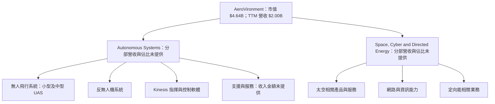
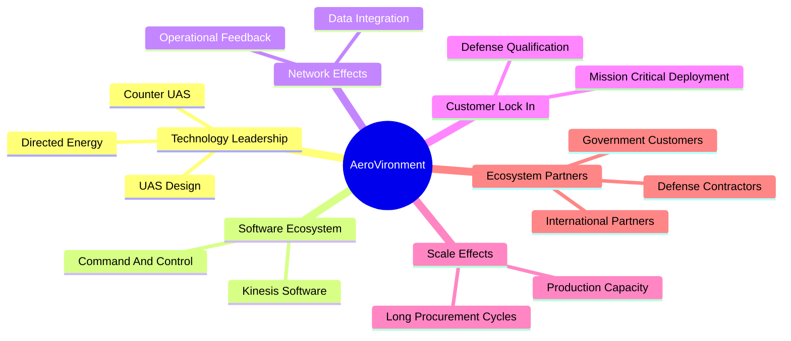
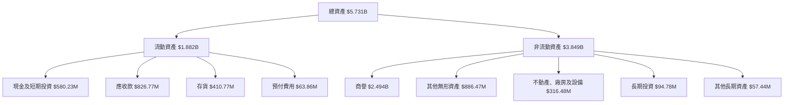
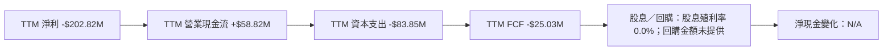
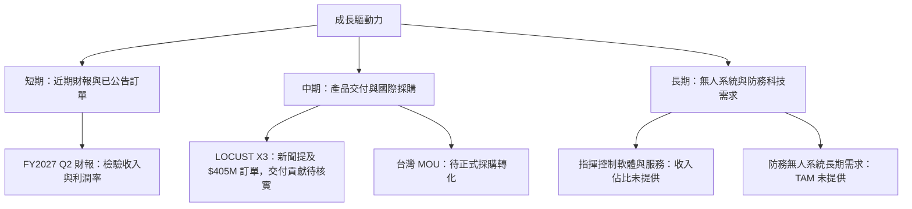
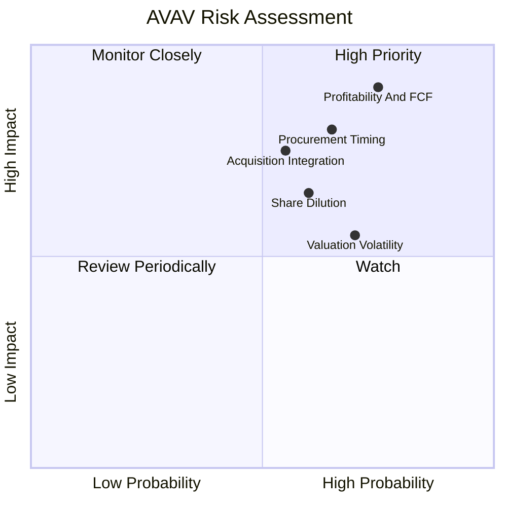
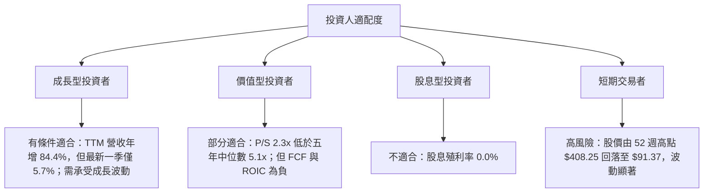

# AVAV 基本面深度分析報告
> **報告日期**：2026-11-26 ｜ **語言**：繁體中文 ｜ **數據來源**：SEC 申報資料 (XBRL)、Yahoo Finance、Finviz、StockAnalysis、Roic.ai ｜ **分析師**：CFA 級機構研究

## 目錄

| # | 章節 | 核心結論 |
|---|------|----------|
| 1 | 執行摘要 | 買入；加權合理價值 $128.39；MOS +28.8% |
| 2 | 公司概覽與商業模式 | 無人系統與防務科技業務具專業壁壘，分部營收資料不足以量化護城河 |
| 3 | 損益表深度分析 | TTM 營收 $2.00B、年增 84.4%；最新一季年增 5.7%，獲利轉弱 |
| 4 | 資產負債表分析 | 淨負債 $149.83M；流動性充足，但商譽與無形資產大增 |
| 5 | 現金流量深度分析 | TTM FCF -$25.03M、FCF Yield -0.54%，自由現金流尚未轉正 |
| 6 | 獲利能力與資本效率 | ROIC -4.4% 對 WACC 9.75%，目前摧毀經濟價值 |
| 7 | 相對估值分析 | Forward P/E 接近同業中位數；P/S 低於同業中位數及自身五年中位數 |
| 8 | DCF 內在價值評估 | N/A：TTM 營業利益為負，不建立現金流折現模型；採用程式計算的估值方法加權 |
| 9 | 成長催化劑 | 訂單、無人系統需求及新產品可能推動成長，惟 TAM 與訂單轉營收時間表未提供 |
| 10 | 風險矩陣 | 主要風險為獲利與現金流、政府採購週期、併購整合與股權稀釋 |
| 11 | 投資建議 | 買入；重點監控利潤率、FCF、稀釋股數及新業務轉化 |

## 1. 執行摘要

AVAV 的 TTM 營收為 **$2.00B**，TTM 年增 **84.4%**，但最新一季營收年增僅 **5.7%**；TTM 營業利益率為 **-12.6%**、ROIC **-4.4%**，低於 **9.75% WACC**，且 TTM FCF 為 **-$25.03M**。相對估值方法加權後的合理價值為 **$128.39**，較 2026-11-25 收盤價 **$91.37** 高 **40.5%**，MOS 為 **28.8%**。依評級門檻應為**買入**：雖然 MOS 超過 25%，但 ROIC 未高於 WACC，因此不符合「強烈買入」條件；本報告不作額外一級調整。

### 1.0 一頁式投資儀表板（Portfolio Manager 30 秒速讀）

| 項目 | 內容 |
|------|------|
| **投資論點（3 句）** | ① TTM 營收年增 84.4%，但最新一季年增降至 5.7%，成長動能須重新驗證。② 現價 $91.37 低於加權合理價值 $128.39，MOS 為 28.8%。③ TTM ROIC -4.4%、FCF -$25.03M，當前擴張尚未轉化成股東可留存的現金報酬。 |
| **綜合評分** | **6.0/10**（引用 1.1 評分卡） |
| **財務健康** | 🟡 現金與短期投資 $580.23M、流動比率 4.26；但淨負債 $149.83M，且 FCF 為負。 |
| **ROIC vs WACC** | **-4.4% vs 9.75%**；目前經濟報酬低於資本成本，摧毀股東價值。 |
| **FCF 趨勢** | TTM FCF -$25.03M；FCF Yield **-0.54%**。年度 FCF 由 FY2025 -$24.13M 惡化至 FY2026 -$164.62M。 |
| **估值** | Forward P/E **20.727x** ｜ EV/EBITDA **22.379x** ｜ FCF Yield **-0.54%**（採 VERIFIED TTM 定義） |
| **DCF 內在價值（基準）** | **N/A**；TTM 營業利益為負，未建立 DCF。故不計算相對 DCF 的折溢價。 |
| **安全邊際（MOS）** | **+28.8%**＝($128.39 − $91.37) ÷ $128.39；以 8.8 加權合理價值為基準｜🟢 >25% |
| **預期報酬（基準情境 12M）** | DCF 基準情境 N/A；相對加權合理價值的指示性上行空間 **+40.5%**，非保證的 12 個月報酬預測。 |
| **關鍵風險（前二）** | 營業利潤率與 FCF 未改善；政府訂單時點及併購整合可能令成長難以轉化為獲利。 |
| **評級 + 信心度** | 🟢 **買入** ｜ 信心：中低（相對估值有折價，但 DCF 無法估值且獲利仍為負） |

### 1.1 綜合評分卡（全報告唯一）

| 維度 | 評分（1–10） | 主要依據（引用數字與其來源章節） |
|------|--------------|----------------------------------|
| 成長性 | 7.5 | TTM 營收年增 84.4%，但最新一季年增 5.7%（第 3 章），近季減速限制評分。 |
| 獲利能力 | 2.0 | TTM 營業利益率 -12.6%、ROIC -4.4%、F-Score 4/9（第 3、6 章）。 |
| 財務健康 | 6.5 | 淨負債 $149.83M、流動比率 4.26、CCC 92 天（第 4 章）。 |
| 估值 | 7.5 | MOS +28.8%；P/S 2.3x，低於自身五年中位數 5.1x（第 7、8 章）。但 DCF 不可用。 |
| 護城河 | 7.5 | 國防採購、無人系統與軟體控制能力構成一定客戶與技術門檻；缺少分部營收、續約及市場份額數據（第 2 章）。 |
| 管理層與資本配置 | 5.0 | FY2026 SBC $38.33M、TTM 稀釋股數測試未通過；併購後商譽升至 $2.494B，整合回報仍待驗證（第 3、4 章）。 |
| **綜合評分** | **6.0** | 六項算術平均：(7.5 + 2.0 + 6.5 + 7.5 + 7.5 + 5.0) ÷ 6 = **6.0**。 |

### 1.2 五大投資論點 + 三大核心風險

| 類型 | 項目 | 具體依據 | 信心度 |
|------|------|----------|--------|
| 🟢 **投資論點①** | 國防無人系統需求具結構性支撐 | TTM 營收 $2.00B、年增 84.4%；公司產品涵蓋無人飛行系統、反無人機及相關軟體服務。 | 🟡 中 |
| 🟢 **投資論點②** | 相對估值較自身歷史低 | P/S 2.3x，低於五年中位數 5.1x；現價 $91.37 低於加權合理價值 $128.39。 | 🟢 高 |
| 🟢 **投資論點③** | 資產負債表短期流動性尚可 | 現金與短期投資 $580.23M，流動比率 4.26、速動比率 3.185。 | 🟢 高 |
| 🟢 **投資論點④** | 訂單與新產品可能帶來收入轉化 | 新聞提及 LOCUST X3 $405M 訂單及台灣 MOU；但實際交付節奏與財務貢獻未提供。 | 🟡 中低 |
| 🟢 **投資論點⑤** | 現價已反映明顯回撤 | 現價較 52 週高點 $408.25 低約 77.6%；若基本面止跌，估值修復空間存在。 | 🟡 中 |
| 🟡 **風險①** | 獲利與自由現金流仍弱 | TTM 營業利益率 -12.6%、FCF -$25.03M；FY2026 FCF -$164.62M。 | 🔴 高衝擊 |
| 🔴 **風險②** | 成長快速減速、訂單集中與採購節奏 | TTM 成長 84.4% 與最新一季 5.7% 差距大；政府預算、驗收與交付延遲可能造成季度波動。 | 🔴 高衝擊 |
| 🟡 **風險③** | 併購整合與稀釋 | 商譽 $2.494B、無形資產 $886.47M；F-Score 顯示稀釋股數未通過未增加測試。 | 🟡 中高 |

### 1.3 快速統計卡片

| 指標 | 公司實際值（期間） | 同業中位數 | 狀態 |
|------|--------------------|------------|------|
| 營收成長（TTM） | **84.4%** | — | 🟢 |
| 營收成長（最新一季年增） | **5.7%** | 35.7%（KTOS、ONDS、LMT 中位數） | 🔴 |
| 毛利率（TTM） | **26.5%** | 23.0%（同業中位數） | 🟢 |
| 營業利益率（TTM） | **-12.6%** | — | 🔴 |
| ROIC（TTM） | **-4.4%** | — | 🔴 |
| Forward P/E | **20.727x** | 22.0x（KTOS、LMT 中位數） | 🟢 |
| FCF Yield（TTM） | **-0.54%** | — | 🔴 |
| Piotroski F-Score | **4 / 9** | — | 🟡 |

### 1.4 投資結論

```text
╔══════════════════════════════════════════════════════════════════╗
║                    📊 投資結論摘要                               ║
╠══════════════════════════════════════════════════════════════════╣
║  評級：買入（MOS +28.8%，但 ROIC -4.4% 未高於 WACC 9.75%）       ║
║  價格（2026-11-25 收盤）：$91.37                                 ║
║  DCF 內在價值（基準）：N/A（TTM 營業利益為負）                   ║
║  安全邊際 MOS：+28.8%（＝($128.39−$91.37)÷$128.39）             ║
║  加權合理價值（8.8）：$128.39                                    ║
║  DCF 情境價值：N/A（DCF MODEL 未提供可用模型）                   ║
║  綜合評分：6.0/10（引用 1.1）                                    ║
║  適合投資人：可承受高波動、關注國防科技成長且願意追蹤現金流者    ║
╚══════════════════════════════════════════════════════════════════╝
```

## 2. 公司概覽與商業模式

### 2.1 業務結構與收入來源

公司資料指出 AVAV 主要分為 Autonomous Systems 與 Space, Cyber and Directed Energy 兩大業務板塊，提供無人飛行系統、反無人機與相關軟體及支援服務。最新 TTM 營收為 **$2.00B**、市值 **$4.64B**；但分部收入與各子業務佔比未提供，因此不以推估值填補。



### 2.2 市場份額

市場份額數據未提供，亦無足以計算市場滲透率的 TAM 數字。AVAV TTM 營收為 $2.00B，規模高於小型無人系統公司 Ondas 的比較基準並具防務業務特性；但分部收入、訂單市占及競爭產品份額缺少可核實資料，不能據此推定市場領先地位。

### 2.3 競爭護城河分析



上述為質化業務關係，不代表已有可量化的網路效應或市占數據。

### 2.4 護城河強度

| 護城河項目 | 強度（強／中／弱） | 證據（引用數字或事實） | 會削弱它的情況 |
|------------|--------------------|------------------------|----------------|
| 技術與產品整合 | 中 | 公司提供 UAS、反無人機、指揮控制及定向能等系統；TTM 營收 $2.00B。 | 技術替代、產品性能落後或競爭者以較低成本達成同等任務效果。 |
| 軟體生態系統 | 中 | 公司具 Kinesis 指揮控制軟體；軟體收入、續約率及客戶留存率未提供。 | 軟體無法形成持續收入，或客戶採用跨廠商平台。 |
| 網路效應 | 弱至中 | 任務部署與作業資料可能累積使用價值，但數據規模及客戶網絡效應未提供。 | 資料不可跨任務重用，或政府標準降低單一供應商優勢。 |
| 客戶鎖定 | 中 | 防務採購、認證與任務整合通常提高切換成本；具體合約期限及續約率未提供。 | 採購轉向競標、平台重新驗證或國防預算削減。 |
| 規模效應 | 中 | FY2026 營收 $1.977B、員工 3,991 人；規模可支援研發與交付，但單位成本資料缺乏。 | 需求下滑導致產能閒置，或擴產先於訂單。 |
| 生態夥伴 | 中 | 公司公告涉及台灣 MOU 及防務合作新聞；合作收入與分工未提供。 | 合作未轉化成採購、出口許可或量產訂單。 |

**護城河評分理由**：1.1 的護城河評分為 7.5/10，主要支持來自防務認證、系統整合和客戶切換成本，但收入結構、續約與市占資料缺失，限制了可驗證程度。

## 3. 損益表深度分析

### 3.1 年度收入成長趨勢（近4年）

年度 YoY 為依年度營收計算；CAGR 以 FY2023 至 FY2026 三年期間計算。金額以財務資料原值列示。

```text
╔══════════════════════════════════════════════════════════════════╗
║              AeroVironment 年度收入趨勢（FY2023-FY2026）         ║
╠══════════════════════════════════════════════════════════════════╣
║  FY2023  $540.54M  ██████░░░░░░░░░░░░░░░░░░  YoY: +32.6% 🟢    ║
║  FY2024  $716.72M  ████████░░░░░░░░░░░░░░░░  YoY: +32.6% 🟢    ║
║  FY2025  $820.63M  █████████░░░░░░░░░░░░░░░  YoY: +14.5% 🟡    ║
║  FY2026  $1.977B   ████████████████████████  YoY:+140.9% 🟢    ║
║                                                                  ║
║  FY2023-FY2026 三年收入 CAGR：約 +54.1%                         ║
╚══════════════════════════════════════════════════════════════════╝
```

FY2026 成長加速，年度營收由 $820.63M 增至 $1.977B；但 TTM 成長 84.4% 與最新一季年增 5.7% 的落差，顯示高成長不能直接外推，需區分併購／交付帶來的基期跳升與既有業務的內生增長。

### 3.2 季度收入趨勢分析

| 季度 | 營收 | QoQ | YoY | 備註 |
|------|------|-----|-----|------|
| 2025-10-31 | $472.51M | — | +150.7% | QoQ 前一季度數據未納入此四季列示期間；YoY 取 StockAnalysis 單季成長率。 |
| 2026-01-31 | $408.05M | -13.6% | +143.4% | 營收較前季減少，仍遠高於去年同期。 |
| 2026-04-30 | $641.62M | +57.2% | +133.3% | 季度交付集中可能造成季節性波動，資料未提供交付拆分。 |
| 2026-07-31 | $480.49M | -25.2% | **+5.7%** | 最新一季年增率引用單季 VERIFIED 數值；年增明顯減速。 |

QoQ 以表列季度營收相鄰計算，公式為本季營收 ÷ 前季營收 − 1；年度季節差異及訂單交付時點可能使季增率波動，不能單獨代表需求趨勢。

### 3.3 利潤率演變分析

| 利潤率指標 | FY2023 | FY2024 | FY2025 | FY2026 | 趨勢 | 評估 |
|------------|--------|--------|--------|--------|------|------|
| **毛利率** | 32.1% | 39.6% | 38.8% | 25.3% | FY2026 下滑約 13.5 個百分點 | 🔴 |
| **營業利益率** | -4.2% | 10.0% | 7.2% | -3.6% | FY2026 轉負 | 🔴 |
| **淨利率** | -32.6% | 8.3% | 5.3% | -13.4% | FY2026 明顯轉弱 | 🔴 |

*年度利潤率以年度營收與毛利／營業利益／淨利相除計算。TTM 營業利益率另依 VERIFIED FIGURES 為 -12.6%，與 FY2026 年度值區間不同。*

FY2026 毛利率由 FY2025 約 38.8% 降至 25.3%，與營收急速擴張同時出現；這代表收入增量未帶來相稱毛利，可能與產品組合、成本及整合支出有關，但現有資料未提供細項，不能將原因歸於單一因素。年度營業利益由 FY2025 $59.15M 轉為 FY2026 -$70.29M，顯示費用與毛利結構未隨收入同比改善。TTM 營業利益率 -12.6% 亦說明現階段的營業槓桿仍是負向。

### 3.4 費用結構分析

完整營業費用明細（包括銷售、一般及行政費用）未提供，因此不繪製會暗示完整費用比例的圓餅圖。FY2026 營收 $1.977B、毛利 $500.64M、研發費用 $127.68M，營業利益 -$70.29M；由此可見營收擴大尚未覆蓋全部營運費用，但不能以不完整資料反推其他費用項目。

```text
╔══════════════════════════════════════════════════════════════════╗
║                    FY2026 損益結構（已披露項目）                 ║
╠══════════════════════════════════════════════════════════════════╣
║  營收       $1.977B  ██████████████████████████████              ║
║  毛利       $500.64M ████████                                    ║
║  研發費用   $127.68M ██                                          ║
║  營業利益   -$70.29M（營業損失）                                 ║
║  其他營業費用細項：未提供                                        ║
╚══════════════════════════════════════════════════════════════════╝
```

### 3.5 季度 EPS 趨勢與盈餘品質（Quality of Earnings）

| 季度 | EPS 實際值 | EPS 預期值／驚喜 | 季度淨利 | 解讀 |
|------|------------|------------------|----------|------|
| 2026-07-31 | -$0.10 | N/A；估值資料為 nan | -$5.07M | 有 EPS 實際值，但無可用一致預期值，無法判斷超預期或不及預期。 |
| 2026-04-30 | -$0.48 | N/A；估值資料為 nan | -$24.10M | 虧損收窄不等同核心獲利轉正。 |
| 2026-01-31 | -$3.15 | N/A；估值資料為 nan | -$243.82M | 單季大額淨損；特殊項目明細未提供。 |
| 2025-10-31 | -$0.34 | N/A；估值資料為 nan | -$17.10M | 獲利仍為負。 |

四季 EPS Est 與 EPS Surprise 欄位為 nan，故**過去四季超預期／不及預期無法判定**，也不將缺失預期值誤標成 beat 或 miss。

| 盈餘品質項目 | 數值/佔比 | 評估 |
|--------------|-----------|------|
| 股權薪酬 SBC / 營收 | 最新四個季度 SBC 合計 $31.84M ÷ TTM 營收 $2.00B = **約 1.59%** | 🟡 存在稀釋成本；F-Score 稀釋股數測試未通過。 |
| SBC / 營業現金流 | $31.84M ÷ $58.82M = **約 54.1%** | 🔴 SBC 相當於 TTM 營業現金流約一半，稀釋對股東回報不容忽視。 |
| FCF / 淨利（現金轉換率） | TTM FCF -$25.03M；TTM 淨利 -$202.82M；比率約 **12.3%** | 🔴 分子、分母均為負，傳統轉換率不具正向獲利解讀，應視為現金與會計虧損均存在。 |
| 一次性／非經常性損益 | N/A（各項非經常性損益明細未提供） | 不判定是否有一次性項目美化或壓低盈餘；FY2026 淨利 -$265.12M，需閱讀附註拆分。 |
| 有效稅率異常 | N/A（TTM 所得稅費用明細未提供） | 無法判斷稅務利益是否影響淨利。 |
| 資本化支出 vs 費用化 | TTM Capex $83.85M；資本化政策明細 N/A | Capex 是現金流出而非全部當期費用；缺少資本化支出明細，無法判斷成本遞延程度。 |

**盈餘品質結論**：目前負營業利益、負 FCF 和負淨利並存，無法以正向現金轉換支持會計獲利品質。SBC 佔 TTM 營業現金流約 54.1%，且稀釋股數測試未通過，意味每股價值可能被稀釋；估值應更重視營收可持續性與現金流轉正，而非單一年度 EPS。

## 4. 資產負債表分析

### 4.1 資產結構分解

以下為 2026-08-01 TTM 資產資料。細項來自 StockAnalysis 季度資產負債表，使用者提供資料中的總資產為 $5.731B、流動資產 $1.882B；非流動資產為兩者差額。



由於已列資產細項存在四捨五入與分類差異，圖中分項僅作結構觀察，不以分項強行加總至總額。商譽與無形資產合計約 $3.38B，佔資產總額約 59%；若收購業務表現不及預期，可能增加減損風險。

### 4.2 流動性與營運資金分析

| 指標 | 最新 TTM | 一年前 TTM | 變化 | 解讀 |
|------|----------|------------|------|------|
| 流動比率 | 4.26 | N/A | N/A | 流動資產覆蓋短期負債的能力較強；比較值未提供。 |
| 速動比率 | 3.185 | N/A | N/A | 排除存貨後仍有較高覆蓋度。 |
| DSO 應收帳款天數 | 33 天 | 67 天 | -34 天 | 收款天數縮短，有利營運現金回收；收入組合變化也可能影響指標。 |
| DIO 存貨天數 | 102 天 | 113 天 | -11 天 | 存貨天數下降，對現金占用有改善，但最新存貨餘額仍達 $410.77M。 |
| DPO 應付帳款天數 | 43 天 | 44 天 | -1 天 | 變化不大，沒有證據顯示公司顯著延長供應商付款期。 |
| CCC 現金轉換週期 | 92 天 | 135 天 | -43 天 | 現金轉換週期縮短，營運資金周轉較一年前改善。 |

DSO、DIO、DPO 與 CCC 依 QUALITY FIGURES 原值引用。CCC 改善與 DSO、DIO 同步下降一致，但不代表整體現金流已轉正：TTM 營業現金流 $58.82M 仍低於 Capex $83.85M。

### 4.3 債務結構分析

以 VERIFIED FIGURES 的債務、現金及短期投資數字為準；另一資料區段出現不同債務與 Capex 數值，本報告的核心 TTM 指標不以其替代。

```text
╔══════════════════════════════════════════════════════════════════╗
║                   AeroVironment 債務健康診斷                     ║
╠══════════════════════════════════════════════════════════════════╣
║  總債務：       $730.06M  ████████████████████                   ║
║  現金+短期投資：$580.23M  ████████████████                       ║
║  淨負債：       $149.83M  █████                                  ║
║                                                                  ║
║  流動比率：4.26x；速動比率：3.185x                              ║
║  Debt/EBITDA：N/A（不以衝突口徑推算）                            ║
║  利息保障倍數：N/A（利息費用及一致口徑營業獲利未提供）           ║
║  診斷：🟡 有可觀流動性，但並非淨現金公司                         ║
╚══════════════════════════════════════════════════════════════════╝
```

### 4.4 股東權益趨勢

```text
╔══════════════════════════════════════════════════════════════════╗
║                  股東權益變化（年度）                             ║
╠══════════════════════════════════════════════════════════════════╣
║  FY2023  $550.97M  ████░░░░░░░░░░░░░░░░░░░░░                   ║
║  FY2024  $822.75M  █████░░░░░░░░░░░░░░░░░░░░                   ║
║  FY2025  $886.51M  █████░░░░░░░░░░░░░░░░░░░░                   ║
║  FY2026  $4.40B    █████████████████████████                    ║
╚══════════════════════════════════════════════════════════════════╝
```

FY2026 股東權益升至 $4.40B，同期總資產從 FY2025 $1.12B 升至 $5.72B，商譽亦由 $256.78M 增至 $2.494B、無形資產由 $48.71M 增至 $929.83M。這種資產負債表躍升與收購後資產擴張相符，但現有資料不足以拆解權益增幅中現金增資、換股及其他項目的各自貢獻，應追蹤併購資產的後續回報。

## 5. 現金流量深度分析

### 5.1 現金流量瀑布圖



淨利至營業現金流之間受非現金費用、營運資金及其他調整影響，細項未提供，故不將兩者差額歸因於單一項目。FCF 嚴格採用 TTM 營業現金流減 Capex。

### 5.2 FCF 轉換率趨勢

| 財年 | FCF | 淨利 | FCF / 淨利 | 趨勢與限制 |
|------|-----|------|------------|------------|
| FY2023 | -$3.47M | -$176.21M | 約 2.0% | 正負同為負數，比例不代表正向現金轉換。 |
| FY2024 | -$9.19M | $59.67M | -15.4% | 有淨利但 FCF 為負，Capex 及現金流轉換值得注意。 |
| FY2025 | -$24.13M | $43.62M | -55.3% | FCF 虧損擴大。 |
| FY2026 | -$164.62M | -$265.12M | 約 62.1% | 比率因分子、分母皆負而失真；兩者絕對額均為大額負值。 |
| TTM | -$25.03M | -$202.82M | 約 12.3% | 兩者同負，不宜視作有意義的正向轉換率。 |

### 5.3 自由現金流趨勢

```text
╔══════════════════════════════════════════════════════════════════╗
║                   自由現金流：年度與 TTM                         ║
╠══════════════════════════════════════════════════════════════════╣
║  FY2023  -$3.47M     ◀█░░░░░░░░░░░░░░░░░░░░░                    ║
║  FY2024  -$9.19M     ◀██░░░░░░░░░░░░░░░░░░░░                    ║
║  FY2025  -$24.13M    ◀████░░░░░░░░░░░░░░░░░░░░                  ║
║  FY2026  -$164.62M   ◀█████████████████████████                  ║
║  TTM     -$25.03M    ◀████░░░░░░░░░░░░░░░░░░░░                  ║
║  TTM FCF Yield：-0.54%（VERIFIED TTM）                           ║
╚══════════════════════════════════════════════════════════════════╝
```

FY2026 全年現金流顯著惡化，而截至 2026-08-01 的 TTM FCF 回升至 -$25.03M，但仍為負值。這種改善需以後續季度確認，不能只憑單季營業現金流回正便判斷資本密集期已結束。

### 5.4 資本配置評估

| 配置項目 | 已知數據 | 評估 |
|----------|----------|------|
| 資本支出 | TTM $83.85M | 超過 TTM 營業現金流 $58.82M，是 TTM FCF 為負的直接算術原因。 |
| 股權薪酬 | FY2026 $38.33M；最新四季合計 $31.84M | 形成實質股東稀釋成本。 |
| 股息 | 殖利率 0.0% | 資本保留於公司再投資，未提供股息回報。 |
| 回購 | 金額未提供 | 不推定有回購。 |
| 併購／投資 | 商譽及無形資產大增 | 反映資產規模擴張，投資回報仍需以後續營收、利潤率及減損情形驗證。 |

未提供各資本用途的現金金額全表，因此不繪製比例圓餅圖，以免將缺失部分視作零。

## 6. 獲利能力與資本效率

### 6.1 ROE / ROA / ROIC 趨勢

| 指標 | FY2023 | FY2024 | FY2025 | 最新 TTM | 評估 |
|------|--------|--------|--------|----------|------|
| ROE | N/A | N/A | N/A | -4.6% | 最新為負，與 TTM 淨損一致。 |
| ROA | N/A | N/A | N/A | -0.1% | 最新略為負；歷年可比序列未提供。 |
| ROIC | N/A | N/A | N/A | -4.4% | 低於 9.75% WACC，資本回報未覆蓋資本成本。 |

歷年 ROE、ROA、ROIC 未提供可直接照抄的完整序列，不以自建口徑補值。

### 6.2 ROIC vs WACC 分析（核心價值創造判斷）

```text
╔══════════════════════════════════════════════════════════════════╗
║                ROIC vs WACC 深度分析                             ║
╠══════════════════════════════════════════════════════════════════╣
║  WACC（直接採用資本成本資料）：9.75%                             ║
║  ├── 無風險利率（10Y 美債）：4.85%                               ║
║  ├── 市場風險溢酬 ERP：5.00%                                     ║
║  ├── Beta 原始值：1.40；採用調整後 Beta：1.27                   ║
║  ├── 股權成本 Ke：11.19%（資本成本輸入原值）                    ║
║  ├── 稅前債務成本：0.77%；稅後約 0.61%                           ║
║  ├── 股權／債務權重：86.4% / 13.6%                               ║
║  └── ✅ WACC：9.75%                                               ║
║                                                                  ║
║  ROIC（TTM）：-4.4%                                               ║
║  經濟利差：ROIC − WACC = -4.4% − 9.75% = -14.15 個百分點         ║
║                                                                  ║
║  ROIC  -4.4%  ◀負值                                              ║
║  WACC   9.75%  ██████████░░░░░░░░                                ║
║  EVA 利差 -14.15pp：🔴 摧毀股東價值                             ║
║                                                                  ║
║  結論：TTM 投入資本回報低於資本成本，現階段未創造經濟附加價值。  ║
╚══════════════════════════════════════════════════════════════════╝
```

Cost of Equity 的輸入原值為 11.19%；將已四捨五入的 Rf、調整後 Beta 與 ERP 代入會得到約 11.20%，差異來自底層未四捨五入數字。WACC 直接採用資本成本資料的 **9.75%**，不另行替換。稅後債務成本的可複算式為 **0.77% × (1 − 21.0%) = 0.6083%**；以已公布權重檢核：**86.4% × 11.19% + 13.6% × 0.6083% = 9.7509% ≈ 9.75%**。

ROIC -4.4% 明顯低於 WACC 9.75%，目前擴張並未證明可帶來超過資本成本的報酬。要扭轉判斷，營業利潤率與資本周轉必須實質改善，而非僅營收增加。

### 6.3 杜邦三因素分解

| 因素 | 數值（TTM） | 解讀 |
|------|-------------|------|
| 淨利率 | -10.1% | 淨利為負，是負 ROE 的主要來源。 |
| 資產週轉率 | 0.35 | 資產擴張後每單位資產產生的營收有限。 |
| 權益乘數 | 1.30 | 槓桿程度有限；負 ROE 不是由高槓桿撐起。 |
| **ROE** | **-4.6%** | -10.1% × 0.35 × 1.30 = -4.5955%，四捨五入為 -4.6%。 |

### 6.4 財務體質：Piotroski F-Score

Piotroski F-Score **4 / 9**，依 QUALITY FIGURES 原值引用；各項測試如下：

| 測試 | 結果 | 解讀 |
|------|------|------|
| ROA > 0 | ❌ 未通過 | 目前資產獲利為負。 |
| 營業現金流 > 0 | ✅ 通過 | TTM 營業現金流為 $58.82M。 |
| ROA 高於一年前 | ❌ 未通過 | 資產報酬未改善。 |
| 營業現金流 > 淨利（應計品質） | ✅ 通過 | 現金流相對會計淨利較佳，但兩者需結合負 FCF 判讀。 |
| 長期負債 ÷ 總資產低於一年前 | ✅ 通過 | 負債比例方向通過該測試。 |
| 流動比率高於一年前 | ❌ 未通過 | 流動性比率相較一年前未改善。 |
| 稀釋股數未增加 | ❌ 未通過 | 股數稀釋削弱每股價值增長。 |
| 毛利率高於一年前 | ❌ 未通過 | 毛利率走弱，與 FY2026 利潤率下滑相呼應。 |
| 資產週轉率高於一年前 | ✅ 通過 | 資產運用效率相對改善。 |

4/9 表示部分現金流、負債比率及資產周轉項目通過，但獲利能力、毛利率與股數稀釋仍是主要弱項。

## 7. 相對估值分析

### 7.1 同業估值比較表格

競爭對手及估值倍數均採用 Peer multiples 原值。AVAV Forward P/E 取市場估值資料；Trailing P/E 因 TTM 虧損為 N/A。

| 估值指標 | **AVAV** | **KTOS** | **ONDS** | **LMT** | AVAV 評估 |
|----------|----------|---------|---------|---------|-----------|
| **Trailing P/E** | N/A | 241.3x | N/A | 21.3x | 🔴 AVAV 虧損，P/E 不適用。 |
| **Forward P/E** | 20.727x | 25.9x | -25.2x | 18.0x | 🟡 AVAV 接近 KTOS、LMT 中位數 22.0x；ONDS 負值無法代表盈利倍數。 |
| **P/S Ratio** | 2.3x | 3.3x | 7.0x | 1.7x | 🟢 低於三家公司中位數 3.3x，但同業業務組合差異大。 |
| **EV/EBITDA** | 22.379x | 47.7x | -5.4x | 15.5x | 🟡 位於盈利型同業之間；ONDS 為負值，倍數比較有限。 |
| **最新一季營收 YoY** | 5.7% | 35.7% | 1,558.6% | 11.3% | 🔴 AVAV 低於同業中位數 35.7%；ONDS 高基期及小規模效應須審慎解讀。 |
| **毛利率（TTM）** | 26.5% | 23.0% | 36.4% | 11.7% | 🟢 高於 KTOS、LMT，低於 ONDS。 |

P/S 是本公司相對估值較具可用性的指標，但不同公司營收成長、毛利率與盈利成熟度差異顯著。AVAV 最新一季成長 5.7% 低於上述三家成長率中位數，若收入增速持續低於同業，低 P/S 可能是基本面差異而非單純低估。

### 7.2 歷史估值區間分析

```text
╔══════════════════════════════════════════════════════════════════╗
║                    P/S 歷史估值位置                              ║
╠══════════════════════════════════════════════════════════════════╣
║  五年低點：3.0x  ├────────五年中位數 5.1x────────┤  高點：13.4x ║
║  目前：2.3x  ◀低於歷史區間下限                                   ║
║  當前歷史百分位：0%                                               ║
╚══════════════════════════════════════════════════════════════════╝
```

當前 P/S 2.3x 低於五年歷史範圍下限 3.0x，並處於 0 百分位。此比較反映估值壓縮，不代表股價必然回歸歷史中位數；若營業虧損與單季成長放緩持續，估值折價可能合理。

### 7.3 情境價值（Bear / Base / Bull，照抄 DCF MODEL 的 Scenarios）

**N/A（DCF 無法計算：TTM 營業利益不為正；未提供悲觀、基準與樂觀 DCF 情境輸出）**。依規則不自建 DCF，也不將分析師共識目標價冒充 DCF 情境目標價。

### 7.4 相對估值隱含價格區間

```text
╔══════════════════════════════════════════════════════════════════╗
║                 相對估值方法隱含每股價值                         ║
╠══════════════════════════════════════════════════════════════════╣
║  $91.37 現價 ── $96.81 Forward P/E ─── $130.43 P/S ── $210.86    ║
║                    同業 Forward P/E       同業 P/S    分析師共識  ║
║  評估方法：P/E、P/S 取同業中位數；分析師共識為 24 位分析師平均   ║
╚══════════════════════════════════════════════════════════════════╝
```

| 方法 | 每股價值 | 依據 |
|------|----------|------|
| 同業 Forward P/E | $96.81 | KTOS、LMT Forward P/E 中位數 22.0x × AVAV Forward EPS $4.41。 |
| 同業 P/S | $130.43 | KTOS、ONDS、LMT P/S 中位數 3.3x × AVAV TTM 營收與股數的程式計算結果。 |
| 分析師共識目標價 | $210.86 | 24 位分析師平均目標價；參考性較高，但分析師估值方法與假設未提供。 |

## 8. DCF 內在價值評估（Discounted Cash Flow）

> **模型適用性結論：DCF MODEL 為 N/A。** TTM 營業利益不為正，直接把虧損現金流外推並折現會形成不可靠的估值；本章不另建模型、不填入虛構假設、不提供 DCF 每股價值與 DCF 情境價值。相對估值與加權合理價值仍按程式計算的既定方法呈列。

### 8.0 估值推理鏈（Thinking Logic）

AVAV 價值主要受三類因素影響：既有無人系統業務（公司總 TTM 營收 $2.00B，但分部佔比未提供）、太空／網路／定向能業務（佔比未提供），以及未來新訂單與軟體服務收入（金額未提供）。由於 TTM 營業利益率 -12.6%、ROIC -4.4%，目前缺乏正向營業現金流底盤，無法以負 EBIT 作為可靠 DCF 起點。

模型選擇上，雖然一般可採 FCFF 配合 WACC 估算企業價值，但本案沒有程式輸出的逐年現金流、終值、敏感度與反推結果，且 TTM 營業利益為負，因此不使用 DCF，也不以自設預測取代既定模型。最脆弱的估值環節是未來營業利潤率與 FCF 能否回正；若不能，基於 P/S 的相對價值也可能因成長品質惡化而下修。

### 8.1 模型假設總表（Model Inputs）

**N/A（DCF MODEL 未提供：TTM 營業利益不為正，程式未建立 DCF 假設、年度現金流及終值；依規則不自建模型。）**

### 8.2 折現率推導（WACC）

DCF 折現模型不適用，但資本成本仍用於第 6.2 節 ROIC 比較。WACC 直接引用資本成本資料的 **9.75%**，其輸入如下：

```text
╔══════════════════════════════════════════════════════════════════╗
║                    WACC 資本成本資料                             ║
╠══════════════════════════════════════════════════════════════════╣
║  Rf（10Y Treasury）：4.85%                                       ║
║  ERP：5.00%                                                       ║
║  Beta 原始值：1.40；採用調整後 Beta：1.27                        ║
║  股權成本 Ke（資料原值）：11.19%                                 ║
║  稅前債務成本：0.77%                                              ║
║  稅率：21.0%；稅後債務成本 = 0.77% × (1−21.0%) = 0.6083%         ║
║  股權／債務權重：86.4% / 13.6%                                   ║
║  WACC（資料原值）：9.75%                                         ║
╚══════════════════════════════════════════════════════════════════╝
```

Beta 調整方式為 **⅔ × 原始 Beta 1.40 + ⅓ = 1.27**。無風險利率資料未提供觀測日，故不額外標示日期；ERP 為資本成本輸入所採用的 5.00%。按已四捨五入輸入複核，稅後 Kd 為 0.6083%，WACC 為 **86.4% × 11.19% + 13.6% × 0.6083% = 9.7509% ≈ 9.75%**。此值與第 6.2 節一致，且不因 DCF 不適用而重算替換。

### 8.3 逐年自由現金流預測（基準情境）

**N/A（DCF MODEL 未提供逐年營收、EBIT、稅項、D&A、Capex、ΔWC、FCFF 或現值資料；原因為 TTM 營業利益不為正。不建立替代預測。）**

### 8.4 終值計算（Terminal Value）

**N/A（未建立 DCF，故沒有 WACC 與永續成長率 g 的適用性檢查，也沒有 Gordon Growth 或退出倍數終值。）**

### 8.5 企業價值 → 每股內在價值（Bridge）

**N/A（缺少 DCF 預測期 FCF 現值及終值，不能計算 EV、股權價值或 DCF 每股內在價值。）**  
本節不計算 MOS；全報告 MOS 只採用 8.8 加權合理價值為分母。

### 8.6 敏感性分析（WACC × 永續成長率）

**N/A（DCF MODEL 未提供敏感度矩陣；不自建矩陣、不推算 DCF 情境。）**

### 8.7 反推 DCF（Reverse DCF：市場在預期什麼）

**N/A（沒有可用的 DCF 基準模型，無法固定基準假設或反推單一市場隱含變數。）**  
可由相對估值觀察到的市場訊息是：當前 AVAV P/S 為 2.3x，低於自身五年中位數 5.1x；而當期最新一季營收年增 5.7%。這反映市場對增長延續與獲利轉化存疑，但不能取代反推 DCF。

### 8.8 估值三角驗證與安全邊際

AVAV 屬未盈利公司，程式固定採用同業 Forward P/E 30%、同業 P/S 60%、分析師共識 10% 的權重。DCF 與 EV/EBITDA 方法未列入該公司類型的程式估值方法，故不增列或重新分配權重。

| 估值方法 | 隱含每股價值 | 上行空間（÷現價） | 權重 | 說明 |
|----------|--------------|-------------------|------|------|
| 同業 Forward P/E | $96.81 | +6.0% | 30% | 同業中位數 22.0x × Forward EPS $4.41。 |
| 同業 P/S | $130.43 | +42.7% | 60% | KTOS、ONDS、LMT 同業 P/S 中位數 3.3x。 |
| 分析師共識目標價 | $210.86 | +130.8% | 10% | 24 位分析師平均目標價。 |
| **加權合理價值** | **$128.39** | **+40.5%** | **100%** | 程式列示之加權合理價值。 |

逐步演算：

- 加權值 = $96.81 × 30% + $130.43 × 60% + $210.86 × 10%
- = $29.043 + $78.258 + $21.086
- = **$128.387 ≈ $128.39**

以未四捨五入加權值 $128.387 計算，MOS 為 **($128.387 − $91.37) ÷ $128.387 = 28.83% ≈ +28.8%**；上行空間為 **($128.387 − $91.37) ÷ $91.37 = 40.51% ≈ +40.5%**。報告中的 MOS、加權合理價值及評級依 VERIFIED FIGURES 原值呈列。

```text
╔══════════════════════════════════════════════════════════════════╗
║                  估值區間與安全邊際                              ║
╠══════════════════════════════════════════════════════════════════╣
║  $91.37 現價 ── $96.81 P/E ─── [$128.39 加權合理值] ── $130.43  ║
║                                          P/S                     ║
║  安全邊際 MOS = (128.39 − 91.37) ÷ 128.39 = +28.8%              ║
║  上行空間 = (128.39 − 91.37) ÷ 91.37 = +40.5%                   ║
║  DCF 基準價值：N/A                                               ║
║  建議買入區間：$91.37–$115.55（加權價值的 90% 以下；上限含現價）║
║  合理價值參考：$128.39（非 DCF 目標價）                          ║
║  高於加權合理價值後：重新評估風險報酬，不直接視作固定賣出價      ║
╚══════════════════════════════════════════════════════════════════╝
```

買入區間上限 $115.55 的計算為 **$128.39 × (1 − 10%) = $115.551 ≈ $115.55**。這是以加權合理價值計算的估值參考，不是對未來股價的保證。

> 🔎 **程式複算（Python，依本節各項自動重算）**
>
> 加權合理價值 = $96.81 × 30% + $130.43 × 60% + $210.86 × 10% = **$128.39**（權重合計 100%）
>
> 以價格 $91.37 計：MOS = **+28.8%**，上行空間 = **+40.5%**
>
> ✅ 與本節所寫數值一致。

### 8.9 DCF 模型的局限與失效條件

- **終值依賴度**：N/A，未建立 DCF，無終值佔 EV 比例。
- **最脆弱假設**：營業利潤率能否恢復、最新一季 5.7% 的營收年增能否回升。若營收放緩且毛利率續降，相對 P/S 估值也可能下修。
- **不適用情境**：TTM 營業利益為負、TTM FCF 為負，DCF 結果對獲利轉正時點極敏感。現階段應以同業 P/S、收入品質與現金流轉正進度為主，並把 Forward P/E 作交叉參考。
- **風險連結**：政府採購延後影響營收增長；併購整合及成本上升壓低營業利潤率；Capex、存貨及應收款增加會拖累 FCF。

### 8.10 複算檢核表（Audit Trail）

| # | 檢核項目 | 檢查方式 | 結果 |
|---|----------|----------|------|
| 1 | 所有 DCF 高／中敏感度輸入均有推導 | DCF 不適用，無模型輸入 | N/A |
| 2 | 每個 DCF 假設都有來歷 | 未建立 DCF 假設表 | N/A |
| 3 | WACC 五步算式及權重複核 | 已依資本成本輸入複核，權重 86.4% + 13.6% = 100% | ✅ |
| 4 | Kd 分母與債務權重範圍一致 | 沿用輸入區塊的稅前債務成本與債務權重，未另推估債務範圍 | N/A |
| 5 | WACC 與第 6.2 節一致 | 兩處均為 9.75% | ✅ |
| 6 | 逐年 DCF 欄位符合 N | 無 DCF 預測表 | N/A |
| 7 | FY+1 現金流算式可複算 | 無 DCF 現金流 | N/A |
| 8 | 預測期 PV 加總複核 | 無 DCF 現值 | N/A |
| 9 | WACC > g | 未設定 g | N/A |
| 10 | 終值基期及折現期 | 無終值 | N/A |
| 11 | EV 至每股價值橋接 | 無 DCF 橋接 | N/A |
| 12 | SBC 與 EBIT、股數處理相容 | 未建立 DCF SBC 模型；營運分析已揭露 SBC | N/A |
| 13 | 敏感度矩陣基準格與 DCF 價值一致 | 無矩陣 | N/A |
| 14 | 矩陣有效格檢查 | 無矩陣 | N/A |
| 15 | 三情境機率與加權 | 無 DCF 情境 | N/A |
| 16 | 反推 DCF 每列只放開一個變數 | 無反推模型 | N/A |
| 17 | MOS 與折溢價基準一致 | MOS 以 8.8 加權合理價值；DCF 折溢價 N/A | ✅ |
| 18 | 報告完整輸出至第 11 章 | 已列出第 1 至第 11 章 | ✅ |
| 19 | 加權合理價值等於加權總和 | $29.043 + $78.258 + $21.086 = $128.387 ≈ $128.39 | ✅ |
| 20 | 評級符合 MOS 門檻 | MOS 28.8%，但 ROIC -4.4% ≤ WACC 9.75%，採「買入」 | ✅ |

## 9. 成長催化劑

### 9.1 催化劑時間軸

可核實資料未提供未來交付、預算核准、產品量產或合約履約的確切日期，因此不以自行設定日期製作 Gantt 時程。可追蹤的近期事件包括公司公告的 FY2027 Q2 財報與電話會議；其他催化劑應以實際訂單與 SEC 申報更新。

| 時間範圍 | 催化劑 | 可驗證條件 |
|----------|--------|------------|
| 短期 | FY2027 Q2 財報及電話會議 | 最新季收入成長能否維持在正成長，營業利益率及 FCF 是否改善。 |
| 中期 | LOCUST X3 新訂單／產品交付 | 新聞提及 $405M 訂單；後續需核實交付進度、收入認列與毛利率。 |
| 中期 | 台灣 MOU 及國際拓展 | MOU 是否轉為正式採購合約，及是否取得必要出口許可。 |
| 長期 | 無人系統與反無人機需求 | 訂單、 backlog、客戶複購及軟體服務收入是否形成持續性。 |

### 9.2 TAM 市場規模分析

**N/A（TAM 數據未提供）**。TTM 營收為 $2.00B、TTM 年增 84.4%，FY2026 年營收年增 140.9%；但最新一季年增僅 5.7%，顯示歷史高速成長未必代表未來市場滲透仍加速。缺乏來源與年份明確的市場規模數字，不估算 TAM 或滲透率。

### 9.3 成長驅動力結構圖



## 10. 風險矩陣

### 10.1 風險評分矩陣

下列機率與衝擊座標是分析師定性判斷，不是公司財務數據或外部統計估計；以未來 12–24 個月的風險監控排序為目的。



### 10.2 風險清單詳細分析

| # | 風險項目 | 發生機率 | 財務衝擊 | 風險評分 | 緩解措施 |
|---|----------|----------|----------|----------|----------|
| 1 | 🔴 **獲利與 FCF 持續為負** | 中高（分析師判斷） | 高；TTM 營業利益率 -12.6%、FCF -$25.03M | 🔴 高 | 每季追蹤毛利率、營業費用、Capex 與 FCF；若 FCF 再度擴大為負，重新評估估值。 |
| 2 | 🔴 **政府採購與交付時點波動** | 中高（分析師判斷） | 高；最新一季營收年增由 TTM 84.4% 對照為 5.7% | 🔴 高 | 追蹤訂單、backlog、交付驗收和財測；避免以單季旺季收入外推全年。 |
| 3 | 🟠 **併購整合與商譽減損** | 中（分析師判斷） | 高；商譽 $2.494B、無形資產 $886.47M | 🟠 中高 | 監控收購業務收入、毛利率、整合成本及商譽減損測試。 |
| 4 | 🟠 **股權稀釋與 SBC** | 中高（分析師判斷） | 中；最新四季 SBC $31.84M，約為 TTM OCF 的 54.1% | 🟠 中高 | 追蹤稀釋股數、SBC／營收與每股營收成長。 |
| 5 | 🟡 **高波動與估值重估** | 高（分析師判斷） | 中高；股價由 52 週高點 $408.25 回落至 $91.37 | 🟡 中高 | 分批建倉，避免單一估值倍數做決策；持續比較 P/S 與收入及毛利趨勢。 |

## 11. 投資建議

### 11.1 最終評級與評分

評級為**買入**：MOS +28.8% 達到 25% 門檻，但 ROIC -4.4% 未高於 WACC 9.75%，因此不符合強烈買入條件，且未作質化一級調整。公司綜合評分為 **6.0/10**，六項分數依序為成長性 7.5、獲利能力 2.0、財務健康 6.5、估值 7.5、護城河 7.5、管理層與資本配置 5.0，均引用 1.1 評分卡。

### 11.2 合理價值與隱含報酬率

| 方法／情境 | 每股價值 | 相對 2026-11-25 收盤價 $91.37 | 機率 |
|------------|----------|------------------------------|------|
| 加權合理價值 | **$128.39** | **+40.5%** | 不適用 |
| DCF 悲觀情境 | N/A | N/A | N/A |
| DCF 基準情境 | N/A | N/A | N/A |
| DCF 樂觀情境 | N/A | N/A | N/A |

加權合理價值由同業 Forward P/E、同業 P/S 與分析師共識按固定權重計算；**+40.5% 是相對估值指示性上行空間，不是 DCF 推導的目標報酬或保證。**

### 11.3 買入時機與觸發因素

```text
╔══════════════════════════════════════════════════════════════════╗
║                  ✅ 買入觸發因素 Checklist                       ║
╠══════════════════════════════════════════════════════════════════╣
║  立即納入觀察／分批建倉條件：                                    ║
║  ✅ 現價 $91.37 低於加權合理價值 $128.39                         ║
║  ✅ 流動比率 4.26、現金及短期投資 $580.23M                       ║
║  ☐ 最新一季收入成長由 5.7% 回升，且連續兩季為正向加速            ║
║  ☐ 毛利率停止下滑，營業利益率逐季改善                            ║
║                                                                  ║
║  加碼觸發條件：                                                  ║
║  ☐ TTM FCF 轉正，且不是單季營運資金釋放造成                      ║
║  ☐ ROIC 由 -4.4% 明顯改善並向 9.75% WACC 靠近                    ║
║  ☐ $405M LOCUST X3 訂單能轉化為已交付收入並維持合理毛利          ║
║                                                                  ║
║  減碼／重新評估條件：                                            ║
║  ☐ 最新一季營收年增轉負，或連續兩季低於 5%                       ║
║  ☐ 毛利率及營業利益率繼續下降，FCF 惡化                          ║
║  ☐ 稀釋股數加速增加，或重大商譽減損                              ║
╚══════════════════════════════════════════════════════════════════╝
```

### 11.4 投資人適配度分析



### 11.5 每季財報監控清單（Quarterly Watch List）

| 指標 | 最新基準 | 觸發加碼訊號 | 觸發減碼／重新評估訊號 |
|------|----------|--------------|------------------------|
| 營收年增 | 最新一季 +5.7%；TTM +84.4% | 最新季年增回升並連續兩季加速 | 連續兩季年增低於 5% 或轉負 |
| 毛利率 | TTM 26.5%；FY2026 約 25.3% | 季度毛利率連續改善 | 毛利率進一步跌破 FY2026 水準且未見訂單補償 |
| 營業利益率 | TTM -12.6%；最新一季 -2.3%（VERIFIED） | 營業損失縮小並持續改善 | 虧損擴大或營收成長但營業利潤率惡化 |
| 營業現金流 | TTM $58.82M | OCF 穩定為正並覆蓋 Capex | OCF 轉負或靠營運資金一次性釋放支撐 |
| Capex / FCF | TTM Capex $83.85M；FCF -$25.03M | FCF 轉正且連續兩季維持 | TTM FCF 虧損進一步擴大 |
| 應收與存貨 | DSO 33 天、DIO 102 天；存貨 $410.77M | DSO、DIO 維持或下降 | 存貨與應收增加速度持續高於營收 |
| 股權薪酬／稀釋 | 最新四季 SBC $31.84M；F-Score 稀釋測試未通過 | SBC／營收下降且稀釋股數穩定 | 稀釋股數加速增加或 SBC 占 OCF 上升 |
| 財測與訂單履行 | 公司財測數據未提供；LOCUST X3 訂單新聞值 $405M | 訂單正式確認並按期交付、轉收入 | 訂單延遲、取消或收入認列顯著低於預期 |
| 資本報酬 | ROIC -4.4%；WACC 9.75% | ROIC 持續改善並向 WACC 收斂 | ROIC 長期低於 WACC 且沒有改善方向 |

### 11.6 反面論證：什麼會證明論點錯誤（What Would Change My Mind）

```text
╔══════════════════════════════════════════════════════════════════╗
║              ⚠️ 論點失效條件（Disconfirming Evidence）           ║
╠══════════════════════════════════════════════════════════════════╣
║  本投資論點在下列情況成立時應重新檢視或退出：                    ║
║  ☐ 最新一季營收年增連續兩季低於 5%，或轉為負成長                 ║
║  ☐ TTM 毛利率跌破目前 26.5%，且營收增長沒有回升                  ║
║  ☐ TTM FCF 虧損擴大至低於目前 -$25.03M，並連續兩季惡化          ║
║  ☐ ROIC 長期維持負值，且未向 9.75% WACC 收斂                     ║
║  ☐ 稀釋股數持續增加，令每股營收及每股價值成長落後公司營收        ║
║  ☐ 商譽 $2.494B 或無形資產 $886.47M 出現重大減損                 ║
║  ☐ LOCUST X3 或國際合作未形成可核實交付及收入                     ║
╚══════════════════════════════════════════════════════════════════╝
```

> **免責聲明**：本報告為 AI 自動生成，僅供研究參考，不構成投資建議。投資有風險，入市需謹慎。

---

## 資料與來源

| 項目 | 內容 |
|------|------|
| 價格 | 91.37 USD，2026-11-25 收盤（Yahoo Finance 即時報價（該交易日已收盤）） |
| 財務報表 | SEC 10-Q filed 2026-09-10，最新季度 2026-08-01（FY2027 Q1） |
| 有回應的資料來源 | SEC 申報資料 (XBRL)、Yahoo Finance、Finviz、StockAnalysis、Roic.ai |
| 由程式計算 | TTM 數字、WACC、DCF 模型、估值方法與權重、加權合理價值、MOS、評級門檻、F-Score、杜邦分解、營運資金天數、綜合評分 |
| 撰寫模型 | openai / gpt-6-luna |

> 本區塊由產生報告的程式依實際取得的資料填寫，非模型撰寫。「由程式計算」的數字不是模型的估計；其餘判斷（評分、情境、策略）是模型的分析。
