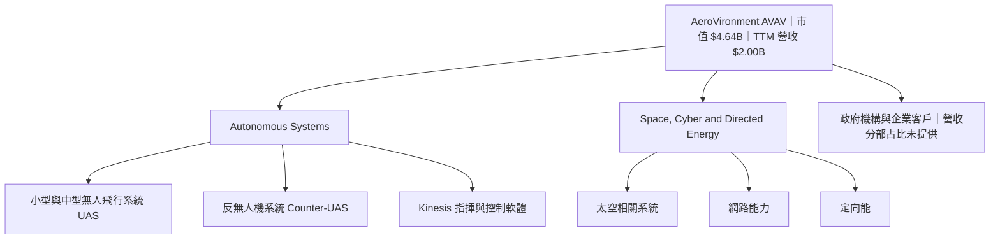
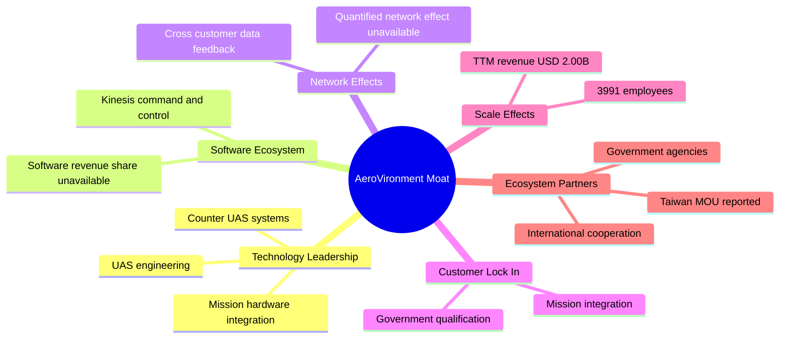
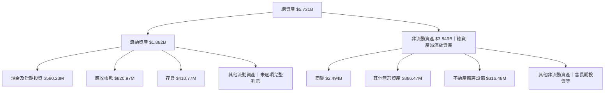
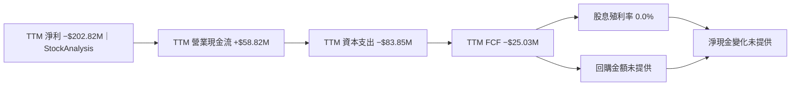
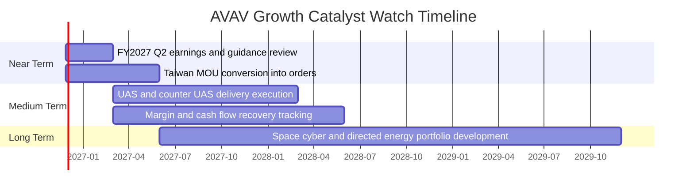
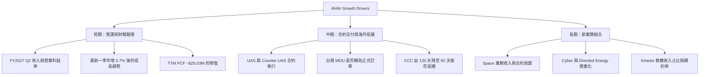
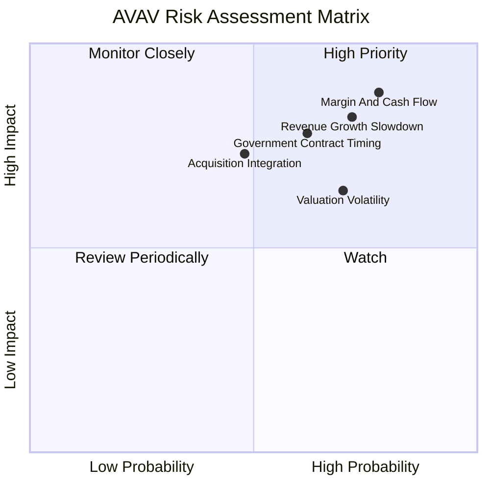
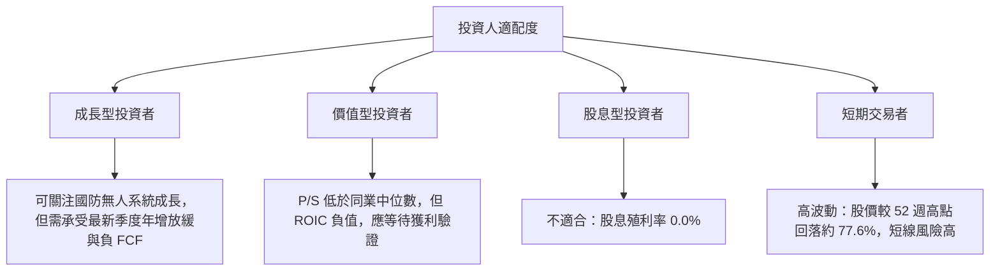

# AVAV 基本面深度分析報告
> **報告日期**：2026-11-27 ｜ **語言**：繁體中文 ｜ **數據來源**：SEC 申報資料 (XBRL)、Yahoo Finance、Finviz、StockAnalysis、Roic.ai ｜ **分析師**：CFA 級機構研究

## 目錄

| # | 章節 | 核心結論 |
|---|------|----------|
| 1 | 執行摘要 | 買入；加權合理價值 $128.39；MOS +28.8% |
| 2 | 公司概覽與商業模式 | 無人系統與國防科技平台；市場份額資料未提供，護城河主要來自技術、客戶驗證與任務整合 |
| 3 | 損益表深度分析 | TTM 營收 $2.00B、TTM 成長 84.4%；獲利率仍為負且季度成長放緩 |
| 4 | 資產負債表分析 | 淨負債 $149.83M；現金與短期投資 $580.23M，短期流動性充足 |
| 5 | 現金流量深度分析 | TTM FCF −$25.03M、FCF Yield −0.54%；現金轉換仍待改善 |
| 6 | 獲利能力與資本效率 | ROIC −4.4% 低於 WACC 9.75%，目前仍在摧毀經濟價值 |
| 7 | 相對估值分析 | P/S 低於同業中位數及自身歷史中位數；但獲利品質弱化解讀 |
| 8 | DCF 內在價值評估 | TTM 營業利益為負，DCF 模型不適用；以規定的相對估值方法三角驗證 |
| 9 | 成長催化劑 | 國防無人系統需求、海外拓展與產品組合是主要觀察方向；TAM 數字未提供 |
| 10 | 風險矩陣 | 獲利與現金流轉弱、政府採購波動、估值與股價波動為前三大風險 |
| 11 | 投資建議 | 買入評級，但應以獲利率與 FCF 修復為持續持有的驗證條件 |

---

## 1. 執行摘要

AVAV 的 2026-11-25 收盤價為 **$91.37**。TTM 營收達 **$2.00B**、TTM 年增 **84.4%**，但最新一季營收年增只有 **5.7%**；TTM 營業利益率為 **−12.6%**、ROIC **−4.4%**，低於 **9.75% WACC**，TTM FCF 亦為 **−$25.03M**。另一方面，規定估值方法的加權合理價值為 **$128.39**，MOS 為 **+28.8%**。依 MOS 門檻本應符合強烈買入的幅度，但因 ROIC 低於 WACC，按規則 20 評級為 **買入**；不再額外調整。估值上行空間為 **+40.5%**，但獲利能力與 FCF 尚未證明營收擴張能轉化為股東回報。

### 1.0 一頁式投資儀表板（Portfolio Manager 30 秒速讀）

| 項目 | 內容 |
|------|------|
| **投資論點（3 句）** | ① TTM 營收年增 **84.4%**，反映過去一年業務規模擴張。② 最新一季年增放緩至 **5.7%**，需要後續訂單與季度收入確認成長能否延續。③ 加權合理價值 **$128.39** 高於現價，但 ROIC **−4.4%**、TTM FCF **−$25.03M**，估值折價須由獲利修復驗證。 |
| **綜合評分** | **5.8/10**（引用 1.1 評分卡） |
| **財務健康** | 🟡 現金及短期投資 **$580.23M**、淨負債 **$149.83M**；流動性尚可，但 TTM FCF 為負。 |
| **ROIC vs WACC** | **−4.4% vs 9.75%**；ROIC 低於資本成本，現階段摧毀股東價值。 |
| **FCF 趨勢** | TTM FCF 為負；TTM FCF Yield **−0.54%**。 |
| **估值** | Forward P/E **20.72714x** ｜ EV/EBITDA **22.379x** ｜ FCF Yield **−0.54%** |
| **DCF 內在價值（基準）** | **N/A**；TTM 營業利益為負，DCF 未計算，折溢價不適用。 |
| **安全邊際（MOS）** | **+28.8%＝($128.39 − $91.37) ÷ $128.39**（加權合理價值基準）｜ 🟢 >25% |
| **預期報酬（基準情境 12M）** | **+40.5%**，以加權合理價值作為估值參考，不代表 DCF 情境預測。 |
| **關鍵風險（前二）** | 營業利益率持續為負；營收增速由 TTM 84.4% 降至最新一季 5.7%。 |
| **評級 + 信心度** | 🟢 **買入** ｜ 信心：**中低**（獲利與 FCF 尚未轉正，資料來源間部分欄位存在差異） |

### 1.1 綜合評分卡（全報告唯一）

| 維度 | 評分（1–10） | 主要依據（引用數字與其來源章節） |
|------|--------------|----------------------------------|
| 成長性 | 7.0 | TTM 營收年增 **84.4%**，但最新一季年增降至 **5.7%**（第 3 章），高增長的延續性尚待確認。 |
| 獲利能力 | 3.5 | TTM 營業利益率 **−12.6%**、ROIC **−4.4%**，F-Score **4/9**（第 3、6 章）。 |
| 財務健康 | 6.0 | 淨負債 **$149.83M**、現金及短期投資 **$580.23M**，流動比率 **4.26**；但 TTM FCF 為負（第 4、5 章）。 |
| 估值 | 7.0 | MOS **28.8%**；P/S **2.3x** 低於同業中位數 **3.3x**，亦低於自身歷史中位數 **5.1x**（第 7、8 章）。 |
| 護城河 | 6.0 | 國防系統涉及軟硬體整合及政府採購驗證，但可量化的客戶留存、續約率與軟體營收比重未提供（第 2 章）。 |
| 管理層與資本配置 | 5.0 | FY2026 SBC **$38.33M**，稀釋股數未通過 Piotroski 測試；回購及股東資本回報數據不足（第 3、5、6 章）。 |
| **綜合評分** | **5.8** | 六項算術平均：**(7.0 + 3.5 + 6.0 + 7.0 + 6.0 + 5.0) ÷ 6 = 5.75 ≈ 5.8**。 |

### 1.2 五大投資論點 + 三大核心風險

| 類型 | 項目 | 具體依據 | 信心度 |
|------|------|----------|--------|
| 🟢 **投資論點①** | 過去一年營收基數大幅擴大 | TTM 營收 **$2.00B**、TTM 成長 **84.4%**；但最新一季年增 **5.7%**，因此不能將過往增速直接外推。 | 🟡 中 |
| 🟢 **投資論點②** | 估值低於同業銷售額倍數中位數 | AVAV P/S **2.3x**，KTOS、ONDS、LMT 的 P/S 中位數為 **3.3x**；折價可能反映盈利與現金流風險。 | 🟡 中 |
| 🟢 **投資論點③** | 資產負債表仍有可用流動性 | 現金與短期投資 **$580.23M**，淨負債 **$149.83M**，流動比率 **4.26**。 | 🟢 高 |
| 🟢 **投資論點④** | 現價低於多方法加權合理價值 | 加權合理價值 **$128.39**，較現價上行空間 **40.5%**；其中估值權重較高的是同業 P/S 方法。 | 🟡 中 |
| 🟢 **投資論點⑤** | 營運資金天數改善 | CCC 由一年前 **135 天**降至 **92 天**，DSO 從 **67 天**降至 **33 天**；後續要確認是否能持續轉化為現金流。 | 🟡 中 |
| 🟡 **風險①** | 營業獲利與資本回報仍負 | TTM 營業利益率 **−12.6%**、ROIC **−4.4%**，顯著低於 WACC **9.75%**。 | 🔴 高衝擊 |
| 🔴 **風險②** | 成長急速降溫且現金流為負 | TTM 成長 **84.4%**，但最新一季年增僅 **5.7%**；TTM FCF **−$25.03M**。 | 🔴 高衝擊 |
| 🟡 **風險③** | 政府採購及股權稀釋 | 政府合約時程可能影響季度收入；Piotroski 稀釋股數測試未通過，FY2026 SBC 為 **$38.33M**。 | 🟡 中高 |

### 1.3 快速統計卡片

| 指標 | 公司實際值（期間） | 同業中位數 | 狀態 |
|------|--------------------|------------|------|
| 營收成長（TTM） | **84.4%** | — | 🟢 |
| 營收成長（最新一季年增） | **5.7%** | **35.7%**（KTOS、ONDS、LMT 中位數） | 🔴 |
| 毛利率（TTM） | **26.5%** | **23.0%**（三家中位數） | 🟢 |
| 營業利益率（TTM） | **−12.6%** | — | 🔴 |
| ROIC（TTM） | **−4.4%** | — | 🔴 |
| Forward P/E | **20.72714x** | **22.0x**（KTOS、LMT 中位數） | 🟢 |
| FCF Yield（TTM） | **−0.54%** | — | 🔴 |
| Piotroski F-Score | **4 / 9** | — | 🟡 |

### 1.4 投資結論

╔══════════════════════════════════════════════════════════════════╗  
║                    📊 投資結論摘要                               ║  
╠══════════════════════════════════════════════════════════════════╣  
║  評級：買入（MOS +28.8%，但 ROIC −4.4% 低於 WACC 9.75%）         ║  
║  價格（2026-11-25 收盤）：$91.37                                 ║  
║  DCF 內在價值（基準）：N/A（TTM 營業利益為負）                  ║  
║  安全邊際 MOS：+28.8%（以加權合理價值為分母）                   ║  
║  加權合理價值（8.8）：$128.39                                    ║  
║  綜合評分：5.8/10（引用 1.1）                                    ║  
║  適合投資人：可承受波動、願意追蹤獲利與現金流修復的成長型投資人  ║  
╚══════════════════════════════════════════════════════════════════╝

---

## 2. 公司概覽與商業模式

AeroVironment, Inc.（AVAV）是美國國防科技公司，提供無人飛行系統及相關指揮控制、反無人機、太空、網路與定向能等產品和服務。公司資料列示員工 **3,991 人**，市值 **$4.64B**，TTM 營收 **$2.00B**。TTM 營收擴張顯著，但最新一季年增 **5.7%**，表明投資判斷應聚焦合約交付節奏及轉化為利潤的能力，而非單看歷史增長率。

### 2.1 業務結構與收入來源

財務資料列出 Autonomous Systems，以及 Space, Cyber and Directed Energy 兩個業務板塊，但沒有提供分部收入、分部利潤或各子業務營收占比，因此不以估計比例繪製收入拆分。

### 2.2 市場份額

市場份額資料未提供，亦無足以量化的 TAM 或各產品市場收入資料，因此不繪製市場份額圖。以公司規模觀察，AVAV TTM 營收 **$2.00B**，高於資料中 LMT 的相對估值所代表之小型無人系統公司並不適用直接比較；同業成長方面，AVAV 最新一季年增 **5.7%**，低於 KTOS **35.7%**、ONDS **1,558.6%**、LMT **11.3%**，但 ONDS 的極高成長率不能直接視為可持續的成熟業務基準。

### 2.3 競爭護城河分析

### 2.4 護城河強度

| 護城河項目 | 強度（強／中／弱） | 證據（引用數字或事實） | 會削弱它的情況 |
|------------|--------------------|------------------------|----------------|
| 技術與系統整合 | 中 | 公司跨 UAS、反無人機與指揮控制軟體提供產品；細分市場份額及研發成果量化資料未提供。 | 新競爭者在成本、性能或量產能力上取得優勢。 |
| 軟體生態系統 | 中偏弱 | 公司提供 Kinesis 指揮控制軟體，但軟體營收、續約率及客戶數未提供。 | 軟體未形成持續訂閱或部署優勢。 |
| 客戶鎖定與採購資格 | 中 | 政府機構為重要客戶類型，國防系統整合通常需經測試與採購程序；個別合約集中度未提供。 | 預算削減、合約取消或替代供應商通過驗證。 |
| 規模效應 | 中 | TTM 營收 **$2.00B**、員工 **3,991 人**；但 TTM 營業利益率仍為 **−12.6%**，尚未顯示規模轉為獲利。 | 收入增長無法攤薄研發、整合與交付成本。 |
| 網路效應 | 弱／未證實 | 沒有使用者數、資料網絡效益或平台留存數據。 | 客戶採購只按單一產品性能與價格決定。 |
| 生態夥伴 | 中偏弱 | 新聞提及台灣 MOU，但未提供合約金額、時程或已確認收入。 | 合作備忘錄無法轉化為具體訂單。 |

1.1「護城河」評分 **6.0/10**，反映國防系統整合與客戶驗證可能構成進入障礙，但缺少可量化的軟體經常性收入、客戶鎖定及市場份額證據。

---

## 3. 損益表深度分析

### 3.1 年度收入成長趨勢（近 4 年）

| 財年 | 營收 | YoY | 趨勢 |
|------|------|-----|------|
| FY2023 | $540.54M | — | — |
| FY2024 | $716.72M | **+32.6%** | 🟢 |
| FY2025 | $820.63M | **+14.5%** | 🟢 |
| FY2026 | $1.98B | **+140.9%** | 🟢 |

FY2023 至 FY2026 三年 CAGR 約 **54.1%**，算式為 **($1,977M ÷ $540.54M)^(1/3) − 1 ≈ 54.1%**。FY2026 成長主要反映營收基數跨越式擴張；然而 FY2027 Q1 單季年增只有 **5.7%**，若後續季度無法恢復較高增速，三年 CAGR 對未來的代表性會降低。

╔══════════════════════════════════════════════════════════════════╗  
║              AeroVironment 年度收入趨勢（FY2023-FY2026）          ║  
╠══════════════════════════════════════════════════════════════════╣  
║ FY2023  $0.54B  ██████░░░░░░░░░░░░░░░░░░  YoY：基期             ║  
║ FY2024  $0.72B  ████████░░░░░░░░░░░░░░░░  YoY：+32.6% 🟢        ║  
║ FY2025  $0.82B  █████████░░░░░░░░░░░░░░░  YoY：+14.5% 🟢        ║  
║ FY2026  $1.98B  ████████████████████████  YoY：+140.9% 🟢       ║  
╠══════════════════════════════════════════════════════════════════╣  
║ FY2023-FY2026 三年營收 CAGR：約 +54.1%                           ║  
╚══════════════════════════════════════════════════════════════════╝

### 3.2 季度收入趨勢分析

以下 QoQ 以已列出的相鄰季度營收計算；最新一季 YoY 採單季年增率，不標示為 TTM。

| 季度 | 營收 | QoQ | YoY | 備註 |
|------|------|-----|-----|------|
| 2025-10-31 | $472.51M | — | **+150.72%** | YoY 為 StockAnalysis 單季數據。 |
| 2026-01-31 | $408.05M | **−13.6%** | **+143.41%** | 相較前季回落，但同比仍高。 |
| 2026-04-30 | $641.62M | **+57.2%** | **+133.27%** | 單季交付或合約認列集中，季節性影響需考慮。 |
| 2026-08-01 | $480.49M | **−25.2%** | **+5.7%** | 最新季 YoY 以 SEC／程式計算數據為準；與部分第三方資料列示差異需留意。 |

FY2027 Q1 的 QoQ 回落不一定單獨代表需求惡化，國防合約交付與收入認列可能造成季度波動；但 YoY 由前幾季三位數成長降至 **5.7%**，是應優先追蹤的成長警訊。

### 3.3 利潤率演變分析

| 利潤率指標 | FY2023 | FY2024 | FY2025 | FY2026 | 趨勢 | 評估 |
|------------|--------|--------|--------|--------|------|------|
| **毛利率** | 32.1% | 39.6% | 38.8% | 25.3% | FY2026 明顯收縮 | 🔴 |
| **營業利益率** | −4.2% | 10.0% | 7.2% | −3.6% | FY2026 轉負 | 🔴 |
| **淨利率** | −32.6% | 8.3% | 5.3% | −13.4% | FY2026 顯著惡化 | 🔴 |

毛利率以各財年毛利除以營收計算。FY2026 營收由 **$820.63M**升至 **$1.98B**，毛利率卻從 FY2025 約 **38.8%**降至 **25.3%**，說明收入增長未伴隨毛利率改善；可能受產品組合、整合及交付成本影響，但提供資料不足以逐項拆解。FY2026 營業利益為 **−$70.29M**，相較 FY2025 **+$59.15M**轉負。須注意：程式計算的 TTM 營業利益率為 **−12.6%**，第三方合併欄位另有 **−0.6%**；本報告依規則以程式驗證值 **−12.6%**為主，並將此差異視為分析限制。

### 3.4 費用結構分析

完整的銷貨成本、銷售管理費、研發費及收購相關成本分項未在同一期間提供可核對的完整數據，因此不繪製費用占比圓餅圖。已知 FY2026 研發費用為 **$127.68M**，高於 FY2025 **$100.73M**；研發投入增加有助產品開發，但需觀察其能否改善後續營收與營業利潤率。

### 3.5 季度 EPS 趨勢與盈餘品質（Quality of Earnings）

提供的四季 EPS 預估值均為 NaN，因此無法判定實際盈餘是否超預期或不及預期。StockAnalysis 列示的實際 EPS 為 FY2027 Q1 **−$0.10**、FY2026 Q4 **−$0.48**、Q3 **−$3.15**、Q2 **−$0.34**；各期估值與預估均缺少可比資料，且不同來源的季度 EPS 口徑可能不同，故不虛構 beat/miss 結論。

| 盈餘品質項目 | 數值／佔比 | 評估 |
|--------------|-----------|------|
| 股權薪酬 SBC / 營收 | FY2026 **$38.33M ÷ $1,977M = 1.94%**；TTM SBC 未提供 | 🟡 SBC 是持續股東成本，且稀釋股數測試未通過。 |
| SBC / 營業現金流 | TTM SBC 未提供；無法計算 | 🟡 缺乏同期間數據，不以年度 SBC 與 TTM OCF 混算。 |
| FCF / 淨利（現金轉換率） | TTM FCF **−$25.03M**；TTM 淨利可由 StockAnalysis 列示為 **−$202.82M**；比值約 **12.3%** | 🔴 分子、分母同為負，傳統轉換率失去正向解讀；公司仍處虧損。 |
| 一次性／非經常性損益 | FY2026 淨利 **−$265.12M**，但非經常性項目拆分未提供 | 🟡 無法辨識虧損中有多少屬一次性項目。 |
| 有效稅率異常 | TTM 有效稅率 N/A | 🟡 稅項明細不足，不能判定稅務利益是否影響盈餘。 |
| 資本化支出 vs 費用化 | TTM Capex **$83.85M**；資本化政策明細未提供 | 🟡 資本支出較高，但不能據此推論費用被延後認列。 |

**盈餘品質結論**：營業利益為負、TTM FCF 為負，且 FY2026 淨虧損較大，GAAP 盈餘目前不是穩定估值錨。FY2026 SBC 占營收 **1.94%**，金額相對營收不算主導因素，但稀釋股數增加仍會降低每股價值；盈餘轉正前應以現金流、毛利率和訂單轉換為重要驗證項目。

---

## 4. 資產負債表分析

### 4.1 資產結構分解

截至 2026-08-01 的資產負債表明細以 StockAnalysis 所列資料為主：總資產 **$5.731B**，流動資產 **$1.882B**；非流動資產差額為 **$3.849B**。明細含商譽 **$2.494B**及無形資產 **$886.47M**，兩者占資產比重高，收購整合與未來減損風險值得追蹤。

### 4.2 流動性與營運資金分析

| 指標 | 最新 TTM | 一年前 TTM | 變化 | 解讀 |
|------|----------|------------|------|------|
| DSO 應收帳款天數 | **33 天** | **67 天** | **−34 天** | 收款天數下降，短期有利營運資金；仍須注意政府客戶付款時點。 |
| DIO 存貨天數 | **102 天** | **113 天** | **−11 天** | 存貨周轉改善，但 102 天仍代表交付與庫存管理重要。 |
| DPO 應付帳款天數 | **43 天** | **44 天** | **−1 天** | 付款天數大致持平，未顯示大幅延長供應商融資。 |
| CCC 現金轉換週期 | **92 天** | **135 天** | **−43 天** | 週期縮短改善現金占用，主因 DSO 下降。 |

流動比率 **4.26**、速動比率 **3.185**，顯示短期資產對流動負債有較大覆蓋；不過應收帳款 **$820.97M**及存貨 **$410.77M**合計占流動資產大部分，流動性品質仍受收款及交付節奏影響。財務資料中部分期末資產負債表數值在 SEC 與第三方資料間存在差異，本節營運資金天數按品質指標計算結果照列。

### 4.3 債務結構分析

╔══════════════════════════════════════════════════════════════════╗  
║                   AeroVironment 債務健康診斷                     ║  
╠══════════════════════════════════════════════════════════════════╣  
║ 總債務：             $730.06M  ████████████████████               ║  
║ 現金及短期投資：     $580.23M  ████████████████░░░░               ║  
║ 淨負債：             $149.83M  ████░░░░░░░░░░░░░░░░  🟡           ║  
║ 流動比率：           4.26x     🟢                                ║  
║ Debt/EBITDA：        N/A（TTM EBITDA 為正值，但所需債務口徑不一致）║  
║ Interest Coverage：  N/A（利息費用及一致期間 EBIT 未提供）       ║  
╚══════════════════════════════════════════════════════════════════╝

債務健康診斷採用 VERIFIED FIGURES 的債務 **$730.06M**與淨負債 **$149.83M**。其他資料表另列總債務 **$850.82M**；兩者口徑有差異，為確保與驗證數據一致，本報告未混用該數字計算淨負債。以現金流與盈利狀況看，核心限制不是短期償債比率，而是營業獲利及 FCF 尚未穩定為正。

### 4.4 股東權益趨勢

| 財年結束日 | 股東權益 | 年變化 |
|------------|----------|--------|
| 2023-04-30 | $550.97M | — |
| 2024-04-30 | $822.75M | +49.3% |
| 2025-04-30 | $886.51M | +7.7% |
| 2026-04-30 | $4.40B | +396.5% |

╔══════════════════════════════════════════════════════════════════╗  
║                   股東權益年度趨勢                               ║  
╠══════════════════════════════════════════════════════════════════╣  
║ FY2023  $0.55B  ███░░░░░░░░░░░░░░░░░░                           ║  
║ FY2024  $0.82B  ████░░░░░░░░░░░░░░░░                           ║  
║ FY2025  $0.89B  █████░░░░░░░░░░░░░░                           ║  
║ FY2026  $4.40B  ████████████████████                           ║  
╚══════════════════════════════════════════════════════════════════╝

FY2026 權益跳升幅度遠高於營收及過往趨勢，但目前資料不足以完整拆分權益變化是由股權融資、併購會計或其他項目造成，不能把該增幅直接解讀為內生獲利累積。商譽與無形資產於 FY2026 大幅上升，也提示資產負債表受併購與收購會計影響。

---

## 5. 現金流量深度分析

### 5.1 現金流量瀑布圖

TTM 淨利採 StockAnalysis 列示值 **−$202.82M**；營業現金流、資本支出及 FCF 則採驗證數據。資本配置中的股息殖利率為 **0.0%**；回購金額及淨現金變化的同期間拆分未提供。

### 5.2 FCF 轉換率趨勢

| 財年／期間 | FCF | 淨利 | FCF / 淨利 | 評估 |
|------------|-----|------|------------|------|
| FY2023 | −$3.47M | −$176.21M | 比值正值但無正向解讀 | 虧損期，比率失真。 |
| FY2024 | −$9.19M | $59.67M | 約 **−15.4%** | 盈利未轉為正 FCF。 |
| FY2025 | −$24.13M | $43.62M | 約 **−55.3%** | 現金流轉換較弱。 |
| FY2026 | −$164.62M | −$265.12M | 約 **62.1%** | 虧損且 FCF 為負，不能視為良好轉換率。 |
| 最新 TTM | **−$25.03M** | 虧損 | 不具經濟解讀性 | 以負淨利計算正比值會造成誤導。 |

年度 FCF 數據取自現金流量表列示，TTM FCF 則採用驗證口徑 **OCF − Capex**。年度與 TTM 期間、資本支出口徑可能不同，不宜直接把單一年度數字與最新 TTM 簡單拼接成連續趨勢。

### 5.3 自由現金流趨勢

| 期間 | FCF | FCF Yield |
|------|-----|-----------|
| FY2023 | −$3.47M | N/A |
| FY2024 | −$9.19M | N/A |
| FY2025 | −$24.13M | N/A |
| FY2026 | −$164.62M | N/A |
| 最新 TTM | **−$25.03M** | **−0.54%** |

╔══════════════════════════════════════════════════════════════════╗  
║                 自由現金流：歷史與最新 TTM                       ║  
╠══════════════════════════════════════════════════════════════════╣  
║ FY2023  −$3.47M     負值，規模較小                              ║  
║ FY2024  −$9.19M     負值擴大                                    ║  
║ FY2025  −$24.13M    負值擴大                                    ║  
║ FY2026  −$164.62M   顯著負值                                    ║  
║ 最新TTM −$25.03M    FCF Yield −0.54%                             ║  
╚══════════════════════════════════════════════════════════════════╝

FY2026 年度 FCF 與最新 TTM 的數值差距很大，可能受期間與資本支出時點影響；決策上應以最新 TTM 驗證值為現況錨點，並等待多季資料確認現金流是否持續改善。

### 5.4 資本配置評估

資本配置可核實數據包括：TTM Capex **$83.85M**、TTM OCF **$58.82M**、股息殖利率 **0.0%**。回購金額、併購現金支出及完整留存現金用途未提供，因此不繪製比例圓餅圖。

| 資本配置項目 | 可得數據 | 評估 |
|--------------|----------|------|
| 資本支出 | TTM **$83.85M** | 高於 TTM OCF，直接導致 TTM FCF 為負。 |
| 股息 | 殖利率 **0.0%** | 未以現金股息回饋股東。 |
| 回購 | N/A | 金額資料未提供。 |
| 併購／投資 | N/A | 無法從現有同期間資料拆分。 |
| SBC | FY2026 **$38.33M** | 應視為股東經濟成本，並追蹤稀釋後股數。 |

---

## 6. 獲利能力與資本效率

### 6.1 ROE / ROA / ROIC 趨勢

| 指標 | 最新資料 | 歷史比較 | 評估 |
|------|----------|----------|------|
| ROE（TTM） | **−4.6%** | FY2026 淨虧損 **$265.12M**；可比歷史 ROE 未完整提供 | 🔴 股東權益回報為負。 |
| ROA（TTM） | **−0.1%** | Piotroski 測試顯示 ROA 未大於零，且低於一年前 | 🔴 資產未產生正回報。 |
| ROIC（TTM） | **−4.4%** | 低於 WACC **9.75%** | 🔴 資本配置未創造經濟價值。 |

行業均值資料未提供，不列比較欄。ROE、ROA、ROIC 的負值與 FY2026 淨虧損、營業利益率為負相互印證；若收入擴張無法帶動毛利與營業利潤率回升，資本效率將持續落後於資本成本。

### 6.2 ROIC vs WACC 分析（核心價值創造判斷）

╔══════════════════════════════════════════════════════════════════╗  
║                ROIC vs WACC 深度分析                            ║  
╠══════════════════════════════════════════════════════════════════╣  
║ 資本成本輸入：                                                  ║  
║ ├── 無風險利率（10Y 美債）：4.85%                               ║  
║ ├── 市場風險溢酬 ERP：5.00%                                     ║  
║ ├── 原始 Beta：1.40；採用調整後 Beta：1.27                      ║  
║ ├── 股權成本：4.85% + 1.27 × 5.00% = 11.19%                   ║  
║ ├── 稅前債務成本：0.77%；稅後約 0.61%                          ║  
║ ├── 股權／債務權重：86.4%／13.6%                                ║  
║ └── WACC：9.75%                                                 ║  
║                                                                  ║  
║ ROIC（TTM）：−4.4%                                              ║  
║ 經濟價值差額：ROIC − WACC = −4.4% − 9.75% = −14.15 個百分點    ║  
║                                                                  ║  
║ ROIC  −4.4%  低於資本成本  🔴                                  ║  
║ WACC   9.75%  資本成本門檻                                      ║  
║                                                                  ║  
║ 結論：ROIC < WACC，現階段摧毀股東價值；需靠利潤率與周轉改善翻轉 ║  
╚══════════════════════════════════════════════════════════════════╝

ROIC 與 WACC 的期間及定義依驗證數據引用，不另以其他資產負債表口徑重算。WACC 組成中債務成本採資料提供的 **0.77% 稅前成本**，稅後成本為 **0.77% × (1 − 21%) = 0.6083%**；股權成本採已調整 Beta 的 **11.19%**。以權重核算，**86.4% × 11.19% + 13.6% × 0.6083% = 9.75%（四捨五入）**。ROIC 與 WACC 的差額為 **−14.15 個百分點**，顯示 AVAV 尚未覆蓋資金成本。

### 6.3 杜邦三因素分解

| 因素 | 數值（TTM） | 解讀 |
|------|-------------|------|
| 淨利率 | **−10.1%** | 淨利率為負，是 ROE 負值的主要來源。 |
| 資產週轉率 | **0.35** | 資產每年約產生 0.35 倍營收；併購後資產擴大可能壓低周轉率。 |
| 權益乘數 | **1.30** | 槓桿程度不高，ROE 並非主要靠高財務槓桿支撐。 |
| **ROE** | **−4.6%** | **−10.1% × 0.35 × 1.30 ≈ −4.6%**（採品質指標原值）。 |

### 6.4 財務體質：Piotroski F-Score

Piotroski F-Score 為 **4 / 9**。各項按品質指標原值照列：

| 測試 | 結果 | 解讀 |
|------|------|------|
| ROA > 0 | ❌ 未通過 | 公司仍未達到正資產報酬。 |
| 營業現金流 > 0 | ✅ 通過 | TTM OCF 為 **$58.82M**。 |
| ROA 高於一年前 | ❌ 未通過 | 資產獲利能力未改善。 |
| 營業現金流 > 淨利（應計品質） | ✅ 通過 | 現金流相對會計淨利較佳，但不代表 FCF 已轉正。 |
| 長期負債 ÷ 總資產低於一年前 | ✅ 通過 | 槓桿相對資產的趨勢通過測試。 |
| 流動比率高於一年前 | ❌ 未通過 | 流動比率相較一年前未上升。 |
| 稀釋股數未增加 | ❌ 未通過 | 每股價值可能受到股權稀釋影響。 |
| 毛利率高於一年前 | ❌ 未通過 | 與 FY2026 毛利率下降相符。 |
| 資產週轉率高於一年前 | ✅ 通過 | 資產使用效率測試通過。 |

4/9 表示有部分現金流及負債指標通過，但獲利、毛利率、流動性改善及股數穩定性仍偏弱，整體財務品質尚未達到穩健狀態。

---

## 7. 相對估值分析

### 7.1 同業估值比較表格

同業資料採 KTOS、ONDS、LMT 的 Peer multiples；AVAV 自身估值採市場數據。P/E 為負或缺少資料時不作數字化排名。

| 估值指標 | **AVAV** | **KTOS** | **ONDS** | **LMT** | AVAV 評估 |
|----------|----------:|---------:|---------:|--------:|------------|
| **Trailing P/E** | N/A | 241.3x | N/A | 21.3x | 🔴 AVAV TTM EPS 為 **−$4.05**，不適用正盈餘 P/E。 |
| **Forward P/E** | 20.72714x | 25.9x | −25.2x | 18.0x | 🟡 KTOS、LMT 中位數 **22.0x**；AVAV 略低，ONDS 為負值不納入可比正倍數中位數。 |
| **P/S Ratio** | 2.3186612x | 3.3x | 7.0x | 1.7x | 🟢 三家中位數 **3.3x**，AVAV 低於中位數。 |
| **EV/EBITDA（TTM）** | 22.379x | 47.7x | −5.4x | 15.5x | 🟡 AVAV 低於 KTOS、高於 LMT；ONDS EBITDA 為負，倍數不具直接經濟意義。 |
| 最新一季營收 YoY | 5.7% | 35.7% | 1,558.6% | 11.3% | 🔴 AVAV 最新一季增長低於所列同業。 |
| 毛利率（TTM） | 26.5% | 23.0% | 36.4% | 11.7% | 🟢 AVAV 高於三家中位數 **23.0%**。 |

同業差異很大，尤其 ONDS 的收入成長與負獲利使其倍數不宜被當成穩定成熟公司基準。Forward P/E 中位數為 KTOS 與 LMT 的 **(25.9x + 18.0x) ÷ 2 ≈ 22.0x**；相對估值結果仍依程式指定的同業方法與權重，不自行替換。

### 7.2 歷史估值區間分析

╔══════════════════════════════════════════════════════════════════╗  
║              AVAV 五年歷史 P/S 估值位置                         ║  
╠══════════════════════════════════════════════════════════════════╣  
║ 當前 P/S：2.3x   ｜ 歷史中位數：5.1x                           ║  
║ 歷史區間：3.0x ─────────────────────────────── 13.4x            ║  
║ 當前百分位：0%   🔴（歷史區間資料列示值）                      ║  
║                                                                  ║  
║ 注意：當前 2.3x 低於所列歷史區間下限 3.0x，資料口徑可能不一致。 ║  
╚══════════════════════════════════════════════════════════════════╝

五年歷史 P/S 的當前值 **2.3x**低於歷史區間下限 **3.0x**，雖然百分位為 **0%**，但區間與現值存在內部不一致，可能來自期間或計算口徑差異。方向上可說當前估值低於歷史中位數 **5.1x**，不宜將精確百分位視為可靠的歷史統計結論。

### 7.3 情境價值（Bear / Base / Bull）

**N/A（DCF 無法計算：TTM 營業利益不為正，程式未建立 DCF 模型）**。因此不提供悲觀、基準與樂觀 DCF 情境價值，也不虛構營收 CAGR、利潤率、WACC 或情境機率。

### 7.4 相對估值隱含價格區間

╔══════════════════════════════════════════════════════════════════╗  
║             相對估值方法隱含每股價值                             ║  
╠══════════════════════════════════════════════════════════════════╣  
║ 同業 Forward P/E：       $96.81   ────────────────               ║  
║ 現價（2026-11-25）：     $91.37   ●                              ║  
║ 同業 P/S：               $130.43  ───────────────────────────    ║  
║ 分析師共識目標價：       $210.86  ─────────────────────────────  ║  
╚══════════════════════════════════════════════════════════════════╝

| 方法 | 每股價值 | 依據 |
|------|----------|------|
| 同業 Forward P/E | **$96.81** | KTOS、LMT 同業中位數 Forward P/E **22.0x × AVAV Forward EPS $4.41**。 |
| 同業 P/S | **$130.43** | KTOS、ONDS、LMT 同業 P/S 中位數 **3.3x × AVAV TTM 營收**，依指定估值計算。 |
| 分析師共識目標價 | **$210.86** | 24 位分析師平均目標價；不是由本報告現金流模型推導。 |

同業 P/S 方法價格高於現價約 **42.7%**，Forward P/E 方法僅高約 **6.0%**，兩種估值訊號差異顯示合理價值對選用倍數敏感；分析師共識價與兩種相對估值差距更大，應視為參考而非獨立保證。

---

## 8. DCF 內在價值評估（Discounted Cash Flow）

### 8.0 估值推理鏈（Thinking Logic）

**模型狀態：N/A。** SEC 及財務資料計算出的 TTM 營業利益率為 **−12.6%**，TTM 營業利益不為正。依程式估值規則，負營業利益不作為預測期現金流底盤，故不建立 DCF，不自行設定營收 CAGR、利潤率、終值或現金流。

#### Step 1 — 價值由哪些變數決定？

公司披露的業務包括 Autonomous Systems 與 Space, Cyber and Directed Energy，但分部收入占比未提供；因此無法有根據地把現有主業、第二成長曲線與新業務選擇權拆成精確權重。就目前可驗證數據，估值關鍵在 **TTM 營收 $2.00B 能否轉化為正營業利益及正 FCF**；若營收成長不伴隨利潤率修復，單純以銷售額倍數估值仍有風險。

#### Step 2 — 模型選擇

| 決策點 | 本報告採用 | 理由 | 曾考慮但否決 | 否決理由 |
|--------|-----------|------|--------------|----------|
| 現金流定義 | FCFF／WACC | 若有正營業獲利，可用於企業價值估算。 | 建立現金流預測 | TTM 營業利益為負，程式模型標示 DCF N/A。 |
| 預測期 N | N/A | DCF 模型未提供預測期。 | 自行設定 5–10 年 | 無獲利錨點，屬自建模型，違反數據要求。 |
| 終值方法 | N/A | 未建立預測現金流，無法計算終值。 | Gordon Growth／退出倍數 | 缺少可引用的模型輸入。 |
| EBIT 基礎 | N/A | DCF 模型未建立。 | GAAP EBIT 外推 | TTM 營業利益為負，不能將負值機械外推。 |

#### Step 3 — 關鍵假設推導

模型輸入表不存在，因此沒有可按四段式推導的 DCF 假設。自行補入預測年限、營業利潤率、稅率、Capex、營運資金與終值，會變成另一套未經程式計算的 DCF，故不提供。

#### Step 4 — 最脆弱的一環

若在獲利尚未轉正時直接假設利潤率迅速回升，估值可能被大幅高估；但現有資料不足以量化其對每股價值的影響。此估值風險與第 8.9 節的模型局限一致。

### 8.1 模型假設總表（Model Inputs）

**N/A（數據未提供：程式 DCF MODEL 因 TTM 營業利益不為正而未建立）**。不列預測期、營收 CAGR、期末營業利潤率、稅率、Capex／營收、D&A／營收、營運資金、稀釋率、永續成長率或終值方法假設。

### 8.2 折現率推導（WACC）

ROIC vs WACC 分析已於第 6.2 節列示相同 WACC **9.75%**。此處不將該 WACC 用於 DCF，因 DCF MODEL 為 N/A。

╔══════════════════════════════════════════════════════════════════╗  
║                    WACC 輸入（非 DCF 折現）                      ║  
╠══════════════════════════════════════════════════════════════════╣  
║ 無風險利率：4.85% ｜ ERP：5.00%                                 ║  
║ 原始 Beta：1.40 ｜ 調整後 Beta：1.27                             ║  
║ 股權成本：11.19% ｜ 稅前債務成本：0.77%                         ║  
║ 股權／債務權重：86.4%／13.6% ｜ WACC：9.75%                     ║  
║ DCF 狀態：N/A；不作逐年折現或終值計算                           ║  
╚══════════════════════════════════════════════════════════════════╝

### 8.3 逐年自由現金流預測（基準情境）

**N/A（DCF MODEL 未建立：TTM 營業利益不為正）**。沒有 FY+1 至 FY+N 營收與 FCFF 假設，故不列逐年預測、折現因子或預測期現值合計。

### 8.4 終值計算（Terminal Value）

**N/A（未建立 DCF 預測期，無 FY+N FCFF；因此無法計算 Gordon Growth 終值或退出倍數終值）**。

### 8.5 企業價值 → 每股內在價值（Bridge）

**N/A（沒有預測期 FCF 現值及終值，不能得出 DCF 企業價值、股權價值或 DCF 每股內在價值）**。DCF 折溢價亦不適用；本報告不以相對估值的加權合理價值冒充 DCF 基準內在價值。

### 8.6 敏感性分析（WACC × 永續成長率）

**N/A（DCF 模型未建立，因此沒有基準 FCFF、終值或敏感度矩陣）**。不提供任何假設性矩陣或三情境 DCF 價格。

### 8.7 反推 DCF（Reverse DCF）

**N/A（程式 DCF MODEL 未建立）**。現價反推需要先固定模型其餘輸入，並以一條方程式解一個未知變數；目前缺少可引用的基準現金流模型，故不製造市場隱含營收 CAGR 或利潤率數字。

### 8.8 估值三角驗證與安全邊際

| 估值方法 | 隱含每股價值 | 上行空間（÷現價） | 權重 | 說明 |
|----------|--------------|-------------------|------|------|
| 同業 Forward P/E | **$96.81** | **+6.0%** | **30%** | KTOS、LMT 中位數 **22.0x × Forward EPS $4.41**。 |
| 同業 P/S | **$130.43** | **+42.7%** | **60%** | KTOS、ONDS、LMT 中位數 **3.3x × TTM 營收**。 |
| 分析師共識目標價 | **$210.86** | **+130.8%** | **10%** | 24 位分析師平均目標價。 |
| **加權合理價值** | **$128.39** | **+40.5%** | **100%** | 公司類型：未獲利公司；未列入 DCF，未添加其他估值方法。 |

**加權演算：**

\[
\$96.81 \times 30\% + \$130.43 \times 60\% + \$210.86 \times 10\%
= \$29.043 + \$78.258 + \$21.086
= \$128.387 \approx \$128.39
\]

此估值方法組合依未獲利公司類型固定權重；DCF 因 TTM 營業利益為負而未計算。MOS 僅以 **$128.39 加權合理價值**為分母；折溢價若要計算，則應以 DCF 基準值為分母，但 DCF 基準不存在。

╔══════════════════════════════════════════════════════════════════╗  
║                  估值區間與安全邊際                              ║  
╠══════════════════════════════════════════════════════════════════╣  
║ $91.37（現價） ─────────────── [$128.39 加權合理價值]            ║  
║                                                                  ║  
║ MOS = ($128.39 − $91.37) ÷ $128.39 = +28.8%                     ║  
║ 上行空間 = ($128.39 − $91.37) ÷ $91.37 = +40.5%                 ║  
║                                                                  ║  
║ MOS 評估：🟢 >25%                                                ║  
║ 建議買入區間：$84.27 – $115.55                                  ║  
║ 上限 $115.55 = $128.39 × (1 − 10%)；區間下限參考 52 週低點。     ║  
║ 合理持有區間：$115.55 – $128.39                                  ║  
║ 減碼考慮區間：高於 $128.39，需另以新數據驗證估值。              ║  
╚══════════════════════════════════════════════════════════════════╝

評級依 MOS 門檻及 ROIC 條件判定：MOS **28.8%**雖達 25% 以上，但 ROIC **−4.4%**低於 WACC **9.75%**，因此按規則 20 為 **買入**，而非強烈買入。上方買入區間採用可提供至少約 10% MOS 的價格上限，且上限高於現價 **$91.37**。

> 🔎 **程式複算（Python，依本節各項自動重算）**
>
> 加權合理價值 = $96.81 × 30% + $130.43 × 60% + $210.86 × 10% = **$128.39**（權重合計 100%）
>
> 以價格 $91.37 計：MOS = **+28.8%**，上行空間 = **+40.5%**
>
> ✅ 與本節所寫數值一致。

### 8.9 DCF 模型的局限與失效條件

- **終值依賴度**：N/A，DCF 未建立，不能計算終值占 EV 比重。
- **最脆弱的假設**：本報告未採用 DCF 假設；相對估值最敏感之處是同業 P/S 中位數 **3.3x**與 AVAV 能否恢復增長及毛利率。若最新一季 **5.7%**年增成為新常態，P/S 比較可能高估合理價值。
- **不適用情境**：TTM 營業利益率為負、TTM FCF 為負，且 FY2026 淨虧損較大，DCF 可靠度不足。現階段應以同業 P/S、同業 Forward P/E 和營運里程碑追蹤為主；未來若營業利益和 FCF 轉正，再重建 FCFF 模型。
- **與第 10 章風險矩陣連結**：收入成長放緩直接影響 P/S 合理性；毛利率收縮與政府採購延後會推遲獲利及現金流轉正；併購或整合成本增加則可能使目前的資產負債表商譽承擔減損風險。

### 8.10 複算檢核表（Audit Trail）

| # | 檢核項目 | 檢查方式 | 結果 |
|---|----------|----------|------|
| 1 | 高／中敏感度 DCF 輸入皆有四段式推導 | DCF 假設不存在 | N/A |
| 2 | 每個 DCF 假設都有來歷 | DCF 模型未建立 | N/A |
| 3 | WACC 五步算式及權重核對 | 第 6.2 節權重 **86.4% + 13.6% = 100%**；WACC **9.75%** | ✅ |
| 4 | Kd 分母與債務權重範圍一致 | 不用於 DCF；已有 WACC 以提供值引用 | N/A |
| 5 | WACC 與第 6.2 節一致 | 皆為 **9.75%** | ✅ |
| 6 | 逐年表格年度數等於 N | 無 DCF 逐年表 | N/A |
| 7 | FY+1 九步算式可複算 | 無 FY+1 模型 | N/A |
| 8 | 預測期 PV 逐項加總 | 無預測期 PV | N/A |
| 9 | WACC > g | 無 DCF 永續成長率 g | N/A |
| 10 | 終值以 FY+N 現金流為基礎 | 無終值 | N/A |
| 11 | EV 至每股價值橋接可複算 | 無 DCF EV 橋接 | N/A |
| 12 | SBC 組合相容 | DCF 未建立，不適用 A/B/C 模型 | N/A |
| 13 | 敏感度矩陣基準格等於 DCF 每股價值 | 無矩陣 | N/A |
| 14 | 敏感度格只在 WACC > g 時有效 | 無矩陣 | N/A |
| 15 | 三情境機率合計 | 無 DCF 情境 | N/A |
| 16 | 反推 DCF 每列只放開一個變數 | 未建立反推模型 | N/A |
| 17 | MOS 與 1.0 一致、折溢價採 DCF 基準 | MOS 均為 **28.8%**；DCF 折溢價未提供 | ✅ |
| 18 | 報告完整至第 11 章 | 各章節均列出 | ✅ |
| 19 | 加權合理價值為各方法乘權重之和 | **$29.043 + $78.258 + $21.086 = $128.387 ≈ $128.39** | ✅ |
| 20 | 評級符合規則 20 | MOS ≥25%，但 ROIC ≤ WACC，因此為「買入」 | ✅ |

---

## 9. 成長催化劑

### 9.1 催化劑時間軸

以下時間安排為觀察窗口，不是管理層財測或已確認收入時程；財務數據沒有提供具體交付日期或訂單金額。

- **短期**：公司即將公布 FY2027 Q2 業績，應關注收入年增能否高於最新一季 **5.7%**、以及營業利益率能否改善。
- **中期**：台灣 MOU 若由合作意向轉化為訂單，可能擴大國際市場觸及；目前新聞沒有列示金額或收入認列時間。
- **長期**：太空、網路與定向能可能擴展產品範圍，但分部收入及獲利數據未提供，應以實際合約與毛利貢獻確認。

### 9.2 TAM 市場規模分析

**N/A（TAM 數據未提供）**。無法以可引用的市場規模與年份計算滲透率。AVAV TTM 營收 **$2.00B**、TTM 成長 **84.4%**，顯示業務規模擴大；但最新一季年增 **5.7%**，後續成長空間應依訂單、收入認列及利潤率表現驗證，而非以未經來源支持的 TAM 推算。

### 9.3 成長驅動力結構圖

---

## 10. 風險矩陣

### 10.1 風險評分矩陣

下列機率與影響座標為分析師主觀風險排序，不是公司披露的統計機率；財務衝擊數值只在有可核實依據時列示。

### 10.2 風險清單詳細分析

| # | 風險項目 | 發生機率 | 財務衝擊 | 風險評分 | 緩解措施 |
|---|----------|----------|----------|----------|----------|
| 1 | 🔴 **利潤率及 FCF 無法修復** | 高（主觀約 60%） | 高；目前 TTM 營業利益率 **−12.6%**、FCF **−$25.03M**，若延續會降低估值支撐 | 🔴 8.5/10 | 逐季檢查毛利率、費用率、Capex 與 OCF；若收入增加但 FCF 持續惡化，降低估值倍數。 |
| 2 | 🔴 **營收成長明顯放緩** | 中高（主觀約 55%） | 高；最新一季年增 **5.7%**，遠低於 TTM **84.4%** | 🔴 8.0/10 | 追蹤合約新增、交付及收入認列；連續兩季低增長需重新評估同業 P/S 估值。 |
| 3 | 🟠 **政府採購與合約時程波動** | 中高（主觀約 50%） | 高；可能造成季度營收、庫存與收款波動；單一客戶集中度未提供 | 🟠 7.5/10 | 關注合約 backlog、交付期、應收帳款與存貨天數；避免以單季高收入外推全年。 |
| 4 | 🟡 **收購整合與無形資產減損** | 中（主觀約 40%） | 中高；商譽 **$2.494B**、無形資產 **$886.47M** | 🟡 6.8/10 | 追蹤併購業務收入及利潤貢獻；若持續低於預期，評估減損可能。 |
| 5 | 🟡 **估值與股價波動** | 高（主觀約 65%） | 中高；股價由 52 週高點 **$408.25**跌至 **$91.37**，約下跌 **77.6%** | 🟡 6.8/10 | 分批建倉、設定季度基本面檢查點；避免僅依分析師共識目標價交易。 |
| 6 | 🟡 **股權稀釋與 SBC** | 中（主觀約 40%） | 中；FY2026 SBC **$38.33M**，Piotroski 稀釋股數測試未通過 | 🟡 5.8/10 | 追蹤稀釋後股數、SBC／營收與每股 FCF；要求每股收入及現金流同步改善。 |

---

## 11. 投資建議

### 11.1 最終評級與評分

評級為 **買入**：加權合理價值 **$128.39**、現價 **$91.37**、MOS **28.8%**；因 ROIC **−4.4%**低於 WACC **9.75%**，依規則 20 不評為強烈買入。公司綜合評分為 **5.8/10**，六項分數依序為成長性 **7.0**、獲利能力 **3.5**、財務健康 **6.0**、估值 **7.0**、護城河 **6.0**、管理層與資本配置 **5.0**。

### 11.2 合理價值與隱含報酬率

| 估值參考 | 每股價值 | 相對現價 $91.37 | 機率 |
|----------|----------:|----------------:|------|
| 同業 Forward P/E | $96.81 | +6.0% | 不適用 |
| 同業 P/S | $130.43 | +42.7% | 不適用 |
| 分析師共識目標價 | $210.86 | +130.8% | 不適用 |
| **加權合理價值** | **$128.39** | **+40.5%** | 不適用 |
| DCF 悲觀／基準／樂觀情境 | N/A | N/A | N/A |

DCF 因 TTM 營業利益不為正而未計算。加權合理價值由固定估值方法權重推導，並非保證達成的 12 個月目標價。

### 11.3 買入時機與觸發因素

╔══════════════════════════════════════════════════════════════════╗  
║                  ✅ 買入觸發因素 Checklist                      ║  
╠══════════════════════════════════════════════════════════════════╣  
║ 目前可考慮分批買入：                                            ║  
║ ✅ 現價 $91.37 低於加權合理價值 $128.39                         ║  
║ ✅ 現價位於建議買入區間 $84.27–$115.55                          ║  
║ ✅ 短期流動性可接受：流動比率 4.26，現金及短期投資 $580.23M     ║  
║                                                                  ║  
║ 加碼觸發條件：                                                  ║  
║ ☐ 最新一季營收年增率連續回升，且不只由單一季度交付拉動          ║  
║ ☐ TTM 營業利益率由 −12.6% 持續改善，並朝損益兩平靠近            ║  
║ ☐ TTM FCF 轉正，或多季 OCF 足以覆蓋 Capex                       ║  
║ ☐ CCC 維持改善，應收帳款與存貨未同步快速上升                    ║  
║                                                                  ║  
║ 減碼／重新評估條件：                                            ║  
║ ☐ 最新一季年增低於 5.7% 且連續兩季沒有改善                      ║  
║ ☐ 毛利率繼續下降，營收增長仍無法轉化成營業利潤                  ║  
║ ☐ TTM FCF 持續為負且淨負債上升                                  ║  
║ ☐ 股價高於 $128.39 但獲利、現金流與訂單沒有相應改善              ║  
╚══════════════════════════════════════════════════════════════════╝

### 11.4 投資人適配度分析

| 投資人類型 | 適配度 | 原因 |
|------------|--------|------|
| 成長型 | 中高 | TTM 營收年增 **84.4%**，但最新一季只有 **5.7%**，成長延續性需確認。 |
| 價值型 | 中 | P/S **2.3x**低於同業中位數 **3.3x**；ROIC **−4.4%**使折價可能合理。 |
| 股息型 | 低 | 股息殖利率 **0.0%**。 |
| 短期交易 | 中低 | 股價波動大，短期價格不等同企業基本面改善。 |

### 11.5 每季財報監控清單（Quarterly Watch List）

| 監控指標 | 最新基準 | 加碼觀察條件 | 減碼／重估條件 |
|----------|----------|--------------|----------------|
| 單季營收年增 | 最新一季 **5.7%** | 後續季度重新加速，並由多項業務共同支撐 | 連續兩季低於 **5.7%**或進一步轉負 |
| TTM 營收 | **$2.00B**；TTM 年增 **84.4%** | TTM 成長仍為正且新季度改善 | TTM 成長明顯下滑且季度收入同步走弱 |
| 營業利益率 | TTM **−12.6%**；最新季度 **−2.3%**（驗證數據） | 連續改善，並能解釋由成本、組合或規模帶動 | 營業利益率再度擴大負值 |
| 毛利率 | TTM **26.5%** | 恢復上升且新增營收維持合理毛利 | 毛利率繼續低於目前基準 |
| OCF、Capex、FCF | TTM OCF **$58.82M**；Capex **$83.85M**；FCF **−$25.03M** | OCF 持續覆蓋 Capex，FCF 轉正 | FCF 持續為負且現金下降、債務增加 |
| DSO／DIO／CCC | **33／102／92 天** | CCC 維持在約 **92 天**或下降 | CCC 連續上升，尤其應收帳款天數回升 |
| SBC 與稀釋股數 | FY2026 SBC **$38.33M**；稀釋股數測試未通過 | SBC／營收下降且股數增幅收斂 | SBC 增速高於營收或稀釋加快 |
| 現金與淨負債 | 現金及短期投資 **$580.23M**；淨負債 **$149.83M** | 現金穩定、淨負債下降 | 淨負債增加且 FCF 未改善 |
| 訂單／財測／海外 MOU | 合約金額與 backlog 未提供 | MOU 轉正式訂單，並披露交付或收入時程 | 合作消息未轉化為訂單，財測下修 |

### 11.6 反面論證：什麼會證明論點錯誤（What Would Change My Mind）

╔══════════════════════════════════════════════════════════════════╗  
║              ⚠️ 論點失效條件（Disconfirming Evidence）           ║  
╠══════════════════════════════════════════════════════════════════╣  
║ 本投資論點在以下情況成立時，應重新檢視或退出：                  ║  
║ ☐ 單季營收年增連續兩季低於最新基準 5.7%                         ║  
║ ☐ TTM 營業利益率持續低於 −12.6%，且沒有可驗證的改善路徑         ║  
║ ☐ TTM FCF 持續為負，且 OCF 長期無法覆蓋 Capex                   ║  
║ ☐ ROIC 持續低於 WACC 9.75%，公司仍未創造正經濟利潤              ║  
║ ☐ 毛利率低於 TTM 基準 26.5% 並連續惡化                           ║  
║ ☐ CCC 從 92 天明顯回升，且應收帳款或存貨增速高於營收             ║  
║ ☐ 稀釋股數持續增加，SBC 占營收比例上升                           ║  
╚══════════════════════════════════════════════════════════════════╝

上述門檻是基於最新已知數據設定的監控條件，不是公司管理層指引。若其中多項同時觸發，應重新檢視同業倍數、合約轉化及資本需求，不能僅因股價下跌而維持原投資論點。

> **免責聲明**：本報告為 AI 自動生成，僅供研究參考，不構成投資建議。投資有風險，入市需謹慎。

---

## 資料與來源

| 項目 | 內容 |
|------|------|
| 價格 | 91.37 USD，2026-11-25 收盤（Yahoo Finance 日線） |
| 財務報表 | SEC 10-Q filed 2026-09-10，最新季度 2026-08-01（FY2027 Q1） |
| 有回應的資料來源 | SEC 申報資料 (XBRL)、Yahoo Finance、Finviz、StockAnalysis、Roic.ai |
| 由程式計算 | TTM 數字、WACC、DCF 模型、估值方法與權重、加權合理價值、MOS、評級門檻、F-Score、杜邦分解、營運資金天數、綜合評分 |
| 撰寫模型 | openai / gpt-6-luna |

> 本區塊由產生報告的程式依實際取得的資料填寫，非模型撰寫。「由程式計算」的數字不是模型的估計；其餘判斷（評分、情境、策略）是模型的分析。
