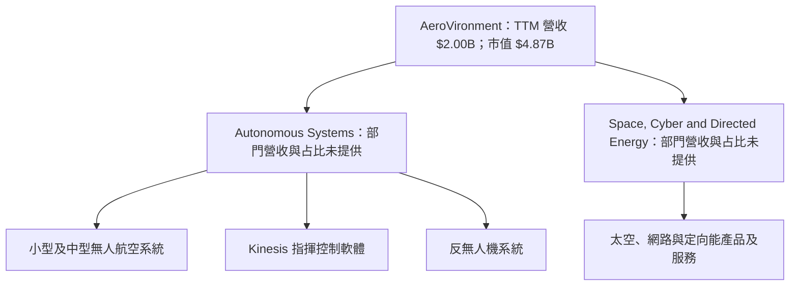
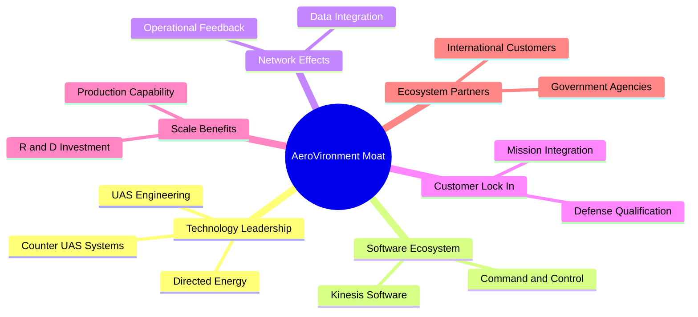
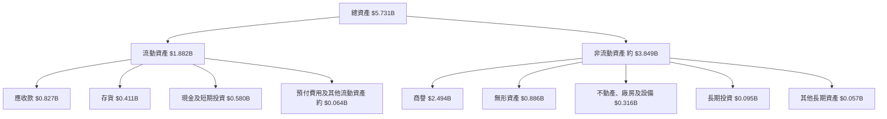
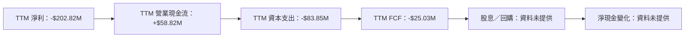
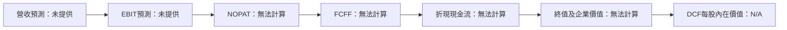
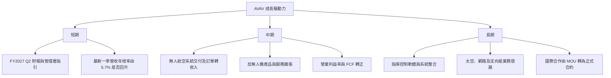
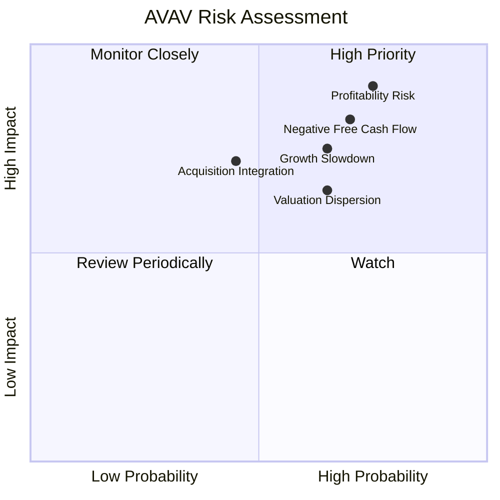
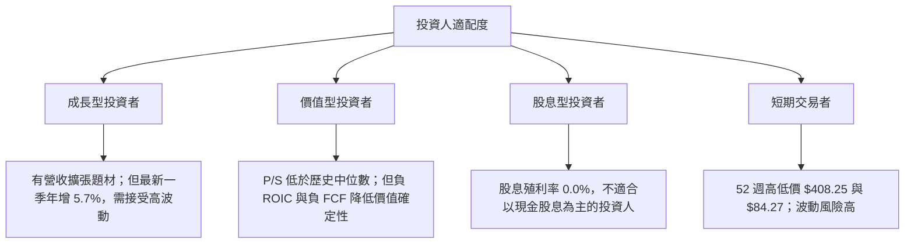

# AVAV 基本面深度分析報告
> **報告日期**：2026-11-28 ｜ **語言**：繁體中文 ｜ **數據來源**：SEC 申報資料 (XBRL)、Yahoo Finance、Finviz、StockAnalysis、Roic.ai ｜ **分析師**：CFA 級機構研究

## 目錄

| # | 章節 | 核心結論 |
|---|------|----------|
| 1 | 執行摘要 | 買入；加權合理價值 $129.49；MOS +29.4% |
| 2 | 公司概覽與商業模式 | 無人系統及國防科技供應商；市場份額與部門收入拆分未提供 |
| 3 | 損益表深度分析 | TTM 營收 $2.00B、TTM 成長 84.4%；最新一季年增 5.7%，TTM 營業利益率為負 |
| 4 | 資產負債表分析 | 淨負債 $149.83M；流動性指標高，但債務資料來源存在差異 |
| 5 | 現金流量深度分析 | TTM FCF -$25.03M、FCF Yield -0.51%；現金轉換仍待改善 |
| 6 | 獲利能力與資本效率 | ROIC -4.4% 低於 WACC 9.89%，目前摧毀股東價值 |
| 7 | 相對估值分析 | P/S 低於自身五年中位數及同業中位數；估值方法結果分散 |
| 8 | DCF 內在價值評估 | N/A：TTM 營業利益為負，未建立 DCF |
| 9 | 成長催化劑 | 無人系統需求、反無人機與國際拓展具潛力，量化 TAM 未提供 |
| 10 | 風險矩陣 | 獲利轉弱、現金流轉負及估值預期落差為主要風險 |
| 11 | 投資建議 | 依 MOS 評級為買入；以執行獲利與現金流轉正為追蹤重點 |

---

## 1. 執行摘要

AVAV 2026-11-25 收盤價為 **$91.37**。程式計算的加權合理價值為 **$129.49**，安全邊際（MOS）為 **+29.4%**、隱含上行空間為 **+41.7%**；但 TTM ROIC 為 **-4.4%**、低於 **9.89% WACC**，TTM FCF 為 **-$25.03M**，且 TTM 營業利益率為 **-12.6%**。因此依 MOS 門檻，MOS 雖高於 25%，但 ROIC 未高於 WACC，規則 20 評級為 **買入**，而非強烈買入。這項評級成立的前提是收入規模持續擴大並逐步恢復獲利；若虧損及負 FCF 延續，估值推論的可信度會下降。

### 1.0 一頁式投資儀表板（Portfolio Manager 30 秒速讀）

| 項目 | 內容 |
|------|------|
| **投資論點（3 句）** | ① TTM 營收達 **$2.00B**，TTM 年增 **84.4%**，規模擴張為主要多頭依據。② 最新一季年增僅 **5.7%**，TTM 營業利益率 **-12.6%**，成長與獲利尚未同步。③ 加權合理價值 **$129.49** 高於現價 **$91.37**，但 ROIC **-4.4%**、TTM FCF **-$25.03M** 限制評級。 |
| **綜合評分** | **5.7/10**（引用 1.1 評分卡） |
| **財務健康** | 🟡 現金及短期投資 **$580.23M**，流動比率 **4.26**；但淨負債 **$149.83M**、TTM FCF 為負。 |
| **ROIC vs WACC** | **-4.4% vs 9.89%**；差距 **-14.29 個百分點**，目前未創造足以覆蓋資本成本的回報。 |
| **FCF 趨勢** | TTM FCF **-$25.03M**，FCF Yield **-0.51%**；年度 FCF 連續為負。 |
| **估值** | Forward P/E **21.727543x** ｜ EV/EBITDA **23.4x** ｜ FCF Yield **-0.51%** |
| **DCF 內在價值（基準）** | **N/A**；TTM 營業利益為負，未建立 DCF，故不計算 DCF 折溢價。 |
| **安全邊際（MOS）** | **+29.4%＝($129.49 − $91.37) ÷ $129.49**；基準為 8.8 加權合理價值。🟢 數值高於 25%，但價值實現仍受獲利及現金流限制。 |
| **預期報酬（基準情境 12M）** | DCF 情境未提供；以加權合理價值推算的上行空間為 **+41.7%**，不是獨立的 12 個月預測。 |
| **關鍵風險（前二）** | 營業獲利率及自由現金流持續為負；收入成長由最新一季的 **5.7%** 顯示出明顯降速。 |
| **評級 + 信心度** | 🟢 **買入** ｜ 信心：**低至中**；估值指標有上行空間，但公司基本面尚未證明可持續盈利。 |

### 1.1 綜合評分卡（全報告唯一）

| 維度 | 評分（1–10） | 主要依據（引用數字與其來源章節） |
|------|--------------|----------------------------------|
| 成長性 | 7.5 | TTM 營收成長 **84.4%**，但最新一季年增降至 **5.7%**（第 3 章）。 |
| 獲利能力 | 2.5 | TTM 營業利益率 **-12.6%**、ROIC **-4.4%**；Piotroski F-Score **4/9**（第 3、6 章）。 |
| 財務健康 | 6.0 | 現金及短期投資 **$580.23M**、流動比率 **4.26**；淨負債 **$149.83M**，CCC **92 天**（第 4 章）。 |
| 估值 | 7.0 | MOS **+29.4%**；P/S **2.3x**，低於五年中位數 **5.1x**，但營運獲利尚未轉正（第 7、8 章）。 |
| 護城河 | 7.0 | 無人機、指揮控制軟體、反無人機與國防客戶產品組合構成技術與認證門檻；缺乏量化續約或市場份額資料（第 2 章）。 |
| 管理層與資本配置 | 4.0 | FY2026 FCF **-$164.62M**、股權薪酬 **$38.33M**，且稀釋股數測試未通過（第 3、5、6 章）。 |
| **綜合評分** | **5.7** | 六項算術平均：**(7.5 + 2.5 + 6.0 + 7.0 + 7.0 + 4.0) ÷ 6 = 5.7**。 |

### 1.2 五大投資論點 + 三大核心風險

| 類型 | 項目 | 具體依據 | 信心度 |
|------|------|----------|--------|
| 🟢 **投資論點①** | 營收規模明顯擴張 | TTM 營收 **$2.00B**，TTM 年增 **84.4%**；FY2026 年營收 **$1.977B**，較 FY2025 的 **$820.63M** 增長 **140.9%**。 | 🟢 高 |
| 🟢 **投資論點②** | 國防無人系統產品組合 | 公司涵蓋無人航空系統、指揮控制軟體、反無人機及太空、網路與定向能領域；整體組合使公司能參與多類國防需求。 | 🟡 中 |
| 🟢 **投資論點③** | 現金流營運週期改善 | CCC 從一年前 **135 天**降至 **92 天**，改善 **43 天**；其中 DSO 由 **67 天**降至 **33 天**。 | 🟡 中 |
| 🟢 **投資論點④** | 相對估值低於歷史中位數 | P/S 現為 **2.3x**，低於自身五年中位數 **5.1x**；相對歷史區間下緣 **3.0x**亦偏低。 |
| 🟢 **投資論點⑤** | 同業及分析師估值提供上行參考 | 同業 Forward P/E 估值法為 **$100.09**、同業 P/S 法為 **$130.62**、分析師共識為 **$210.86**；不同方法差異很大，不能視作同等確定性。 |
| 🟡 **風險①** | 獲利及現金流轉弱 | TTM 營業利益率 **-12.6%**、ROIC **-4.4%**，TTM FCF **-$25.03M**。若持續，DCF 不適用的問題不會自然消失。 |
| 🔴 **風險②** | 收入成長降速 | TTM 成長 **84.4%**，但最新一季年增率 **5.7%**；單季變化若延續，歷史高增速可能不具代表性。 |
| 🔴 **風險③** | 市場預期與實際基本面落差 | 24 位分析師平均目標價 **$210.86**，遠高於現價，但 EPS 估計及實際值資料缺漏，無法核實近期盈餘是否超預期。 |

### 1.3 快速統計卡片

| 指標 | 公司實際值（期間） | 同業中位數 | 狀態 |
|------|--------------------|------------|------|
| 營收成長（TTM） | **84.4%** | — | 🟢 高成長；須留意單季降速 |
| 營收成長（最新一季年增） | **5.7%** | **35.7%** | 🔴 低於同業中位數 |
| 毛利率（TTM） | **26.5%** | **23.0%** | 🟢 高於同業中位數 |
| 營業利益率（TTM） | **-12.6%** | — | 🔴 負值 |
| ROIC（TTM） | **-4.4%** | — | 🔴 低於 WACC |
| Forward P/E | **21.727543x** | **22.7x** | 🟢 略低於可計算的同業中位數 |
| FCF Yield（TTM） | **-0.51%** | — | 🔴 負值 |
| Piotroski F-Score | **4 / 9** | — | 🟡 中低 |

### 1.4 投資結論

╔══════════════════════════════════════════════════════════════════╗  
║                    📊 投資結論摘要                               ║  
╠══════════════════════════════════════════════════════════════════╣  
║  評級：買入（依規則 20；MOS 高，但 ROIC 未高於 WACC）            ║  
║  價格（2026-11-25 收盤）：$91.37                                 ║  
║  DCF 內在價值（基準）：N/A（TTM 營業利益為負）                   ║  
║  安全邊際 MOS：+29.4%（＝($129.49−$91.37)÷$129.49）             ║  
║  加權合理價值（8.8）：$129.49                                    ║  
║  綜合評分：5.7/10（引用 1.1）                                    ║  
║  適合投資人：能承受高波動、重視國防無人系統成長的投資人          ║  
╚══════════════════════════════════════════════════════════════════╝  

依 MOS 門檻，MOS ≥25% 原可達強烈買入；但規則要求 ROIC > WACC，而 AVAV ROIC 為 **-4.4%**、WACC 為 **9.89%**，因此評級為**買入**，未作質化上調或下調。

---

## 2. 公司概覽與商業模式

### 2.1 業務結構與收入來源

公司資料顯示，AeroVironment 設有 Autonomous Systems，以及 Space, Cyber and Directed Energy 兩大業務部門，產品涵蓋小型及中型無人航空系統、指揮控制軟體，以及反無人機等方向。公司總營收為 TTM **$2.00B**；部門營收、各部門占比及軟體／服務收入金額未提供，故不以圖表虛構分布。

### 2.2 市場份額

市場份額數據未提供，因此不估算市占率。公司 TTM 營收為 **$2.00B**、TTM 成長 **84.4%**，但最新一季年增率為 **5.7%**；同業 KTOS 最新一季年增 **35.7%**，顯示 AVAV 的單季成長速度暫時低於可比公司中位數。

### 2.3 競爭護城河分析

### 2.4 護城河強度

| 護城河項目 | 強度（強／中／弱） | 證據（引用數字或事實） | 會削弱它的情況 |
|------------|--------------------|------------------------|----------------|
| 技術及產品組合 | 中 | 涵蓋 UAS、反無人機、指揮控制及定向能；FY2026 研發費用 **$127.68M**。 | 技術快速商品化、競爭者在成本或性能上追上。 |
| 軟體生態系統 | 中 | 產品概況包含 Kinesis 指揮控制軟體；軟體收入、續約率及客戶留存數據未提供。 | 軟體缺乏獨立付費能力，或轉換成本不高。 |
| 客戶鎖定與認證 | 中 | 國防任務系統通常需整合、測試與認證；公司面向政府機構及企業。 | 採購延誤、單一客戶或計畫依賴提高。 |
| 規模效應 | 中 | TTM 營收 **$2.00B**，員工 **3,991 人**；但 TTM 營業利益率為 **-12.6%**，尚未顯示穩定規模利潤。 | 併購整合、產能擴張或研發費用未轉化為毛利。 |
| 網路效應 | 弱至中 | 部署及使用回饋可能改善產品與系統整合；實際使用者數與網路效應指標未提供。 | 客戶間資料不可互通，或不同產品替代性高。 |
| 生態夥伴 | 中 | 公司服務政府及國際市場；近期新聞提及台灣 MOU，但交易規模及訂單金額未提供。 | MOU 未轉化成合約，或出口審批與政策變動。 |

1.1 護城河評分為 **7.0/10**，理由是產品組合、研發投入與國防系統整合具一定進入門檻，但目前缺乏市場份額、軟體續約及持續正向營業利潤率的量化證據。

---

## 3. 損益表深度分析

### 3.1 年度收入成長趨勢（近 4 年）

年度營收來源為 SEC 申報資料及財務資料庫整理；柱長僅用作視覺比較，並非額外財務數字。

╔══════════════════════════════════════════════════════════════════╗  
║              AeroVironment 年度收入趨勢（FY2023-FY2026）         ║  
╠══════════════════════════════════════════════════════════════════╣  
║  FY2023  $540.54M  ██████░░░░░░░░░░░░░░░░  YoY: +21.3%          ║  
║  FY2024  $716.72M  ████████░░░░░░░░░░░░░░  YoY: +32.6%          ║  
║  FY2025  $820.63M  █████████░░░░░░░░░░░░░  YoY: +14.5%          ║  
║  FY2026  $1.977B   ████████████████████░░  YoY: +140.9%         ║  
╠══════════════════════════════════════════════════════════════════╣  
║  FY2023–FY2026 營收 CAGR：約 +54.1%                              ║  
╚══════════════════════════════════════════════════════════════════╝  

計算：FY2023–FY2026 CAGR＝\((1.977B ÷ 0.54054B)^{1/3} - 1\)＝約 **54.1%**。FY2026 大幅增長與公司規模擴張相符，但單季年增降至 **5.7%**，因此不宜直接將 FY2026 的成長率外推。

### 3.2 季度收入趨勢分析

| 季度 | 營收 | QoQ 成長 | YoY 成長 | 備註 |
|------|------:|---------:|---------:|------|
| 2025-11-01 | $472.51M | +3.9% | +150.72% | QoQ 以上一季 $454.68M 為基準。 |
| 2026-01-31 | $408.05M | -13.6% | +143.41% | 營收較前季下降，但同比仍高增。 |
| 2026-04-30 | $641.62M | +57.2% | +133.27% | 季度營收高於前季；季度波動顯著。 |
| 2026-08-01 | $480.49M | -25.1% | +5.68% | 最新一季同比成長大幅放緩。 |

最新一季年增 **5.7%** 是單季同比數字，並非 TTM 成長率。季度營收的明顯起伏代表交付節奏可能不均；現有資料未提供訂單與合約交付拆分，無法判斷波動是時點效應或需求轉弱。

### 3.3 利潤率演變分析

| 利潤率指標 | FY2023 | FY2024 | FY2025 | FY2026 | 趨勢 | 評估 |
|------------|-------:|-------:|-------:|-------:|------|------|
| **毛利率** | 32.1% | 39.6% | 38.8% | 25.3% | FY2026 顯著下降 | 🔴 |
| **營業利益率** | -4.2% | 10.0% | 7.2% | -3.6% | FY2026 轉負 | 🔴 |
| **淨利率** | -32.6% | 8.3% | 5.3% | -13.4% | FY2026 轉負 | 🔴 |

計算口徑為年度財務表所列毛利、營業利益、淨利除以營收。FY2026 毛利率下降至 **25.3%**，低於 FY2025 的 **38.8%**；營業利益從 FY2025 **+$59.15M** 轉為 FY2026 **-$70.29M**。可確認的是毛利與營業費用後的獲利表現惡化；但產品組合、整合成本、一次性費用或定價變化的分項資料未提供，不宜將原因歸於特定因素。

另需注意，品質數據列示 TTM 營業利益率 **-12.6%**，而其他資料區段有 **-0.6%** 的不同值；本報告採 VERIFIED FIGURES 的 **-12.6%** 作為 TTM 指標，並將來源差異視為估值風險。

### 3.4 費用結構分析

可取得 FY2026 研發費用 **$127.68M**、收入 **$1.977B**，研發費用約占收入 **6.5%**。完整營業費用拆分及各費用項目比例未提供，故不繪製會暗示完整費用結構的圓餅圖。FY2026 營業虧損 **$70.29M** 表示毛利尚不足以覆蓋全部營業費用，但細項歸因資料不足。

### 3.5 季度 EPS 趨勢與盈餘品質（Quality of Earnings）

EPS 預估值與實際值資料皆為 N/A，因此無法判定過去四季是否超預期或不及預期。財務資料另列 StockAnalysis 季度 EPS：FY2027 Q1 **-$0.10**、FY2026 Q4 **-$0.48**、Q3 **-$3.15**、Q2 **-$0.34**；不同資料源之季度 EPS 存在差異，應以正式季報核對。

| 盈餘品質項目 | 數值/佔比 | 評估 |
|--------------|-----------|------|
| 股權薪酬 SBC / 營收 | 最近四個季度 SBC **$31.84M**；約占 TTM 營收 **1.59%** | 🟡 比重需持續監察；股權薪酬會稀釋股東持有比例。 |
| SBC / 營業現金流 | **54.1%**（$31.84M ÷ $58.82M） | 🔴 SBC 相對營業現金流規模偏高；即使不直接流出現金，仍有股東稀釋成本。 |
| FCF / 淨利（現金轉換率） | 約 **12.3%**（-$25.03M ÷ -$202.82M） | 🔴 淨利及 FCF 均為負，該比率不具一般正獲利公司的現金轉換解讀意義。 |
| 一次性/非經常性損益 | N/A；FY2026 淨利 **-$265.12M**、營業利益 **-$70.29M** | 🔴 兩者差距顯著，但缺少分項資料，不能判定是否為一次性損益。 |
| 有效稅率異常 | N/A | 淨利為負，且有效稅率資料未提供；不能判定稅務利益是否支撐盈餘。 |
| 資本化支出 vs 費用化 | TTM 資本支出 **$83.85M**；資本化與費用化明細 N/A | 🟡 缺少資本化政策及折舊攤銷明細，無法判斷是否遞延成本。 |

**盈餘品質結論**：AVAV 目前不是以穩定正淨利支持估值的公司。TTM 營業現金流為正 **$58.82M**，但扣除資本支出後 FCF 為 **-$25.03M**；SBC 約為營業現金流的 **54.1%**。因此短期評估應優先追蹤營業利潤率、FCF 及股數稀釋，而不是以單一季度 EPS 變化作出結論。

---

## 4. 資產負債表分析

### 4.1 資產結構分解

以下為 TTM 至 2026-08-01 資料庫資產分類，數字以十億美元表示，部分細項四捨五入。

資產負債表中商譽與無形資產合計約 **$3.38B**，占總資產比重較高。若相關收購業務未達預期，可能出現減值風險；減值資料與測試假設未提供。

### 4.2 流動性與營運資金分析

| 指標 | 最新 TTM | 一年前 TTM | 變化 | 解讀 |
|------|----------|------------|------|------|
| 流動比率 | 4.26 | N/A | N/A | 短期資產相對流動負債充足；一年對比資料未提供。 |
| 速動比率 | 3.185 | N/A | N/A | 扣除部分存貨後仍高於 1；但不代表營運已產生正 FCF。 |
| DSO 應收帳款天數 | 33 天 | 67 天 | -34 天 | 收款週期縮短，支持營運資金效率改善；仍需確認是否因期末餘額或合約時點造成。 |
| DIO 存貨天數 | 102 天 | 113 天 | -11 天 | 庫存週轉有所改善，但 102 天仍代表較長的資金占用週期。 |
| DPO 應付帳款天數 | 43 天 | 44 天 | -1 天 | 付款天數大致持平，不宜解讀為供應商融資能力大幅提升。 |
| CCC 現金轉換週期 | 92 天 | 135 天 | -43 天 | 營運資金週期改善，主要由 DSO 降低、DIO 下降帶動。 |

### 4.3 債務結構分析

╔══════════════════════════════════════════════════════════════════╗  
║                  AeroVironment 債務健康診斷                      ║  
╠══════════════════════════════════════════════════════════════════╣  
║  總債務（品質數據）：          $730.06M                           ║  
║  現金及短期投資：              $580.23M                           ║  
║  淨負債：                      $149.83M                           ║  
║  流動比率：                    4.26                               ║  
║  速動比率：                    3.185                              ║  
║  Debt/EBITDA：                 N/A（TTM EBITDA 口徑資料不一致）   ║  
║  利息保障倍數：                N/A（利息費用資料未提供）         ║  
╚══════════════════════════════════════════════════════════════════╝  

資產負債表其他資料列示總債務 **$850.82M**、淨負債 **$270.60M**，與品質數據列示的 **$730.06M**、**$149.83M** 不一致。遵守財務數據優先原則，本節淨負債採用品質數據中的 **$149.83M**，不以不同口徑混算。另因 TTM EBITDA 與營業利益數據存在資料差異，不用不一致的數字計算 Debt/EBITDA。

### 4.4 股東權益趨勢

╔══════════════════════════════════════════════════════════════════╗  
║                 股東權益趨勢（年度資料）                         ║  
╠══════════════════════════════════════════════════════════════════╣  
║  FY2023  $550.97M  ██████░░░░░░░░░░░░░░░░░░░░                  ║  
║  FY2024  $822.75M  █████████░░░░░░░░░░░░░░░░░░                  ║  
║  FY2025  $886.51M  ██████████░░░░░░░░░░░░░░░░░                  ║  
║  FY2026  $4.40B    ████████████████████████████                  ║  
╚══════════════════════════════════════════════════════════════════╝  

FY2026 股東權益大幅增加，與資產負債表規模擴大同時發生；但財務資料未提供增資、併購及其他權益變動的完整橋接，不能把變化單純歸因於留存盈餘或營運獲利。FY2026 淨利為 **-$265.12M**，顯示權益上升並非由當年度淨利累積所驅動。

---

## 5. 現金流量深度分析

### 5.1 現金流量瀑布圖

TTM 數值採 VERIFIED FIGURES；股息及回購金額、期間淨現金變化未提供，不將缺項推算補入。

淨利與營業現金流方向不同，顯示非現金項目及營運資金可能對現金流有重大影響；但缺少完整現金流調節表時，不進一步臆測來源。

### 5.2 FCF 轉換率趨勢

| 財年 | FCF | 淨利 | FCF / 淨利 | 解讀 |
|------|----:|----:|-----------:|------|
| FY2023 | -$3.47M | -$176.21M | 不宜作一般轉換率解讀 | 分子、分母均負，且淨利受大額虧損影響。 |
| FY2024 | -$9.19M | $59.67M | -15.4% | 有會計獲利但 FCF 為負，資本支出與營運資金需追蹤。 |
| FY2025 | -$24.13M | $43.62M | -55.3% | FCF 赤字擴大，現金轉換偏弱。 |
| FY2026 | -$164.62M | -$265.12M | 不宜作一般轉換率解讀 | 營業現金流與淨利均為負，年度 FCF 明顯惡化。 |

### 5.3 自由現金流趨勢

FY2026 年度 FCF 採年度現金流量表數據；TTM FCF 依指定口徑引用 **-$25.03M**。FY2026 年度 FCF 與 TTM FCF 期間不同，不應混為同一數字。

╔══════════════════════════════════════════════════════════════════╗  
║               自由現金流：歷史實際值                             ║  
╠══════════════════════════════════════════════════════════════════╣  
║  FY2023  -$3.47M    ◀ 小幅負值                                   ║  
║  FY2024  -$9.19M    ◀ 負值擴大                                   ║  
║  FY2025  -$24.13M   ◀ 赤字擴大                                   ║  
║  FY2026  -$164.62M  ◀ 赤字明顯擴大                               ║  
║  最新 TTM -$25.03M  FCF Yield：-0.51%                            ║  
╚══════════════════════════════════════════════════════════════════╝  

### 5.4 資本配置評估

回購、股息、併購及其他投資的完整金額分拆未提供，因此不繪製資本配置圓餅圖。已知 FY2026 資本支出 **$86.22M**、SBC **$38.33M**，FY2026 FCF **-$164.62M**；FY2026 營業現金流 **-$78.40M**，顯示該年度資本投入尚未由營運現金流覆蓋。股息殖利率為 **0.0%**，沒有股息分配支撐總報酬。

---

## 6. 獲利能力與資本效率

### 6.1 ROE / ROA / ROIC 趨勢

可供引用的標準化趨勢數據以 TTM 為主，歷史 ROIC／ROA 年度序列未提供。故不補造同業均值或完整年度趨勢。

| 指標 | 最新可用值 | 歷史資料 | 評估 |
|------|-----------:|----------|------|
| ROE（TTM） | -4.6% | 歷年一致口徑 N/A | 🔴 負值，股東權益回報為負。 |
| ROA（TTM） | -0.1% | 品質數據測試顯示 ROA 未通過正值與同比改善 | 🔴 資產尚未產生正向淨利回報。 |
| ROIC（TTM） | -4.4% | 歷年一致口徑 N/A | 🔴 低於 WACC 9.89%。 |

### 6.2 ROIC vs WACC 分析（核心價值創造判斷）

╔══════════════════════════════════════════════════════════════════╗  
║                ROIC vs WACC 深度分析                             ║  
╠══════════════════════════════════════════════════════════════════╣  
║  無風險利率（10Y 美債）：     4.94%                              ║  
║  市場風險溢酬 ERP：           5.00%                              ║  
║  原始 Beta：                  1.40                               ║  
║  調整後 Beta：                1.27                               ║  
║  股權成本 Ke（資料值）：      11.28%                             ║  
║  稅前債務成本 Kd：            0.77%                              ║  
║  稅率假設：                   21.0%                              ║  
║  股權／債務權重：             87.0%／13.0%                       ║  
║  WACC（指定值）：             9.89%                              ║  
║                                                                  ║  
║  ROIC（TTM）：               -4.4%                               ║  
║  ROIC - WACC：               -14.29 個百分點                     ║  
║  判斷：目前回報低於資本成本，尚未創造股東經濟價值                ║  
╚══════════════════════════════════════════════════════════════════╝  

Beta 調整方式為 **⅔ × 原始 Beta 1.40 + ⅓ × 1 = 1.27**。按列示輸入，CAPM 以已調整 Beta 代入後，顯示值會受輸入四捨五入影響；本報告採財務資料給定的 Ke **11.28%** 與 WACC **9.89%**，不另改寫成本資本數字。ROIC 與 WACC 的差額為 **-4.4% − 9.89% = -14.29 個百分點**，目前判斷為摧毀價值；未來若營業利潤轉正且投入資本效率提升，結論才可能改變。

### 6.3 杜邦三因素分解

| 因素 | 數值（TTM） | 解讀 |
|------|-------------|------|
| 淨利率 | -10.1% | 淨利為負，是 ROE 負值的主要來源。 |
| 資產週轉率 | 0.35 | 每單位資產創造的營收有限；收購或資產擴張可能影響周轉效率。 |
| 權益乘數 | 1.30 | 槓桿程度不是主要推升 ROE 的因素。 |
| **ROE** | **-4.6%** | **-10.1% × 0.35 × 1.30 = 約 -4.6%**。 |

### 6.4 財務體質：Piotroski F-Score

F-Score **4 / 9**。以下測試結果照錄品質數據；缺漏測試的分母可能低於九項，但本次列示為 4/9。

| 測試 | 結果 | 解讀 |
|------|------|------|
| ROA > 0 | ❌ 未通過 | 資產報酬仍為負。 |
| 營業現金流 > 0 | ✅ 通過 | TTM 營業現金流為正。 |
| ROA 高於一年前 | ❌ 未通過 | 尚未顯示資產獲利改善。 |
| 營業現金流 > 淨利（應計品質） | ✅ 通過 | 現金流高於淨利；但淨利為負時需審慎解讀。 |
| 長期負債 ÷ 總資產低於一年前 | ✅ 通過 | 相對負債指標改善。 |
| 流動比率高於一年前 | ❌ 未通過 | 流動比率同比改善測試未通過。 |
| 稀釋股數未增加 | ❌ 未通過 | 股東持股可能遭稀釋，需追蹤股數變化。 |
| 毛利率高於一年前 | ❌ 未通過 | 毛利率同比未改善。 |
| 資產週轉率高於一年前 | ✅ 通過 | 資產利用效率測試通過。 |

---

## 7. 相對估值分析

### 7.1 同業估值比較表格

公司估值採財務資料中的市場估值欄位；同業數值採 Peer multiples。Forward P/E 的程式估值方法以 KTOS 與 LMT 中位數為基礎，故中位數為 **22.7x**。

| 估值指標 | **AVAV** | **KTOS** | **ONDS** | **LMT** | 本公司評估 |
|----------|---------:|---------:|---------:|---------:|-----------|
| **Trailing P/E** | N/A | 253.2x | N/A | 21.5x | 🟡 AVAV TTM 虧損，無可比正值 P/E。 |
| **Forward P/E** | 21.727543x | 27.2x | -26.5x | 18.2x | 🟢 低於 KTOS/LMT 中位數 22.7x；ONDS 為負值，不納入該估值法中位數。 |
| **P/S Ratio** | 2.430572x | 3.5x | 7.3x | 1.8x | 🟢 低於同業中位數 3.5x。 |
| **EV/EBITDA** | 23.4x | 50.8x | -5.9x | 15.7x | 🟡 高於 LMT，低於 KTOS；ONDS 為負值，倍數可比性有限。 |
| **最新一季營收年增** | 5.7% | 35.7% | 1558.6% | 11.3% | 🔴 AVAV 最新單季增速低於同業中位數 35.7%。 |
| **毛利率（TTM）** | 26.5% | 23.0% | 36.4% | 11.7% | 🟢 高於同業中位數 23.0%。 |

ONDS 的最新季營收增速極高，與 AVAV、KTOS、LMT 的成熟度及規模不同，倍數比較應視為參考，而非同質公司估值。AVAV 的正 Forward P/E 反映市場預期未來 EPS 為正，但實際近期季度 EPS 資料仍為負。

### 7.2 歷史估值區間分析

╔══════════════════════════════════════════════════════════════════╗  
║                    AVAV 五年 P/S 歷史位置                         ║  
╠══════════════════════════════════════════════════════════════════╣  
║  五年區間：3.0x ───────────────────────────── 13.4x             ║  
║  五年中位數：5.1x                                               ║  
║  現值：2.3x（低於五年區間下緣）                                 ║  
║  當前百分位：0%                                                  ║  
╚══════════════════════════════════════════════════════════════════╝  

P/S 現值低於自身五年區間下緣，但估值折價可能同時反映最新一季成長放緩、負營業利益率及負 FCF。低於歷史中位數不等同估值必然回歸，需以利潤率及現金流改善驗證。

### 7.3 情境價值（Bear / Base / Bull，照抄 DCF MODEL 的 Scenarios）

**N/A（DCF 無法計算：TTM 營業利益不為正，DCF MODEL 未提供三情境價值及其假設）**。因此不自行建構悲觀、基準及樂觀情境目標價。

### 7.4 相對估值隱含價格區間

╔══════════════════════════════════════════════════════════════════╗  
║                    相對估值每股參考值                             ║  
╠══════════════════════════════════════════════════════════════════╣  
║  現價 $91.37 ── Forward P/E $100.09 ── P/S $130.62 ── 共識 $210.86 ║  
╚══════════════════════════════════════════════════════════════════╝  

| 方法 | 每股價值 | 相對現價 | 依據 |
|------|---------:|---------:|------|
| 同業 Forward P/E | $100.09 | +9.5% | KTOS、LMT 的 Forward P/E 中位數 **22.7x** × AVAV Forward EPS **$4.41**。 |
| 同業 P/S | $130.62 | +43.0% | KTOS、ONDS、LMT 的 P/S 中位數 **3.5x** × AVAV TTM 營收。 |
| 分析師共識目標價 | $210.86 | +130.8% | 24 位分析師平均目標價；作參考，不等同內在價值模型。 |

---

## 8. DCF 內在價值評估（Discounted Cash Flow）

### 8.0 估值推理鏈（Thinking Logic）

**Step 1 — 價值來源與主導變數**  
AVAV 的價值主要取決於無人系統及相關服務能否在快速擴張營收後轉為可持續營業利潤和正 FCF。已知公司 TTM 營收 **$2.00B**，但兩大部門營收占比未提供，故無法拆分主業與新業務各自的收入權重。就現有財務資料而言，主導估值的變數應是**營業利潤率及現金流轉正能力**，而不是單純營收 CAGR。

**Step 2 — 模型選擇**

| 決策點 | 本報告採用 | 理由（含數字） | 曾考慮但否決 | 否決理由 |
|--------|-----------|----------------|--------------|----------|
| 現金流定義 | 不建立 DCF | TTM 營業利益為負，無 DCF MODEL 基準預測。 | FCFF／FCFE 自建模型 | 與指定數據規則不符；亦缺少可審核的預測假設。 |
| 預測期 N | N/A | 模型未提供預測期。 | 自行採用 5–10 年 | 會形成未經數據支持的模型。 |
| 終值方法 | N/A | 無逐年正向 FCFF 預測，無法計算終值。 | Gordon Growth／退出倍數 | 會產生不可稽核結果。 |
| EBIT 基礎 | N/A | DCF MODEL 未建立。 | GAAP／非 GAAP 自建 | 不自行填入獲利預測。 |

**Step 3 — 假設推導鏈**  
因 DCF MODEL 標示 N/A，營收 CAGR、期末營業利潤率、永續成長率、預測期、Capex 比率、D&A 比率、營運資金假設、SBC 處理及稀釋率均沒有程式模型數值。基於規則，不用歷史營收成長外推出自建估值。

**Step 4 — 最脆弱環節**  
若只看相對估值而忽略 **TTM 營業利益率 -12.6%** 與 **TTM FCF -$25.03M**，將高估營收成長轉化為股東現金流的速度；本報告因此不提供 DCF 內在價值。

**Step 5 — 計算路徑圖**

### 8.1 模型假設總表（Model Inputs）

| 假設項目 | 採用值 | 依據 / 來源 | 敏感度 |
|----------|--------|-------------|--------|
| 預測期長度 N | N/A | DCF MODEL 未建立；TTM 營業利益為負。 | 🔴 高 |
| 營收 CAGR | N/A | 無 DCF 預測；歷史 TTM 成長 **84.4%**、最新一季年增 **5.7%**，兩者差異過大，不應直接外推。 | 🔴 高 |
| 營業利潤率（期末） | N/A | TTM **-12.6%**，最新一季 **-2.3%**；未提供轉正預測。 | 🔴 高 |
| 有效稅率 | N/A | 只有 WACC 預設稅率 **21.0%**；不是 DCF 稅率預測。 | 🟢 低 |
| Capex / 營收 | N/A | TTM Capex **$83.85M**，但模型假設未提供。 | 🟡 中 |
| D&A / 營收 | N/A | 未提供 DCF 模型假設。 | 🟢 低 |
| 營運資金變動 / 營收增額 | N/A | CCC 數據存在，但 DCF 模型未提供此假設。 | 🟢 低 |
| EBIT 基礎 | N/A | 未建立 DCF。 | 🟡 中 |
| SBC 處理 | N/A | 未建立 DCF，不可宣稱 SBC 已在模型內計入一次。 | 🟡 中 |
| 年稀釋率 | N/A | 目前股數及股數變化測試可見，但未提供 DCF 稀釋假設。 | 🟡 中 |
| 永續成長率 g | N/A | 未建立 DCF。 | 🔴 高 |
| 終值方法 | N/A | 無 FCFF 預測及終值計算。 | 🔴 高 |
| WACC | **9.89%** | 程式給定資本成本；詳見 8.2。 | 🔴 高 |

FCFF 定義在本節不適用，因未建立 FCFF 預測；因此不執行 SBC 組合 A/B/C 的模型處理，也不推算每股 DCF 價值。

### 8.2 折現率推導（WACC）

╔══════════════════════════════════════════════════════════════════╗  
║                    WACC 推導（折現率）                            ║  
╠══════════════════════════════════════════════════════════════════╣  
║  無風險利率 Rf（10Y 美債）：      4.94%                          ║  
║  市場風險溢酬 ERP：               5.00%                          ║  
║  原始 Beta（Yahoo Finance）：      1.40                           ║  
║  調整後 Beta：                    1.27                           ║  
║  Beta 調整：                      ⅔×1.40 + ⅓×1 = 1.27           ║  
║  股權成本 Ke（資料值）：          11.28%                         ║  
║  稅前債務成本 Kd：                0.77%                          ║  
║  稅率：                           21.0%                          ║  
║  股權／債務權重：                 87.0%／13.0%                   ║  
║  WACC（資料值）：                 9.89%                          ║  
╚══════════════════════════════════════════════════════════════════╝  

逐步核對：

1. **Ke（CAPM）**：顯示值按列示輸入計算為 **4.94% + 1.27 × 5.00% = 11.29%**；資本成本資料提供的 Ke 為 **11.28%**。此 **0.01 個百分點**差異可由原始輸入的未顯示精度造成，本報告以指定 Ke **11.28%** 為準。
2. **稅前 Kd**：資料提供 **0.77%**；利息費用及平均計息負債明細未提供，故不能獨立重算。
3. **稅後 Kd**：**0.77% × (1 − 21.0%) = 0.6083%**，約 **0.61%**。
4. **資本權重**：指定股權權重 **87.0%**、債務權重 **13.0%**，合計 **100.0%**；市值及計息負債口徑的組成明細未提供。
5. **WACC**：**87.0% × 11.28% + 13.0% × 0.6083% = 9.8136% + 0.0791% = 9.8927% ≈ 9.89%**。

WACC 與第 6.2 節一致，均採 **9.89%**。資料未提供 10Y 殖利率觀測日、利息費用與平均計息負債的完整明細，故無法進一步驗證其原始觀測期或重建 Kd。

### 8.3 逐年自由現金流預測（基準情境）

**N/A（DCF MODEL 未提供；原因：TTM 營業利益不為正，程式未建立 DCF）**。因此不列 FY+1 至 FY+N 預測表、不計預測期 FCF 現值，也不製作歷史與預測 FCF 混合圖表。

### 8.4 終值計算（Terminal Value）

**N/A（無 DCF 預測現金流、永續成長率 g 或預測期 N，無法檢查 WACC 與 g，也無法計算 Gordon Growth 或退出倍數終值）**。

### 8.5 企業價值 → 每股內在價值（Bridge）

╔══════════════════════════════════════════════════════════════════╗  
║              企業價值 → 每股內在價值 橋接表                      ║  
╠══════════════════════════════════════════════════════════════════╣  
║  預測期 FCF 現值合計            N/A                              ║  
║  終值現值 PV(TV)                N/A                              ║  
║  = 企業價值 EV                   N/A                              ║  
║  + 現金及短期投資               N/A（DCF 橋接未建立）            ║  
║  − 總債務                       N/A（DCF 橋接未建立）            ║  
║  = 股權價值                      N/A                              ║  
║  ÷ 稀釋後流通股數                N/A                              ║  
║  ★ 每股 DCF 內在價值             N/A                              ║  
║  當前股價（2026-11-25 收盤）     $91.37                           ║  
║  DCF 折溢價                      N/A                              ║  
╚══════════════════════════════════════════════════════════════════╝  

DCF 橋接不成立，原因是 DCF MODEL 為 N/A，而非現金、債務或股數不存在。本報告不計算 DCF MOS；MOS 僅在 8.8 以加權合理價值為基準計算。

### 8.6 敏感性分析（WACC × 永續成長率）

**N/A（DCF MODEL 未提供基準 FCFF、終值或敏感度矩陣）**。不自建矩陣、不提供三情境 DCF 價值，也不以自建假設推算每股敏感度。

### 8.7 反推 DCF（Reverse DCF：市場在預期什麼）

**N/A（DCF MODEL 未提供反推結果）**。現價無法在缺少基準現金流、預測期、永續成長率與模型股數假設時，可靠地反推出單一市場隱含營收成長率或利潤率；因此不列試算軌跡。

### 8.8 估值三角驗證與安全邊際

| 估值方法 | 隱含每股價值 | 上行空間（÷現價） | 權重 | 說明 |
|----------|--------------:|------------------:|------|------|
| 同業 Forward P/E | $100.09 | +9.5% | 30% | 同業中位數 **22.7x** × AVAV Forward EPS **$4.41**。 |
| 同業 P/S | $130.62 | +43.0% | 60% | 同業中位數 **3.5x** × AVAV TTM 營收。 |
| 分析師共識目標價 | $210.86 | +130.8% | 10% | 24 位分析師平均目標價。 |
| **加權合理價值** | **$129.49** | **+41.7%** | **100%** | 公司類型為未獲利公司；未納入 DCF，因 DCF MODEL 為 N/A。 |

加權計算：  
**$100.09 × 30% + $130.62 × 60% + $210.86 × 10%  
= $30.027 + $78.372 + $21.086  
= $129.485 ≈ $129.49**。  

MOS 使用四捨五入後的加權合理價值計算：  
**($129.49 − $91.37) ÷ $129.49 = $38.12 ÷ $129.49 = +29.4%**。  
上行空間為：**($129.49 − $91.37) ÷ $91.37 = $38.12 ÷ $91.37 = +41.7%**。  
折溢價固定以 DCF 基準值為分母；因 DCF 基準值 N/A，故折溢價不計算。

╔══════════════════════════════════════════════════════════════════╗  
║                  估值區間與安全邊際                               ║  
╠══════════════════════════════════════════════════════════════════╣  
║  現價 $91.37 ── Forward P/E $100.09 ── 加權合理值 $129.49        ║  
║  DCF 基準：N/A                                                    ║  
║  MOS = ($129.49 − $91.37) ÷ $129.49 = +29.4%                    ║  
║  上行空間 = ($129.49 − $91.37) ÷ $91.37 = +41.7%                 ║  
║  評級：買入（MOS 高，但 ROIC -4.4% 未超過 WACC 9.89%）           ║  
║  建議買入參考上限：$116.54（按 MOS 至少 10% 推算）               ║  
╚══════════════════════════════════════════════════════════════════╝  

依 MOS ≥10% 的價格上限計算：**$129.49 × (1 − 10%) = $116.541 ≈ $116.54**。此為基於加權合理價值的數學門檻，不代表股價有保證的下限或短期支撐。

> 🔎 **程式複算（Python，依本節各項自動重算）**
>
> 加權合理價值 = $100.09 × 30% + $130.62 × 60% + $210.86 × 10% = **$129.49**（權重合計 100%）
>
> 以價格 $91.37 計：MOS = **+29.4%**，上行空間 = **+41.7%**
>
> ✅ 與本節所寫數值一致。

### 8.9 DCF 模型的局限與失效條件

- **終值依賴度**：N/A，DCF 未建立，無法計算終值占企業價值比重。
- **最脆弱的假設**：沒有 DCF 假設可供量化敏感度。基本面最需驗證的變數是營業利益率能否改善，以及 TTM FCF 能否由 **-$25.03M** 轉正。
- **不適用情境說明**：TTM 營業利益為負、淨利率 **-10.1%**，且歷年 FCF 為負，DCF 可靠度不足。相對估值可作參考，但 P/S 本身不反映利潤轉換；後續應以營業利潤率、FCF、訂單轉收入及資本回報率補足。
- **與第 10 章風險矩陣的連結**：交付延後、毛利率繼續收縮、研發與資本支出未形成營收，會延後獲利轉正，使相對估值合理化難度上升。

### 8.10 複算檢核表（Audit Trail）

| # | 檢核項目 | 檢查方式 | 結果 |
|---|----------|----------|------|
| 1 | 所有高／中敏感度輸入均有完整推導 | 對照 8.1 與 8.0；DCF 輸入不存在 | N/A（未建立 DCF） |
| 2 | 每個假設都有來歷 | 8.1 缺少的模型輸入明確列為 N/A | ✅ |
| 3 | WACC 五步算式及相乘相加 | 指定權重合計 100%；按顯示值約 9.89% | ✅（Ke 有 0.01pp 顯示精度差異） |
| 4 | Kd 分母與債務權重口徑一致 | 利息費用及計息負債明細未提供 | N/A（無法獨立驗證） |
| 5 | WACC 與第 6.2 節同值 | 兩節均為 9.89% | ✅ |
| 6 | 逐年預測年度數與 N 一致 | N 未提供，且未建立模型 | N/A |
| 7 | FY+1 FCFF 與 PV 可複算 | 未提供預測表 | N/A |
| 8 | 預測期 PV 加總 | 未提供預測現值 | N/A |
| 9 | WACC > g | g 未提供 | N/A |
| 10 | 終值以 FY+N FCFF 為基礎 | 未提供 FCFF 與 N | N/A |
| 11 | EV 至每股價值橋接 | DCF 橋接未建立 | N/A |
| 12 | SBC 組合 A/B/C 相容 | 未建立 DCF，不宣稱模型內 SBC 處理 | N/A |
| 13 | 敏感性矩陣基準格對應 8.5 | 矩陣未提供 | N/A |
| 14 | 矩陣只在 WACC > g 時有數值 | 矩陣未提供 | N/A |
| 15 | 三情境機率合計 100% | DCF 情境未提供 | N/A |
| 16 | 反推 DCF 逐列單一變數求解 | 反推結果未提供 | N/A |
| 17 | MOS、DCF 折溢價口徑一致 | MOS 按 8.8；DCF 折溢價因 DCF N/A 不計 | ✅ |
| 18 | 報告完整至第 11 章 | 章節已列至第 11 章 | ✅ |
| 19 | 加權合理價值為方法加權總和 | $30.027 + $78.372 + $21.086 = $129.485 | ✅ |
| 20 | 評級符合 MOS 規則 | MOS ≥25%，但 ROIC < WACC，故買入 | ✅ |

---

## 9. 成長催化劑

### 9.1 催化劑時間軸

具體合約交付日期、管理層財測及訂單金額未提供，故不以未確認日期建立 Gantt 圖。

| 時間範圍 | 催化劑 | 可觀察指標 | 現有證據與限制 |
|----------|--------|------------|----------------|
| 近期 | FY2027 Q2 財報 | 營收年增、營業利益率、FCF、全年指引 | 公司有公告將舉行 FY2027 Q2 財報會議；實際日期與財報數字需以公司公告確認。 |
| 近期至中期 | 無人系統需求及合約轉收入 | 訂單、交付、應收帳款與存貨 | TTM 營收 **$2.00B**，但最新一季年增率為 **5.7%**，尚須判斷單季放緩是否持續。 |
| 中期 | 反無人機及產品組合拓展 | 新合約、毛利率、服務收入 | 產品線涵蓋反無人機等領域，但分部收入與訂單資料未提供。 |
| 中長期 | 國際合作及市場拓展 | MOU 轉為正式合約、出口許可、回款 | 新聞提及台灣 MOU；金額、具約束力程度及交付時間均未提供。 |

### 9.2 TAM 市場規模分析

**N/A（TAM 數據未提供）**。公司 TTM 營收 **$2.00B**、TTM 年增 **84.4%**，代表過去一年收入規模大幅擴張；但最新一季年增率降至 **5.7%**，未有 TAM、可服務市場或滲透率資料，不能量化未來市場空間。

### 9.3 成長驅動力結構圖

---

## 10. 風險矩陣

### 10.1 風險評分矩陣

以下機率與衝擊座標為分析師定性評估，並非公司財務數據或管理層預測。

### 10.2 風險清單詳細分析

| # | 風險項目 | 發生機率 | 財務衝擊 | 風險評分 | 緩解措施 |
|---|----------|----------|----------|----------|----------|
| 1 | 🔴 **營業虧損延續** | 高（分析師估計 60%–75%） | 高；TTM 營業利益率 **-12.6%**，若不改善將限制估值及融資彈性 | 🔴 高 | 追蹤季度毛利率、營業費用率與營業利益率；要求連續季度改善，而非只看營收成長。 |
| 2 | 🔴 **FCF 持續為負** | 高（分析師估計 60%–75%） | 高；TTM FCF **-$25.03M**、FY2026 FCF **-$164.62M** | 🔴 高 | 追蹤營業現金流、資本支出及營運資金；若 FCF 連續兩季為負且赤字擴大，重新檢視持倉。 |
| 3 | 🔴 **營收成長降速** | 中高（分析師估計 50%–65%） | 高；最新一季年增 **5.7%**，低於 TTM 成長 **84.4%** | 🔴 高 | 觀察後續季度同比、訂單轉收入及全年指引；區分交付波動與需求放緩。 |
| 4 | 🟡 **收購整合及資產減值** | 中（分析師估計 35%–50%） | 中高；商譽 **$2.494B**、無形資產 **$886.47M** | 🟡 中高 | 追蹤收購業務收入、毛利、整合成本與減值測試假設。 |
| 5 | 🟡 **估值方法分歧** | 中高（分析師估計 50%–65%） | 中；三種估值法由 **$100.09** 至 **$210.86** | 🟡 中高 | 以實際營運與現金流驗證，而非單獨依賴分析師共識。 |
| 6 | 🟡 **資料口徑與可比性** | 中（分析師估計 30%–45%） | 中；債務、營業利益率及季度 EPS 資料存在差異 | 🟡 中 | 優先核對 SEC 10-Q、10-K；重大差異未釐清前降低模型信心。 |

---

## 11. 投資建議

### 11.1 最終評級與評分

依 8.8 加權合理價值 **$129.49** 與現價 **$91.37** 計算，MOS 為 **+29.4%**；依規則 20，由於 TTM ROIC **-4.4%** 未高於 WACC **9.89%**，評級為**買入**，不符合強烈買入條件。1.1 綜合評分為 **5.7/10**，六項評分依序為成長性 **7.5**、獲利能力 **2.5**、財務健康 **6.0**、估值 **7.0**、護城河 **7.0**、管理層與資本配置 **4.0**。

### 11.2 合理價值與隱含報酬率

| 估值參考 | 每股價值 | 相對現價 | 機率 |
|----------|---------:|---------:|------|
| 加權合理價值 | **$129.49** | **+41.7%** | 不適用 |
| 同業 Forward P/E | $100.09 | +9.5% | 權重 30% |
| 同業 P/S | $130.62 | +43.0% | 權重 60% |
| 分析師共識目標價 | $210.86 | +130.8% | 權重 10% |
| DCF 悲觀／基準／樂觀情境 | N/A | N/A | DCF MODEL 未提供 |

### 11.3 買入時機與觸發因素

╔══════════════════════════════════════════════════════════════════╗  
║                  ✅ 買入觸發因素 Checklist                       ║  
╠══════════════════════════════════════════════════════════════════╣  
║  逐步建倉前優先確認：                                            ║  
║  ✅ 股價低於 $116.54：對應加權合理價值的 MOS 約 10% 門檻         ║  
║  ✅ 最新季度營收年增率停止下滑，且與 TTM 成長差距收斂            ║  
║  ✅ 營業利益率連續改善，並朝損益兩平推進                         ║  
║  ✅ TTM FCF 從 -$25.03M 朝零值收斂                               ║  
║                                                                  ║  
║  加碼觸發條件：                                                  ║  
║  ☐ 連續兩季營業現金流為正且資本支出後 FCF 改善                   ║  
║  ☐ ROIC 明顯回升，並逐步接近 WACC 9.89%                          ║  
║  ☐ 新聞所述合作或 MOU 轉為具金額與交付期的正式合約               ║  
║                                                                  ║  
║  減碼／重新評估條件：                                            ║  
║  ☐ 最新一季營收年增連續兩季低於 5.7%                             ║  
║  ☐ TTM 營業利益率低於 -12.6% 或持續惡化                           ║  
║  ☐ TTM FCF 赤字擴大，且淨負債高於目前 $149.83M                   ║  
╚══════════════════════════════════════════════════════════════════╝  

買入參考上限 **$116.54** 是以加權合理價值及 MOS 10% 門檻推算，並非價格支撐保證。現價位於此上限以下，但因 FCF 與獲利仍為負，較適合分批並以財報觸發條件控管風險。

### 11.4 投資人適配度分析

### 11.5 每季財報監控清單（Quarterly Watch List）

| 指標 | 最新可用基準 | 加碼觀察條件 | 減碼／重估條件 |
|------|--------------:|--------------|----------------|
| 單季營收年增 | **5.7%** | 後續季度回升並連續改善 | 連續兩季低於 **5.7%** |
| TTM 營收成長 | **84.4%** | 成長維持且不依賴單一季度高基期 | TTM 成長明顯下滑並伴隨訂單轉收入減速 |
| TTM 營業利益率 | **-12.6%** | 逐季改善並接近損益兩平 | 惡化低於 **-12.6%** |
| TTM FCF | **-$25.03M** | 赤字收窄，之後轉正 | 赤字擴大或營業現金流轉負 |
| 資本支出 | **TTM $83.85M** | 投資後營收與毛利同步改善 | Capex 上升但收入與現金流未改善 |
| 存貨天數 DIO | **102 天** | 維持下降或不因積庫而惡化 | 庫存天數持續上升且營收增速放緩 |
| 應收帳款天數 DSO | **33 天** | 維持在目前附近或下降 | 顯著回升並拖累現金流 |
| CCC | **92 天** | 維持改善趨勢 | 回升至一年前 **135 天**附近或更高 |
| 淨負債 | **$149.83M** | 淨負債不擴大，並由 FCF 支持償債 | 淨負債持續上升且 FCF 仍為負 |
| 稀釋股數 | Piotroski 測試未通過 | 股數增速下降、SBC 佔比回落 | 股數持續增加且 SBC／營收上升 |
| 管理層財測 | 可量化財測未提供 | 財測與訂單、利潤率改善相符 | 下修營收或利潤指引 |

### 11.6 反面論證：什麼會證明論點錯誤（What Would Change My Mind）

╔══════════════════════════════════════════════════════════════════╗  
║              ⚠️ 論點失效條件（Disconfirming Evidence）           ║  
╠══════════════════════════════════════════════════════════════════╣  
║  ☐ 單季營收年增連續兩季低於最新基準 5.7%，且管理層下修指引       ║  
║  ☐ TTM 營業利益率低於目前 -12.6%，連續兩季惡化                  ║  
║  ☐ TTM FCF 赤字持續擴大，或營業現金流轉負                       ║  
║  ☐ ROIC 長期維持負值，且未朝 WACC 9.89% 收斂                    ║  
║  ☐ 淨負債超過目前 $149.83M 並持續上升，且現金流無法償債         ║  
║  ☐ 股數持續增加、SBC 占營收比例上升，造成每股經濟價值稀釋       ║  
║  ☐ 收購與無形資產未能支持收入或利潤，出現重大減值                ║  
╚══════════════════════════════════════════════════════════════════╝  

若上述條件持續出現，尤其是收入增速低於最新 **5.7%**、TTM FCF 赤字擴大、ROIC 長期低於 WACC，則「收入擴張終將轉化為股東價值」的核心投資論點將受到否證，應重新檢視估值與持倉。

> **免責聲明**：本報告為 AI 自動生成，僅供研究參考，不構成投資建議。投資有風險，入市需謹慎。

---

## 資料與來源

| 項目 | 內容 |
|------|------|
| 價格 | 91.37 USD，2026-11-25 收盤（Yahoo Finance 日線） |
| 財務報表 | SEC 10-Q filed 2026-09-10，最新季度 2026-08-01（FY2027 Q1） |
| 有回應的資料來源 | SEC 申報資料 (XBRL)、Yahoo Finance、Finviz、StockAnalysis、Roic.ai |
| 由程式計算 | TTM 數字、WACC、DCF 模型、估值方法與權重、加權合理價值、MOS、評級門檻、F-Score、杜邦分解、營運資金天數、綜合評分 |
| 撰寫模型 | openai / gpt-6-luna |

> 本區塊由產生報告的程式依實際取得的資料填寫，非模型撰寫。「由程式計算」的數字不是模型的估計；其餘判斷（評分、情境、策略）是模型的分析。
