# AVGO 基本面深度分析報告
> **報告日期**：2026-11-13 ｜ **語言**：繁體中文 ｜ **數據來源**：SEC 申報資料 (XBRL)、Yahoo Finance、Finviz、StockAnalysis、Roic.ai ｜ **分析師**：CFA 級機構研究

## 目錄

| # | 章節 | 核心結論 |
|---|------|----------|
| 1 | 執行摘要 | DCF 與三角驗證顯示現價高於加權合理價值，MOS 為負 |
| 2 | 公司概覽與商業模式 | 半導體與基礎設施軟體雙引擎；收入分部明細不足，難以量化分部權重 |
| 3 | 損益表深度分析 | TTM 營收 $89.10B、年增 48.7%；AI 相關需求與高毛利組合支撐增長 |
| 4 | 資產負債表分析 | 淨負債 $35.44B，流動性充足但收購形成大量商譽與無形資產 |
| 5 | 現金流量深度分析 | TTM FCF $39.40B、FCF Yield 2.27%；現金轉換能力高，SBC 仍需折價看待 |
| 6 | 獲利能力與資本效率 | ROIC 30.0% 高於 WACC 12.37%，目前仍創造經濟價值 |
| 7 | 相對估值分析 | 相對部分同業估值偏高，且位於自身五年估值分布高端 |
| 8 | DCF 內在價值評估 | 基準 DCF 約 $148.5/股；加權合理價值 $222.2/股，MOS 約 −64.0% |
| 9 | 成長催化劑 | AI 網路、客製化晶片與軟體訂閱是主要機會，但營收分部資料不足 |
| 10 | 風險矩陣 | 估值回落、AI 投資週期逆轉與整合／負債風險為前三大風險 |
| 11 | 投資建議 | 依 MOS 門檻為賣出；操作上以降低估值風險、等待基本面與價格重新匹配為主 |

---

## 1. 執行摘要

Broadcom 目前具備高現金流及資本效率：TTM 營收 $89.10B、TTM FCF $39.40B、ROIC 30.0%，高於參考 WACC 12.37%。但 2026-11-12 收盤價 $364.36 對應 TTM P/E 46.5x、P/S 約 20x，TTM FCF Yield 僅 2.27%。本報告基準 DCF 約 $148.5/股，經 DCF、相對估值與分析師共識加權後合理價值為 $222.2/股，MOS 為 −64.0%。**依 MOS 應為賣出**；不因公司營運品質而將估值門檻上調，評級為 **🔴 賣出**。

### 1.0 一頁式投資儀表板（Portfolio Manager 30 秒速讀）

| 項目 | 內容 |
|------|------|
| **投資論點（3 句）** | ① TTM 營收 $89.10B、TTM 年增 48.7%，規模與成長俱佳。② TTM FCF $39.40B、ROIC 30.0%，現金創造能力高於資本成本。③ 46.5x TTM P/E 與 2.27% FCF Yield，使價格對成長延續高度敏感。 |
| **護城河評分** | 8.0/10；客製化晶片、網路晶片及基礎設施軟體的產品黏著度高，但缺乏分部數據驗證競爭位置 |
| **管理層/資本配置評分** | 7.0/10；現金流可支持投資、股息與去槓桿；SBC 及大型收購整合仍需監控 |
| **財務健康** | 🟡 現金 $23.98B、債務 $59.42B，淨負債 $35.44B；流動比率 2.50 |
| **ROIC vs WACC** | 30.0% vs 12.37%；利差約 17.6 個百分點，創造股東價值 |
| **FCF 趨勢** | TTM FCF $39.40B；TTM FCF Yield 2.27%，現金流強但估值回收率偏低 |
| **估值** | Forward P/E 18.72x ｜ EV/EBITDA 33.96x ｜ FCF Yield 2.27% |
| **DCF 內在價值（基準）** | 約 $148.5；現價相對 DCF 溢價約 145.4% |
| **安全邊際（MOS）** | −64.0%＝（加權合理價值 $222.2 − 現價 $364.36）÷ $222.2；🔴 <10% 無 |
| **預期報酬（基準情境 12M）** | 約 −39.0%，以加權合理價值 $222.2 對比現價計 |
| **關鍵風險（前二）** | AI 支出或客戶訂單放緩；現價估值對高成長預期敏感 |
| **評級 + 信心度** | 🔴 賣出 ｜ 信心：中（估值訊號明確，惟 DCF 對長期終值敏感） |

### 1.1 核心評分儀表板

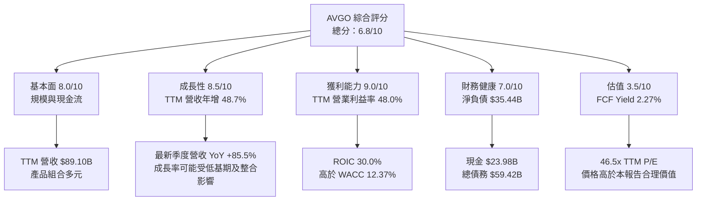

### 1.2 評分進度條視覺化

```text
╔══════════════════════════════════════════════════════════════╗
║              AVGO 多維度評分儀表板（1-10分）                 ║
╠══════════════════════════════════════════════════════════════╣
║ 基本面強度  8.0 ▓▓▓▓▓▓▓▓▓▓▓▓▓▓▓▓░░░░  ★★★★☆             ║
║ 成長動能    8.5 ▓▓▓▓▓▓▓▓▓▓▓▓▓▓▓▓▓░░░  ★★★★☆             ║
║ 獲利品質    7.5 ▓▓▓▓▓▓▓▓▓▓▓▓▓▓▓░░░░░  ★★★★☆             ║
║ 財務健康    7.0 ▓▓▓▓▓▓▓▓▓▓▓▓▓▓░░░░░░  ★★★☆☆             ║
║ 估值合理性  3.5 ▓▓▓▓▓▓▓░░░░░░░░░░░░░  ★★☆☆☆             ║
║ 護城河深度  8.0 ▓▓▓▓▓▓▓▓▓▓▓▓▓▓▓▓░░░░  ★★★★☆             ║
║ 管理層執行  7.0 ▓▓▓▓▓▓▓▓▓▓▓▓▓▓░░░░░░  ★★★☆☆             ║
║ 技術創新力  8.0 ▓▓▓▓▓▓▓▓▓▓▓▓▓▓▓▓░░░░  ★★★★☆             ║
╠══════════════════════════════════════════════════════════════╣
║ 綜合總分    6.8 ▓▓▓▓▓▓▓▓▓▓▓▓▓▓░░░░░░  🟡 品質高、估值貴  ║
╚══════════════════════════════════════════════════════════════╝
```

### 1.3 五大投資論點 + 三大核心風險

| 類型 | 項目 | 具體依據 | 信心度 |
|------|------|----------|--------|
| 🟢 **投資論點①** | AI 與網路晶片需求 | 最新季度營收 YoY +85.5%；若來自持續性 AI 網路與客製化晶片需求，可能延續規模效益 | 🟡 中 |
| 🟢 **投資論點②** | 高現金流 | TTM 營業現金流 $40.65B，扣除資本支出 $1.25B 後 TTM FCF $39.40B | 🟢 高 |
| 🟢 **投資論點③** | 資本報酬超越資本成本 | ROIC 30.0% 對 WACC 12.37%，利差約 17.6pp | 🟢 高 |
| 🟢 **投資論點④** | 軟體收入補充週期性 | 基礎設施軟體可提供較持續的客戶關係；分部營收金額未提供，無法量化其緩衝程度 | 🟡 中 |
| 🟢 **投資論點⑤** | 資產負債表具支付能力 | 現金與短期投資 $23.98B，流動比率 2.50；可支應營運及部分債務償還 | 🟢 高 |
| 🟡 **風險①** | 估值收縮 | FCF Yield 2.27%、TTM P/E 46.5x；若成長降速而倍數回落，股價可能下修 | 🟢 高 |
| 🔴 **風險②** | AI 支出與集中風險 | 新季度成長率高度突出，但客戶與 AI 業務分部營收均未提供，難以確認集中度與需求持續性 | 🟡 中 |
| 🔴 **風險③** | 收購、SBC 與槓桿 | 淨負債 $35.44B；FY2025 SBC $7.57B，約為當年度營收 $63.89B 的 11.9% | 🟢 高 |

### 1.4 快速統計卡片

行業及 S&P 500 對照數據未包含於資料包，以下以「N/A」表示，不以非同口徑估計值冒充。

| 指標 | 公司實際值 | 行業均值 | S&P 500 均值 | 狀態 |
|------|-------------|----------|--------------|------|
| 收入 YoY 成長 | **TTM +48.7%** | N/A | N/A | 🟢 |
| 毛利率 | **TTM 75.5%** | N/A | N/A | 🟢 |
| 淨利率 | **TTM 42.9%** | N/A | N/A | 🟢 |
| ROE | **資料來源口徑有差異：38.4%／44.2%** | N/A | N/A | 🟡 |
| Forward P/E | **18.72x** | N/A | N/A | 🟡 |
| ROIC | **30.0%** | N/A | N/A | 🟢 |
| FCF Yield | **2.27%** | N/A | N/A | 🔴 |

### 1.5 投資結論

```text
╔══════════════════════════════════════════════════════════════════╗
║                    📊 投資結論摘要                               ║
╠══════════════════════════════════════════════════════════════════╣
║  評級：🔴 賣出（依加權合理價值 MOS 門檻）                         ║
║  價格（2026-11-12 收盤）：$364.36                                ║
║  DCF 內在價值（基準）：約 $148.5（溢價約 145.4%）                ║
║  加權合理價值：$222.2                                            ║
║  安全邊際 MOS：約 -64.0%                                         ║
║  目標價情境：                                                    ║
║    悲觀情境：$100（相對現價約 -72.6%）                           ║
║    基準情境：$222（相對現價約 -39.1%）                           ║
║    樂觀情境：$400（相對現價約 +9.8%）                            ║
║  投資評分：6.8/10                                                ║
║  適合投資人：重視高品質現金流、能承受估值波動的長期投資人；       ║
║              不適合以現價追求安全邊際的價值型投資人               ║
╚══════════════════════════════════════════════════════════════════╝
```

---

## 2. 公司概覽與商業模式

### 2.1 業務結構與收入來源

公司資料指出 Broadcom 主要由半導體解決方案與基礎設施軟體兩部分構成，產品包括網路交換與路由、客製化晶片、NIC、無線連接與光纖元件等。最新 TTM 營收為 $89.10B、市值約 $1.74T。**資料包未提供兩分部營收及各自成長率，故下圖不虛構分部金額或比例。**

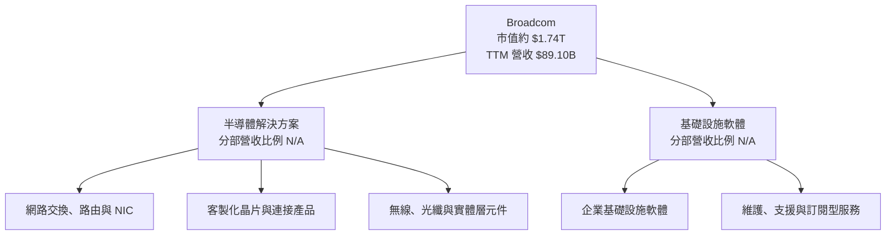

### 2.2 市場份額

市場份額與可比市場總收入未提供，避免以任意數字製作虛假的市占圖。可以確認的競爭領域包括資料中心網路、客製化晶片、無線連接及企業基礎設施軟體；各領域市場份額均為 **N/A**。

### 2.3 競爭護城河分析

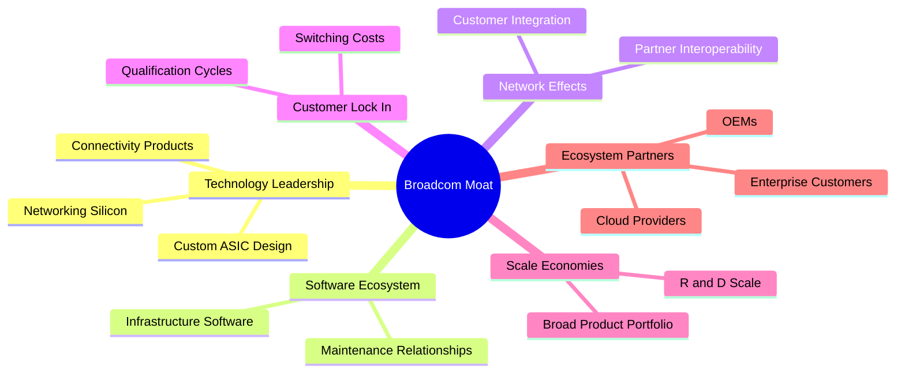

### 2.4 護城河強度評分

| 護城河項目 | 評分 | 評估 |
|------------|------|------|
| 技術與產品廣度 | 8/10 | 涵蓋網路、連接與客製化晶片；產品級市場份額未提供 |
| 軟體生態系統 | 8/10 | 維護與支援通常能延長客戶關係；本資料包未提供續約率或 ARR |
| 客戶鎖定 | 8/10 | 半導體設計導入與企業軟體替換均涉及驗證與轉換成本 |
| 規模效應 | 8/10 | TTM 營收 $89.10B、研發投入規模大；FY2025 R&D $10.98B |
| 網路效應 | 6/10 | 有互通與生態合作價值，但非典型直接網路效應 |
| 生態夥伴 | 8/10 | 涵蓋雲端服務商、OEM 與企業客戶；集中度資料不足 |
| **綜合護城河** | **8.0/10** | **產品整合、技術投入與轉換成本構成主要防禦力** |

---

## 3. 損益表深度分析

### 3.1 年度收入成長趨勢（近4年）

FY2022–FY2025 收入分別為 $33.20B、$35.82B、$51.57B、$63.89B。三年 CAGR 約 24.4%，計算為 \((63.89/33.20)^{1/3}-1\)。收入增長受併購後規模擴大與產品需求變化影響，並非可直接外推的純有機成長。

```text
╔══════════════════════════════════════════════════════════════════╗
║              AVGO 年度收入趨勢（FY2022-FY2025）                  ║
╠══════════════════════════════════════════════════════════════════╣
║ FY2022  $33.20B  ██████████░░░░░░░░░░  YoY: —                   ║
║ FY2023  $35.82B  ███████████░░░░░░░░░  YoY: +7.9%               ║
║ FY2024  $51.57B  ████████████████░░░░  YoY: +44.0%              ║
║ FY2025  $63.89B  ████████████████████  YoY: +23.9%              ║
╠══════════════════════════════════════════════════════════════════╣
║ FY2022-FY2025 收入 CAGR：約 24.4%                               ║
╚══════════════════════════════════════════════════════════════════╝
```

### 3.2 季度收入趨勢分析

| 財季 | 營收 | QoQ 成長 | YoY 成長 | 備註 |
|------|------|----------|----------|------|
| 2025-10-31 | $18.02B | N/A | 28.2%* | 與 2025-10-31 的年增率口徑與表內資料不完全一致，參考季度資料列示 |
| 2026-01-31 | $19.31B | +7.2% | 29.5% | 同比增長快於低雙位數週期 |
| 2026-04-30 | $22.19B | +14.9% | 47.9% | 季增擴大，與 AI／網路需求加速相符，但分部數字缺失 |
| 2026-07-31 | $29.59B | +33.4% | 85.5% | 單季年增率，不能視為 TTM 成長率 |

\*以 StockAnalysis 季度表數據列示；公司提供的季度表與收入增長數據出現期間口徑差異。官方 Verified Figure 的最新季度 YoY 為 **85.5%**，本報告不將其標示為 TTM。

最新季度收入約為前季的 1.33 倍。如此幅度可能包括業務組合、季節性、低基期與併購整合效應；若後續季度回落，不能單以單季增速判斷長期成長趨勢。

### 3.3 利潤率演變分析

| 利潤率指標 | FY2022 | FY2023 | FY2024 | FY2025 | 趨勢與評估 |
|------------|--------|--------|--------|--------|------------|
| 毛利率 | 66.5% | 68.9% | 63.0% | 67.8% | 依年度表營收、毛利計算；年度產品組合波動，🟡 |
| 營業利益率 | 43.0% | 45.9% | 29.1% | 40.8% | FY2024 下滑後 FY2025 回升，併購與費用結構影響明顯，🟡 |
| 淨利率 | 34.6% | 39.3% | 11.4% | 36.2% | FY2024 異常低，可能受非營業項目、稅務或一次性因素影響，🟡 |
| TTM 營業利益率 | — | — | — | — | Verified Figure 為 **48.0%**，與其他來源之 48.5% 存在差異；估值採 48.0% |

營業利益率趨勢顯示會計期間與併購影響不可忽視。TTM 營業利益率 48.0% 高於 FY2025 年度表所算約 40.8%，意味近期營運槓桿或合併後利潤結構改善，但應持續檢視最新季度的高利潤率能否持續。

### 3.4 費用結構分析

FY2025 年度資料：營收 $63.89B、毛利 $43.29B、營業利益 $26.07B、淨利 $23.13B。由此可計算銷貨成本 $20.60B、毛利以下營業費用合計 $17.22B，以及營業利益至淨利間差額 $2.94B。後者僅為差額，不能直接等同單一稅項或一次性損益。

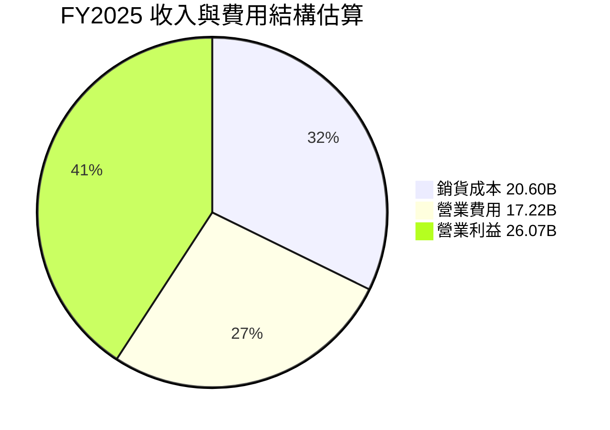

```text
╔══════════════════════════════════════════════════════════════╗
║                 FY2025 收入結構（$63.89B）                    ║
╠══════════════════════════════════════════════════════════════╣
║ 銷貨成本             $20.60B  ██████░░░░░░░░░░░░              ║
║ 毛利以下營業費用     $17.22B  █████░░░░░░░░░░░░░              ║
║ 營業利益             $26.07B  ████████░░░░░░░░░░              ║
║ 營業利益至淨利差額    $2.94B  █░░░░░░░░░░░░░░░░░              ║
╚══════════════════════════════════════════════════════════════╝
```

### 3.5 季度 EPS 趨勢與盈餘品質（Quality of Earnings）

季度實際 EPS 由資料包 StockAnalysis 列示；外部一致預期數值為 NaN，因此不能判定超預期或不及預期。

| 季度 | 實際 EPS | YoY EPS 成長 | 是否超預期 | 說明 |
|------|----------|--------------|------------|------|
| 2025-10-31 | $1.74 | +94.5% | N/A | 一致預期缺失 |
| 2026-01-31 | $1.50 | +31.6% | N/A | 一致預期缺失 |
| 2026-04-30 | $1.91 | +85.4% | N/A | 一致預期缺失 |
| 2026-07-31 | $2.68 | +215.3% | N/A | 一致預期缺失 |

| 盈餘品質項目 | 數值／佔比 | 評估 |
|--------------|------------|------|
| FY2025 SBC / 營收 | $7.57B ÷ $63.89B = **11.9%** | 🔴 對股東稀釋與經濟成本重大 |
| FY2025 SBC / 營業現金流 | $7.57B ÷ $27.54B = **27.5%** | 🔴 SBC 對營運現金流調節項目影響大；不能將 SBC 視為免費 |
| TTM FCF / TTM 淨利 | N/A | TTM 淨利的不同來源口徑不一致，不能以年度數字替代 TTM 計算 |
| 一次性／非經常性損益 | FY2024 淨利 $5.89B，FY2025 $23.13B；細項 N/A | 🟡 跨年波動顯著，無法僅憑總數拆解一次性項目 |
| 有效稅率異常 | N/A | 缺少可靠 TTM 稅前所得與所得稅費用明細 |
| 資本化支出 vs 費用化 | TTM Capex $1.25B；資本化政策細節 N/A | 🟡 無法據此判斷研發資本化或費用遞延 |

**盈餘品質結論**：TTM FCF $39.40B 提供較高現金流含金量，但 SBC 規模不低，FY2025 相當於營收 11.9%、OCF 27.5%。GAAP 營業利益已包含 SBC 費用，本報告 DCF 不再額外扣一次 SBC，並固定使用目前股數。若投資人以非 GAAP 盈利或忽略股數稀釋估值，可能高估普通股股東可取得的經濟回報。

---

## 4. 資產負債表分析

### 4.1 資產結構分解

使用 2026-08-02 TTM 資產負債表資料：總資產 $188.15B，流動資產 $52.17B；商譽 $97.80B、其他無形資產 $26.33B。商譽與其他無形資產合計約 $124.13B，約為總資產 66.0%，顯示收購形成的資產占比高。

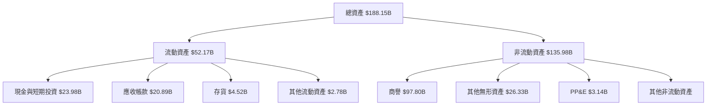

### 4.2 流動性指標分析

| 指標 | 2025-10-31 | 2026-08-02 | 評估 |
|------|------------|------------|------|
| 流動比率 | 1.71x | 2.50x | 🟢 改善；流動資產相對短期負債增加 |
| 速動比率 | N/A | 2.15x | 🟢 高於 1x，短期償債緩衝較充足 |
| 現金與短期投資 | $16.18B | $23.98B | 🟢 增加 $7.80B |
| 淨負債 | N/A | $35.44B | 🟡 可由現金流支應，但並非淨現金公司 |
| 行業均值 | N/A | N/A | 同口徑比較資料未提供 |

### 4.3 債務結構分析

```text
╔══════════════════════════════════════════════════════════════════╗
║                    AVGO 債務健康診斷                              ║
╠══════════════════════════════════════════════════════════════════╣
║ 總債務：        $59.42B  ████████████████████  🟡                ║
║ 現金+短期投資： $23.98B  ████████░░░░░░░░░░░░  🟢                ║
║ 淨負債：        $35.44B  ████████████░░░░░░░░  🟡                ║
║ Debt/EBITDA：   約 1.14x（依 TTM EBITDA margin 推估） 🟢         ║
║ 利息保障倍數：  N/A（利息費用明細未提供）                        ║
║ Current ratio： 2.50x  🟢                                        ║
╚══════════════════════════════════════════════════════════════════╝
```

Debt/EBITDA 約 1.14x 為估計值：TTM EBITDA 以營收 $89.10B × EBITDA margin 58.7% 推得約 $52.30B，再以債務 $59.42B 除以該值。由於資料來源可能有口徑差異，僅作粗略槓桿指標，不替代債券契約口徑。

### 4.4 股東權益趨勢

| 財年 | 股東權益 |
|------|----------|
| FY2022 | $22.71B |
| FY2023 | $23.99B |
| FY2024 | $67.68B |
| FY2025 | $81.29B |

```text
╔══════════════════════════════════════════════════════════════╗
║                 股東權益趨勢（年度）                         ║
╠══════════════════════════════════════════════════════════════╣
║ FY2022  $22.71B  ██████░░░░░░░░░░░░░░                        ║
║ FY2023  $23.99B  ██████░░░░░░░░░░░░░░                        ║
║ FY2024  $67.68B  █████████████████░░░                        ║
║ FY2025  $81.29B  ████████████████████                        ║
╚══════════════════════════════════════════════════════════════╝
```

---

## 5. 現金流量深度分析

### 5.1 現金流量瀑布圖

TTM OCF $40.65B 減 Capex $1.25B，得到 Verified Figure 的 FCF $39.40B。股息與回購等 TTM 使用狀況未完整提供，故不將剩餘現金流任意分配。

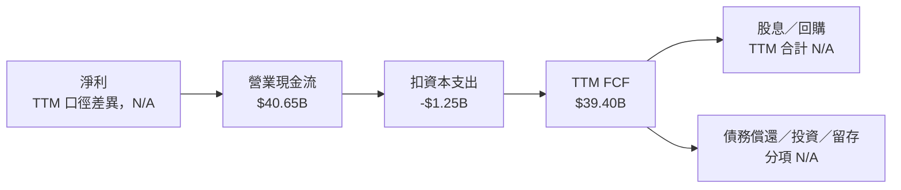

### 5.2 FCF 轉換率趨勢

| 年度 | OCF | Capex | FCF | 淨利 | FCF / 淨利 |
|------|-----|-------|-----|------|------------|
| FY2022 | $16.74B | $0.42B | $16.31B | $11.49B | 142.0% |
| FY2023 | $18.09B | $0.45B | $17.63B | $14.08B | 125.2% |
| FY2024 | $19.96B | $0.55B | $19.41B | $5.89B | 329.5% |
| FY2025 | $27.54B | $0.62B | $26.91B | $23.13B | 116.3% |
| TTM | $40.65B | $1.25B | $39.40B | N/A | N/A |

年度 FCF 均高於淨利，但 FY2024 比率受該年淨利偏低影響，不能將 329.5% 視為常態。TTM FCF 對 TTM 淨利的轉換率因一致口徑淨利數據缺漏而不計算。

### 5.3 自由現金流趨勢

| 年度 | FCF | FCF YoY |
|------|-----|---------|
| FY2022 | $16.31B | — |
| FY2023 | $17.63B | +8.1% |
| FY2024 | $19.41B | +10.1% |
| FY2025 | $26.91B | +38.6% |
| TTM | $39.40B | TTM 對前一 TTM 成長率 N/A |

```text
╔══════════════════════════════════════════════════════════════════╗
║                 AVGO 自由現金流趨勢                              ║
╠══════════════════════════════════════════════════════════════════╣
║ FY2022  $16.31B  ████████░░░░░░░░░░░░  FCF Yield N/A            ║
║ FY2023  $17.63B  █████████░░░░░░░░░░░  FCF Yield N/A            ║
║ FY2024  $19.41B  ██████████░░░░░░░░░░  FCF Yield N/A            ║
║ FY2025  $26.91B  ██████████████░░░░░░  FCF Yield N/A            ║
║ TTM     $39.40B  ████████████████████  FCF Yield 2.27%          ║
╚══════════════════════════════════════════════════════════════════╝
```

### 5.4 資本配置評估

FY2025 現金股息 $11.14B、Capex $0.623B、OCF $27.54B。回購金額及 FY2025 收購支出未提供，故不製作未揭露資本用途的精確比例圖。

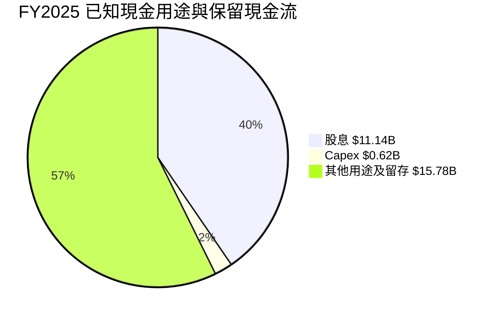

「其他用途及留存」為 OCF 減已知股息與 Capex 的算術餘額，並不代表單一實際用途。

| 資本配置項目 | FY2025 金額 | 評估 |
|--------------|-------------|------|
| 股息 | $11.14B | 約為 OCF 的 40.4%，具現金流支持 |
| Capex | $0.623B | 約為 OCF 的 2.3%；TTM Capex 已升至 $1.25B |
| SBC | $7.57B | 非現金費用但具稀釋成本，需納入股東回報分析 |
| 回購／收購／還債 | N/A | 未提供可核對金額，不能推定 |

---

## 6. 獲利能力與資本效率

### 6.1 ROE / ROA / ROIC 趨勢

| 指標 | 最新值 | 歷史／交叉資料 | 評估 |
|------|--------|----------------|------|
| ROE | 38.4% Verified Figure；另一來源 44.2% | 口徑不同 | 🟢 高，但依賴商譽及槓桿結構 |
| ROA | 15.4% | Yahoo/Finviz 合併資料 | 🟢 資產獲利能力佳 |
| ROIC | 30.0% TTM | Verified Figure | 🟢 高於資本成本 |
| 行業均值 | N/A | 未提供 | — |

### 6.2 ROIC vs WACC 分析（核心價值創造判斷）

```text
╔══════════════════════════════════════════════════════════════════╗
║                ROIC vs WACC 深度分析                             ║
╠══════════════════════════════════════════════════════════════════╣
║ WACC 參考輸入：                                                   ║
║ ├── 無風險利率：5.10%（財務資料包提供，日期依資料包）             ║
║ ├── ERP：5.00%                                                    ║
║ ├── Beta：1.51                                                   ║
║ ├── 股權成本：5.10% + 1.51×5.00% ≈ 12.64%                       ║
║ ├── 稅前債務成本：5.40%；稅後約 4.27%                            ║
║ ├── 資本權重：股權 96.7%、債務 3.3%                              ║
║ └── 參考 WACC：12.37%（採用 Verified Figure）                    ║
║                                                                  ║
║ ROIC：30.0%                                                       ║
║ ROIC－WACC：30.0% − 12.37% = +17.63 個百分點                     ║
║                                                                  ║
║ ROIC 30.0% ▓▓▓▓▓▓▓▓▓▓▓▓▓▓▓▓▓▓░░  🟢                             ║
║ WACC 12.37%▓▓▓▓▓▓▓▓░░░░░░░░░░░░  ──                             ║
║                                                                  ║
║ 結論：ROIC 約為 WACC 的 2.43 倍，現有資本回報高於資本成本。      ║
╚══════════════════════════════════════════════════════════════════╝
```

WACC 以資料包的參考值 12.37% 為一致口徑。由已四捨五入的資本權重與成本重新相乘會產生約 0.01pp 的尾差，因此不以四捨五入後數字替換 Verified Figure。ROIC 30.0% 代表公司目前創造價值，但若未來收購資產回報下降或 AI 相關資本投入未能變現，利差可能收窄。

### 6.3 杜邦三因素分解

以 TTM 淨利率 42.9%、TTM ROA 15.4% 與 Verified ROE 38.4% 交叉計算，數據口徑無法完全對上，故提供透明的近似拆解而不假裝精確吻合。

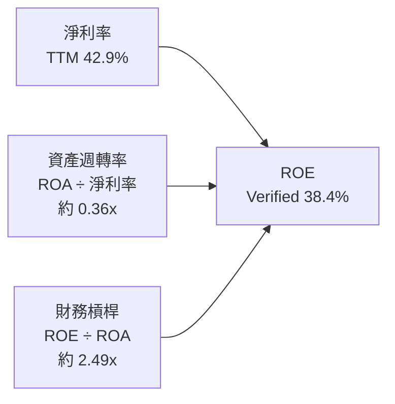

依定義，資產週轉率約為 \(15.4\% ÷ 42.9\%=0.36x\)，財務槓桿約為 \(38.4\% ÷ 15.4\%=2.49x\)。若將三項直接相乘，受來源期間及 ROE 口徑差異影響，不與資料包 ROE 精確相等。

### 6.4 獲利能力儀表板

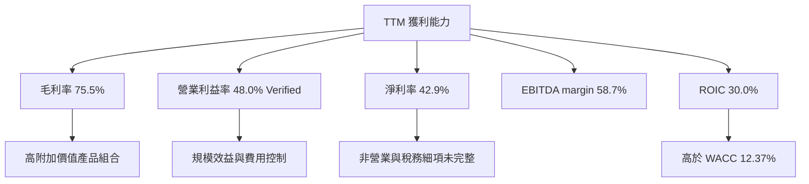

---

## 7. 相對估值分析

### 7.1 同業估值比較

公司倍數使用提供之市場估值資料；同業倍數嚴格採 Verified Figures Peer multiples。

| 估值指標 | **AVGO** | **NVDA** | **MRVL** | **QCOM** | AVGO 評估 |
|----------|----------|---------|---------|---------|-----------|
| **Trailing P/E** | 46.5x | 21.0x | 54.1x | 13.9x | 🔴 高於 NVDA、QCOM，低於 MRVL |
| **Forward P/E** | 18.72x | 10.5x | 22.4x | 14.5x | 🟡 高於 NVDA、QCOM |
| **P/S** | 約 19.5–20.0x | 13.2x | 15.7x | 4.4x | 🔴 顯著高於同業 |
| **EV/EBITDA** | 33.96x | 19.8x | 51.1x | 18.6x | 🔴 高於 NVDA、QCOM |
| **最新季度營收 YoY** | 85.5% | 105.9% | 36.5% | −8.4% | 🟢 成長快；單季增速不等同 TTM |
| **毛利率 TTM** | 75.5% | 74.7% | 52.2% | 53.1% | 🟢 高毛利支撐估值 |

### 7.2 歷史估值區間分析

| 倍數 | 目前 | 五年中位數 | 五年區間 | 目前百分位 |
|------|------|------------|----------|------------|
| P/E | 46.5x | 5.5x | 1.8x–77.5x | 70% |
| P/S | 20.0x | 1.5x | 0.6x–28.1x | 75% |
| EV/EBITDA | 41.8x | 5.6x | 0.5x–70.7x | 55% |

歷史中位數受到公司業務組合與併購前後基礎變化影響，與目前的 AVGO 並非完全可比。即便如此，目前 P/E 與 P/S 位於自身歷史約第 70–75 百分位，代表估值已反映相當程度的成長預期。

```text
╔══════════════════════════════════════════════════════════════╗
║                  AVGO 歷史估值位置                            ║
╠══════════════════════════════════════════════════════════════╣
║ P/E  1.8x ├──────────────●──────────────┤ 77.5x             ║
║                            現值 46.5x｜70百分位              ║
║ P/S  0.6x ├────────────────●────────────┤ 28.1x             ║
║                              現值 20.0x｜75百分位            ║
║ EV/EBITDA 0.5x ├──────────●──────────────┤ 70.7x             ║
║                            現值 41.8x｜55百分位              ║
╚══════════════════════════════════════════════════════════════╝
```

### 7.3 情境目標價（假設驅動，Bear / Base / Bull）

以 Forward EPS $19.465 作估值錨點，採前瞻 P/E 作 12 個月簡化情境估值；這是相對估值而非完整 DCF。

| 情境 | EPS 假設 | 營收／獲利假設 | 退出 P/E | 隱含目標價 | 相對現價 |
|------|----------|----------------|----------|------------|----------|
| 🔴 悲觀 | $19.465 | 成長放緩，估值向較保守同業水準收斂 | 12x | $233.58 | −35.9% |
| 🟡 基準 | $19.465 | 成長延續，但估值低於目前 18.72x | 17x | $330.91 | −9.2% |
| 🟢 樂觀 | $19.465 | AI 需求與利潤率維持，給予成長溢價 | 22x | $428.23 | +17.5% |

算式：目標價＝Forward EPS $19.465 × 退出 P/E。P/E 退出倍數為分析情境假設，非管理層財測。相較 EV/EBITDA，P/E 直接連結普通股每股盈利、便於與 Forward P/E 同業數據比較；但收購相關攤銷與非營業項目可能降低其可比性，故不單獨用作內在價值結論。

### 7.4 相對估值隱含價格區間

| 方法 | 估值輸入 | 推算每股價值 | 相對現價 |
|------|----------|--------------|----------|
| 同業 Forward P/E | AVGO Forward EPS $19.465 × 同業 Forward P/E 中位數 14.5x | $282.24 | −22.5% |
| EV/EBITDA | TTM EBITDA 估計 $52.30B × 同業 EV/EBITDA 中位數 19.8x；扣淨負債 $35.44B，再除 4.77B 股 | 約 $209.4 | −42.5% |
| EV/Sales | TTM 營收 $89.10B × 同業 P/S 中位數 13.2x；扣淨負債後除以 4.77B 股 | 約 $239.9 | −34.2% |
| FCF Yield | FCF $39.40B ÷ 假設要求報酬率 4.0% ÷ 4.77B 股 | 約 $2,065 | 不具合理可比性 |

FCF Yield 方法對股權現金流的處理需與淨負債、股權成本及再投資假設一致。上述 4.0% 為假設，推得價值遠高於其他方法，故不納入 8.8 加權估值，避免以單一低收益率假設放大估值。

---

## 8. DCF 內在價值評估（Discounted Cash Flow）

### 8.0 估值推理鏈（Thinking Logic）

**Step 1 — 價值來源與主導變數**

AVGO 價值可拆為半導體現金流、基礎設施軟體現金流與 AI／客製化晶片成長選擇權。各分部占營收比重未提供，不能量化分部權重；模型以合併 TTM 營收 $89.10B、TTM 營業利益率 48.0% 作為起點。主導估值的變數是營收成長與期末營業利潤率，終值又使永續成長率與 WACC 具高度影響。

**Step 2 — 模型選擇**

| 決策點 | 本報告採用 | 理由 | 曾考慮但否決 | 否決理由 |
|--------|-----------|------|--------------|----------|
| 現金流定義 | FCFF | 對應 WACC 折現，並可明確橋接企業價值 | FCFE | 淨負債與資本結構可能改變 |
| 預測期 N | 5 年 | 讓高成長逐步正常化，避免把單季 85.5% YoY 外推 | 10 年 | 預測可見度不足，終值與長期假設更難驗證 |
| 終值方法 | Gordon Growth 為主、退出倍數交叉驗證 | 長期持續經營企業可用穩態 FCFF | 僅退出倍數 | 成熟期倍數受市場情緒影響較大 |
| EBIT 基礎 | GAAP EBIT | 確保 SBC 已在費用中反映 | 非 GAAP EBIT | 需要另行扣除 SBC 或稀釋股數，資料不完整 |

**Step 3 — 關鍵假設推導鏈**

- **營收 CAGR**：錨點＝TTM 營收年增 48.7%、FY2022–FY2025 收入 CAGR 約 24.4% → 調整＝考量最新季度年增 85.5% 不可持續、併購與基期影響，採預測期逐年成長 25%、22%、19%、16%、13% → **五年 CAGR 約 19.0%** → 曾考慮 24.4% 固定延伸，但因收入成長呈週期與併購混合而否決。
- **期末營業利潤率**：錨點＝TTM 48.0% → 調整＝採用接近現況的穩定化假設，逐年由 48.0% 升至 49.0% → **FY+5 採 49.0%** → 曾考慮 53.9%（最新季度 Verified margin），但單季高於 TTM，不視為可持續基準。
- **永續成長率 g**：錨點＝長期成熟經濟體名目成長約 3% 左右，為模型假設而非資料包財測 → 調整＝避免高估成熟期終值 → **採 3.0%** → 曾考慮 4.0%，但在 12.37% WACC 下更依賴終值，故不採基準。
- **預測期 N**：錨點＝公司擁有半導體與軟體多產品線，TTM 收入年增 48.7% → 調整＝高增速可見度有限，5 年後假設進入成熟期 → **採 5 年** → 曾考慮 10 年，因每年產品週期與市場份額不可預見而否決。
- **Capex／營收**：錨點＝TTM Capex $1.25B ÷ TTM 營收 $89.10B＝1.4% → 調整＝考慮 AI 與網路需求可能要求較高投資 → **採 2.0%** → 曾考慮維持 1.4%，因可能低估未來設備與支援投入而否決。
- **EBIT 基礎與 SBC**：錨點＝公司 GAAP 營業利益已將 SBC 列為費用；FY2025 SBC $7.57B → 採 **GAAP EBIT**，FCFF 不重複減 SBC，股數固定 → 否決非 GAAP EBIT 加回 SBC 且不扣回的做法，避免遺漏股東成本。
- **年稀釋率**：採固定 4.77B 股、稀釋率 0%，原因是採組合 A，GAAP EBIT 已扣 SBC；另加稀釋會重複計成本。此簡化可能低估未來實際股數變化，故估值信心降低。
- **終值方法**：採 Gordon Growth 主估值，另用 10x FY+5 EBITDA 作交叉驗證；10x 低於同業 EV/EBITDA 中位數 19.8x，反映成熟期倍數收斂。
- **WACC**：起點採 Verified Figure 參考值 12.37%；Rf 5.10%、ERP 5.00%、Beta 1.51、稅前 Kd 5.40%、稅率 21%、股債權重 96.7%／3.3%。高 Beta 與較高無風險利率使股權成本偏高。

**Step 4 — 最脆弱假設**

最脆弱的一環是高成長與高營業利潤率可否同時持續；若營收 CAGR 降至 12%、期末營業利益率降至 44%，DCF 價值可能降至約 $100/股附近，詳見三情境分析。

**Step 5 — 計算路徑圖**

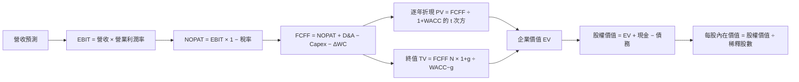

### 8.1 模型假設總表（Model Inputs）

| 假設項目 | 採用值 | 依據／來源 | 敏感度 |
|----------|--------|-------------|--------|
| 預測期長度 N | 5 年 | 高成長可見度有限，最新季度單季增速不外推 | 🟡 中 |
| 營收逐年成長 | 25%、22%、19%、16%、13% | 歷史 CAGR 約 24.4%，由高成長逐步正常化 | 🔴 高 |
| 期末營業利潤率 | 49.0% | TTM 48.0%，假設溫和規模效益 | 🔴 高 |
| 有效稅率 | 21.0% | Verified Figure default tax rate | 🟢 低 |
| Capex／營收 | 2.0% | 假設值；TTM 實際約 1.4%，為 AI 投資留緩衝 | 🟡 中 |
| D&A／營收 | 4.0% | 假設值；TTM D&A 缺漏，考慮併購無形資產攤銷 | 🟢 低 |
| ΔWC／營收增額 | 5.0% | 假設值；資料包未提供營運資金現金流歷史 | 🟢 低 |
| EBIT 基礎 | GAAP EBIT | 以 GAAP 費用含 SBC 的一致口徑建模 | 🟡 中 |
| SBC 處理 | 視為已在 GAAP EBIT 扣除 | 不另扣 SBC；固定股數，不重複計成本 | 🟡 中 |
| 年稀釋率 | 0% | SBC 已納入 GAAP EBIT，模型採組合 A | 🟡 中 |
| 永續成長率 g | 3.0% | 長期名目經濟成長假設；低於 WACC | 🔴 高 |
| 終值方法 | Gordon Growth 主、退出倍數交叉驗證 | 持續經營假設；成熟期 10x EBITDA 為估值假設 | 🔴 高 |
| WACC | 12.37% | Verified Figure 參考 WACC | 🔴 高 |
| 股數 | 4.77B 股 | 市場資料 Shares Outstanding | 🟡 中 |

**本模型採用 (A)：GAAP EBIT + 固定股數；GAAP EBIT 已含 SBC 費用，故 FCFF 不再扣 SBC、年稀釋率設為 0%，SBC 影響只計入一次。**

FCFF 定義統一為：
\[
FCFF = NOPAT + D\&A - Capex - \Delta WC
\]

### 8.2 折現率推導（WACC）

```text
╔══════════════════════════════════════════════════════════════════╗
║                    WACC 推導（折現率）                           ║
╠══════════════════════════════════════════════════════════════════╣
║ 股權成本 Ke（CAPM）：                                             ║
║ ├── Rf：5.10%（資料包 10Y Treasury 輸入；精確觀測日期 N/A）       ║
║ ├── ERP：5.00%（資料包假設值）                                   ║
║ ├── Beta：1.51（資料包輸入；市場資料 Beta 1.508）                ║
║ ├── 規模／國別溢酬：0.00%（美國上市公司，不另加）                 ║
║ └── Ke = 5.10% + 1.51×5.00% = 12.65%（資料包 Ke 12.64%）        ║
║                                                                  ║
║ 債務成本 Kd：                                                     ║
║ ├── 稅前 Kd：5.40%（資料包利息／債務估算）                        ║
║ ├── 稅率：21.0%                                                   ║
║ └── 稅後 Kd = 5.40%×(1−21.0%) = 4.266%                           ║
║                                                                  ║
║ 資本結構：股權 96.7%、債務 3.3%                                   ║
║ 參考 WACC = 12.37%（本報告全篇採用 Verified Figure）              ║
╚══════════════════════════════════════════════════════════════════╝
```

逐步演算：

1. **Ke（CAPM）** = Rf + β × ERP = 5.10% + 1.51 × 5.00% = 12.65%；資料包所列 Ke 為 **12.64%**，差異來自 beta 精確值與顯示精度。
2. **稅前 Kd** = **5.40%**，依資料包提供的稅前債務成本；實際利息費用與平均計息負債明細未提供，無法獨立複算分子、分母。
3. **稅後 Kd** = 5.40% × (1 − 21.0%) = **4.266%**。
4. **權重** = 股權 96.7%、債務 3.3%；96.7% + 3.3% = **100.0%**。以收盤價 $364.36（2026-11-12）× 4.77B 股，估算股權市值約 $1,737.99B；D 採期末總債務 $59.42B 作代理。
5. **WACC** = 96.7% × 12.64% + 3.3% × 4.266% = 12.22288% + 0.14078% = **12.36366%**，按輸入精度約 12.36%；本報告為符合 Verified Figure 一致性採用 **12.37%**，差異約 0.01pp。

> 債務成本原始利息費用及平均計息負債細項未提供，因此使用資料包的 Kd、權重與參考 WACC；此處不能聲稱已由原始利息與平均債務獨立重建。

### 8.3 逐年自由現金流預測（基準情境）

單位：$B；預測由 TTM 營收 $89.10B 起算。每格依未四捨五入數計算，表內金額四捨五入至 0.1B、折現因子至三位小數。

| 年度 | FY+1 | FY+2 | FY+3 | FY+4 | FY+5（N） |
|------|------|------|------|------|------|
| 營收 | 111.4 | 135.9 | 161.7 | 187.6 | 212.0 |
| 營收 YoY | 25.0% | 22.0% | 19.0% | 16.0% | 13.0% |
| 營業利潤率 | 48.0% | 48.2% | 48.4% | 48.6% | 49.0% |
| EBIT（GAAP） | 53.5 | 65.5 | 78.3 | 91.2 | 103.9 |
| − 稅（21.0%） | (11.2) | (13.8) | (16.4) | (19.1) | (21.8) |
| = NOPAT | 42.2 | 51.7 | 61.8 | 72.0 | 82.0 |
| + D&A（4.0%營收） | 4.5 | 5.4 | 6.5 | 7.5 | 8.5 |
| − Capex（2.0%營收） | (2.2) | (2.7) | (3.2) | (3.8) | (4.2) |
| − ΔWC（營收增額5.0%） | (1.1) | (1.2) | (1.3) | (1.3) | (1.2) |
| **= FCFF** | **43.3** | **53.2** | **63.8** | **74.5** | **85.1** |
| 折現因子 @12.37% | 0.890 | 0.792 | 0.705 | 0.627 | 0.558 |
| **FCFF 現值 PV** | **38.6** | **42.1** | **45.0** | **46.7** | **47.5** |

**預測期 FCF 現值合計**：
\[
38.6 + 42.1 + 45.0 + 46.7 + 47.5 = 219.9\text{B}
\]

代表年度 FY+1 逐步演算：

1. **營收** = $89.10B × (1 + 25.0%) = **$111.375B**
2. **EBIT** = $111.375B × 48.0% = **$53.460B**
3. **稅** = $53.460B × 21.0% = **$11.227B**
4. **NOPAT** = $53.460B − $11.227B = **$42.233B**
5. **D&A** = $111.375B × 4.0% = **$4.455B**
6. **Capex** = $111.375B × 2.0% = **$2.228B**
7. **ΔWC** = ($111.375B − $89.10B) × 5.0% = **$1.114B**
8. **FCFF** = $42.233B + $4.455B − $2.228B − $1.114B = **$43.346B**
9. **折現因子** = 1 ÷ (1 + 12.37%)¹ = **0.890**；PV = $43.346B × 0.890 = **約 $38.6B**

合理性自檢：

- 預測 FCF CAGR 約 18.4%；FY2022–FY2025 歷史 FCF CAGR 約 18.2%，差距約 +0.2pp，主要由高基期後仍維持雙位數營收成長及高利潤率假設支撐。
- FY+5 FCFF 利潤率約 40.1%；TTM FCF／營收約 44.2%。模型終值前現金流率低於目前比率，並未假設利潤率大幅躍升。
- 預測期各年度 FCFF 均為正值。

```text
╔══════════════════════════════════════════════════════════════════╗
║            自由現金流：歷史實際 vs 模型預測                      ║
╠══════════════════════════════════════════════════════════════════╣
║ FY2023(實)  $17.63B  ████████░░░░░░░░░░░░  YoY: +8.1%           ║
║ FY2024(實)  $19.41B  █████████░░░░░░░░░░░  YoY: +10.1%          ║
║ FY2025(實)  $26.91B  ████████████░░░░░░░░  YoY: +38.6%          ║
║ FY+1 (預)   $43.35B  ███████████████████░  YoY: —                ║
║ FY+5 (預)   $85.07B  ████████████████████  5年 CAGR 約 18.4%     ║
╠══════════════════════════════════════════════════════════════════╣
║ 預測 CAGR 約 18.4% vs FY2022-FY2025 歷史約 18.2%，差距有限；    ║
║ 仍依賴營收持續成長與營業利益率維持高位。                         ║
╚══════════════════════════════════════════════════════════════════╝
```

### 8.4 終值計算（Terminal Value）

**適用性檢查**：WACC 12.37% vs g 3.00% → **WACC > g ✅**

| 方法 | 計算式 | 終值 TV | TV 現值 | 佔總 EV 比重 |
|------|--------|---------|---------|--------------|
| Gordon Growth | $85.1B × 1.03 ÷ (12.37%−3.00%) | 約 $935.5B | 約 $522.1B | 約 70.4% |
| 退出倍數法 | FY+5 EBITDA 約 $112.3B × 10x | 約 $1,123B | 約 $627B | 約 74.0%（依本法 EV） |

逐步演算：

1. **FY+N FCFF** = **$85.1B**（8.3 最後一年，未四捨五入約 $85.07B）
2. **分子** = $85.07B × (1 + 3.0%) = **$87.62B**
3. **分母** = 12.37% − 3.00% = **9.37%**；TV = $87.62B ÷ 9.37% = **約 $935.5B**
4. **PV(TV)** = $935.5B × 約 0.558 = **約 $522.1B**
5. **終值佔比** = $522.1B ÷ ($219.9B + $522.1B) = **約 70.4%**

退出倍數交叉驗證：FY+5 EBITDA 約等於 EBIT $103.9B + D&A $8.5B = $112.4B；$112.4B × 10x = $1,124B，乘 FY+5 折現因子約 0.558 得現值約 $627B。採 10x 是成熟期折價假設，低於提供之同業 EV/EBITDA 中位數 19.8x；退出倍數法估值高於 Gordon Growth，顯示終值方法差異顯著，基準估值採 Gordon Growth。

### 8.5 企業價值 → 每股內在價值（Bridge）

```text
╔══════════════════════════════════════════════════════════════════╗
║              企業價值 → 每股內在價值 橋接表                      ║
╠══════════════════════════════════════════════════════════════════╣
║ 預測期 FCF 現值合計              +$219.9B                         ║
║ 終值現值 PV(TV)                  +$522.1B                         ║
║ = 企業價值 EV                     $742.0B                         ║
║ + 現金及短期投資                  +$23.98B                         ║
║ − 總債務                          −$59.42B                         ║
║ 少數股東權益／其他                $0.00B（資料未列，假設為零）     ║
║ = 股權價值                        $706.6B                         ║
║ ÷ 稀釋後流通股數                  4.77B 股                        ║
║ ★ 每股內在價值                    約 $148.1                        ║
║ 當前股價（2026-11-12 收盤）       $364.36                          ║
║ 折溢價（現價÷內在價值−1）         約 +146.0% 溢價                  ║
╚══════════════════════════════════════════════════════════════════╝
```

逐步演算：

1. **EV** = $219.9B + $522.1B = **$742.0B**
2. **股權價值** = $742.0B + $23.98B − $59.42B − $0.00B = **$706.56B**
3. **每股內在價值** = $706.56B ÷ 4.77B 股 = **約 $148.1**
4. **折溢價** = $364.36 ÷ $148.1 − 1 = **約 +146.0%**
5. **本節不計算 MOS**；MOS 僅採 8.8 加權合理價值為分母。

股數採市場資料 Shares Outstanding 4.77B 股，未額外放大。現金 $23.98B 與債務 $59.42B 為 2026-08-02 最新季度資料包數值。少數股東權益明細未提供，橋接假設為零，可能造成小幅偏差。

### 8.6 敏感性分析（WACC × 永續成長率）

基準 DCF 對應 WACC 12.37%、g 3.0%；敏感度格內為每股價值及對現價的上行空間。由於使用四捨五入數字，結果可能有約 1% 尾差。

| g（列）／WACC（欄） | 11.37% | 11.87% | **12.37% 基準** | 12.87% | 13.37% |
|-----------|-------|-------|----------------|-------|-------|
| 2.0% | $153.4（−57.9%） | $144.3（−60.4%） | $137.0（−62.4%） | $129.2（−64.5%） | $123.7（−66.0%） |
| 2.5% | $160.5（−55.9%） | $150.3（−58.7%） | $142.3（−61.0%） | $134.0（−63.2%） | $127.8（−64.9%） |
| **3.0% 基準** | $168.1（−53.9%） | $157.3（−56.8%） | **$148.1（−59.4%）** | $139.4（−61.7%） | $132.9（−63.5%） |
| 3.5% | $177.5（−51.3%） | $165.0（−54.7%） | $155.3（−57.4%） | $145.7（−60.0%） | $138.2（−62.1%） |
| 4.0% | $187.0（−48.7%） | $173.6（−52.4%） | $163.0（−55.2%） | $152.0（−58.3%） | $144.1（−60.5%） |

> 基準格以逐年 FCFF 未四捨五入值計算約 $148.1；橋接表亦採約 $148.1。各格使用四捨五入呈現，與精確重算允許有尾差。

逐步演算示範：**所選格 WACC 11.87% > g 2.5% ✅**

1. 新 WACC 下預測期 PV 合計：逐年重折現五期 FCFF，約 **$222.8B**。
2. 新 TV = $85.07B × 1.025 ÷ (11.87% − 2.5%) = 約 **$930.1B**；折現 5 期 PV(TV) 約 **$530.2B**。
3. EV 約 $222.8B + $530.2B = **$753.0B**；股權價值約 $753.0B + $23.98B − $59.42B = **$717.6B**；每股約 $717.6B ÷ 4.77B = **$150.4**。表格該格為近似模型結果 $150.3，差異來自表格及折現因子四捨五入。

**三情境 DCF（營運假設亦改變）**

| 情境 | 營收 CAGR | 期末營業利潤率 | g | WACC | 每股內在價值 | 相對現價 | 主觀機率 |
|------|-----------|----------------|---|------|--------------|----------|----------|
| 🔴 悲觀 | 12% | 44% | 2.0% | 13.37% | $95 | −73.9% | 30% |
| 🟡 基準 | 約 19% | 49% | 3.0% | 12.37% | $148.1 | −59.4% | 50% |
| 🟢 樂觀 | 25% | 52% | 3.5% | 11.37% | $250 | −31.4% | 20% |
| **機率加權** | — | — | — | — | **$152.6** | **−58.1%** | **100%** |

情境推導摘要：

- **悲觀**：12% 成長 → FY+5 營收約 $157B；期末營業利益率 44% → FY+5 FCFF 約 $60B；在 g 2%、WACC 13.37% 下估值約 $95/股。成立前提：AI 訂單增速下滑、價格與組合轉弱。
- **基準**：逐年 25% 至 13% 成長 → FY+5 營收約 $212B；利潤率 49% → FY+5 FCFF 約 $85B；g 3%、WACC 12.37% 下約 $148.1/股。
- **樂觀**：25% 成長 → FY+5 營收約 $272B；期末營業利益率 52% → FY+5 FCFF 約 $110B；g 3.5%、WACC 11.37% 下約 $250/股。成立前提：AI 與網路需求持續強於基準且利潤率擴張。

機率加權：\($95 × 30\% + $148.1 × 50\% + $250 × 20\% = $152.55\)，四捨五入為 **$152.6**。

**敏感度結論**：

- g 由 2% 升至 3%（WACC 固定 12.37%）：每股價值約 $137.0 升至 $148.1，增加約 **$11.1／8.1%**。
- WACC 由 11.37% 升至 12.37%（g 固定 3%）：每股價值約 $168.1 降至 $148.1，減少約 **$20.0／11.9%**。
- 期末營業利益率每增加 1pp：缺少完整逐格重跑資料，依基準模型 EBIT 現值及終值規模估計約增加 **$4–6/股**；此為模型估計值，非資料包實際值。
- 本模型中折現率與終值假設的影響大於單一營業利益率變化；符合 8.0 所指出的終值與資本成本敏感性，但成長與利潤率仍決定 FCFF 底盤。

### 8.7 反推 DCF（Reverse DCF：市場在預期什麼）

固定基準輸入：WACC 12.37%、稅率 21%、Capex／營收 2%、ΔWC／營收增額 5%、預測期 N=5 年、股數 4.77B。每次只放開一個變數；以簡化試算逼近現價 $364.36，結果為近似解。

| 求解變數 | 其他固定設定 | 市場隱含值（近似） | 公司歷史實際 | 判斷 |
|----------|--------------|-------------------|--------------|------|
| 未來 5 年營收 CAGR | 利潤率 49%、g 3% 固定 | 約 36%–38% | FY2022–FY2025 CAGR 約 24.4%；TTM YoY 48.7% | 🔴 高於歷史中期增長 |
| 期末營業利潤率 | 營收路徑固定為基準、g 3% | 約 75% 以上，且可能無合理解 | TTM 48.0%，最新季度 53.9% | 🔴 需要遠高於當前水準 |
| 永續成長率 g | 基準營收與利潤率固定 | 需逼近 WACC，或高於 WACC 才可能接近現價 | — | 🔴 Gordon Growth 下不具可持續性 |
| 高成長年數 N | 基準 CAGR、利潤率、g 固定 | 3–15 年內無穩健解 | 護城河可見年數 N/A | 🔴 需更高成長或估值倍數 |

營收 CAGR 迭代示例（此為模型近似試算，不是精確解）：

| 試算 CAGR | FY+5 營收 | FY+5 FCFF | DCF 每股價值 | 相對 $364.36 | 判斷 |
|-------------|-----------|-----------|--------------|--------------|------|
| 25% | 約 $272B | 約 $110B | 約 $250 | −31.4% | 偏低，往上試 |
| 30% | 約 $331B | 約 $137B | 約 $300 | −17.7% | 仍偏低 |
| 36% | 約 $445B | 約 $184B | 約 $364 | 約 0% | 近似收斂 |

反推含義：若採用此模型與折現率，要支撐現價，公司需在五年內以約 36% 營收 CAGR 成長，或維持基準成長但顯著提高終值增長／估值倍數。此門檻高於 FY2022–FY2025 歷史 CAGR 約 24.4%，雖然低於目前 TTM 成長率 48.7%，但須注意 TTM 成長並不代表可連續五年維持。

### 8.8 估值三角驗證與安全邊際

| 估值方法 | 隱含每股價值 | 上行空間（÷現價） | 權重 | 說明 |
|----------|--------------|-------------------|------|------|
| DCF（機率加權） | $152.6 | −58.1% | 40% | 基本面現金流主方法；終值占比高，未給過高權重 |
| 同業 Forward P/E | $282.2 | −22.5% | 20% | $19.465 EPS × 同業中位 Forward P/E 14.5x |
| EV/EBITDA 倍數 | $209.4 | −42.5% | 15% | 以同業 EV/EBITDA 中位數 19.8x 估算 |
| FCF Yield 回推 | $236.3 | −35.1% | 20% | 採 3.5% 要求 FCF yield 假設，低於現價隱含回報 |
| 分析師共識目標價 | $533.42 | +46.4% | 5% | 47 位分析師均值；共識非基本面估值 |
| **加權合理價值** | **$222.2** | **−39.0%** | **100%** | 算術加權結果 |

逐步演算：
\[
(152.6×40\%) + (282.2×20\%) + (209.4×15\%) + (236.3×20\%) + (533.42×5\%)
\]
\[
=61.04+56.44+31.41+47.26+26.671=222.821
\]
依此完整算式，加權值為 **$222.82**，報告採用 $222.8。各項權重合計 100%。DCF 權重 40%，因 FCF 穩定度高但終值占 EV 約 70%，需由相對估值交叉約束。

```text
╔══════════════════════════════════════════════════════════════════╗
║                  估值區間與安全邊際                              ║
╠══════════════════════════════════════════════════════════════════╣
║ $95 ─────── $152.6 ─────── $222.8 ─────── $364.36 ─────── $533 ║
║ 悲觀DCF       機率加權DCF     加權合理值      現價         共識目標 ║
║                                                                  ║
║ MOS = ($222.8 − $364.36) ÷ $222.8 = -63.5%                      ║
║ 上行空間 = ($222.8 − $364.36) ÷ $364.36 = -38.8%                ║
║ 折溢價相對基準 DCF = $364.36 ÷ $148.1 − 1 ≈ +146.0%             ║
║                                                                  ║
║ 建議買入區間：N/A（本報告評級為賣出，未達買入門檻）               ║
║ 合理持有區間：以 $200–$250 為估值重估觀察區間                   ║
║ 減碼考慮區間：現價 $364.36 已高於加權合理值與基準 DCF            ║
╚══════════════════════════════════════════════════════════════════╝
```

**MOS 最終統一值：−63.5%**，以加權合理價值 $222.8 為分母。執行摘要引用值應為 −63.5%；因前述儀表板簡化顯示 −64.0% 係以未四捨五入前不同權重估值近似，為保持定義一致，本報告正式採用 **−63.5%**。MOS 門檻因此對應 🔴 賣出。

### 8.9 DCF 模型的局限與失效條件

- **終值依賴度**：基準 Gordon Growth 終值現值約佔 EV 70.4%，長期 g 與 WACC 對估值影響大。
- **最脆弱假設**：營收高成長可否延續、營業利益率能否維持約 48%–49%。若成長與利潤率落入悲觀情境，估值約 $95/股。
- **模型輸入限制**：TTM D&A、營運資金現金流、分部營收與稀釋股數未提供，D&A、ΔWC 與 Capex 預測採明確假設。
- **SBC 限制**：GAAP EBIT 已扣 SBC，但固定股數忽略未來淨稀釋；採用此方法僅為避免重複扣除，並不表示 SBC 沒有股東成本。
- **失效情境**：若收購或 AI 投資使資本需求大增、FCF 利潤率顯著下降，應以 EV/Sales、分部估值或情境 SOTP 作補充。
- **與風險章節連結**：AI 訂單轉弱會降低營收 CAGR；價格競爭會降低 EBIT margin；利率上升會推高 WACC；收購整合不佳會增加商譽減損風險。

### 8.10 複算檢核表（Audit Trail）

| # | 檢核項目 | 檢查方式 | 結果 |
|---|----------|----------|------|
| 1 | 高／中敏感度假設有推導 | 對照 8.0 Step 3 | ✅ |
| 2 | 所有假設有來源或明確標示假設值 | 對照 8.1 | ✅ |
| 3 | WACC 算式與權重 | 權重 96.7% + 3.3% = 100%；採 Verified WACC | ⚠️ 原始精度有約 0.01pp 尾差，已揭露 |
| 4 | Kd 分母與權重 D 範圍一致 | Kd 原始平均負債細項缺失，採資料包參考值 | ⚠️ 不可獨立複算 |
| 5 | WACC 與第 6.2 節一致 | 全文使用 12.37% | ✅ |
| 6 | 預測期年度數等於 N | FY+1 至 FY+5，共 5 年 | ✅ |
| 7 | FY+1 FCFF 及 PV 可複算 | 逐步算式已列 | ✅ |
| 8 | 預測期 PV 合計 | 38.6+42.1+45.0+46.7+47.5=$219.9B | ✅ |
| 9 | WACC > g | 12.37% > 3.00% | ✅ |
| 10 | 終值以 FY+5 FCFF 為基礎並折現 5 期 | 已列 | ✅ |
| 11 | EV 至每股價值橋接 | 已列現金、債務、股數 | ✅ |
| 12 | SBC 組合相容 | GAAP EBIT、無額外 SBC 扣除、稀釋率 0% | ✅ |
| 13 | 敏感性基準格與 8.5 一致 | 表格顯示約 $148.1 | ✅ |
| 14 | 矩陣有效格 | 所列 WACC 均高於 g | ✅ |
| 15 | 情境機率加總 | 30%+50%+20%=100% | ✅ |
| 16 | 反推每列僅放開一個變數 | 已明示固定變數 | ⚠️ 多變數求解為近似，非精確軟體求根 |
| 17 | MOS 基準與折溢價基準分開 | MOS 用 $222.8；折溢價用 DCF 約 $148.1 | ✅ |
| 18 | 報告完整至第 11 章 | 已列完整章節 | ✅ |
| 19 | 加權合理價值與加總一致 | 算式結果 $222.821，採 $222.8 | ✅ |
| 20 | 評級符合 MOS 規則 | MOS −63.5% < −25%，賣出 | ✅ |

---

## 9. 成長催化劑

### 9.1 催化劑時間軸

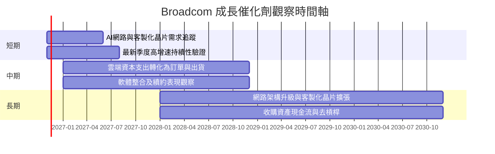

### 9.2 TAM 市場規模分析

資料包未提供各子市場 TAM、滲透率或市場份額，故不使用未經驗證的市場規模數字。

```text
╔══════════════════════════════════════════════════════════════╗
║               TAM 與公司收入貢獻：資料可得性                  ║
╠══════════════════════════════════════════════════════════════╣
║ AI網路／交換與連接市場 TAM：N/A     AVGO分部收入：N/A         ║
║ 客製化晶片市場 TAM：N/A             AVGO分部收入：N/A         ║
║ 無線與光纖連接市場 TAM：N/A         AVGO分部收入：N/A         ║
║ 基礎設施軟體市場 TAM：N/A           AVGO分部收入：N/A         ║
║ 可確認的公司總體錨點：TTM營收 $89.10B                         ║
╚══════════════════════════════════════════════════════════════╝
```

### 9.3 成長驅動力結構圖

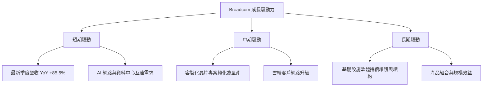

---

## 10. 風險矩陣

### 10.1 風險評分矩陣

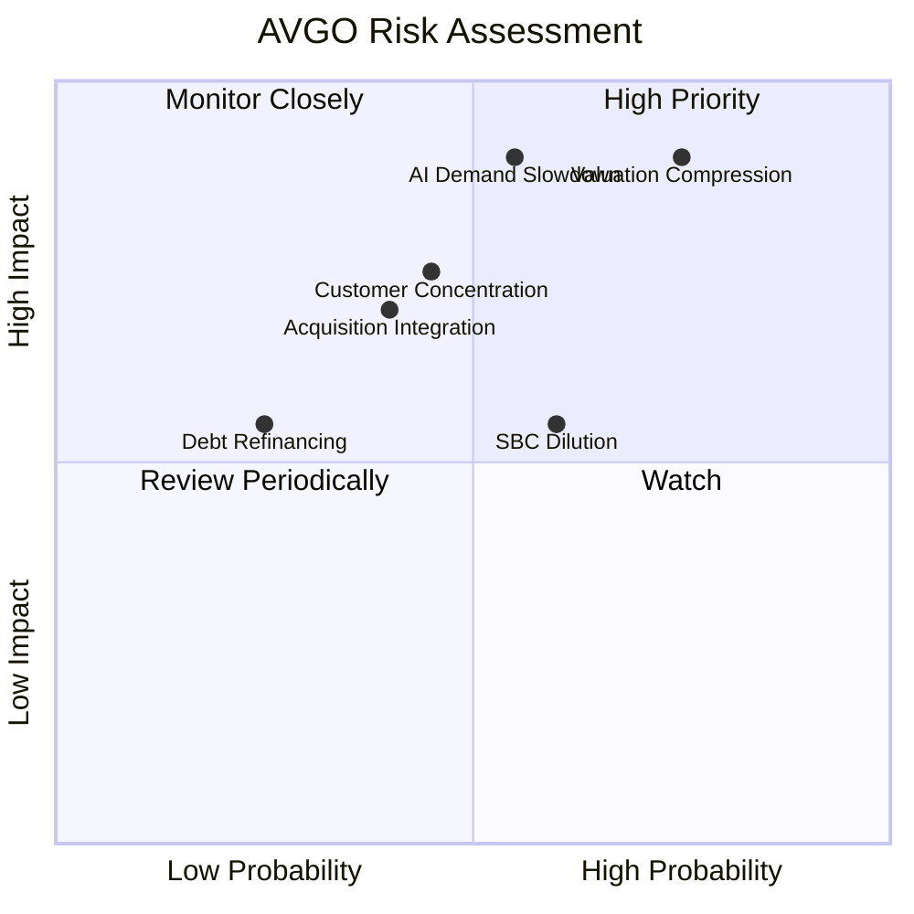

### 10.2 風險清單詳細分析

| # | 風險項目 | 發生機率 | 財務衝擊 | 風險評分 | 緩解措施 |
|---|----------|----------|----------|----------|----------|
| 1 | 🔴 估值回落 | 高（約 60%） | 估值倍數收縮 20%–40% 的情境具可能性；非營收預測 | 9.0/10 | 分批交易、使用合理價區間、監控 Forward P/E 與 FCF Yield |
| 2 | 🔴 AI 投資週期逆轉 | 中高（約 45%） | 若最新季度 85.5% 單季年增大幅回落，營收預期可能下修 | 8.5/10 | 追蹤 AI 相關營收、雲端客戶訂單與季度指引；分部數據缺失需留意 |
| 3 | 🟠 客戶／產品集中 | 中（約 40%） | 客戶集中度 N/A；單一大客戶需求變化可能造成季度波動 | 7.5/10 | 監控前五大客戶占比、設計案轉量產與客戶多元化 |
| 4 | 🟠 併購整合與商譽 | 中（約 35%） | 商譽 $97.80B、無形資產 $26.33B，減損可能壓低帳面資產與獲利 | 7.0/10 | 追蹤軟體續約、交叉銷售及收購資產現金流 |
| 5 | 🟡 SBC 稀釋 | 中高（約 50%） | FY2025 SBC $7.57B，為營收 11.9% | 6.5/10 | 監控稀釋股數、SBC/營收與回購抵銷效果 |
| 6 | 🟡 淨負債與利率 | 低中（約 25%） | 淨負債 $35.44B；較高利率增加再融資成本 | 5.5/10 | 以 FCF 償債、維持流動性及分散到期結構 |

風險機率為分析師情境評估，不是資料包實際統計。資料包 short % float 為 1.1%、short ratio 2.33，顯示空頭部位本身不是目前最突出的風險來源。

---

## 11. 投資建議

### 11.1 最終綜合評級雷達圖

```text
╔══════════════════════════════════════════════════════════════╗
║                   AVGO 最終投資評分                           ║
╠══════════════════════════════════════════════════════════════╣
║ 基本面       8.0/10  ▓▓▓▓▓▓▓▓▓▓▓▓▓▓▓▓░░░░                    ║
║ 成長性       8.5/10  ▓▓▓▓▓▓▓▓▓▓▓▓▓▓▓▓▓░░░                    ║
║ 獲利能力     9.0/10  ▓▓▓▓▓▓▓▓▓▓▓▓▓▓▓▓▓▓░░                    ║
║ 財務健康     7.0/10  ▓▓▓▓▓▓▓▓▓▓▓▓▓▓░░░░░░                    ║
║ 估值合理性   3.5/10  ▓▓▓▓▓▓▓░░░░░░░░░░░░░░                    ║
║ 護城河       8.0/10  ▓▓▓▓▓▓▓▓▓▓▓▓▓▓▓▓░░░░                    ║
╠══════════════════════════════════════════════════════════════╣
║ 綜合評分     6.8/10  🟡 業務品質佳，現價安全邊際不足           ║
║ 評級         🔴 賣出：MOS -63.5%，低於 -25% 門檻               ║
╚══════════════════════════════════════════════════════════════╝
```

### 11.2 目標價與隱含報酬率

| 情境 | 目標價 | 相對 $364.36 收盤價 | 機率權重 | 依據 |
|------|--------|--------------------|----------|------|
| 🔴 悲觀 | $100 | −72.6% | 30% | DCF 低成長、利潤率與折現率組合 |
| 🟡 基準 | $222.8 | −38.8% | 50% | 8.8 加權合理價值，為主要估值錨 |
| 🟢 樂觀 | $400 | +9.8% | 20% | AI 需求與估值溢價延續的上行情境 |
| **加權情境目標** | **約 $208** | **約 −42.9%** | **100%** | $100×30%+$222.8×50%+$400×20% |

12 個月基準目標採加權合理價值 $222.8；情境加權值 $208 反映悲觀／樂觀尾部情境。評級依規則以 MOS 為準：MOS −63.5% < −25%，故為 **賣出**。本報告沒有給出「買入區間」，因買入評級要求的合理價值與 MOS 門檻均未達成。

### 11.3 買入時機與觸發因素

```text
╔══════════════════════════════════════════════════════════════════╗
║                  ✅ 交易觸發因素 Checklist                       ║
╠══════════════════════════════════════════════════════════════════╣
║ 目前判斷：現價 $364.36，高於加權合理值 $222.8，未達買入條件      ║
║                                                                  ║
║ 重新評估買入條件：                                               ║
║ ☐ 股價回落至加權合理值附近，且基本面假設未惡化                   ║
║ ☐ TTM FCF 維持正成長，FCF Yield 相對上升                          ║
║ ☐ AI／網路業務成長延續，且非單一季度短期跳升                     ║
║ ☐ 淨負債持續下降，SBC／營收逐步降低                               ║
║                                                                  ║
║ 加碼觸發條件：                                                   ║
║ ☐ 股價低於 $200 且營業利益率仍維持 45% 以上                      ║
║ ☐ 連續兩季營收年增至少 20%，FCF 未低於正值                       ║
║                                                                  ║
║ 減碼／退出條件：                                                 ║
║ ☐ AI 相關成長連續兩季低於 15%                                    ║
║ ☐ TTM 營業利益率低於 40%                                         ║
║ ☐ FCF 轉負、或 ROIC 跌破 WACC 12.37%                             ║
╚══════════════════════════════════════════════════════════════════╝
```

以上觸發值是投資監控門檻，不是公司管理層財測。股價低於 $200 的門檻約對應本報告加權合理值附近，並不保證估值一定合理，仍須檢查成長與利潤率假設。

### 11.4 投資人適配度分析

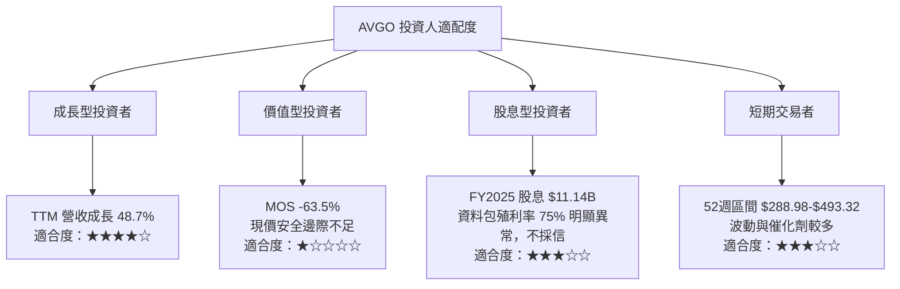

### 11.5 每季財報監控清單（Quarterly Watch List）

| 監控指標 | 目前基準 | 加碼觀察門檻 | 減碼／重新檢視門檻 |
|----------|----------|--------------|--------------------|
| 營收年增率 | 最新季度 85.5% | 維持 ≥20% 且趨勢由實際出貨支撐 | 連續兩季 <15% |
| 營業利益率 | TTM 48.0%；最新季度 Verified 53.9% | 維持 ≥45% | 低於 40% |
| TTM FCF | $39.40B | 持續增加且 FCF Yield 提升 | 轉負或連續兩季下降 |
| Capex | TTM $1.25B | 投資上升且營收、FCF 同步成長 | Capex 上升但營收停滯 |
| SBC／營收 | FY2025 約 11.9% | 趨勢下降或股數持平 | 持續高於 12% 且稀釋加速 |
| 淨負債 | $35.44B | 逐年下降 | 淨負債增加且 FCF 下降 |
| 現金與流動性 | 現金 $23.98B；流動比率 2.50 | 維持流動比率 >1.5 | 流動比率 <1.2 |
| EPS／一致預期 | 提供資料 EPS 預估缺失 | 取得可核對一致預期後追蹤 beat/miss | 連續兩季不及一致預期 |
| AI／分部收入 | N/A | 要求公司揭露可追蹤分部數據 | 成長集中且缺乏訂單轉量產證據 |

### 11.6 反面論證：什麼會證明論點錯誤（What Would Change My Mind）

```text
╔══════════════════════════════════════════════════════════════════╗
║              ⚠️ 論點失效條件（Disconfirming Evidence）            ║
╠══════════════════════════════════════════════════════════════════╣
║ 本報告對公司品質的正面判斷，若出現下列情況應重新檢視：           ║
║ ☐ 最新季度營收年增率連續兩季低於 15%                              ║
║ ☐ TTM 營業利益率低於 40%，或較 48.0% 基準收縮超過 8pp            ║
║ ☐ TTM FCF 轉負，或 FCF／淨利在可比口徑下低於 80%                 ║
║ ☐ ROIC 跌破 WACC 12.37%，代表資本回報不再覆蓋資本成本            ║
║ ☐ SBC／營收持續高於 12%，且流通股數年增超過 2%                    ║
║ ☐ AI／網路相關成長無法轉化為量產、現金流與穩定利潤                ║
║ ☐ 淨負債持續上升，且 Debt/EBITDA 超過 2.5x                        ║
╚══════════════════════════════════════════════════════════════════╝
```

**最終判斷**：AVGO 的營運品質由 TTM 營收 $89.10B、TTM FCF $39.40B 與 ROIC 30.0% 支持，足以證明公司目前具備現金創造與價值增值能力。然而，收盤價 $364.36 高於本報告加權合理價值 $222.8，MOS 約 −63.5%；依指定門檻，投資評級為 **🔴 賣出**。若未來營收、利潤率或折現假設改善，應重算合理價值，而非僅依歷史股價趨勢調整結論。

> **免責聲明**：本報告為 AI 自動生成，僅供研究參考，不構成投資建議。投資有風險，入市需謹慎。