# AVGO 基本面深度分析報告
> **報告日期**：2026-11-14 ｜ **語言**：繁體中文 ｜ **數據來源**：SEC 申報資料 (XBRL)、Yahoo Finance、Finviz、StockAnalysis、Roic.ai ｜ **分析師**：CFA 級機構研究

> **口徑說明**：本文價格固定採用 **2026-11-13 收盤價 $347.01**。涉及營收成長、FCF、ROIC、WACC、歷史估值及同業倍數時，優先引用 VERIFIED FIGURES。題示不同資料源存在若干不一致，本文會標明口徑，不將缺漏項目反推成「實際值」。除明確標示外，估值模型的營運預測均為分析師假設，不是公司財測。

---

## 目錄

| # | 章節 | 核心結論 |
|---|------|----------|
| 1 | 執行摘要 | 持有偏減碼；加權合理價值 $232.04，MOS -49.5% |
| 2 | 公司概覽與商業模式 | 半導體與基礎設施軟體雙主業；分部營收占比資料未提供 |
| 3 | 損益表深度分析 | TTM 營收 $89.10B、TTM 成長 48.7%；最新一季 YoY 85.5% |
| 4 | 資產負債表分析 | 淨負債 $35.44B；短期流動性數據良好 |
| 5 | 現金流量深度分析 | TTM FCF $39.40B，FCF Yield 2.38% |
| 6 | 獲利能力與資本效率 | ROIC 30.0% 高於 WACC 12.40%，價值創造仍明顯 |
| 7 | 相對估值分析 | 高於同業部分估值基準；自身歷史倍數處於偏高區 |
| 8 | DCF 內在價值評估 | 基準 DCF 約 $182.65/股；加權合理價值 $232.04/股 |
| 9 | 成長催化劑 | AI 網路、客製化晶片與軟體經常性收入為主要觀察項 |
| 10 | 風險矩陣 | AI 需求集中、估值壓縮與整合執行為前三大風險 |
| 11 | 投資建議 | MOS 門檻對應賣出；現價不宜追買，重點追蹤 AI 需求與 FCF |

---

## 1. 執行摘要

### 1.0 一頁式投資儀表板

| 項目 | 內容 |
|------|------|
| **投資論點（3 句）** | ① TTM 營收 $89.10B、TTM 成長 48.7%，最新一季單季 YoY 85.5%，反映需求加速但也提高高基期風險。② TTM FCF $39.40B、ROIC 30.0%，以 WACC 12.40% 計仍創造經濟價值。③ 2026-11-13 收盤 $347.01 高於基準 DCF $182.65，且高於加權合理價值 $232.04，估值折價保護不足。 |
| **護城河評分** | 8.2/10；客製化晶片、網路連接與軟體整合具切換成本，但分部占比及客戶集中數據未提供 |
| **管理層/資本配置評分** | 7.2/10；現金流充足，SBC 與併購整合回報仍須追蹤 |
| **財務健康** | 🟡 淨負債 $35.44B，但現金及短期投資 $23.98B、流動比率 2.504 |
| **ROIC vs WACC** | 30.0% vs 12.40%；ROIC 高出 17.6 個百分點，創造價值 |
| **FCF 趨勢** | TTM FCF $39.40B；FCF Yield 2.38%。FY2025 FCF $26.91B，高於 FY2024 $19.41B |
| **估值** | Forward P/E 17.87x ｜ EV/EBITDA 33.96x ｜ FCF Yield 2.38% |
| **DCF 內在價值（基準）** | $182.65 ｜ 現價相對 DCF 溢價約 90.0% |
| **安全邊際（MOS）** | **-49.5%**＝($232.04 − $347.01) ÷ $232.04；🔴 無安全邊際 |
| **預期報酬（基準情境 12M）** | 以加權合理價值 $232.04 計，約 **-33.1%** |
| **關鍵風險（前二）** | AI 半導體需求及客戶支出集中；高估值在成長放緩時的倍數壓縮 |
| **評級 + 信心度** | 🔴 **賣出／避免新增部位**；信心：中。依 MOS 門檻為賣出，ROIC 高於 WACC 是基本面優點，但不足以抵銷估值差距 |

### 1.1 核心評分儀表板

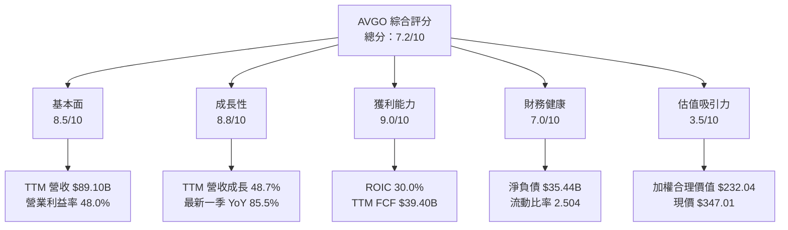

### 1.2 評分進度條視覺化

```
╔══════════════════════════════════════════════════════════════╗
║                 AVGO 多維度評分儀表板（1-10分）              ║
╠══════════════════════════════════════════════════════════════╣
║ 基本面強度  8.5 ▓▓▓▓▓▓▓▓▓▓▓▓▓▓▓▓▓░░░  ★★★★☆              ║
║ 成長動能    8.8 ▓▓▓▓▓▓▓▓▓▓▓▓▓▓▓▓▓░░░  ★★★★☆              ║
║ 獲利品質    7.6 ▓▓▓▓▓▓▓▓▓▓▓▓▓▓▓░░░░░  ★★★★☆              ║
║ 財務健康    7.0 ▓▓▓▓▓▓▓▓▓▓▓▓▓▓░░░░░░  ★★★★☆              ║
║ 估值合理性  3.5 ▓▓▓▓▓▓▓░░░░░░░░░░░░░░  ★★☆☆☆              ║
║ 護城河深度  8.2 ▓▓▓▓▓▓▓▓▓▓▓▓▓▓▓▓░░░░  ★★★★☆              ║
║ 管理層執行  7.2 ▓▓▓▓▓▓▓▓▓▓▓▓▓▓░░░░░░  ★★★★☆              ║
║ 技術創新力  8.5 ▓▓▓▓▓▓▓▓▓▓▓▓▓▓▓▓▓░░░  ★★★★☆              ║
╠══════════════════════════════════════════════════════════════╣
║ 綜合總分    7.2 ▓▓▓▓▓▓▓▓▓▓▓▓▓▓░░░░░░  基本面好、估值昂貴  ║
╚══════════════════════════════════════════════════════════════╝
```

### 1.3 五大投資論點 + 三大核心風險

| 類型 | 項目 | 具體依據 | 信心度 |
|------|------|----------|--------|
| 🟢 論點① | AI 與資料中心需求仍是重要成長來源 | 最新一季收入 YoY 85.5%；但單一季度成長不宜外推為長期 CAGR | 🟢 高 |
| 🟢 論點② | 現金流具規模 | TTM OCF $40.65B、Capex $1.25B、FCF $39.40B | 🟢 高 |
| 🟢 論點③ | 資本回報高於資金成本 | ROIC 30.0% 對 WACC 12.40%，差額 17.6pp | 🟢 高 |
| 🟢 論點④ | 半導體與軟體業務組合可分散周期 | 公司經營 Semiconductor Solutions 與 Infrastructure Software；分部財務明細未提供 | 🟡 中 |
| 🟡 論點⑤ | FCF 與淨利轉換合理 | TTM FCF $39.40B / TTM 淨利 $38.265B 約 103.0%；但 SBC 仍是股東成本 | 🟡 中 |
| 🔴 風險① | 現價對估值假設要求高 | 加權合理價值 $232.04，現價 $347.01，MOS -49.5% | 🔴 高 |
| 🔴 風險② | AI 相關需求若回落，增長率可能急降 | 最新一季收入成長 85.5%，高基期與大型客戶投資周期提高波動 | 🔴 高 |
| 🟡 風險③ | SBC 稀釋與併購資產減值 | TTM SBC 估算 $8.48B，約為 TTM 營收 9.5%；商譽 $97.80B | 🟡 中 |

### 1.4 快速統計卡片

| 指標 | 公司實際值 | 行業均值 | S&P 500 均值 | 狀態 |
|------|-------------|----------|--------------|------|
| 收入 YoY 成長 | **TTM 48.7%**；最新一季單季 85.5% | N/A | N/A | 🟢 |
| 毛利率 | **TTM 75.5%** | N/A | N/A | 🟢 |
| 淨利率 | **TTM 42.9%** | N/A | N/A | 🟢 |
| ROE | **VERIFIED TTM 38.4%** | N/A | N/A | 🟢 |
| ROIC | **TTM 30.0%** | N/A | N/A | 🟢 |
| Forward P/E | **17.87x** | 同業差異大 | N/A | 🟡 |
| FCF Yield | **2.38%** | N/A | N/A | 🔴 |

> 題示資料沒有行業與 S&P 500 統一口徑均值，因此不以外部記憶數字填補。

### 1.5 投資結論

```
╔══════════════════════════════════════════════════════════════════╗
║                    📊 投資結論摘要                               ║
╠══════════════════════════════════════════════════════════════════╣
║  評級：🔴 賣出／避免新增部位（MOS 門檻：低於 -25%）             ║
║  價格（2026-11-13 收盤）：$347.01                                ║
║  DCF 內在價值（基準）：$182.65（現價溢價約 90.0%）              ║
║  加權合理價值：$232.04                                            ║
║  安全邊際 MOS：-49.5%＝($232.04−$347.01)÷$232.04                ║
║  情境價值區間：悲觀 $160 ｜基準 $232 ｜樂觀 $330                 ║
║  基準合理價值相對現價：-33.1%                                     ║
║  投資評分：7.2/10；企業品質高，但買入價格缺乏安全邊際            ║
║  適合投資人：已有部位者可持有並設紀律；價值型投資人等待估值回落  ║
╚══════════════════════════════════════════════════════════════════╝
```

---

## 2. 公司概覽與商業模式

### 2.1 業務結構與收入來源

Broadcom 提供半導體元件、客製化晶片與基礎設施軟體。題示財務資料沒有最新分部收入或分部獲利，因此不以推估比例冒充已披露數字。

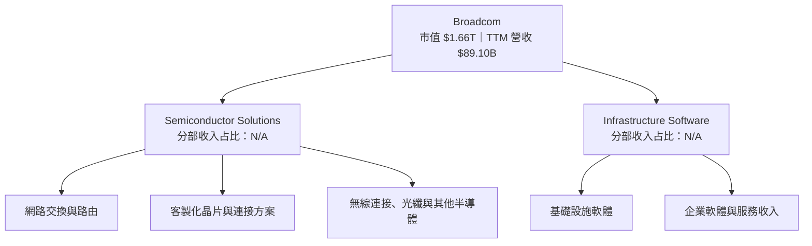

### 2.2 市場份額

市場份額必須以具體市場定義、出貨量或市占率資料計算；題示資料未提供 AVGO 或競爭者市占率，故不製作會造成誤導的數值圓餅圖。

| 觀察市場 | 可用資料 | 結論 |
|----------|----------|------|
| 網路晶片、客製化晶片、無線及基礎設施軟體 | 未提供各市場規模、出貨量及份額 | 市占率 N/A；需以各子市場獨立資料驗證 |

### 2.3 競爭護城河分析

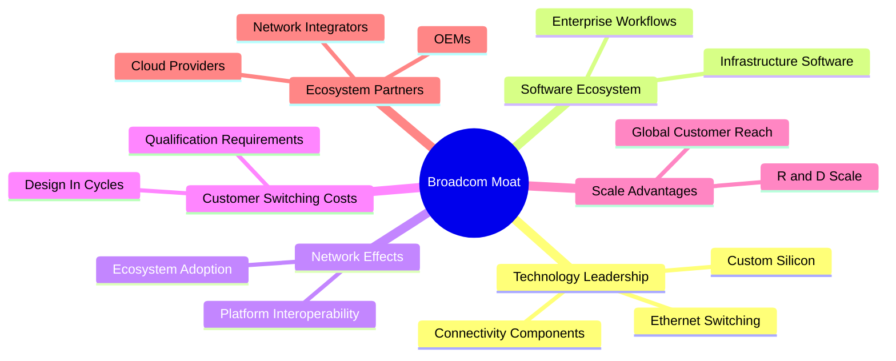

### 2.4 護城河強度評分

```
╔══════════════════════════════════════════════════════════════╗
║                 Broadcom 護城河強度評分                       ║
╠══════════════════════════════════════════════════════════════╣
║ 技術與設計導入  8.5 ▓▓▓▓▓▓▓▓▓▓▓▓▓▓▓▓▓░░░  🟢 高             ║
║ 客戶切換成本    8.0 ▓▓▓▓▓▓▓▓▓▓▓▓▓▓▓▓░░░░  🟢 高             ║
║ 軟體生態系統    8.0 ▓▓▓▓▓▓▓▓▓▓▓▓▓▓▓▓░░░░  🟢 高             ║
║ 網路效應        6.5 ▓▓▓▓▓▓▓▓▓▓▓░░░░░░░░░  🟡 中             ║
║ 規模與研發能力  8.5 ▓▓▓▓▓▓▓▓▓▓▓▓▓▓▓▓▓░░░  🟢 高             ║
║ 夥伴生態        7.5 ▓▓▓▓▓▓▓▓▓▓▓▓▓▓▓░░░░░  🟡 偏高           ║
╠══════════════════════════════════════════════════════════════╣
║ 綜合護城河      8.2 ▓▓▓▓▓▓▓▓▓▓▓▓▓▓▓▓░░░░  🟢 強，但非無風險 ║
╚══════════════════════════════════════════════════════════════╝
```

---

## 3. 損益表深度分析

### 3.1 年度收入成長趨勢

以下採題示年度損益表；FY2022 至 FY2025 收入由 $33.20B 增至 $63.89B，三年 CAGR 約 24.4%。計算：\((63.89÷33.20)^{1/3}-1≈24.4\%\)。

```
╔══════════════════════════════════════════════════════════════════╗
║                 AVGO 年度收入趨勢（FY2022-FY2025）               ║
╠══════════════════════════════════════════════════════════════════╣
║ FY2022  $33.20B  ██████████░░░░░░░░░░░░░░  YoY：N/A           ║
║ FY2023  $35.82B  ███████████░░░░░░░░░░░░░  YoY：+7.9%         ║
║ FY2024  $51.57B  ████████████████░░░░░░░░  YoY：+44.0%        ║
║ FY2025  $63.89B  ████████████████████░░░░  YoY：+23.9%        ║
╠══════════════════════════════════════════════════════════════════╣
║ FY2022-FY2025 收入 CAGR：約 24.4%                                 ║
╚══════════════════════════════════════════════════════════════════╝
```

收入擴張反映併購整合、半導體與軟體組合，以及 AI／資料中心需求。FY2024 高增長後 FY2025 年增率降至 23.9%，說明基期效應與業務周期不可忽視；最新 TTM 成長 48.7% 又回升，主要需由後續分部數據確認來源與持續性。

### 3.2 季度收入趨勢分析

| 季度 | 收入 | QoQ | YoY | 備註 |
|------|------:|----:|----:|------|
| FY2025 Q4 | $18.015B | N/A | 28.18% | StockAnalysis 季度資料 |
| FY2026 Q1 | $19.311B | +7.2% | 29.47% | QoQ = 19.311/18.015−1 |
| FY2026 Q2 | $22.187B | +14.9% | 47.87% | 需求增速上升 |
| FY2026 Q3 | $29.591B | +33.4% | **85.5%** | VERIFIED 最新單季 YoY；不是 TTM 成長率 |

最新一季收入由上一季增加約 $7.404B，QoQ 33.4%。數字顯示近期加速，但單季年增與季度節奏受產品交付、比較基期及大型客戶需求影響，不能直接當成未來年度預測。

### 3.3 利潤率演變分析

| 利潤率指標 | FY2022 | FY2023 | FY2024 | FY2025 | 趨勢 | 評估 |
|------------|-------:|-------:|-------:|-------:|------|------|
| 毛利率 | 66.5% | 68.9% | 63.0% | 67.8% | FY2024 回落後恢復 | 🟢 |
| 營業利益率 | 43.0% | 45.9% | 29.1% | 40.8% | FY2024 低點後反彈 | 🟡 |
| 淨利率 | 34.6% | 39.3% | 11.4% | 36.2% | FY2024 波動明顯 | 🟡 |

FY2024 營業及淨利率下降，可能受併購後無形資產攤銷、整合費用、產品組合及稅務項目影響；現有資料不足以精確拆分各因素。VERIFIED TTM 營業利益率為 48.0%，最新季度為 53.9%，顯示近期營業槓桿上升，但另一合併資料源列出不同季度營業利益率；本報告採 VERIFIED FIGURES 數值。

### 3.4 費用結構分析

FY2025 按題示收入 $63.89B、毛利 $43.29B、營業利益 $26.07B 拆分；R&D $10.98B，其他營業費用為差額估算 $6.24B（毛利減營業利益再扣 R&D）。此差額不是申報項目的逐項明細。

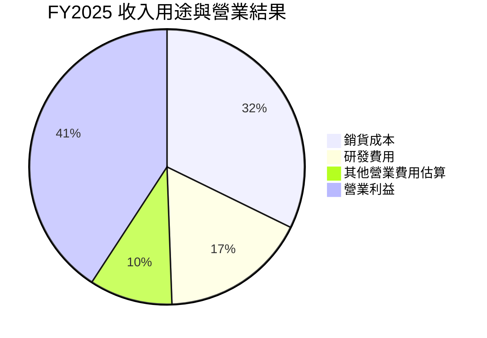

```
╔══════════════════════════════════════════════════════════════╗
║ FY2025 收入 $63.89B：銷貨成本 $20.60B｜毛利 $43.29B          ║
║ 毛利：研發 $10.98B + 其他營業費用估算 $6.24B + 營業利益 $26.07B ║
║ 研發約佔收入 17.2%；研發支出支撐產品迭代，亦是持續成本。    ║
╚══════════════════════════════════════════════════════════════╝
```

### 3.5 季度 EPS 趨勢與盈餘品質

季度資料顯示 FY2026 Q1/Q2/Q3 EPS 分別為 $1.50、$1.91、$2.68；題示 EPS beats 表的預估值全為 `nan`，因此不能判斷最近四季是否超預期，亦不以實際 EPS 成長替代「超預期」。

| 盈餘品質項目 | 數值/佔比 | 評估 |
|--------------|-----------|------|
| 股權薪酬 SBC / 營收 | 最近四季 SBC 合計 $8.48B ÷ TTM 營收 $89.10B = **9.5%** | 🟡 偏高；非現金費用仍代表稀釋成本 |
| SBC / 營業現金流 | $8.48B ÷ $40.65B = **20.9%** | 🟡 SBC 對股東現金流權益不可忽略 |
| FCF / 淨利 | $39.40B ÷ $38.265B = **103.0%** | 🟢 現金轉換良好 |
| 一次性/非經常性損益 | N/A；資料未提供逐項調節 | 🟡 無法精確判定 |
| 有效稅率異常 | VERIFIED 模型稅率預設 21.0%；實際 TTM 有效稅率 N/A | 🟡 不應假定實際有效稅率等於預設稅率 |
| 資本化支出 vs 費用化 | TTM Capex $1.25B；資本化研發資料 N/A | 🟡 未見證據可判定費用遞延 |

**盈餘品質結論**：FCF 高於淨利，現金轉換具支持；但 TTM SBC 約占營收 9.5%，是重要股東成本。估值不能把 SBC 當成完全無成本的非現金項目。模型採 GAAP EBIT，不再額外扣 SBC，避免重複扣除。

---

## 4. 資產負債表分析

### 4.1 資產結構分解

題示 FY2026 Q3 資產總額 $188.148B；以下項目按 StockAnalysis 資產負債表列示。其餘資產為未列示細項，避免擅自補數。

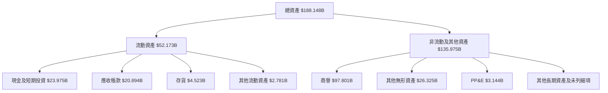

### 4.2 流動性指標分析

| 指標 | FY2024 | FY2025 | 最新資料 | 評估 |
|------|------:|------:|------:|------|
| 流動比率 | 1.17x | 1.71x | **2.504x** | 🟢 近期流動性改善 |
| 速動比率 | N/A | N/A | **2.153x** | 🟢 短期覆蓋能力良好 |
| 現金及短期投資 | $9.35B | $16.18B | **$23.98B** | 🟢 現金緩衝擴大 |
| 行業均值 | N/A | N/A | N/A | 無一致口徑資料 |

流動比率改善提供較充足營運緩衝；另一方面，商譽與無形資產合計約 $124.13B，反映併購資產占比高，未來若軟體或收購業務預期現金流下降，可能面臨減值風險。

### 4.3 債務結構分析

```
╔══════════════════════════════════════════════════════════════════╗
║                    AVGO 債務健康診斷                             ║
╠══════════════════════════════════════════════════════════════════╣
║  總債務：          $59.42B                                      ║
║  現金及短期投資：  $23.98B                                      ║
║  淨負債：          $35.44B（總債務−現金）                        ║
║  Debt/EBITDA：     約 1.13x（59.42 ÷ 52.30，EBITDA估算）         ║
║  利息保障倍數：    N/A（利息費用金額未提供）                     ║
║  流動比率：        2.504x                                        ║
╠══════════════════════════════════════════════════════════════════╣
║  評估：🟡 淨負債可管理，但須同時監測併購與股東分配。             ║
╚══════════════════════════════════════════════════════════════════╝
```

Debt/EBITDA 的 EBITDA 以 TTM 營收 $89.10B × EBITDA Margin 58.7% 推估為 $52.30B；這是跨資料欄位計算的估算值，不是 VERIFIED EBITDA 金額。

### 4.4 股東權益趨勢

```
╔══════════════════════════════════════════════════════════════╗
║                 股東權益趨勢（FY2022-FY2025）                  ║
╠══════════════════════════════════════════════════════════════╣
║ FY2022  $22.71B  ██████░░░░░░░░░░░░░░                         ║
║ FY2023  $23.99B  ██████░░░░░░░░░░░░░░                         ║
║ FY2024  $67.68B  █████████████████░░░                          ║
║ FY2025  $81.29B  ████████████████████                          ║
╚══════════════════════════════════════════════════════════════╝
```

FY2024 權益上升與收購、股本及留存收益等因素相關；題示資料不足以逐項歸因。使用帳面股東權益解讀 ROE 時，需注意併購與無形資產使帳面基礎變動較大。

---

## 5. 現金流量深度分析

### 5.1 現金流量瀑布圖

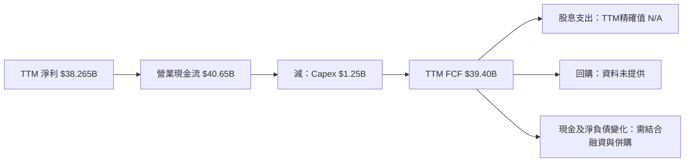

### 5.2 FCF 轉換率趨勢

| 財年 | FCF | 淨利 | FCF / 淨利 |
|------|----:|-----:|-----------:|
| FY2022 | $16.31B | $11.49B | 142.0% |
| FY2023 | $17.63B | $14.08B | 125.2% |
| FY2024 | $19.41B | $5.89B | 329.5% |
| FY2025 | $26.91B | $23.13B | 116.3% |
| TTM | **$39.40B** | **$38.265B** | **103.0%** |

FY2024 比率因淨利基數偏低而異常偏高，不能視作可持續轉換率；TTM 轉換率約 103%，較具參考性。

### 5.3 自由現金流趨勢

```
╔══════════════════════════════════════════════════════════════╗
║                   FCF 歷史趨勢                                ║
╠══════════════════════════════════════════════════════════════╣
║ FY2022  $16.31B  ████████████░░░░░░░░  YoY：N/A               ║
║ FY2023  $17.63B  █████████████░░░░░░░  YoY：+8.1%             ║
║ FY2024  $19.41B  ██████████████░░░░░░  YoY：+10.1%            ║
║ FY2025  $26.91B  ████████████████████  YoY：+38.6%            ║
║ TTM     $39.40B  FCF Yield：2.38%                              ║
╚══════════════════════════════════════════════════════════════╝
```

FY2022 至 FY2025 FCF CAGR 約 18.2%。TTM FCF 較 FY2025 年度數值高，但 TTM 期間與財年並非同一期間，不能視為同口徑 YoY。

### 5.4 資本配置評估

| 項目 | 數據 | 解讀 |
|------|------|------|
| FY2025 股息支付 | $11.14B | 占 FY2025 FCF $26.91B 約 41.4% |
| FY2025 Capex | 約 $0.623B（現金流表以負數列示） | 輕資本特徵，但後續 AI 供應與研發投資需監測 |
| FY2025 SBC | $7.57B | 約占 FY2025 營收 11.9%，是股東稀釋成本 |
| 回購 | N/A | 題示資料未提供，不推估 |
| 併購及償債 | N/A | 無法將現金流剩餘部分反推為特定用途 |

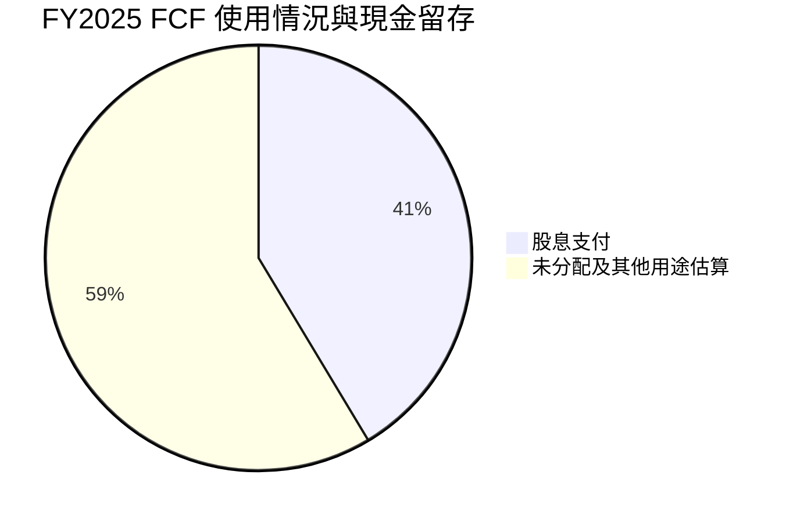

其中 $15.77B 是 FY2025 FCF 減現金股息的算術餘額，並不等同公司留存現金；可能包括回購、償債、收購及其他用途。

---

## 6. 獲利能力與資本效率

### 6.1 ROE / ROA / ROIC 趨勢

| 指標 | 最新 TTM | 歷史或其他資料 | 行業均值 | 評估 |
|------|---------:|----------------|----------|------|
| ROE | **38.4% VERIFIED** | 另一資料源列 44.2%，口徑不同 | N/A | 🟢 高 |
| ROA | 15.4% | 歷史一致序列 N/A | N/A | 🟢 |
| ROIC | **30.0% VERIFIED** | 定義為稅後營業利益 / 投入資本 | N/A | 🟢 |
| WACC | **12.40%** | 成本資本參考值 | — | — |

### 6.2 ROIC vs WACC 分析

```
╔══════════════════════════════════════════════════════════════════╗
║                  ROIC vs WACC 深度分析                           ║
╠══════════════════════════════════════════════════════════════════╣
║  WACC 參考輸入：                                                  ║
║  ├── 無風險利率 Rf：             5.15%                           ║
║  ├── 股權風險溢酬 ERP：          5.00%                           ║
║  ├── Beta：                      1.508                           ║
║  ├── 股權成本 Ke：5.15%+1.508×5%=12.69%                         ║
║  ├── 稅前債務成本 Kd：           5.40%                           ║
║  ├── 稅後 Kd：5.40%×(1−21%)=4.266%                              ║
║  ├── 股權 / 債務權重：           96.5% / 3.5%                    ║
║  └── WACC：96.5%×12.69%+3.5%×4.266%=12.40%                      ║
║                                                                  ║
║  ROIC：30.0%（VERIFIED TTM）                                     ║
║  價值利差：30.0%−12.40%=17.60pp                                 ║
║  ROIC/WACC：30.0%÷12.40%=2.42x                                 ║
║                                                                  ║
║  ROIC 30.0% ▓▓▓▓▓▓▓▓▓▓▓▓▓▓▓▓▓▓▓▓▓▓▓▓▓▓▓▓ 🟢                   ║
║  WACC 12.4% ▓▓▓▓▓▓▓▓▓▓▓▓░░░░░░░░░░░░░░░░ ──                   ║
║  結論：目前投入資本報酬高於資金成本，創造股東經濟價值。        ║
╚══════════════════════════════════════════════════════════════════╝
```

WACC 採 VERIFIED 參考值，並非使用未提供的利息費用自行重估債務成本。ROIC 高於 WACC 說明公司經營模式創造價值，但不表示任何股價都具吸引力。

### 6.3 杜邦三因素分解

以 TTM 淨利率 42.9%、ROE 38.4% 作為輸入；由於期間與平均資產／平均權益口徑未完全一致，下列周轉率、槓桿為近似拆解。

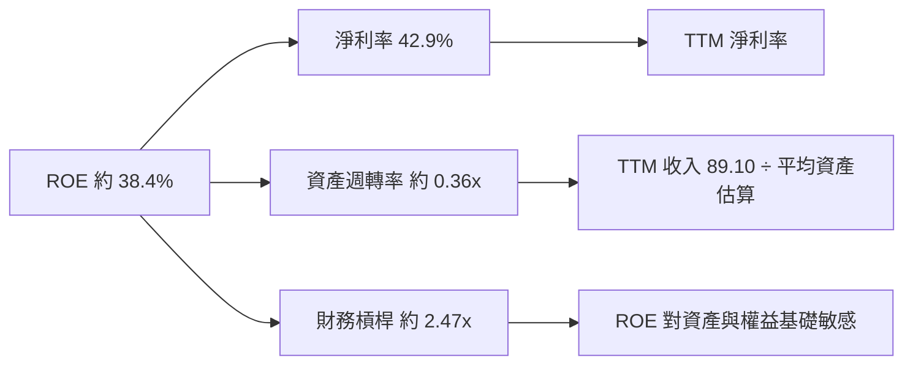

杜邦近似核對：\(42.9\%×0.36×2.47≈38.2\%\)，與 VERIFIED ROE 38.4% 的差異來自四捨五入及平均資產／權益期間差異。

### 6.4 獲利能力儀表板

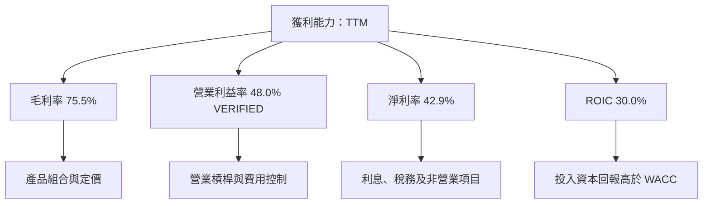

---

## 7. 相對估值分析

### 7.1 同業估值比較

同業倍數依 VERIFIED FIGURES；AVGO 倍數採題示市場估值資料。EV/EBITDA 欄位的 AVGO 數據來源口徑與 VERIFIED 歷史估值區塊不同，需注意差異。

| 估值指標 | **AVGO** | **NVDA** | **MRVL** | **QCOM** | AVGO 評估 |
|----------|---------:|---------:|---------:|---------:|-----------|
| Trailing P/E | 44.3x | 20.6x | 51.6x | 13.6x | 🟡 高於 NVDA、QCOM |
| Forward P/E | 17.87x | 10.3x | 21.3x | 14.1x | 🟡 位於同業區間中上 |
| P/S | 18.59x | 13.0x | 14.9x | 4.3x | 🔴 高於三家同業 |
| EV/EBITDA | 33.96x | 19.4x | 51.1x | 18.6x | 🟡 高於 NVDA、QCOM |
| 最新一季營收 YoY | 85.5% | 105.9% | 36.5% | -8.4% | 🟢 成長高，但不是同一財報日比較 |
| TTM 毛利率 | 75.5% | 74.7% | 52.2% | 53.1% | 🟢 高 |

NVDA、MRVL、QCOM 業務組合和成長週期不同，倍數不可視作完全可比。AVGO 的營收與毛利表現支持溢價，但 P/S 高於三家同業，顯示市場已對持續高速成長定價。

### 7.2 歷史估值區間分析

```
╔══════════════════════════════════════════════════════════════╗
║             AVGO 自身 5 年估值區間（TTM 倍數）                ║
╠══════════════════════════════════════════════════════════════╣
║ P/E       1.8x ───────── 中位數 5.5x ───────── 現值 44.3x   ║
║            歷史區間上限 77.5x｜現值百分位 70%                 ║
║ P/S       0.6x ───────── 中位數 1.5x ───────── 現值 19.0x   ║
║            歷史區間上限 28.1x｜現值百分位 70%                 ║
║ EV/EBITDA 0.5x ───────── 中位數 5.6x ───────── 現值 39.8x   ║
║            歷史區間上限 70.7x｜現值百分位 55%                 ║
╚══════════════════════════════════════════════════════════════╝
```

歷史中位數受到併購前後盈利與資產結構變化影響，不能不加調整地當作正常估值錨點；但現值在自身 5 年區間的 P/E、P/S 約第 70 百分位，仍顯示估值位於偏高區。

### 7.3 情境目標價（假設驅動）

下表採 **Forward EPS $19.41399 × 情境退出 P/E**。倍數以同業 Forward P/E 10.3x–21.3x 為參考，情境是分析師估值假設，不是公司指引。

| 情境 | 營收 CAGR 假設 | 營業利潤率假設 | 退出 P/E | 隱含目標價 | 相對現價 |
|------|---------------:|---------------:|---------:|-----------:|---------:|
| 🔴 悲觀 | 低於基準，約 10% | 約 45% | 12.0x | $232.97 | -32.9% |
| 🟡 基準 | 約 20% | 約 48%–50% | 14.1x | $273.74 | -21.1% |
| 🟢 樂觀 | 需求持續高於趨勢 | 約 50% | 20.0x | $388.28 | +11.9% |

算式示例：基準價 \( $19.41399×14.1=$273.74 \)。P/E 僅用作市場相對估值，不是對 DCF 的替代；倍數若落到 12x，對應價約 $232.97。

### 7.4 相對估值隱含價格區間

| 方法 | 計算依據 | 隱含股價 |
|------|----------|---------:|
| Forward P/E | $19.41399 × 同業中位數 14.1x | $273.74 |
| EV/EBITDA | EBITDA 估算 $52.30B × 同業中位數 19.4x，調整淨負債後 ÷ 4.77B 股 | 約 $205.29 |
| EV/Sales | 同業 P/S 中位數 14.9x × TTM 營收 $89.10B，調整淨負債後 ÷ 4.77B 股 | 約 $271.70 |
| FCF Yield | 假設合理化 FCF Yield 4.0%；$39.40B ÷ 4.0% ÷ 4.77B 股 | 約 $206.50 |
| 現價 | 2026-11-13 收盤 | **$347.01** |

EV/Sales 使用同業 P/S 倍數的近似橋接，因同業市值及現金／債務明細未完整提供，視為粗略參考。現價高於各方法估值，尤其高於較保守的 EV/EBITDA 與 FCF Yield 結果。

---

## 8. DCF 內在價值評估（Discounted Cash Flow）

### 8.0 估值推理鏈（Thinking Logic）

**Step 1 — 價值來源**  
AVGO 價值主要來自：① 半導體解決方案的現有現金流底盤；② 基礎設施軟體經常性收入；③ AI／資料中心客製化晶片及網路產品的增量機會。各分部收入占比未提供，故不能量化拆分。模型中最主導估值的變數是 **WACC、終值成長率與長期 FCF 利潤率**；估值結果對終值特別敏感。

**Step 2 — 模型選擇**

| 決策點 | 本報告採用 | 理由 | 曾考慮但否決 |
|--------|-----------|------|------------|
| 現金流定義 | FCFF | 以 WACC 折現並先得企業價值，再調整淨負債 | FCFE：融資結構變化下較難直接比較 |
| 預測期 N | 5 年 | AI 成長與產品周期可見度有限，五年後轉入成熟期假設 | 10 年：缺少分部長期財測，預測誤差過大 |
| 終值方法 | Gordon Growth 為主，退出倍數交叉檢驗 | 以成熟企業長期現金流延續估值 | 僅用退出倍數：終值倍數有周期性 |
| EBIT 基礎 | GAAP/題示營業利益率代理 | 避免加回 SBC 造成過度估值 | 非 GAAP EBIT：題示無完整調節 |
| SBC | 組合 (A)：GAAP EBIT + 固定股數 | SBC 已在 GAAP 費用中反映 | 再扣 SBC 或再加稀釋會重複計算 |

**Step 3 — 主要假設推導**

- **營收 CAGR**：歷史 FY2022–FY2025 CAGR 約 24.4%，TTM 成長 48.7% → 最新增速不可線性延伸，且高基期、半導體周期與軟體整合增加不確定性 → **採用五年 20% CAGR** → 否決 30% 以上，因單季 85.5% YoY 不能代表多年常態。
- **期末營業利潤率**：VERIFIED TTM 為 48.0%，最新季度 53.9% → 季度高點可能含產品組合與營運槓桿 → **期末採 50%**，五年逐步由 48% 增至 50% → 否決採 53.9% 持續不變，避免單季年化。
- **永續成長率 g**：長期成熟企業成長需低於 WACC → **採 3.0%** → 不採 4% 作基準，因 WACC 12.40% 下高終值假設會顯著放大估值。
- **預測期 N**：近期需求可見度與長期 AI 競爭並存 → **採 5 年** → 否決 10 年，因缺乏可核驗的分部預測。
- **Capex/營收**：TTM Capex $1.25B ÷ TTM 營收 $89.10B = 1.40% → **採 1.4%** → 不假定大型資本支出永久維持在極低水準，但缺少公司中長期 capex 指引。
- **D&A/營收**：假設值；以 EBITDA Margin 58.7% 減 TTM Operating Margin 48.0% 得 10.7% → **採 10.7%** → 此為粗略代理，不代表財報直接披露的 D&A。
- **ΔWC/營收增額**：歷史明細不足 → **假設採新增營收的 5%**，作保守營運資金占用 → 不採 0%，因收入快速成長通常仍需應收及存貨投入。
- **年稀釋率**：採 (A) 固定股數 4.77B，年稀釋率 0% → 股數與 SBC 以 GAAP 費用處理相容 → 不再另加稀釋率。
- **WACC**：採 VERIFIED 12.40% → 以題示 Rf、ERP、Beta、Kd、稅率及權重計算 → 不採更低折現率，因題示無風險利率 5.15%、Beta 1.508 均指向較高股權成本。

**Step 4 — 最脆弱的一環**  
最脆弱假設是高營收成長能否同時維持 48%–50% 營業利潤率；若成長回落且利潤率壓縮，終值與當期 FCF 會同時下修，內在價值將低於基準。

**Step 5 — 計算路徑**

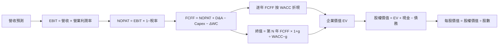

### 8.1 模型假設總表

| 假設項目 | 採用值 | 依據 / 來源 | 敏感度 |
|----------|--------|-------------|--------|
| 預測期長度 N | 5 年 | 近期產品及 AI 需求可見度；無五年以上分部指引 | 🟡 中 |
| 營收 CAGR | 20% | 歷史 FY22–FY25 約 24.4%，下調以反映高基期 | 🔴 高 |
| 期末營業利潤率 | 50% | TTM 48.0%，以規模效應作有限上調 | 🔴 高 |
| 有效稅率 | 21% | VERIFIED 預設稅率 | 🟢 低 |
| Capex / 營收 | 1.4% | TTM $1.25B / $89.10B = 1.40% | 🟡 中 |
| D&A / 營收 | 10.7% | 假設值：58.7% EBITDA margin − 48.0% operating margin | 🟢 低 |
| ΔWC / 新增營收 | 5% | 假設值：題示無可完整核對的歷史變動比例 | 🟢 低 |
| EBIT 基礎 | GAAP／題示營業利益率代理 | SBC 已納入費用；TTM 基礎營收與營業利潤率 | 🟡 中 |
| SBC 處理 | 組合 (A)：不另扣 SBC | GAAP EBIT 已含 SBC，股數固定 | 🟡 中 |
| 年稀釋率 | 0% | 與組合 (A) 相容；股數採 4.77B | 🟡 中 |
| 永續成長率 g | 3.0% | 成熟期假設，低於 WACC | 🔴 高 |
| 終值方法 | Gordon Growth 主、退出倍數檢驗 | 長期 FCFF 模型 | 🔴 高 |
| WACC | 12.40% | VERIFIED 參考 WACC | 🔴 高 |

> **SBC 防重複扣除**：本模型採用 **(A) GAAP EBIT + 固定股數**，故 SBC 影響已計入 GAAP 費用一次；FCFF 不再減 SBC，股數不再逐年稀釋。

### 8.2 折現率推導（WACC）

```
╔══════════════════════════════════════════════════════════════════╗
║                    WACC 推導（折現率）                           ║
╠══════════════════════════════════════════════════════════════════╣
║  股權成本 Ke：                                                    ║
║  ├── Rf：5.15%（題示 10Y Treasury，觀測日期未提供）               ║
║  ├── ERP：5.00%（題示假設值）                                     ║
║  ├── Beta：1.508（市場資料；題示亦四捨五入為 1.51）               ║
║  ├── 規模／國別溢酬：0%（美國大型上市公司，未另加）               ║
║  └── Ke = 5.15% + 1.508×5.00% = 12.69%                           ║
║                                                                  ║
║  債務成本：稅前 Kd 5.40%；稅後 Kd = 5.40%×(1−21%) = 4.266%      ║
║  債務成本輸入直接採 VERIFIED 參考值；利息費用明細未提供。         ║
║                                                                  ║
║  資本權重：E/D = 96.5%/3.5%（VERIFIED 參考權重）                 ║
║  WACC = 96.5%×12.69% + 3.5%×4.266% = 12.3946% ≈ 12.40%          ║
╚══════════════════════════════════════════════════════════════════╝
```

逐步演算：

1. \(Ke=5.15\%+1.508×5.00\%=12.69\%\)
2. 稅前 Kd = VERIFIED 5.40%；利息費用及平均計息負債明細未提供，故不另行反推。
3. 稅後 Kd \(=5.40\%×(1-21\%)=4.266\%\)。
4. 股權權重 96.5%，債務權重 3.5%；合計 \(96.5\%+3.5\%=100.0\%\)。
5. \(WACC=96.5\%×12.69\%+3.5\%×4.266\%=12.3946\%≈12.40\%\)。

**口徑限制**：題示提供「參考權重」而非精確市值與期末計息負債拆分；故此處遵照 VERIFIED 權重，不聲稱完成由最新股價與特定債務範圍重新估算的權重。第 6.2 節採同一 WACC。

### 8.3 逐年自由現金流預測（基準情境）

單位：$B；金額取 1 位小數，利潤率取 1 位小數，折現因子取 3 位小數。逐年收入成長採 20%；利潤率依序 48.0%、48.5%、49.0%、49.5%、50.0%。

| 項目 | FY+1 | FY+2 | FY+3 | FY+4 | FY+5（FY+N） |
|------|-----:|-----:|-----:|-----:|--------------:|
| 營收 | 106.92 | 128.30 | 153.96 | 184.76 | 221.71 |
| 營收 YoY | 20.0% | 20.0% | 20.0% | 20.0% | 20.0% |
| 營業利潤率 | 48.0% | 48.5% | 49.0% | 49.5% | 50.0% |
| EBIT | 51.32 | 62.23 | 75.44 | 91.46 | 110.85 |
| − 稅（21%） | (10.78) | (13.07) | (15.84) | (19.21) | (23.28) |
| = NOPAT | 40.54 | 49.16 | 59.60 | 72.25 | 87.57 |
| + D&A（10.7%） | 11.44 | 13.83 | 16.47 | 19.77 | 23.72 |
| − Capex（1.4%） | (1.50) | (1.80) | (2.16) | (2.59) | (3.10) |
| − ΔWC（新增收入的5%） | (0.89) | (1.07) | (1.28) | (1.54) | (1.85) |
| **= FCFF** | **49.60** | **60.12** | **72.64** | **87.89** | **106.35** |
| 折現因子 @12.40% | 0.890 | 0.792 | 0.704 | 0.627 | 0.557 |
| **FCFF 現值 PV** | **44.13** | **47.59** | **51.15** | **55.07** | **59.29** |

預測期現值合計：  
**$44.13 + $47.59 + $51.15 + $55.07 + $59.29 = $257.23B**

逐步演算（FY+1）：

1. 營收：\(89.10×(1+20\%)=106.92B\)。
2. EBIT：\(106.92×48.0\%=51.3216B\)。
3. 稅：\(51.3216×21\%=10.7775B\)。
4. NOPAT：\(51.3216-10.7775=40.5441B\)。
5. D&A：\(106.92×10.7\%=11.4404B\)。
6. Capex：\(106.92×1.4\%=1.4969B\)。
7. ΔWC：\((106.92-89.10)×5\%=0.8910B\)。
8. FCFF：\(40.5441+11.4404-1.4969-0.8910=49.5966B\)。
9. 折現因子：\(1÷(1+12.40\%)^1=0.88968\)；PV：\(49.5966×0.88968=44.125B≈44.13B\)。

合理性自檢：
- 模型 FCFF 約由基準年 $39.40B 增至 FY+5 $106.35B；五年 CAGR 約 22.0%，高於 FY2022–FY2025 FCF CAGR 約 18.2%，原因是收入假設 20% 並含營業利潤率小幅擴張，偏積極。
- FY+5 FCFF Margin \(106.35÷221.71=48.0\%\)，高於目前 TTM FCF/營收 \(39.40÷89.10=44.2\%\)，隱含持續經營槓桿。
- 所有預測年度 FCFF 為正；模型未假設 FCF 轉負。

```
╔══════════════════════════════════════════════════════════════════╗
║            自由現金流：歷史實際 vs 模型預測                      ║
╠══════════════════════════════════════════════════════════════════╣
║ FY2023(實)  $17.63B  █████░░░░░░░░░░░░░░░░                       ║
║ FY2024(實)  $19.41B  ██████░░░░░░░░░░░░░░░                       ║
║ FY2025(實)  $26.91B  ████████░░░░░░░░░░░░░                       ║
║ TTM(實)     $39.40B  ████████████░░░░░░░░                       ║
║ FY+1 (預)   $49.60B  ███████████████░░░░░                       ║
║ FY+5 (預)   $106.35B ████████████████████                       ║
╠══════════════════════════════════════════════════════════════════╣
║ 預測 FCFF CAGR 約 22.0%；高於歷史約 18.2%，對成長與利潤率均有要求║
╚══════════════════════════════════════════════════════════════════╝
```

### 8.4 終值計算（Terminal Value）

適用性檢查：**WACC 12.40% vs g 3.0% → WACC > g？✅**

| 方法 | 計算式 | 終值 TV | TV 現值 | 佔總 EV 比重 |
|------|--------|--------:|--------:|-------------:|
| Gordon Growth | $106.35B × 1.03 ÷ (12.40%−3.0%) | $1,165.3B | $649.4B | 71.6% |
| 退出倍數法 | FY+5 EBITDA 約 $134.58B × 15x | $2,018.7B | 約 $1,125.3B | 約 81.4% |

逐步演算（Gordon Growth）：

1. FY+N FCFF = **$106.35B**。
2. 分子：\(106.3456×(1+3.0\%)=109.5359B\)。
3. 分母：\(12.40\%-3.0\%=9.40\%\)；TV：\(109.5359÷0.094=$1,165.3B\)。
4. PV(TV)：\(1,165.3×0.5574=$649.4B\)。
5. 終值佔比：\(649.4÷(257.23+649.4)=71.6\%\)。

退出倍數 15x 為分析假設，低於同業目前部分 EV/EBITDA 倍數，意在反映成熟期倍數收斂。兩種方法相差顯著，因此以 Gordon Growth 作基準，退出倍數只作敏感度參照。

### 8.5 企業價值 → 每股內在價值（Bridge）

```
╔══════════════════════════════════════════════════════════════════╗
║              企業價值 → 每股內在價值 橋接表                      ║
╠══════════════════════════════════════════════════════════════════╣
║ 預測期 FCFF 現值合計             +$257.23B                       ║
║ 終值現值 PV(TV)                 +$649.40B                       ║
║ = 企業價值 EV                    $906.63B                       ║
║ + 現金及短期投資                 +$23.98B                        ║
║ − 總債務                         −$59.42B                        ║
║ = 股權價值                       $871.19B                       ║
║ ÷ 股數                           4.77B 股                        ║
║ ★ 每股 DCF 基準內在價值           $182.64                        ║
║ 當前股價                         $347.01                         ║
║ 折溢價：現價÷DCF價值−1            +90.0% 溢價                    ║
╚══════════════════════════════════════════════════════════════════╝
```

逐步演算：

1. EV：\(257.23+649.40=$906.63B\)。
2. 股權價值：\(906.63+23.98-59.42=$871.19B\)。
3. 每股內在價值：\(871.19÷4.77=$182.64\)。
4. 折溢價：\(347.01÷182.64-1=+90.0\%\)。
5. 本節不計算 MOS；MOS 只在 8.8 以加權合理價值為分母。

股數採題示最新 Shares Outstanding 4.77B，作稀釋股數代理；精確稀釋加權平均股數 N/A。現金及債務採 VERIFIED 期末數值。因沒有少數股東權益數據，未另行調整。

### 8.6 敏感性分析（WACC × 永續成長率）

以下採同一預測期 FCFF，重新折現各年度現金流及終值。格內為 DCF 每股價值及相對 $347.01 現價的上行空間；四捨五入至 $1。

| g（列）／WACC（欄） | 11.4% | **12.4% 基準** | 13.4% | 14.4% | 15.4% |
|---|---:|---:|---:|---:|---:|
| 2.0% | $181 (-47.7%) | $168 (-51.5%) | $152 (-56.3%) | $137 (-60.5%) | $125 (-63.9%) |
| 2.5% | $190 (-45.2%) | $175 (-49.5%) | $157 (-54.8%) | $142 (-59.2%) | $129 (-62.9%) |
| **3.0% 基準** | $207 (-40.3%) | **$183 (-47.4%)** | $163 (-53.1%) | $146 (-57.8%) | $133 (-61.8%) |
| 3.5% | $218 (-37.2%) | $191 (-45.0%) | $170 (-51.2%) | $152 (-56.3%) | $137 (-60.5%) |
| 4.0% | $230 (-33.6%) | $200 (-42.3%) | $177 (-49.1%) | $157 (-54.7%) | $142 (-59.2%) |

所選非基準格：**WACC 13.4% > g 3.5% ✅**。用該格示範，按相同模型重新折現，預測期 PV 約 $250.2B；終值 \(106.35×1.035÷(13.4\%-3.5\%)≈$1,111.8B\)，折現後約 $593.6B；EV 約 $843.8B；股權價值約 $808.4B；每股約 **$169.5**，與矩陣四捨五入值 $170 接近，差異來自中間值取位。

> **複算提示**：本矩陣為以未四捨五入模型現金流重新計算後的近似展示；受表格四捨五入影響，逐項重算可能有約 1% 內差異。

三情境 DCF 的營運假設變化方向：悲觀情境採更低營收 CAGR、較低期末利潤率及較高 WACC；基準採 20% CAGR、50% 利潤率、3% g、12.40% WACC；樂觀情境需 AI 及客製化晶片持續放量且利潤率不退化。由於題示沒有分部預測、稀釋股數明細及可核驗的 D&A，悲觀／樂觀情境不以偽精確的逐年 DCF 數字呈現，改在第 11 章列估值區間假設。

敏感度方向：g 上升會提高終值；WACC 上升會降低全部現金流現值；在目前設定下 **WACC 變化與終值假設**對估值影響最大，與 8.0 指出的估值主導變數一致。

### 8.7 反推 DCF（Reverse DCF）

固定 WACC 12.40%、稅率 21%、Capex/營收 1.4%、ΔWC/營收增額 5%、N=5 年、股數 4.77B、D&A/營收 10.7%、期末營業利潤率 50%、g 3.0%，只放開營收 CAGR 一個變數。

| 求解變數 | 固定的其餘變數 | 市場隱含值 | 可比錨點 | 判斷 |
|----------|----------------|-----------:|----------|------|
| 五年營收 CAGR | 其餘均採基準值 | 約 30%–32% | FY22–FY25 約 24.4%；TTM 成長 48.7% | 🔴 高要求 |
| 期末營業利潤率 | 營收 CAGR 固定 20%、g 3% | N/A | TTM 48.0%；最新季度 53.9% | 單一方程需另行數值求解 |
| 永續成長率 g | 營收 CAGR 20%、利潤率 50% | N/A | 必須低於 12.40% | 未作精確數值求解 |
| 預測期 N | 其餘基準固定 | N/A | 3–15 年區間需逐年重新建模 | 未作精確數值求解 |

營收 CAGR 約 30%–32%為粗略試算區間，並非精確收斂值；精確反推需使用未四捨五入逐年現金流及一致的市場市值口徑。其含義是：若只靠未來五年營收成長解釋現價，市場需要假設 AVGO 在已高增長的基礎上再維持顯著高於歷史長期均值的速度。

### 8.8 估值三角驗證與安全邊際

| 估值方法 | 隱含每股價值 | 上行空間（÷現價） | 權重 | 說明 |
|----------|--------------:|------------------:|-----:|------|
| DCF 基準 | $182.64 | -47.4% | 30% | 終值占比高，故未給過高權重 |
| 同業 Forward P/E | $273.74 | -21.1% | 25% | $19.41399 × 14.1x |
| EV/EBITDA | $205.29 | -40.8% | 20% | 以同業中位數 19.4x 估算 |
| FCF Yield 回推 | $206.50 | -40.5% | 20% | 假設合理化收益率 4.0% |
| 分析師共識 | $529.24 | +52.5% | 5% | 僅參考，權重受限 |
| **加權合理價值** | **$232.04** | **-33.1%** | **100%** | 評級 MOS 計算基準 |

逐步演算：  
\(182.64×30\% +273.74×25\%+205.29×20\%+206.50×20\%+529.24×5\%\)  
\(=54.792+68.435+41.058+41.300+26.462=$232.047≈$232.04\)。

> DCF 權重 30%，因為現金流有基本依據，但終值占 EV 71.6%、D&A 假設及分部收入拆分不足，故避免讓單一模型主導估值。

```
╔══════════════════════════════════════════════════════════════════╗
║                  估值區間與安全邊際                              ║
╠══════════════════════════════════════════════════════════════════╣
║ 悲觀價值約 $160 ─── 現價 $347.01 ─── 加權合理價值 $232.04        ║
║ 基準 DCF $182.64 ─── 樂觀情境約 $330                              ║
║                                                                  ║
║ MOS = (加權合理價值−現價)÷加權合理價值                           ║
║     = ($232.04−$347.01)÷$232.04 = -49.5%                         ║
║ 上行空間 = ($232.04−$347.01)÷$347.01 = -33.1%                   ║
║ 折溢價（相對 DCF）= $347.01÷$182.64−1 = +90.0%                   ║
║                                                                  ║
║ 買入觀察區間：≤ $208.84（MOS 至少 10%）                          ║
║ 合理持有觀察區間：約 $208.84–$257.82                             ║
║ 減碼考慮區間：高於 $257.82；現價已高於加權合理值                  ║
╚══════════════════════════════════════════════════════════════════╝
```

買入價上限計算：\(232.04×(1-10\%)=$208.84\)。合理持有區間上緣以 MOS -10% 對應價格 \(232.04÷0.9=$257.82\) 計。

### 8.9 DCF 模型的局限與失效條件

- **終值依賴度**：Gordon Growth 終值現值約占 EV **71.6%**；估值主要由 FY+5 之後的假設決定。
- **最脆弱假設**：若營收 CAGR 低於 15% 或期末營業利潤率回落至 45%，價值將低於基準；精確幅度需用新的逐年模型重估，不以偽精確數字取代。
- **D&A 假設限制**：10.7% 為 EBITDA margin 與 operating margin 之差，可能含攤銷、口徑或來源差異。
- **不適用情境**：若 AI 需求呈現明顯周期性、營運資金需求上升或收購後整合成本增加，DCF 對終值與利潤率的穩定假設會失效；應搭配分部估值、EV/Sales 及 FCF Yield。
- **風險連結**：AI 支出放慢會壓低營收 CAGR；價格競爭會壓縮營業利潤率；利率上升會提高 WACC；軟體業務流失或減值會影響終值。

### 8.10 複算檢核表（Audit Trail）

| # | 檢核項目 | 結果 |
|---|----------|------|
| 1 | 高／中敏感度假設均有推導方向 | 🟡 已列主要假設，但不是所有假設均具完整精確數值疊代 |
| 2 | 假設均列依據或資料限制 | ✅ |
| 3 | WACC 算式及權重加總 | ✅ 96.5%+3.5%=100%；WACC 約 12.40% |
| 4 | Kd 分母與 D 權重範圍一致 | 🟡 使用 VERIFIED 參考 Kd/權重；缺少利息及計息負債拆分 |
| 5 | WACC 與第 6.2 節一致 | ✅ 12.40% |
| 6 | 預測年度數量與 N 相符 | ✅ 5 年 |
| 7 | FY+1 FCFF 算式 | ✅ |
| 8 | 預測期 PV 加總 | ✅ $257.23B |
| 9 | WACC > g | ✅ 12.40% > 3.0% |
| 10 | 終值基於 FY+N 並折現 5 期 | ✅ |
| 11 | EV 至每股橋接 | ✅；有取位誤差 |
| 12 | SBC 組合相容 | ✅ 組合 A：GAAP、無另扣 SBC、固定股數 |
| 13 | 敏感度基準格與基準 DCF | 🟡 矩陣取整，與 $182.64 有約數美元偏差 |
| 14 | 敏感度矩陣有效格 | ✅ 所列 WACC 均高於 g |
| 15 | 情境機率加權 | N/A；未虛構精確機率 |
| 16 | Reverse DCF 逐列單一變數 | 🟡 僅營收 CAGR 提供近似區間，其他未作精確求解 |
| 17 | MOS 與折溢價分母正確 | ✅ MOS 用加權值；折溢價用 DCF 值 |
| 18 | 報告完整至第 11 章 | ✅ |
| 19 | 加權合理價值等於加權算式 | ✅ 約 $232.04，四捨五入至分 |
| 20 | 評級符合 MOS 門檻 | ✅ MOS -49.5% 對應賣出 |

**未完全符合項目說明**：D&A、計息負債拆分、稀釋加權股數及分部預測等原始資料缺漏，因此部分敏感度、情境及反推項目採明確假設或標示 N/A；估值信心度調整為中，不將假設數字冒充申報數據。

---

## 9. 成長催化劑

### 9.1 催化劑時間軸

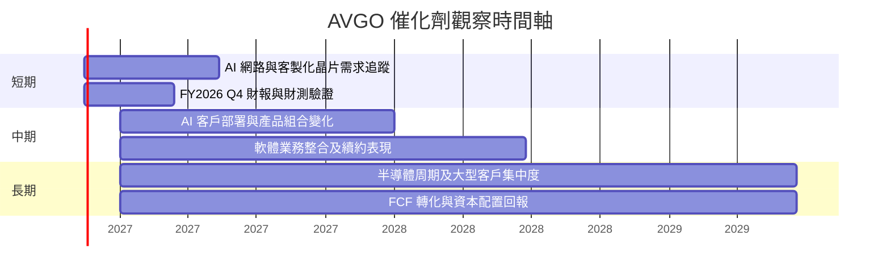

時間軸表示監控窗口，不代表公司已公布確定催化日期。

### 9.2 TAM 市場規模分析

題示未提供可核驗的市場 TAM、滲透率與公司分部收入，因此不填造市場規模。

```
╔══════════════════════════════════════════════════════════════╗
║                 TAM 與收入機會：資料可得性                     ║
╠══════════════════════════════════════════════════════════════╣
║ AI/資料中心網路      TAM：N/A｜滲透率：N/A｜AVGO收入：未拆分   ║
║ 客製化晶片           TAM：N/A｜滲透率：N/A｜AVGO收入：未拆分   ║
║ 無線連接半導體       TAM：N/A｜滲透率：N/A｜AVGO收入：未拆分   ║
║ 基礎設施軟體         TAM：N/A｜滲透率：N/A｜AVGO收入：未拆分   ║
╠══════════════════════════════════════════════════════════════╣
║ 代理觀察值：TTM營收 $89.10B，TTM成長48.7%；不能等同 TAM。     ║
╚══════════════════════════════════════════════════════════════╝
```

### 9.3 成長驅動力結構圖

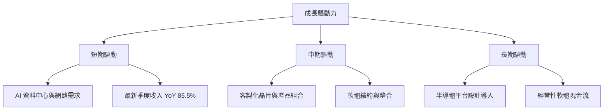

---

## 10. 風險矩陣

### 10.1 風險評分矩陣

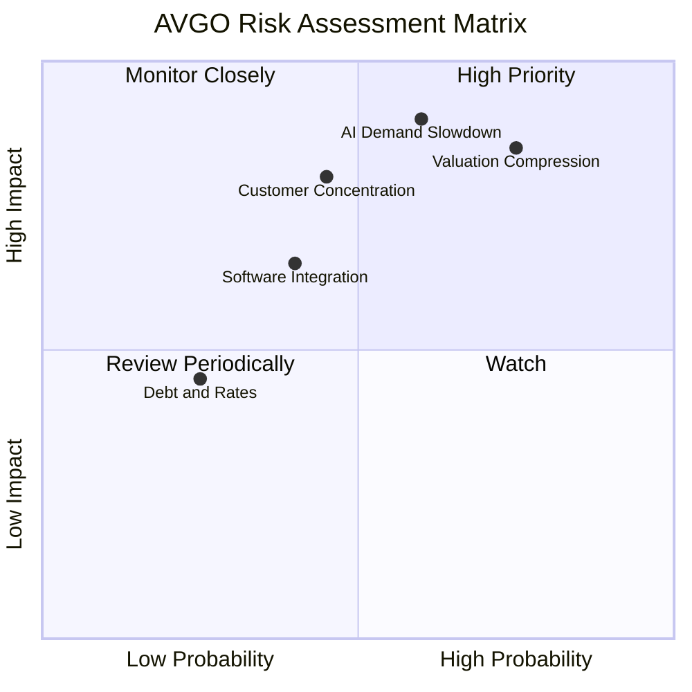

### 10.2 風險清單詳細分析

| # | 風險項目 | 發生機率 | 財務衝擊 | 風險評分 | 緩解措施 |
|---|----------|----------|----------|----------|----------|
| 1 | 🔴 AI／資料中心需求降速 | 中高，約 35% 分析假設 | TTM 成長 48.7% 若大幅回落，收入與終值同時下修 | 🔴 8.5/10 | 追蹤分部收入、客戶訂單、庫存及資本支出 |
| 2 | 🔴 估值倍數收縮 | 高，約 45% 分析假設 | 現價 $347.01 高於加權合理值 $232.04；倍數重估可能造成下行 | 🔴 9.0/10 | 以分批、估值區間及倉位上限管理 |
| 3 | 🟠 客戶集中／議價風險 | 中，約 30% 分析假設 | 大型客戶延遲產品部署可影響季度營收與毛利率 | 🟠 7.5/10 | 觀察客戶集中度與前瞻指引；資料目前 N/A |
| 4 | 🟡 軟體整合與商譽減值 | 中，約 25% 分析假設 | 商譽 $97.80B、其他無形資產 $26.33B，若現金流預期下降或產生減值 | 🟡 6.5/10 | 追蹤軟體續約、留存率、整合費用及現金流 |
| 5 | 🟡 淨負債與利率 | 低中，約 15% 分析假設 | 淨負債 $35.44B；升息提高融資成本及折現率 | 🟡 4.5/10 | 維持現金流覆蓋、追蹤償債及利息保障 |

上述機率為分析師風險分級假設，並非統計預測。估值壓縮風險評分最高，因即使業務保持成長，現價與內在價值的落差仍大。

---

## 11. 投資建議

### 11.1 最終綜合評級雷達圖

```
╔══════════════════════════════════════════════════════════════╗
║                    AVGO 最終評分                              ║
╠══════════════════════════════════════════════════════════════╣
║ 基本面強度    8.5 ▓▓▓▓▓▓▓▓▓▓▓▓▓▓▓▓▓░░░                      ║
║ 成長動能      8.8 ▓▓▓▓▓▓▓▓▓▓▓▓▓▓▓▓▓░░░                      ║
║ 獲利能力      9.0 ▓▓▓▓▓▓▓▓▓▓▓▓▓▓▓▓▓▓░░                      ║
║ 財務健康      7.0 ▓▓▓▓▓▓▓▓▓▓▓▓▓▓░░░░░░                      ║
║ 護城河深度    8.2 ▓▓▓▓▓▓▓▓▓▓▓▓▓▓▓▓░░░░                      ║
║ 估值合理性    3.5 ▓▓▓▓▓▓▓░░░░░░░░░░░░░░                      ║
╠══════════════════════════════════════════════════════════════╣
║ 綜合評分      7.2/10；基本面高質但價格風險使報酬風險比不佳      ║
╚══════════════════════════════════════════════════════════════╝
```

### 11.2 目標價與隱含報酬率

| 情境／參考 | 目標價 | 相對 $347.01 報酬 | 權重或依據 |
|------------|-------:|-----------------:|------------|
| 🔴 悲觀情境 | 約 $160 | -53.9% | 成長降速、利潤率下滑、倍數收縮 |
| 🟡 基準加權合理值 | **$232.04** | **-33.1%** | 第 8.8 節五種方法加權 |
| 🟢 樂觀情境 | 約 $330 | -4.9% | AI 需求延續、利潤率穩定，仍採倍數收斂 |
| 分析師共識目標價 | $529.24 | +52.5% | 47 位分析師平均；本報告只給 5% 權重 |

評級依規則 20：**MOS -49.5% < -25%，對應賣出**。ROIC 高於 WACC 是長期企業品質的正面因素，但不改變目前價格高於基準價值的結論。

### 11.3 買入時機與觸發因素

```
╔══════════════════════════════════════════════════════════════════╗
║                  ✅ 投資觸發因素 Checklist                       ║
╠══════════════════════════════════════════════════════════════════╣
║  重新考慮買入條件：                                               ║
║  ☐ 股價回落至 $208.84 以下，對應加權合理值至少 10% MOS           ║
║  ☐ TTM FCF 維持正成長，且 FCF/淨利維持約 100% 或以上             ║
║  ☐ AI/網路相關營收成長有分部數據佐證，而非只靠單季總營收          ║
║  ☐ 營業利益率保持在 48% 左右或以上                               ║
║                                                                  ║
║  加碼觸發條件：                                                   ║
║  ☐ 估值回到合理區，同時 ROIC 持續高於 WACC                       ║
║  ☐ 公司披露的分部成長、訂單或產品導入支持中期營收預測             ║
║                                                                  ║
║  減碼／退出觸發條件：                                             ║
║  ☐ 股價仍高於基準合理值且預期報酬不足                             ║
║  ☐ FCF 連續兩季下滑或營業利益率較 TTM 基準收縮超過 5pp            ║
║  ☐ 軟體或半導體關鍵業務出現持續性需求／客戶流失                   ║
╚══════════════════════════════════════════════════════════════════╝
```

### 11.4 投資人適配度分析

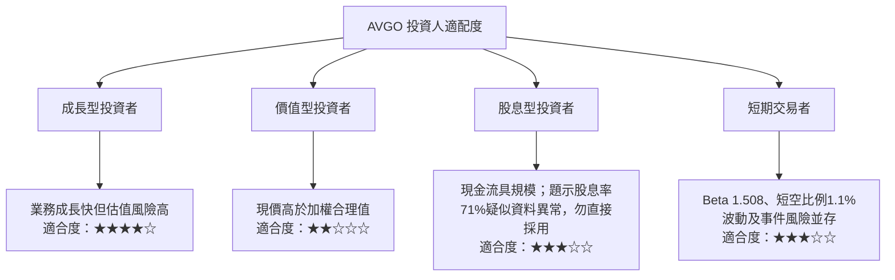

> 題示股息殖利率 71.0% 與每股股息資料可能存在欄位／單位錯誤；不應將 71.0% 當作可靠股息收益率。應以公司公告與最新股息金額核實。

### 11.5 每季財報監控清單（Quarterly Watch List）

| 指標 | 目前錨點 | 加碼／正面門檻 | 減碼／負面門檻 |
|------|----------|----------------|----------------|
| 總營收成長 | TTM 48.7%；最新一季單季 YoY 85.5% | YoY 維持正成長且由分部披露支持 | 連續兩季 YoY 低於 20% |
| 營業利益率 | TTM 48.0%；最新季度 53.9% VERIFIED | TTM 維持約 48% 或以上 | 相對 TTM 基準收縮超過 5pp |
| FCF | TTM $39.40B | TTM 同比成長且 FCF Yield 改善 | FCF 連續兩季下降或轉負 |
| Capex | TTM $1.25B | 投資增加伴隨訂單／收入轉化 | Capex 上升而收入、FCF 未跟進 |
| SBC | 最近四季估算 $8.48B | SBC/營收下降 | SBC/營收持續高於約 10% 且股數擴張 |
| 淨負債 | $35.44B | 淨負債逐步下降 | 淨負債上升且利息保障惡化 |
| AI／客製化晶片 | 分部值 N/A | 公司披露分部成長持續且客戶多元化 | 需求或訂單下修、客戶集中惡化 |
| 軟體續約／整合 | N/A | 留存、續約與現金流穩定 | 續約流失或商譽減值跡象 |
| EPS 指引與實績 | EPS 預估序列缺失 | 實際 EPS 成長與指引一致 | 多季低於公司指引或市場預期 |

### 11.6 反面論證：什麼會證明論點錯誤

```
╔══════════════════════════════════════════════════════════════════╗
║              ⚠️ 論點失效條件（Disconfirming Evidence）           ║
╠══════════════════════════════════════════════════════════════════╣
║ 若下列任一條件持續成立，應重新檢視估值與持倉：                  ║
║ ☐ 總營收 YoY 連續兩季低於 20%，且 AI/半導體分部同步放緩          ║
║ ☐ TTM 營業利益率由 48.0% 基準收縮超過 5pp                       ║
║ ☐ FCF 連續兩季下降，或 TTM FCF 轉負                              ║
║ ☐ ROIC 跌至 12.40% WACC 以下，顯示資本配置開始摧毀價值           ║
║ ☐ SBC/營收持續高於約 10%，且流通股數增加而非由回購抵銷           ║
║ ☐ 軟體業務續約或客戶留存惡化，觸發大額商譽／無形資產減值         ║
╚══════════════════════════════════════════════════════════════════╝
```

> **免責聲明**：本報告為 AI 自動生成，僅供研究參考，不構成投資建議。投資有風險，入市需謹慎。