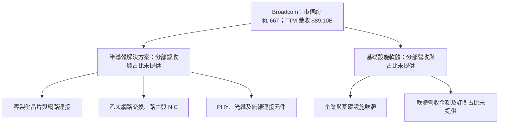
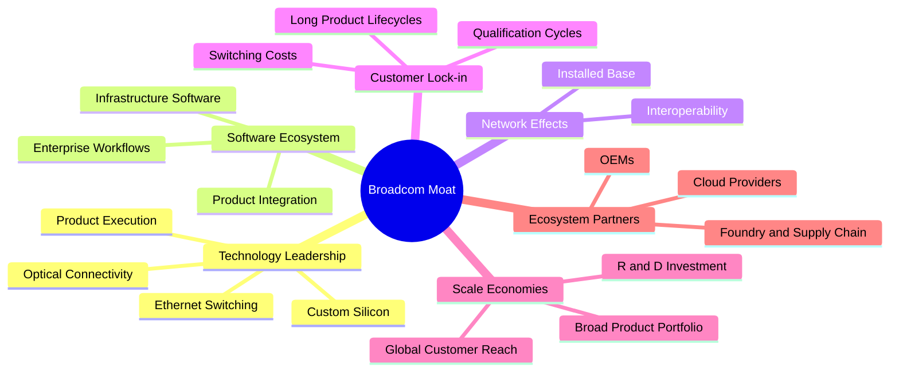
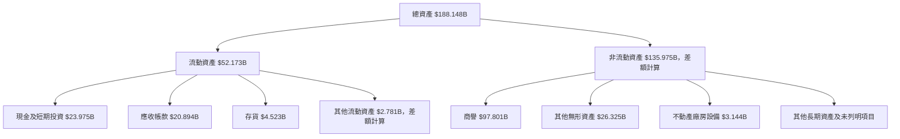
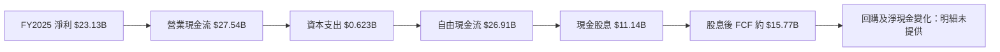
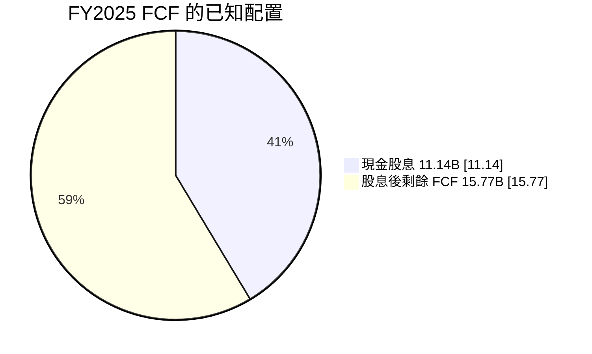
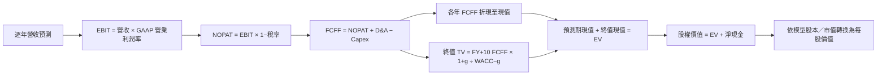
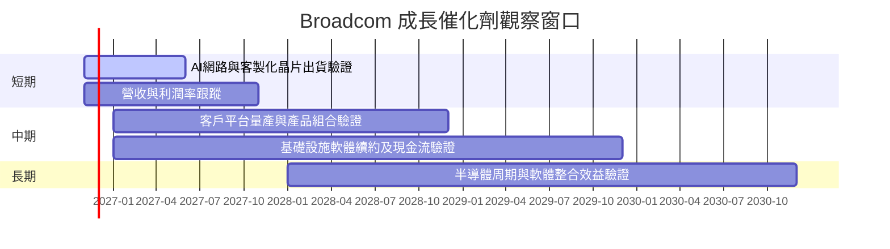
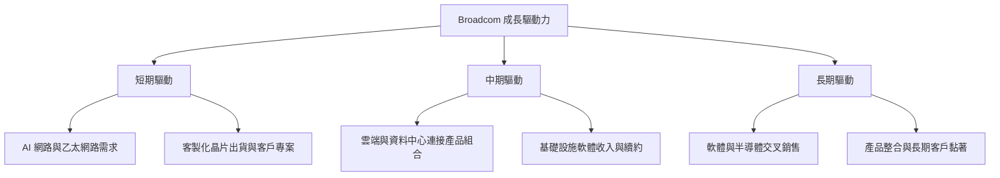
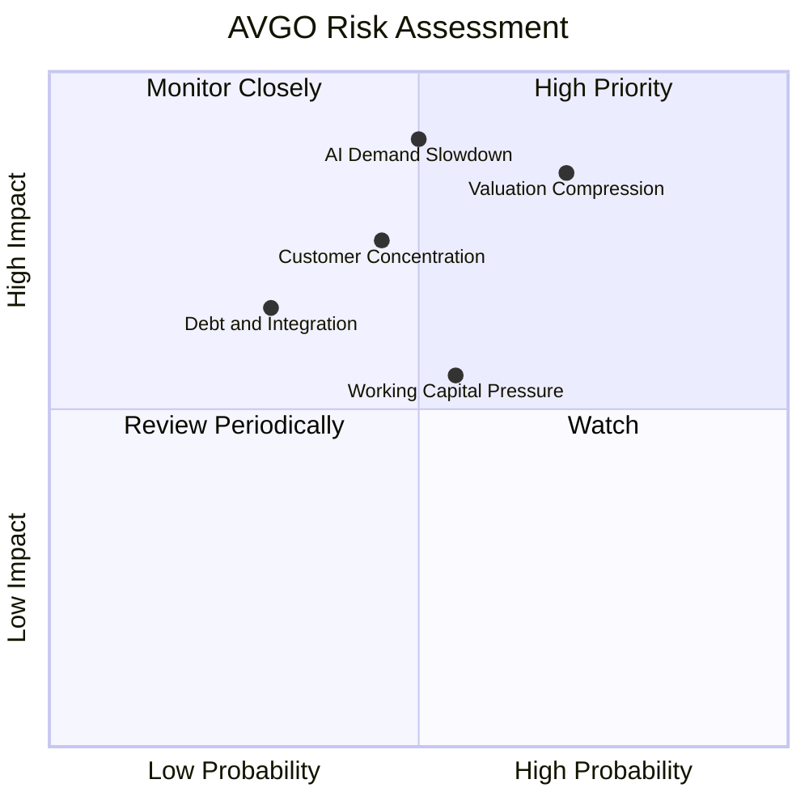
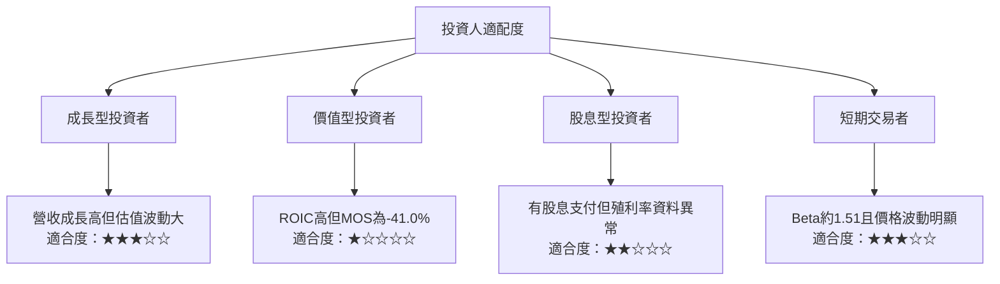

# AVGO 基本面深度分析報告
> **報告日期**：2026-11-15 ｜ **語言**：繁體中文 ｜ **數據來源**：SEC 申報資料 (XBRL)、Yahoo Finance、Finviz、StockAnalysis、Roic.ai ｜ **分析師**：CFA 級機構研究

---

## 目錄

| # | 章節 | 核心結論 |
|---|------|----------|
| 1 | 執行摘要 | 賣出；加權合理價值 $246.05；MOS -41.0% |
| 2 | 公司概覽與商業模式 | 半導體與基礎設施軟體組合具規模與客戶黏著度，分部營收占比未提供 |
| 3 | 損益表深度分析 | TTM 營收 $89.10B、年增 48.7%；營業利益率 48.0% |
| 4 | 資產負債表分析 | 淨負債 $35.44B；流動比率 2.504 倍，營運資金天數增加 |
| 5 | 現金流量深度分析 | TTM FCF $39.40B，FCF Yield 2.38% |
| 6 | 獲利能力與資本效率 | ROIC 30.0% 高於 WACC 11.58%，目前仍創造經濟價值 |
| 7 | 相對估值分析 | Forward P/E 高於同業中位數；自身估值位於歷史偏高區 |
| 8 | DCF 內在價值評估 | 基準 DCF $208.79；終值占企業價值 52.4% |
| 9 | 成長催化劑 | AI 網路與客製化晶片需求是重要可能驅動力，但未提供 TAM 數字 |
| 10 | 風險矩陣 | 估值、AI 需求循環及客戶／供應鏈集中為主要風險 |
| 11 | 投資建議 | 現價高於加權合理價值；等待估值回落或營運數據持續驗證 |

---

## 1. 執行摘要

### 1.0 一頁式投資儀表板（Portfolio Manager 30 秒速讀）

| 項目 | 內容 |
|------|------|
| **投資論點（3 句）** | ① TTM 營收 $89.10B、年增 48.7%，最新一季單季年增 85.5%，顯示需求與產品出貨仍在加速。② TTM 營業利益率 48.0%、ROIC 30.0%，高於 11.58% WACC，現有營運仍創造股東價值。③ 現價 $347.01 高於加權合理價值 $246.05，MOS -41.0%，主要風險是高估值已預支未來成長。 |
| **綜合評分** | **6.7/10**（引用 1.1 六項評分的算術平均） |
| **財務健康** | 🟡 現金及短期投資 $23.98B、總債務 $59.42B，淨負債 $35.44B；流動比率 2.504 倍，但 CCC 較一年前延長 10 天。 |
| **ROIC vs WACC** | **30.0% vs 11.58%**；利差 18.42 個百分點，創造價值。 |
| **FCF 趨勢** | TTM FCF $39.40B；FY2022–FY2025 年度 FCF 由 $16.31B 增至 $26.91B，TTM FCF Yield 2.38%。 |
| **估值** | Forward P/E 17.83x ｜ EV/EBITDA 32.375x（市場資料）｜ FCF Yield 2.38%。 |
| **DCF 內在價值（基準）** | **$208.79** ｜現價相對 DCF 折溢價 **+66.2% 溢價**（以 DCF 基準價值計）。 |
| **安全邊際（MOS）** | **-41.0%＝($246.05 − $347.01) ÷ $246.05**；🔴 <10% 無。分母為 8.8 加權合理價值。 |
| **預期報酬（基準情境 12M）** | DCF 基準情境 $208.79，相對現價上行空間 **-39.8%**；此為模型情境，不等同分析師共識。 |
| **關鍵風險（前二）** | ① 當前估值要求高成長持續；② AI／網路及客製化晶片需求若降溫，營收與倍數可能同時收縮。 |
| **評級 + 信心度** | 🔴 **賣出** ｜信心：中。規則 20 依 MOS -41.0% 得出；沒有依質化因素調整。 |

### 1.1 綜合評分卡（全報告唯一）

| 維度 | 評分（1–10） | 主要依據（引用數字與其來源章節） |
|------|--------------|----------------------------------|
| 成長性 | 9 | TTM 營收年增 48.7%、最新一季單季年增 85.5%（第 3 章）；成長速度高，但集中於週期性半導體與 AI 需求。 |
| 獲利能力 | 9 | TTM 營業利益率 48.0%、ROIC 30.0% 對 WACC 11.58%、F-Score 7/8（第 6 章）。 |
| 財務健康 | 7 | 淨負債 $35.44B、流動比率 2.504 倍、CCC 63 天且較一年前增加 10 天（第 4 章）。 |
| 估值 | 1 | MOS -41.0%；Forward P/E 17.83x 高於三家同業中位數 14.1x（第 7、8 章）。 |
| 護城河 | 8 | 產品組合涵蓋連網晶片及基礎設施軟體，TTM 毛利率 75.5%；但分部及客戶集中度數據未提供（第 2 章）。 |
| 管理層與資本配置 | 6 | FY2025 FCF $26.91B、股息支付 $11.14B；FY2025 SBC $7.57B，且最新比較期稀釋股數未通過 F-Score 測試（第 3、5、6 章）。 |
| **綜合評分** | **6.7** | 六項算術平均：(9 + 9 + 7 + 1 + 8 + 6) ÷ 6 = 6.666…，四捨五入至小數一位。 |

### 1.2 五大投資論點 + 三大核心風險

| 類型 | 項目 | 具體依據 | 信心度 |
|------|------|----------|--------|
| 🟢 **投資論點①** | AI 與網路相關需求推升營收 | TTM 營收 $89.10B、年增 48.7%；最新一季營收年增 85.5%。單季增速明顯高於 TTM，若需求延續，營運槓桿有機會維持。 | 🟢 高 |
| 🟢 **投資論點②** | 高營業利潤率與現金產生能力 | TTM 營業利益率 48.0%、營業現金流 $40.65B、FCF $39.40B，資本支出僅 $1.25B。 | 🟢 高 |
| 🟢 **投資論點③** | ROIC 顯著高於資本成本 | ROIC 30.0% 對 WACC 11.58%，利差 18.42 個百分點，反映現階段資本投入回報高於資金成本。 | 🟢 高 |
| 🟢 **投資論點④** | 半導體與基礎設施軟體組合 | 公司跨越半導體產品與基礎設施軟體，降低單一產品依賴的可能性；但分部營收占比未提供，尚不能量化分散效果。 | 🟡 中 |
| 🟢 **投資論點⑤** | 營運現金流高於淨利 | TTM 營業現金流 $40.65B，高於 TTM 淨利約 $38.27B；現金轉換率支持獲利含金量。 | 🟢 高 |
| 🟡 **風險①** | 高估值與模型下檔 | DCF 基準價值 $208.79，低於現價 $347.01；加權合理價值 $246.05，MOS -41.0%。 |
| 🔴 **風險②** | AI 成長預期與需求集中 | DCF 基準假設首年營收成長 30.0%，而市場價格反推首年成長 44.1%；若需求沒有支撐，估值面臨下修。 |
| 🟡 **風險③** | SBC 與營運資金占用 | FY2025 SBC $7.57B；DSO 由 40 天升至 56 天、DIO 由 40 天升至 59 天，需留意增長是否伴隨回款與庫存壓力。 |

### 1.3 快速統計卡片

| 指標 | 公司實際值（期間） | 同業中位數 | 狀態 |
|------|--------------------|------------|------|
| 營收成長（TTM） | **48.7%** | — | 🟢 |
| 營收成長（最新一季年增） | **85.5%** | 36.5% | 🟢 |
| 毛利率（TTM） | **75.5%** | 53.1% | 🟢 |
| 營業利益率（TTM） | **48.0%** | — | 🟢 |
| ROIC（TTM） | **30.0%** | — | 🟢 |
| Forward P/E | **17.827318x** | 14.1x | 🟡 |
| FCF Yield（TTM） | **2.38%** | — | 🟡 |
| Piotroski F-Score | **7 / 8** | — | 🟢 |

> 同業中位數只依可用同業資料計算：最新一季營收成長中位數為 MRVL 36.5%、QCOM -8.4%、NVDA 105.9% 的中位數 36.5%；毛利率中位數為 53.1%；Forward P/E 中位數為 14.1x。

### 1.4 投資結論

```text
╔══════════════════════════════════════════════════════════════════╗
║                    📊 投資結論摘要                               ║
╠══════════════════════════════════════════════════════════════════╣
║  評級：🔴 賣出（依 MOS -41.0%，符合規則 20）                    ║
║  價格（2026-11-13 收盤）：$347.01                               ║
║  DCF 內在價值（基準）：$208.79（現價溢價 +66.2%）               ║
║  安全邊際 MOS：-41.0%（＝(加權合理價值−現價)÷加權合理價值）     ║
║  加權合理價值（8.8）：$246.05                                   ║
║  DCF 情境價值：                                                  ║
║    悲觀情境：$86.41（-75.1%）                                    ║
║    基準情境：$208.79（-39.8%）                                   ║
║    樂觀情境：$459.00（+32.3%）                                   ║
║  綜合評分：6.7/10（引用 1.1）                                   ║
║  適合投資人：能承受半導體週期波動、以長期成長為目標且重視估值者 ║
╚══════════════════════════════════════════════════════════════════╝
```

---

## 2. 公司概覽與商業模式

### 2.1 業務結構與收入來源

Broadcom 設計、開發並供應半導體元件及基礎設施軟體。公司業務涵蓋網路連接、客製化晶片、乙太網路交換與路由、NIC 控制器、PHY 裝置、光纖元件及無線連接等。提供的資訊沒有分部營收、占比或軟體收入金額，故不臆造各部門比例。



### 2.2 市場份額

市場份額數據未提供，沒有可引用的份額百分比或年份，因此不繪製市場份額圖。公司 TTM 營收為 $89.10B，TTM 營收年增 48.7%，最新一季單季年增 85.5%；Peer multiples 的同業最新單季成長從 QCOM -8.4% 至 NVDA 105.9% 不等，AVGO 的當季增速高於 MRVL、低於 NVDA。單季增速不能直接推論長期市場份額變化。

### 2.3 競爭護城河分析



### 2.4 護城河強度

| 護城河項目 | 強度（強／中／弱） | 證據（引用數字或事實） | 會削弱它的情況 |
|------------|--------------------|------------------------|----------------|
| 技術與產品組合 | 強 | 涵蓋客製化晶片、乙太網路交換與路由、NIC、PHY、光纖等；TTM 毛利率 75.5%。 | 競爭者追上設計能力、客戶改採自研或替代方案。 |
| 軟體生態系統 | 中 | 公司有基礎設施軟體業務；軟體分部收入、續約率及經常性收入占比未提供。 | 軟體整合效益未能持續，或客戶轉向替代平台。 |
| 網路效應 | 中 | 網路設備及互通產品可能因相容性與部署規模受益，但可量化網路效應資料未提供。 | 產業標準改變，或客戶採用更開放的替代架構。 |
| 客戶鎖定 | 中至強 | 企業與網路產品通常須經過客戶驗證及系統整合；客戶集中度、續約率及切換成本數字未提供。 | 大型客戶議價能力上升、集中採購或供應商替換。 |
| 規模效應 | 強 | TTM 營收 $89.10B、研發支出 FY2025 $10.98B（年度損益表資料），顯示可支撐廣泛研發與產品線。 | 成本增速超過營收，或產品線複雜度降低資本效率。 |
| 生態夥伴 | 中 | 業務需與雲端業者、OEM、代工與供應鏈協作；伙伴收入占比及依賴程度未提供。 | 供應中斷、出口限制或主要客戶轉向其他供應鏈。 |

第 1.1 節「護城河」評分為 8 分，依據是廣泛產品組合、TTM 毛利率 75.5% 與大型研發投入；扣分原因是分部與客戶集中度資料不足。

---

## 3. 損益表深度分析

### 3.1 年度收入成長趨勢（近 4 年）

FY2022–FY2025 年度營收來自年度損益表；成長率依相鄰年度計算，FY2022 YoY 使用所列 FY2021 營收 $27.45B 計算。

```text
╔══════════════════════════════════════════════════════════════════╗
║            Broadcom 年度收入趨勢（FY2022–FY2025）                ║
╠══════════════════════════════════════════════════════════════════╣
║  FY2022  $33.20B  █████████████░░░░░░░░░░░░░░  YoY +21.0% 🟢   ║
║  FY2023  $35.82B  ██████████████░░░░░░░░░░░░░░  YoY  +7.9% 🟡   ║
║  FY2024  $51.57B  █████████████████████░░░░░░░  YoY +44.0% 🟢   ║
║  FY2025  $63.89B  ██████████████████████████░░░  YoY +23.9% 🟢   ║
║                                                                  ║
║  4 年視窗 FY2021–FY2025 營收 CAGR：                              ║
║  (63.887 ÷ 27.450)^(1/4) − 1 = 23.5%                            ║
╚══════════════════════════════════════════════════════════════════╝
```

FY2024 高成長與 FY2025 持續擴張，配合 FY2026 TTM 48.7% 成長，顯示近期增長顯著快於 FY2021–FY2025 的 23.5% CAGR。合併與產品組合變化可能影響歷史基準；分部資料不足，無法精確拆解各成長來源。

### 3.2 季度收入趨勢分析

季度收入採 StockAnalysis.com 季度損益表；QoQ 以相鄰列示季度收入計算，最新一季 YoY 使用 VERIFIED FIGURES 的單季年增率。

| 季度 | 營收（$B） | QoQ | YoY | 備註 |
|------|-----------:|----:|----:|------|
| 2025-10-31 | 18.015 | +12.9% | +28.18% | 相對 2025-08-03 季度營收 $15.952B。 |
| 2026-01-31 | 19.311 | +7.2% | +29.47% | YoY 仍高於 TTM 48.7%? 否；單季 YoY 為 29.47%，反映與 TTM 增速口徑不同。 |
| 2026-04-30 | 22.187 | +14.9% | +47.87% | 成長加速，季度營收較前季增加 $2.876B。 |
| 2026-08-02 | 29.591 | +33.4% | **+85.5%** | VERIFIED FIGURES 單季年增率；季度增速明顯放大。 |

> 季度來源表列示的期末日為 2026-07-31／2026-04-30 等，SEC 最新季度期間標示為 2026-08-02；日期存在資料源口徑差異，最新季度 YoY 僅採用明確標註的 85.5%。

### 3.3 利潤率演變分析

| 利潤率指標 | FY2022 | FY2023 | FY2024 | FY2025 | 趨勢 | 評估 |
|------------|-------:|-------:|-------:|-------:|------|------|
| **毛利率**（年度毛利 ÷ 營收） | 66.5% | 68.9% | 63.0% | 67.8% | 年度間波動；TTM 毛利率另列為 75.5%。 | 🟡 年度表格與 TTM 資料口徑可能受併購及分部組合影響。 |
| **營業利益率**（年度營業利益 ÷ 營收） | 43.0% | 45.9% | 29.1% | 40.8% | FY2024 下滑後 FY2025 回升；TTM 為 48.0%。 | 🟢 近期 TTM 水準高，但應注意年度與 TTM 口徑差異。 |
| **淨利率（TTM）** | — | — | — | — | 42.9% | 🟢 高獲利轉換；季度淨利仍受稅項及非營運項目影響。 |

> 年度毛利與營業利益率由年度損益表提供的金額計算。另一來源 StockAnalysis 對 FY2025 毛利、營業利益數字與年度損益表不一致，因此不將不同來源數字混合計算年度利潤率。TTM 指標採用指定的品質及 VERIFIED FIGURES。

**利潤率演變深度解析**：TTM 營業利益率 48.0%，低於最新季度的 53.9%，代表近期季度獲利能力高於過去四季平均。可能的機制包括較高毛利產品占比、規模攤薄與費用控制；但資料沒有分部毛利、產品出貨組合或單位成本，不能將利潤率改善歸因於單一因素。年度毛利率在 FY2024 曾下降至約 63.0%，也提醒投資人併購組合、成本與產品周期可能讓利潤率波動。

### 3.4 費用結構分析

可得的 FY2025 研發費用為 $10.98B；年度營收 $63.89B，研發費用約占 17.2%。完整營業費用、銷管費、利息、稅項及其他費用分類數據未能在同一期間一致取得，因此不繪製完整損益表費用圓餅圖，避免用缺漏分類推估比例。

```text
╔══════════════════════════════════════════════════════════════════╗
║                FY2025 已知費用項目                               ║
╠══════════════════════════════════════════════════════════════════╣
║  研發費用 $10.98B / 營收 $63.89B = 17.2%                         ║
║  其他費用分類：未提供一致可比數字，故不補算或繪製比例圖         ║
╚══════════════════════════════════════════════════════════════════╝
```

### 3.5 季度 EPS 趨勢與盈餘品質（Quality of Earnings）

| 盈餘品質項目 | 數值／佔比 | 評估 |
|--------------|------------|------|
| 股權薪酬 SBC / 營收 | 約 $8.48B ÷ $89.10B = **9.5%**；估算使用四季 SBC 合計，季度與 TTM 期間近似但日期口徑不完全一致。 | 🟡 SBC 規模不低，會稀釋股東；FY2025 SBC $7.57B 亦顯著。 |
| SBC / 營業現金流 | 約 $8.48B ÷ $40.65B = **20.9%** | 🟡 SBC 是非現金費用，但具有經濟稀釋成本，需同時看股數變化。 |
| FCF / 淨利（現金轉換率） | $39.40B ÷ $38.265B = **103.0%** | 🟢 現金流略高於淨利，現金轉換良好。 |
| 一次性／非經常性損益 | **N/A**（未提供可辨識明細） | 無法判斷本期淨利受一次性項目美化或壓低的程度。 |
| 有效稅率異常 | **N/A**（有效稅率明細未提供）；DCF 假設稅率為 21.0%。 | 不能由模型假設推論實際稅率。 |
| 資本化支出 vs 費用化 | TTM Capex $1.25B；資本化研發等資料 N/A。 | Capex 低於營收，但無法僅憑 Capex 判定費用是否資本化或遞延。 |

**過去四季 EPS 表現**：EPS Est／EPS Act 在最近四季均為 NaN，故無法判定「超預期」或「不及預期」。可觀察到列示的單季 EPS：2025-10-31 為 $1.74、2026-01-31 為 $1.50、2026-04-30 為 $1.91、2026-07-31 為 $2.68；Q3 2026 EPS YoY 成長 215.3%。但單季 EPS 及季度日期口徑與其他來源有差異，不能替代一致的盈餘驚喜資料。

**盈餘品質結論**：TTM FCF $39.40B 約為淨利 $38.265B 的 103.0%，現金轉換支持獲利品質；但 SBC 約占營收 9.5%、占營業現金流約 20.9%，並且 F-Score 的稀釋股數測試未通過，股東需將稀釋成本納入估值。一次性損益、實際有效稅率與資本化費用缺少足夠資料，不能判斷 GAAP 盈餘是否被特定項目高估。

---

## 4. 資產負債表分析

### 4.1 資產結構分解

以下數字採 2026-08-02 TTM 資產負債表資料，金額為 $B。非流動資產為總資產減流動資產的計算值；明細不必然涵蓋所有資產。



### 4.2 流動性與營運資金分析

| 流動性指標 | 最新資料 | 歷史／比較資料 | 評估 |
|------------|----------|----------------|------|
| 現金及短期投資 | $23.98B | FY2025 $16.18B | 🟢 現金緩衝增加。 |
| 總債務 | $59.42B | FY2025 $65.14B | 🟡 債務仍高於現金，需持續償付。 |
| 淨負債 | $35.44B | — | 🟡 以目前 FCF 規模具有償債能力，但並非淨現金公司。 |
| 流動比率 | 2.504 倍 | FY2025 年底由流動資產 $31.57B／流動負債 $18.51B 得約 1.71 倍，資料期間與來源口徑不同 | 🟢 最新指標顯示短期流動性充足。 |
| 速動比率 | 2.153 倍 | — | 🟢 近期流動性具有緩衝。 |

**營運資金天數**

| 指標 | 最新 TTM | 一年前 TTM | 變化 | 解讀 |
|------|----------:|----------:|------:|------|
| DSO 應收帳款天數 | 56 天 | 40 天 | +16 天 | 🟡 收款週期拉長；可能與快速成長、客戶付款條件或期末應收增加有關，需觀察應收帳款是否快於營收增長。 |
| DIO 存貨天數 | 59 天 | 40 天 | +19 天 | 🟡 存貨占用增加；需辨別為需求備貨或周轉放慢。 |
| DPO 應付帳款天數 | 52 天 | 26 天 | +26 天 | 🟢 延長供應商付款週期可部分抵銷應收、存貨占用；是否代表議價力改善尚無資料證實。 |
| CCC 現金轉換週期 | 63 天 | 53 天 | +10 天 | 🟡 現金轉換變慢，增長帶來的營運資金需求上升。 |

> 以上營運資金天數直接採用程式計算的 QUALITY FIGURES；沒有重新計算。

### 4.3 債務結構分析

```text
╔══════════════════════════════════════════════════════════════════╗
║                   Broadcom 債務健康診斷                          ║
╠══════════════════════════════════════════════════════════════════╣
║  總債務：       $59.42B  ████████████████████  🟡               ║
║  現金及短投：   $23.98B  ████████░░░░░░░░░░░░  🟢               ║
║  淨負債：       $35.44B  ████████████░░░░░░░░  🟡               ║
║                                                                  ║
║  Debt/EBITDA：估算約 1.15x，使用總債務 $59.42B ÷ EBITDA $51.3B  ║
║  Interest Coverage：N/A（利息費用資料未提供）                   ║
║  Debt/Equity：來源值 59.604；單位／口徑不清，不作倍數解讀        ║
║  判斷：FCF 強，負債可管理；仍需關注併購後負債與利息成本          ║
╚══════════════════════════════════════════════════════════════════╝
```

> EBITDA $51.3B 為近似值：採用 TTM 營收 $89.10B × EBITDA margin 58.7%。此處僅作債務量級參考，不是 VERIFIED FIGURES 指定的 DCF 輸入。

### 4.4 股東權益趨勢

| 財年 | 股東權益（$B） | YoY 變化 | 解讀 |
|------|---------------:|---------:|------|
| FY2022 | 22.71 | — | 歷史基準。 |
| FY2023 | 23.99 | +5.6% | 小幅增加。 |
| FY2024 | 67.68 | +182.1% | 大幅增加，可能受併購與資本結構變化影響；不能只視為內生累積。 |
| FY2025 | 81.29 | +20.1% | 延續增加。 |

```text
╔══════════════════════════════════════════════════════════════════╗
║                  股東權益趨勢（FY2022–FY2025）                   ║
╠══════════════════════════════════════════════════════════════════╣
║  FY2022  $22.71B  ██████░░░░░░░░░░░░░░░░░░░░░░                   ║
║  FY2023  $23.99B  ███████░░░░░░░░░░░░░░░░░░░░░                   ║
║  FY2024  $67.68B  ██████████████████████░░░░░░                   ║
║  FY2025  $81.29B  ███████████████████████████░                   ║
╚══════════════════════════════════════════════════════════════════╝
```

---

## 5. 現金流量深度分析

### 5.1 現金流量瀑布圖

FY2025 年度淨利、營運現金流、資本支出、FCF、股息依年度現金流資料；「留存 FCF」為 FCF 減股息的計算值。回購及淨現金變化資料未提供。



### 5.2 FCF 轉換率趨勢

| 財年 | FCF（$B） | 淨利（$B） | FCF／淨利 | 評估 |
|------|---------:|---------:|----------:|------|
| FY2022 | 16.31 | 11.49 | 142.0% | 🟢 現金流高於淨利。 |
| FY2023 | 17.63 | 14.08 | 125.2% | 🟢 轉換維持良好。 |
| FY2024 | 19.41 | 5.89 | 329.5% | 🟡 淨利基數偏低使比例偏高，不宜外推。 |
| FY2025 | 26.91 | 23.13 | 116.3% | 🟢 現金轉換仍高於 100%。 |
| TTM 至 2026-08-02 | 39.40 | 38.265 | 103.0% | 🟢 轉換率健康，接近一比一。 |

### 5.3 自由現金流趨勢

```text
╔══════════════════════════════════════════════════════════════════╗
║                  自由現金流趨勢                                  ║
╠══════════════════════════════════════════════════════════════════╣
║  FY2022  $16.31B  █████████░░░░░░░░░░░  YoY +16.3%              ║
║  FY2023  $17.63B  █████████░░░░░░░░░░░  YoY  +8.1%              ║
║  FY2024  $19.41B  ██████████░░░░░░░░░░  YoY +10.1%              ║
║  FY2025  $26.91B  ██████████████░░░░░░  YoY +38.6%              ║
║  TTM     $39.40B  ████████████████████  FCF Yield 2.38%         ║
╚══════════════════════════════════════════════════════════════════╝
```

FY2025 FCF 成長 38.6%，TTM FCF 進一步升至 $39.40B。低資本支出使營業現金流較易轉成 FCF，但 SBC 不應被視為沒有成本的現金流增量，因其稀釋股東權益。

### 5.4 資本配置評估

FY2025 FCF 為 $26.91B，現金股息支付 $11.14B，差額約 $15.77B。資料未提供同年度回購、併購現金支出及債務償還的完整分配，故圖表只呈現可核對的 FCF 配置。



| 資本配置項目 | FY2025 金額 | 評估 |
|--------------|------------:|------|
| FCF | $26.91B | 可提供分紅、償債、投資及回購資金。 |
| 現金股息 | $11.14B | 約占 FCF 41.4%；提供股東現金回報。 |
| 股息後剩餘 FCF | 約 $15.77B | 計算為 $26.91B − $11.14B；具備財務彈性，但實際用途未提供。 |
| 回購 | N/A | 無一致可核對數字；不據此判定回購力度。 |
| FY2025 SBC | $7.57B | 對股東有稀釋成本，需與股息及回購一併看待。 |

> 分析師資料欄列示「Dividend Yield 75.0%」與股息金額顯然存在口徑或資料品質疑慮，本報告不採用該殖利率數字。

---

## 6. 獲利能力與資本效率

### 6.1 ROE / ROA / ROIC 趨勢

| 指標 | 最新 TTM | 歷史數據 | 評估 |
|------|---------:|----------|------|
| ROE | **38.4%** | QUALITY FIGURES 的 DuPont 數值；其他行情資料另列 44.2%，口徑不同，本報告採用 QUALITY FIGURES。 | 🟢 高回報，但須同時看權益乘數及商譽。 |
| ROA | N/A（歷年一致口徑未提供） | F-Score 顯示 TTM ROA 為正且高於一年前，但未提供精確數值。 | 🟢 方向正向；不能量化趨勢幅度。 |
| ROIC | **30.0%** | TTM after-tax operating income ÷ invested capital。 | 🟢 明顯高於 WACC。 |

### 6.2 ROIC vs WACC 分析（核心價值創造判斷）

以下 WACC 與 ROIC 一律使用指定的程式計算值，不另建替代模型。原始 Beta 為 1.51，採用調整後 Beta 1.34，計算方式為 ⅔ × 1.51 + ⅓ × 1。

```text
╔══════════════════════════════════════════════════════════════════╗
║                ROIC vs WACC 深度分析                            ║
╠══════════════════════════════════════════════════════════════════╣
║  WACC 組成（採用 Cost of capital 輸入）：                        ║
║  ├── 無風險利率（10Y 美債）：       5.15%                       ║
║  ├── 市場風險溢酬 ERP：              5.00%                       ║
║  ├── 原始 Beta：                     1.51                        ║
║  ├── 調整後 Beta：                   1.34                        ║
║  ├── Ke = 5.15% + 1.34 × 5.00% = 11.85%                        ║
║  ├── 稅前債務成本：                  5.40%                       ║
║  ├── 稅後債務成本：                  5.40% × (1−21%) = 4.27%    ║
║  ├── 股權／債務權重：                96.5% / 3.5%                ║
║  └── WACC：                          11.58%                      ║
║                                                                  ║
║  ROIC（TTM）：                       30.00%                      ║
║  ROIC − WACC：                       18.42 個百分點              ║
║  ROIC / WACC：                       約 2.59 倍                  ║
║                                                                  ║
║  ROIC 30.00%  ▓▓▓▓▓▓▓▓▓▓▓▓▓▓▓▓▓▓▓▓▓▓▓▓▓▓▓▓                     ║
║  WACC 11.58%  ▓▓▓▓▓▓▓▓▓▓▓▓░░░░░░░░░░░░░░░░                     ║
║  EVA spread     +18.42pp                                           ║
╠══════════════════════════════════════════════════════════════════╣
║  結論：ROIC 高於 WACC，現階段投入資本仍創造經濟價值；          ║
║  但估值高低與價值創造不是同一問題，現價仍高於估值模型基準值。  ║
╚══════════════════════════════════════════════════════════════════╝
```

**WACC 公式核對**：  
Ke = 5.15% + 1.34 × 5.00% = 11.85%。稅後 Kd = 5.40% × (1 − 21.0%) = 4.266%。加權 WACC = 96.5% × 11.85% + 3.5% × 4.266% = 11.58456%，採用 **11.58%**。

> 費用資本化細節、利息費用與平均計息負債明細未提供，故無法從原始報表獨立重建稅前 Kd；此處採用成本資本資料列示的稅前 Kd 5.40%。第 8.2 節沿用同一 WACC。

### 6.3 杜邦三因素分解

| 因素 | 數值（TTM） | 解讀 |
|------|-------------|------|
| 淨利率 | 42.9% | 高淨利率是 ROE 的主要貢獻來源之一。 |
| 資產週轉率 | 0.47 | 每美元資產產生約 0.47 美元營收，與大型無形資產及商譽基礎相符。 |
| 權益乘數 | 1.89 | 財務槓桿有貢獻，但不是 ROE 唯一來源。 |
| **ROE** | **38.4%** | 42.9% × 0.47 × 1.89 = 約 38.2%；QUALITY FIGURES 列示 38.4%，微小差異來自未四捨五入的原始值。 |

### 6.4 財務體質：Piotroski F-Score

QUALITY FIGURES 列示 **Piotroski F-Score 7/8**。由於一項測試缺少輸入而排除，分母低於標準九項；不得把分數改寫為 7/9。

| 測試 | 結果 | 解讀 |
|------|------|------|
| ROA > 0 | ✅ 通過 | 獲利為正。 |
| 營業現金流 > 0 | ✅ 通過 | 營運產生正現金流。 |
| ROA 高於一年前 | ✅ 通過 | 資產報酬方向改善。 |
| 營業現金流 > 淨利 | ✅ 通過 | 應計品質指標正向。 |
| 長期負債 ÷ 總資產低於一年前 | — 無法判定（缺資料） | 不計入分母，無法判斷負債趨勢是否改善。 |
| 流動比率高於一年前 | ✅ 通過 | 短期流動性方向改善。 |
| 稀釋股數未增加 | ❌ 未通過 | 股數增加可能稀釋每股價值；需關注 SBC 與回購抵銷程度。 |
| 毛利率高於一年前 | ✅ 通過 | 毛利率方向改善。 |
| 資產週轉率高於一年前 | ✅ 通過 | 資產使用效率改善。 |

---

## 7. 相對估值分析

### 7.1 同業估值比較表格

AVGO Forward P/E、P/S 及市場資料 EV/EBITDA 來自行情估值區；同業倍數嚴格採同業倍數資料。公司自身 P/S 的不同來源有 18.590607x 與歷史估值計算 19.0x 等口徑差異，表內採市場估值欄位數字，歷史比較另依 7.2。

| 估值指標 | **AVGO** | **NVDA** | **MRVL** | **QCOM** | AVGO 評估 |
|----------|---------:|---------:|---------:|---------:|-----------|
| **Trailing P/E** | 44.31801x | 20.6x | 51.6x | 13.6x | 🔴 高於中位數 20.6x；歷史及 GAAP 盈餘比較受週期、會計與併購影響。 |
| **Forward P/E** | 17.827318x | 10.3x | 21.3x | 14.1x | 🟡 高於同業中位數 14.1x，價格仍反映成長溢價。 |
| **P/S Ratio** | 18.590607x | 13.0x | 14.9x | 4.3x | 🔴 高於三家同業中位數 13.0x。 |
| **EV / EBITDA** | 32.375x | 19.4x | 48.7x | 18.2x | 🟡 公司行情欄位倍數高於 NVDA、QCOM，但低於 MRVL；與自身歷史估值計算 39.8x 口徑不同。 |
| **最新一季營收 YoY** | 85.5% | 105.9% | 36.5% | -8.4% | 🟢 成長高於 MRVL、QCOM，低於 NVDA。 |
| **毛利率 TTM** | 75.5% | 74.7% | 52.2% | 53.1% | 🟢 毛利率高於所列同業。 |

### 7.2 歷史估值區間分析

```text
╔══════════════════════════════════════════════════════════════════╗
║               AVGO 五年 P/E 歷史位置（TTM）                     ║
╠══════════════════════════════════════════════════════════════════╣
║  五年區間：1.8x ─────────────────────────────── 77.5x            ║
║  五年中位數：5.5x                                                ║
║  當前 P/E：44.3x；歷史百分位：70%                                ║
║  當前位置：                                                      ║
║  1.8x ├────────────────────────────●────────────┤ 77.5x        ║
║                                      44.3x                       ║
║  判讀：高於五年中位數，處於歷史區間偏高位置。                    ║
╚══════════════════════════════════════════════════════════════════╝
```

自身五年估值：P/S 當前 19.0x、中位數 1.5x、百分位 70%；EV/EBITDA 當前 39.8x、中位數 5.6x、百分位 55%。這些歷史中位數可能受公司業務組合及併購前後財務口徑變化影響，不應機械視為回歸目標。

### 7.3 情境價值（Bear / Base / Bull，照抄 DCF MODEL 的 Scenarios）

| 情境 | 第 1 年營收成長 | 期末營業利潤率 | WACC | 每股價值 | 相對現價 | 機率 | 會發生的條件 |
|------|----------------:|----------------:|-----:|---------:|---------:|-----:|--------------|
| 🔴 悲觀 | 15.0% | 36.4% | 12.58% | $86.41 | -75.1% | 25% | AI 與網路需求放緩，競爭或產品組合使長期利潤率低於基準。 |
| 🟡 基準 | 30.0% | 42.8% | 11.58% | $208.79 | -39.8% | 50% | 短期延續成長，但十年內營收成長及利潤率逐步回歸模型基準。 |
| 🟢 樂觀 | 45.0% | 47.1% | 10.58% | $459.00 | +32.3% | 25% | 客製化晶片與網路需求高於基準，較高成長與利潤率得以延續，資本成本下降。 |

### 7.4 相對估值隱含價格區間

```text
╔══════════════════════════════════════════════════════════════════╗
║            估值方法隱含每股價值與現價位置                        ║
╠══════════════════════════════════════════════════════════════════╣
║  $163.42 ───── $208.79 ───── $246.05 ─── $275.02 ── $347.01    ║
║  EV/EBITDA       DCF        加權價值     Forward P/E   現價      ║
║                                                                  ║
║  分析師共識目標價 $529.24；47 位分析師平均值，不作為營運估值錨。║
╚══════════════════════════════════════════════════════════════════╝
```

| 方法 | 每股價值 | 依據 |
|------|---------:|------|
| 同業 Forward P/E | $275.02 | 同業中位數 14.1x × Forward EPS $19.47。 |
| 同業 EV/EBITDA | $163.42 | 同業中位數 18.8x（NVDA、QCOM）× TTM EBITDA，再加回淨現金／扣除淨負債橋接。 |
| DCF 基準 | $208.79 | 十年 FCFF、WACC 11.58%、永續成長 3.0%。 |
| 分析師共識目標價 | $529.24 | 47 位分析師平均目標價；屬市場共識，不代表獨立內在價值。 |

---

## 8. DCF 內在價值評估（Discounted Cash Flow）

> 本章唯一模型採用 DCF MODEL 列示結果。所有模型輸入和逐年現金流照列；資料源已給出的每股估值、情境及敏感性數字不重建或替換。金額單位為美元，除每股數值外以 $B 表示。

### 8.0 估值推理鏈（Thinking Logic）

**Step 1 — 價值由哪些變數決定？**  
AVGO 的價值主要由半導體現金流、基礎設施軟體現金流及兩者的成長選擇權構成；但兩個分部的營收占比都未提供，不能把 $89.10B TTM 營收拆成虛構占比。模型的關鍵主導變數是未來營收成長、營業利潤率及折現率：基準情境十年營收由 $89.10B 增至 $399.23B，終值現值占 EV 52.4%，顯示遠期現金流假設對價值有重大影響。

**Step 2 — 模型選擇**

| 決策點 | 本報告採用 | 理由（含數字） | 曾考慮但否決 | 否決理由 |
|--------|-----------|----------------|--------------|----------|
| 現金流定義 | FCFF | 以企業自由現金流配合 WACC 11.58% 折現，先得 EV 再扣淨負債。 | FCFE | 債務與股權權重已納入 WACC，避免直接以股權現金流混用企業折現率。 |
| 預測期 N | 10 年 | DCF MODEL 固定 N=10；可反映高成長逐步淡化。 | 5 年 | 無法與既定模型保持一致，且會提前把更多價值交給終值。 |
| 終值方法 | Gordon Growth，g=3.0% | WACC 11.58% 大於 g 3.0%，公式有效；終值現值占 EV 52.4%。 | 退出倍數 | DCF MODEL 未提供退出倍數終值，不能自行另建模型。 |
| EBIT 基礎 | GAAP EBIT | 已用 GAAP EBIT，符合 DCF MODEL。 | 非 GAAP EBIT | 會與模型假設及 SBC 處理不一致。 |

**Step 3 — 關鍵假設推導鏈**

- **首年營收成長 30.0%**：錨點＝TTM 營收年增 48.7%、最新一季單季年增 85.5% → 調整＝避免將快速增加的近期成長外推十年，並按模型規則限制首年不超過 30.0% → **採用 30.0%** → 曾考慮 48.7%（TTM 實際增速），因基期放大與周期性令長期外推風險過高而否決。
- **十年末營業利益率 42.8%**：錨點＝TTM 營業利益率 48.0% → 調整＝模型將利潤率逐年淡化至近五個財年中位數 → **採用 42.8%** → 曾考慮長期維持 48.0%，因未證明目前利潤率可跨周期持續而否決。
- **預測期 N=10 年**：錨點＝程式模型指定 10 年，業務包含半導體產品周期與軟體業務 → 調整＝以線性成長淡化呈現長期成熟 → **採用 10 年** → 曾考慮較短預測期，但會令終值過早承接現金流，與既定模型不一致。
- **Capex／營收**：錨點＝TTM Capex $1.25B ÷ TTM 營收 $89.10B ≈ 1.4%（模型輸入採值）→ 調整＝隨折舊比例下降至模型第十年 0.8% → **採用首年 1.4%、末年 0.8%** → 曾考慮長期固定 1.4%，但模型依 Capex 高於 1.1 倍 D&A 的規則逐步下調。
- **永續成長率 g=3.0%**：錨點＝長期成熟企業需低於 WACC、且不應無限維持高速成長 → 調整＝採用模型指定 3.0%，低於 WACC 11.58% → **採用 3.0%** → 曾考慮更高 g，因會放大終值並接近折現率，缺少支持依據。
- **SBC 與股數**：採模型組合 **(A) GAAP EBIT + 固定股數**；GAAP EBIT 已反映 SBC 費用，FCFF 不再扣 SBC，年稀釋率 0%，避免重複計成本。此假設忽略未來股數變化，可能高估每股價值。
- **WACC 11.58%**：錨點＝程式列示的無風險利率 5.15%、ERP 5.00%、調整後 Beta 1.34、稅前 Kd 5.40%、稅率 21.0%及權重 96.5%／3.5% → **採用 11.58%** → 不採用自行推算的替代 WACC，以保持與 ROIC 比較及 DCF 模型一致。
- **有效稅率 21.0%、D&A／營收 0.7%**：錨點＝DCF MODEL 假設值；前者採預設稅率，後者採 TTM 比率。ΔWC 不建模；這是模型簡化，不代表實際營運資金沒有變動。

**Step 4 — 最脆弱環節**  
最脆弱的是 30.0% 首年成長能否延續且後續只線性淡化；若 AI／網路需求低於模型情境，估值可向悲觀情境 $86.41 靠攏。終值假設同樣重要，但模型列示終值現值占 EV 52.4%，並非絕大多數價值。

**Step 5 — 計算路徑圖**



### 8.1 模型假設總表（Model Inputs）

| 假設項目 | 採用值 | 依據／來源 | 敏感度 |
|----------|--------|-------------|--------|
| 預測期長度 N | 10 年 | DCF MODEL 指定 10 年。 | 🟡 中 |
| 營收成長 | FY+1 30.0%，線性淡化至 FY+10 3.0% | TTM 成長 48.7%；模型設定 0%–30% 上限並淡化。 | 🔴 高 |
| 營業利潤率 | FY+1 48.0% → FY+10 42.8% | TTM 48.0%；末年淡化至近五財年中位數。 | 🔴 高 |
| 有效稅率 | 21.0% | 程式列示預設稅率；實際稅率明細未提供。 | 🟢 低 |
| Capex／營收 | FY+1 1.4% → FY+10 0.8% | TTM 資本支出比率及模型淡化規則。 | 🟡 中 |
| D&A／營收 | 0.7% | DCF MODEL 列示 TTM 比率，固定使用。 | 🟢 低 |
| ΔWC／營收增額 | 不建模 | DCF MODEL 明確未建模營運資金變化。 | 🟢 低，但可能造成偏差 |
| EBIT 基礎 | GAAP | DCF MODEL 明確採 GAAP EBIT。 | 🟡 中 |
| SBC 處理 | 模型組合 (A)：不再扣 SBC | GAAP EBIT 已含 SBC；不再扣一次。 | 🟡 中 |
| 年稀釋率 | 0% | 模型組合 (A) 固定股數；模型股數轉換採指定每股公式。 | 🟡 中 |
| 永續成長率 g | 3.0% | DCF MODEL 指定，低於 WACC 11.58%。 | 🔴 高 |
| 終值方法 | Gordon Growth | DCF MODEL 列示 Gordon Growth 終值；退出倍數輸入未提供。 | 🔴 高 |
| WACC | 11.58% | Cost of capital 指定值；推導見 8.2。 | 🔴 高 |

**FCFF 定義**：FCFF = NOPAT + D&A − Capex；營運資金變動未建模。  
**SBC 一次計入聲明**：本模型採用 (A)，GAAP EBIT 已含 SBC 費用，因此 FCFF 不另扣 SBC，股數不以年稀釋率放大。

### 8.2 折現率推導（WACC）

```text
╔══════════════════════════════════════════════════════════════════╗
║                    WACC 推導（折現率）                           ║
╠══════════════════════════════════════════════════════════════════╣
║  股權成本 Ke（CAPM）：                                           ║
║  ├── 無風險利率 Rf（10Y 美債）：      5.15%                      ║
║  ├── 市場風險溢酬 ERP：               5.00%                      ║
║  ├── 原始 Beta（Yahoo）：              1.51                       ║
║  ├── 調整後 Beta：                    1.34                       ║
║  ├── Beta 調整：⅔×1.51 + ⅓×1 = 1.34                             ║
║  ├── 規模／國別溢酬：                  0.00%（未另加）           ║
║  └── Ke = 5.15% + 1.34×5.00% = 11.85%                          ║
║                                                                  ║
║  債務成本 Kd：                                                   ║
║  ├── 稅前 Kd：                        5.40%（程式計算值）        ║
║  ├── 稅率：                           21.0%                      ║
║  └── 稅後 Kd = 5.40%×(1−21.0%) = 4.266%                         ║
║                                                                  ║
║  資本結構權重：                                                  ║
║  ├── 股權權重 E：                     96.5%                      ║
║  ├── 債務權重 D：                     3.5%                       ║
║  └── WACC = 96.5%×11.85% + 3.5%×4.266% = 11.58456%              ║
╚══════════════════════════════════════════════════════════════════╝
```

**逐步演算（WACC）**

1. **Ke** = Rf + β × ERP = 5.15% + 1.34 × 5.00% = **11.85%**。
2. **稅前 Kd** = **5.40%**，直接採用程式列示的「利息 ÷ 債務」結果；利息費用及平均計息負債原始明細未提供，不能另行重建。
3. **稅後 Kd** = 5.40% × (1 − 21.0%) = **4.266%**。
4. **權重** = 股權 96.5%、債務 3.5%；合計 96.5% + 3.5% = **100.0%**。股權權重來自市場資本結構資料，另列市值約 $1.66T、總債務 $59.42B；程式列示權重優先於用四捨五入市值重新計算。
5. **WACC** = 96.5% × 11.85% + 3.5% × 4.266% = 11.43525% + 0.14931% = 11.58456% ≈ **11.58%**。

> Cost of capital 資料未提供 10 年期美債日期、ERP 的具體歷史依據，故照列指定輸入，不另增溢酬。由於債務計息範圍與平均餘額細節未提供，Kd 無法獨立稽核。第 6.2 節與本節均採同一 WACC 11.58%。

### 8.3 逐年自由現金流預測（基準情境）

下表逐年照列 DCF MODEL。模型金額以 $B 表示，折現因子保留三位小數。由於來源模型已使用未四捨五入輸入，將展示值直接反算可能產生小額差異。

| 年度 | FY+1 | FY+2 | FY+3 | FY+4 | FY+5 | FY+6 | FY+7 | FY+8 | FY+9 | FY+10 |
|------|-----:|-----:|-----:|-----:|-----:|-----:|-----:|-----:|-----:|------:|
| 營收 | 115.84 | 147.11 | 182.42 | 220.72 | 260.46 | 299.52 | 335.47 | 365.66 | 387.60 | 399.23 |
| 營收 YoY | 30.0% | 27.0% | 24.0% | 21.0% | 18.0% | 15.0% | 12.0% | 9.0% | 6.0% | 3.0% |
| 營業利潤率 | 48.0% | 47.5% | 46.9% | 46.3% | 45.7% | 45.2% | 44.6% | 44.0% | 43.4% | 42.8% |
| EBIT（GAAP） | 55.66 | 69.83 | 85.54 | 102.23 | 119.12 | 135.26 | 149.54 | 160.89 | 168.30 | 171.04 |
| − 稅 | (11.69) | (14.67) | (17.96) | (21.47) | (25.02) | (28.40) | (31.40) | (33.79) | (35.34) | (35.92) |
| NOPAT | 43.97 | 55.17 | 67.58 | 80.76 | 94.10 | 106.85 | 118.14 | 127.10 | 132.96 | 135.12 |
| + D&A | 0.82 | 1.04 | 1.29 | 1.57 | 1.85 | 2.12 | 2.38 | 2.59 | 2.75 | 2.83 |
| − Capex | (1.62) | (1.96) | (2.31) | (2.64) | (2.93) | (3.17) | (3.31) | (3.36) | (3.29) | (3.11) |
| − ΔWC | 未建模 | 未建模 | 未建模 | 未建模 | 未建模 | 未建模 | 未建模 | 未建模 | 未建模 | 未建模 |
| = FCFF | **43.17** | **54.25** | **66.56** | **79.69** | **93.02** | **105.81** | **117.21** | **126.34** | **132.41** | **134.84** |
| 折現因子 | 0.896 | 0.803 | 0.720 | 0.645 | 0.578 | 0.518 | 0.464 | 0.416 | 0.373 | 0.334 |
| FCFF 現值 PV | **38.68** | **43.57** | **47.91** | **51.40** | **53.77** | **54.81** | **54.41** | **52.56** | **49.37** | **45.06** |

**預測期 FCF 現值合計**

38.68 + 43.57 + 47.91 + 51.40 + 53.77 + 54.81 + 54.41 + 52.56 + 49.37 + 45.06 = **$491.54B**（逐欄列示值加總）；DCF MODEL 列示合計為 **$491.56B**。差額 $0.02B，約占 1% 門檻以下，屬逐項四捨五入差異；後續估值沿用模型列示值 $491.56B。

**逐步演算（FY+1；以模型列示數為準）**

1. **營收** = $89.10B × (1 + 30.0%) = $115.83B；模型列示 **$115.84B**（原始未四捨五入基礎造成差異）。
2. **EBIT** = 營收 × 48.0% = 模型列示 **$55.66B**。
3. **稅** = EBIT × 21.0% = $55.66B × 21.0% = $11.6886B ≈ **$11.69B**。
4. **NOPAT** = $55.66B − $11.69B = **$43.97B**。
5. **D&A** = 模型列示 **$0.82B**。
6. **Capex** = 模型列示 **$1.62B**。
7. **ΔWC** = 模型設定不建模，故不列入 FCFF。
8. **FCFF** = $43.97B + $0.82B − $1.62B = **$43.17B**。
9. **折現因子與 PV**：模型列示折現因子 0.896；$43.17B × 0.896 = $38.681B ≈ **$38.68B**。

**合理性自檢**

- 預測 FCFF CAGR：FY+1 $43.17B 至 FY+10 $134.84B，10 個年度共有 9 個成長間隔；($134.84 ÷ $43.17)^(1/9) − 1 ≈ **13.5%**。歷史 FY2022–FY2025 FCF CAGR：($26.91 ÷ $16.31)^(1/3) − 1 ≈ **18.2%**；模型預測較歷史溫和，反映成長淡化。
- FY+10 FCFF 利潤率 = $134.84B ÷ $399.23B ≈ **33.8%**；目前 TTM FCF 利潤率 = $39.40B ÷ $89.10B ≈ **44.2%**。模型假設末期比率低於目前，不隱含持續擴張至更高水準。
- 表列每年 FCFF 均為正；未建模 ΔWC，若應收與存貨持續增加，實際 FCFF 可能低於模型。

```text
╔══════════════════════════════════════════════════════════════════╗
║            自由現金流：歷史實際 vs 模型預測                      ║
╠══════════════════════════════════════════════════════════════════╣
║  FY2023(實)  $17.63B  ███░░░░░░░░░░░░░░░░░  YoY +8.1%           ║
║  FY2024(實)  $19.41B  ███░░░░░░░░░░░░░░░░░  YoY +10.1%          ║
║  FY2025(實)  $26.91B  ████░░░░░░░░░░░░░░░░  YoY +38.6%          ║
║  TTM(實)     $39.40B  ██████░░░░░░░░░░░░░░  TTM FCF Yield 2.38% ║
║  FY+1 (預)   $43.17B  ███████░░░░░░░░░░░░░  FCFF                ║
║  FY+10(預)  $134.84B  ████████████████████  FCFF                ║
╠══════════════════════════════════════════════════════════════════╣
║  預測 FCFF CAGR 約 13.5%；低於 FY2022–FY2025 FCF CAGR 約 18.2%   ║
║  兩者口徑不同：前者為模型 FCFF，後者為歷史 FCF。               ║
╚══════════════════════════════════════════════════════════════════╝
```

### 8.4 終值計算（Terminal Value）

**適用性檢查**：WACC 11.58% vs g 3.0% → **WACC > g？✅**

| 方法 | 計算式 | 終值 TV | TV 現值 | 佔總 EV 比重 |
|------|--------|--------:|--------:|-------------:|
| Gordon Growth | FCFF(FY+10) × (1+g) ÷ (WACC−g) | $1,617.76B（模型列示） | $540.58B（模型列示） | 52.4% |
| 退出倍數法 | N/A（DCF MODEL 未提供退出倍數假設） | N/A | N/A | N/A |

**逐步演算（終值）**

1. FY+10 FCFF = **$134.84B**（取自 8.3）。
2. 分子 = $134.84B × (1 + 3.0%)；以展示值直接計算為 $138.8852B，模型使用未四捨五入數列示終值。
3. 分母 = 11.58% − 3.0% = **8.58%**；模型列示 TV = **$1,617.76B**。以顯示到兩位的小數重算可能有小額差異，不能用展示值取代程式模型值。
4. PV(TV) = TV × 第十年折現因子；模型列示 PV(TV) **$540.58B**。
5. 終值占比 = $540.58B ÷ $1,032.14B = **52.4%**（四捨五入）。

> 終值占比為 52.4%，低於 75% 警示線，但仍超過 EV 一半，估值對長期假設具有實質敏感性。

### 8.5 企業價值 → 每股內在價值（Bridge）

```text
╔══════════════════════════════════════════════════════════════════╗
║              企業價值 → 每股內在價值 橋接表                      ║
╠══════════════════════════════════════════════════════════════════╣
║  預測期 FCF 現值合計            +$491.56B（模型列示）             ║
║  終值現值 PV(TV)                +$540.58B（模型列示）             ║
║  ─────────────────────────────────────────────                  ║
║  = 企業價值 EV                   $1,032.14B                       ║
║  + 淨現金（−代表淨負債）        -$35.44B                          ║
║  = 股權價值                      $996.69B（模型列示）             ║
║  每股價值                        $208.79（模型列示）              ║
║  當前股價                        $347.01（2026-11-13 收盤）       ║
║  折溢價（現價÷DCF價值−1）       +66.2% 溢價                      ║
╚══════════════════════════════════════════════════════════════════╝
```

**逐步演算（橋接）**

1. **EV** = 預測期 PV $491.56B + PV(TV) $540.58B = **$1,032.14B**。
2. **股權價值** = EV $1,032.14B + 淨現金（−$35.44B）= 模型列示 **$996.69B**；以已顯示兩位小數直接相減為 $996.70B，差額 $0.01B，屬模型未四捨五入值與顯示值差異。
3. **每股內在價值** = 模型股權價值及股本／市值換算後，模型列示 **$208.79**。模型公式指定：股權價值 × 價格 ÷ 市值；不以另一來源的股數替代程式計算值。
4. **折溢價** = $347.01 ÷ $208.79 − 1 = **+66.2%**（以 DCF 基準價值為分母）。
5. **本節不計算 MOS**：MOS 僅在 8.8 以加權合理價值為分母計算一次。

> 淨負債採 TTM 資產負債表現金及債務資料；模型已列示淨現金為 -$35.44B。由於 DCF 每股換算使用模型規定的股權價值、股價與市值公式，本節不另以不同日期或來源股數取代。

### 8.6 敏感性分析（WACC × 永續成長率）

以下每股價值照列 DCF MODEL；括號內上行空間以 ($估值 ÷ $347.01 − 1) 計算並四捨五入至一位小數。

| g（列）／WACC（欄） | 9.58% | 10.58% | **11.58%（基準）** | 12.58% | 13.58% |
|---|---:|---:|---:|---:|---:|
| **2.0%** | $258.83 (-25.4%) | $223.65 (-35.5%) | $195.99 (-43.5%) | $173.72 (-49.9%) | $155.43 (-55.2%) |
| **2.5%** | $270.36 (-22.1%) | $231.87 (-33.2%) | $202.04 (-41.8%) | $178.27 (-48.6%) | $158.92 (-54.2%) |
| **3.0%（基準）** | $283.64 (-18.3%) | $241.19 (-30.5%) | **$208.79 (-39.8%)** | $183.30 (-47.2%) | $162.75 (-53.1%) |
| **3.5%** | $299.11 (-13.8%) | $251.81 (-27.4%) | $216.38 (-37.6%) | $188.88 (-45.6%) | $166.95 (-51.9%) |
| **4.0%** | $317.34 (-8.5%) | $264.05 (-23.9%) | $224.97 (-35.2%) | $195.11 (-43.8%) | $171.60 (-50.5%) |

**有效格逐步演算**：選格 **WACC = 10.58% > g = 3.0% ✅**。  
該格 DCF MODEL 直接列示為 **$241.19/股**。該敏感度矩陣的逐年 PV 合計與終值中間值未提供，依規則不另建模型或反推矩陣格子的中間值。可核對的方向是：降低折現率後估值較基準 $208.79 上升至 $241.19；相對現價仍為 ($241.19 ÷ $347.01 − 1) = **-30.5%**。

**三情境 DCF**

| 情境 | 營收 CAGR／首年成長假設 | 期末營業利潤率 | g | WACC | 每股內在價值 | 相對現價 | 機率 |
|------|-------------------------:|---------------:|---:|-----:|--------------:|---------:|-----:|
| 🔴 悲觀 | 首年成長 15.0% | 36.4% | N/A（情境細項未提供） | 12.58% | $86.41 | -75.1% | 25% |
| 🟡 基準 | 首年成長 30.0% | 42.8% | 3.0% | 11.58% | $208.79 | -39.8% | 50% |
| 🟢 樂觀 | 首年成長 45.0% | 47.1% | N/A（情境細項未提供） | 10.58% | $459.00 | +32.3% | 25% |
| **機率加權** | — | — | — | — | **$240.75** | **-30.6%** | **100%** |

> DCF MODEL 的三情境只提供首年成長、期末利潤率、WACC、每股價值及機率；沒有提供各情境的第十年營收、FCFF、終值與 g。為遵守不重建模型原則，不虛構情境中間數字。機率加權：$86.41 × 25% + $208.79 × 50% + $459.00 × 25% = **$240.7475 ≈ $240.75**。

**敏感度結論**  
- g 從 2.5% 增至 3.5%，基準 WACC 11.58% 下估值由 $202.04 增至 $216.38，變化 **+$14.34／約 +7.1%**（以 $202.04 為基數）。
- WACC 從 10.58% 增至 12.58%，g=3.0% 下估值由 $241.19 降至 $183.30，變化 **-$57.89／約 -24.0%**。
- 期末利潤率每 +1pp 的獨立估值彈性未提供，無法從單一基準 DCF 矩陣直接識別；三情境同時改變多項變數，不能當作單變數彈性。
- 目前可量化的敏感度顯示 WACC 變化對估值影響大；與 8.0 所說營收、利潤率及折現率共同主導估值一致，但不同情境間不能拆成單一因素因果。

### 8.7 反推 DCF（Reverse DCF：市場在預期什麼）

基準固定輸入：WACC **11.58%**、稅率 **21.0%**、預測期 **10 年**、D&A／營收 **0.7%**、營運資金 **不建模**、SBC 組合 (A)、年稀釋率 **0%**；Capex 比率沿 DCF MODEL 逐年淡化。

| 求解的變數（一次一個） | 其餘變數設定 | 市場隱含值（令 DCF = 現價） | 公司歷史實際 | 判斷 |
|------------------------|--------------|------------------------------|--------------|------|
| 首年營收成長 | 其他基準值固定 | **44.1%** | TTM 成長 48.7%；最近單季 YoY 85.5% | 🟡 價格要求的成長低於近期實績，但明顯高於 DCF 基準 30.0%。 |
| 固定營業利潤率 | 其他基準值固定 | **71.9%** | TTM 營業利益率 48.0% | 🔴 顯著高於目前利潤率；若視為長期固定利潤率，要求非常高。 |

DCF MODEL 未提供永續成長率或預測期長度的反推解，故不列為已求解變數。程式未提供反推試算軌跡，不能自行宣稱 0.5pp 逐步試算結果。

**反推結論**：以基準模型其他輸入固定，現價要求首年營收成長 44.1%，或固定營業利益率 71.9%。前者接近近期 TTM 成長但必須在高基數上維持；後者遠高於目前 48.0% TTM 利潤率，較難單靠現有資料支持。市場價格因此對持續高成長有明確要求。

### 8.8 估值三角驗證與安全邊際

| 估值方法 | 隱含每股價值 | 上行空間（÷現價） | 權重 | 說明 |
|----------|--------------:|-------------------:|-----:|------|
| DCF（基準） | $208.79 | -39.8% | 40% | 十年 FCFF、WACC 11.58%、g 3.0%。 |
| 同業 Forward P/E | $275.02 | -20.7% | 25% | 同業中位數 14.1x × Forward EPS 19.47。 |
| 同業 EV/EBITDA | $163.42 | -52.9% | 25% | 同業中位數 18.8x × TTM EBITDA，加回／扣除淨現金橋接。 |
| 分析師共識目標價 | $529.24 | +52.5% | 10% | 47 位分析師平均目標價，僅作市場參考。 |
| **加權合理價值** | **$246.05** | **-29.1%** | **100%** | 公司類型為 profitable；方法及權重依程式設定。 |

**逐步演算（權重外顯）**

$208.79 × 40% + $275.02 × 25% + $163.42 × 25% + $529.24 × 10%  
= $83.516 + $68.755 + $40.855 + $52.924  
= **$246.05**（四捨五入至美分；權重合計 40% + 25% + 25% + 10% = 100%）。

相對估值採同業中位數倍數，非公司自身當前倍數。程式列出四個可計算方法；沒有被剔除的方法。

```text
╔══════════════════════════════════════════════════════════════════╗
║                  估值區間與安全邊際                              ║
╠══════════════════════════════════════════════════════════════════╣
║  $86.41 ───── $208.79 ───── [$246.05] ───── $347.01 ───── $459 ║
║  悲觀DCF       基準DCF      加權合理值       現價          樂觀DCF║
║                                                                  ║
║  MOS = (加權合理價值 − 現價) ÷ 加權合理價值                     ║
║      = ($246.05 − $347.01) ÷ $246.05 = -41.0%                   ║
║  上行空間 = ($246.05 − $347.01) ÷ $347.01 = -29.1%              ║
║  MOS 評估：🔴 <10% 無                                            ║
║                                                                  ║
║  建議買入區間：≤ $221.45                                         ║
║  推導：$246.05 × (1−10%) = $221.445 ≈ $221.45                   ║
║  合理持有區間：$221.45–$246.05（MOS 0%–10%附近）                 ║
║  減碼考慮區間：現價已高於加權合理價值；樂觀 DCF 為 $459.00       ║
╚══════════════════════════════════════════════════════════════════╝
```

> 依規則 20，MOS -41.0% 對應賣出。買入區間是以 MOS 至少 10% 反推的估值門檻，不是短期價格預測。

> 🔎 **程式複算（Python，依本節各項自動重算）**
>
> 加權合理價值 = $208.79 × 40% + $275.02 × 25% + $163.42 × 25% + $529.24 × 10% = **$246.05**（權重合計 100%）
>
> 以價格 $347.01 計：MOS = **-41.0%**，上行空間 = **-29.1%**
>
> ✅ 與本節所寫數值一致。

### 8.9 DCF 模型的局限與失效條件

- **終值依賴度**：PV(TV) 占 EV 52.4%，代表約半數價值來自第十年之後的現金流。
- **最脆弱假設**：首年營收成長 30.0% 及末年營業利益率 42.8%；若成長和利潤率同時走弱，模型悲觀情境為 $86.41。
- **營運資金限制**：模型沒有扣除 ΔWC；但 CCC 從 53 天延長至 63 天，若應收及存貨持續上升，模型可能高估 FCF。
- **SBC 限制**：GAAP EBIT 已含 SBC、固定股數不稀釋，雖符合指定組合 (A)，仍未將未來實際股數上升單獨反映在每股價值中。
- **資產結構限制**：商譽 $97.801B、無形資產 $26.325B；若併購資產未能持續產生預期回報，單純現金流模型未充分呈現減值風險。
- **與第 10 章連結**：AI 需求下行衝擊營收成長；競爭或定價壓力衝擊營業利潤率；收款與庫存惡化衝擊 ΔWC；利率上升則提高 WACC、降低折現價值。

### 8.10 複算檢核表（Audit Trail）

| # | 檢核項目 | 檢查方式 | 結果 |
|---|----------|----------|------|
| 1 | 高／中敏感度輸入都有推導說明 | 對照 8.0、8.1 | ✅ |
| 2 | 每項假設有來歷 | 依據欄列出來源或模型設定；缺少資料明確註記 | ✅ |
| 3 | WACC 算式與權重 | 權重合計 100%；WACC 算術得 11.58456% | ✅ |
| 4 | Kd 與 D 範圍一致性 | 原始利息及平均計息負債明細未提供；採程式列示 Kd 與權重 | ⚠️ 原始分母無法獨立稽核 |
| 5 | WACC 與第 6.2 節相同 | 均為 11.58% | ✅ |
| 6 | 逐年表格年度數與 N 一致 | FY+1 至 FY+10，共 10 年，無省略 | ✅ |
| 7 | FY+1 FCFF 與 PV | $43.97 + $0.82 − $1.62 = $43.17；乘 0.896 約 $38.68 | ✅ |
| 8 | 預測期 PV 加總 | 展示值合計 $491.54B；模型列示 $491.56B，差 $0.02B | ✅（差異小於 1%） |
| 9 | WACC > g | 11.58% > 3.0% | ✅ |
| 10 | 終值基於 FY+10 並折現十期 | 採 FY+10 FCFF，模型列示 PV(TV) $540.58B | ✅ |
| 11 | EV 至每股價值橋接 | 展示數據存在 $0.01B 四捨五入差異；沿用模型每股 $208.79 | ⚠️ 依模型原值，不以顯示值重算替換 |
| 12 | SBC 三要素相容 | GAAP EBIT；無 −SBC 列；年稀釋率 0% | ✅ |
| 13 | 矩陣基準格等於 DCF 基準 | g 3.0%、WACC 11.58% 格為 $208.79 | ✅ |
| 14 | 矩陣有效格 | 所有列示 WACC 均大於最高 g 4.0% | ✅ |
| 15 | 三情境機率與加權 | 25%+50%+25%=100%；加權值 $240.75 | ✅ |
| 16 | 反推每列只解一個變數 | 只列資料已提供的兩個反推值；沒有自行補解 | ✅ |
| 17 | MOS 與折溢價基準 | MOS 用 8.8 $246.05；折溢價用 DCF $208.79 | ✅ |
| 18 | 報告完整至第 11 章 | 各章節完整列出 | ✅ |
| 19 | 加權合理價值無事後調整 | 權重算式得 $246.05 | ✅ |
| 20 | 評級符合 MOS 門檻 | MOS -41.0%，評級賣出 | ✅ |

> ⚠️ 模型輸出有少量四捨五入差異，並未因此更換任何 VERIFIED FIGURES 指定數字；報告採用模型列示的 DCF $208.79、EV $1,032.14B 及加權合理價值 $246.05。

---

## 9. 成長催化劑

### 9.1 催化劑時間軸

財務資料未提供可驗證的產品上市日期或管理層事件日程，以下按業務驗證窗口而非指定財報日期呈現。



### 9.2 TAM 市場規模分析

**N/A（TAM 數據未提供）**。公司 TTM 營收 $89.10B、成長 48.7%，最新一季營收單季年增 85.5%，顯示目前業務增長快，但缺少可引用的市場規模、份額及滲透率資料，不能據此估算 TAM。

### 9.3 成長驅動力結構圖



> 可量化的驗證錨點是 TTM 營收 $89.10B、最新一季營收年增 85.5%、TTM 營業利益率 48.0%；各成長來源的分部金額與貢獻尚未提供。

---

## 10. 風險矩陣

### 10.1 風險評分矩陣

以下位置是分析師對相對機率與影響的定性判斷，不是公司披露的統計概率。圖中節點名稱與座標使用英文以符合 quadrantChart 語法。



### 10.2 風險清單詳細分析

| # | 風險項目 | 發生機率 | 財務衝擊 | 風險評分 | 緩解措施 |
|---|----------|----------|----------|----------|----------|
| 1 | 🔴 **估值倍數收縮** | 中高（分析師判斷） | 高；DCF 基準 $208.79，低於現價 $347.01；高估值下市場預期變化會放大股價波動。 | 🔴 高 | 分批建倉、以加權合理價值及每季基本面更新估值；不以分析師共識目標價替代內在價值。 |
| 2 | 🔴 **AI／網路需求放緩** | 中（分析師判斷） | 高；最新單季營收年增 85.5%，若高增速不能維持，模型首年 30.0% 成長假設可能受壓。 | 🔴 高 | 跟蹤分部營收、客戶訂單、產品交付與毛利率；分部細項目前未提供。 |
| 3 | 🟡 **客戶集中與議價能力** | 中（分析師判斷） | 高；主要客戶集中度資料未提供，若大客戶改採自研或更換供應商，可能影響出貨。 | 🟡 中高 | 監測大客戶營收占比、續約、設計案轉量產與回款；公司未披露的資料不可假設穩定。 |
| 4 | 🟡 **應收與存貨增加** | 中 | 中；DSO +16 天、DIO +19 天，CCC 增加 10 天至 63 天。 | 🟡 中 | 每季檢查應收、存貨增速是否低於營收；檢查存貨週轉與壞帳準備。 |
| 5 | 🟡 **槓桿、併購整合與商譽** | 低至中 | 中至高；淨負債 $35.44B，商譽 $97.801B、無形資產 $26.325B。 | 🟡 中 | 觀察債務償還、利息保障與軟體業務整合；相關利息費用及分部回報需進一步披露。 |
| 6 | 🟡 **SBC 稀釋** | 中 | 中；FY2025 SBC $7.57B，估算四季 SBC 約為 TTM 營收 9.5%。 | 🟡 中 | 跟蹤稀釋股數與回購抵銷；不能只以非現金費用理由忽略股東成本。 |

---

## 11. 投資建議

### 11.1 最終評級與評分

依加權合理價值 $246.05 與 2026-11-13 收盤價 $347.01 計算，MOS 為 -41.0%，因此規則 20 對應 **賣出**；未依質化因素調整評級。公司綜合評分為 **6.7/10**，六項維度依序為成長性 9、獲利能力 9、財務健康 7、估值 1、護城河 8、管理層與資本配置 6；公司品質與股票現價的吸引力存在落差。

### 11.2 合理價值與隱含報酬率

| 估值基準 | 每股價值 | 相對現價報酬／上行空間 | 機率／權重 |
|----------|---------:|----------------------:|-----------:|
| 加權合理價值 | $246.05 | -29.1% | 方法權重合計 100% |
| 🔴 DCF 悲觀情境 | $86.41 | -75.1% | 25% |
| 🟡 DCF 基準情境 | $208.79 | -39.8% | 50% |
| 🟢 DCF 樂觀情境 | $459.00 | +32.3% | 25% |
| DCF 機率加權參考值 | $240.75 | -30.6% | 僅作情境參考，8.8 合理價值仍採固定權重法 |

### 11.3 買入時機與觸發因素

```text
╔══════════════════════════════════════════════════════════════════╗
║                  ✅ 買入觸發因素 Checklist                      ║
╠══════════════════════════════════════════════════════════════════╣
║  立即重新評估（多數符合）：                                      ║
║  ☐ 股價回到 ≤ $221.45（加權合理價值的 90%，對應 MOS 約 10%）     ║
║  ☐ TTM 營收成長仍維持正值，且營業利益率不低於 48.0%              ║
║  ☐ 應收與存貨增速放緩，CCC 不再高於目前 63 天                    ║
║                                                                  ║
║  加碼觸發條件（需基本面與估值同時支持）：                        ║
║  ☐ AI／網路相關營收持續增長，並由公司分部資料確認               ║
║  ☐ TTM FCF 維持正值且 FCF／淨利不低於約 100%                    ║
║  ☐ 股價低於加權合理價值，且 ROIC 維持高於 WACC 11.58%            ║
║                                                                  ║
║  減碼／退出觸發條件：                                            ║
║  ☐ 最新一季營收 YoY 連續兩季低於 30%                             ║
║  ☐ TTM 營業利益率由 48.0% 收縮超過 5 個百分點                    ║
║  ☐ TTM FCF 轉負，或 FCF／淨利低於 80%                            ║
║  ☐ ROIC 跌至 WACC 11.58% 以下                                    ║
║  ☐ 應收與存貨持續快於營收成長，CCC 明顯高於 63 天                ║
╚══════════════════════════════════════════════════════════════════╝
```

### 11.4 投資人適配度分析



### 11.5 每季財報監控清單（Quarterly Watch List）

| 監控指標 | 最新基準 | 加碼觀察門檻 | 減碼／重新估值門檻 |
|----------|---------:|--------------|--------------------|
| 營收成長 | TTM YoY 48.7%；最新季度 YoY 85.5% | 單季 YoY 維持 >30%，並確認不是單一客戶或低基期效應。 | 連續兩季單季 YoY <30%。 |
| 營業利益率 | TTM 48.0%；最新季度 53.9% | TTM 不低於 48.0%。 | TTM 較 48.0% 下滑超過 5pp。 |
| 毛利率 | TTM 75.5% | 維持於目前附近，並由實際季報確認產品組合。 | 連續兩季下滑且同時伴隨營收放緩。 |
| FCF | TTM $39.40B | 維持正值，且 FCF／淨利約 100% 或以上。 | FCF 轉負或 FCF／淨利 <80%。 |
| Capex | TTM $1.25B | 投資增加須伴隨營收與現金流成長。 | Capex 上升而營收、FCF 同時下滑。 |
| SBC／稀釋股數 | FY2025 SBC $7.57B；F-Score 股數測試未通過 | SBC 占營收下降，或回購可抵銷淨稀釋。 | SBC 占營收持續接近或高於約 9.5%，且稀釋股數加速增加。 |
| 應收、存貨與 CCC | DSO 56 天、DIO 59 天、CCC 63 天 | CCC 穩定或下降；應收與存貨增速低於營收增速。 | CCC 連續上升，或應收／存貨長期快於營收。 |
| ROIC 對 WACC | ROIC 30.0%；WACC 11.58% | ROIC 持續高於 WACC。 | ROIC 跌破 11.58%。 |
| 淨負債 | $35.44B | FCF 支持穩步償債，現金緩衝維持。 | 淨負債增加且 FCF 下降，或利息負擔明顯上升。 |
| 公司財測及分部披露 | 分部成長資料未提供 | 要求管理層清楚披露半導體、軟體及 AI 相關營收。 | 管理層下修展望，或關鍵分部成長低於市場預期。 |

### 11.6 反面論證：什麼會證明論點錯誤（What Would Change My Mind）

```text
╔══════════════════════════════════════════════════════════════════╗
║              ⚠️ 論點失效條件（Disconfirming Evidence）           ║
╠══════════════════════════════════════════════════════════════════╣
║  本報告對基本面與估值的判斷，在下列情況成立時應重新檢視：      ║
║  ☐ 單季營收 YoY 連續兩季低於 30%，且公司下修營收展望            ║
║  ☐ TTM 營業利益率較 48.0% 收縮超過 5 個百分點                   ║
║  ☐ TTM FCF 轉負，或 FCF／淨利低於 80%                           ║
║  ☐ ROIC 跌破 WACC 11.58%，顯示新增資本不再創造超額回報          ║
║  ☐ CCC 明顯高於 63 天，且應收及存貨增速持續超過營收             ║
║  ☐ SBC 維持高占比並伴隨稀釋股數加速增加                         ║
║  ☐ AI／客製化晶片成長未能支撐基準模型首年 30.0% 成長假設         ║
╚══════════════════════════════════════════════════════════════════╝
```

> **免責聲明**：本報告為 AI 自動生成，僅供研究參考，不構成投資建議。投資有風險，入市需謹慎。

---

## 資料與來源

| 項目 | 內容 |
|------|------|
| 價格 | 347.01 USD，2026-11-13 收盤（Yahoo Finance 日線） |
| 財務報表 | SEC 10-Q filed 2026-09-10，最新季度 2026-08-02（FY2026 Q3） |
| 有回應的資料來源 | SEC 申報資料 (XBRL)、Yahoo Finance、Finviz、StockAnalysis、Roic.ai |
| 由程式計算 | TTM 數字、WACC、DCF 模型、估值方法與權重、加權合理價值、MOS、評級門檻、F-Score、杜邦分解、營運資金天數、綜合評分 |
| 撰寫模型 | openai / gpt-6-luna |

> 本區塊由產生報告的程式依實際取得的資料填寫，非模型撰寫。「由程式計算」的數字不是模型的估計；其餘判斷（評分、情境、策略）是模型的分析。
