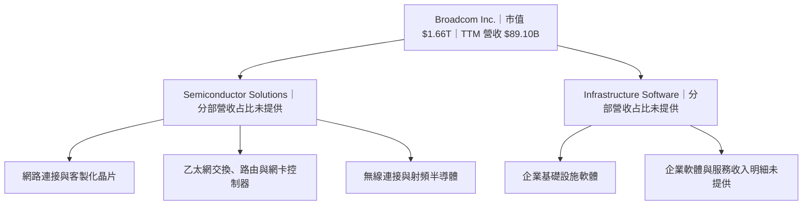
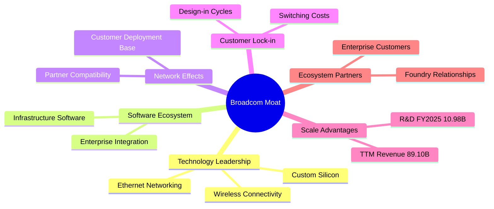
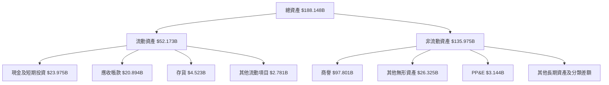
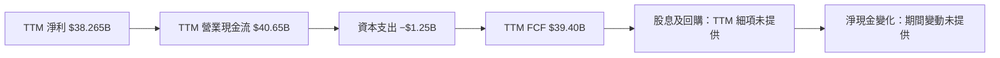
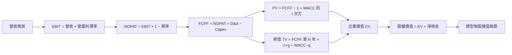
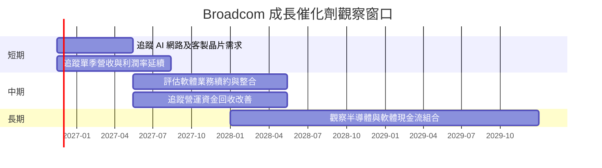
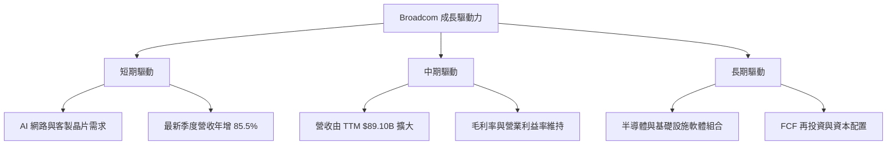
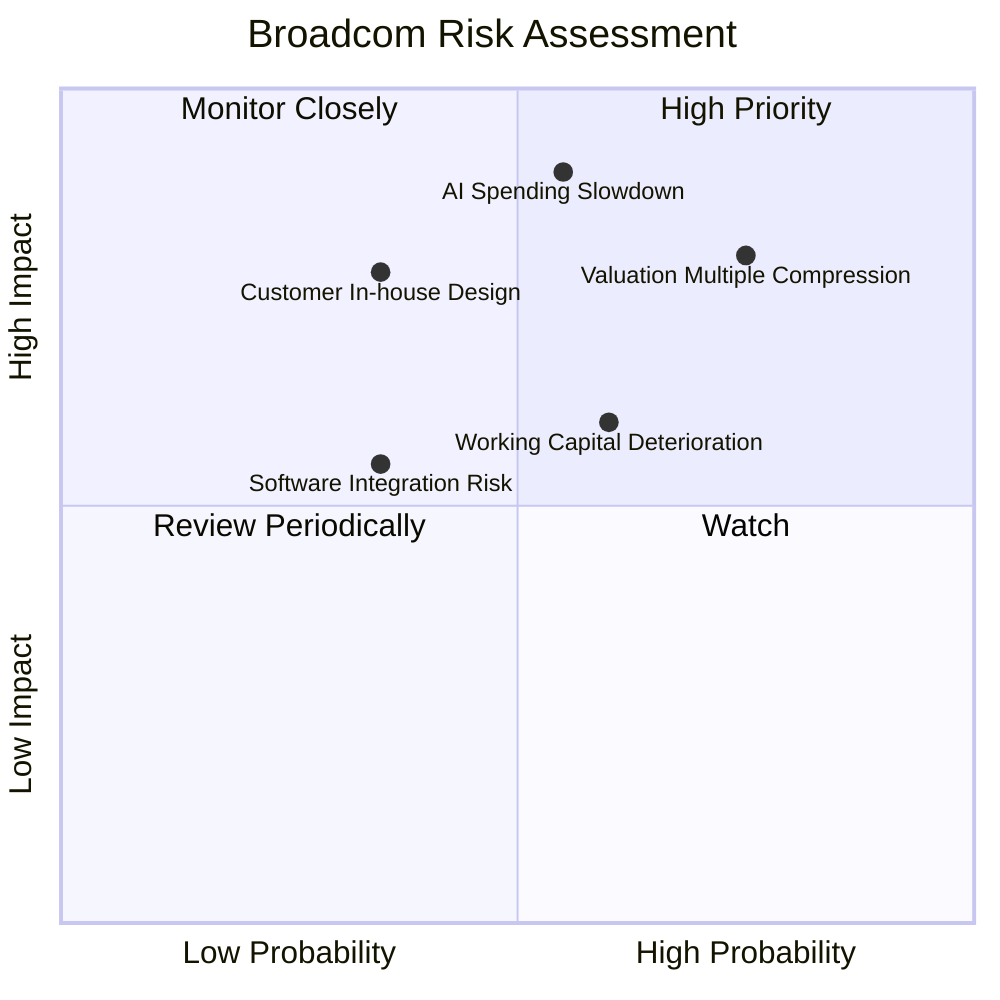
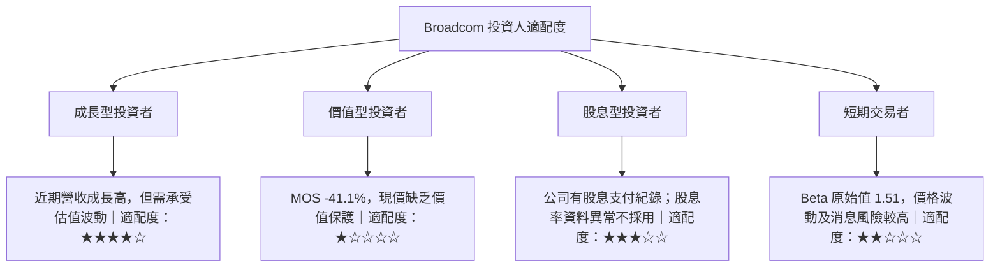

# AVGO 基本面深度分析報告
> **報告日期**：2026-11-16 ｜ **語言**：繁體中文 ｜ **數據來源**：SEC 申報資料 (XBRL)、Yahoo Finance、Finviz、StockAnalysis、Roic.ai ｜ **分析師**：CFA 級機構研究

## 目錄

| # | 章節 | 核心結論 |
|---|------|----------|
| 1 | 執行摘要 | 評級為賣出；加權合理價值 $245.87，MOS -41.1% |
| 2 | 公司概覽與商業模式 | 半導體與基礎設施軟體雙主業；客戶嵌入與產品組合構成主要護城河 |
| 3 | 損益表深度分析 | TTM 營收 $89.10B、年增 48.7%；最新季度單季年增 85.5% |
| 4 | 資產負債表分析 | 淨負債 $35.44B；流動比率 2.50 倍，但營運資金週期延長 |
| 5 | 現金流量深度分析 | TTM FCF $39.40B，FCF Yield 2.38% |
| 6 | 獲利能力與資本效率 | ROIC 30.0% 高於 WACC 11.58%，目前創造股東價值 |
| 7 | 相對估值分析 | 相較 DCF 與同業倍數，現價估值偏高；歷史估值位於較高區段 |
| 8 | DCF 內在價值評估 | DCF 基準價值 $208.79；加權合理價值 $245.87 |
| 9 | 成長催化劑 | AI 網路與客製晶片需求是主要成長線索，TAM 數據未提供 |
| 10 | 風險矩陣 | AI 投資週期、估值收縮、產品組合與營運資金為主要風險 |
| 11 | 投資建議 | 依 MOS 評級為賣出；現價不具足夠估值保護 |

---

## 1. 執行摘要

AVGO 的基本面成長與現金創造能力強：TTM 營收為 **$89.10B**、TTM 年增 **48.7%**，最新季度單季年增 **85.5%**；TTM FCF 為 **$39.40B**、ROIC **30.0%**，高於 WACC **11.58%**。但估值已反映大量成長預期：DCF 基準價值為 **$208.79**，低於 2026-11-13 收盤價 **$347.01**；依估值方法加權後合理價值為 **$245.87**，MOS 為 **-41.1%**。依規則 20，評級為 **🔴 賣出**；不因公司品質高而上調，因目前估值與下檔保護不足。

### 1.0 一頁式投資儀表板

| 項目 | 內容 |
|------|------|
| **投資論點（3 句）** | ① TTM 營收 $89.10B、年增 48.7%，AI 相關需求帶動近期成長加速。② TTM FCF $39.40B、ROIC 30.0% 對比 WACC 11.58%，顯示現階段資本投入產生正經濟利潤。③ 現價 $347.01 高於加權合理價值 $245.87，MOS -41.1%，估值風險抵銷基本面優勢。 |
| **綜合評分** | **6.8/10**（引用 1.1 評分卡） |
| **財務健康** | 🟡 現金 $23.98B、總債務 $59.42B、淨負債 $35.44B；流動比率 2.50 倍 |
| **ROIC vs WACC** | **30.0% vs 11.58%**；利差 18.42 個百分點，創造股東價值 |
| **FCF 趨勢** | 上升；TTM FCF $39.40B，FCF Yield **2.38%** |
| **估值** | Forward P/E **17.87x** ｜ EV/EBITDA **32.38x** ｜ FCF Yield **2.38%** |
| **DCF 內在價值（基準）** | **$208.79** ｜ 現價相對 DCF 溢價 **66.2%** |
| **安全邊際（MOS）** | **-41.1%**＝($245.87 − $347.01) ÷ $245.87；🔴 無安全邊際 |
| **預期報酬（基準情境 12M）** | DCF 基準情境相對現價 **-39.8%**（情境價值 $208.79） |
| **關鍵風險（前二）** | AI 投資成長不及估值隱含預期；高估值下市場倍數收縮 |
| **評級 + 信心度** | 🔴 **賣出** ｜ 信心：中（DCF 對長期假設敏感） |

### 1.1 綜合評分卡

| 維度 | 評分（1–10） | 主要依據（引用數字與其來源章節） |
|------|--------------|----------------------------------|
| 成長性 | 9.0 | TTM 營收年增 48.7%、最新季度單季年增 85.5%（第 3 章）；近期成長顯著，但持續性未獲驗證 |
| 獲利能力 | 9.0 | TTM 營業利益率 48.0%、ROIC 30.0%，F-Score 7/8（第 3、6 章） |
| 財務健康 | 7.0 | 淨負債 $35.44B、流動比率 2.504 倍；CCC 由 53 天升至 63 天（第 4 章） |
| 估值 | 2.0 | MOS -41.1%；DCF $208.79，現價 $347.01；自身歷史 P/E 70 百分位（第 7、8 章） |
| 護城河 | 8.0 | 半導體產品與基礎設施軟體結合、客戶設計導入與切換成本；最新季度營收 $29.59B（第 2 章） |
| 管理層與資本配置 | 6.0 | FY2025 SBC $7.57B、占營收 11.9%；F-Score 的稀釋股數測試未通過（第 3、5 章） |
| **綜合評分** | **6.8** | 六項算術平均：(9+9+7+2+8+6)÷6 = 6.8 |

### 1.2 五大投資論點 + 三大核心風險

| 類型 | 項目 | 具體依據 | 信心度 |
|------|------|----------|--------|
| 🟢 **投資論點①** | 營收加速 | TTM 營收 $89.10B、年增 48.7%；最新季度營收 $29.59B、單季年增 85.5% | 🟢 高 |
| 🟢 **投資論點②** | 現金流轉換能力 | TTM 營業現金流 $40.65B、資本支出 $1.25B、FCF $39.40B | 🟢 高 |
| 🟢 **投資論點③** | 資本報酬高於資金成本 | ROIC 30.0% vs WACC 11.58%，利差 18.42 個百分點 | 🟢 高 |
| 🟢 **投資論點④** | 利潤率維持高位 | TTM 營業利益率 48.0%；最新季度營業利益率 53.9% | 🟡 中 |
| 🟢 **投資論點⑤** | 軟體與半導體組合分散單一產品週期 | 公司同時經營 Semiconductor Solutions 與 Infrastructure Software；兩者收入明細未提供 | 🟡 中 |
| 🟡 **風險①** | 成長基期與 AI 投資週期 | 最新季度單季年增 85.5%，若大型客戶調整 AI 資本支出，收入成長可能快速回落 | 🟡 中 |
| 🔴 **風險②** | 估值與長期預期過高 | 加權合理價值 $245.87，低於現價 29.1%；DCF 基準值 $208.79 | 🔴 高衝擊 |
| 🟡 **風險③** | SBC 與營運資金消耗 | FY2025 SBC $7.57B，占營收 11.9%；CCC 同比增加 10 天 | 🟡 中 |

### 1.3 快速統計卡片

| 指標 | 公司實際值（期間） | 同業中位數 | 狀態 |
|------|--------------------|------------|------|
| 營收成長（TTM） | **48.7%** | — | 🟢 |
| 營收成長（最新一季年增） | **85.5%** | 36.5% | 🟢 |
| 毛利率（TTM） | **75.5%** | 53.1% | 🟢 |
| 營業利益率（TTM） | **48.0%** | — | 🟢 |
| ROIC（TTM） | **30.0%** | — | 🟢 |
| Forward P/E | **17.87x** | 14.1x | 🟡 |
| FCF Yield（TTM） | **2.38%** | — | 🟡 |
| Piotroski F-Score | **7 / 8** | — | 🟢 |

*同業中位數依有提供相應數據的 NVDA、MRVL、QCOM 計算；Forward P/E 中位數為 14.1x。*

### 1.4 投資結論

```text
╔══════════════════════════════════════════════════════════════════╗
║                    📊 投資結論摘要                              ║
╠══════════════════════════════════════════════════════════════════╣
║  評級：🔴 賣出（依加權合理價值 MOS -41.1%）                     ║
║  價格（2026-11-13 收盤）：$347.01                               ║
║  DCF 內在價值（基準）：$208.79（現價溢價 66.2%）               ║
║  安全邊際 MOS：-41.1%（以加權合理價值為分母）                   ║
║  加權合理價值（8.8）：$245.87                                   ║
║  DCF 情境價值：                                                  ║
║    悲觀情境：$86.41（-75.1%）                                   ║
║    基準情境：$208.79（-39.8%）                                  ║
║    樂觀情境：$459.00（+32.3%）                                  ║
║  綜合評分：6.8/10（引用 1.1）                                   ║
║  適合投資人：能承受高波動的長期成長型投資人；不適合要求估值     ║
║  保護或依賴短期股價上漲的投資人                                 ║
╚══════════════════════════════════════════════════════════════════╝
```

---

## 2. 公司概覽與商業模式

### 2.1 業務結構與收入來源

Broadcom 提供半導體產品及基礎設施軟體，分部收入與比例在所列財務資料中未提供，因此不以估算比例繪製分部占比。公司 TTM 營收為 **$89.10B**，市值約 **$1.66T**。



**商業模式判讀：**半導體業務以設計、開發及供應晶片取得產品收入；基礎設施軟體則提供另一種收入來源。因分部收入、毛利與訂閱收入占比未提供，無法量化兩部門對總體成長或利潤率的相對貢獻。

### 2.2 市場份額

市場份額數據未提供，且可引用的新聞摘要未列出市場份額與年份。以可核對數字比較，AVGO TTM 營收 $89.10B、成長 48.7%，最新季度單季年增 85.5%；成長高於 MRVL 的 36.5% 與 QCOM 的 -8.4%，低於 NVDA 的 105.9%。這表示近期成長具競爭力，但不能據此推定市占率。

### 2.3 競爭護城河分析



### 2.4 護城河強度

| 護城河項目 | 強度（強／中／弱） | 證據（引用數字或事實） | 會削弱它的情況 |
|------------|--------------------|------------------------|----------------|
| 技術與產品組合 | 強 | 公司提供網路、客製晶片、無線連接等產品；FY2025 研發費用 $10.98B | 客戶轉向自研晶片、替代架構，或產品性能與能耗落後 |
| 軟體生態系統 | 中 | 公司經營 Infrastructure Software，但分部營收、續約率及軟體毛利未提供 | 併購後產品整合不佳、客戶流失或企業軟體競爭加劇 |
| 網路效應 | 中 | 網路設備與晶片需配合客戶設備及生態系統；量化客戶數與相容性資料未提供 | 客戶採用開放規格或多供應商設計，降低單一供應商影響力 |
| 客戶鎖定 | 強 | 客製晶片設計導入會涉及產品開發與驗證周期；具體客戶集中度未提供 | 主要客戶取消專案、縮短供應協議或提高替代供應商比例 |
| 規模效應 | 強 | TTM 營收 $89.10B、FY2025 研發費用 $10.98B | 研發支出回報下降，或大型對手以規模與定價迫使毛利收縮 |
| 生態夥伴 | 中 | 公司跨半導體、軟體與企業基礎設施供應鏈營運；合作夥伴數據未提供 | 供應鏈瓶頸、代工資源受限或夥伴轉向競爭平台 |

1.1「護城河」評分 **8.0/10**，主要依據是產品設計導入、規模與軟體組合；分部與客戶集中度數據缺漏，因此未給滿分。

---

## 3. 損益表深度分析

### 3.1 年度收入成長趨勢（近 4 年）

FY2022 至 FY2025 營收分別為 $33.20B、$35.82B、$51.57B、$63.89B；2022–2025 三年 CAGR 為 24.4%。

```text
╔══════════════════════════════════════════════════════════════════╗
║              Broadcom 年度收入趨勢（FY2022–FY2025）             ║
╠══════════════════════════════════════════════════════════════════╣
║  FY2022  $33.20B  ██████████░░░░░░░░░░░░░░  YoY：基期          ║
║  FY2023  $35.82B  ███████████░░░░░░░░░░░░░  YoY：+7.9%         ║
║  FY2024  $51.57B  ████████████████░░░░░░░░  YoY：+44.0%        ║
║  FY2025  $63.89B  ████████████████████░░░░  YoY：+23.9%        ║
╠══════════════════════════════════════════════════════════════════╣
║  2022–2025 三年營收 CAGR：(63.89 ÷ 33.20)^(1/3) − 1 = 24.4%    ║
╚══════════════════════════════════════════════════════════════════╝
```

FY2024 的高增長與 FY2025 延續擴張，反映產品需求與業務組合變化；TTM 成長進一步升至 48.7%，最新季度營收跳升顯示短期成長加速，但單季增速不應直接外推為長期成長率。

### 3.2 季度收入趨勢分析

| 季度 | 營收 | QoQ 成長 | YoY 成長 | 備註 |
|------|------|----------|----------|------|
| 2025-10-31 | $18.015B | — | 28.18% | 與前季相比的 QoQ 基期未列入表格 |
| 2026-01-31 | $19.311B | 7.2% | 29.47% | 成長延續，但仍低於後續季度 |
| 2026-04-30 | $22.187B | 14.9% | 47.87% | 年增加速 |
| 2026-07-31 | $29.591B | 33.4% | 85.5% | 單季收入快速增加；單季數據，不等同 TTM 成長 |

QoQ 計算例：($29.591B ÷ $22.187B) − 1 = **33.4%**。最新季度的年增率與季增率都顯示加速，但資料未提供業務分部貢獻，無法判斷增幅中 AI、軟體及其他產品各占多少。

### 3.3 利潤率演變分析

以下為年度報表數據計算；TTM 與最新季度營業利益率另依 SEC 10-Q 的統一口徑引用。

| 利潤率指標 | FY2022 | FY2023 | FY2024 | FY2025 | 趨勢 | 評估 |
|------------|--------|--------|--------|--------|------|------|
| **毛利率** | 66.5% | 69.0% | 63.0% | 67.8% | FY2024 下滑後回升 | 🟢 |
| **營業利益率** | 43.0% | 46.0% | 29.1% | 40.8% | FY2024 下滑、FY2025 恢復 | 🟡 |
| **淨利率** | 34.6% | 39.3% | 11.4% | 36.2% | FY2024 顯著下滑後反彈 | 🟡 |

計算方法為年度毛利或營業利益除以年度營收；FY2024 淨利率偏低，與該年淨利 $5.89B 相對低於 FY2023 的 $14.08B 有關。具體一次性損益與稅務項目的拆分資料未提供，不宜將單年利潤率變化全歸因於營運因素。TTM 營業利益率 **48.0%**、最新季度 **53.9%**，顯示近期利潤率高於年度歷史水準；是否可維持，需觀察產品組合、成本與軟體業務占比。

### 3.4 費用結構分析

完整費用拆分資料未提供，無法製作符合數據要求的費用結構圓餅圖。已知 FY2025 研發費用 **$10.98B**，約為該年營收 **17.2%**；FY2025 SBC 為 **$7.57B**，但 SBC 可能分散列於不同營業費用，不能將研發與 SBC 相加視為互斥的費用項目。

### 3.5 季度 EPS 趨勢與盈餘品質（Quality of Earnings）

| 季度 | EPS 實際 | EPS YoY 成長 | 超預期／不及預期 |
|------|----------|--------------|------------------|
| 2025-10-31 | $1.74 | 94.51% | N/A（EPS 預估值未提供） |
| 2026-01-31 | $1.50 | 31.58% | N/A（EPS 預估值未提供） |
| 2026-04-30 | $1.91 | 85.44% | N/A（EPS 預估值未提供） |
| 2026-07-31 | $2.68 | 215.29% | N/A（EPS 預估值未提供） |

最近四季 EPS 預估與驚喜幅度均缺資料，故不能把 EPS 表現標記為超預期或不及預期。最新季度實際 EPS 較去年同期增加，但原因不能只由 EPS 表推導；同期淨利與營收亦快速成長。

| 盈餘品質項目 | 數值／佔比 | 評估 |
|--------------|-----------|------|
| 股權薪酬 SBC / 營收 | FY2025：$7.57B ÷ $63.887B = **11.9%** | 🟡 SBC 規模對每股股東報酬有實質稀釋影響 |
| SBC / 營業現金流 | FY2025：$7.57B ÷ $27.54B = **27.5%** | 🟡 SBC 占現金流量級顯著；SBC 本身為非現金支出，但稀釋成本仍需考量 |
| FCF / 淨利 | TTM：$39.40B ÷ $38.265B = **103.0%** | 🟢 現金轉換高於會計淨利；仍須注意營運資金與 SBC |
| 一次性／非經常性損益 | N/A（具體拆分未提供） | 無法判斷 FY2024 淨利變化是否受一次性項目主導 |
| 有效稅率異常 | N/A（TTM 有效稅率未提供）；DCF 採 21.0% | 無法確認實際稅率是否因一次性稅項偏離常態 |
| 資本化支出 vs 費用化 | TTM 資本支出 $1.25B；資本化支出明細 N/A | 資本支出相對 TTM 營收低；其他資本化政策無足夠資料判斷 |

**盈餘品質結論：**TTM FCF $39.40B 約為淨利 $38.265B 的 103.0%，支持現金流轉換並非主要依賴非現金應計。但 FY2025 SBC 占營收 11.9%，且 Piotroski 的稀釋股數測試未通過，表示 GAAP 盈餘的現金屬性良好，不代表股東每股經濟報酬沒有稀釋。

---

## 4. 資產負債表分析

### 4.1 資產結構分解

最新 TTM 資產負債表總資產為 **$188.148B**，流動資產 **$52.173B**，非流動資產合計為 $135.975B（總資產減流動資產）。非流動資產的完整細項在 TTM 列有不完整或不同來源口徑，以下只呈現可核對項目。



### 4.2 流動性與營運資金分析

流動比率與速動比率依市場資料列示為 **2.504 倍**及 **2.153 倍**，短期償債緩衝充足。營運資金天數則顯示收款與存貨占用週期延長，應與高成長期間的應收、存貨擴張一併追蹤。

| 指標 | 最新 TTM | 一年前 TTM | 變化 | 解讀 |
|------|----------|------------|------|------|
| DSO 應收帳款天數 | 56 天 | 40 天 | +16 天 | 收款週期變長；可能伴隨營收規模擴張，仍須檢查逾期與客戶條件 |
| DIO 存貨天數 | 59 天 | 40 天 | +19 天 | 存貨占用增加；若需求放緩，可能形成庫存與折價風險 |
| DPO 應付帳款天數 | 52 天 | 26 天 | +26 天 | 付款天數增加，有助資金周轉，但不能單憑此數字判斷議價能力 |
| CCC 現金轉換週期 | 63 天 | 53 天 | +10 天 | 現金轉換週期惡化 10 天，需追蹤營收增長以外的現金回收品質 |

### 4.3 債務結構分析

```text
╔══════════════════════════════════════════════════════════════════╗
║                   Broadcom 債務健康診斷                         ║
╠══════════════════════════════════════════════════════════════════╣
║  總債務：        $59.42B  ████████████████████  🟡              ║
║  現金+短期投資： $23.98B  ████████░░░░░░░░░░░░  🟢              ║
║  淨負債：        $35.44B  ████████████░░░░░░░░  🟡              ║
║                                                                  ║
║  流動比率：      2.504x  🟢                                      ║
║  Debt/EBITDA：   依 TTM 債務與 EBITDA $52.31B 計算約 1.14x       ║
║  利息保障倍數：  N/A（利息費用與 EBIT 同口徑未提供）             ║
║  評語：現金流規模可觀，但公司為淨負債狀態，並非淨現金公司       ║
╚══════════════════════════════════════════════════════════════════╝
```

Debt/EBITDA 以提供的總債務 $59.42B 除以 TTM EBITDA $52.31B 的估算結果為 1.14 倍；由於 EBITDA 數據來自合併市場資料，而債務採 SEC 口徑，僅作近似參考，不取代區塊中的正式估值倍數。

### 4.4 股東權益趨勢

```text
╔══════════════════════════════════════════════════════════════════╗
║                 Broadcom 歷年股東權益變化                       ║
╠══════════════════════════════════════════════════════════════════╣
║  FY2022  $22.71B  ██████░░░░░░░░░░░░░░░░░░░░░░                 ║
║  FY2023  $23.99B  ██████░░░░░░░░░░░░░░░░░░░░░░                 ║
║  FY2024  $67.68B  █████████████████████░░░░░░░                 ║
║  FY2025  $81.29B  █████████████████████████░░░                 ║
╚══════════════════════════════════════════════════════════════════╝
```

FY2024 股東權益明顯增加，期間總資產亦由 FY2023 的 $72.86B 增至 FY2024 的 $165.65B；反映資產負債表規模出現重大變化，但資料未提供可充分拆解的併購與會計項目，不能僅憑權益增加推論有機資本累積。

---

## 5. 現金流量深度分析

### 5.1 現金流量瀑布圖

最新 TTM 淨利與股息、回購資料未同口徑完整提供，故不把股息或回購金額放入 TTM 現金流瀑布；FY2025 股息支付為 $11.14B。



### 5.2 FCF 轉換率趨勢

| 財年 | FCF | 淨利 | FCF／淨利 |
|------|-----|------|-----------|
| FY2022 | $16.31B | $11.49B | 142.0% |
| FY2023 | $17.63B | $14.08B | 125.2% |
| FY2024 | $19.41B | $5.89B | 329.5% |
| FY2025 | $26.91B | $23.13B | 116.3% |
| TTM 至 2026-08-02 | $39.40B | $38.265B | 103.0% |

FY2024 轉換率被較低淨利放大，不能視為常態；FY2025 與 TTM 轉換率分別為 116.3% 與 103.0%，較能代表現金流與會計利潤相近且略高的狀況。

### 5.3 自由現金流趨勢

```text
╔══════════════════════════════════════════════════════════════════╗
║                  Broadcom 自由現金流趨勢                        ║
╠══════════════════════════════════════════════════════════════════╣
║  FY2022  $16.31B  ████████████░░░░░░░░░░░░░░░░                 ║
║  FY2023  $17.63B  █████████████░░░░░░░░░░░░░░░                 ║
║  FY2024  $19.41B  ██████████████░░░░░░░░░░░░░░                 ║
║  FY2025  $26.91B  ████████████████████░░░░░░░░                 ║
║  TTM     $39.40B  ██████████████████████████████  Yield 2.38%  ║
╚══════════════════════════════════════════════════════════════════╝
```

FY2022–FY2025 FCF CAGR 約為 **18.2%**；TTM FCF 較 FY2025 年度數字高，但期間涵蓋 FY2026 的快速成長季度，不宜把短期增幅直接線性延伸。

### 5.4 資本配置評估

FY2025 股息支付為 $11.14B；FY2025 資本支出 $0.623B；回購金額未提供，故不製作比例圓餅圖。

| 資本配置項目 | 可核對數據 | 評估 |
|--------------|------------|------|
| 資本支出 | FY2025 $0.623B；TTM $1.25B | 相對營收不高；需觀察 AI 供應鏈及研發相關投入是否增加 |
| 股息 | FY2025 現金股息 $11.14B | 有現金回饋紀錄；股息率欄資料出現異常，不採用 |
| 股票回購 | N/A（回購金額未提供） | 無法判斷回購是否抵銷 SBC 稀釋 |
| 留存現金／併購 | N/A（完整配置拆分未提供） | 需追蹤負債下降、收購與現金累積 |

---

## 6. 獲利能力與資本效率

### 6.1 ROE／ROA／ROIC 趨勢

歷史 ROE、ROA、ROIC 的同口徑年度序列資料未完整提供，故不拼接不同來源的口徑；以下列示可直接核對的 TTM 指標。

| 指標 | 最新 TTM | 歷史趨勢資料 | 評估 |
|------|----------|----------------|------|
| ROE | **38.4%**（QUALITY FIGURES 口徑） | N/A（完整同口徑歷史序列未提供） | 🟢 高；但仍需結合權益乘數判讀 |
| ROA | **15.4%**（市場資料） | F-Score 顯示高於一年前 | 🟢 |
| ROIC | **30.0%** | N/A（完整同口徑歷史序列未提供） | 🟢 明顯高於資本成本 |
| 行業均值 | N/A（未提供可引用資料） | 不列示 | — |

### 6.2 ROIC vs WACC 分析（核心價值創造判斷）

```text
╔══════════════════════════════════════════════════════════════════╗
║                ROIC vs WACC 深度分析                            ║
╠══════════════════════════════════════════════════════════════════╣
║  WACC 輸入（程式計算，採用區塊值）：                             ║
║  ├── 無風險利率：                         5.15%                  ║
║  ├── 市場風險溢酬：                       5.00%                  ║
║  ├── 原始 Beta：                          1.51                   ║
║  ├── 調整後 Beta：                        1.34                   ║
║  ├── 股權成本：                           11.85%                 ║
║  ├── 稅前債務成本：                       5.40%                  ║
║  ├── 稅後債務成本：                       4.27%                  ║
║  ├── 股權／債務權重：                     96.5%／3.5%            ║
║  └── ✅ WACC：                            11.58%                 ║
║                                                                  ║
║  ROIC（TTM）：                            30.0%                  ║
║  EVA 利差 = ROIC − WACC：                 +18.42 個百分點        ║
║                                                                  ║
║  ROIC  30.0%  ▓▓▓▓▓▓▓▓▓▓▓▓▓▓▓▓▓▓▓▓▓▓▓▓▓▓▓▓▓▓  🟢              ║
║  WACC  11.58% ▓▓▓▓▓▓▓▓▓▓▓▓░░░░░░░░░░░░░░░░░░  ──              ║
╠══════════════════════════════════════════════════════════════════╣
║  結論：ROIC 約為 WACC 的 2.59 倍，現階段創造股東價值。         ║
║  ROIC 及 WACC 均採用指定口徑，不以其他來源數字替代。            ║
╚══════════════════════════════════════════════════════════════════╝
```

WACC 複算：調整 Beta 為 **⅔×1.51 + ⅓ = 1.34**；股權成本 **5.15% + 1.34×5.00% = 11.85%**；稅後債務成本 **5.40%×(1−21.0%) = 4.266%**；WACC **96.5%×11.85% + 3.5%×4.266% = 11.58%**。債務成本與資本權重直接採用成本資本區塊；未提供利息費用及平均計息負債，不能另行重建。

### 6.3 杜邦三因素分解

| 因素 | 數值（TTM） | 解讀 |
|------|-------------|------|
| 淨利率 | 42.9% | 高淨利率是 ROE 的主要來源之一 |
| 資產週轉率 | 0.47 | 反映每單位資產的營收產出 |
| 權益乘數 | 1.89 | 有槓桿，但不是極高權益乘數 |
| **ROE** | **38.4%** | 42.9% × 0.47 × 1.89 = 38.1%，與提供 ROE 38.4% 有四捨五入及口徑差異 |

依指定 QUALITY FIGURES 原值照錄。上述三因素乘積依顯示到一位小數的輸入為 **38.1%**；與提供的 ROE **38.4%** 差異約 0.3 個百分點，可能來自未四捨五入數值，故不自行修改原始指標。

### 6.4 財務體質：Piotroski F-Score

指定品質指標為 **7/8**；有一項因資料缺漏無法判定，九項測試中實際列出的測試結果如下。

| 測試 | 結果 | 解讀 |
|------|------|------|
| ROA > 0 | ✅ 通過 | 資產報酬為正 |
| 營業現金流 > 0 | ✅ 通過 | 營業活動產生正現金流 |
| ROA 高於一年前 | ✅ 通過 | 資產獲利能力改善 |
| 營業現金流 > 淨利 | ✅ 通過 | 應計品質測試通過 |
| 長期負債 ÷ 總資產低於一年前 | — 無法判定 | 缺少測試輸入，不補算 |
| 流動比率高於一年前 | ✅ 通過 | 短期流動性改善 |
| 稀釋股數未增加 | ❌ 未通過 | 股數稀釋削弱每股經濟利益 |
| 毛利率高於一年前 | ✅ 通過 | 毛利率改善 |
| 資產週轉率高於一年前 | ✅ 通過 | 資產使用效率提高 |

未通過的稀釋股數項目與 FY2025 SBC $7.57B 相呼應，意味營收及淨利增長不能直接等同每股價值同比增長。

---

## 7. 相對估值分析

### 7.1 同業估值比較表格

| 估值指標 | **AVGO** | **NVDA** | **MRVL** | **QCOM** | 本公司評估 |
|----------|---------|---------|---------|---------|-----------|
| **Trailing P/E** | 44.3x | 20.6x | 51.6x | 13.6x | 🟡 高於 NVDA、QCOM，低於 MRVL |
| **Forward P/E** | 17.87x | 10.3x | 21.3x | 14.1x | 🟡 高於同業中位數 14.1x |
| **P/S Ratio** | 18.59x | 13.0x | 14.9x | 4.3x | 🔴 高於全部列示同業 |
| **EV/EBITDA** | 32.38x¹ | 19.4x | 48.7x | 18.2x | 🟡 位於同業區間中段偏高 |

¹ AVGO 的 32.38x 取市場資料估值區塊；自身歷史比較採 VERIFIED FIGURES 的 39.8x，兩者可能因資料來源與計算時點口徑不同，不混用。Peer multiples 的相對比較顯示，AVGO Forward P/E 高於同業中位數，但其近期成長率亦高於 MRVL 與 QCOM。倍數差異不能只以成長率解釋，仍須納入產品風險、利潤率與資本回報。

### 7.2 歷史估值區間分析

```text
╔══════════════════════════════════════════════════════════════════╗
║          AVGO 近五年估值區間（TTM 倍數，指定口徑）             ║
╠══════════════════════════════════════════════════════════════════╣
║  P/E：      1.8x ├────────中位數 5.5x───────────────┤ 77.5x   ║
║                                      現值 44.3x｜70 百分位     ║
║  P/S：      0.6x ├────────中位數 1.5x───────────────┤ 28.1x   ║
║                                      現值 19.0x｜70 百分位     ║
║  EV/EBITDA：0.5x ├────────中位數 5.6x───────────────┤ 70.7x   ║
║                                      現值 39.8x｜55 百分位     ║
╚══════════════════════════════════════════════════════════════════╝
```

估值百分位在自身歷史中偏高。由於歷史區間可能跨越業務組合及併購變化，歷史中位數不宜直接作為合理價，但目前 P/E 與 P/S 均位於 70 百分位，仍支持估值保護有限的判斷。

### 7.3 情境價值（照抄 DCF MODEL 的 Scenarios）

| 情境 | 第 1 年營收成長 | 期末營業利潤率 | WACC | 每股價值 | 相對現價 | 機率 | 會發生的條件 |
|------|----------------|----------------|------|----------|----------|------|--------------|
| 🔴 悲觀 | 15.0% | 36.4% | 12.58% | $86.41 | -75.1% | 25% | AI 專案增速放緩、產品組合轉弱，且資本成本維持高位 |
| 🟡 基準 | 30.0% | 42.8% | 11.58% | $208.79 | -39.8% | 50% | 成長由高位逐步回落，營業利潤率向模型長期假設收斂 |
| 🟢 樂觀 | 45.0% | 47.1% | 10.58% | $459.00 | +32.3% | 25% | AI 相關需求與客製晶片持續超預期，利潤率維持高位且折現率下降 |

三情境機率加權價值依模型為 **$240.75**，僅作情境參考；第 8.8 節依指定估值方法與權重使用基準 DCF，而非機率加權值。

### 7.4 相對估值隱含價格區間

```text
╔══════════════════════════════════════════════════════════════════╗
║             各估值方法隱含價值與現價位置                       ║
╠══════════════════════════════════════════════════════════════════╣
║  $163.42 ───── $208.79 ───── $245.87 ───── $274.30 ───── $347.01║
║   EV/EBITDA       DCF        加權合理值       Forward P/E    現價║
║  $529.24：分析師共識目標價（高於目前股價）                     ║
╚══════════════════════════════════════════════════════════════════╝
```

- 同業 Forward P/E：同業中位數 **14.1x × Forward EPS $19.41 = $274.30**。
- 同業 EV/EBITDA：同業中位數 **18.8x**（NVDA、QCOM）套用 TTM EBITDA 並加回淨現金，模型每股價值 **$163.42**。
- 分析師共識：47 位分析師平均目標價 **$529.24**；屬外部參考，不代表基本面現金流估值。

---

## 8. DCF 內在價值評估（Discounted Cash Flow）

### 8.0 估值推理鏈（Thinking Logic）

#### Step 1 — 價值由哪些變數決定？

AVGO 的價值主要取決於現有半導體與基礎設施軟體現金流底盤，以及 AI 網路與客製晶片成長能否延續；但分部營收占比未提供，無法把 $89.10B TTM 營收再分解成各業務來源。模型的主導因素是營收成長路徑及終值，因 10 年期增長會累積影響末年現金流，而終值現值占企業價值 **52.4%**。

#### Step 2 — 模型選擇

| 決策點 | 本報告採用 | 理由（含數字） | 曾考慮但否決 | 否決理由 |
|--------|-----------|----------------|--------------|----------|
| 現金流定義 | FCFF | 以 WACC 折現，推導企業價值；TTM FCF $39.40B | FCFE | 债務融資對企業價值橋接不如 FCFF 直接 |
| 預測期 N | 10 年 | DCF MODEL 固定預測期；FY+1 至 FY+10 成長由 30.0% 線性降至 3.0% | 5 年 | 會提早截斷模型已指定的成長淡出路徑 |
| 終值方法 | Gordon Growth | 模型採永續成長率 3.0%，且 WACC 11.58% 高於 g | 單獨退出倍數 | 模型未提供退出倍數終值數值，不能自行建模 |
| EBIT 基礎 | GAAP EBIT | 模型明確使用 GAAP EBIT，SBC 已計入費用 | 非 GAAP EBIT | 會把已費用化的 SBC 加回，改變模型口徑 |

#### Step 3 — 關鍵假設推導鏈

- **年 1 營收成長**：錨點＝TTM 營收成長 **48.7%**、最新季度單季年增 **85.5%** → 調整＝高成長季度未必可長期維持，且模型把成長率限制在 0%–30% → **採用 30.0%** → 曾考慮延續 48.7% TTM 成長，但否決，因需避免直接外推短期高速成長。
- **營收成長淡出／期末成長**：錨點＝TTM 成長 **48.7%**，FY+1 取 30.0%，第 10 年為 **3.0%** → 調整＝逐年線性淡出以反映競爭、基期與成熟化 → **採用 FY+1 30.0%、FY+10 3.0%** → 曾考慮長期維持雙位數成長，但否決，因與成熟企業長期假設不符。
- **期末營業利潤率**：錨點＝TTM 營業利益率 **48.0%** → 調整＝模型逐步回落至近五個財年的中位數 → **採用 FY+10 42.8%** → 曾考慮長期維持 48.0%，但否決，因高位利潤率不應無條件永久延續。
- **永續成長率 g**：錨點＝模型設定 **3.0%**，低於 WACC **11.58%** → 調整＝模型未將永續成長設定在高成長期增速 → **採用 3.0%** → 曾考慮 4.0%，但基準採用較低值以降低終值膨脹。
- **預測期 N**：錨點＝模型明列 **10 年**、逐年成長率 30.0% 至 3.0% → 調整＝使用完整成長淡出期 → **採用 10 年** → 曾考慮縮短預測期，但與既定 DCF 模型不符。
- **Capex／營收**：錨點＝TTM 資本支出／營收 = **$1.25B ÷ $89.10B = 1.4%** → 調整＝模型由 1.4% 逐步降至 0.8% → **採用 FY+1 1.4%、FY+10 0.8%** → 曾考慮維持 1.4%，但模型假設規模增加後資本支出率回落。
- **EBIT 與 SBC**：錨點＝FY2025 SBC **$7.57B**，已屬營業費用的一部分；模型使用 GAAP EBIT → **採用組合 (A)：GAAP EBIT、FCFF 不再扣 SBC、股數不額外稀釋** → 不採非 GAAP 加回後再扣 SBC，以免改變既定模型口徑。
- **WACC**：錨點＝指定成本資本 WACC **11.58%** → 調整＝依成本資本區塊的 CAPM、債務成本及資本權重 → **採用 11.58%** → 不另以市場估值重估 WACC，避免偏離指定模型。
- **有效稅率**：錨點＝模型預設稅率 **21.0%** → **採用 21.0%**；TTM 實際有效稅率未提供，故不能以歷史實際稅率替代。
- **D&A／營收**：錨點＝TTM **0.7%** → **採用 0.7%** 固定。
- **營運資金變動**：模型未納入營運資金變動；即 ΔWC **不建模**，不是假設 ΔWC 為零的歷史事實。
- **終值方法**：錨點＝基準模型 Gordon Growth，使用第 10 年 FCFF 與 g 3.0% → **採用 Gordon Growth**；退出倍數交叉驗證所需倍數未提供，故不另造估算值。

#### Step 4 — 最脆弱環節

最脆弱的假設是高速營收成長可在 10 年內依模型路徑逐步淡出，同時維持高營業利潤率；若成長與利潤率同時走弱，模型悲觀情境已顯示每股價值為 **$86.41**，明顯低於基準 **$208.79**。

#### Step 5 — 計算路徑圖



### 8.1 模型假設總表（Model Inputs）

| 假設項目 | 採用值 | 依據／來源 | 敏感度 |
|----------|--------|-------------|--------|
| 預測期長度 N | 10 年 | DCF MODEL 固定期間 | 🟡 中 |
| 營收成長 | FY+1 30.0%，FY+10 3.0%，線性淡出 | TTM 年增 48.7%；模型限制 FY+1 成長不超過 30.0% | 🔴 高 |
| 營業利益率 | FY+1 48.0% → FY+10 42.8% | TTM 營業利益率 48.0%，向近五年中位數淡出 | 🔴 高 |
| 有效稅率 | 21.0% | DCF 預設稅率；實際 TTM 稅率未提供 | 🟢 低 |
| Capex／營收 | FY+1 1.4% → FY+10 0.8% | TTM Capex $1.25B／營收 $89.10B，模型逐步下降 | 🟡 中 |
| D&A／營收 | 0.7% | TTM 模型輸入 | 🟢 低 |
| 營運資金變動 | 未建模 | DCF MODEL 明示 Working capital is not modelled | 🟢 低 |
| EBIT 基礎 | GAAP EBIT | DCF MODEL 明示 GAAP EBIT | 🟡 中 |
| SBC 處理 | GAAP EBIT 已含 SBC，不再扣一次 | SBC 已費用化；固定股數的模型組合 A | 🟡 中 |
| 年稀釋率 | 0%（模型採固定股數） | 與 GAAP EBIT 組合 A 相容；非預測實際股數趨勢 | 🟡 中 |
| 永續成長率 g | 3.0% | DCF MODEL 固定值，低於 WACC | 🔴 高 |
| 終值方法 | Gordon Growth | DCF MODEL 提供終值計算 | 🔴 高 |
| WACC | 11.58% | 成本資本區塊指定值 | 🔴 高 |

**FCFF 定義：**本模型使用 FCFF = NOPAT + D&A − Capex；營運資金未納入，故與一般完整 FCFF 定義相比少了 ΔWC 項。**本模型採用組合 (A)：GAAP EBIT + 固定股數，故 SBC 影響已透過費用計入一次，不再另扣 SBC 或另加稀釋。**

### 8.2 折現率推導（WACC）

```text
╔══════════════════════════════════════════════════════════════════╗
║                    WACC 推導（折現率）                          ║
╠══════════════════════════════════════════════════════════════════╣
║  股權成本 Ke（CAPM）：                                           ║
║  ├── 無風險利率 Rf（10Y 美債）：          5.15%                 ║
║  ├── 市場風險溢酬 ERP：                   5.00%                 ║
║  ├── 原始 Beta（Yahoo）：                 1.51                  ║
║  ├── 調整後 Beta：                        1.34                  ║
║  ├── Beta 調整：                          ⅔×1.51 + ⅓ = 1.34  ║
║  ├── 規模／國別溢酬：                     0.00%                 ║
║  └── Ke = 5.15% + 1.34×5.00% =            11.85%                ║
║                                                                  ║
║  債務成本 Kd：                                                   ║
║  ├── 稅前 Kd：                            5.40%                 ║
║  ├── 稅率：                               21.0%                 ║
║  └── 稅後 Kd = 5.40%×(1−21.0%) =          4.266%                ║
║                                                                  ║
║  資本結構（成本資本區塊權重）：                                  ║
║  ├── 股權權重 E：                         96.5%                 ║
║  ├── 債務權重 D：                         3.5%                  ║
║  └── ✅ WACC = 96.5%×11.85% + 3.5%×4.266% = 11.58%              ║
╚══════════════════════════════════════════════════════════════════╝
```

- 原始 Beta **1.51**；採用調整後 Beta **1.34 = ⅔×1.51 + ⅓**。
- CAPM：**5.15% + 1.34×5.00% = 11.85%**。
- 稅後債務成本：**5.40%×(1−21.0%) = 4.266%**。
- 權重：**96.5% + 3.5% = 100.0%**。
- WACC：**96.5%×11.85% + 3.5%×4.266% = 11.58456% ≈ 11.58%**。
- 10 年期美債利率資料的觀察日未提供，故不另補日期。債務成本與權重已由成本資本輸入提供；利息費用、平均計息債務及精確市值權重構成未提供，不能獨立從資產負債表重建五步估算。

### 8.3 逐年自由現金流預測（基準情境）

金額單位為 **USD billions**。折現因子依指定模型值原樣引用；營運資金未建模，表格不加入 ΔWC 列。

| 年度 | FY+1 | FY+2 | FY+3 | FY+4 | FY+5 | FY+6 | FY+7 | FY+8 | FY+9 | FY+10 |
|------|------|------|------|------|------|------|------|------|------|-------|
| 營收 | 115.84 | 147.11 | 182.42 | 220.72 | 260.46 | 299.52 | 335.47 | 365.66 | 387.60 | 399.23 |
| 營收 YoY | 30.0% | 27.0% | 24.0% | 21.0% | 18.0% | 15.0% | 12.0% | 9.0% | 6.0% | 3.0% |
| 營業利潤率 | 48.0% | 47.5% | 46.9% | 46.3% | 45.7% | 45.2% | 44.6% | 44.0% | 43.4% | 42.8% |
| EBIT（GAAP） | 55.66 | 69.83 | 85.54 | 102.23 | 119.12 | 135.26 | 149.54 | 160.89 | 168.30 | 171.04 |
| − 稅（21.0%） | (11.69) | (14.67) | (17.96) | (21.47) | (25.02) | (28.40) | (31.40) | (33.79) | (35.34) | (35.92) |
| = NOPAT | 43.97 | 55.17 | 67.58 | 80.76 | 94.10 | 106.85 | 118.14 | 127.10 | 132.96 | 135.12 |
| + D&A | 0.82 | 1.04 | 1.29 | 1.57 | 1.85 | 2.12 | 2.38 | 2.59 | 2.75 | 2.83 |
| − Capex | (1.62) | (1.96) | (2.31) | (2.64) | (2.93) | (3.17) | (3.31) | (3.36) | (3.29) | (3.11) |
| **= FCFF** | **43.17** | **54.25** | **66.56** | **79.69** | **93.02** | **105.81** | **117.21** | **126.34** | **132.41** | **134.84** |
| 折現因子 @11.58% | 0.896 | 0.803 | 0.720 | 0.645 | 0.578 | 0.518 | 0.464 | 0.416 | 0.373 | 0.334 |
| **FCFF 現值 PV** | **38.68** | **43.57** | **47.91** | **51.40** | **53.77** | **54.81** | **54.41** | **52.56** | **49.37** | **45.06** |

預測期 PV 加總：  
**$38.68 + $43.57 + $47.91 + $51.40 + $53.77 + $54.81 + $54.41 + $52.56 + $49.37 + $45.06 = $491.54B**。  
模型列示合計為 **$491.56B**，兩者差異 **$0.02B**，源自逐年 PV 顯示至小數點後兩位的四捨五入；採用模型原始未四捨五入合計 **$491.56B**。

**FY+1 逐步演算（依模型列示值）：**

1. 營收 = $89.10B × (1 + 30.0%) = **$115.84B**（模型以未四捨五入 TTM 基數計算）。
2. EBIT = $115.84B × 48.0% = **$55.66B**（依模型未四捨五入營收計算）。
3. 稅 = $55.66B × 21.0% = **$11.69B**。
4. NOPAT = $55.66B − $11.69B = **$43.97B**。
5. D&A = $115.84B × 0.7% = **$0.82B**（模型未四捨五入比率及營收）。
6. Capex = $115.84B × 1.4% = **$1.62B**。
7. ΔWC = **未建模**；不能將缺失項目回推或解讀為實際變動為零。
8. FCFF = $43.97B + $0.82B − $1.62B = **$43.17B**。
9. 折現因子 = 1 ÷ (1+11.58%)¹ = **0.896**；PV = $43.17B × 0.896 = **$38.68B**（模型使用未四捨五入折現因子）。

**合理性自檢：**

- 基準預測期 FCFF 由 FY+1 $43.17B 增至 FY+10 $134.84B，9 年 CAGR 約 **13.5%**；歷史 FY2022–FY2025 FCF CAGR 約 **18.2%**，預測低於歷史，但歷史期間較短且包含不同成長階段。
- FY+10 FCFF 利潤率 = $134.84B ÷ $399.23B = **33.8%**；目前 TTM FCF 利潤率 = $39.40B ÷ $89.10B = **44.2%**。模型隱含成熟期 FCF 利潤率下降，未假設持續高於目前水準。
- 預測年度 FCFF 均為正，沒有負現金流年度；但因模型未納入 ΔWC，快速增長帶來的營運資金需求可能使實際 FCFF 低於表列模型。

```text
╔══════════════════════════════════════════════════════════════════╗
║            自由現金流：歷史實際 vs 模型預測                     ║
╠══════════════════════════════════════════════════════════════════╣
║  FY2023(實) $17.63B  █████░░░░░░░░░░░░░░░░░░░░  YoY +8.1%      ║
║  FY2024(實) $19.41B  ██████░░░░░░░░░░░░░░░░░░░  YoY +10.1%     ║
║  FY2025(實) $26.91B  ████████░░░░░░░░░░░░░░░░░  YoY +38.6%     ║
║  FY+1 (預)  $43.17B  █████████████░░░░░░░░░░░░  模型值         ║
║  FY+10(預)  $134.84B ██████████████████████████ CAGR 約 13.5%  ║
╠══════════════════════════════════════════════════════════════════╣
║  預測期 FCFF CAGR 約 13.5% vs 歷史 FY22–FY25 FCF CAGR 約 18.2% ║
╚══════════════════════════════════════════════════════════════════╝
```

### 8.4 終值計算（Terminal Value）

**適用性檢查：**`WACC 11.58% vs g 3.0% → WACC > g？✅`

| 方法 | 計算式 | 終值 TV | TV 現值 | 佔總 EV 比重 |
|------|--------|---------|---------|--------------|
| Gordon Growth | $134.84B × (1+3.0%) ÷ (11.58%−3.0%) | $1,617.76B | $540.58B | 52.4% |
| 退出倍數法 | N/A（DCF MODEL 未提供退出倍數及相應終值） | N/A | N/A | N/A |

逐步演算：

1. FY+10 FCFF = **$134.84B**。
2. 分子 = $134.84B × (1+3.0%) = **$138.8852B**。
3. 分母 = 11.58% − 3.0% = **8.58%**；TV = $138.8852B ÷ 8.58% = **$1,618.01B**。程式模型列示 **$1,617.76B**，反映內部未四捨五入輸入及顯示值差異；估值報告依規則原值採用模型列示的 $1,617.76B。
4. PV(TV) = 模型終值 $1,617.76B × 模型折現因子 0.334 = 模型列示 **$540.58B**（模型使用未四捨五入因子）。
5. 終值占比 = $540.58B ÷ $1,032.14B = **52.4%**。

終值現值占企業價值 52.4%，低於 75% 警戒值，但仍是估值的重要組成；退出倍數交叉驗證因模型沒有提供必要輸入，不另行估算。

### 8.5 企業價值 → 每股內在價值（Bridge）

```text
╔══════════════════════════════════════════════════════════════════╗
║              企業價值 → 每股內在價值 橋接表                    ║
╠══════════════════════════════════════════════════════════════════╣
║  預測期 FCF 現值合計             +$491.56B                       ║
║  終值現值 PV(TV)                 +$540.58B                       ║
║  ─────────────────────────────────────────────                  ║
║  = 企業價值 EV                    $1,032.14B                     ║
║  + 淨現金（淨負債為負）           −$35.44B                       ║
║  = 股權價值（模型列示）           $996.69B                       ║
║  ÷ 股數／價格換算                 模型以市值與價格換算           ║
║  ─────────────────────────────────────────────                  ║
║  ★ DCF 每股內在價值               $208.79                        ║
║    當前股價（2026-11-13 收盤）     $347.01                        ║
║    折溢價（現價÷DCF價值−1）        +66.2%（溢價）                ║
╚══════════════════════════════════════════════════════════════════╝
```

模型橋接演算：

1. EV = $491.56B + $540.58B = **$1,032.14B**。
2. 股權價值 = $1,032.14B − $35.44B = **$996.70B**；模型列示 **$996.69B**，有 $0.01B 四捨五入差異。
3. 每股價值依模型指定換算方式：**股權價值 × 股價 ÷ 市值 = $208.79**；模型未提供可直接以股權價值除以股數完全複核的未四捨五入股數與市值，故以模型每股值為準，不另推算。
4. DCF 折溢價 = $347.01 ÷ $208.79 − 1 = **+66.2%**。
5. 本節不計算 MOS；MOS 僅於 8.8 以加權合理價值為分母計算。

現金、債務採用 TTM 至 2026-08-02 的現金及短期投資 **$23.98B**、總債務 **$59.42B**，淨負債 **$35.44B**。模型每股換算行以股權價值及價格／市值比例計算；稀釋股數細項未提供，故不自行補一個股數除法。

### 8.6 敏感性分析（WACC × 永續成長率）

以下完全照錄 DCF MODEL 每股價值。括號為相對 2026-11-13 收盤價 $347.01 的上行空間。

| g（列）／WACC（欄） | 9.58% | 10.58% | **11.58%（基準）** | 12.58% | 13.58% |
|-----------|------:|------:|------------------:|------:|------:|
| 2.0% | $258.83 (-25.4%) | $223.65 (-35.5%) | $195.99 (-43.5%) | $173.72 (-49.9%) | $155.43 (-55.2%) |
| 2.5% | $270.36 (-22.1%) | $231.87 (-33.2%) | $202.04 (-41.8%) | $178.27 (-48.6%) | $158.92 (-54.2%) |
| **3.0%（基準）** | $283.64 (-18.3%) | $241.19 (-30.5%) | **$208.79 (-39.8%)** | $183.30 (-47.2%) | $162.75 (-53.1%) |
| 3.5% | $299.11 (-13.8%) | $251.81 (-27.4%) | $216.38 (-37.6%) | $188.88 (-45.6%) | $166.95 (-51.9%) |
| 4.0% | $317.34 (-8.5%) | $264.05 (-23.9%) | $224.97 (-35.2%) | $195.11 (-43.8%) | $171.60 (-50.5%) |

矩陣非基準格的逐年 PV 與終值中間表未在模型輸出提供；依要求不能另建模型重算，因此不冒充完成中間值演算。有效性檢查：矩陣內最低 WACC 9.58% 仍高於最高 g 4.0%，全部 25 格均符合 WACC > g。

**三情境 DCF（模型原值）**

| 情境 | 第 1 年成長 | 期末營業利潤率 | WACC | 每股內在價值 | 相對現價 | 機率 |
|------|-------------:|---------------:|-----:|--------------:|---------:|------:|
| 🔴 悲觀 | 15.0% | 36.4% | 12.58% | $86.41 | -75.1% | 25% |
| 🟡 基準 | 30.0% | 42.8% | 11.58% | $208.79 | -39.8% | 50% |
| 🟢 樂觀 | 45.0% | 47.1% | 10.58% | $459.00 | +32.3% | 25% |
| **機率加權** | — | — | — | **$240.75** | **-30.6%** | **100%** |

情境逐年營收、FY+10 FCFF 與各情境終值中間明細未提供，故不補造「營收 CAGR → 終年 FCFF」的數值鏈。機率加權依模型為 **$240.75**；以表面顯示的三個情境價值計算會有四捨五入差異，採程式計算值，不另改。

敏感度方向可由矩陣直接讀取：

- **g +1pp**：在 WACC 11.58% 下，g 由 2.5% 到 3.5%，內在價值由 $202.04 升至 $216.38，增加 **$14.34／7.1%**。
- **WACC +1pp**：g 3.0% 下，WACC 11.58% 到 12.58%，價值由 $208.79 降至 $183.30，減少 **$25.49／12.2%**。
- 期末營業利潤率每 +1pp 的單獨敏感度未提供；不能從兩個情境同時改動營收、利潤率與 WACC 的結果拆解。
- 依已提供矩陣，在這組測試區間內 WACC 變化造成的每股價值變化大於 g 每 1 個百分點的變化；與終值折現及資本成本高度影響估值的判斷一致。

### 8.7 反推 DCF（Reverse DCF）

模型反推結果只提供兩項：令股價等於現價所需的第 1 年營收成長率，以及固定營業利潤率。其餘變數的反推結果與疊代軌跡未提供，不以自行建模替代。

| 求解的變數（一次一個） | 其餘變數設定 | 市場隱含值 | 公司歷史／基準 | 判斷 |
|------------------------|--------------|--------------|----------------|------|
| 第 1 年營收成長率 | 其他變數固定基準值 | **44.1%** | 基準 30.0%；TTM 成長 48.7% | 🟡 接近近期 TTM 高增速，要求成長維持強勁 |
| 固定營業利潤率 | 其他變數固定基準值 | **71.9%** | TTM 48.0% | 🔴 顯著高於目前營業利潤率 |
| 永續成長率 g | N/A（未提供反推值） | N/A | 基準 3.0% | 未計算 |
| 預測期 N | N/A（未提供反推值） | N/A | 基準 10 年 | 未計算 |

反推試算軌跡及每個試算點的營收、FCFF、每股價值未提供，不能製作偽精確收斂表。反推含義是：在其他基準假設不變時，市場價格要求年 1 成長率達 44.1%，或固定營業利潤率達 71.9%；後者明顯高於目前 48.0%，因此價格對持續高成長及利潤率具有較高要求。

### 8.8 估值三角驗證與安全邊際

| 估值方法 | 隱含每股價值 | 上行空間（÷現價） | 權重 | 說明 |
|----------|--------------:|-------------------:|-----:|------|
| DCF（基準） | $208.79 | -39.8% | 40% | 10 年 FCFF、WACC 11.58%、終值成長 3.0% |
| 同業 Forward P/E | $274.30 | -21.0% | 25% | 同業中位數 14.1x × Forward EPS $19.41 |
| 同業 EV/EBITDA | $163.42 | -52.9% | 25% | 同業中位數 18.8x × TTM EBITDA，加回淨現金 |
| 分析師共識目標價 | $529.24 | +52.5% | 10% | 47 位分析師平均目標價，作參考 |
| **加權合理價值** | **$245.87** | **-29.1%** | **100%** | — |

加權算式：  
**$208.79×40% + $274.30×25% + $163.42×25% + $529.24×10%  
= $83.516 + $68.575 + $40.855 + $52.924  
= $245.870 ≈ $245.87。**

權重為「獲利公司」類型的固定配置；區塊列出的四種估值方法均保留，沒有方法遭剔除。

```text
╔══════════════════════════════════════════════════════════════════╗
║                    估值區間與安全邊際                          ║
╠══════════════════════════════════════════════════════════════════╣
║  $86.41 ───── $208.79 ───── $245.87 ───── $347.01 ───── $459.00║
║  悲觀情境       基準DCF       加權合理值       現價          樂觀║
║                                                                  ║
║  MOS = ($245.87 − $347.01) ÷ $245.87 = -41.1%                  ║
║  MOS 評估：🔴 <10% 無；現值低於零，代表現價高於合理價值        ║
║  上行空間 = ($245.87 − $347.01) ÷ $347.01 = -29.1%              ║
║                                                                  ║
║  MOS ≥ 10% 對應價格上限：$245.87 × 90% = $221.28               ║
║  建議觀察／分批買入區間：低於 $221.28；現價不在買入區間         ║
║  合理持有區間：$221.28–$245.87（估值仍低於合理價值上緣）        ║
║  減碼考慮區間：現價 $347.01 已高於加權合理價值及基準 DCF         ║
╚══════════════════════════════════════════════════════════════════╝
```

MOS 計算：($245.87 − $347.01) ÷ $245.87 = **-41.1%**；上行空間：($245.87 − $347.01) ÷ $347.01 = **-29.1%**。兩者分母不同。DCF 折溢價則固定以 DCF 基準價值為分母，現價相對 DCF 溢價 **66.2%**。

> 🔎 **程式複算（Python，依本節各項自動重算）**
>
> 加權合理價值 = $208.79 × 40% + $274.30 × 25% + $163.42 × 25% + $529.24 × 10% = **$245.87**（權重合計 100%）
>
> 以價格 $347.01 計：MOS = **-41.1%**，上行空間 = **-29.1%**
>
> ✅ 與本節所寫數值一致。

### 8.9 DCF 模型的局限與失效條件

- **終值依賴度：**終值現值占 EV **52.4%**，模型價值對第 10 年現金流及永續成長率仍有顯著依賴。
- **最脆弱假設：**年 1 營收成長 30.0%、之後線性淡出至 3.0%；若 AI 需求與客製晶片出貨不及預期，悲觀情境每股價值為 $86.41。
- **利潤率風險：**模型由 FY+1 營業利益率 48.0% 降至 FY+10 42.8%；若毛利組合或定價使利潤率更快收縮，DCF 價值下行。
- **營運資金限制：**模型不納入 ΔWC；但 DSO 由 40 天增至 56 天、DIO 由 40 天增至 59 天，表示營運資金可能實際消耗現金，模型存在上偏可能。
- **SBC 及每股價值：**採 GAAP EBIT 並以固定股數處理；若未來稀釋延續，模型每股價值可能偏高。
- **估值方法補充：**AVGO TTM FCF 為正且規模大，DCF 可用；但若高成長業務變動劇烈，應同步觀察相對估值與分部估值，不能單靠單一 DCF 數字。
- **與第 10 章連結：**AI 資本支出下降會壓低營收成長；競爭與客戶自研會降低利潤率；應收與存貨上升會提高現金需求；利率上行則提高 WACC，四者均會下修估值。

### 8.10 複算檢核表（Audit Trail）

| # | 檢核項目 | 檢查方式 | 結果 |
|---|----------|----------|------|
| 1 | 所有高／中敏感度輸入都有推導 | 逐項比對 8.0 Step 3、8.1 | ✅ 已列明模型錨點與限制 |
| 2 | 每個假設都有來歷 | 逐項檢查 8.1 依據欄 | ✅ 未提供者明確標示 |
| 3 | WACC 算式權重與結果 | 權重加總 100%；重算 WACC | ✅ 依指定輸入得 11.58% |
| 4 | Kd 分母與 D 權重為同一計息負債範圍 | 檢查指定成本資本輸入 | ⚠️ 組成明細未提供，無法獨立重建；採指定 WACC 原值 |
| 5 | WACC 與第 6.2 節同值 | 比對數值 | ✅ 11.58% |
| 6 | 預測年度數等於 N，無省略 | 檢查 FY+1 至 FY+10 | ✅ 10 年完整 |
| 7 | FY+1 計算可複算 | 依表列比率及四捨五入值重算 | ⚠️ 模型採未四捨五入輸入，逐格會有小幅尾差 |
| 8 | 預測 PV 逐項加總 | 顯示年度 PV 相加 | ⚠️ 顯示值 $491.54B；模型原始合計 $491.56B，差額為顯示四捨五入 |
| 9 | WACC > g | 11.58% vs 3.0% | ✅ |
| 10 | 終值基於 FY+N 並折現 N 期 | 檢查 FY+10 FCFF 與模型終值 | ✅ 依模型原值採用；逐項重算有未四捨五入差異 |
| 11 | 橋接 EV 至每股價值 | EV、淨負債、模型每股價值 | ⚠️ 模型列示股權價值與 EV 減淨負債差 $0.01B；每股換算所需精確股數未提供 |
| 12 | SBC 組合合法且相容 | GAAP EBIT、無 SBC 扣減、固定股數 | ✅ 組合 (A) |
| 13 | 矩陣基準格等於 DCF 每股價值 | 比對 11.58%、g 3.0% | ✅ $208.79 |
| 14 | 敏感性矩陣所有格有效 | 最低 WACC 9.58% 高於最高 g 4.0% | ✅ |
| 15 | 三情境機率加總 | 25% + 50% + 25% | ✅ 100% |
| 16 | 反推每列只放開一個變數且有試算軌跡 | 檢查反推輸出 | ⚠️ 輸出只提供兩個求解結果，沒有疊代軌跡 |
| 17 | MOS、折溢價基準一致 | MOS 用 8.8；折溢價用 DCF | ✅ MOS -41.1%；DCF 溢價 +66.2% |
| 18 | 報告完整至第 11 章 | 檢查章節 | ✅ |
| 19 | 加權合理價值等於方法加權和 | 重算四項價值×權重 | ✅ $245.87 |
| 20 | 評級符合 MOS 門檻 | MOS -41.1% 對照規則 20 | ✅ 賣出 |

---

## 9. 成長催化劑

### 9.1 催化劑時間軸

具體產品發布或合約出貨時間未提供；下圖為觀察窗口，不代表公司已公布的確定時程。



### 9.2 TAM 市場規模分析

**N/A（TAM 數據未提供）。**目前可核對的公司規模為 TTM 營收 $89.10B、TTM 年增 48.7%，最新季度單季年增 85.5%。收入分部與市場規模未提供，因此無法計算滲透率或分市場成長空間。

### 9.3 成長驅動力結構圖



---

## 10. 風險矩陣

### 10.1 風險評分矩陣

機率及衝擊座標為研究評估分級，並非公司已披露統計機率；不代表額外財務數據。



### 10.2 風險清單詳細分析

| # | 風險項目 | 發生機率 | 財務衝擊 | 風險評分 | 緩解措施 |
|---|----------|----------|----------|----------|----------|
| 1 | 🔴 **AI／客製晶片成長回落** | 中（主觀） | 高；最新季度營收單季年增 85.5%，成長若顯著回落會使估值假設下修 | 🔴 高 | 逐季追蹤分部營收、訂單與管理層財測；避免以單季增速年化 |
| 2 | 🔴 **估值倍數收縮** | 高（主觀） | 高；加權合理價值 $245.87，現價高 41.1%（以合理價值為分母） | 🔴 高 | 以估值區間控制部位；追蹤 Forward P/E 與現金流成長 |
| 3 | 🟡 **應收及庫存占用增加** | 中（主觀） | 中高；DSO +16 天、DIO +19 天、CCC +10 天 | 🟡 中高 | 追蹤應收帳款、存貨與營業現金流是否跟上營收 |
| 4 | 🟡 **客戶自研或競品替代** | 中（主觀） | 高；可能影響產品定價、客戶留存與利潤率 | 🟡 中高 | 監控主要客戶設計導入、替代供應商及產品更新 |
| 5 | 🟡 **股權薪酬稀釋** | 中（主觀） | 中；FY2025 SBC $7.57B，占營收 11.9%，稀釋股數測試未通過 | 🟡 中 | 追蹤稀釋股數變化、回購是否抵銷稀釋 |

---

## 11. 投資建議

### 11.1 最終評級與評分

依加權合理價值 $245.87 與現價 $347.01 計算，MOS 為 **-41.1%**，依規則 20 評級為 **🔴 賣出**，沒有作一級調整。1.1 綜合評分為 **6.8/10**，六項分數為成長性 9.0、獲利能力 9.0、財務健康 7.0、估值 2.0、護城河 8.0、管理層與資本配置 6.0。

### 11.2 合理價值與隱含報酬率

| 估值情境／方法 | 每股價值 | 相對現價報酬 | 機率／權重 |
|----------------|----------:|--------------:|-----------:|
| 加權合理價值 | $245.87 | -29.1% | 100% 加權總值 |
| 🔴 悲觀 DCF 情境 | $86.41 | -75.1% | 25% |
| 🟡 基準 DCF 情境 | $208.79 | -39.8% | 50% |
| 🟢 樂觀 DCF 情境 | $459.00 | +32.3% | 25% |
| DCF 情境機率加權參考值 | $240.75 | -30.6% | 100% |

### 11.3 買入時機與觸發因素

```text
╔══════════════════════════════════════════════════════════════════╗
║                  ✅ 買入觸發因素 Checklist                      ║
╠══════════════════════════════════════════════════════════════════╣
║  目前判斷：現價 $347.01 高於加權合理價值 $245.87，暫不追價      ║
║                                                                  ║
║  重新評估買入（多數符合）：                                      ║
║  ☐ 股價回落至 $221.28 或以下，對加權合理價值 MOS 至少約 10%     ║
║  ☐ TTM FCF 維持正值，且 FCF Yield 相對現值 2.38% 有改善         ║
║  ☐ DSO、DIO 與 CCC 不再持續惡化                                  ║
║  ☐ ROIC 持續高於 WACC 11.58%                                    ║
║                                                                  ║
║  加碼觸發條件（出現以下任一，並重新估值）：                      ║
║  ☐ 成長放緩後仍維持穩定營業利益率與現金轉換                     ║
║  ☐ SBC 占營收下降，且稀釋股數不再增加                           ║
║                                                                  ║
║  減碼／退出觸發條件：                                            ║
║  ☐ 最新季度營收年增低於 30%，且連續兩季未回升                   ║
║  ☐ TTM 營業利益率較 48.0% 收縮超過 5 個百分點                  ║
║  ☐ TTM FCF 轉負，或 ROIC 跌至 WACC 11.58% 以下                  ║
╚══════════════════════════════════════════════════════════════════╝
```

### 11.4 投資人適配度分析



### 11.5 每季財報監控清單（Quarterly Watch List）

| 監控指標 | 目前基準 | 觸發加碼／正向訊號 | 觸發減碼／負向訊號 |
|----------|----------|--------------------|--------------------|
| 營收成長 | TTM 48.7%；最新季度單季年增 85.5% | 成長放緩但仍符合長期模型，且分部收入延續 | 單季年增低於 30% 且連續兩季未改善 |
| 營業利益率 | TTM 48.0%；最新季度 53.9% | 維持高位，並有清楚產品組合支持 | TTM 較 48.0% 下滑超過 5 個百分點 |
| FCF | TTM $39.40B | FCF 隨收入增長，現金轉換率維持 100% 左右或以上 | FCF 轉負，或 FCF／淨利低於 80% |
| 資本支出 | TTM $1.25B | 投資增加且有營收、毛利回報佐證 | 資本支出上升但營收與 FCF 不跟進 |
| 應收帳款／DSO | DSO 56 天 | DSO 穩定或下降 | DSO 高於 56 天並持續上升 |
| 存貨／DIO | DIO 59 天 | DIO 穩定或下降 | DIO 高於 59 天且收入成長轉弱 |
| 營運資金週期 | CCC 63 天 | CCC 下降 | CCC 持續升高，顯示現金回收惡化 |
| SBC／稀釋股數 | FY2025 SBC $7.57B；占營收 11.9% | SBC／營收下降、稀釋股數趨穩 | SBC／營收高於 11.9% 且稀釋加速 |
| ROIC 對 WACC | 30.0% vs 11.58% | ROIC 維持高於 WACC | ROIC 跌至 11.58% 或以下 |
| 財測與市場預期 | 反推年 1 成長要求 44.1% | 財測與可驗證出貨趨勢支持假設 | 實際成長低於財測、同時估值倍數仍高 |

### 11.6 反面論證：什麼會證明論點錯誤（What Would Change My Mind）

```text
╔══════════════════════════════════════════════════════════════════╗
║              ⚠️ 論點失效條件（Disconfirming Evidence）           ║
╠══════════════════════════════════════════════════════════════════╣
║  多頭基本面論點需在下列條件出現時重新檢視：                    ║
║  ☐ 最新季度營收年增連續兩季低於 30%                             ║
║  ☐ TTM 營業利益率由 48.0% 下滑超過 5 個百分點                  ║
║  ☐ TTM FCF 轉負，或 FCF／淨利低於 80%                           ║
║  ☐ ROIC 跌至 WACC 11.58% 以下，代表價值創造利差消失            ║
║  ☐ DSO 高於 56 天、DIO 高於 59 天且 CCC 持續高於 63 天          ║
║  ☐ SBC／營收高於 FY2025 的 11.9%，且稀釋股數持續增加            ║
║  ☐ AI 或客製晶片需求下滑，令年 1 成長無法接近基準假設 30.0%     ║
╚══════════════════════════════════════════════════════════════════╝
```

> **免責聲明**：本報告為 AI 自動生成，僅供研究參考，不構成投資建議。投資有風險，入市需謹慎。

---

## 資料與來源

| 項目 | 內容 |
|------|------|
| 價格 | 347.01 USD，2026-11-13 收盤（Yahoo Finance 日線） |
| 財務報表 | SEC 10-Q filed 2026-09-10，最新季度 2026-08-02（FY2026 Q3） |
| 有回應的資料來源 | SEC 申報資料 (XBRL)、Yahoo Finance、Finviz、StockAnalysis、Roic.ai |
| 由程式計算 | TTM 數字、WACC、DCF 模型、估值方法與權重、加權合理價值、MOS、評級門檻、F-Score、杜邦分解、營運資金天數、綜合評分 |
| 撰寫模型 | openai / gpt-6-luna |

> 本區塊由產生報告的程式依實際取得的資料填寫，非模型撰寫。「由程式計算」的數字不是模型的估計；其餘判斷（評分、情境、策略）是模型的分析。
