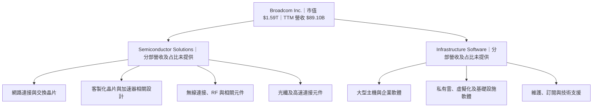
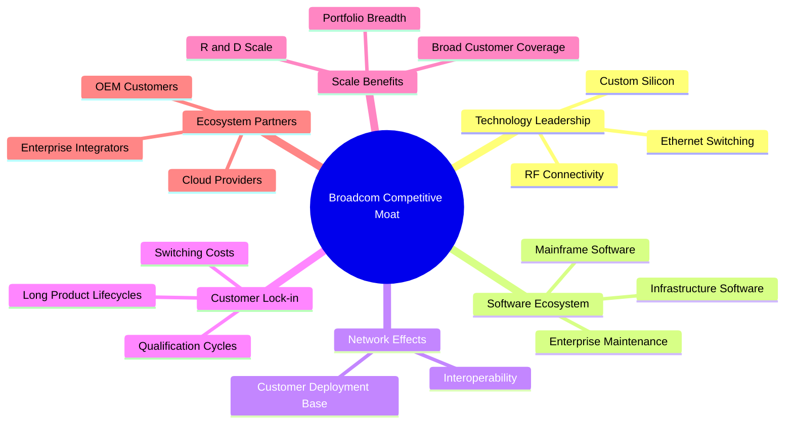
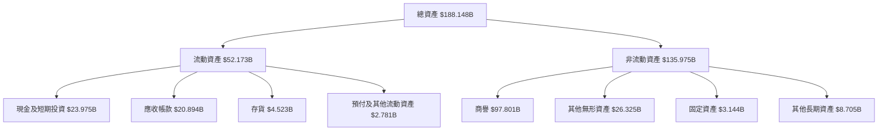
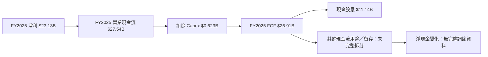
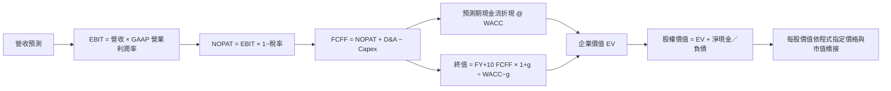
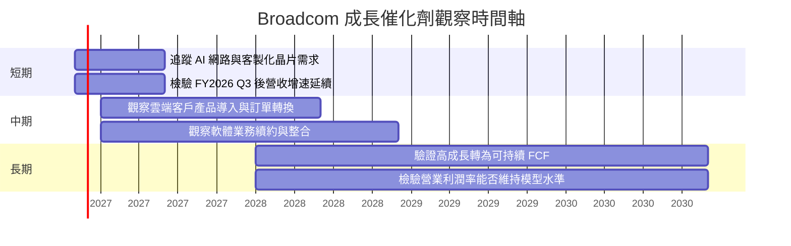
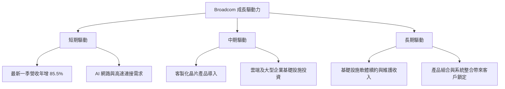
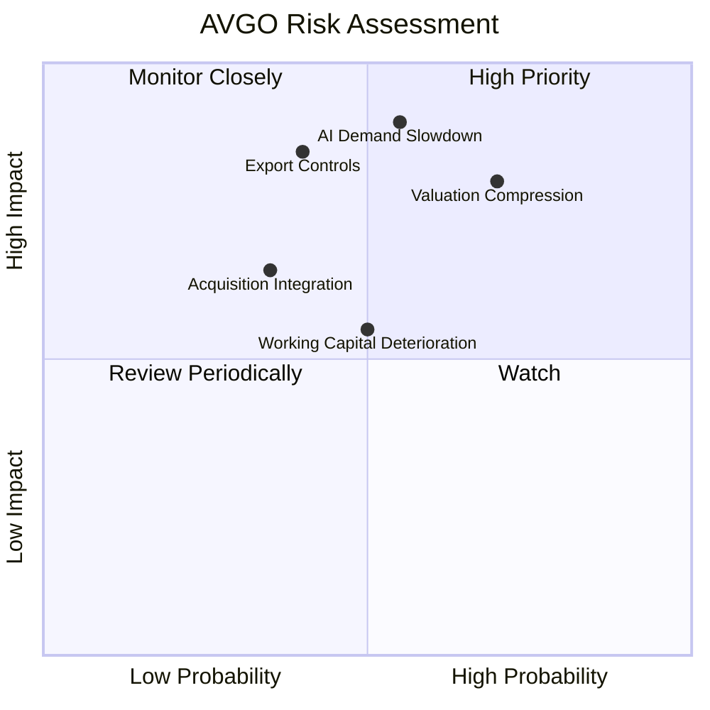
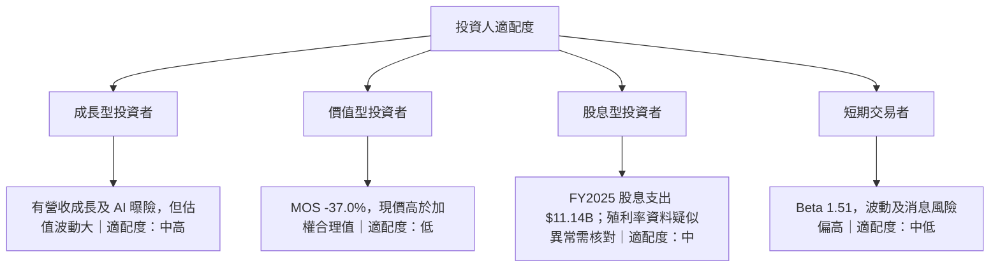

# AVGO 基本面深度分析報告
> **報告日期**：2026-11-17 ｜ **語言**：繁體中文 ｜ **數據來源**：SEC 申報資料 (XBRL)、Yahoo Finance、Finviz、StockAnalysis、Roic.ai ｜ **分析師**：CFA 級機構研究

## 目錄

| # | 章節 | 核心結論 |
|---|------|----------|
| 1 | 執行摘要 | 賣出；加權合理價值 $243.32，MOS -37.0% |
| 2 | 公司概覽與商業模式 | 半導體與基礎設施軟體雙業務，但分部營收明細未提供 |
| 3 | 損益表深度分析 | TTM 營收 $89.10B、TTM 成長 48.7%；營業利潤率 48.0% |
| 4 | 資產負債表分析 | 淨負債 $35.44B；流動比率 2.504 |
| 5 | 現金流量深度分析 | TTM FCF $39.40B，FCF Yield 2.48% |
| 6 | 獲利能力與資本效率 | ROIC 30.0% 高於 WACC 11.54%，目前仍創造價值 |
| 7 | 相對估值分析 | 相對估值與自身歷史估值均偏高 |
| 8 | DCF 內在價值評估 | 基準 DCF 每股 $210.00；終值現值佔 EV 52.5% |
| 9 | 成長催化劑 | AI 網路與客製化晶片是重要質化驅動，但 TAM 數據未提供 |
| 10 | 風險矩陣 | 估值回落、AI 投資／需求變化、競爭及監管為主要風險 |
| 11 | 投資建議 | 現價高於加權合理價值；以 $219 左右或以下作為買入觀察上限 |

---

## 1. 執行摘要

### 1.0 一頁式投資儀表板（Portfolio Manager 30 秒速讀）

| 項目 | 內容 |
|------|------|
| **投資論點（3 句）** | ① FY2026 Q3 單季營收年增 85.5%，TTM 營收年增 48.7%，AI 相關需求是重要成長來源，但分部收入拆分未提供。② TTM FCF 為 $39.40B、ROIC 為 30.0%，高於 11.54% 的 WACC。③ 加權合理價值 $243.32，相對 2026-11-16 收盤價 $333.40 的 MOS 為 -37.0%，估值不具安全邊際。 |
| **綜合評分** | **7.1/10**（引用 1.1 評分卡） |
| **財務健康** | 🟢 現金 $23.98B、總債務 $59.42B、淨負債 $35.44B；流動比率 2.504 |
| **ROIC vs WACC** | 30.0% vs 11.54%；利差 **+18.46 個百分點**，目前創造價值 |
| **FCF 趨勢** | TTM FCF $39.40B；FCF Yield 2.48%。FY2025 年度 FCF 為 $26.91B，TTM 現金創造提高，但資本支出與營運資金仍須追蹤 |
| **估值** | Forward P/E 17.17x ｜ EV/EBITDA（Yahoo Finance 市場資料）31.13x ｜ FCF Yield 2.48% |
| **DCF 內在價值（基準）** | $210.00 ｜ 現價相對 DCF **溢價 58.8%**（折溢價基準為 DCF） |
| **安全邊際（MOS）** | **-37.0%＝($243.32 − $333.40) ÷ $243.32**；🔴 無安全邊際 |
| **預期報酬（基準情境 12M）** | 以基準情境每股價值 $210.00 作參考，較現價 **-37.0%**；並非獨立的一年期股價預測 |
| **關鍵風險（前二）** | AI／客製化晶片成長低於市場預期；高估值在利率上升或獲利預期下修時收縮 |
| **評級 + 信心度** | 🔴 **賣出** ｜ 信心：中（基本面現金流較強，但 DCF 與多方法估值輸入仍有不確定性） |

> DCF 折溢價定義為「現價 ÷ DCF 基準內在價值 − 1」；MOS 則固定以 8.8 加權合理價值為分母，兩者不可混用。報告中另有資料源在股息殖利率、利潤率及估值倍數的口徑差異，詳見相關章節。

### 1.1 綜合評分卡（全報告唯一）

| 維度 | 評分（1–10） | 主要依據（引用數字與其來源章節） |
|------|--------------|----------------------------------|
| 成長性 | 9.0 | TTM 營收年增 48.7%、最新一季年增 85.5%（第 3 章）；季度成長加速但有基期與單季波動風險 |
| 獲利能力 | 9.0 | TTM 營業利益率 48.0%、ROIC 30.0%、Piotroski F-Score 7/8（第 3、6 章） |
| 財務健康 | 7.0 | 淨負債 $35.44B、流動比率 2.504；CCC 由 53 天升至 63 天（第 4 章） |
| 估值 | 3.0 | MOS -37.0%；自身 P/E 42.5x，位於自身 5 年估值區間第 70 百分位（第 7、8 章） |
| 護城河 | 8.0 | 半導體連接技術與基礎設施軟體具客戶鎖定及系統整合特性；但分部收入與市場份額數據未提供（第 2 章） |
| 管理層與資本配置 | 6.5 | FY2025 SBC $7.57B、稀釋股數測試未通過；股息與回購的完整年度資本配置明細不足（第 3、5 章） |
| **綜合評分** | **7.1** | 六項算術平均：(9.0 + 9.0 + 7.0 + 3.0 + 8.0 + 6.5) ÷ 6 = 7.083，四捨五入至一位小數 |

### 1.2 五大投資論點 + 三大核心風險

| 類型 | 項目 | 具體依據 | 信心度 |
|------|------|----------|--------|
| 🟢 **投資論點①** | 高速營收成長 | TTM 營收 $89.10B、年增 48.7%；最新一季營收年增 85.5%。若 AI 網路及客製化晶片需求延續，營收增長可能帶來營業槓桿 | 🟢 高 |
| 🟢 **投資論點②** | 高現金轉換 | TTM OCF $40.65B、Capex $1.25B、FCF $39.40B；FCF／TTM 淨利約 103.0%（以 StockAnalysis TTM 淨利 $38.265B 計算） | 🟢 高 |
| 🟢 **投資論點③** | 資本回報高於資金成本 | ROIC 30.0% 對 WACC 11.54%，利差 +18.46 個百分點 | 🟢 高 |
| 🟢 **投資論點④** | 軟體收入提供不同於晶片的收入來源 | 公司經營半導體解決方案與基礎設施軟體；軟體通常具有維護、訂閱及客戶轉換成本特性，但分部數字未提供 | 🟡 中 |
| 🟢 **投資論點⑤** | 資產負債表流動性尚可 | 現金與短期投資 $23.98B、流動比率 2.504、速動比率 2.153 | 🟢 高 |
| 🟡 **風險①** | 估值高於合理價值 | 加權合理價值 $243.32，較收盤價 $333.40 低 $90.08；MOS -37.0% | 🔴 高衝擊 |
| 🔴 **風險②** | 成長預期及資本化週期風險 | DCF 基準假設第 1 年營收成長 30.0%，但反推市場價格需要第 1 年成長 42.8%；若客戶 AI 投資放緩，估值可能承壓 | 🔴 高 |
| 🟡 **風險③** | 應收、存貨與股數稀釋 | DSO 由 40 天升至 56 天、DIO 由 40 天升至 59 天；F-Score 稀釋股數測試未通過 | 🟡 中 |

### 1.3 快速統計卡片

| 指標 | 公司實際值（期間） | 同業中位數 | 狀態 |
|------|--------------------|------------|------|
| 營收成長（TTM） | **48.7%** | — | 🟢 |
| 營收成長（最新一季年增） | **85.5%** | 36.5%（NVDA、MRVL、QCOM 中位數） | 🟢 |
| 毛利率（TTM） | **75.5%**（Yahoo Finance 合併資料） | 53.1% | 🟢 |
| 營業利益率（TTM） | **48.0%**（SEC 10-Q／程式計算口徑） | — | 🟢 |
| ROIC（TTM） | **30.0%** | — | 🟢 |
| Forward P/E | **17.17x**（Yahoo Finance） | 13.8x（NVDA、MRVL、QCOM 中位數） | 🟡 |
| FCF Yield（TTM） | **2.48%** | — | 🟡 |
| Piotroski F-Score | **7 / 8**（一項測試缺少資料而未計入） | — | 🟢 |

> 公司估值倍數因資料來源與計算口徑有差異：Peer multiples 區塊的 AVGO 自身 P/E 為 42.5x、P/S 18.3x、EV/EBITDA 38.3x；Yahoo Finance 市場快照則顯示 Trailing P/E 42.58x、P/S 17.86x、EV/EBITDA 31.13x。第 7 章依指定來源分別列示，不混用。

### 1.4 投資結論

```text
╔══════════════════════════════════════════════════════════════════╗
║                    📊 投資結論摘要                               ║
╠══════════════════════════════════════════════════════════════════╣
║  評級：🔴 賣出（MOS -37.0%，符合規則 20）                       ║
║  價格（2026-11-16 收盤）：$333.40                                ║
║  DCF 內在價值（基準）：$210.00（現價溢價 58.8%）                 ║
║  安全邊際 MOS：-37.0%（＝($243.32−$333.40)÷$243.32）             ║
║  加權合理價值（8.8）：$243.32                                    ║
║  DCF 情境價值：                                                   ║
║    悲觀情境：$86.85（較現價 -74.0%）                             ║
║    基準情境：$210.00（較現價 -37.0%）                            ║
║    樂觀情境：$462.06（較現價 +38.6%）                            ║
║  綜合評分：7.1/10（引用 1.1）                                    ║
║  適合投資人：可承受高波動、看好 AI 基礎設施長期需求的成長型投資人║
╚══════════════════════════════════════════════════════════════════╝
```

---

## 2. 公司概覽與商業模式

### 2.1 業務結構與收入來源

公司營運兩大部門：半導體解決方案及基礎設施軟體。資料未提供最新分部營收及營收占比，因此不以估計比例繪製分部金額或比例圖。



### 2.2 市場份額

市場份額數據未提供，因此不繪製比例圖或估算市場占比。TTM 營收 $89.10B、TTM 成長 48.7%，最新一季營收年增 85.5%，顯示公司規模及增長速度均具重要性。Peer multiples 中，NVDA 最新一季營收年增 105.9%、MRVL 年增 36.5%、QCOM 年減 8.4%；但各家公司產品組合不同，不能單以成長率推斷市場份額。

### 2.3 競爭護城河分析



### 2.4 護城河強度

| 護城河項目 | 強度（強／中／弱） | 證據（引用數字或事實） | 會削弱它的情況 |
|------------|--------------------|------------------------|----------------|
| 技術與產品設計 | 強 | TTM 營收 $89.10B、毛利率 75.5%；產品涵蓋網路、客製化晶片、無線連接及光纖元件 | 主要客戶改用內部設計、替代供應商或新架構 |
| 軟體生態系統 | 中至強 | 公司有基礎設施軟體部門，並提供企業軟體與維護服務；分部收入占比未提供 | 客戶削減軟體支出、替代開源或雲端原生方案 |
| 網路效應 | 中 | 產品須與雲端、交換器、伺服器及企業系統互通；沒有可引用的網路效應量化指標 | 標準改變或客戶集中採購轉移 |
| 客戶鎖定 | 強 | 半導體導入與企業軟體遷移通常涉及測試、認證、相容性及轉換成本；量化續約率未提供 | 大客戶自研、重新議價或降低採購 |
| 規模效應 | 強 | FY2025 研發費用 $10.98B，TTM 營收 $89.10B，具跨產品研發及銷售規模 | 併購整合效率下降或研發回報降低 |
| 生態夥伴 | 中 | 公司服務雲端、OEM、企業及系統整合生態；客戶集中度數據未提供 | 主要合作夥伴轉向競爭者或供應鏈受限 |

**護城河分數理由：**1.1 評分卡給予 8.0/10，依據是多產品線、企業軟體維護和客戶轉換成本等質化優勢；但缺乏分部收入、客戶集中度及市場份額數字，故不給更高評分。

---

## 3. 損益表深度分析

### 3.1 年度收入成長趨勢（近 4 年）

FY2022 至 FY2025 營收 CAGR 約 24.4%：\((63.89 ÷ 33.20)^{1/3} − 1\)。

```text
╔══════════════════════════════════════════════════════════════════╗
║              Broadcom 年度收入趨勢（FY2022-FY2025）              ║
╠══════════════════════════════════════════════════════════════════╣
║  FY2022  $33.20B  ████████████░░░░░░░░░░░░  起始年度             ║
║  FY2023  $35.82B  █████████████░░░░░░░░░░░  YoY: +7.9%  🟡      ║
║  FY2024  $51.57B  ███████████████████░░░░░  YoY: +44.0% 🟢      ║
║  FY2025  $63.89B  ████████████████████████  YoY: +23.9% 🟢      ║
╠══════════════════════════════════════════════════════════════════╣
║  FY2022-FY2025 營收 CAGR：約 +24.4%                               ║
╚══════════════════════════════════════════════════════════════════╝
```

FY2024 增長明顯加快，與大型併購後軟體業務納入及半導體需求復甦同時發生；FY2025 營收仍增加 23.9%，但增速低於 FY2024。FY2026 TTM 成長 48.7%，以及最新一季 85.5% 年增，顯示近期增長再次加速，但不應將單季年增直接外推為長期增速。

### 3.2 季度收入趨勢分析

| 季度 | 營收（$B） | QoQ 成長 | YoY 成長 | 備註 |
|------|------------:|---------:|---------:|------|
| FY2025 Q4 | 18.015 | 以 FY2025 Q3 15.952 計為 +12.9% | +28.2% | 單季營收延續增長 |
| FY2026 Q1 | 19.311 | +7.2% | +29.5% | 年增仍高於 FY2025 全年基調 |
| FY2026 Q2 | 22.187 | +14.9% | +47.9% | 成長加速 |
| FY2026 Q3 | 29.591 | +33.4% | +85.5% | 季營收明顯跳升，需檢驗是否持續 |

QoQ 以相鄰季度營收計算；FY2025 Q4 至 FY2026 Q1 的 QoQ 及各季 YoY 以財務資料內對應年度季度數計算。最新一季成長可能受需求集中、產品組合及比較基期影響，應以後續季度訂單、客戶指引與現金回收確認。

### 3.3 利潤率演變分析

| 利潤率指標 | FY2022 | FY2023 | FY2024 | FY2025 | 趨勢 | 評估 |
|------------|-------:|-------:|-------:|-------:|------|------|
| **毛利率** | 66.5% | 68.9% | 63.1% | 67.8% | FY2024 回落、FY2025 回升 | 🟢 |
| **營業利益率** | 43.0% | 45.9% | 29.1% | 40.8% | FY2024 顯著下降後反彈 | 🟡 |
| **淨利率** | 34.6% | 39.3% | 11.4% | 36.2% | FY2024 受非營業及稅務等因素影響較大 | 🟡 |

年度利潤率按年度財報列示的毛利、營業利益、淨利除以營收計算，與 TTM 口徑不同。FY2024 營業利益率及淨利率下滑，可能反映併購後無形資產攤銷、整合與融資成本等影響；FY2025 的營業利益率回升至 40.8%，顯示營收規模擴大及產品組合改善，但仍低於 FY2022–23 的年度水準。TTM 營業利益率為 48.0%，最新一季為 53.9%；這些 TTM／單季數字不可與 FY 年度比率混作同一期間。

### 3.4 費用結構分析

完整費用分類與同期間成本拆分未提供，且現有數據包含不同期間及口徑，因此不繪製費用結構圓餅圖。FY2025 研發費用為 $10.98B，約為年度營收 $63.89B 的 17.2%；研發投入增加有助於維持產品設計能力，但其回報取決於新產品商業化與客戶採用。

### 3.5 季度 EPS 趨勢與盈餘品質（Quality of Earnings）

| 季度 | EPS 實際值（來源列示） | EPS 預估／超預期情況 |
|------|------------------------:|----------------------|
| FY2025 Q4 | $1.74 | N/A；EPS 估計值為缺失 |
| FY2026 Q1 | $1.50 | N/A；EPS 估計值為缺失 |
| FY2026 Q2 | $1.91 | N/A；EPS 估計值為缺失 |
| FY2026 Q3 | $2.68 | N/A；EPS 估計值為缺失 |

Earnings History 的四季 EPS Est 與 EPS Act 欄位均為 `nan`，因此無法判斷過去四季是超預期或不及預期；上表僅列 StockAnalysis 季度 EPS 數字，不把它們誤標為市場實際 EPS 驚喜。另一來源列示最新一季 EPS 年增 215.3%，淨利年增 216.1%。

| 盈餘品質項目 | 數值／佔比 | 評估 |
|--------------|-----------|------|
| 股權薪酬 SBC / 營收 | FY2025 SBC $7.57B ÷ FY2025 營收 $63.887B = **11.9%**；FY2025 SBC / OCF = **27.5%** | 🟡 SBC 絕非可忽略成本；將減少既有股東的經濟持份，F-Score 稀釋股數項亦未通過 |
| SBC / 營業現金流 | $7.57B ÷ $27.54B = **27.5%**（FY2025） | 🟡 現金流會把 SBC 加回，但股東承擔稀釋成本 |
| FCF / 淨利（現金轉換率） | $39.40B ÷ $38.265B = **103.0%**（TTM；淨利取 StockAnalysis TTM） | 🟢 現金轉換高於會計淨利；但須注意各來源 TTM 口徑可能有差異 |
| 一次性／非經常性損益 | N/A（沒有足以量化的一次性損益拆分） | 無法判定有無重大盈餘美化 |
| 有效稅率異常 | 模型預設稅率 21.0%；實際 TTM 有效稅率 N/A | 不以模型稅率冒充實際稅率；無法判定稅務利益影響 |
| 資本化支出 vs 費用化 | TTM Capex $1.25B；資本化研發等明細 N/A | Capex 低不代表所有技術投資均不需資本；資本化支出明細不足 |

**盈餘品質結論：**TTM FCF $39.40B、OCF $40.65B，支持 GAAP 獲利具有現金流覆蓋；但 SBC 對 FY2025 營收約 11.9%，且稀釋股數測試未通過，代表報表現金流不等於無稀釋的股東回報。未取得實際 TTM 稅率及非經常性項目拆分，對 GAAP 淨利是否受一次性因素影響保留判斷。

---

## 4. 資產負債表分析

### 4.1 資產結構分解

以下為 2026-08-02 TTM 資產負債表數字，單位 $B。非流動資產明細只列資料中提供的主要項目，不能視為完整加總。



流動資產加總：$23.975B + $20.894B + $4.523B + $2.781B = $52.173B。商譽與無形資產規模較大，代表併購資產在帳面資產中的重要性；若被收購業務現金流弱化，可能帶來減損風險。

### 4.2 流動性與營運資金分析

| 指標 | 最新 TTM | 一年前 TTM | 變化 | 解讀 |
|------|----------|------------|------|------|
| 流動比率 | 2.504 | N/A | N/A | 目前流動資產覆蓋流動負債約 2.5 倍 |
| 速動比率 | 2.153 | N/A | N/A | 排除存貨後流動性仍充足 |
| DSO 應收帳款天數 | 56 天 | 40 天 | +16 天 | 收款周期拉長；可能與營收組合、客戶付款條件或季度末銷售有關，應追蹤壞帳與回款 |
| DIO 存貨天數 | 59 天 | 40 天 | +19 天 | 存貨天數增加，可能是供貨準備，也可能反映需求預測偏差 |
| DPO 應付帳款天數 | 52 天 | 26 天 | +26 天 | 對供應商付款時間拉長，可支撐營運資金；亦須確保不代表供應鏈付款壓力 |
| CCC 現金轉換週期 | 63 天 | 53 天 | +10 天 | 現金轉換週期變長，與應收、存貨增加速度快於應付改善一致 |

營運資金天數由 SEC 現金流與 Yahoo 季度資產負債表按 QUALITY FIGURES 口徑引用，不另行重算。

### 4.3 債務結構分析

```text
╔══════════════════════════════════════════════════════════════════╗
║                  Broadcom 債務健康診斷                           ║
╠══════════════════════════════════════════════════════════════════╣
║  總債務：        $59.42B   ████████████████████████               ║
║  現金+短期投資： $23.98B   ██████████                             ║
║  淨負債：        $35.44B   總債務減現金，需由持續 FCF 覆蓋         ║
║                                                                  ║
║  流動比率：      2.504x    🟢 流動資產覆蓋流動負債               ║
║  速動比率：      2.153x    🟢 排除存貨後仍有流動性                ║
║  Debt/EBITDA：   N/A       缺少與此比率一致的債務及 EBITDA 口徑    ║
║  利息保障倍數：  N/A       利息費用明細不足                        ║
╚══════════════════════════════════════════════════════════════════╝
```

FY2025 年末總債務為 $65.14B，至最新 TTM 數據 $59.42B；現金與短期投資由 FY2025 年末 $16.18B 增至 $23.98B。淨負債下降有助降低再融資風險，但公司仍有 $35.44B 淨負債，不能稱為淨現金公司。

### 4.4 股東權益趨勢

```text
╔══════════════════════════════════════════════════════════════════╗
║                 Broadcom 歷年股東權益變化                         ║
╠══════════════════════════════════════════════════════════════════╣
║  FY2022  $22.71B  ████████░░░░░░░░░░░░                           ║
║  FY2023  $23.99B  ████████░░░░░░░░░░░░                           ║
║  FY2024  $67.68B  ███████████████████                            ║
║  FY2025  $81.29B  ███████████████████████                        ║
╚══════════════════════════════════════════════════════════════════╝
```

FY2024 股東權益大幅上升，與併購後商譽、無形資產及資本結構變化同時發生；股東權益變動不應單獨視為內生獲利累積。

---

## 5. 現金流量深度分析

### 5.1 現金流量瀑布圖

FY2025 有完整的年度淨利、OCF、Capex 及股息數據，可建立部分現金流關係；回購數據及淨現金變化的完整調節表未提供，因此不補估。



FY2025 這組年度數據的 OCF、Capex 與 FCF 以年度現金流量表為來源。TTM FCF 另依規定使用營業現金流 $40.65B 減資本支出 $1.25B，為 $39.40B。

### 5.2 FCF 轉換率趨勢

| 年度 | FCF（$B） | 淨利（$B） | FCF / 淨利 | 評估 |
|------|----------:|-----------:|-----------:|------|
| FY2022 | 16.31 | 11.49 | 142.0% | 🟢 現金流高於淨利 |
| FY2023 | 17.63 | 14.08 | 125.2% | 🟢 |
| FY2024 | 19.41 | 5.89 | 329.5% | 🟡 淨利基數異常偏低，倍數不宜外推 |
| FY2025 | 26.91 | 23.13 | 116.3% | 🟢 |
| TTM 至 2026-08-02 | 39.40 | 38.265 | 103.0% | 🟢 TTM 淨利採 StockAnalysis 來源 |

FY2024 轉換率偏高主要是淨利基數低造成的分母效應，並非現金流本身突然成為常態的 3.3 倍淨利。

### 5.3 自由現金流趨勢

```text
╔══════════════════════════════════════════════════════════════════╗
║                 Broadcom 歷年自由現金流                           ║
╠══════════════════════════════════════════════════════════════════╣
║  FY2022  $16.31B  ████████████░░░░░░░░░░  FCF Yield：N/A         ║
║  FY2023  $17.63B  █████████████░░░░░░░░░  FCF Yield：N/A         ║
║  FY2024  $19.41B  ██████████████░░░░░░░░  FCF Yield：N/A         ║
║  FY2025  $26.91B  ████████████████████░░  FCF Yield：N/A         ║
║  TTM      $39.40B  ██████████████████████████████ FCF Yield 2.48%║
╚══════════════════════════════════════════════════════════════════╝
```

歷史年度 FCF Yield 未提供同期間市值序列，故不補填。TTM FCF Yield 2.48% 代表以目前市值計算的現金流報酬有限，與高成長預期及較高估值相符。

### 5.4 資本配置評估

資本配置金額以有明確數字的項目列示，因缺少同一期間回購、收購與留存的完整資金流明細，不繪製比例圓餅圖。

| 項目 | 數值 | 解讀 |
|------|------:|------|
| FY2025 資本支出 | $0.623B | 約佔 FY2025 營收 1.0%；資本密集度較低，但不能因此忽略研發及併購投入 |
| FY2025 現金股息 | $11.14B | 約佔 FY2025 FCF $26.91B 的 41.4% |
| FY2025 SBC | $7.57B | 相當於 FY2025 營收 11.9%，稀釋成本顯著 |
| 回購／收購／留存完整拆分 | N/A | 現有資料不足以量化各項用途占比 |

Yahoo Finance 合併資料列示股息殖利率 75.0%，與 FY2025 現金股息 $11.14B、現價 $333.40 及 32.4% payout ratio 等資訊明顯不易互相核對，應視為資料異常，不作投資結論依據。5 年平均股息欄位 123.0% 同樣可能有口徑或資料錯誤。

---

## 6. 獲利能力與資本效率

### 6.1 ROE / ROA / ROIC 趨勢

| 指標 | 最新 TTM | 歷史可用值 | 評估 |
|------|---------:|-------------|------|
| ROE | 38.4%（QUALITY FIGURES） | Yahoo 合併資料另列 44.2%，口徑不一致 | 🟢 高回報，但採評分與杜邦分析時以 QUALITY FIGURES 口徑為準 |
| ROA | 15.4%（Yahoo 合併資料） | Piotroski 顯示 TTM ROA 高於一年前，具體歷史比率未提供 | 🟢 |
| ROIC | 30.0%（VERIFIED FIGURES） | 歷年一致口徑 ROIC 未提供 | 🟢 |
| WACC | 11.54% | 同第 8.2 節 | — |

沒有同業 ROIC／ROA 均值資料，不列行業平均。ROE 來源分歧需留意，以下杜邦拆解嚴格引用 QUALITY FIGURES 的 38.4%。

### 6.2 ROIC vs WACC 分析（核心價值創造判斷）

```text
╔══════════════════════════════════════════════════════════════════╗
║                ROIC vs WACC 深度分析                            ║
╠══════════════════════════════════════════════════════════════════╣
║  WACC 輸入（與第 8.2 節採同一數值）：                            ║
║  ├── 無風險利率（10Y 美債）：       5.12%                        ║
║  ├── 市場風險溢酬 ERP：              5.00%                        ║
║  ├── 原始 Beta：                    1.51                         ║
║  ├── 調整後 Beta：                  1.34                         ║
║  ├── 股權成本 Ke（資料列示）：      11.81%                       ║
║  ├── 稅前債務成本：                 5.40%                        ║
║  ├── 稅後債務成本：                 5.40%×(1−21%) = 4.266%       ║
║  ├── 股權／債務權重：               96.4% / 3.6%                  ║
║  └── WACC（資料列示）：             11.54%                       ║
║                                                                  ║
║  ROIC（TTM，採 VERIFIED FIGURES）：30.0%                         ║
║  EVA 利差 = ROIC − WACC = 30.0% − 11.54% = +18.46pp              ║
║                                                                  ║
║  ROIC 30.0%  ▓▓▓▓▓▓▓▓▓▓▓▓▓▓▓▓▓▓▓▓▓▓▓▓▓▓▓▓▓▓ 🟢                  ║
║  WACC 11.54% ▓▓▓▓▓▓▓▓▓▓▓▓░░░░░░░░░░░░░░░░░░ ──                  ║
╚══════════════════════════════════════════════════════════════════╝
```

ROIC 30.0% 高於 WACC 11.54%，利差為 **18.46 個百分點**，代表目前投入資本回報高於資金成本，仍在創造經濟價值。這不保證未來回報維持不變：若 AI 晶片價格競爭、收購資產回報下降，或營運資金占用加大，ROIC 可能收斂。WACC 明細及計算限制於第 8.2 節說明。

### 6.3 杜邦三因素分解

| 因素 | 數值（TTM） | 解讀 |
|------|-------------|------|
| 淨利率 | 42.9% | 高淨利率是 ROE 的主要來源之一 |
| 資產週轉率 | 0.47 | 每單位資產產生約 0.47 倍營收 |
| 權益乘數 | 1.89 | 有槓桿，但不是唯一的 ROE 驅動因素 |
| **ROE** | **38.4%** | 42.9% × 0.47 × 1.89 = 38.2%，QUALITY FIGURES 列示 38.4%；差異來自未四捨五入底層值 |

採 QUALITY FIGURES 的 DuPont 數字，不以四捨五入後的三項重新替代其 ROE 結果。ROE 主要由高淨利率與中等資產週轉、槓桿共同形成，並非單靠高槓桿撐起。

### 6.4 財務體質：Piotroski F-Score

Piotroski F-Score 為 **7/8**；一項缺少資料的測試未納入分母，故不是 7/9。

| 測試 | 結果 | 解讀 |
|------|------|------|
| ROA > 0 | ✅ 通過 | 有正獲利 |
| 營業現金流 > 0 | ✅ 通過 | 營運產生正現金流 |
| ROA 高於一年前 | ✅ 通過 | 資產報酬改善 |
| 營業現金流 > 淨利 | ✅ 通過 | 應計品質測試通過 |
| 長期負債 ÷ 總資產低於一年前 | — 無法判定 | 缺少輸入，未納入分母 |
| 流動比率高於一年前 | ✅ 通過 | 流動性相對改善 |
| 稀釋股數未增加 | ❌ 未通過 | 股數稀釋可能降低每股價值增長 |
| 毛利率高於一年前 | ✅ 通過 | 毛利率改善 |
| 資產週轉率高於一年前 | ✅ 通過 | 資產使用效率改善 |

---

## 7. 相對估值分析

### 7.1 同業估值比較表格

| 估值指標 | **AVGO** | **NVDA** | **MRVL** | **QCOM** | 本公司評估 |
|----------|---------:|---------:|---------:|---------:|-----------|
| **Trailing P/E** | 42.5x | 20.6x | 47.8x | 13.3x | 🟡 同業差異大；AVGO 高於 NVDA、QCOM，低於 MRVL |
| **Forward P/E** | 17.17x（Yahoo 市場資料） | 9.9x | 19.7x | 13.8x | 🟡 高於同業中位數 13.8x；Peer 區塊未提供 AVGO 同口徑 forward 倍數 |
| **P/S Ratio** | 18.3x | 12.4x | 13.8x | 4.2x | 🔴 高於三家同業 |
| **EV/EBITDA** | 38.3x（Peer multiples 口徑） | 18.6x | 45.2x | 17.8x | 🔴 高於 NVDA、QCOM；低於 MRVL |
| **最新一季營收年增** | 85.5% | 105.9% | 36.5% | -8.4% | 🟢 成長居前，但仍低於 NVDA |
| **毛利率（TTM）** | 75.5%（合併資料） | 74.7% | 52.2% | 53.1% | 🟢 毛利率高於同業列示值 |

AVGO 自身估值採 Peer multiples 區塊時，P/E 42.5x、P/S 18.3x、EV/EBITDA 38.3x；Forward P/E 17.17x 則取 Yahoo Finance 市場資料。由於 Forward P/E 的公司及同業資料來源口徑不同，僅作方向性參考。

### 7.2 歷史估值區間分析

```text
╔══════════════════════════════════════════════════════════════════╗
║                 AVGO 自身 5 年估值區間                            ║
╠══════════════════════════════════════════════════════════════════╣
║  P/E：        1.8x ───────── 中位數 5.5x ───────── 77.5x        ║
║  目前：42.5x｜第 70 百分位                                      ║
║                                                                  ║
║  P/S：        0.6x ───────── 中位數 1.5x ───────── 28.1x        ║
║  目前：18.3x｜第 70 百分位                                      ║
║                                                                  ║
║  EV/EBITDA：  0.5x ───────── 中位數 5.6x ───────── 70.7x        ║
║  目前：38.3x｜第 55 百分位                                      ║
╚══════════════════════════════════════════════════════════════════╝
```

上述歷史區間受併購、盈利基數及計算口徑改變影響，較低的歷史中位數不宜直接當作均值回歸目標；不過目前 P/E、P/S 均在自身歷史第 70 百分位，顯示市場已為成長預期支付較高溢價。

### 7.3 情境價值（Bear / Base / Bull，照抄 DCF MODEL）

| 情境 | 第 1 年營收成長 | 期末營業利潤率 | WACC | 每股價值 | 相對現價 | 機率 | 會發生的條件 |
|------|----------------:|----------------:|-----:|---------:|---------:|-----:|--------------|
| 🔴 悲觀 | 15.0% | 36.4% | 12.54% | $86.85 | -74.0% | 25% | AI／客製化晶片成長放緩、軟體與半導體利潤率承壓，資本成本提高 |
| 🟡 基準 | 30.0% | 42.8% | 11.54% | $210.00 | -37.0% | 50% | 成長由高基期逐步減速，營業利潤率朝較低歷史中位數收斂 |
| 🟢 樂觀 | 45.0% | 47.1% | 10.54% | $462.06 | +38.6% | 25% | AI 晶片及網路需求延續，成長高於基準、利潤率維持高位且風險折現率下降 |

### 7.4 相對估值隱含價格區間

```text
╔══════════════════════════════════════════════════════════════════╗
║             估值方法回推每股價值與目前股價                       ║
╠══════════════════════════════════════════════════════════════════╣
║  $157.99 ───── $210.00 ───── $243.32 ───── $268.02 ── $333.40   ║
║  EV/EBITDA       基準 DCF      加權合理值      Forward P/E   現價 ║
╚══════════════════════════════════════════════════════════════════╝
```

- **同業 EV/EBITDA：$157.99**；使用 NVDA、QCOM 同業中位數 18.2x 乘以 AVGO TTM EBITDA，再加淨現金／扣除淨負債橋接；方法值與區塊所列保持一致。
- **同業 Forward P/E：$268.02**；同業中位數 13.8x × Forward EPS $19.41。
- **DCF 基準：$210.00**；10 年 FCFF、WACC 11.54%、永續成長率 3.0%。
- 分析師共識目標價 $528.17 另於第 8.8 節列示。

---

## 8. DCF 內在價值評估（Discounted Cash Flow）

> 本章唯一模型為程式計算的 DCF MODEL。模型輸出按原值引用，不另建模型或改動其數字。由於部分提供的已四捨五入輸入無法精確重現底層輸出，本章會明確標出差異，而不以錯誤等式掩蓋。

### 8.0 估值推理鏈（Thinking Logic）

#### Step 1 — 價值由哪些變數決定？

AVGO 的價值可視為**半導體解決方案現金流 + 基礎設施軟體現金流 + 高成長 AI 相關需求的選擇權**；但分部收入未提供，無法量化各自營收占比。模型主要估值變數是**營收成長路徑與營業利潤率**：其變化會作用於所有預測年 FCFF，並進一步放大終值。第 8.6 敏感度中，WACC 變化的價值影響也很大，與現金流長久期特徵相符。

#### Step 2 — 模型選擇

| 決策點 | 本報告採用 | 理由（含數字） | 曾考慮但否決 | 否決理由 |
|--------|-----------|----------------|--------------|----------|
| 現金流定義 | FCFF | 使用 WACC 折現，企業價值再橋接至股權價值；TTM OCF $40.65B、FCF $39.40B | FCFE | 債務與資本結構變化由 EV 橋接處理較一致 |
| 預測期 N | 10 年 | 模型固定 10 年，能呈現高成長逐步衰減至 3.0% | 5 年 | 5 年無法呈現區塊內已設定的長期成長衰減路徑 |
| 終值方法 | Gordon Growth | 區塊使用永續成長率 3.0%、WACC 11.54% | 退出倍數作主法 | 區塊未提供退出倍數 DCF 結果，不自行補建 |
| EBIT 基礎 | GAAP EBIT | 區塊明示採 GAAP EBIT | 非 GAAP EBIT | 避免把 SBC 加回後再遺漏其股東成本 |

#### Step 3 — 關鍵假設推導鏈

- **營收成長**：錨點＝TTM 年增 48.7%、最新一季年增 85.5% → 調整＝高基期與單季增長不可長期線性外推 → **採用 FY+1 30.0%，FY+10 3.0%，逐年遞減** → 曾考慮持續採 48.7%，因其高於模型設定且會把近期高增長永久化而不採用。
- **營業利潤率**：錨點＝TTM 48.0%；FY2025 年度營業利益率約 40.8% → 調整＝將目前高利潤率逐步向近年歷史水準收斂 → **FY+1 48.0% 至 FY+10 42.8%** → 未採用長期維持 48.0%，因模型明示以近 5 個財年中位數為終點依據。
- **永續成長率 g**：錨點＝長期成熟企業通常需低於名目經濟長期成長；具體 GDP／通膨輸入未提供 → 採用模型值 **3.0%**，且低於 WACC 11.54% → 不採用 4.0% 以上作基準，避免終值過度膨脹。
- **預測期 N**：錨點＝公司 TTM 成長 48.7%，但高增長可見度與資料未提供的產品週期限制預測準確度 → 採用模型 **10 年** → 否決更短年限，因會截斷成長衰減路徑；不另測更長年限，以遵守模型輸入。
- **Capex／營收**：錨點＝TTM Capex $1.25B ÷ TTM 營收 $89.10B 約 1.4% → 模型採用 FY+1 1.4% 至 FY+10 0.8%，逐步向 1.1 倍 D&A 收斂 → 不採用高於模型的長期資本支出率，因未見區塊支持。
- **GAAP EBIT 與 SBC**：錨點＝FY2025 SBC $7.57B；模型指定 GAAP EBIT → GAAP EBIT 已將 SBC 列作費用，**模型採用 (A)：GAAP EBIT、不另扣 SBC、固定股數、年稀釋率 0%** → 否決再扣 SBC 或另加年稀釋，避免同一成本重複計算。
- **年稀釋率**：錨點＝F-Score 的稀釋股數測試未通過，但 DCF MODEL 指定組合 (A) → 採用 **0% 額外稀釋**，因模型已選 GAAP EBIT 組合 → 不自行加入股數稀釋假設，以免違反既定模型。
- **終值方法**：錨點＝模型採 10 年 FCFF 及 3.0% 永續成長率 → 採用 Gordon Growth → 退出倍數法未列在模型輸出，故不自行製作第二套終值。
- **WACC**：錨點＝Cost of capital 區塊的 11.54% → 採用 **11.54%**；不另算替代 WACC，以保持與第 6.2 節一致。

#### Step 4 — 最脆弱假設

最脆弱之處是高成長能否維持及其對終值的影響；若成長、利潤率與資本成本同時轉差，程式悲觀情境價值為 $86.85，較現價低 74.0%。

#### Step 5 — 計算路徑圖



### 8.1 模型假設總表（Model Inputs）

| 假設項目 | 採用值 | 依據／來源 | 敏感度 |
|----------|--------|-------------|--------|
| 預測期長度 N | 10 年 | DCF MODEL 固定 10 年 | 🟡 中 |
| 營收成長 | FY+1 30.0%，FY+10 3.0%，逐年線性下降 | TTM 年增 48.7%，模型將其限制於 0%–30% 後向 3% 衰減 | 🔴 高 |
| 營業利潤率 | 48.0% 降至 42.8% | TTM 48.0%；模型終點採近 5 個財年中位數 | 🔴 高 |
| 有效稅率 | 21.0% | 模型預設稅率 | 🟢 低 |
| Capex／營收 | FY+1 1.4% 降至 FY+10 0.8% | TTM Capex／營收約 1.4%；模型逐步收斂 | 🟡 中 |
| D&A／營收 | 0.7% | 模型採 TTM 比率 | 🟢 低 |
| 營運資金變動 | 未建模 | DCF MODEL 明示 Working capital is not modelled | 🟢 低 |
| EBIT 基礎 | GAAP | DCF MODEL 指定 GAAP EBIT | 🟡 中 |
| SBC 處理 | 採用組合 (A)：GAAP EBIT；不再扣 SBC | GAAP EBIT 已含 SBC 費用；固定股數 | 🟡 中 |
| 年稀釋率 | 0% | 隨模型組合 (A) 固定股數 | 🟡 中 |
| 永續成長率 g | 3.0% | DCF MODEL 指定；低於 WACC | 🔴 高 |
| 終值方法 | Gordon Growth | DCF MODEL 指定 | 🔴 高 |
| WACC | 11.54% | Cost of capital 區塊指定 | 🔴 高 |

FCFF 定義依模型為 **NOPAT + D&A − Capex**；營運資金未建模，不另行加入 ΔWC 數字。本模型採用 **(A)**，故 SBC 影響已計入一次：GAAP EBIT 已含 SBC 費用，不再扣 SBC，也不額外放大股數。

### 8.2 折現率推導（WACC）

```text
╔══════════════════════════════════════════════════════════════════╗
║                    WACC 推導（折現率）                           ║
╠══════════════════════════════════════════════════════════════════╣
║  股權成本 Ke（CAPM）：                                           ║
║  ├── 無風險利率 Rf（10Y 美債）：      5.12%                      ║
║  ├── 市場風險溢酬 ERP：               5.00%                      ║
║  ├── 原始 Beta（Yahoo Finance）：      1.51                       ║
║  ├── 調整後 Beta：                    1.34                       ║
║  ├── Beta 調整：⅔×1.51 + ⅓×1 = 1.34（四捨五入）                 ║
║  └── Ke（資料列示）：                 11.81%                     ║
║                                                                  ║
║  債務成本 Kd：                                                   ║
║  ├── 稅前 Kd（資料列示）：            5.40%                      ║
║  ├── 稅率：                           21.0%                      ║
║  └── 稅後 Kd = 5.40%×(1−21.0%) = 4.266%                         ║
║                                                                  ║
║  資本結構（市值基礎，資料列示權重）：                            ║
║  ├── 股權權重 E：                     96.4%                      ║
║  ├── 債務權重 D：                     3.6%                       ║
║  └── WACC（資料列示）：               11.54%                     ║
╚══════════════════════════════════════════════════════════════════╝
```

**逐步演算與一致性說明**

1. **Ke（CAPM）**：原始 Beta 1.51 經調整後採用 Beta 1.34；以已列示輸入直接相乘，\(5.12\% + 1.34 \times 5.00\% = 11.82\%\)。成本資本區塊列示 Ke 為 **11.81%**，兩者有 0.01 個百分點差異，可能來自底層未四捨五入輸入；本報告引用指定 Ke 11.81%，不改動。
2. **稅前 Kd**：利息費用及平均計息負債的絕對金額未提供，不能獨立重建；採成本資本區塊列示稅前債務成本 **5.40%**。
3. **稅後 Kd**：\(5.40\% \times (1 - 21.0\%) = 4.266\%\)。
4. **權重**：股權 96.4%、債務 3.6%，相加為 100.0%。區塊列示的總債務為 $59.42B；利息費用的債務範圍及逐項平均計息負債明細未提供，故無法獨立核對 Kd 分母。
5. **WACC**：\(96.4\% \times 11.81\% + 3.6\% \times 4.266\% = 11.38484\% + 0.153576\% = 11.538416\%\)，四捨五入為 **11.54%**。

無風險利率日期未在資料中提供；ERP 5.00% 為假設輸入；未另加規模或國別溢酬。WACC 11.54% 與第 6.2 節一致，並直接採用模型指定數值。

### 8.3 逐年自由現金流預測（基準情境）

下表照抄 DCF MODEL 輸出，金額為 $B，折現因子保留三位小數。ΔWC 不列為數值列，因模型明示未建模；FCFF 也未另扣 SBC，與組合 (A) 相符。

| 年度 | FY+1 | FY+2 | FY+3 | FY+4 | FY+5 | FY+6 | FY+7 | FY+8 | FY+9 | FY+10 |
|------|-----:|-----:|-----:|-----:|-----:|-----:|-----:|-----:|-----:|------:|
| 營收 | 115.84 | 147.11 | 182.42 | 220.72 | 260.46 | 299.52 | 335.47 | 365.66 | 387.60 | 399.23 |
| 營收 YoY | 30.0% | 27.0% | 24.0% | 21.0% | 18.0% | 15.0% | 12.0% | 9.0% | 6.0% | 3.0% |
| 營業利潤率 | 48.0% | 47.5% | 46.9% | 46.3% | 45.7% | 45.2% | 44.6% | 44.0% | 43.4% | 42.8% |
| 營業利益 EBIT（GAAP） | 55.66 | 69.83 | 85.54 | 102.23 | 119.12 | 135.26 | 149.54 | 160.89 | 168.30 | 171.04 |
| − 稅（21.0%） | (11.69) | (14.67) | (17.96) | (21.47) | (25.02) | (28.40) | (31.40) | (33.79) | (35.34) | (35.92) |
| = NOPAT | 43.97 | 55.17 | 67.58 | 80.76 | 94.10 | 106.85 | 118.14 | 127.10 | 132.96 | 135.12 |
| + D&A | 0.82 | 1.04 | 1.29 | 1.57 | 1.85 | 2.12 | 2.38 | 2.59 | 2.75 | 2.83 |
| − Capex | (1.62) | (1.96) | (2.31) | (2.64) | (2.93) | (3.17) | (3.31) | (3.36) | (3.29) | (3.11) |
| **= FCFF** | **43.17** | **54.25** | **66.56** | **79.69** | **93.02** | **105.81** | **117.21** | **126.34** | **132.41** | **134.84** |
| 折現因子 @11.54% | 0.897 | 0.804 | 0.721 | 0.646 | 0.579 | 0.519 | 0.465 | 0.417 | 0.374 | 0.335 |
| **FCFF 現值 PV** | **38.70** | **43.60** | **47.96** | **51.48** | **53.87** | **54.94** | **54.56** | **52.72** | **49.54** | **45.23** |

預測期 PV 合計的逐項加總為：

\[
38.70+43.60+47.96+51.48+53.87+54.94+54.56+52.72+49.54+45.23
=492.60\text{B}
\]

**FY+1 代表年度逐步演算**

1. 營收：模型列示 **$115.84B**。按顯示值計算 \(89.10 \times (1+30.0\%) = 115.83\)，與模型輸出差 $0.01B；採原模型列值，不替換。
2. EBIT：模型列示 **$55.66B**；按顯示營收與 48.0% 利潤率計算 \(115.84 \times 48.0\% = 55.6032\)，不等於模型列值。原模型輸出照抄，底層未四捨五入數據未提供。
3. 稅：\(55.66 \times 21.0\% = 11.6886 \approx 11.69\)。
4. NOPAT：\(55.66 - 11.69 = 43.97\)。
5. D&A：模型列示 $0.82B；按 0.7% 與已四捨五入營收計為 \(115.84 \times 0.7\%=0.8109\)，有約 $0.01B 差異。
6. Capex：模型列示 $1.62B；按顯示營收與 1.4% 計算為 \(115.84 \times 1.4\%=1.6218\)，四捨五入為 $1.62B。
7. ΔWC：模型未建模，故無此項數字。
8. FCFF：\(43.97 + 0.82 - 1.62 = 43.17\)。
9. 折現：\(1 \div (1+11.54\%)^1 = 0.8965 \approx 0.897\)；\(43.17 \times 0.897 = 38.72\)，模型列示 PV 為 $38.70B，差異來自未四捨五入底層數字。

**合理性自檢**

- 預測期 FCF CAGR：約 \((134.84 ÷ 43.17)^{1/9}-1 = 13.5\%\)；歷史 FY2022 至 FY2025 FCF CAGR 約 \((26.91 ÷ 16.31)^{1/3}-1 = 18.2\%\)。預測期增長低於過去歷史，反映營收與利潤率逐步收斂。
- FY+10 FCFF 利潤率：\(134.84 ÷ 399.23 = 33.8\%\)；目前 TTM FCF 利潤率：\(39.40 ÷ 89.10 = 44.2\%\)。模型隱含成熟期現金利潤率低於目前 TTM 水準；同業最佳 FCF 利潤率未提供。
- 模型各年度 FCFF 均為正，故預測期現金流沒有負值年度。

```text
╔══════════════════════════════════════════════════════════════════╗
║            自由現金流：歷史實際 vs 模型預測                      ║
╠══════════════════════════════════════════════════════════════════╣
║  FY2023(實)  $17.63B  ████░░░░░░░░░░░░░░░░  YoY: +8.1%          ║
║  FY2024(實)  $19.41B  █████░░░░░░░░░░░░░░░  YoY: +10.1%         ║
║  FY2025(實)  $26.91B  ██████░░░░░░░░░░░░░░  YoY: +38.6%         ║
║  FY+1 (預)   $43.17B  ██████████░░░░░░░░░░  對 TTM 起點成長     ║
║  FY+10(預)  $134.84B  ████████████████████  9 年 CAGR 約 13.5%  ║
╠══════════════════════════════════════════════════════════════════╣
║  預測 CAGR 約 13.5% vs FY2022-FY2025 歷史 CAGR 約 18.2%          ║
║  歷史已包含不同營收與併購基期，兩者不可直接視為同等可比。       ║
╚══════════════════════════════════════════════════════════════════╝
```

### 8.4 終值計算（Terminal Value）

適用性檢查：**WACC 11.54% vs g 3.0% → WACC > g？✅**

| 方法 | 計算式 | 終值 TV | TV 現值 | 佔總 EV 比重 |
|------|--------|---------:|--------:|-------------:|
| Gordon Growth | FCFF(FY+10) × (1+g) ÷ (WACC − g) | $1,625.74B（模型列示） | $545.30B | 52.5% |
| 退出倍數法 | DCF MODEL 未提供退出倍數估值 | N/A | N/A | N/A |

**Gordon Growth 演算核對**

1. FY+10 FCFF：模型列示 **$134.84B**。
2. 分子：\(134.84 \times (1+3.0\%) = 138.8852\text{B}\)。
3. 分母：\(11.54\%-3.0\%=8.54\%\)。按顯示輸入計算，\(138.8852 ÷ 8.54\% = 1,626.29\text{B}\)，而 DCF MODEL 列示 TV **$1,625.74B**。
4. PV(TV)：模型列示 \(1,625.74 \times 0.335 = 545.30\text{B}\)；直接按已顯示的 0.335 相乘為 $544.62B，差異反映折現因子未四捨五入值未提供。
5. 終值佔 EV：模型列示 52.5%；按顯示金額 \(545.30 ÷ 1,037.91 = 52.54\%\)，四捨五入為 52.5%。

模型的終值現值約佔企業價值一半，對長期假設敏感；退出倍數估值及其同業依據未包含在 DCF MODEL，不自行增加。

### 8.5 企業價值 → 每股內在價值（Bridge）

```text
╔══════════════════════════════════════════════════════════════════╗
║              企業價值 → 每股內在價值 橋接表                      ║
╠══════════════════════════════════════════════════════════════════╣
║  預測期 FCF 現值合計             +$492.60B                       ║
║  終值現值 PV(TV)                 +$545.30B                       ║
║  ─────────────────────────────────────────────                  ║
║  = 企業價值 EV                    $1,037.91B（模型列示）          ║
║  + 淨現金（負數代表淨負債）       -$35.44B                        ║
║  = 股權價值                       $1,002.46B（模型列示）          ║
║  ÷ 股數／價格市值橋接             依模型指定公式                  ║
║  ★ 每股 DCF 基準內在價值           $210.00                         ║
║    2026-11-16 收盤價                $333.40                         ║
║    折溢價（現價÷DCF價值−1）         +58.8% 溢價                    ║
╚══════════════════════════════════════════════════════════════════╝
```

模型橋接列示的 $492.60B + $545.30B = $1,037.90B，而企業價值列為 $1,037.91B；股權價值亦有 $0.01B 差異。依規則採用模型原值，不以顯示金額重算替換。

1. **EV**：模型列示 $1,037.91B；可見分項加總為 \(492.60+545.30=1,037.90\text{B}\)，差 $0.01B。
2. **股權價值**：模型列示 \(1,037.91-35.44=1,002.47\text{B}\)，而區塊列示 $1,002.46B，差 $0.01B。
3. **每股內在價值**：依模型指定公式「股權價值 × 價格 ÷ 市值」列示 **$210.00**。此處不另以另一套股數換算取代模型值。
4. **折溢價**：\((333.40 ÷ 210.00)-1 = 58.7619\%\)，四捨五入為 **58.8% 溢價**。
5. **本節不計算 MOS**：MOS 固定在 8.8 以加權合理價值為分母計算。

股權價值橋接使用最新 TTM 現金加短期投資 $23.98B 減總債務 $59.42B，淨負債為 $35.44B。DCF 模型每股價格公式依其提供的「股權價值 × price ÷ market cap」計算，並以模型列示結果 $210.00 為準。

### 8.6 敏感性分析（WACC × 永續成長率）

括號為相對收盤價 $333.40 的上行空間；所有數值照抄 DCF MODEL 敏感度矩陣。

| g（列）／WACC（欄） | 9.54% | 10.54% | **11.54%（基準）** | 12.54% | 13.54% |
|-----------|------:|-------:|-------------------:|-------:|-------:|
| **2.0%** | $260.52 (-21.9%) | $224.96 (-32.5%) | $197.04 (-40.9%) | $174.57 (-47.6%) | $156.13 (-53.2%) |
| **2.5%** | $272.23 (-18.3%) | $233.30 (-30.0%) | $203.16 (-39.1%) | $179.18 (-46.3%) | $159.67 (-52.1%) |
| **3.0%** | $285.72 (-14.3%) | $242.74 (-27.2%) | **$210.00 (-37.0%)** | $184.26 (-44.7%) | $163.53 (-51.0%) |
| **3.5%** | $301.45 (-9.6%) | $253.53 (-24.0%) | $217.69 (-34.7%) | $189.92 (-43.1%) | $167.79 (-49.7%) |
| **4.0%** | $320.02 (-4.0%) | $265.97 (-20.2%) | $226.40 (-32.1%) | $196.23 (-41.2%) | $172.49 (-48.3%) |

**逐步演算：非基準格 WACC 10.54%、g 3.0%**

所選格 **WACC 10.54% > g 3.0% ✅**。

模型敏感度矩陣列示此格每股價值 **$242.74**。DCF MODEL 未提供該格的預測期 PV 合計、TV 中間值與股權價值中間值；由於明令不得另建或自行重跑模型，不能聲稱已獨立重算出該格的 EV 橋接。

**三情境 DCF**

| 情境 | 營收成長假設 | 期末營業利潤率 | g | WACC | 每股內在價值 | 相對現價 | 主觀機率 |
|------|-------------|----------------|---:|-----:|--------------:|---------:|---------:|
| 🔴 悲觀 | 第 1 年 15.0%，逐年模型路徑 | 36.4% | 3.0%（其餘沿用基準） | 12.54% | $86.85 | -74.0% | 25% |
| 🟡 基準 | 第 1 年 30.0%，第 10 年 3.0% | 42.8% | 3.0% | 11.54% | $210.00 | -37.0% | 50% |
| 🟢 樂觀 | 第 1 年 45.0%，逐年模型路徑 | 47.1% | 3.0%（其餘沿用基準） | 10.54% | $462.06 | +38.6% | 25% |
| **機率加權** | — | — | — | — | **$242.23** | **-27.3%** | 100% |

DCF MODEL 未提供三情境的完整逐年營收、FY+10 FCFF 及終值明細，故不補造「營收 → FCFF → TV」中間數字。情境價值依其原列假設與結果引用。機率加權為：

\[
86.85 \times 25\% + 210.00 \times 50\% + 462.06 \times 25\%
=21.7125+105.00+115.515
=242.2275 \approx \$242.23
\]

**敏感度結論**

- **g 變化**：在 WACC 11.54% 下，g 由 2.5% 升至 3.5%，價值由 $203.16 升至 $217.69，即 \(217.69-203.16=\) **+$14.53／+7.2%**（相對 $203.16）。
- **WACC 變化**：在 g 3.0% 下，WACC 由 10.54% 升至 12.54%，價值由 $242.74 降至 $184.26，即 \(184.26-242.74=\) **-$58.48／-24.1%**。
- **期末營業利潤率每 +1pp**：N/A；敏感度矩陣未提供營業利潤率單變量測試，不能自行補算。
- **結論**：在現有矩陣測試範圍中，WACC 變化造成的估值變動最大；與 8.0 指出成長及利潤率主導營運價值的推理不完全相同，原因是此矩陣直接測試 WACC，且終值對折現率敏感。

### 8.7 反推 DCF（Reverse DCF：市場在預期什麼）

固定基準輸入為：WACC 11.54%、稅率 21.0%、預測期 10 年、g 3.0%、D&A／營收 0.7%、Capex 路徑按基準模型、固定股數組合 (A)。營運資金未建模。DCF MODEL 的反推結果如下：

| 求解的變數（一次一個） | 其餘變數設定 | 市場隱含值（令 DCF = 現價） | 公司歷史實際 | 判斷 |
|------------------------|--------------|------------------------------|--------------|------|
| 第 1 年營收成長 | 其他變數固定於基準 | 42.8% | TTM 年增 48.7%；基準 30.0% | 🔴 基準模型要達現價需更高短期成長 |
| 固定營業利潤率 | 其他變數固定於基準 | 68.8% | TTM 營業利潤率 48.0% | 🔴 高於現行水準，假設要求偏高 |
| 永續成長率 g | 未提供反解結果 | 未計算 | — | N/A |
| 預測期長度 N | 未提供反解結果 | 未計算 | — | N/A |

DCF MODEL 只列出 42.8% 的第 1 年成長率及 68.8% 的固定營業利潤率反推值，未附逐次迭代表或求解精度。故照抄其反推結果，但不虛構試算軌跡。解讀上，若其他基準假設不變，現價需要明顯高於基準的短期增長，或非常高的固定利潤率，市場價格因此依賴較積極的經營結果。

### 8.8 估值三角驗證與安全邊際

| 估值方法 | 隱含每股價值 | 上行空間（÷現價） | 權重 | 說明 |
|----------|--------------:|-------------------:|------:|------|
| DCF（基準） | $210.00 | -37.0% | 40% | 10 年 FCFF、WACC 11.54%、g 3.0% |
| 同業 Forward P/E | $268.02 | -19.6% | 25% | 同業中位數 13.8x × Forward EPS $19.41 |
| 同業 EV/EBITDA | $157.99 | -52.6% | 25% | NVDA、QCOM 中位數 18.2x，乘 TTM EBITDA 並以淨負債橋接 |
| 分析師共識目標價 | $528.17 | +58.4% | 10% | 47 位分析師平均目標價 |
| **加權合理價值** | **$243.32** | **-27.0%** | **100%** | 盈利公司固定估值方法權重 |

加權價值算式：

\[
\$210.00 \times 40\% + \$268.02 \times 25\% + \$157.99 \times 25\% + \$528.17 \times 10\%
\]
\[
=84.00+67.005+39.4975+52.817
=243.3195 \approx \$243.32
\]

此權重來自盈利型公司的固定估值方法權重；四種方法均保留，沒有另行刪除或調整權重。

```text
╔══════════════════════════════════════════════════════════════════╗
║                  估值區間與安全邊際                              ║
╠══════════════════════════════════════════════════════════════════╣
║  $86.85 ───── $210.00 ───── [$243.32] ───── $333.40 ───── $462.06║
║  悲觀 DCF       基準 DCF       加權合理值        現價       樂觀 DCF║
║                                                                  ║
║  MOS = ($243.32 − $333.40) ÷ $243.32 = -37.0%                   ║
║  MOS 評估：🔴 <10%，無安全邊際                                   ║
║  上行空間 = ($243.32 − $333.40) ÷ $333.40 = -27.0%              ║
║                                                                  ║
║  建議買入觀察區間：≤ $219.00（相當於加權價值的 90%）             ║
║  合理持有觀察區間：$219.00–$243.32                               ║
║  減碼考慮區間：高於 $243.32；現價 $333.40 已高於此區間            ║
╚══════════════════════════════════════════════════════════════════╝
```

建議買入觀察上限以 \(243.32 \times (1-10\%) = \$218.988\)，四捨五入為 $219.00；此為 MOS 10% 的價值門檻，不是模型提供的獨立目標價。現價遠高於該水平，與賣出評級一致。

> 🔎 **程式複算（Python，依本節各項自動重算）**
>
> 加權合理價值 = $210.00 × 40% + $268.02 × 25% + $157.99 × 25% + $528.17 × 10% = **$243.32**（權重合計 100%）
>
> 以價格 $333.40 計：MOS = **-37.0%**，上行空間 = **-27.0%**
>
> ✅ 與本節所寫數值一致。

### 8.9 DCF 模型的局限與失效條件

- **終值依賴度：**終值現值佔 EV 52.5%，代表估值約半數來自 FY+10 以後的現金流假設，g 或 WACC 變動可顯著改變結果。
- **最脆弱假設：**第一，營收成長能否由 30.0% 的模型第 1 年假設逐步減速；第二，48.0% 的初始營業利潤率能否在成長放緩時維持。悲觀情境每股價值 $86.85，說明多項假設同時轉差時下行風險大。
- **模型局限：**公司當前有正且高的 FCF，DCF 可用；但收購整合、商譽減損、股數稀釋及營運資金變動未完整反映。模型明示未建模 ΔWC，組合 (A) 也未在未來另加稀釋率。
- **事件與模型連結：**AI／雲端資本支出下修會影響營收成長；價格競爭影響 EBIT 利潤率；利率或風險溢酬上升影響 WACC；客戶回款變慢會增加營運資金占用，而目前模型未納入。
- **模型數字一致性：**使用表內已四捨五入數字獨立重算時，部分 EBIT、PV、終值和 EV 有小幅差異。底層未四捨五入數字未提供，故保留模型原值並在下方稽核表標示，不將其冒稱為完全可由顯示值複算。

### 8.10 複算檢核表（Audit Trail）

| # | 檢核項目 | 檢查方式 | 結果 |
|---|----------|----------|------|
| 1 | 所有 🔴高／🟡中敏感度輸入均有推導 | 對照 8.0 Step 3 與 8.1 | ✅ 已逐項說明 |
| 2 | 每個假設都有來歷 | 依據欄與文字推導鏈 | ✅ 缺資料項目已標明 |
| 3 | WACC 五步算式及權重 | 96.4%+3.6%=100%；WACC 顯示計算約 11.54% | ✅（Ke 顯示輸入有 0.01pp 四捨五入差異） |
| 4 | Kd 分母與 D 範圍一致 | 缺利息費用與平均計息負債明細 | ❌ 無法獨立核對；保留指定 Kd 與 WACC |
| 5 | WACC 與第 6.2 節相同 | 兩處均為 11.54% | ✅ |
| 6 | 逐年欄位數等於 N 且無省略 | FY+1 至 FY+10 共 10 年 | ✅ |
| 7 | FY+1 算式可複算 | 以顯示值複算 EBIT、D&A、PV 有小幅差異 | ❌ 顯示輸入不足以重現底層精度；已明示差異 |
| 8 | 預測期 PV 逐項加總 | 十項相加 = $492.60B | ✅ |
| 9 | WACC > g | 11.54% > 3.0% | ✅ |
| 10 | 終值以 FY+10 FCFF 為基礎並折現 10 期 | 模型使用 FY+10 FCFF 及 10 年折現因子 | ✅（底層未四捨五入因子未提供） |
| 11 | 橋接算式及每股價值 | EV、股權價值的列示數字各有 $0.01B 差異 | ❌ 保留指定模型數值並揭露 |
| 12 | SBC 三要素相容 | GAAP EBIT、無 −SBC 列、固定股數／稀釋率 0% | ✅ 組合 (A) |
| 13 | 敏感度基準格 = DCF 基準值 | 11.54%／3.0% 格為 $210.00 | ✅ |
| 14 | 矩陣有效格及示範格 | WACC 9.54%–13.54% 均大於 g 2.0%–4.0%；示範格只引模型結果 | ✅ |
| 15 | 三情境機率及加權 | 25%+50%+25%=100%；加權約 $242.23 | ✅ |
| 16 | 反推 DCF 單次只放開一變數 | 只列模型實際提供的兩項反推結果 | ✅ 無法提供疊代軌跡，已明示 |
| 17 | MOS 與折溢價口徑 | MOS 用 $243.32；折溢價用 DCF $210.00 | ✅ |
| 18 | 完整輸出至第 11 章 | 本報告包含 11 章 | ✅ |
| 19 | 加權價值未微調 | 加權和 $243.3195，四捨五入 $243.32 | ✅ |
| 20 | 評級符合規則 20 | MOS -37.0% → 賣出；未調整級別 | ✅ |

---

## 9. 成長催化劑

### 9.1 催化劑時間軸

具體產品上市及管理層預告日期未提供，以下按投資觀察期間呈現，不虛構日期或季度指引。



### 9.2 TAM 市場規模分析

**N/A（TAM 數據未提供）。**沒有具來源及年份的市場規模數據，故不估算 TAM 或滲透率。可觀察的企業指標是 TTM 營收 $89.10B、TTM 年增 48.7% 及最新一季年增 85.5%；若未來增長持續，需以分部營收和客戶需求資料確認成長來源。

### 9.3 成長驅動力結構圖



---

## 10. 風險矩陣

### 10.1 風險評分矩陣

機率／衝擊座標為定性排序，並非財務數據估計；具體營收衝擊目前無資料可量化。



### 10.2 風險清單詳細分析

| # | 風險項目 | 發生機率 | 財務衝擊 | 風險評分 | 緩解措施 |
|---|----------|----------|----------|----------|----------|
| 1 | 🔴 **估值收縮** | 中高（定性） | 加權合理價值 $243.32，現價 $333.40，模型基準 DCF $210.00 | 🔴 高 | 分批交易；以營收、FCF 及估值變化重新檢視，避免只依分析師共識目標價 |
| 2 | 🔴 **AI／客製化晶片需求降溫** | 中（定性） | 第 1 年成長由基準 30.0% 降至悲觀 15.0% 時，悲觀情境價值 $86.85 | 🔴 高 | 追蹤分部營收、主要客戶採購與下一季財測；目前分部數字未提供 |
| 3 | 🔴 **出口管制與地緣政治** | 中（定性） | 近期市場新聞提及更嚴格美國晶片規則；公司特定收入影響未提供 | 🔴 高 | 追蹤法規公告、受限產品與客戶地域組合 |
| 4 | 🟡 **營運資金惡化** | 中（定性） | DSO +16 天、DIO +19 天、CCC +10 天 | 🟡 中 | 監控應收帳款、存貨週轉、現金轉換與壞帳準備 |
| 5 | 🟡 **併購整合及無形資產減損** | 中（定性） | 商譽 $97.80B、其他無形資產 $26.33B | 🟡 中 | 追蹤軟體續約、整合成本、商譽減損與負債下降 |

---

## 11. 投資建議

### 11.1 最終評級與評分

依加權合理價值 $243.32、現價 $333.40 計算，MOS 為 -37.0%，依規則 20 評級為**賣出**，沒有作一級質化調整。1.1 綜合評分為 **7.1/10**，六項分數為成長性 9.0、獲利能力 9.0、財務健康 7.0、估值 3.0、護城河 8.0、管理層與資本配置 6.5。

### 11.2 合理價值與隱含報酬率

| 估值情境／方法 | 每股價值 | 相對現價 | 機率 |
|----------------|---------:|---------:|-----:|
| 加權合理價值 | $243.32 | -27.0% | — |
| 🔴 悲觀 DCF 情境 | $86.85 | -74.0% | 25% |
| 🟡 基準 DCF 情境 | $210.00 | -37.0% | 50% |
| 🟢 樂觀 DCF 情境 | $462.06 | +38.6% | 25% |
| DCF 情境機率加權參考值 | $242.23 | -27.3% | 100% |

### 11.3 買入時機與觸發因素

```text
╔══════════════════════════════════════════════════════════════════╗
║                  ✅ 買入觸發因素 Checklist                      ║
╠══════════════════════════════════════════════════════════════════╣
║  重新考慮買入的條件（需多數符合）：                              ║
║  ☐ 股價回落至加權合理價值的 90% 左右或以下，即約 $219.00 以下    ║
║  ☐ 後續季度營收增長延續，且非單季跳升後快速回落                  ║
║  ☐ FCF 持續為正，且應收與存貨天數不再明顯拉長                    ║
║                                                                  ║
║  加碼觸發條件（出現以下任一並經基本面確認）：                    ║
║  ☐ AI／網路相關分部增長可由財報或管理層指引量化確認              ║
║  ☐ 淨負債持續下降，同時沒有靠大幅股數稀釋達成                   ║
║                                                                  ║
║  減碼／退出觸發條件（出現以下任一）：                            ║
║  ☐ 最新季營收成長大幅回落且連續兩季未改善                        ║
║  ☐ 營業利益率較 TTM 48.0% 收縮超過 5 個百分點                    ║
║  ☐ FCF 轉負，或 DSO、DIO 同時持續上升                             ║
║  ☐ ROIC 跌至 WACC 11.54% 以下                                    ║
╚══════════════════════════════════════════════════════════════════╝
```

$219.00 是以加權合理價值的 10% 安全邊際推算：\(243.32 \times 90\% = 218.988\)，四捨五入至 $219.00。因目前評級為賣出，該價格為估值觀察門檻，不代表保證可達的市場低點。

### 11.4 投資人適配度分析



### 11.5 每季財報監控清單（Quarterly Watch List）

| 監控項目 | 現有基準 | 觸發加碼／正面訊號 | 觸發減碼／負面訊號 |
|----------|----------|---------------------|--------------------|
| 營收成長 | 最新一季 YoY 85.5%；TTM 48.7% | 後續季度增長仍具韌性，且能以分部數字驗證 | 連續兩季低於 30%，且管理層下修展望 |
| 營業利益率 | TTM 48.0%；最新一季 53.9% | 維持高位，並由產品組合及規模效益支持 | 相對 TTM 48.0% 收縮超過 5pp |
| OCF／FCF | TTM OCF $40.65B；FCF $39.40B | FCF 持續增長且現金轉換率維持在淨利附近或以上 | FCF 轉負，或 FCF／淨利持續低於 80% |
| 資本支出 | TTM $1.25B | 投資提升產能或新產品收入且回報可見 | Capex 明顯增加但營收與 FCF 未同步改善 |
| SBC／稀釋股數 | FY2025 SBC $7.57B；稀釋股數測試未通過 | SBC／營收下降、股數成長受控 | SBC 占營收維持高位且流通股數持續增加 |
| 營運資金 | DSO 56 天、DIO 59 天、CCC 63 天 | DSO／DIO 下降，CCC 回落 | DSO 或 DIO 持續升高並壓低 OCF |
| 淨負債 | $35.44B | 淨負債下降且利息成本可控 | 淨負債反升，或收購融資壓力加大 |
| 分部／AI 指引 | 分部明細未提供 | 財報開始量化 AI、網路或軟體收入與訂單 | 需求增加僅見於管理層定性說法，未轉化為營收與現金 |

### 11.6 反面論證：什麼會證明論點錯誤（What Would Change My Mind）

```text
╔══════════════════════════════════════════════════════════════════╗
║              ⚠️ 論點失效條件（Disconfirming Evidence）           ║
╠══════════════════════════════════════════════════════════════════╣
║  多頭基本面論點在下列情況成立時應重新檢視或退出：                ║
║  ☐ 營收年增連續兩季低於 30%，且無法由分部資料確認新成長來源      ║
║  ☐ TTM 營業利益率由 48.0% 收縮超過 5 個百分點                    ║
║  ☐ TTM FCF 轉負，或 FCF／淨利持續低於 80%                        ║
║  ☐ ROIC 跌破 WACC 11.54%，代表經濟價值創造停止                   ║
║  ☐ DSO、DIO 持續上升並造成營運現金流低於淨利                     ║
║  ☐ SBC 維持高佔比且稀釋股數繼續增加，抵銷每股盈餘成長             ║
║  ☐ AI／客製化晶片需求下滑，且軟體收入無法提供抵銷                 ║
╚══════════════════════════════════════════════════════════════════╝
```

> **免責聲明**：本報告為 AI 自動生成，僅供研究參考，不構成投資建議。投資有風險，入市需謹慎。

---

## 資料與來源

| 項目 | 內容 |
|------|------|
| 價格 | 333.40 USD，2026-11-16 收盤（Yahoo Finance 日線） |
| 財務報表 | SEC 10-Q filed 2026-09-10，最新季度 2026-08-02（FY2026 Q3） |
| 有回應的資料來源 | SEC 申報資料 (XBRL)、Yahoo Finance、Finviz、StockAnalysis、Roic.ai |
| 由程式計算 | TTM 數字、WACC、DCF 模型、估值方法與權重、加權合理價值、MOS、評級門檻、F-Score、杜邦分解、營運資金天數、綜合評分 |
| 撰寫模型 | openai / gpt-6-luna |

> 本區塊由產生報告的程式依實際取得的資料填寫，非模型撰寫。「由程式計算」的數字不是模型的估計；其餘判斷（評分、情境、策略）是模型的分析。
