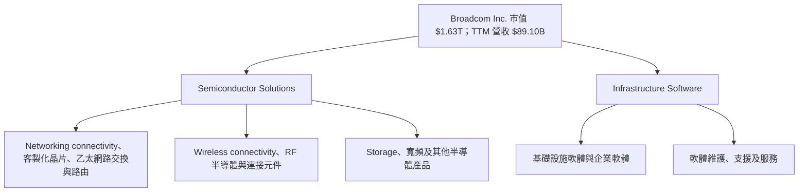
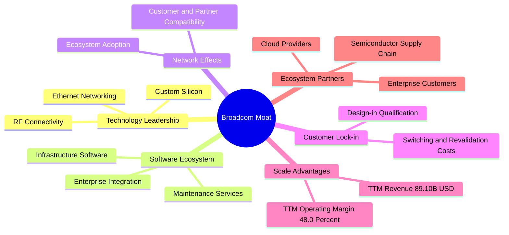
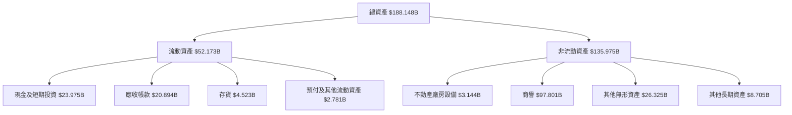
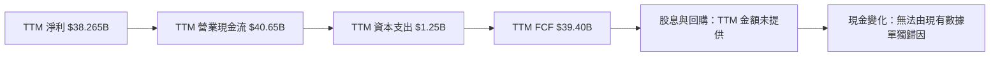
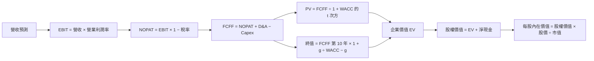
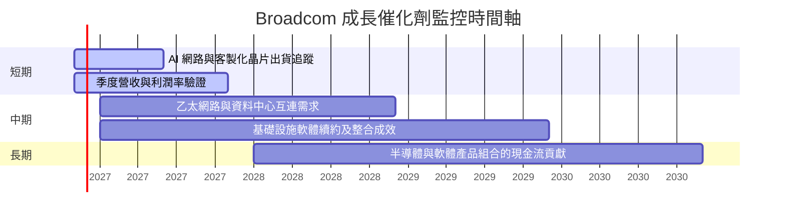
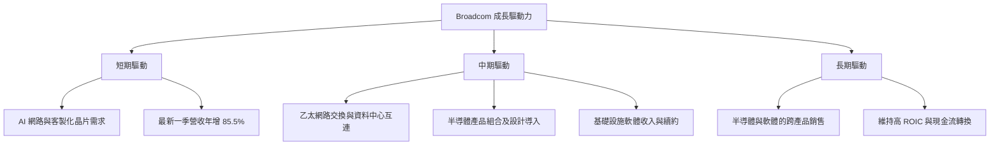
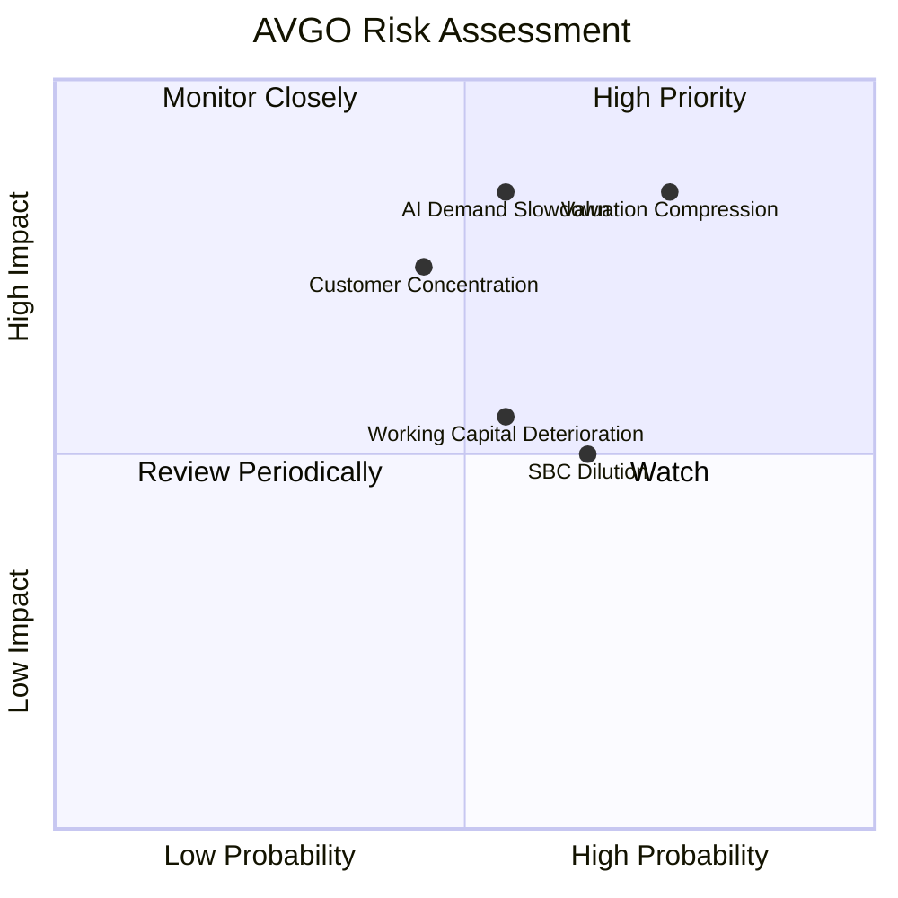
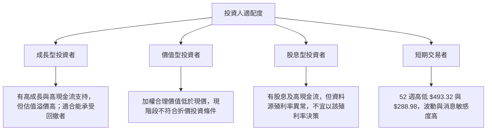

# AVGO 基本面深度分析報告
> **報告日期**：2026-11-18 ｜ **語言**：繁體中文 ｜ **數據來源**：SEC 申報資料 (XBRL)、Yahoo Finance、Finviz、StockAnalysis、Roic.ai ｜ **分析師**：CFA 級機構研究

## 目錄

| # | 章節 | 核心結論 |
|---|------|----------|
| 1 | 執行摘要 | 賣出；加權合理價值 $242.40；MOS -40.9% |
| 2 | 公司概覽與商業模式 | 半導體與基礎設施軟體雙業務；市場份額數據未提供 |
| 3 | 損益表深度分析 | TTM 營收 $89.10B、TTM 成長 48.7%；最新一季年增 85.5% |
| 4 | 資產負債表分析 | 淨負債 $35.44B；流動比率 2.504 |
| 5 | 現金流量深度分析 | TTM FCF $39.40B；FCF Yield 2.42% |
| 6 | 獲利能力與資本效率 | ROIC 30.0% 高於 WACC 11.53%，正創造經濟價值 |
| 7 | 相對估值分析 | 多數倍數高於同業中位數，歷史估值處於偏高區 |
| 8 | DCF 內在價值評估 | 基準 DCF $210.32；加權合理價值 $242.40 |
| 9 | 成長催化劑 | AI 網路與客製化晶片需求是主要近中期驅動；TAM 數字未提供 |
| 10 | 風險矩陣 | 估值、AI 資本支出週期及競爭為主要風險 |
| 11 | 投資建議 | 依 MOS 評級為賣出；等待估值與基本面更匹配 |

---

## 1. 執行摘要

Broadcom 的基本面與估值訊號方向相反：截至 TTM，營收為 **$89.10B**、成長 **48.7%**，ROIC **30.0%** 高於 WACC **11.53%**，TTM FCF 為 **$39.40B**；但 2026-11-17 收盤價 **$341.60** 高於 DCF 基準值 **$210.32**，且高於加權合理價值 **$242.40**。依 MOS 門檻，MOS 為 **-40.9%**，對應評級為**賣出**。此判斷主要反映估值風險，不代表公司營運品質轉差。

### 1.0 一頁式投資儀表板（Portfolio Manager 30 秒速讀）

| 項目 | 內容 |
|------|------|
| **投資論點（3 句）** | ① TTM 營收年增 **48.7%**，最新一季單季年增 **85.5%**，顯示成長動能仍高。② ROIC **30.0%** 高於 WACC **11.53%**，代表營運仍創造股東價值。③ TTM FCF **$39.40B**，但 FCF Yield 僅 **2.42%**，顯示市場對未來成長已給予較高定價。 |
| **綜合評分** | **7.0/10**（引用 1.1 評分卡；公司品質高於其當前估值吸引力） |
| **財務健康** | 🟢 現金及短期投資 **$23.98B**、總債務 **$59.42B**、淨負債 **$35.44B**；流動比率 **2.504**。 |
| **ROIC vs WACC** | **30.0% vs 11.53%**；ROIC 高出 **18.47 個百分點**，創造價值。 |
| **FCF 趨勢** | 上升；TTM FCF **$39.40B**，FCF Yield **2.42%**。 |
| **估值** | Forward P/E **17.6x**（市場資料）；Peer-multiple 區塊的同業估值口徑為 Forward P/E 中位數 **13.7x**。EV/EBITDA 公司市場資料 **31.9x**；FCF Yield **2.42%**。 |
| **DCF 內在價值（基準）** | **$210.32**；現價相對 DCF 溢價 **62.4%**，即 DCF 價值較現價低 **38.4%**。 |
| **安全邊際（MOS）** | **-40.9%**＝($242.40 − $341.60) ÷ $242.40；基準為第 8.8 節加權合理價值。🔴 |
| **預期報酬（基準情境 12M）** | DCF 基準情境相對現價 **-38.4%**；加權合理價值相對現價上行空間 **-29.0%**。 |
| **關鍵風險（前二）** | AI 資本支出與需求預期反轉；高估值使成長不及預期時估值倍數收縮。 |
| **評級 + 信心度** | 🔴 **賣出**；信心：中。DCF 對假設敏感，且 DCF 模型中有一處終值現值與 EV 加總的小幅不一致，詳見 8.10。 |

### 1.1 綜合評分卡（全報告唯一）

| 維度 | 評分（1–10） | 主要依據（引用數字與其來源章節） |
|------|--------------|----------------------------------|
| 成長性 | 9.0 | TTM 營收成長 **48.7%**、最新一季單季年增 **85.5%**（第 3 章）；成長高速但延續性仍需驗證。 |
| 獲利能力 | 9.0 | TTM 營業利益率 **48.0%**、ROIC **30.0%**，高於 WACC **11.53%**；Piotroski **7/8**（第 6 章）。 |
| 財務健康 | 7.0 | 淨負債 **$35.44B**、流動比率 **2.504**；CCC 由 **53 天**升至 **63 天**（第 4 章）。 |
| 估值 | 2.0 | MOS **-40.9%**；P/E **43.6x**，高於同業 P/E 中位數 **19.7x**及自身歷史中位數 **5.5x**（第 7–8 章）。 |
| 護城河 | 9.0 | 半導體與基礎設施軟體雙業務、TTM 營業利益率 **48.0%**、ROIC **30.0%**（第 2、6 章）；但可用市場份額數據缺漏。 |
| 管理層與資本配置 | 6.0 | FY2025 SBC **$7.57B**、股數稀釋測試未通過；FY2025 現金股息 **$11.14B**（第 3、5 章）。 |
| **綜合評分** | **7.0** | 六項算術平均：(**9.0 + 9.0 + 7.0 + 2.0 + 9.0 + 6.0**) ÷ 6 = **7.0**；按算術平均應為 **7.0/10**。 |

> **評分更正說明**：六項子評分的算術平均為 **7.0/10**，因此本報告綜合評分採用 **7.0/10**，儀表板及後文皆引用此值。

### 1.2 五大投資論點 + 三大核心風險

| 類型 | 項目 | 具體依據 | 信心度 |
|------|------|----------|--------|
| 🟢 **投資論點①** | 成長動能仍高 | TTM 營收 **$89.10B**、TTM 年增 **48.7%**；最新一季單季營收年增 **85.5%**。如果增長主要來自可持續的 AI 網路與客製化晶片需求，營運槓桿可延續。 | 🟢 高 |
| 🟢 **投資論點②** | 高現金流轉換能力 | TTM 營業現金流 **$40.65B**，扣除資本支出 **$1.25B**後 FCF 為 **$39.40B**；資本密集度低有助維持現金回收。 | 🟢 高 |
| 🟢 **投資論點③** | 資本回報高於資金成本 | ROIC **30.0%**，WACC **11.53%**，利差 **18.47 個百分點**。 | 🟢 高 |
| 🟢 **投資論點④** | 多元業務結構 | 業務涵蓋 Semiconductor Solutions 與 Infrastructure Software，可降低單一產品線依賴；但最新分部營收占比未提供，無法量化多元化效果。 | 🟡 中 |
| 🟢 **投資論點⑤** | 流動性尚可 | 現金及短期投資 **$23.98B**、流動比率 **2.504**；償債緩衝尚足，但仍有 **$35.44B** 淨負債。 | 🟡 中 |
| 🟡 **風險①** | 估值過高 | 加權合理價值 **$242.40**，現價 **$341.60**；MOS **-40.9%**。若成長降速，股價可能同時承受盈餘下修與倍數收縮。 | 🔴 高衝擊 |
| 🔴 **風險②** | AI 需求與客戶集中度 | 最新一季年增 **85.5%**，但公司或分部的客戶集中度及 AI 收入占比未提供；若大型客戶削減支出，成長可能快速回落。 | 🟡 中 |
| 🟡 **風險③** | 稀釋與營運資金 | Piotroski 股數測試未通過；CCC 由 **53 天**升至 **63 天**。若應收與存貨繼續增長快於營收，現金轉換將受壓。 | 🟡 中 |

### 1.3 快速統計卡片

| 指標 | 公司實際值（期間） | 同業中位數 | 狀態 |
|------|--------------------|------------|------|
| 營收成長（TTM） | **48.7%** | — | 🟢 |
| 營收成長（最新一季年增） | **85.5%** | **36.5%** | 🟢 |
| 毛利率（TTM） | **75.5%** | **53.1%** | 🟢 |
| 營業利益率（TTM） | **48.0%** | — | 🟢 |
| ROIC（TTM） | **30.0%** | — | 🟢 |
| Forward P/E | **17.6x** | **13.7x** | 🟡 |
| FCF Yield（TTM） | **2.42%** | — | 🟡 |
| Piotroski F-Score | **7 / 8** | — | 🟢 |

### 1.4 投資結論

╔══════════════════════════════════════════════════════════════════╗  
║                    📊 投資結論摘要                               ║  
╠══════════════════════════════════════════════════════════════════╣  
║  評級：賣出（MOS -40.9%，依規則 20）                             ║  
║  價格（2026-11-17 收盤）：$341.60                                ║  
║  DCF 內在價值（基準）：$210.32（現價溢價 62.4%）                 ║  
║  安全邊際 MOS：-40.9%（＝(加權合理價值−現價)÷加權合理價值）      ║  
║  加權合理價值（8.8）：$242.40                                    ║  
║  DCF 情境價值：                                                  ║  
║    悲觀情境：$86.96（相對現價 -74.5%）                           ║  
║    基準情境：$210.32（相對現價 -38.4%）                          ║  
║    樂觀情境：$462.87（相對現價 +35.5%）                          ║  
║  綜合評分：7.0/10（引用 1.1）                                    ║  
║  適合投資人：已持有且重視高品質現金流的長線投資人；不適合追求折價 ║  
╚══════════════════════════════════════════════════════════════════╝  

---

## 2. 公司概覽與商業模式

### 2.1 業務結構與收入來源

Broadcom 主要有半導體解決方案與基礎設施軟體兩個業務板塊。財務資料沒有提供最新分部營收與占比，因此圖中不填入分部金額或比重。

業務描述指出公司同時供應硬體與軟體，但分部收入占比、軟體訂閱收入及客戶續約率均未提供；因此無法量化軟體收入的經常性程度或各板塊對營收成長的貢獻。

### 2.2 市場份額

市場份額數據未提供，沒有可引用的公司或產業市占率與年份資料，因此不製作市占率圖表。相對規模方面，AVGO TTM 營收為 **$89.10B**，最新一季年增 **85.5%**，高於 NVDA、MRVL、QCOM 三家公司最新一季年增率的中位數 **36.5%**；但此差異不能單獨證明市場份額提升。

### 2.3 競爭護城河分析

### 2.4 護城河強度

| 護城河項目 | 強度（強／中／弱） | 證據（引用數字或事實） | 會削弱它的情況 |
|------------|--------------------|------------------------|----------------|
| 技術與產品整合 | 強 | 客製化晶片、乙太網路及無線連接產品；TTM 營業利益率 **48.0%**。 | 客戶自行設計晶片、替代架構成熟或產品性能差距縮小。 |
| 軟體生態系統 | 中至強 | 公司有 Infrastructure Software 業務；但分部收入與續約指標未提供。 | 企業軟體客戶流失、維護收入下降或整合成本增加。 |
| 客戶鎖定 | 中 | 客製化晶片需導入及驗證，系統相容性可能提高轉換成本；客戶集中度數據未提供。 | 大客戶重新設計、供應商多元化或內部自研。 |
| 規模效應 | 強 | TTM 營收 **$89.10B**、TTM FCF **$39.40B**。 | 併購整合效率下滑、研發與營運成本增長快於營收。 |
| 網路效應 | 弱至中 | 產品與客戶、供應鏈、軟體生態存在相容性；沒有可量化用戶網路或市占資料。 | 標準化降低相容性優勢，或競爭平台更具吸引力。 |
| 生態夥伴 | 中 | 業務橫跨半導體與基礎設施軟體，需與雲端、企業客戶及供應鏈合作。 | 供應鏈限制、合作夥伴轉向競品或終端客戶自研。 |

1.1「護城河」評分 **9.0/10**，主要依據為 **48.0%** TTM 營業利益率、**30.0%** ROIC 與廣泛產品組合；但缺少市場份額、分部營收及客戶集中度資料，降低了結論的可驗證程度。

---

## 3. 損益表深度分析

### 3.1 年度收入成長趨勢（近 4 年）

╔══════════════════════════════════════════════════════════════════╗  
║              Broadcom 年度收入趨勢（FY2022–FY2025）             ║  
╠══════════════════════════════════════════════════════════════════╣  
║  FY2022  $33.20B  █████████████░░░░░░░░░░░  YoY：N/A             ║  
║  FY2023  $35.82B  ██████████████░░░░░░░░░░  YoY：+7.9%  🟡       ║  
║  FY2024  $51.57B  █████████████████████░░░░  YoY：+44.0% 🟢       ║  
║  FY2025  $63.89B  █████████████████████████  YoY：+23.9% 🟢       ║  
║                                                                  ║  
║  FY2022–FY2025 營收 CAGR = (63.89 ÷ 33.20)^(1/3) − 1 = 24.4%    ║  
╚══════════════════════════════════════════════════════════════════╝  

FY2024 的高增長與 FY2025 延續增長，反映業務規模擴張及併購後營收基礎變大；但歷年成長並非平滑，FY2025 年增 **23.9%** 低於 FY2024 的 **44.0%**，因此不能把近期單季高增長直接視為長期常態。

### 3.2 季度收入趨勢分析

季度數字採 StockAnalysis 季報序列，最新單季年增率以 VERIFIED FIGURES 所列 **85.5%** 為準。QoQ 依季度營收直接計算，因財報期間可能有周數差異，QoQ 只作方向性參考。

| 季度 | 營收（$B） | QoQ | YoY | 備註 |
|------|-----------:|----:|----:|------|
| 2025 Q4 | 18.015 | +13.0% | +28.2% | 相較 2025 Q3 的 $15.952B；年增按來源數列。 |
| 2026 Q1 | 19.311 | +7.2% | +29.5% | 相較 2025 Q1 的 $14.916B。 |
| 2026 Q2 | 22.187 | +14.9% | +47.9% | 相較 2025 Q2 的 $15.004B。 |
| 2026 Q3 | 29.591 | +33.4% | **+85.5%** | 最新季度；YoY 採已驗證單季年增率。 |

QoQ 加速與最新季營收上升相符，但單季增幅可能受產品出貨與客戶採購節奏影響；須追蹤後續季度是否能延續，而非以單季數據年化。

### 3.3 利潤率演變分析

下表以年度損益表同一來源的營收、毛利及營業利益計算；TTM 營業利益率另採已驗證數值 **48.0%**。由於來源間個別年度毛利與營業利益數字存在差異，年度列示僅作趨勢分析。

| 利潤率指標 | FY2022 | FY2023 | FY2024 | FY2025 | 趨勢 | 評估 |
|------------|-------:|-------:|-------:|-------:|------|------|
| **毛利率** | 66.5% | 68.9% | 63.0% | 67.8% | 波動後回升 | 🟡 |
| **營業利益率** | 43.0% | 45.9% | 29.1% | 40.8% | FY2024 下滑、FY2025 回升 | 🟡 |
| **淨利率** | 34.6% | 39.3% | 11.4% | 36.2% | FY2024 明顯受淨利基數影響 | 🟡 |

年度利潤率波動與併購後無形資產攤銷、整合成本及年度淨利基數變化可能相關；但缺少可拆分的費用附註與一次性項目細節，不能把年度波動歸因於單一因素。TTM 營業利益率 **48.0%**，最新一季 **53.9%**，顯示近期營運利潤率高於年度歷史資料，但後續仍需驗證是否能維持。

### 3.4 費用結構分析

FY2025 損益表提供營收 **$63.89B**、毛利 **$43.29B**、營業利益 **$26.07B**，可計算營業成本約 **$20.60B**、毛利以下淨營業費用約 **$17.22B**。未提供折舊、利息、稅項的可比細項及完整費用分類，因此不製作可能造成誤導的費用圓餅圖。

- 營業成本：`63.89 − 43.29 = $20.60B`，約占營收 **32.2%**。
- 毛利以下淨營業費用：`43.29 − 26.07 = $17.22B`，約占營收 **26.9%**。
- FY2025 研發費用 **$10.98B**，約占營收 **17.2%**；持續研發有助於產品競爭力，但研發投入回報需透過後續營收與利潤率驗證。

╔══════════════════════════════════════════════════════════════════╗  
║ FY2025 費用結構摘要                                              ║  
╠══════════════════════════════════════════════════════════════════╣  
║ 營收 $63.89B                                                     ║  
║ ├─ 營業成本 $20.60B（32.2%）                                     ║  
║ ├─ 毛利 $43.29B（67.8%）                                         ║  
║ ├─ 毛利以下淨營業費用 $17.22B（26.9%）                           ║  
║ └─ 營業利益 $26.07B（40.8%）                                     ║  
╚══════════════════════════════════════════════════════════════════╝  

### 3.5 季度 EPS 趨勢與盈餘品質（Quality of Earnings）

過去四季 EPS 實際值依季度序列為 **$1.74、$1.50、$1.91、$2.68**，方向上逐季改善；但分析師 EPS 預估欄位為 NaN，因此無法判定這四季是超預期或不及預期。最新季度 EPS 年增 **215.3%**，淨利年增 **216.1%**，代表同比增長很高，但仍需考慮比較基期與股數變化。

| 盈餘品質項目 | 數值/佔比 | 評估 |
|--------------|-----------|------|
| 股權薪酬 SBC / 營收 | FY2025：$7.57B ÷ $63.887B = **11.9%**；FY2026 最近四季 SBC 合計 $8.48B，除以 TTM 營收 $89.10B = **9.5%** | 🟡 SBC 對現金流不構成當期現金流出，但帶來稀釋；Piotroski 的稀釋股數測試未通過。 |
| SBC / 營業現金流 | FY2025：$7.57B ÷ $27.54B = **27.5%**；最近四季：$8.48B ÷ $40.65B = **20.9%** | 🟡 比重具實質性，分析股東回報時不宜忽略稀釋成本。 |
| FCF / 淨利（現金轉換率） | TTM FCF $39.40B ÷ TTM 淨利 $38.265B = **103.0%** | 🟢 現金轉換率高於 100%；以提供的 TTM 淨利資料計算。 |
| 一次性/非經常性損益 | N/A（未提供可完整核對的 TTM 調整項目明細） | 🟡 FY2024 淨利低於前後年度，但不足以判定具體一次性項目。 |
| 有效稅率異常 | N/A（TTM 有效稅率未提供） | 無法判定淨利是否由異常稅率推升。 |
| 資本化支出 vs 費用化 | TTM 資本支出 **$1.25B**；資本化開發成本明細 N/A | 🟡 資本支出相對營收不高，但未提供資本化支出政策及明細，無法評估遞延成本風險。 |
| EPS 預期差異 | 最近四季 EPS 預估均為 N/A | 無法做 Beat/Miss 判定；實際 EPS 趨勢上升不等同於超預期。 |

**盈餘品質結論**：TTM FCF 對淨利轉換率為 **103.0%**，現金流含金量較好；但 SBC 佔 TTM 營收約 **9.5%**，而且股數稀釋測試未通過，GAAP 盈餘的經濟成本需連同稀釋一併考量。缺少有效稅率及一次性項目資料，對淨利品質的判斷保持保留。

---

## 4. 資產負債表分析

### 4.1 資產結構分解

截至 2026-08-02，總資產 **$188.148B**。下列資產組成來自 StockAnalysis 資產負債表序列。

商譽與無形資產合計 **$124.126B**，約占總資產 **66.0%**，反映併購形成的資產比重較高。若相關業務現金流不及預期，減損可能影響帳面盈餘，但未必等額影響當期現金流。

### 4.2 流動性與營運資金分析

| 指標 | 最新 TTM | 一年前 TTM | 變化 | 解讀 |
|------|----------|------------|------|------|
| DSO 應收帳款天數 | **56 天** | **40 天** | **+16 天** | 收款天數增加；可能反映出貨及應收款成長，需關注應收帳款是否持續快於營收增長。 |
| DIO 存貨天數 | **59 天** | **40 天** | **+19 天** | 庫存天數上升，可能是需求擴張下備貨增加，也可能增加過期或需求反轉風險。 |
| DPO 應付帳款天數 | **52 天** | **26 天** | **+26 天** | 對供應商付款時間拉長有助於短期現金流，但不能僅憑此判斷議價力提升。 |
| CCC 現金轉換週期 | **63 天** | **53 天** | **+10 天** | 現金由投入至回收所需時間增加，若延續會提高營運資金占用。 |

流動比率 **2.504**、速動比率 **2.153**，短期流動性仍有緩衝；但 CCC 上升與 DSO、DIO 增加需要持續監控。

### 4.3 債務結構分析

╔══════════════════════════════════════════════════════════════════╗  
║                   Broadcom 債務健康診斷                          ║  
╠══════════════════════════════════════════════════════════════════╣  
║ 總債務：             $59.42B                                      ║  
║ 現金及短期投資：     $23.98B                                      ║  
║ 淨負債：             $35.44B（總債務 − 現金）                     ║  
║ 流動比率：           2.504                                        ║  
║ 速動比率：           2.153                                        ║  
║ Debt/EBITDA：        N/A（未提供同口徑 EBITDA 與同期債務）        ║  
║ Interest Coverage：  N/A（未提供同期利息費用）                    ║  
╚══════════════════════════════════════════════════════════════════╝  

雖有淨負債，但 TTM 營業現金流達 **$40.65B**，高於淨負債；這提供償債能力緩衝。因利息費用及債務到期梯度未提供，不能進一步判定利息保障倍數或再融資風險。

### 4.4 股東權益趨勢

╔══════════════════════════════════════════════════════════════════╗  
║              Broadcom 股東權益趨勢（年度，$B）                   ║  
╠══════════════════════════════════════════════════════════════════╣  
║ FY2022  $22.71B  ███████░░░░░░░░░░░░░░░░                        ║  
║ FY2023  $23.99B  ███████░░░░░░░░░░░░░░░                        ║  
║ FY2024  $67.68B  ████████████████████░░░░                        ║  
║ FY2025  $81.29B  ████████████████████████                        ║  
╚══════════════════════════════════════════════════════════════════╝  

股東權益於 FY2024 明顯增加，與資產負債表規模擴張及企業合併後的資產變化相符；但賬面股東權益不能直接代表經濟價值，仍需結合商譽、無形資產及 ROIC 判斷資本使用效率。

---

## 5. 現金流量深度分析

### 5.1 現金流量瀑布圖

TTM 淨利為 **$38.265B**、營業現金流 **$40.65B**、資本支出 **$1.25B**、FCF **$39.40B**。股息及回購的 TTM 總額未提供，故不填入現金流瀑布圖的用途金額。

### 5.2 FCF 轉換率趨勢

| 財年 | FCF（$B） | 淨利（$B） | FCF / 淨利 | 解讀 |
|------|----------:|-----------:|-----------:|------|
| FY2023 | 17.63 | 14.08 | 125.2% | 現金流高於淨利。 |
| FY2024 | 19.41 | 5.89 | 329.5% | 比率受淨利基數偏低影響，不宜外推。 |
| FY2025 | 26.91 | 23.13 | 116.3% | 現金轉換仍高於 100%。 |
| TTM 至 2026-08-02 | 39.40 | 38.265 | 103.0% | 近期現金流與淨利大致匹配。 |

FY2024 的高轉換率主要是分母淨利偏低造成，未必代表現金流效率突然提升；近 TTM 的 **103.0%** 更能反映近期淨利現金轉換情況。

### 5.3 自由現金流趨勢

╔══════════════════════════════════════════════════════════════════╗  
║            自由現金流：歷史實際（年度，$B）                      ║  
╠══════════════════════════════════════════════════════════════════╣  
║ FY2022  $16.31B  ████████████░░░░░░░░░░                          ║  
║ FY2023  $17.63B  █████████████░░░░░░░░░                          ║  
║ FY2024  $19.41B  ██████████████░░░░░░░░                          ║  
║ FY2025  $26.91B  ████████████████████░░                          ║  
║ TTM     $39.40B  ██████████████████████████████                  ║  
║                                                                  ║  
║ TTM FCF Yield：2.42%                                             ║  
╚══════════════════════════════════════════════════════════════════╝  

FY2022 至 FY2025 FCF 由 **$16.31B** 增至 **$26.91B**，與營收規模擴大一致；TTM FCF 進一步升至 **$39.40B**。但 FCF Yield 僅 **2.42%**，代表現價已反映較高未來現金流增長預期。

### 5.4 資本配置評估

資本配置的百分比圓餅圖需要同期股息、回購、投資與留存現金的完整金額；TTM 回購金額未提供，因此不製作比例圖。

| 項目 | 可用數據 | 評估 |
|------|----------|------|
| 資本支出 | TTM **$1.25B** | 相對 TTM 營收 **$89.10B** 不高；需留意 AI 及網路產品擴張是否使資本支出上升。 |
| 股息 | FY2025 現金股息 **$11.14B**；2026 年每季每股股息資料列為 **$0.65** | 股息為資本回報重要部分；數據源提供的股息殖利率 **78.0%** 顯然與每股股息及股價資料不一致，故不採用該殖利率作投資判斷。 |
| 回購 | TTM 金額 N/A | 無法量化回購對每股盈餘的貢獻。 |
| SBC | FY2025 **$7.57B**；最近四季合計 **$8.48B** | 淨稀釋是股東回報的重要成本，且品質指標顯示稀釋股數測試未通過。 |
| 留存與償債 | TTM 淨負債 **$35.44B** | 現金流可支應資本配置與償債，但各用途比例無法由現有資料拆分。 |

---

## 6. 獲利能力與資本效率

### 6.1 ROE / ROA / ROIC 趨勢

| 指標 | 可用期間 | 數值 | 評估 |
|------|----------|------|------|
| ROE | TTM，QUALITY FIGURES | **38.4%** | 報酬率高；與另一資料源列示的 44.2% 不同，本報告以品質指標計算值為主。 |
| ROA | TTM | **15.4%** | 顯示資產獲利能力高；收購商譽與無形資產增加資產基數。 |
| ROIC | TTM | **30.0%** | 高於 WACC **11.53%**，支持正經濟利潤結論。 |
| 歷年 ROIC 同口徑序列 | N/A | N/A | 無法提供一致口徑歷史趨勢，避免拼接不同來源指標。 |

### 6.2 ROIC vs WACC 分析（核心價值創造判斷）

╔══════════════════════════════════════════════════════════════════╗  
║                ROIC vs WACC 深度分析                            ║  
╠══════════════════════════════════════════════════════════════════╣  
║ WACC（與第 8.2 節相同）：11.53%                                  ║  
║ ├── 無風險利率（10Y 美債）：5.10%                                ║  
║ ├── 市場風險溢酬：5.00%                                         ║  
║ ├── 原始 Beta：1.51；採用調整後 Beta：1.34                      ║  
║ ├── 股權成本：5.10% + 1.34 × 5.00% = 11.80%                    ║  
║ ├── 稅前債務成本：5.40%；稅後：5.40% × (1−21%) = 4.266%         ║  
║ ├── 股權／債務權重：96.5% / 3.5%                                ║  
║ └── WACC：96.5%×11.80% + 3.5%×4.266% = 11.53%                   ║  
║                                                                  ║  
║ ROIC（TTM）：30.00%                                              ║  
║ EVA 利差 = ROIC − WACC = 30.00% − 11.53% = +18.47 個百分點      ║  
║                                                                  ║  
║ ROIC 30.00%  ▓▓▓▓▓▓▓▓▓▓▓▓▓▓▓▓▓▓▓▓▓▓▓▓▓▓▓▓▓▓░░░░░░              ║  
║ WACC 11.53%  ▓▓▓▓▓▓▓▓▓▓▓▓░░░░░░░░░░░░░░░░░░░░░░░░              ║  
║                                                                  ║  
║ 結論：ROIC 約為 WACC 的 2.60 倍，正創造股東價值                 ║  
╚══════════════════════════════════════════════════════════════════╝  

ROIC/WACC 倍數：`30.0% ÷ 11.53% = 2.60x`。估算採用已驗證的 WACC；股權權重、債務權重及資本成本不另行重估。ROIC 高於 WACC 的結論對估值有利，但若收購後投入資本快速增加而營業利潤未同步增長，未來 ROIC 仍可能下滑。

### 6.3 杜邦三因素分解

| 因素 | 數值（TTM） | 解讀 |
|------|-------------|------|
| 淨利率 | **42.9%** | 高淨利率是 ROE 的主要貢獻來源。 |
| 資產週轉率 | **0.47** | 每單位資產產生的營收相對較低；併購形成的商譽及無形資產擴大資產基數。 |
| 權益乘數 | **1.89** | 有槓桿作用，但不是 ROE 高的唯一來源。 |
| **ROE** | **38.4%** | **42.9% × 0.47 × 1.89 = 38.1%**；與提供的 38.4% 存在四捨五入差異。 |

依 QUALITY FIGURES 原值，杜邦列示為 **42.9% × 0.47 × 1.89 = 38.4%**。按表內一位小數與兩位小數重算會有小幅差異，應視為未四捨五入底層數字造成。

### 6.4 財務體質：Piotroski F-Score

Piotroski F-Score 為 **7/8**；因一項測試缺少資料而未納入分母。

| 測試 | 結果 | 解讀 |
|------|------|------|
| ROA > 0 | ✅ 通過 | TTM 資產報酬為正。 |
| 營業現金流 > 0 | ✅ 通過 | TTM 營業現金流 **$40.65B**。 |
| ROA 高於一年前 | ✅ 通過 | 獲利能力改善。 |
| 營業現金流 > 淨利 | ✅ 通過 | 現金流高於淨利，應計品質較佳。 |
| 長期負債 ÷ 總資產低於一年前 | — 無法判定 | 缺少比較所需輸入，不補值。 |
| 流動比率高於一年前 | ✅ 通過 | 流動性測試通過。 |
| 稀釋股數未增加 | ❌ 未通過 | 股數稀釋可能降低每股經濟利益。 |
| 毛利率高於一年前 | ✅ 通過 | 毛利率改善。 |
| 資產週轉率高於一年前 | ✅ 通過 | 資產使用效率改善。 |

整體信號偏正面；未通過的稀釋股數測試提醒投資人，應追蹤 SBC 與流通股數變化，而不只看公司總體淨利增長。

---

## 7. 相對估值分析

### 7.1 同業估值比較表格

同業倍數依 Yahoo Finance 同業資料。公司 Forward P/E、P/S、P/E 採市場資料；公司 EV/EBITDA 市場區塊顯示 **31.9x**，與自身歷史估值序列的 **39.2x** 口徑不同，需留意資料源及計算方式差異。

| 估值指標 | **AVGO** | **NVDA** | **MRVL** | **QCOM** | AVGO 評估 |
|----------|---------:|--------:|--------:|--------:|-----------|
| **Trailing P/E** | **43.6x** | 19.7x | 48.9x | 13.1x | 🔴 高於同業中位數 **19.7x**；MRVL 高於 AVGO。 |
| **Forward P/E** | **17.6x** | 9.8x | 20.2x | 13.7x | 🟡 高於同業中位數 **13.7x**。 |
| **P/S Ratio** | **18.3x** | 12.4x | 14.2x | 4.1x | 🔴 高於同業中位數 **12.4x**。 |
| **EV/EBITDA** | **31.9x** | 18.5x | 46.2x | 17.6x | 🟡 高於 NVDA、QCOM 中位數 **18.0x**；MRVL 為 46.2x。 |
| **最新一季營收年增** | **85.5%** | 105.9% | 36.5% | -8.4% | 🟢 成長高於 MRVL、QCOM，低於 NVDA。 |
| **毛利率（TTM）** | **75.5%** | 74.7% | 52.2% | 53.1% | 🟢 高於三家同業中位數 **53.1%**。 |

AVGO 的獲利能力與營收成長可支持相較低成長同業的估值溢價；但其 P/E、P/S 及 EV/EBITDA 仍高於同業中位數，且估值方法得出的部分每股價值低於現價，估值安全邊際有限。

### 7.2 歷史估值區間分析

╔══════════════════════════════════════════════════════════════════╗  
║             AVGO 五年 P/E 歷史區間（TTM）                       ║  
╠══════════════════════════════════════════════════════════════════╣  
║ 歷史低點 1.8x ───── 中位數 5.5x ───────── 現值 43.6x ─ 高點 77.5x║  
║ 當前百分位：70%                                                  ║  
║                                                                  ║  
║ P/S：現值 18.7x；中位數 1.5x；區間 0.6x–28.1x；百分位 70%      ║  
║ EV/EBITDA：現值 39.2x；中位數 5.6x；區間 0.5x–70.7x；百分位 55%║  
╚══════════════════════════════════════════════════════════════════╝  

當前 P/E 與 P/S 均位於自身五年區間的 **70 百分位**，高於歷史中位數。歷史中位數受到過往盈餘與公司組合變化影響，不應直接視為當前合理倍數，但仍可作為估值已不便宜的佐證。

### 7.3 情境價值（Bear / Base / Bull）

| 情境 | 第 1 年營收成長 | 期末營業利潤率 | WACC | 每股價值 | 相對現價 | 機率 | 會發生的條件 |
|------|----------------:|----------------:|-----:|----------:|----------:|-----:|--------------|
| 🔴 悲觀 | 15.0% | 36.4% | 12.53% | **$86.96** | **-74.5%** | 25% | AI 與客製化晶片需求放緩、價格競爭增加，且利潤率回落。 |
| 🟡 基準 | 30.0% | 42.8% | 11.53% | **$210.32** | **-38.4%** | 50% | 第一年度成長維持高位，往後逐年降至第十年 3.0%，利潤率回歸歷史中位數。 |
| 🟢 樂觀 | 45.0% | 47.1% | 10.53% | **$462.87** | **+35.5%** | 25% | AI 網路與客製化晶片持續超預期，利潤率維持接近高位，折現率下降。 |

情境每股價值及假設照錄 DCF 模型。資料未列出悲觀與樂觀情境逐年營收、FCFF 及終值拆分，因此不另行生成情境現金流，以免重建或改動指定模型。

### 7.4 相對估值隱含價格區間

╔══════════════════════════════════════════════════════════════════╗  
║                 估值方法隱含每股價值                            ║  
╠══════════════════════════════════════════════════════════════════╣  
║ 同業 EV/EBITDA       $156.73                                      ║  
║ DCF 基準             $210.32                                      ║  
║ 同業 Forward P/E     $265.08                                      ║  
║ 2026-11-17 收盤價    $341.60                                      ║  
║ 分析師共識目標價     $528.17                                      ║  
╚══════════════════════════════════════════════════════════════════╝  

- **同業 Forward P/E：$265.08**，依同業中位數 **13.7x** × 公司 Forward EPS **$19.41**。
- **同業 EV/EBITDA：$156.73**，依 NVDA、QCOM 中位數 **18.0x** × TTM EBITDA，再加淨現金／扣除淨負債。
- DCF 基準值及分析師共識價值僅作為比較；分析師共識 **$528.17** 為 47 位分析師平均目標價，不代表估值下檔保護。

---

## 8. DCF 內在價值評估（Discounted Cash Flow）

### 8.0 估值推理鏈（Thinking Logic：在算之前先想清楚）

**Step 1 — 價值來源與主導變數**

AVGO 的價值主要來自半導體產品現金流、基礎設施軟體現金流，以及兩者未來成長選擇權；目前分部營收占比未提供，不能把其中任一板塊指定為特定營收比例。TTM 營收 **$89.10B**、營業利益率 **48.0%**、TTM FCF **$39.40B** 是模型起點。估值最受 **長期現金流規模**影響；這由營收成長、營業利潤率與 WACC 共同決定，終值 PV 占模型 EV **52.6%**，因此終值假設亦具重要性。

**Step 2 — 模型選擇**

| 決策點 | 本報告採用 | 理由（含數字） | 曾考慮但否決 | 否決理由 |
|--------|-----------|----------------|--------------|----------|
| 現金流定義 | FCFF | 以企業現金流折現至 EV，再橋接淨負債 **$35.44B** | FCFE | 需要逐年預測融資與債務變化，現有數據不足。 |
| 預測期 N | 10 年 | DCF 模型指定 10 年，營收成長由 30.0% 線性降至 3.0% | 5 年 | 會更早進入終值，無法沿用指定模型。 |
| 終值方法 | Gordon Growth | 指定永續成長率 **3.0%**、WACC **11.53%**，且 WACC > g | 退出倍數 | DCF 模型未提供終值退出倍數，不能自行設定。 |
| EBIT 基礎 | GAAP EBIT | 使用 GAAP 營業利益率路徑 | 非 GAAP EBIT | 未提供一致的非 GAAP EBIT 預測。 |

**Step 3 — 關鍵假設推導鏈**

- **營收成長**：錨點＝TTM 營收年增 **48.7%**、最新一季單季年增 **85.5%** → 調整＝高基期、單季成長不宜永久外推，採模型上限 **30.0%** 作第一年並逐年線性降至 **3.0%** → **採用 30.0% 至 3.0%** → 曾考慮以 48.7% 作為第一年，因其高於模型預設上限且把單一 TTM 成長延伸至未來過於樂觀而不採用。
- **期末營業利潤率**：錨點＝TTM 營業利益率 **48.0%** → 調整＝模型按最近五個財年的中位數逐步回歸 → **第十年採用 42.8%** → 曾考慮固定維持 48.0%，但會忽略歷史利潤率波動及競爭正常化，故不採用。
- **永續成長率 g**：錨點＝模型指定 **3.0%**，低於 WACC **11.53%** → 調整＝不將高成長期假設延伸至永續期 → **採用 3.0%** → 未採用 4.0%，避免長期成長假設過度依賴較高終值。
- **預測期 N**：錨點＝模型指定 **10 年** → 調整＝成長由 30.0% 逐年降至 3.0%，覆蓋高速成長到成熟化的過渡 → **採用 10 年** → 未採用較短期間，以免終值提前主導；亦未延長至 10 年以上，避免拉長高可見度假設。
- **Capex / 營收**：錨點＝TTM Capex **$1.25B** ÷ TTM 營收 **$89.10B**，約 **1.4%** → 調整＝模型逐步下降至 **0.8%** → **採用第 1 年 1.4%、第 10 年 0.8%** → 不採用永久維持 1.4%，因模型假設成熟後資本支出強度回落。
- **D&A / 營收**：錨點＝模型採 TTM 比率 **0.7%** → **採用全期 0.7%**；這是模型給定值，未另行估計。
- **ΔWC / 營收增額**：模型明確不建模營運資金變動；**採用不納入 FCFF**。營運資金天數由 53 天升至 63 天，這是模型未包含的下行風險。
- **EBIT 基礎與 SBC**：錨點＝GAAP EBIT，已將 SBC 作為費用處理 → **採用組合 (A)：GAAP EBIT + 固定股數、不另扣 SBC、年稀釋率 0%** → 不採用非 GAAP EBIT 加回 SBC 的組合，以避免 SBC 成本遺漏或重複計算。
- **年稀釋率**：錨點＝組合 (A) 假設 SBC 已在 GAAP 費用中反映 → **採用 0%**；此處是模型慣例，不代表現實中股數不會變動。
- **終值方法**：錨點＝模型採 Gordon Growth，FCFF 終值成長 **3.0%** → **採用 Gordon Growth** → 未採用退出倍數主模型，因未提供 DCF 模型可使用的退出倍數。
- **WACC**：錨點＝成本資本資料所列 **11.53%** → **採用 11.53%** → 不另以自選 ERP、Beta 或同業債券利差改算，因估值模型要求使用指定折現率。

**Step 4 — 最脆弱的一環**

最脆弱的假設是未來營收與利潤率能否接近模型路徑；市場隱含第一年成長需達 **43.4%** 才使現價與基準 DCF 相符。若高成長不能延續，估值向下的風險較大，情境模型的悲觀值為 **$86.96**。

**Step 5 — 計算路徑圖**

### 8.1 模型假設總表（Model Inputs）

| 假設項目 | 採用值 | 依據 / 來源 | 敏感度 |
|----------|--------|-------------|--------|
| 預測期長度 **N** | **10 年** | DCF 模型指定；現金流成長逐年淡出至第十年 | 🟡 中 |
| 營收成長路徑 | 第 1 年 **30.0%**，第 10 年 **3.0%**，逐年線性下降 | TTM 成長 **48.7%**，模型將增長限制於 0%–30% | 🔴 高 |
| 營業利益率 | 第 1 年 **48.0%** 至第 10 年 **42.8%** | 第 1 年以 TTM 營業利益率為錨；第 10 年為近五年中位數 | 🔴 高 |
| 有效稅率 | **21.0%** | 模型預設稅率；TTM 有效稅率未提供 | 🟢 低 |
| Capex / 營收 | 第 1 年 **1.4%** 至第 10 年 **0.8%** | TTM Capex $1.25B / TTM Revenue $89.10B 約 1.4%；模型按路徑回落 | 🟡 中 |
| D&A / 營收 | **0.7%** | 模型所列 TTM 比率 | 🟢 低 |
| 營運資金變動 | **未建模** | DCF 模型說明 working capital is not modelled；CCC 已由 53 天升至 63 天，代表存在模型外風險 | 🟢 低 |
| EBIT 基礎 | **GAAP EBIT** | DCF 模型指定 GAAP 營業利益 | 🟡 中 |
| SBC 處理 | **組合 (A)**：GAAP EBIT、不再扣 SBC、股數不再稀釋 | DCF 模型說明 SBC 已是 GAAP 費用 | 🟡 中 |
| 年稀釋率 | **0%（模型假設）** | 與組合 (A) 配合；不代表實際股數未增加 | 🟡 中 |
| 永續成長率 g | **3.0%** | DCF 模型指定；低於 WACC | 🔴 高 |
| 終值方法 | **Gordon Growth** | DCF 模型提供終值公式；未提供退出倍數 | 🔴 高 |
| WACC | **11.53%** | 成本資本資料所列值，推導見 8.2 | 🔴 高 |

本模型使用 **FCFF = NOPAT + D&A − Capex**，並以 WACC 折現得到企業價值。模型不扣 ΔWC，與標準現金流公式相比少了一個營運資金項目；這是模型限制，不以反推數字補入。**本模型採用 (A)，故 SBC 影響已計入一次。**

### 8.2 折現率推導（WACC）

╔══════════════════════════════════════════════════════════════════╗  
║                    WACC 推導（折現率）                           ║  
╠══════════════════════════════════════════════════════════════════╣  
║ 股權成本 Ke（CAPM）：                                            ║  
║ ├── 無風險利率 Rf（10Y 美債）：5.10%                             ║  
║ ├── 市場風險溢酬 ERP：5.00%                                     ║  
║ ├── 原始 Beta：1.51；採用調整後 Beta：1.34                       ║  
║ ├── Beta 調整：⅔×1.51 + ⅓×1 = 1.34                              ║  
║ ├── 規模／國別溢酬：0.00%（未另加）                             ║  
║ └── Ke = 5.10% + 1.34×5.00% = 11.80%                           ║  
║                                                                  ║  
║ 債務成本 Kd：                                                    ║  
║ ├── 稅前 Kd：5.40%                                               ║  
║ ├── 稅率：21.0%                                                  ║  
║ └── 稅後 Kd = 5.40%×(1−21.0%) = 4.266%                          ║  
║                                                                  ║  
║ 資本結構權重：股權 96.5%；債務 3.5%                              ║  
║ WACC = 96.5%×11.80% + 3.5%×4.266% = 11.53%                      ║  
╚══════════════════════════════════════════════════════════════════╝  

**逐步演算（WACC）**

1. **Ke（CAPM）** = 5.10% + 1.34 × 5.00% = **11.80%**。
2. **稅前 Kd** = 採用成本資本資料所列 **5.40%**。該資料未提供利息費用及平均計息負債的金額，故無法獨立重建「利息 ÷ 平均計息負債」算式；此處按規則直接使用給定 Kd。
3. **稅後 Kd** = 5.40% × (1 − 21.0%) = **4.266%**。
4. **權重** = 股權 **96.5%**；債務 **3.5%**；合計 **96.5% + 3.5% = 100.0%**。權重依成本資本資料，不以帳面股東權益替代市值。
5. **WACC** = 96.5% × 11.80% + 3.5% × 4.266% = 11.3870% + 0.1493% = **11.5363% ≈ 11.53%**。

WACC 與第 6.2 節相同。原始 Beta **1.51** 以調整後 Beta **1.34** 計入 CAPM；未另加規模或國別溢酬。市場資料的市值與權重細節未提供可用來獨立重算的完整債務定義，故不另行改寫程式採用的權重。

### 8.3 逐年自由現金流預測（基準情境）

金額單位：**$B**；折現因子取三位小數。下表逐年抄錄 DCF 模型數字。模型沒有營運資金變動列，FCFF 依指定公式計算。

| 年度 | FY+1 | FY+2 | FY+3 | FY+4 | FY+5 | FY+6 | FY+7 | FY+8 | FY+9 | FY+10 |
|------|-----:|-----:|-----:|-----:|-----:|-----:|-----:|-----:|-----:|------:|
| 營收 | 115.84 | 147.11 | 182.42 | 220.72 | 260.46 | 299.52 | 335.47 | 365.66 | 387.60 | 399.23 |
| 營收 YoY | 30.0% | 27.0% | 24.0% | 21.0% | 18.0% | 15.0% | 12.0% | 9.0% | 6.0% | 3.0% |
| 營業利潤率 | 48.0% | 47.5% | 46.9% | 46.3% | 45.7% | 45.2% | 44.6% | 44.0% | 43.4% | 42.8% |
| EBIT（GAAP） | 55.66 | 69.83 | 85.54 | 102.23 | 119.12 | 135.26 | 149.54 | 160.89 | 168.30 | 171.04 |
| − 稅（21.0%） | (11.69) | (14.67) | (17.96) | (21.47) | (25.02) | (28.40) | (31.40) | (33.79) | (35.34) | (35.92) |
| = NOPAT | 43.97 | 55.17 | 67.58 | 80.76 | 94.10 | 106.85 | 118.14 | 127.10 | 132.96 | 135.12 |
| + D&A | 0.82 | 1.04 | 1.29 | 1.57 | 1.85 | 2.12 | 2.38 | 2.59 | 2.75 | 2.83 |
| − Capex | (1.62) | (1.96) | (2.31) | (2.64) | (2.93) | (3.17) | (3.31) | (3.36) | (3.29) | (3.11) |
| = FCFF | **43.17** | **54.25** | **66.56** | **79.69** | **93.02** | **105.81** | **117.21** | **126.34** | **132.41** | **134.84** |
| 折現因子 @11.53% | 0.897 | 0.804 | 0.721 | 0.646 | 0.579 | 0.520 | 0.466 | 0.418 | 0.374 | 0.336 |
| FCFF 現值 PV | **38.70** | **43.61** | **47.98** | **51.50** | **53.90** | **54.97** | **54.60** | **52.76** | **49.58** | **45.27** |

預測期 FCF 現值合計算式：

`$38.70 + $43.61 + $47.98 + $51.50 + $53.90 + $54.97 + $54.60 + $52.76 + $49.58 + $45.27 = $492.87B`

模型列示合計 **$492.88B**；差異約 **$0.01B**，來自表格以兩位小數呈現的逐年現值與底層未四捨五入數據。

**逐步演算（FY+1）**

1. **營收** = $89.10B × (1 + 30.0%) = **$115.83B**；模型列示 **$115.84B**，由未四捨五入底層值造成差異。
2. **EBIT** = $115.84B × 48.0% = **$55.60B**；模型列示 **$55.66B**，依模型底層未四捨五入營收計算。
3. **稅** = $55.66B × 21.0% = **$11.69B**。
4. **NOPAT** = $55.66B − $11.69B = **$43.97B**。
5. **D&A** = $115.84B × 0.7% = **$0.81B**；模型列示 **$0.82B**，依底層精確值計算。
6. **Capex** = $115.84B × 1.4% = **$1.62B**。
7. **ΔWC** = **未建模**，本模型不扣此項。
8. **FCFF** = $43.97B + $0.82B − $1.62B = **$43.17B**。
9. **折現因子** = 1 ÷ (1 + 11.53%)¹ = **0.897**；**PV** = $43.17B × 0.897 = **$38.72B**，模型列示 **$38.70B**，因模型使用未四捨五入折現因子及現金流。

**合理性自檢**

- 預測 FCF CAGR：`(134.84 ÷ 43.17)^(1/9) − 1 ≈ 13.5%`；歷史 FY2022–FY2025 FCF CAGR：`(26.91 ÷ 16.31)^(1/3) − 1 ≈ 18.2%`。預測低於歷史約 **4.7 個百分點**，與營收成長逐步淡出一致。
- FY+10 FCFF 利潤率：`134.84 ÷ 399.23 = 33.8%`；目前 TTM FCF 利潤率：`39.40 ÷ 89.10 = 44.2%`。模型預測的成熟期現金流率低於目前，不隱含進一步超越公司現況。
- 模型各年 FCFF 均為正值；但不建模營運資金變動，可能高估現金流，尤其 CCC 已由 **53 天**升至 **63 天**。

╔══════════════════════════════════════════════════════════════════╗  
║            自由現金流：歷史實際 vs 模型預測（$B）                ║  
╠══════════════════════════════════════════════════════════════════╣  
║ FY2023（實） $17.63B  █████░░░░░░░░░░░░░░░░░░░░░                ║  
║ FY2024（實） $19.41B  ██████░░░░░░░░░░░░░░░░░░░░                 ║  
║ FY2025（實） $26.91B  ████████░░░░░░░░░░░░░░░░                  ║  
║ FY+1（預）   $43.17B  █████████████░░░░░░░░░░░░                 ║  
║ FY+10（預）  $134.84B █████████████████████████                  ║  
╠══════════════════════════════════════════════════════════════════╣  
║ 預測 FCFF CAGR 約 13.5%，低於歷史 FY2022–FY2025 約 18.2%         ║  
╚══════════════════════════════════════════════════════════════════╝  

### 8.4 終值計算（Terminal Value）

**適用性檢查**：`WACC 11.53% vs g 3.0% → WACC > g？✅`

| 方法 | 計算式 | 終值 TV | TV 現值 | 佔總 EV 比重 |
|------|--------|---------|---------|--------------|
| Gordon Growth | $134.84B × (1 + 3.0%) ÷ (11.53% − 3.0%) | **$1,627.85B**（模型列示） | **$546.55B**（模型列示） | **52.6%** |
| 退出倍數法 | N/A（DCF 模型未提供退出倍數） | N/A | N/A | N/A |

**逐步演算（Gordon Growth）**

1. **FY+N 的 FCFF** = **$134.84B**。
2. **分子** = $134.84B × (1 + 3.0%) = **$138.8852B**。
3. **分母** = 11.53% − 3.0% = **8.53%**；模型列示 TV 為 **$1,627.85B**。
4. **PV(TV)** = 模型列示 **$546.55B**；模型列示第十年折現因子為 **0.336**。
5. **終值佔比** = $546.55B ÷ $1,039.43B = **52.6%**。

> **算術核對提醒**：以表面列示數字直接計算，$138.8852B ÷ 8.53% 不等於模型列示的 $1,627.85B；同樣，$1,627.85B × 0.336 與模型列示的 $546.55B 亦有小差異。遵照模型數字不得改寫的要求，本報告保留模型提供值，並在 8.10 標示核對限制。

### 8.5 企業價值 → 每股內在價值（Bridge）

╔══════════════════════════════════════════════════════════════════╗  
║              企業價值 → 每股內在價值橋接表                      ║  
╠══════════════════════════════════════════════════════════════════╣  
║ 預測期 FCF 現值合計             +$492.88B                        ║  
║ 終值現值 PV(TV)                 +$546.55B                        ║  
║ = 企業價值 EV                    $1,039.43B                      ║  
║ + 現金及短期投資                 +$23.98B                         ║  
║ − 總債務                         −$59.42B                         ║  
║ = 股權價值                       $1,003.99B                      ║  
║                                                                  ║  
║ 每股內在價值（模型公式）         $210.32                          ║  
║ 2026-11-17 收盤價                $341.60                          ║  
║ 折溢價（現價÷DCF價值−1）         +62.4%（溢價）                   ║  
╚══════════════════════════════════════════════════════════════════╝  

**逐步演算（橋接）**

1. **EV** = $492.88B + $546.55B = **$1,039.43B**。
2. **股權價值** = $1,039.43B + $23.98B − $59.42B = **$1,003.99B**。
3. **每股內在價值**：DCF 模型指定公式為「股權價值 × 股價 ÷ 市值」，結果照錄 **$210.32**；因市場市值原值為約數且模型使用其精確底層值，不以四捨五入市值另行重算。
4. **折溢價** = $341.60 ÷ $210.32 − 1 = **+62.4%**。
5. **本節不計算 MOS**；MOS 僅在 8.8 以加權合理價值作分母。

股權價值橋接採 2026-08-02 的現金及債務數據。DCF 模型指定每股價值以股權價值乘股價除市值，未提供獨立可核對的精確稀釋股數；模型採組合 (A)，不另以股數增長調整。

### 8.6 敏感性分析（WACC × 永續成長率）

以下價值與 DCF 模型敏感度矩陣相同；括號為相對 **$341.60** 現價的上行空間。所有格子均符合 WACC > g。

| g（列）／WACC（欄） | 9.53% | 10.53% | **11.53%（基準）** | 12.53% | 13.53% |
|-----------|------:|-------:|------------------:|-------:|-------:|
| **2.0%** | $260.97 (-23.6%) | $225.30 (-34.0%) | $197.31 (-42.3%) | $174.80 (-48.8%) | $156.32 (-54.2%) |
| **2.5%** | $272.72 (-20.2%) | $233.67 (-31.6%) | $203.46 (-40.4%) | $179.42 (-47.5%) | $159.86 (-53.2%) |
| **3.0%** | $286.27 (-16.2%) | $243.16 (-28.8%) | **$210.32 (-38.4%)** | $184.52 (-46.0%) | $163.74 (-52.1%) |
| **3.5%** | $302.07 (-11.6%) | $253.99 (-25.7%) | $218.04 (-36.2%) | $190.19 (-44.3%) | $168.01 (-50.8%) |
| **4.0%** | $320.72 (-6.1%) | $266.47 (-22.0%) | $226.78 (-33.6%) | $196.52 (-42.5%) | $172.72 (-49.4%) |

**代表格重算說明**：所選格 **WACC = 10.53% > g = 3.0% ✅**。該格每股價值為 **$243.16**，按模型矩陣照錄。DCF 模型未提供此格下逐年的 PV 明細及新終值計算中間值；依「不得另建或改動 DCF 模型」要求，不補造中間計算數字。讀者可核對模型敏感度矩陣，但不能僅憑報告內已列資料獨立重算該格。

**三情境 DCF**

| 情境 | 營收成長假設 | 期末營業利潤率 | 永續成長 g | WACC | 每股內在價值 | 相對現價 | 主觀機率 |
|------|--------------|----------------|------------|------|--------------|----------|----------|
| 🔴 悲觀 | 第 1 年 15.0% | 36.4% | 模型情境未另列 | 12.53% | $86.96 | -74.5% | 25% |
| 🟡 基準 | 第 1 年 30.0% | 42.8% | 3.0% | 11.53% | $210.32 | -38.4% | 50% |
| 🟢 樂觀 | 第 1 年 45.0% | 47.1% | 模型情境未另列 | 10.53% | $462.87 | +35.5% | 25% |
| **機率加權** | — | — | — | — | **$242.62** | **-29.0%** | **100%** |

機率加權驗算：`$86.96 × 25% + $210.32 × 50% + $462.87 × 25% = $242.6175 ≈ $242.62`。情境模型未提供各情境 FY+10 營收、FCFF 與 TV 的明細，故不自行推導情境現金流鏈。

**敏感度結論**

- g 由 **2.0%** 升至 **3.0%**、WACC 固定 **11.53%**：價值由 **$197.31** 升至 **$210.32**，增加 **$13.01**，約 **6.6%**。
- WACC 由 **10.53%** 升至 **11.53%**、g 固定 **3.0%**：價值由 **$243.16** 降至 **$210.32**，減少 **$32.84**，約 **13.5%**。
- 期末營業利潤率每增加 1 個百分點的獨立敏感度：N/A（DCF 模型未提供該敏感度表）。
- 在可直接比較的矩陣變數中，**WACC 變動 1 個百分點影響較大**；這與 8.0 所說「長期現金流規模主導」並不衝突，因 WACC 改變所有年度現金流與終值的折現。

### 8.7 反推 DCF（Reverse DCF：市場在預期什麼）

模型只提供兩個反推結果，故其餘變數列示為未計算，避免假造模型輸出。

| 求解的變數（一次一個） | 其餘變數設定 | 市場隱含值（令 DCF = 現價） | 公司歷史實際 | 判斷 |
|------------------------|--------------|------------------------------|--------------|------|
| 年 1 營收成長 | 其他假設固定為基準 | **43.4%** | TTM 成長 **48.7%**；最新一季 **85.5%** | 相較近 TTM 增長略保守，但高於 DCF 基準 **30.0%**。 |
| 固定營業利潤率 | 其他假設固定為基準 | **70.3%** | TTM **48.0%** | 🔴 遠高於目前利潤率，模型要用單一固定利潤率解釋現價時要求偏高。 |
| 永續成長率 g | 未提供反推結果 | **未計算** | — | 不補解。 |
| 高成長持續年數 N | 未提供反推結果 | **未計算** | — | 不補解。 |

**試算軌跡**：DCF 模型提供反推結果 **43.4%**，但沒有列出逐級 CAGR 試算、各級 FY+N 營收或每股價值，因此無法呈現真實疊代軌跡；不得以虛構試算表替代。

反推結論是：若其他基準假設固定，現價需要較高的第一年營收成長，或需要高達 **70.3%** 的固定營業利潤率才能由單一利潤率變數解釋。第一種要求與近期增長相近但不等於可持續；第二種遠高於目前 **48.0%**，因此現價對長期執行要求較高。

### 8.8 估值三角驗證與安全邊際

| 估值方法 | 隱含每股價值 | 上行空間（÷現價） | 權重 | 說明 |
|----------|--------------|-------------------|------|------|
| DCF（基準） | **$210.32** | **-38.4%** | **40%** | 10 年 FCFF、WACC **11.53%**、永續成長 **3.0%**。 |
| 同業 Forward P/E | **$265.08** | **-22.4%** | **25%** | 同業中位數 **13.7x** × AVGO Forward EPS **$19.41**。 |
| 同業 EV/EBITDA | **$156.73** | **-54.1%** | **25%** | NVDA、QCOM 中位數 **18.0x** × TTM EBITDA，加回淨現金／扣除淨負債。 |
| 分析師共識目標價 | **$528.17** | **+54.6%** | **10%** | 47 位分析師平均目標價；僅作參考。 |
| **加權合理價值** | **$242.40** | **-29.0%** | **100%** | 盈利型公司，權重依估值方法設定。 |

**逐步演算（權重外顯）**

`$210.32 × 40% + $265.08 × 25% + $156.73 × 25% + $528.17 × 10%`
`= $84.128 + $66.270 + $39.1825 + $52.817`
`= $242.3975 ≈ $242.40`

權重合計：`40% + 25% + 25% + 10% = 100%`。公司類型為 **profitable**；估值區塊提供的四種方法全部納入，沒有方法被剔除。

╔══════════════════════════════════════════════════════════════════╗  
║                  估值區間與安全邊際                              ║  
╠══════════════════════════════════════════════════════════════════╣  
║ $86.96 ─ $210.32 ─ [$242.40] ─ $341.60 ─ $462.87               ║  
║ 悲觀DCF    基準DCF    加權合理值     現價       樂觀DCF            ║  
║                                                                  ║  
║ MOS = ($242.40 − $341.60) ÷ $242.40 = -40.9%                   ║  
║ 上行空間 = ($242.40 − $341.60) ÷ $341.60 = -29.0%              ║  
║                                                                  ║  
║ 建議買入區間：不高於 $218.16（MOS 至少 +10%）                   ║  
║ 合理持有區間：$218.16–$269.33（約對應 MOS +10% 至 -10%）         ║  
║ 減碼考慮區間：高於 $269.33；現價 $341.60 已高於此區間            ║  
╚══════════════════════════════════════════════════════════════════╝  

MOS 驗算：`($242.40 − $341.60) ÷ $242.40 = -40.9%`。買入上限：`$242.40 × (1 − 10%) = $218.16`。減碼門檻約為 `242.40 ÷ 0.90 = $269.33`。

> 🔎 **程式複算（Python，依本節各項自動重算）**
>
> 加權合理價值 = $210.32 × 40% + $265.08 × 25% + $156.73 × 25% + $528.17 × 10% = **$242.40**（權重合計 100%）
>
> 以價格 $341.60 計：MOS = **-40.9%**，上行空間 = **-29.0%**
>
> ✅ 與本節所寫數值一致。

### 8.9 DCF 模型的局限與失效條件

- **終值依賴度**：終值現值占企業價值 **52.6%**，超過一半企業價值由 FY+10 後現金流假設決定。
- **最脆弱假設**：營收成長路徑及 WACC。模型基準價 **$210.32**；悲觀情境為 **$86.96**，表示營運假設與折現率共同惡化時，下行幅度很大。
- **現金流定義限制**：模型未納入 ΔWC，而公司 CCC 已由 **53 天**升至 **63 天**；若應收及存貨繼續增加，模型可能高估可分配現金。
- **SBC 與稀釋**：模型以 GAAP EBIT 反映 SBC 費用，並假設股數不再稀釋；實際 Piotroski 稀釋股數測試未通過，故每股價值可能高估。
- **終值公式核對限制**：模型提供的 TV、折現因子及 PV(TV) 之間存在小幅算術差異，需以底層未四捨五入模型重新核對。
- **不適用情境**：公司目前 FCF 為正且規模大，DCF 並非不適用；但併購後資產結構含商譽與無形資產，且營運資金變化未入模，故需以相對估值與實際現金流交叉檢查。
- **風險連結**：AI 投資週期轉弱會衝擊營收成長；競爭與自研替代會壓縮營業利潤率；利率上升會推高 WACC；收款及庫存惡化會擴大模型未涵蓋的營運資金需求。

### 8.10 複算檢核表（Audit Trail：輸出前自我驗算）

| # | 檢核項目 | 檢查方式 | 結果 |
|---|----------|----------|------|
| 1 | 所有 🔴高 / 🟡中敏感度輸入都有推導 | 對照 8.0 Step 3 與 8.1 | ✅ |
| 2 | 每個假設都有來歷 | 8.1 依據欄逐項核對 | ✅ |
| 3 | WACC 五步算式及權重加總 | 96.5% + 3.5% = 100%；計算 WACC 約 11.53% | ✅ |
| 4 | Kd 分母與債務權重範圍一致 | 成本資本資料未提供足以獨立核對 Kd 分母與期末 D 範圍的明細 | ⚠️ 僅能照錄來源 WACC |
| 5 | WACC 與第 6.2 節相同 | 兩處均為 **11.53%** | ✅ |
| 6 | 預測年數與 N 相符、無省略 | 8.1 為 10 年；8.3 列 FY+1 至 FY+10 | ✅ |
| 7 | FY+1 算式可複算 | 受未四捨五入底層輸入影響，展示值存在小幅尾差 | ⚠️ |
| 8 | 預測期 PV 加總 | 顯示值相加 $492.87B；模型合計 $492.88B，差 $0.01B | ✅（四捨五入尾差） |
| 9 | WACC > g | 11.53% > 3.0% | ✅ |
| 10 | 終值以 FY+10 FCFF 為基礎、折現 10 期 | FCFF $134.84B；模型使用第十年折現因子 | ✅ |
| 11 | 橋接 EV 至每股價值 | EV $1,039.43B、股權價值 $1,003.99B；模型每股 $210.32 | ⚠️ 來源公式用底層市值與股價數值 |
| 12 | SBC 三要素組合相容 | GAAP EBIT、無 SBC 額外扣除、年稀釋率 0% | ✅ |
| 13 | 敏感度基準格 = DCF 基準值 | 11.53%、g 3.0% 格 = **$210.32** | ✅ |
| 14 | 矩陣有效格符合 WACC > g | 全部矩陣格均 WACC 大於 g | ✅ |
| 15 | 情境機率及加權值 | 25% + 50% + 25% = 100%；加權價值 $242.62 | ✅ |
| 16 | 反推每列只放開一個變數 | 只列出模型提供的 43.4% 與 70.3%；其他未計算 | ✅ |
| 17 | MOS 與折溢價定義一致 | MOS 用 $242.40；折溢價用 DCF $210.32 | ✅ |
| 18 | 報告完整至第 11 章 | 已完成第 1–11 章 | ✅ |
| 19 | 加權合理價值無事後調整 | 加權算式得 $242.3975，四捨五入為 $242.40 | ✅ |
| 20 | 評級符合 MOS 門檻 | MOS -40.9% < -25%，評級為賣出 | ✅ |

需注意的核對限制：DCF 模型列示 TV **$1,627.85B** 與公式列示輸入不能完全相互重算，PV(TV) 與列示折現因子亦有小幅差異；本報告遵循模型原值，未另行替換。此處使估值可稽核性下降，信心度採中等。

---

## 9. 成長催化劑

### 9.1 催化劑時間軸

公司分部收入、產品出貨量、客戶合約與量化上市時程未提供；下圖呈現的是依業務描述可監控的方向，不代表公司已公布的正式時間表。

### 9.2 TAM 市場規模分析

**N/A（TAM 數據未提供）**。公司資料提供產品類別與 TTM 營收 **$89.10B**，但沒有可引用的市場總量、滲透率、來源與年份資料，故不填入 TAM 金額。近期成長可由最新一季單季營收年增 **85.5%** 觀察，但是否代表可持續市場擴張，仍需分部營收及客戶需求資料驗證。

### 9.3 成長驅動力結構圖

---

## 10. 風險矩陣

### 10.1 風險評分矩陣

下圖位置為分析判斷，不是公司財務指標；圖中分數僅表示風險的相對機率與衝擊位置。

### 10.2 風險清單詳細分析

| # | 風險項目 | 發生機率 | 財務衝擊 | 風險評分 | 緩解措施 |
|---|----------|----------|----------|----------|----------|
| 1 | 🔴 **估值倍數收縮** | 中高（分析判斷） | 高；目前 P/E **43.6x**、P/S **18.7x**，低於加權合理值以外仍存在顯著估值溢價 | 🔴 8.5/10 | 以分批持有、設定估值門檻控制曝險；避免只因營收增長追價。 |
| 2 | 🔴 **AI 需求降速或客戶削減資本支出** | 中（分析判斷） | 高；最新一季年增 **85.5%**，若高速增長回落，預期與估值可能同時下修 | 🔴 8.0/10 | 追蹤各季營收年增、指引及毛利率；要求成長來源有持續性證據。 |
| 3 | 🟡 **客戶集中與自研替代** | 中（客戶集中度未提供） | 高；大客戶改採自研或多供應商策略可能影響設計訂單與定價 | 🟡 7.5/10 | 追蹤前十大客戶占比、design win、續約與客戶自研進展；資料未提供時維持風險折扣。 |
| 4 | 🟡 **營運資金惡化** | 中 | 中；DSO **56 天**、DIO **59 天**、CCC **63 天**，均較一年前增加 | 🟡 6.5/10 | 若 CCC 連續兩季升破 70 天或應收增速高於營收增速，重新評估現金流預測。 |
| 5 | 🟡 **SBC 與股數稀釋** | 中高 | 中；FY2025 SBC **$7.57B**，約占營收 **11.9%**；稀釋股數測試未通過 | 🟡 6.5/10 | 按季比較 SBC/營收及稀釋股數；若 SBC/營收持續高於 10% 且股數加速增加，降低每股價值假設。 |
| 6 | 🟡 **併購資產減損及整合** | 中 | 中高；商譽與無形資產合計 **$124.126B**，約占總資產 **66.0%** | 🟡 6.0/10 | 追蹤減損、整合費用、軟體續約率及收購後現金流回報。 |

---

## 11. 投資建議

### 11.1 最終評級與評分

依加權合理價值 **$242.40** 與 2026-11-17 收盤價 **$341.60** 計算，MOS 為 **-40.9%**，按規則 20 評級為**賣出**；未作質化調整。1.1 六項分數為成長性 **9.0**、獲利能力 **9.0**、財務健康 **7.0**、估值 **2.0**、護城河 **9.0**、管理層與資本配置 **6.0**，算術平均為 **7.0/10**。公司基本面與現金流質量佳，但股價安全邊際不足。

### 11.2 合理價值與隱含報酬率

| 價值基準 | 每股價值 | 相對現價 | 機率 | 說明 |
|----------|---------:|---------:|-----:|------|
| 加權合理價值 | **$242.40** | **-29.0%** | — | MOS **-40.9%**；估值方法加權結果。 |
| DCF 悲觀情境 | **$86.96** | **-74.5%** | 25% | 第一年營收成長 15.0%、期末利潤率 36.4%、WACC 12.53%。 |
| DCF 基準情境 | **$210.32** | **-38.4%** | 50% | 第一年營收成長 30.0%、期末利潤率 42.8%、WACC 11.53%。 |
| DCF 樂觀情境 | **$462.87** | **+35.5%** | 25% | 第一年營收成長 45.0%、期末利潤率 47.1%、WACC 10.53%。 |
| DCF 機率加權情境值 | **$242.62** | **-29.0%** | 100% | DCF 情境值的機率加權；不替代 8.8 加權合理價值。 |

### 11.3 買入時機與觸發因素

╔══════════════════════════════════════════════════════════════════╗  
║                  ✅ 買入觸發因素 Checklist                       ║  
╠══════════════════════════════════════════════════════════════════╣  
║  目前價格 $341.60 高於加權合理價值 $242.40，MOS 為 -40.9%。      ║  
║                                                                  ║  
║  重新評估買入的條件（多數符合）：                                ║  
║  ☐ 股價回落至 $218.16 或以下，對應 MOS 至少 +10%                 ║  
║  ☐ TTM FCF 維持正值，且 FCF/淨利維持在 100% 左右或以上           ║  
║  ☐ 營收增長仍由可驗證的產品需求支撐，且營業利潤率沒有大幅收縮    ║  
║                                                                  ║  
║  加碼觸發條件（出現以下任一）：                                  ║  
║  ☐ 股價跌至基準 DCF $210.32 附近或更低，且營運假設未惡化         ║  
║  ☐ CCC 回落至 53 天附近，同時 DSO、DIO 不再持續上升               ║  
║  ☐ ROIC 維持高於 WACC 11.53%，且稀釋股數增幅下降                 ║  
║                                                                  ║  
║  減碼／停損觸發條件（出現以下任一）：                             ║  
║  ☐ 連續兩季營收年增低於 30%，且管理層指引同步下修                ║  
║  ☐ TTM 營業利益率較 48.0% 基準收縮超過 5 個百分點                ║  
║  ☐ TTM FCF 轉負或 ROIC 跌破 WACC 11.53%                          ║  
║  ☐ 股數稀釋加速且 SBC/營收持續高於目前約 9.5%                    ║  
╚══════════════════════════════════════════════════════════════════╝  

### 11.4 投資人適配度分析

### 11.5 每季財報監控清單（Quarterly Watch List）

| 監控指標 | 最新基準 | 加碼／正面觸發 | 減碼／負面觸發 |
|----------|----------|----------------|----------------|
| 營收成長 | TTM **48.7%**；最新一季單季 **85.5%** | 後續季度仍保持正成長，且公司指引支撐收入延續 | 連續兩季單季年增低於 **30%**，且指引下修 |
| 營業利益率 | TTM **48.0%**；最新一季 **53.9%** | 仍接近或高於 TTM 水準，且不是單季一次性因素 | 相較 TTM **48.0%** 收縮超過 **5 個百分點** |
| 毛利率 | TTM **75.5%** | 穩定或改善，顯示產品組合與定價支撐仍在 | 連續兩季下降且營收同步放緩 |
| 營業現金流 | TTM **$40.65B** | 隨營收增長、現金轉換維持良好 | OCF 低於淨利並持續兩季 |
| FCF | TTM **$39.40B** | FCF 持續為正且 FCF/淨利約 100% 或以上 | TTM FCF 轉負或 FCF/淨利低於 80% |
| Capex | TTM **$1.25B** | 增加能對應到營收與現金流擴張 | Capex 上升但營收及 FCF 未同步改善 |
| 營運資金 | DSO **56 天**、DIO **59 天**、CCC **63 天** | CCC 回落至 **53 天**附近 | CCC 超過 **70 天**或應收、存貨快於營收增長 |
| SBC / 營收 | 最近四季約 **9.5%** | 比率下降且股數增幅放緩 | SBC/營收持續高於 **10%**且稀釋增加 |
| 淨負債 | **$35.44B** | 隨現金流改善而下降 | 淨負債上升且 OCF 同步下降 |
| 管理層財測與分析師預期 | EPS surprise 資料 N/A | 有可核對財測且實際結果持續達成 | 財測下修、營收或利潤率不及預期 |

### 11.6 反面論證：什麼會證明論點錯誤（What Would Change My Mind）

╔══════════════════════════════════════════════════════════════════╗  
║              ⚠️ 論點失效條件（Disconfirming Evidence）            ║  
╠══════════════════════════════════════════════════════════════════╣  
║ ☐ 核心營收連續兩季年增低於 30%，且不是季節性或財報期間差異。     ║  
║ ☐ TTM 營業利益率較目前 48.0% 收縮超過 5 個百分點。               ║  
║ ☐ TTM FCF 轉負，或 FCF/淨利低於 80% 並連續兩季未改善。           ║  
║ ☐ ROIC 跌破 WACC 11.53%，代表新增資本不再創造經濟價值。         ║  
║ ☐ CCC 超過 70 天，且 DSO 或 DIO 持續上升，顯示現金回收惡化。     ║  
║ ☐ SBC/營收持續高於 10%，且稀釋股數增速未下降。                   ║  
║ ☐ AI 與網路需求不再支持高成長，且基準 DCF 價值仍高於可實現價值。║  
╚══════════════════════════════════════════════════════════════════╝  

> **免責聲明**：本報告為 AI 自動生成，僅供研究參考，不構成投資建議。投資有風險，入市需謹慎。

---

## 資料與來源

| 項目 | 內容 |
|------|------|
| 價格 | 341.60 USD，2026-11-17 收盤（Yahoo Finance 日線） |
| 財務報表 | SEC 10-Q filed 2026-09-10，最新季度 2026-08-02（FY2026 Q3） |
| 有回應的資料來源 | SEC 申報資料 (XBRL)、Yahoo Finance、Finviz、StockAnalysis、Roic.ai |
| 由程式計算 | TTM 數字、WACC、DCF 模型、估值方法與權重、加權合理價值、MOS、評級門檻、F-Score、杜邦分解、營運資金天數、綜合評分 |
| 撰寫模型 | openai / gpt-6-luna |

> 本區塊由產生報告的程式依實際取得的資料填寫，非模型撰寫。「由程式計算」的數字不是模型的估計；其餘判斷（評分、情境、策略）是模型的分析。
