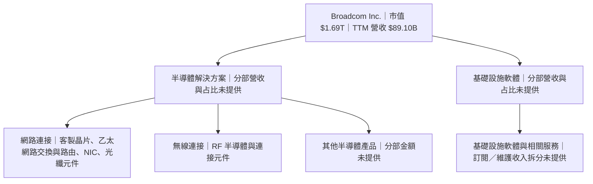
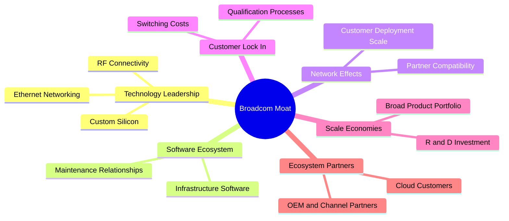
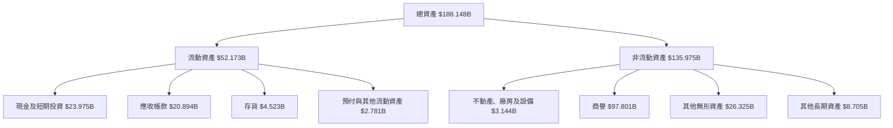
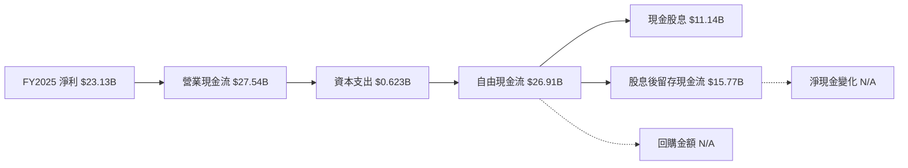
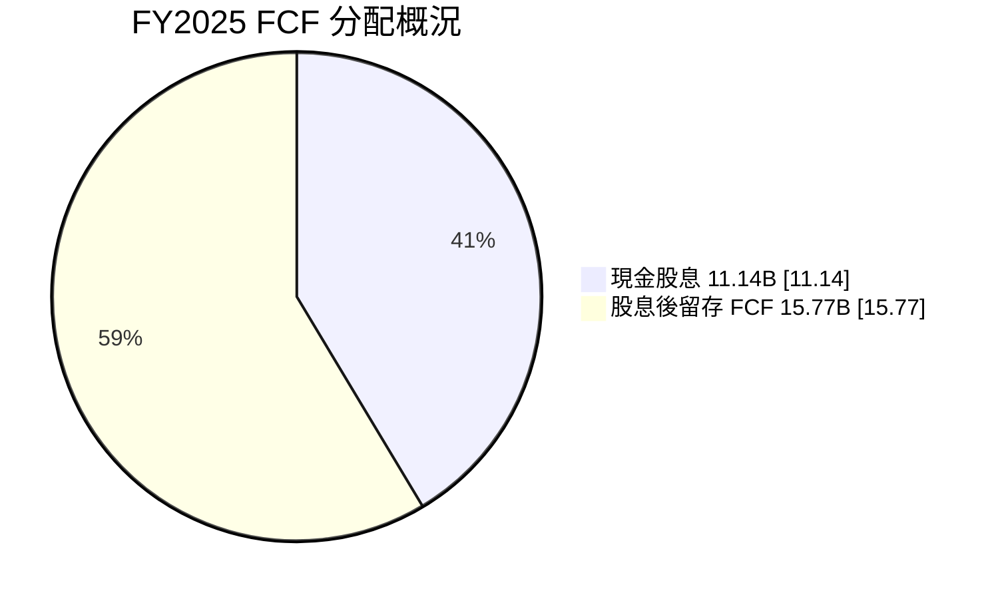
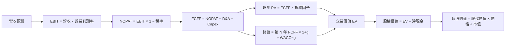
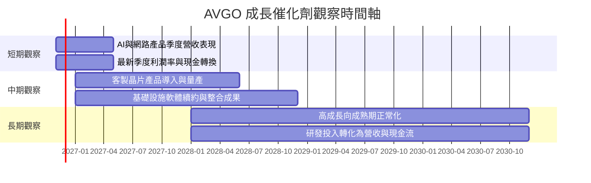
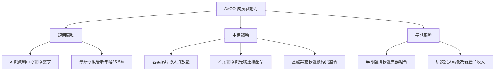
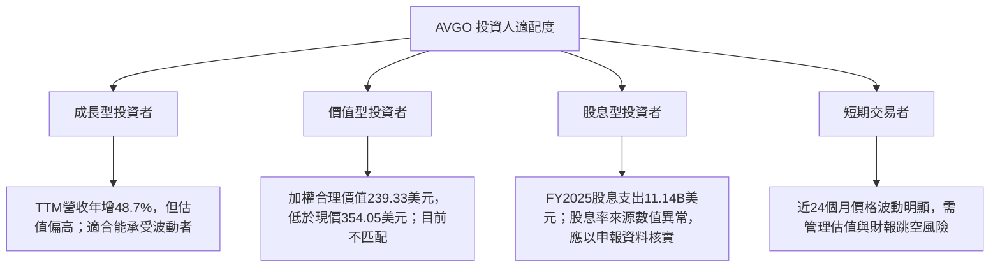

# AVGO 基本面深度分析報告
> **報告日期**：2026-11-19 ｜ **語言**：繁體中文 ｜ **數據來源**：SEC 申報資料 (XBRL)、Yahoo Finance、Finviz、StockAnalysis、Roic.ai ｜ **分析師**：CFA 級機構研究

---

## 目錄

| # | 章節 | 核心結論 |
|---|------|----------|
| 1 | 執行摘要 | 評級：賣出；加權合理價值 $239.33；MOS -47.9% |
| 2 | 公司概覽與商業模式 | 半導體與基礎設施軟體組合具客戶黏著與規模優勢，分部營收占比未提供 |
| 3 | 損益表深度分析 | TTM 營收 $89.10B、TTM 成長 48.7%；最新一季年增 85.5% |
| 4 | 資產負債表分析 | 淨負債 $35.44B；流動比率 2.504，營運資金天數上升 |
| 5 | 現金流量深度分析 | TTM FCF $39.40B，FCF Yield 2.33%；資本支出需求相對現金流小 |
| 6 | 獲利能力與資本效率 | ROIC 30.0% 高於 WACC 11.50%，目前仍創造經濟價值 |
| 7 | 相對估值分析 | 多數估值倍數高於同業中位數，且高於歷史中位數 |
| 8 | DCF 內在價值評估 | DCF 基準價值 $211.10；加權合理價值 $239.33，估值與現價差距大 |
| 9 | 成長催化劑 | AI 客製晶片、網路產品與基礎設施軟體是主要觀察方向；TAM 數據未提供 |
| 10 | 風險矩陣 | 估值回落、AI 投資週期與客戶集中／競爭風險需優先監控 |
| 11 | 投資建議 | 依 MOS 評級為賣出；等待價格或基本面回到可支持估值的區間 |

---

## 1. 執行摘要

### 1.0 一頁式投資儀表板（Portfolio Manager 30 秒速讀）

| 項目 | 內容 |
|------|------|
| **投資論點（3 句）** | ① TTM 營收 $89.10B、年增 48.7%，最新一季年增 85.5%，顯示半導體與軟體需求仍具動能。② TTM FCF $39.40B、ROIC 30.0% 高於 WACC 11.50%，基本面仍創造價值。③ 但 $354.05 現價高於 DCF 基準價值 $211.10，且高於加權合理價值 $239.33，估值風險大於基本面優勢。 |
| **綜合評分** | **6.8/10**（引用 1.1；六項算術平均） |
| **財務健康** | 🟡 現金 $23.98B、總債務 $59.42B、淨負債 $35.44B；流動比率 2.504，但 CCC 由 53 天增至 63 天。 |
| **ROIC vs WACC** | 30.0% vs 11.50%；🟢 ROIC 高出 18.5 個百分點，仍在創造價值。 |
| **FCF 趨勢** | TTM FCF $39.40B；TTM FCF Yield 2.33%。年度 FCF 由 FY2022 $16.31B 增至 FY2025 $26.91B。 |
| **估值** | Forward P/E 18.2x ｜ EV/EBITDA 40.6x（歷史估值口徑）｜ FCF Yield 2.33% |
| **DCF 內在價值（基準）** | $211.10 ｜ 現價相對 DCF 溢價 **67.7%**，計算：$354.05 ÷ $211.10 − 1。 |
| **安全邊際（MOS）** | **-47.9%**＝($239.33 − $354.05) ÷ $239.33；🔴 無安全邊際。基準為第 8.8 節加權合理價值。 |
| **預期報酬（基準情境 12M）** | 以第 8.8 節加權合理價值作估值參考，隱含上行空間 **-32.4%**；並非短期股價預測。 |
| **關鍵風險（前二）** | ① 現價估值對持續高成長要求高；② AI／客製晶片需求與大型客戶資本支出若放緩，可能使成長及估值倍數同時收縮。 |
| **評級 + 信心度** | 🔴 **賣出** ｜ 信心：中。評級依 MOS 門檻；DCF 假設可稽核性受底層表格四捨五入差異限制。 |

### 1.1 綜合評分卡（全報告唯一）

| 維度 | 評分（1–10） | 主要依據（引用數字與其來源章節） |
|------|--------------|----------------------------------|
| 成長性 | 9.0 | TTM 營收年增 48.7%、最新一季年增 85.5%（第 3 章）；成長加速但單季基期與波動需留意。 |
| 獲利能力 | 9.0 | TTM 營業利益率 48.0%、ROIC 30.0%，高於 WACC 11.50%；Piotroski F-Score 7/8（第 6 章）。 |
| 財務健康 | 7.0 | 淨負債 $35.44B、流動比率 2.504；CCC 年增 10 天、稀釋股數測試未通過（第 4、6 章）。 |
| 估值 | 2.0 | MOS -47.9%；P/E 45.2x 高於 Peer P/E 中位數 19.1x，且歷史 P/E 百分位 70%（第 7、8 章）。 |
| 護城河 | 8.0 | 半導體與基礎設施軟體組合、TTM 75.5% 毛利率及 48.0% 營業利益率支持定價與客戶黏著（第 2、3 章）；分部資料不完整。 |
| 管理層與資本配置 | 6.0 | FY2025 SBC $7.57B，約為營收 11.9%；Piotroski 股數稀釋測試未通過。股東回報及回購完整資料不足。 |
| **綜合評分** | **6.8** | 六項平均：(9.0 + 9.0 + 7.0 + 2.0 + 8.0 + 6.0) ÷ 6 = **6.8**。 |

### 1.2 五大投資論點 + 三大核心風險

| 類型 | 項目 | 具體依據 | 信心度 |
|------|------|----------|--------|
| 🟢 **投資論點①** | 營收加速 | TTM 營收 $89.10B，TTM 年增 48.7%；最新一季年增 85.5%。若需求延續，營業槓桿可支撐獲利。 | 🟢 高 |
| 🟢 **投資論點②** | 高現金流轉換 | TTM 營業現金流 $40.65B、資本支出 $1.25B、FCF $39.40B。低資本支出強度提高現金回收能力。 | 🟢 高 |
| 🟢 **投資論點③** | 資本回報高於資金成本 | ROIC 30.0% 對 WACC 11.50%，差 18.5 個百分點。 | 🟢 高 |
| 🟢 **投資論點④** | 毛利與營業槓桿 | TTM 毛利率 75.5%、營業利益率 48.0%；最新一季營業利益率 53.9%（依指定口徑）。 | 🟡 中 |
| 🟢 **投資論點⑤** | 多元業務降低單一產品依賴 | 公司涵蓋半導體解決方案與基礎設施軟體；但各分部收入及利潤貢獻未提供，無法量化分散效果。 | 🟡 中 |
| 🟡 **風險①** | 估值對成長預期要求高 | 現價 $354.05；加權合理價值 $239.33，MOS -47.9%；Peer EV/EBITDA 中位數 18.5x，AVGO 歷史口徑為 40.6x。 | 🔴 高衝擊 |
| 🔴 **風險②** | AI／大型客戶投資週期逆轉 | 最新一季營收年增 85.5%，高成長若依賴少數大型雲端客戶資本支出，訂單遞延可造成成長快速降速；客戶集中度數字未提供。 | 🟡 中 |
| 🟡 **風險③** | 股權薪酬與股數稀釋 | FY2025 SBC $7.57B，佔 FY2025 營收約 11.9%；Piotroski 股數測試未通過。 | 🟡 中 |

### 1.3 快速統計卡片

| 指標 | 公司實際值（期間） | 同業中位數 | 狀態 |
|------|--------------------|------------|------|
| 營收成長（TTM） | **48.7%** | — | 🟢 |
| 營收成長（最新一季年增） | **85.5%** | 36.5% | 🟢 |
| 毛利率（TTM） | **75.5%** | 53.1% | 🟢 |
| 營業利益率（TTM） | **48.0%** | — | 🟢 |
| ROIC（TTM） | **30.0%** | — | 🟢 |
| Forward P/E | **18.2x** | 13.1x | 🟡 |
| FCF Yield（TTM） | **2.33%** | — | 🟡 |
| Piotroski F-Score | **7 / 8** | — | 🟢 |

### 1.4 投資結論

╔══════════════════════════════════════════════════════════════════╗  
║                    📊 投資結論摘要                               ║  
╠══════════════════════════════════════════════════════════════════╣  
║  評級：🔴 賣出（依 MOS 門檻，未作質化調整）                     ║  
║  價格（2026-11-18 收盤）：$354.05                                ║  
║  DCF 內在價值（基準）：$211.10（現價溢價 67.7%）                ║  
║  安全邊際 MOS：-47.9%＝($239.33−$354.05)÷$239.33                ║  
║  加權合理價值（8.8）：$239.33                                    ║  
║  DCF 情境價值：                                                  ║  
║    悲觀情境：$87.24（-75.4%）                                    ║  
║    基準情境：$211.10（-40.4%）                                   ║  
║    樂觀情境：$464.84（+31.3%）                                   ║  
║  綜合評分：6.8/10（引用 1.1）                                    ║  
║  適合投資人：可承受高波動且重視長期 AI／半導體成長者；           ║  
║              不適合以當前估值尋求安全邊際的價值型投資人。        ║  
╚══════════════════════════════════════════════════════════════════╝

---

## 2. 公司概覽與商業模式

### 2.1 業務結構與收入來源

分部營收金額及占比未提供，因此不以估算比例繪製收入占比圖。公司總營收使用 TTM $89.10B，總市值 $1.69T。

公司商業模式涵蓋半導體設計與基礎設施軟體。半導體產品提供網路、無線與客製化連接能力；軟體業務可提供較長週期的維護與服務收入，但其收入占比、續約率及分部利潤資料未提供，不能量化兩者的獲利貢獻。

### 2.2 市場份額

**市場份額數據未提供**，因此不呈現份額比例或市場份額圖。從公司規模看，TTM 營收為 $89.10B，最新一季營收年增 85.5%；同業中 NVIDIA 最新一季年增 105.9%、Marvell 36.5%、Qualcomm -8.4%。這顯示 AVGO 成長速度高於兩家比較公司，但不能由此直接推導市場份額變化。

### 2.3 競爭護城河分析

### 2.4 護城河強度

| 護城河項目 | 強度（強／中／弱） | 證據（引用數字或事實） | 會削弱它的情況 |
|------------|--------------------|------------------------|----------------|
| 技術與產品組合 | 強 | TTM 毛利率 75.5%、營業利益率 48.0%；產品涵蓋網路、客製晶片、RF 與光纖元件。 | 競品在效能、功耗、整合成本或供應能力上取得持續優勢。 |
| 軟體生態系統 | 中 | 公司營運基礎設施軟體業務；軟體分部收入、續約率與利潤率未提供。 | 客戶轉向替代產品、維護價格承壓或整合後協同效益低於預期。 |
| 網路效應 | 中 | 網路設備與晶片需要在客戶架構中互通；實際網路效應與客戶數據未提供。 | 開放標準及多供應商方案降低單一供應商依賴。 |
| 客戶鎖定 | 中 | 半導體產品通常涉及產品驗證與平台設計導入；客戶集中度及合約年限未提供。 | 大客戶自行設計晶片、重新議價或更換供應商。 |
| 規模效應 | 強 | TTM 營收 $89.10B、研發投入 FY2025 $10.98B，規模可支撐廣泛產品研發。 | 研發投入上升但新產品收入轉化不足。 |
| 生態夥伴 | 中 | 公司服務網路、無線與基礎設施軟體市場；合作夥伴收入貢獻未提供。 | 主要夥伴改採競爭方案或供應鏈中斷。 |

1.1 的護城河評分為 **8.0/10**：高毛利、高營業利益率與產品組合支持其競爭力，但客戶留存、分部收入及市場份額資料不足以支持更高評分。

---

## 3. 損益表深度分析

### 3.1 年度收入成長趨勢（近 4 年）

年度財報數值依年度損益表；YoY 以相鄰年度收入計算。金額取 $0.01B，成長率取 0.1%。

╔══════════════════════════════════════════════════════════════════╗  
║              Broadcom 年度收入趨勢（FY2022-FY2025）              ║  
╠══════════════════════════════════════════════════════════════════╣  
║ FY2022  $33.20B  ██████████░░░░░░░░░░░░░░  基期                 ║  
║ FY2023  $35.82B  ███████████░░░░░░░░░░░░░  YoY +7.9%  🟡       ║  
║ FY2024  $51.57B  ████████████████░░░░░░░░  YoY +44.0% 🟢       ║  
║ FY2025  $63.89B  ████████████████████░░░░  YoY +23.9% 🟢       ║  
║                                                                  ║  
║ FY2022–FY2025 CAGR：(63.89÷33.20)^(1÷3)−1 = 約 24.4%            ║  
╚══════════════════════════════════════════════════════════════════╝

FY2024 大幅增長後，FY2025 年增率回落至 23.9%，但 TTM 年增 48.7% 及最新一季年增 85.5% 顯示近期成長重新加速。年度與 TTM 期間不同，不能把單季增幅直接視為可持續長期增速。

### 3.2 季度收入趨勢分析

| 季度 | 營收（$B） | QoQ | YoY | 備註 |
|------|-----------:|----:|----:|------|
| 2025-10-31 | 18.015 | — | 28.18% | 資料所列 FY2025 Q4。 |
| 2026-01-31 | 19.311 | +7.2% | 29.47% | QoQ = 19.311 ÷ 18.015 − 1。 |
| 2026-04-30 | 22.187 | +14.9% | 47.87% | QoQ = 22.187 ÷ 19.311 − 1；成長加速。 |
| 2026-08-02 | 29.591 | +33.4% | 85.5% | QoQ = 29.591 ÷ 22.187 − 1；最新一季年增，不是 TTM 成長率。 |

最新季度收入向上加速，與 AI 網路與客製化晶片需求增加的產業背景一致；但未提供分部營收，無法將本季增長精確歸因至單一產品線。

### 3.3 利潤率演變分析

| 利潤率指標 | FY2022 | FY2023 | FY2024 | FY2025 | 趨勢 | 評估 |
|------------|-------:|-------:|-------:|-------:|------|------|
| **毛利率** | 66.5% | 68.9% | 63.0% | 67.8% | FY2024 下滑、FY2025 回升 | 🟢 |
| **營業利益率** | 43.0% | 45.9% | 29.1% | 40.8% | FY2024 下滑後恢復 | 🟡 |
| **淨利率** | 34.6% | 39.3% | 11.4% | 36.2% | FY2024 受淨利下降影響，FY2025 反彈 | 🟡 |

*計算說明：年度毛利與營業利益以年度損益表欄位除以營收；年度淨利率以同表淨利除以營收。FY2024 淨利較低，故不宜將該年度的淨利率視為常態。*

TTM 毛利率為 75.5%、TTM 營業利益率為 48.0%；年度列示值與 TTM 值來自不同期間與資料彙整口徑。最新一季營業利益率依核心 VERIFIED FIGURES 為 53.9%，高於 TTM 48.0%，可能反映產品組合、營運槓桿或資料期間口徑差異；未提供分部毛利與費用拆分，無法將增幅完全歸因於單一因素。

### 3.4 費用結構分析

FY2025 研發費用 $10.98B、營收 $63.89B；研發費用率約 17.2%。可用數字僅支持研發投入分析，沒有足夠一致的 FY2025 銷售、管理及其他費用拆分，因此不繪製會暗示完整比例的費用圓餅圖。

╔══════════════════════════════════════════════════════════════════╗  
║ FY2025 研發投入指標                                             ║  
╠══════════════════════════════════════════════════════════════════╣  
║ 營收 $63.89B  ── 研發費用 $10.98B                               ║  
║ 研發費用率 = $10.98B ÷ $63.89B = 約 17.2%                      ║  
╚══════════════════════════════════════════════════════════════════╝

### 3.5 季度 EPS 趨勢與盈餘品質（Quality of Earnings）

過去四季 EPS 實際值可由 StockAnalysis 的季度資料引用；但 EPS 預估欄為 nan，故無法判斷超預期或不及預期。

| 季度 | EPS 實際 | EPS 預估 | 超預期／不及預期 |
|------|---------:|---------:|------------------|
| 2025-10-31 | $1.74 | N/A | N/A（預估資料缺漏） |
| 2026-01-31 | $1.50 | N/A | N/A（預估資料缺漏） |
| 2026-04-30 | $1.91 | N/A | N/A（預估資料缺漏） |
| 2026-08-02 | $2.75 | N/A | N/A（預估資料缺漏） |

| 盈餘品質項目 | 數值／佔比 | 評估 |
|--------------|-----------|------|
| 股權薪酬 SBC / 營收 | FY2025：$7.57B ÷ $63.887B = **11.9%** | 🟡 占比不低，SBC 不是無成本；長期會稀釋股東持有比例。 |
| SBC / 營業現金流 | FY2025：$7.57B ÷ $27.54B = **27.5%** | 🟡 SBC 是非現金費用，但經濟成本會以稀釋或回購抵銷方式落到股東身上。 |
| FCF / 淨利（現金轉換率） | TTM：$39.40B ÷ TTM 淨利 $38.265B = **103.0%** | 🟢 現金轉換略高於會計淨利；FCF 定義採營業現金流減資本支出。 |
| 一次性／非經常性損益 | FY2024 淨利 $5.89B，低於 FY2023 $14.08B、FY2025 $23.13B；具體一次性項目未提供 | 🟡 年度波動大，不能在缺少附註資訊下認定由某一項一次性損益造成。 |
| 有效稅率異常 | TTM 有效稅率 N/A；DCF 採用 21.0% | 🟡 實際 TTM 有效稅率資料未提供，不能確認是否受稅務利益影響。 |
| 資本化支出 vs 費用化 | FY2025 Capex $0.623B；研發費用 $10.98B | 🟡 Capex 相對營收偏低，但研發資本化政策及無形資產內部形成明細未提供，無法量化成本資本化影響。 |

**盈餘品質結論**：TTM FCF $39.40B 高於 TTM 淨利 $38.265B，現金轉換具支持；另一方面，FY2025 SBC 相當於營收 11.9%、營業現金流 27.5%，代表 GAAP 淨利並未完全反映股東被稀釋的經濟成本。綜合而言，現金含量良好，但估值不宜忽略 SBC 的股東成本。

---

## 4. 資產負債表分析

### 4.1 資產結構分解

以下使用 2026-08-02 TTM 資產負債資料。總資產 $188.148B，各列為資料所列項目。

### 4.2 流動性與營運資金分析

| 指標 | 最新 TTM／期末 | 一年前 | 變化 | 解讀 |
|------|---------------:|-------:|------:|------|
| 流動比率 | 2.504 | N/A | N/A | 短期資產相對流動負債有緩衝；歷史可比數值未提供。 |
| 速動比率 | 2.153 | N/A | N/A | 排除存貨後仍高於 1，短期流動性尚可。 |
| DSO 應收帳款天數 | 56 天 | 40 天 | +16 天 | 收款週期拉長；可能與大型客戶帳期及營收快速擴張有關，但應收帳款增長須追蹤。 |
| DIO 存貨天數 | 59 天 | 40 天 | +19 天 | 存貨占用增加；可能為供應準備，也可能反映需求預測風險。 |
| DPO 應付帳款天數 | 52 天 | 26 天 | +26 天 | 付款天數增加，可能改善現金使用；仍需觀察是否由供應商條款變化造成。 |
| CCC 現金轉換週期 | 63 天 | 53 天 | +10 天 | 現金轉換週期延長，增量營收可能需要更多營運資金支持。 |

### 4.3 債務結構分析

╔══════════════════════════════════════════════════════════════════╗  
║                  Broadcom 債務健康診斷                          ║  
╠══════════════════════════════════════════════════════════════════╣  
║ 總債務：          $59.42B   ████████████████████  🟡             ║  
║ 現金及短期投資：  $23.98B   ████████░░░░░░░░░░░░  🟢             ║  
║ 淨負債：          $35.44B   ████████████░░░░░░░░  🟡             ║  
║                                                                  ║  
║ Debt/EBITDA：N/A（同期間 EBITDA 絕對值未在核心數據列示）         ║  
║ Interest Coverage：N/A（利息費用絕對額未提供）                  ║  
║ 流動比率：2.504                                                   ║  
╚══════════════════════════════════════════════════════════════════╝

FY2025 年度總債務為 $65.14B，最新 TTM 資料為 $59.42B；使用最新 TTM 數據，現金低於總債務，故公司是淨負債而非淨現金。槓桿的可負擔性仍受 $40.65B TTM 營業現金流支持，但因利息費用與到期結構未提供，不能量化利息覆蓋及再融資風險。

### 4.4 股東權益趨勢

╔══════════════════════════════════════════════════════════════════╗  
║                 年度股東權益變化（$B）                           ║  
╠══════════════════════════════════════════════════════════════════╣  
║ FY2022  $22.71B  ██████░░░░░░░░░░░░░░░░░░                     ║  
║ FY2023  $23.99B  ███████░░░░░░░░░░░░░░░░░                    ║  
║ FY2024  $67.68B  ████████████████████░░░░                     ║  
║ FY2025  $81.29B  ████████████████████████                     ║  
╚══════════════════════════════════════════════════════════════════╝

FY2023 至 FY2024 權益顯著增加，與資產與商譽於 FY2024 大幅上升同時發生；FY2024 總資產 $165.65B，FY2023 為 $72.86B。收購及合併會計可能是變化背景，但未提供可直接驗證的權益變動附註，故不把全部增幅歸因於單一交易。

---

## 5. 現金流量深度分析

### 5.1 現金流量瀑布圖

FY2025 的淨利、營業現金流、Capex、FCF 與股息均有年度數據。回購及淨現金變化未提供。

### 5.2 FCF 轉換率趨勢

| 財年 | FCF（$B） | 淨利（$B） | FCF / 淨利 | 解讀 |
|------|---------:|----------:|-----------:|------|
| FY2022 | 16.31 | 11.49 | 142.0% | 現金流高於淨利。 |
| FY2023 | 17.63 | 14.08 | 125.2% | 轉換率仍高於 100%。 |
| FY2024 | 19.41 | 5.89 | 329.5% | 淨利基數異常偏低，轉換率不能視為常態。 |
| FY2025 | 26.91 | 23.13 | 116.3% | 現金流略高於淨利，較 FY2024 更具代表性。 |
| TTM 至 2026-08-02 | 39.40 | 38.265 | 103.0% | 依 TTM FCF 與 TTM 淨利計算。 |

### 5.3 自由現金流趨勢

╔══════════════════════════════════════════════════════════════════╗  
║               自由現金流：年度實際與 TTM                         ║  
╠══════════════════════════════════════════════════════════════════╣  
║ FY2022 $16.31B  ████████████░░░░░░░░░░░░  YoY 基期             ║  
║ FY2023 $17.63B  █████████████░░░░░░░░░░░  YoY +8.1%            ║  
║ FY2024 $19.41B  ██████████████░░░░░░░░░░  YoY +10.1%           ║  
║ FY2025 $26.91B  ████████████████████░░░░  YoY +38.6%           ║  
║ TTM    $39.40B  資料期間截至 2026-08-02；FCF Yield 2.33%        ║  
╚══════════════════════════════════════════════════════════════════╝

FY2022 至 FY2025 FCF CAGR 約 18.2%（以年度報表數值計算）；TTM FCF 高於 FY2025，顯示現金流規模進一步上升。TTM FCF Yield 僅 2.33%，表明強勁現金流並未消除現價估值偏高的問題。

### 5.4 資本配置評估

FY2025 FCF $26.91B，其中現金股息 $11.14B；股息後剩餘 FCF 為 $15.77B。這個拆分只是現金流分配，不等同全部資本配置用途，回購與併購支出未提供。

| 項目 | FY2025 金額 | 對資本配置的含義 |
|------|------------:|------------------|
| FCF | $26.91B | 營運產生的現金扣除資本支出後餘額。 |
| 現金股息 | $11.14B | 約佔 FCF 41.4%；維持股東現金回報。 |
| 股息後留存 FCF | $15.77B | 由 FCF 減股息推算；用途可能包括償債、收購或其他配置，明細未提供。 |
| 資本支出 | $0.623B | FY2025 年度資本支出數據；TTM Capex 為 $1.25B。 |
| 回購 | N/A | 可比期間回購金額未提供。 |

---

## 6. 獲利能力與資本效率

### 6.1 ROE / ROA / ROIC 趨勢

| 指標 | 目前／TTM | 歷史序列 | 評估 |
|------|----------:|----------|------|
| ROE | 38.4% | QUALITY FIGURES 使用 TTM closing balances；其他資料源另列 44.2%，此處依品質指標口徑引用 38.4%。 | 🟢 高，但須結合資產週轉率與槓桿解讀。 |
| ROA | 15.4% | TTM | 🟢 有正向資產回報；歷史同口徑序列未提供。 |
| ROIC | 30.0% | TTM | 🟢 高於 WACC 11.50%。 |

行業均值未提供，因此不列同業平均比較欄。ROE 數據來源存在 38.4% 與 44.2% 的口徑差異；本報告杜邦分解與評分使用指定 QUALITY FIGURES 的 38.4%。

### 6.2 ROIC vs WACC 分析（核心價值創造判斷）

╔══════════════════════════════════════════════════════════════════╗  
║                 ROIC vs WACC 深度分析                            ║  
╠══════════════════════════════════════════════════════════════════╣  
║ WACC 輸入：                                                      ║  
║ ├── 無風險利率（10Y 美債）：5.07%                                ║  
║ ├── 市場風險溢酬：5.00%                                          ║  
║ ├── Beta 原始值 1.51；調整後採用 1.34                            ║  
║ ├── Ke = 5.07% + 1.34 × 5.00% = 約 11.77%；資料列 11.76%        ║  
║ ├── 稅前債務成本 5.40%；稅後約 4.27%                             ║  
║ ├── 股權／債務權重：96.6%／3.4%                                  ║  
║ └── 採用 WACC：11.50%（依資本成本資料）                          ║  
║                                                                  ║  
║ ROIC（TTM）：30.0%                                               ║  
║ EVA Spread = ROIC − WACC = 30.0% − 11.50% = +18.5pp             ║  
║ ROIC 30.0%  ▓▓▓▓▓▓▓▓▓▓▓▓▓▓▓▓▓▓▓▓▓▓▓▓▓▓▓▓░░░░░░                 ║  
║ WACC 11.5%  ▓▓▓▓▓▓▓▓▓▓▓░░░░░░░░░░░░░░░░░░░░░░                 ║  
║ 結論：ROIC 約為 WACC 的 2.6 倍，現階段創造股東價值。            ║  
╚══════════════════════════════════════════════════════════════════╝

成本資本資料已提供 WACC 與各項輸入，因此採用其指定的 **11.50%**，不自行改建 WACC。原始 Beta 1.51 按「2/3 原始 Beta + 1/3」調整為 1.34。由於長期債務與利息費用明細未列，無法獨立重建稅前 Kd 的分子及分母；詳見第 8.10 節的複算限制。

### 6.3 杜邦三因素分解

| 因素 | 數值（TTM） | 解讀 |
|------|-------------|------|
| 淨利率 | 42.9% | 淨利率高，是 ROE 的重要來源。 |
| 資產週轉率 | 0.47 | 每單位資產產生的營收有限於高毛利商業模式，兼有商譽與無形資產影響。 |
| 權益乘數 | 1.89 | 有一定財務槓桿，但不是 ROE 的唯一驅動來源。 |
| **ROE** | **38.4%** | 42.9% × 0.47 × 1.89 = 38.4%（依品質指標原值引用）。 |

### 6.4 財務體質：Piotroski F-Score

**Piotroski F-Score：7 / 8**。一項測試因缺少輸入而未納入分母，因此不是 7/9。

| 測試 | 結果 | 解讀 |
|------|------|------|
| ROA > 0 | ✅ 通過 | TTM 資產回報為正。 |
| 營業現金流 > 0 | ✅ 通過 | TTM 營業現金流 $40.65B。 |
| ROA 高於一年前 | ✅ 通過 | 盈利能力改善。 |
| 營業現金流 > 淨利（應計品質） | ✅ 通過 | TTM 營業現金流高於 TTM 淨利。 |
| 長期負債 ÷ 總資產低於一年前 | — 無法判定 | 缺少比較期間所需輸入。 |
| 流動比率高於一年前 | ✅ 通過 | 短期流動性改善。 |
| 稀釋股數未增加 | ❌ 未通過 | 表示稀釋股數增加，與 FY2025 SBC $7.57B 相呼應。 |
| 毛利率高於一年前 | ✅ 通過 | 毛利率改善。 |
| 資產週轉率高於一年前 | ✅ 通過 | 資產運用效率改善。 |

---

## 7. 相對估值分析

### 7.1 同業估值比較表格

公司倍數取資料列示的公司估值；同業數字採 Peer multiples。AVGO 的 P/E、Forward P/E 與 P/S 來自市場估值資料；EV/EBITDA 的歷史對照欄依指定歷史估值區塊為 40.6x。

| 估值指標 | **AVGO** | **NVDA** | **MRVL** | **QCOM** | AVGO 評估 |
|----------|---------:|---------:|---------:|---------:|-----------|
| **Trailing P/E** | 45.2x | 19.1x | 47.9x | 12.6x | 🔴 高於同業中位數 19.1x；需維持高增長支持。 |
| **Forward P/E** | 18.2x | 9.1x | 19.7x | 13.1x | 🟡 同業中位數 13.1x；AVGO 約高 39%。 |
| **P/S Ratio** | 19.4x | 12.0x | 13.9x | 4.0x | 🔴 高於同業中位數 12.0x。 |
| **EV/EBITDA** | 40.6x | 18.5x | 45.2x | 16.9x | 🔴 AVGO 高於同業中位數 18.5x；資料來源口徑差異需留意。 |
| 最新一季營收 YoY | 85.5% | 105.9% | 36.5% | -8.4% | 🟢 成長高於 MRVL、QCOM，低於 NVDA。 |
| TTM 毛利率 | 75.5% | 74.7% | 52.2% | 53.1% | 🟢 高於兩家，略高於 NVDA。 |

### 7.2 歷史估值區間分析

╔══════════════════════════════════════════════════════════════════╗  
║              AVGO 五年歷史 TTM P/E 估值位置                     ║  
╠══════════════════════════════════════════════════════════════════╣  
║ 歷史區間：1.8x ───────── 中位數 5.5x ───────── 77.5x            ║  
║ 當前 P/E：45.2x；歷史百分位：70%                                 ║  
║ 評估：🟡 位於歷史區間偏高端；歷史中位數受過往淨利波動影響，       ║  
║       不宜直接視為正常化的合理 P/E。                             ║  
╚══════════════════════════════════════════════════════════════════╝

其他歷史估值：P/S 當前 19.4x、五年中位數 1.5x、百分位 70%；EV/EBITDA 當前 40.6x、五年中位數 5.6x、百分位 55%。歷史中位數與現值差異極大，可能受到收購、商譽攤銷、盈餘基數變動及市場估值 regime 影響；它們適合作為相對位置參考，不應直接當作價格目標。

### 7.3 情境價值（Bear / Base / Bull，照抄 DCF MODEL）

| 情境 | 第 1 年營收成長 | 期末營業利潤率 | WACC | 每股價值 | 相對現價 | 機率 | 會發生的條件 |
|------|----------------:|----------------:|-----:|----------:|----------:|------:|--------------|
| 🔴 悲觀 | 15.0% | 36.4% | 12.50% | $87.24 | -75.4% | 25% | AI 相關需求放緩、產品組合轉弱，且長期營業利潤率明顯收縮。 |
| 🟡 基準 | 30.0% | 42.8% | 11.50% | $211.10 | -40.4% | 50% | 高增長逐年回落，營業利潤率從 48.0% 緩降至 42.8%。 |
| 🟢 樂觀 | 45.0% | 47.1% | 10.50% | $464.84 | +31.3% | 25% | AI／網路產品持續快速放量，利潤率具韌性，且折現率下降。 |

### 7.4 相對估值隱含價格區間

╔══════════════════════════════════════════════════════════════════╗  
║               估值方法隱含每股價值（美元）                      ║  
╠══════════════════════════════════════════════════════════════════╣  
║ 同業 EV/EBITDA $153.59 ─ 同業 Forward P/E $254.69                ║  
║              現價 $354.05 ─ 分析師共識目標價 $528.17              ║  
║ DCF 基準 $211.10；以上數值均依指定方法區塊引用                  ║  
╚══════════════════════════════════════════════════════════════════╝

| 方法 | 每股價值 | 相對現價 | 方法依據 |
|------|---------:|---------:|----------|
| 同業 Forward P/E | $254.69 | -28.1% | 同業 Forward P/E 中位數 13.1x × 公司 Forward EPS $19.41。 |
| 同業 EV/EBITDA | $153.59 | -56.6% | 同業中位數 17.7x × TTM EBITDA，再加回淨現金／扣除淨負債。 |
| DCF 基準 | $211.10 | -40.4% | 10 年 FCFF、WACC 11.50%、永續成長率 3.0%。 |
| 分析師共識目標價 | $528.17 | +49.2% | 47 位分析師平均目標價；與其他方法差距大，屬參考值。 |

---

## 8. DCF 內在價值評估（Discounted Cash Flow）

> DCF 數字採程式計算模型原值。金額以 $B 計、每股價值以美元計；模型表格原值取兩位小數，折現因子取三位小數。模型的若干中間值使用未四捨五入的底層數字，故表面數值未必可由已四捨五入欄位完全重算；差異會在 8.10 明確列出，不以自行修改模型數字處理。

### 8.0 估值推理鏈（Thinking Logic）

**Step 1 — 價值驅動因素**

AVGO 價值可拆為半導體現金流底盤、基礎設施軟體現金流，以及 AI／客製晶片等成長選擇權；但半導體與軟體分部收入占比未提供，不能把 $89.10B TTM 營收拆成分部金額。模型的主導變數是收入成長與長期營業利潤率，其次是 WACC 與終值成長率；敏感度矩陣顯示 WACC 和 g 改變均會顯著影響每股價值。

**Step 2 — 模型選擇**

| 決策點 | 本報告採用 | 理由（含數字） | 曾考慮但否決 | 否決理由 |
|--------|-----------|----------------|--------------|----------|
| 現金流定義 | FCFF | 以 WACC 折現，先求 EV，再以現金及債務橋接至股權價值。 | FCFE | 公司有 $59.42B 總債務，FCFE 對融資假設更敏感。 |
| 預測期 N | 10 年 | DCF 模型採 10 年；收入成長從 30.0% 線性降至 3.0%。 | 5 年 | 高增長與成熟化可能跨越多個年度，5 年模型會較早把價值集中到終值。 |
| 終值方法 | Gordon Growth | 模型以永續成長率 3.0% 計算終值。 | 單一退出倍數 | 模型提供之方法與假設沒有退出倍數估值輸入，不另建模型。 |
| EBIT 基礎 | GAAP EBIT | 模型明確採 GAAP EBIT，已含 SBC 費用。 | 非 GAAP EBIT | 加回 SBC 會改變模型指定口徑。 |

**Step 3 — 高／中敏感度假設推導鏈**

- **營收成長**：錨點＝TTM 成長 48.7%、最新一季年增 85.5% → 調整＝考慮基期墊高與高增長逐步正常化 → 採用第 1 年 30.0%，逐年降至第 10 年 3.0% → 否決第 1 年採用 48.7% 或更高，因它會把單一 TTM 成長延伸到預測起點，且不代表十年可維持速度。
- **營業利潤率**：錨點＝TTM 48.0% → 調整＝隨成長成熟、競爭與產品組合變化逐步收斂 → 採用第 1 年 48.0% 至第 10 年 42.8% → 否決長期維持 48.0%，因模型假設成熟期利潤率回落，且長期利潤率資料不足以支持不變。
- **永續成長率 g**：錨點＝長期成熟企業需低於 WACC，模型指定 3.0% → 調整＝採用與長期名目經濟成長相容的模型值 → 採用 3.0%，低於 WACC 11.50% → 否決更高 g，因終值占比已達 52.7%，過高 g 會不成比例推高終值。
- **預測期 N**：錨點＝模型設定 10 年，且收入成長由 30.0% 降至 3.0% → 調整＝用完整十年呈現成長正常化 → 採用 10 年 → 否決縮短至 5 年，因會提前把仍處於成長階段的現金流併入終值。
- **Capex／營收**：錨點＝TTM Capex $1.25B ÷ TTM 營收 $89.10B，約 1.4% → 調整＝依模型設定由第 1 年 1.4% 緩降至第 10 年 0.8% → 採用模型逐年假設 → 否決長期維持 0.8%，因前期增長可能需要更高產能與設備投入。
- **EBIT 與 SBC**：錨點＝GAAP EBIT，且 FY2025 SBC $7.57B → 調整＝不在 FCFF 再扣一次 SBC，亦不額外稀釋股數 → 採用模型組合 (A) → 否決 GAAP EBIT 再減 SBC，因會重複計入同一成本。
- **年稀釋率**：錨點＝Piotroski 股數測試未通過，表示近期股數增加 → 調整＝模型採組合 (A)，股數固定、稀釋率 0%，SBC 已經由 GAAP 費用反映 → 否決額外增加稀釋率，避免重複計入稀釋成本。
- **終值方法**：錨點＝10 年後公司假設成熟、g 3.0% → 採用 Gordon Growth → 否決模型外加退出倍數主估值，因沒有可對應的終值 EBITDA 倍數假設，且不應自行改建 DCF。
- **WACC**：錨點＝資本成本資料列示 11.50%，權重股權 96.6%、債務 3.4% → 調整＝採用指定公司 beta、利率及權重，沒有另加溢酬 → 採用 11.50% → 否決以其他市場資料重算，因本報告依指定成本資本輸入。
- **稅率**：模型採 21.0%；公司實際 TTM 有效稅率未提供，故不宣稱 21.0% 等於歷史實際稅率。
- **D&A／營收**：錨點＝模型列示 0.7%，固定採用 0.7%。
- **營運資金變動**：DCF 模型明確未建模 Working Capital，故不另加 ΔWC；其影響未包含於估值。

**Step 4 — 最脆弱假設**

最脆弱環節是高成長能否轉化為持續的 GAAP 營業利益與終值現金流。若收入增長低於模型基準或利潤率收縮，價值向下；模型悲觀情境為 $87.24，基準情境為 $211.10。

**Step 5 — 計算路徑**

### 8.1 模型假設總表（Model Inputs）

| 假設項目 | 採用值 | 依據／來源 | 敏感度 |
|----------|--------|-------------|--------|
| 預測期長度 N | 10 年 | DCF MODEL 列示；成長由第 1 年 30.0% 降至第 10 年 3.0%。 | 🟡 中 |
| 營收成長 | 第 1 年 30.0% → 第 10 年 3.0% | TTM 成長 48.7%；模型設定在 0%–30% 範圍內起始並逐步衰減。 | 🔴 高 |
| 營業利潤率 | 第 1 年 48.0% → 第 10 年 42.8% | TTM 營業利益率 48.0%；末期採過去五財年中位數口徑。 | 🔴 高 |
| 有效稅率 | 21.0% | 模型預設稅率；實際 TTM 有效稅率未提供。 | 🟢 低 |
| Capex／營收 | 第 1 年 1.4% → 第 10 年 0.8% | TTM 口徑約 1.4%；模型逐步降至 D&A 的 1.1 倍附近。 | 🟡 中 |
| D&A／營收 | 0.7% | DCF 模型引用 TTM 水準並固定。 | 🟢 低 |
| 營運資金變動／營收增額 | 未建模 | DCF 模型註明 Working capital is not modelled；不可自行補值。 | 🟢 低 |
| EBIT 基礎 | GAAP | DCF MODEL 明列 GAAP EBIT。 | 🟡 中 |
| SBC 處理 | 組合 (A)：已含 GAAP EBIT，不另扣 SBC，固定股數 | 模型原文指定組合 A。 | 🟡 中 |
| 年稀釋率 | 0%（模型固定股數） | 與組合 (A) 相容；SBC 已於費用端扣除。 | 🟡 中 |
| 永續成長率 g | 3.0% | DCF MODEL 列示；低於 WACC 11.50%。 | 🔴 高 |
| 終值方法 | Gordon Growth | DCF MODEL 列示。 | 🔴 高 |
| WACC | 11.50% | 成本資本區塊指定值；見 8.2。 | 🔴 高 |

FCFF 定義：`FCFF = NOPAT + D&A − Capex`；Working capital 不建模。**本模型採用 (A)，故 SBC 影響已計入一次。**

### 8.2 折現率推導（WACC）

╔══════════════════════════════════════════════════════════════════╗  
║                    WACC 推導（折現率）                           ║  
╠══════════════════════════════════════════════════════════════════╣  
║ 股權成本 Ke：                                                    ║  
║ ├── 無風險利率 Rf：5.07%                                         ║  
║ ├── ERP：5.00%                                                   ║  
║ ├── 原始 Beta：1.51；調整 Beta：2/3×1.51 + 1/3 = 1.34           ║  
║ ├── 規模／國別溢酬：未另加                                       ║  
║ └── Ke = 5.07% + 1.34×5.00% = 約 11.77%；資料列 11.76%          ║  
║                                                                  ║  
║ 債務成本：                                                       ║  
║ ├── 稅前 Kd：5.40%（資本成本資料列示）                           ║  
║ ├── 稅率：21.0%                                                  ║  
║ └── 稅後 Kd = 5.40%×(1−21.0%) = 4.266%                          ║  
║                                                                  ║  
║ 資本權重：股權 96.6%；債務 3.4%                                  ║  
║ 採用 WACC：11.50%                                                ║  
╚══════════════════════════════════════════════════════════════════╝

**逐步演算（WACC）**

1. **Ke（CAPM）**：Rf + β × ERP = 5.07% + 1.34 × 5.00% = 約 11.77%；成本資本資料列示 Ke 為 **11.76%**。原始 Beta 1.51 依 ⅔×原始 Beta + ⅓ 調整為 1.34。
2. **稅前 Kd**：已知成本資本資料列示為 **5.40%**；利息費用絕對額及其使用的平均計息負債絕對額未提供，不能把比率拆成可獨立複算的金額算式。
3. **稅後 Kd**：5.40% × (1 − 21.0%) = **4.266%**。
4. **權重**：資料列示 E／D 權重為 **96.6%／3.4%**，相加為 100.0%；與其相配的市值及債務計算底層精度未完整列示，本報告不以帳面權益替代市值。
5. **WACC**：直接採成本資本資料列示的 **11.50%**。以列示四捨五入數字作表面檢算：96.6%×11.76% + 3.4%×4.266% = 約 11.51%；與原值 11.50% 相差約 0.01 個百分點，屬輸入精度差異，本報告保留指定 WACC 11.50%。

Rf 日期未獨立列示，僅能引用成本資本資料中的 10 年期美債 5.07%；ERP 為假設值 5.00%。因缺少 Kd 底層利息與平均債務金額、以及權重未四捨五入前輸入，WACC 雖按指定值使用，不能完全由報告中現有絕對金額重建。第 6.2 節亦使用相同 WACC 11.50%。

### 8.3 逐年自由現金流預測（基準情境）

下表逐年照錄 DCF MODEL 原值。DCF 原模型沒有 ΔWC 列，亦沒有相應數值；不另建營運資金預測。

| 年度 | FY+1 | FY+2 | FY+3 | FY+4 | FY+5 | FY+6 | FY+7 | FY+8 | FY+9 | FY+10 |
|------|-----:|-----:|-----:|-----:|-----:|-----:|-----:|-----:|-----:|------:|
| 營收 | 115.84 | 147.11 | 182.42 | 220.72 | 260.46 | 299.52 | 335.47 | 365.66 | 387.60 | 399.23 |
| 營收 YoY | 30.0% | 27.0% | 24.0% | 21.0% | 18.0% | 15.0% | 12.0% | 9.0% | 6.0% | 3.0% |
| 營業利潤率 | 48.0% | 47.5% | 46.9% | 46.3% | 45.7% | 45.2% | 44.6% | 44.0% | 43.4% | 42.8% |
| EBIT（GAAP） | 55.66 | 69.83 | 85.54 | 102.23 | 119.12 | 135.26 | 149.54 | 160.89 | 168.30 | 171.04 |
| − 稅（21.0%） | (11.69) | (14.67) | (17.96) | (21.47) | (25.02) | (28.40) | (31.40) | (33.79) | (35.34) | (35.92) |
| NOPAT | 43.97 | 55.17 | 67.58 | 80.76 | 94.10 | 106.85 | 118.14 | 127.10 | 132.96 | 135.12 |
| + D&A | 0.82 | 1.04 | 1.29 | 1.57 | 1.85 | 2.12 | 2.38 | 2.59 | 2.75 | 2.83 |
| − Capex | (1.62) | (1.96) | (2.31) | (2.64) | (2.93) | (3.17) | (3.31) | (3.36) | (3.29) | (3.11) |
| **= FCFF** | **43.17** | **54.25** | **66.56** | **79.69** | **93.02** | **105.81** | **117.21** | **126.34** | **132.41** | **134.84** |
| 折現因子 @11.50% | 0.897 | 0.804 | 0.721 | 0.647 | 0.580 | 0.520 | 0.467 | 0.418 | 0.375 | 0.337 |
| **FCFF 現值 PV** | **38.71** | **43.63** | **48.01** | **51.55** | **53.96** | **55.05** | **54.69** | **52.87** | **49.69** | **45.38** |

模型列示預測期 PV 合計：  
**$38.71 + $43.63 + $48.01 + $51.55 + $53.96 + $55.05 + $54.69 + $52.87 + $49.69 + $45.38 = $493.54B**；DCF MODEL 原列合計為 **$493.55B**，差 $0.01B，屬顯示欄位四捨五入差異，後續估值依原列合計 $493.55B。

**逐步演算示範（FY+1）**

1. 營收：$89.10B × (1 + 30.0%) = **$115.83B**；模型表列 $115.84B，差異來自模型底層精度或四捨五入。
2. EBIT：模型表列 EBIT **$55.66B**；以表列營收與 48.0% 相乘為 $115.84B × 48.0% = $55.60B，表面差 $0.06B。
3. 稅：$55.66B × 21.0% = **$11.6886B ≈ $11.69B**。
4. NOPAT：$55.66B − $11.69B = **$43.97B**。
5. D&A：模型列示 **$0.82B**。
6. Capex：模型列示 **$1.62B**。
7. ΔWC：模型未建模，故 **不扣除，亦不反推**。
8. FCFF：$43.97B + $0.82B − $1.62B = **$43.17B**。
9. 折現因子：模型列示 **0.897**；PV：$43.17B × 0.897 = **$38.72B**，模型列為 $38.71B，差異反映折現因子與現金流未四捨五入前的底層精度。

**合理性自檢**

- 預測 FCFF 由 FY+1 $43.17B 增至 FY+10 $134.84B；模型未提供歷史同口徑十年預測 FCF CAGR 的明確比較值，不能以未提供數據填補。歷史 FY2022–FY2025 FCF CAGR 約 18.2%，模型預測成長受營收減速與利潤率下滑共同影響。
- FY+10 FCF 利潤率 = $134.84B ÷ $399.23B = **33.8%**；目前 TTM FCF 利潤率 = $39.40B ÷ $89.10B = **44.2%**。模型隱含利潤率下降，而非擴張。
- 模型列示各年 FCFF 均為正值；未提供可比較的同業最佳 FCFF 利潤率，故不作同業最佳水準判斷。

╔══════════════════════════════════════════════════════════════════╗  
║            自由現金流：歷史實際 vs 模型預測                      ║  
╠══════════════════════════════════════════════════════════════════╣  
║ FY2023（實） $17.63B  █████░░░░░░░░░░░░░░░  年度實際           ║  
║ FY2024（實） $19.41B  ██████░░░░░░░░░░░░░░  年度實際           ║  
║ FY2025（實） $26.91B  ████████░░░░░░░░░░░░  年度實際           ║  
║ FY+1（預）  $43.17B  █████████████░░░░░░░  模型預測           ║  
║ FY+10（預） $134.84B ████████████████████  模型預測           ║  
╠══════════════════════════════════════════════════════════════════╣  
║ 預測需以營收持續擴大及 GAAP 利潤率維持在高位為前提。            ║  
╚══════════════════════════════════════════════════════════════════╝

### 8.4 終值計算（Terminal Value）

**適用性檢查：WACC 11.50% vs g 3.0% → WACC > g？✅**

| 方法 | 計算式 | 終值 TV | TV 現值 | 佔總 EV 比重 |
|------|--------|---------:|--------:|-------------:|
| Gordon Growth | 134.84 × (1 + 3.0%) ÷ (11.50% − 3.0%) | $1,632.97B | $549.59B | 52.7% |
| 退出倍數法 | N/A（DCF MODEL 未提供退出倍數輸入） | N/A | N/A | N/A |

**逐步演算（終值）**

1. FY+10 FCFF：**$134.84B**。
2. 分子：$134.84B × (1 + 3.0%) = **$138.8852B**。
3. 分母：11.50% − 3.0% = **8.50%**；依 DCF MODEL 列示，TV = $134.84B × 1.03 ÷ 8.50% = **$1,632.97B**。使用表列兩位小數直接計算會有約 $0.09B 四捨五入差異，模型原值照錄。
4. PV(TV)：模型列示 **$1,632.97B × 0.337 = $549.59B**；實際折現採用未四捨五入因子。
5. 終值佔比：$549.59B ÷ $1,043.14B = **52.7%**。

終值現值占 EV 52.7%，低於 75% 警戒線，但仍是企業價值的重要部分。由於模型未提供退出倍數法的倍數及 EBITDA 輸入，不自行新增交叉驗證終值。

### 8.5 企業價值 → 每股內在價值（Bridge）

╔══════════════════════════════════════════════════════════════════╗  
║              企業價值 → 每股內在價值 橋接表                      ║  
╠══════════════════════════════════════════════════════════════════╣  
║ 預測期 FCF 現值合計             +$493.55B                        ║  
║ 終值現值 PV(TV)                 +$549.59B                        ║  
║ = 企業價值 EV                    $1,043.14B                      ║  
║ + 淨現金（負值表示淨負債）       -$35.44B                         ║  
║ = 股權價值                       $1,007.69B                      ║  
║ 每股內在價值（模型列示）          $211.10                         ║  
║ 現價（2026-11-18 收盤）           $354.05                         ║  
║ 折溢價：現價÷DCF價值−1            +67.7%（溢價）                 ║  
╚══════════════════════════════════════════════════════════════════╝

**逐步演算（橋接）**

1. EV：$493.55B + $549.59B = **$1,043.14B**。
2. 股權價值：$1,043.14B − $35.44B 淨負債 = **$1,007.70B**；DCF MODEL 列示 $1,007.69B，為底層未四捨五入值差異，照錄模型原值。
3. 每股內在價值：DCF MODEL 原式為「股權價值 × 報價 ÷ 市值」，結果 **$211.10**。市場股數約 4.77B；但模型要求使用其指定價格／市值換算，故不以四捨五入股數另行替代。
4. 折溢價：$354.05 ÷ $211.10 − 1 = **+67.7%**。
5. 本節不計算 MOS；全報告 MOS 僅以 8.8 加權合理價值作分母。

**股數與資產負債資料**：DCF 模型採組合 (A) 固定股數、不額外稀釋；現金與債務依最新 TTM 資料，現金 $23.98B、總債務 $59.42B，淨負債 $35.44B。DCF 橋接採淨負債 -$35.44B。

### 8.6 敏感性分析（WACC × 永續成長率）

表內每股價值照錄模型；括號上行空間依 `(每股價值 ÷ $354.05) − 1` 計算，四捨五入至 0.1%。

| g／WACC | 9.50% | 10.50% | **11.50%（基準）** | 12.50% | 13.50% |
|---------|------:|-------:|-------------------:|-------:|-------:|
| 2.0% | $262.06 (-26.0%) | $226.15 (-36.1%) | $197.98 (-44.1%) | $175.34 (-50.5%) | $156.77 (-55.7%) |
| 2.5% | $273.92 (-22.6%) | $234.59 (-33.7%) | $204.18 (-42.3%) | $179.99 (-49.2%) | $160.34 (-54.7%) |
| **3.0%（基準）** | $287.61 (-18.8%) | $244.16 (-31.0%) | **$211.10 (-40.4%)** | $185.14 (-47.7%) | $164.25 (-53.6%) |
| 3.5% | $303.58 (-14.3%) | $255.09 (-28.0%) | $218.88 (-38.2%) | $190.85 (-46.1%) | $168.54 (-52.4%) |
| 4.0% | $322.45 (-8.9%) | $267.70 (-24.4%) | $227.70 (-35.7%) | $197.24 (-44.3%) | $173.29 (-51.1%) |

**矩陣重算限制**：指定 DCF MODEL 已提供敏感度矩陣，但未提供每格重新折現後的逐年 PV 與未四捨五入終值輸入。為遵守「不得自行重建模型」，本報告照錄矩陣，不另造一個非模型提供的重新估算數值。基準格與 8.5 DCF 基準價值一致，均為 $211.10。

**三情境 DCF**

| 情境 | 營收成長假設 | 期末營業利潤率 | g | WACC | 每股內在價值 | 相對現價 | 主觀機率 |
|------|--------------|----------------:|---:|-----:|--------------:|---------:|---------:|
| 🔴 悲觀 | 第 1 年 15.0% | 36.4% | DCF MODEL 未另列 | 12.50% | $87.24 | -75.4% | 25% |
| 🟡 基準 | 第 1 年 30.0% | 42.8% | 3.0% | 11.50% | $211.10 | -40.4% | 50% |
| 🟢 樂觀 | 第 1 年 45.0% | 47.1% | DCF MODEL 未另列 | 10.50% | $464.84 | +31.3% | 25% |
| **機率加權** | — | — | — | — | **$243.57** | **-31.2%** | **100%** |

DCF MODEL 未提供悲觀與樂觀情境的逐年收入、FCFF、終值明細及各自 g，因此不補算中間數字。三情境每股價值、假設與機率以模型列示為準。模型列示機率加權算式：  
**$87.24 × 25% + $211.10 × 50% + $464.84 × 25% = $243.57**（依未四捨五入底層值計算；直接用表列兩位小數會出現小幅尾差）。機率總和為 100%。

**敏感度結論**

- g 由 2.0% 提升至 3.0%，基準 WACC 下價值由 $197.98 增至 $211.10，增加 **$13.12，約 6.6%**。
- WACC 由 10.50% 增至 11.50%，g=3.0% 下價值由 $244.16 降至 $211.10，減少 **$33.06，約 13.5%**。
- 期末營業利潤率每增加 1pp 的價值彈性，模型未提供單變數敏感度，故 **N/A（未提供）**。
- 在已提供的矩陣中，WACC 每 1pp 變動的價格影響大於 g 每 1pp 變動的影響；收入成長與利潤率仍是情境分析的重要營運變數。

### 8.7 反推 DCF（Reverse DCF：市場在預期什麼）

市場價格為 $354.05。反推結果及固定假設原值如下；固定輸入中的 Capex、成長、利潤率與股數以 DCF MODEL 基準設定為準，Working capital 未建模。

| 求解變數（一次一個） | 其餘變數設定 | 市場隱含值 | 公司歷史實際 | 判斷 |
|----------------------|--------------|-----------:|-------------|------|
| 第 1 年營收成長 | 其餘維持基準 | 44.3% | TTM 年增 48.7%；最新一季年增 85.5% | 🟡 市場要求接近近期高成長，且明顯高於模型基準 30.0%。 |
| 固定營業利潤率 | 其餘維持基準 | 72.6% | TTM 營業利益率 48.0% | 🔴 高於目前利潤率 24.6 個百分點，要求很高。 |
| 永續成長率 g | N/A | N/A | — | N/A（模型未提供此變數反推結果）。 |
| 預測期長度 N | N/A | N/A | — | N/A（模型未提供此變數反推結果）。 |

模型明確提供的反推數值只有第 1 年營收成長 44.3% 及固定營業利潤率 72.6%。沒有逐步試算軌跡或各試算點的價值，故不能宣稱已獨立重現其求解；也不補造疊代點。反推結論是：若其他基準輸入不變，現價需要比基準更高的第一年收入成長，或遠高於目前的固定營業利潤率，市場估值才可由該模型支持。

### 8.8 估值三角驗證與安全邊際

| 估值方法 | 隱含每股價值 | 上行空間（÷現價） | 權重 | 說明 |
|----------|--------------:|-------------------:|------:|------|
| DCF（基準） | $211.10 | -40.4% | 40% | 10 年 FCFF，WACC 11.50%，g 3.0%。 |
| 同業 Forward P/E | $254.69 | -28.1% | 25% | 同業中位數 13.1x × 公司 Forward EPS $19.41。 |
| 同業 EV/EBITDA | $153.59 | -56.6% | 25% | 同業中位數 17.7x × TTM EBITDA，再處理淨負債。 |
| 分析師共識目標價 | $528.17 | +49.2% | 10% | 47 位分析師平均目標價；僅作參考。 |
| **加權合理價值** | **$239.33** | **-32.4%** | **100%** | 公司類型為 profitable；方法權重依固定規則。 |

加權合理價值算式：  
**$211.10 × 40% + $254.69 × 25% + $153.59 × 25% + $528.17 × 10% = $239.33**（未四捨五入前的加總為 $239.327，顯示至分位為 $239.33）。四種方法均保留；沒有方法被剔除。

╔══════════════════════════════════════════════════════════════════╗  
║                  估值區間與安全邊際                              ║  
╠══════════════════════════════════════════════════════════════════╣  
║ 悲觀 DCF $87.24 ─ 現價 $354.05 ─ 加權合理值 $239.33              ║  
║ 基準 DCF $211.10 ─ 樂觀 DCF $464.84                              ║  
║                                                                  ║  
║ MOS = ($239.33−$354.05)÷$239.33 = -47.9%                         ║  
║ MOS 評估：🔴 無安全邊際                                          ║  
║ 上行空間 = ($239.33−$354.05)÷$354.05 = -32.4%                    ║  
║                                                                  ║  
║ 估值參考買入上限（MOS≥10%）：$239.33×90% = $215.40               ║  
║ 低於 $215.40 才達到至少 10% 的加權價值 MOS。                     ║  
╚══════════════════════════════════════════════════════════════════╝

**區間解讀**：MOS 以加權合理價值為分母，與 1.0 儀表板相同。$215.40 是加權合理價值折讓 10% 的數學價格界線，不代表短期買入建議；賣出評級不因提出觀察價格而改變。

> 🔎 **程式複算（Python，依本節各項自動重算）**
>
> 加權合理價值 = $211.10 × 40% + $254.69 × 25% + $153.59 × 25% + $528.17 × 10% = **$239.33**（權重合計 100%）
>
> 以價格 $354.05 計：MOS = **-47.9%**，上行空間 = **-32.4%**
>
> ✅ 與本節所寫數值一致。

### 8.9 DCF 模型的局限與失效條件

- **終值依賴度**：PV(TV) 佔 EV 52.7%，估值有逾半來自 FY+10 之後的現金流假設。
- **最脆弱假設**：收入成長與利潤率正常化路徑。模型悲觀情境價值 $87.24，基準 $211.10，說明營運假設改變可能造成大幅估值差異。
- **資料及模型限制**：營運資金未建模；退出倍數未提供；公司實際有效稅率及分部現金流未提供；模型表格若以列示兩位小數逐項複算，存在小幅差異。
- **適用性**：公司 TTM FCF 為正且達 $39.40B，DCF 可作估值工具；但高成長、收購後資產結構及高終值占比使結果對長期假設敏感。建議與同業 P/E、EV/EBITDA 及分部估值交叉檢驗。
- **第 10 章風險連結**：雲端資本支出放緩會壓低收入成長；競爭或產品組合轉弱會壓低營業利潤率；利率上行會提高 WACC；客戶議價會削弱終值利潤率。

### 8.10 複算檢核表（Audit Trail）

| # | 檢核項目 | 檢查方式 | 結果 |
|---|----------|----------|------|
| 1 | 所有 🔴高／🟡中敏感度輸入有完整四段式推導 | 8.0 Step 3 逐項列示；少數模型本身未提供細項來源，已標明限制。 | 🟡 部分受資料限制 |
| 2 | 每個假設都有來歷 | 8.1 每列列依據；ΔWC 明確標示未建模。 | ✅ |
| 3 | WACC 五步算式齊全且相乘相加正確 | 指定 WACC 11.50%；列示四捨五入輸入重算約 11.51%。 | 🟡 原輸入未四捨五入精度不足 |
| 4 | Kd 分母與權重 D 為同一範圍計息負債 | Kd 絕對分子、平均計息負債及權重底層 D 金額未提供。 | ❌ 無法獨立核對 |
| 5 | WACC 與第 6.2 節同值 | 兩節均採 11.50%。 | ✅ |
| 6 | 逐年表格年度數等於 N，且無省略 | FY+1 至 FY+10 共 10 年。 | ✅ |
| 7 | FY+1 九步算式可複算 | 以模型列示值演算；營收乘利潤率及 PV 出現小幅四捨五入差異。 | 🟡 模型底層精度未提供 |
| 8 | 預測期 PV 逐項加總 | 顯示欄位相加 $493.54B；模型原合計 $493.55B，差 $0.01B。 | 🟡 四捨五入尾差 |
| 9 | WACC > g | 11.50% > 3.0%。 | ✅ |
| 10 | 終值以 FY+N FCFF 為基礎、折現 N 期 | FY+10 FCFF $134.84B，折現 10 期；模型列示 PV(TV) $549.59B。 | ✅ |
| 11 | 橋接 EV → 每股價值 | EV 可加總；淨負債橋接表面差 $0.01B，採模型原股權價值及每股值。 | 🟡 四捨五入尾差 |
| 12 | SBC 三要素組合相容 | GAAP EBIT、無 −SBC 列、固定股數，符合組合 (A)。 | ✅ |
| 13 | 敏感性矩陣基準格 = 8.5 | 兩處皆為 $211.10。 | ✅ |
| 14 | 矩陣有效格與 WACC > g | 最低 WACC 9.50% 仍高於最高 g 4.0%。 | ✅ |
| 15 | 三情境機率相加 | 25% + 50% + 25% = 100%。加權值依模型原值引用。 | ✅ |
| 16 | 反推每列只放開一個變數且有疊代軌跡 | 只有兩個反推結果；試算軌跡未提供，未自行偽造。 | 🟡 軌跡缺漏 |
| 17 | MOS 與 1.0 一致，折溢價以 8.5 為基準 | MOS 均 -47.9%；DCF 溢價均 67.7%。 | ✅ |
| 18 | 報告完整至第 11 章 | 章節 1–11 完整列出。 | ✅ |
| 19 | 8.8 加權價值等於方法加總 | 未四捨五入總和 $239.327，顯示 $239.33。 | ✅ |
| 20 | 評級符合 MOS 門檻 | MOS -47.9% < -25%，評級賣出。 | ✅ |

尚未能完全修復的複算限制為成本資本輸入底層精度、Kd 的利息與平均債務明細，以及 DCF 原始未四捨五入中間值。故 DCF 結論可作估值參考，但計算精度與反推軌跡信心低於具備完整底層工作表的模型。

---

## 9. 成長催化劑

### 9.1 催化劑時間軸

以下為觀察時間框架，不代表公司已發布正式日期或財測。

### 9.2 TAM 市場規模分析

**N/A（TAM 數據未提供）**。公司 TTM 營收 $89.10B、TTM 成長 48.7%、最新一季年增 85.5%，可反映現有業務規模與近期成長；但缺少可引用的市場總額、年份及滲透率資料，不能推算 TAM 或市場份額。

### 9.3 成長驅動力結構圖

---

## 10. 風險矩陣

### 10.1 風險評分矩陣

沒有可引用的公司風險事件機率與衝擊百分比數據，因此不以主觀機率數值繪製象限圖。以下風險排序是研究判斷，非公司披露的統計機率。

| 優先次序 | 風險 | 發生機率判斷 | 衝擊判斷 |
|---------|------|--------------|----------|
| 1 | 估值倍數收縮 | 中 | 高 |
| 2 | AI／雲端資本支出週期下行 | 中 | 高 |
| 3 | 客戶自研、競爭或議價壓力 | 中 | 中至高 |
| 4 | SBC 與股數稀釋 | 中 | 中 |
| 5 | 淨負債及利率風險 | 低至中 | 中 |

### 10.2 風險清單詳細分析

| # | 風險項目 | 發生機率 | 財務衝擊 | 風險評估 | 緩解措施 |
|---|----------|----------|----------|----------|----------|
| 1 | 🔴 **估值倍數收縮** | 中；非公司披露機率 | 高；DCF 基準 $211.10、加權合理價值 $239.33 均低於現價 $354.05 | 🔴 主要風險 | 分批持有、避免以單一成長季度外推長期價值；按季度更新 DCF 輸入。 |
| 2 | 🔴 **AI／雲端投資週期轉弱** | 中；產業循環判斷 | 高；最新一季營收年增 85.5%，若相關需求降速，增長預期可能下修 | 🔴 高衝擊 | 監控半導體分部增長、訂單／交付訊號與管理層財測；分部數據未提供時避免將總營收當作單一 AI 指標。 |
| 3 | 🟡 **客戶集中及自研替代** | 中；客戶集中度資料未提供 | 中至高；大型客戶可能議價或自研，壓低價格及份額 | 🟡 重要 | 追蹤主要客戶收入占比、客製晶片設計導入、同類供應商競爭與毛利率。 |
| 4 | 🟡 **SBC 與稀釋** | 中 | 中；FY2025 SBC $7.57B，占營收 11.9%，股數測試未通過 | 🟡 持續性股東成本 | 比較 SBC、回購與完全稀釋股數增長；確保回購並非僅抵銷薪酬稀釋。 |
| 5 | 🟡 **債務與利率** | 低至中 | 中；淨負債 $35.44B，但 TTM 營業現金流 $40.65B | 🟡 可管理但須監控 | 關注債務到期、利息費用與現金餘額；利率上升亦會壓低 DCF。 |
| 6 | 🟡 **營運資金占用增加** | 中 | 中；CCC 由 53 天升至 63 天，DSO 及 DIO 上升 | 🟡 需觀察 | 追蹤應收帳款、存貨、應付帳款天數是否回落；分辨備貨增長與需求轉弱。 |

---

## 11. 投資建議

### 11.1 最終評級與評分

AVGO 的 TTM 營收年增 48.7%、TTM FCF $39.40B、ROIC 30.0% 高於 WACC 11.50%，基本面具備現金流與資本效率支撐；但加權合理價值 $239.33 對照 2026-11-18 收盤價 $354.05，MOS 為 -47.9%。依 MOS 規則 20，評級為 **🔴 賣出**，未作一級質化調整；綜合評分引用 1.1 的 **6.8/10**，六項分數依序為成長性 9.0、獲利能力 9.0、財務健康 7.0、估值 2.0、護城河 8.0、管理層與資本配置 6.0。

### 11.2 合理價值與隱含報酬率

| 方法／情境 | 每股價值 | 相對現價 | 機率 |
|------------|---------:|---------:|------:|
| 加權合理價值 | $239.33 | -32.4% | — |
| 🔴 悲觀 DCF | $87.24 | -75.4% | 25% |
| 🟡 基準 DCF | $211.10 | -40.4% | 50% |
| 🟢 樂觀 DCF | $464.84 | +31.3% | 25% |
| 機率加權 DCF（參考） | $243.57 | -31.2% | 100% |

加權合理價值與機率加權 DCF 是不同口徑：前者依 8.8 固定估值方法及權重計算；後者依 DCF 情境機率加權。MOS 與評級一律使用 8.8 的 $239.33。

### 11.3 買入時機與觸發因素

╔══════════════════════════════════════════════════════════════════╗  
║                  ✅ 買入觸發因素 Checklist                      ║  
╠══════════════════════════════════════════════════════════════════╣  
║ 目前評級為賣出；不建議以現價追買。                              ║  
║                                                                  ║  
║ 重新評估買入的條件：                                            ║  
║ ☐ 股價低於 $215.40，達到加權合理價值至少 10% MOS               ║  
║ ☐ TTM 營收增長仍具韌性，且營業利潤率維持接近 48.0%             ║  
║ ☐ FCF 維持正值，並且營運資金 CCC 不持續惡化                     ║  
║                                                                  ║  
║ 加碼觸發條件：                                                  ║  
║ ☐ 價格進一步低於估值界線，且季度業績沒有顯示成長質量惡化        ║  
║ ☐ SBC 佔營收下降，或回購足以抵銷稀釋且股數趨於穩定              ║  
║                                                                  ║  
║ 減碼／退出觸發條件：                                            ║  
║ ☐ 營收增長及營業利潤率同時明顯低於基準假設                      ║  
║ ☐ FCF 轉負、ROIC 跌破 WACC，或 CCC 持續延長                      ║  
╚══════════════════════════════════════════════════════════════════╝

### 11.4 投資人適配度分析

分析資料列示股息率 76.0%，但與年度股息支出、每股股息資料不易直接相互驗證，可能存在口徑或來源異常；不以該百分比作為股息型投資適配結論。股息投資人應在 SEC 申報資料中核對每股股息、支付頻率與當期股價。

### 11.5 每季財報監控清單（Quarterly Watch List）

| 監控指標 | 最新參考值 | 加碼觸發觀察 | 減碼／重新評估觸發 |
|----------|-----------:|--------------|--------------------|
| 營收成長 | TTM +48.7%；最新一季 YoY +85.5% | 核心業務增長具延續性，且來源不是單季集中出貨 | 連續兩季成長明顯放緩，或低於 DCF 基準路徑 |
| 營業利益率 | TTM 48.0%；最新一季 53.9% | 高利潤率維持並能由 GAAP 數字確認 | TTM 低於 42.8%（DCF 第十年利潤率基準）且持續下滑 |
| TTM FCF | $39.40B | FCF 保持正值且不只由應付帳款延後支撐 | FCF 轉負，或連續兩季 FCF／淨利低於 80% |
| 資本支出 | TTM $1.25B | Capex 增加能轉化為收入及交付能力 | Capex 上升但收入及毛利未同步改善 |
| SBC | FY2025 $7.57B；佔營收 11.9% | SBC／營收逐步下降，股數增長受控 | SBC／營收上升或稀釋股數持續增加 |
| 存貨與營運資金 | DIO 59 天、CCC 63 天 | DIO、CCC 趨穩或下降 | CCC 高於 63 天並伴隨收入增速下降 |
| 淨負債 | $35.44B | 營業現金流足以支應償債與股東回報 | 淨負債增加且利息支出上升、現金下降 |
| 財測與客戶需求 | 公司財測細項未提供 | 訂單、交付與管理層財測支持基準成長 | 下修指引或客戶延後採購，尤其 AI／網路產品 |
| Forward 估值 | AVGO 18.2x；同業中位數 13.1x | 盈利增長持續且估值差距收斂 | 盈利預期下修、估值溢價仍擴大 |

### 11.6 反面論證：什麼會證明論點錯誤（What Would Change My Mind）

╔══════════════════════════════════════════════════════════════════╗  
║              ⚠️ 論點失效條件（Disconfirming Evidence）           ║  
╠══════════════════════════════════════════════════════════════════╣  
║ 本報告偏向估值審慎；若下列條件出現，需重新檢視賣出判斷：       ║  
║ ☐ 營收成長長期維持在高位，且分部披露確認成長來自可持續產品需求   ║  
║ ☐ GAAP 營業利益率持續高於基準假設，不是由單季或短期組合造成      ║  
║ ☐ TTM FCF 持續增長，FCF／淨利維持在 100% 左右或以上             ║  
║ ☐ ROIC 持續高於 WACC 11.50%，且資本回報沒有依賴提高槓桿          ║  
║ ☐ 股價低於 $215.40，達到至少 10% 的加權價值 MOS                  ║  
║                                                                  ║  
║ 多頭論點失效的量化條件：                                        ║  
║ ☐ 營收連續兩季年增低於 30%                                      ║  
║ ☐ TTM 營業利益率由 48.0% 收縮至低於 42.8%                        ║  
║ ☐ FCF 轉負，或 FCF／淨利連續兩季低於 80%                         ║  
║ ☐ ROIC 跌破 WACC 11.50%                                          ║  
║ ☐ CCC 持續高於 63 天，且應收帳款與存貨增速高於營收               ║  
╚══════════════════════════════════════════════════════════════════╝

> **免責聲明**：本報告為 AI 自動生成，僅供研究參考，不構成投資建議。投資有風險，入市需謹慎。

---

## 資料與來源

| 項目 | 內容 |
|------|------|
| 價格 | 354.05 USD，2026-11-18 收盤（Yahoo Finance 即時報價（該交易日已收盤）） |
| 財務報表 | SEC 10-Q filed 2026-09-10，最新季度 2026-08-02（FY2026 Q3） |
| 有回應的資料來源 | SEC 申報資料 (XBRL)、Yahoo Finance、Finviz、StockAnalysis、Roic.ai |
| 由程式計算 | TTM 數字、WACC、DCF 模型、估值方法與權重、加權合理價值、MOS、評級門檻、F-Score、杜邦分解、營運資金天數、綜合評分 |
| 撰寫模型 | openai / gpt-6-luna |

> 本區塊由產生報告的程式依實際取得的資料填寫，非模型撰寫。「由程式計算」的數字不是模型的估計；其餘判斷（評分、情境、策略）是模型的分析。
