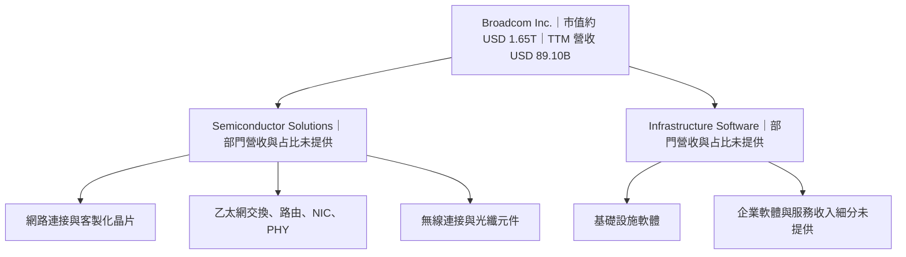
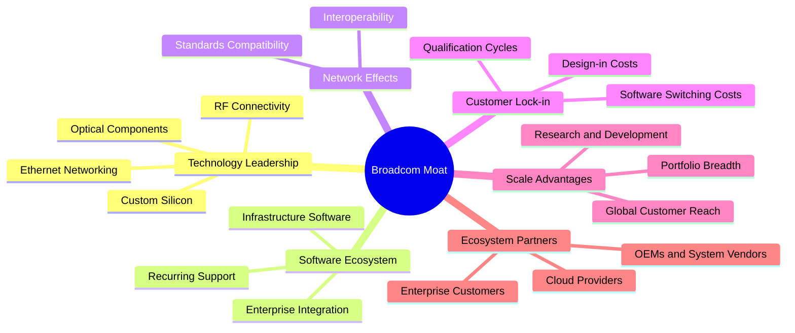
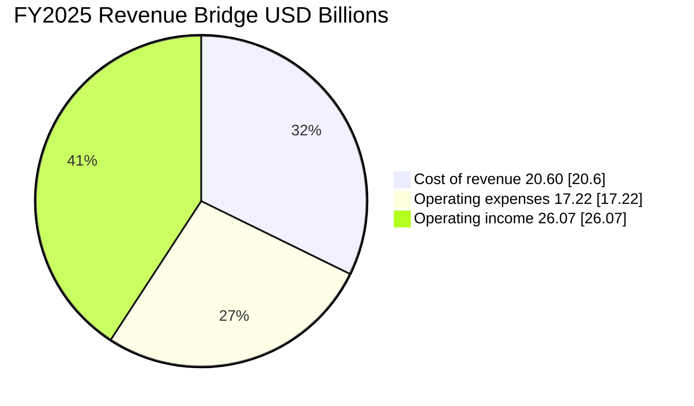
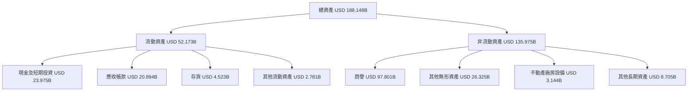
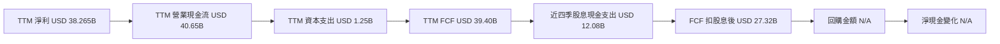
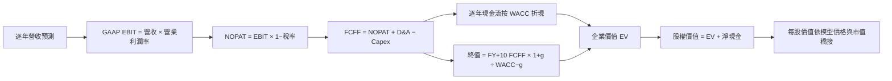
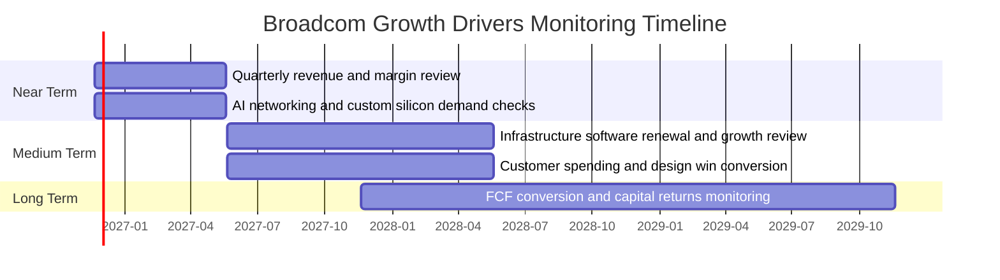
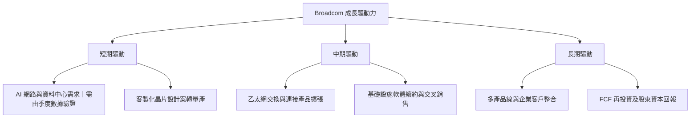
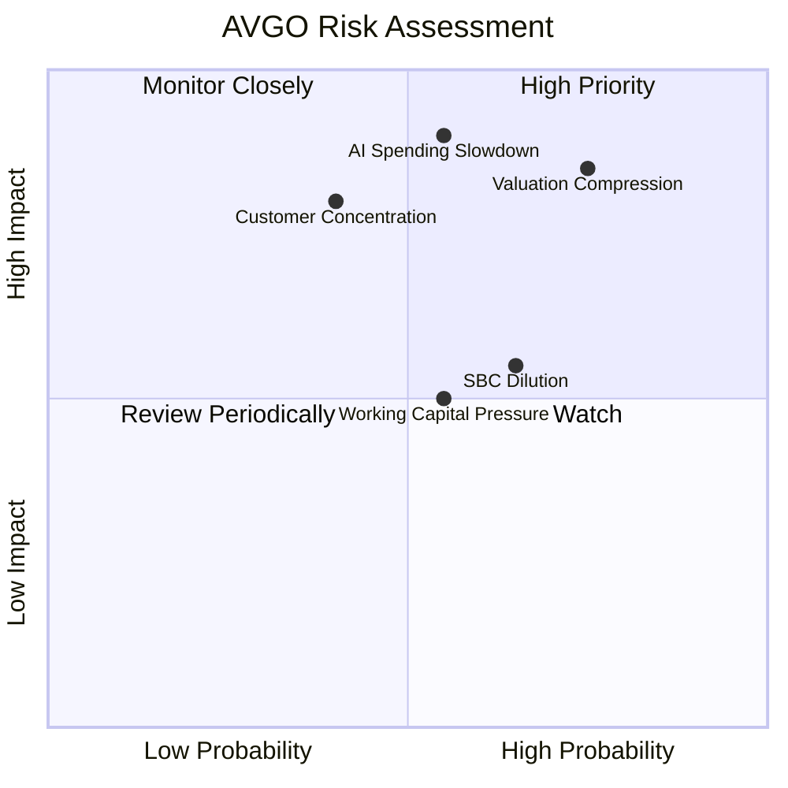
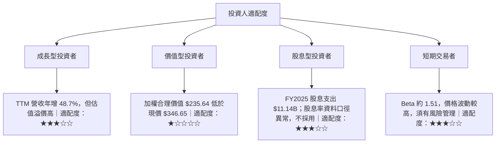

# AVGO 基本面深度分析報告
> **報告日期**：2026-11-20 ｜ **語言**：繁體中文 ｜ **數據來源**：SEC 申報資料 (XBRL)、Yahoo Finance、Finviz、StockAnalysis、Roic.ai ｜ **分析師**：CFA 級機構研究

---

## 目錄

| # | 章節 | 核心結論 |
|---|------|----------|
| 1 | 執行摘要 | 賣出；加權合理價值 $235.64，MOS -47.1% |
| 2 | 公司概覽與商業模式 | 半導體與基礎設施軟體組合具技術、客戶黏著與規模優勢；部門營收拆分未提供 |
| 3 | 損益表深度分析 | TTM 營收 $89.10B、年增 48.7%；最新一季單季年增 85.5% |
| 4 | 資產負債表分析 | 淨負債 $35.44B；流動比率 2.504，營運資金週期較一年前拉長 |
| 5 | 現金流量深度分析 | TTM FCF $39.40B、FCF Yield 2.38%；現金轉換良好但 SBC 顯著 |
| 6 | 獲利能力與資本效率 | ROIC 30.0% 對 WACC 11.49%，正向價值利差 18.51 個百分點 |
| 7 | 相對估值分析 | 相對同業與自身歷史估值偏高；公司歷史 P/E 位於第 70 百分位 |
| 8 | DCF 內在價值評估 | 基準 DCF $211.64；加權合理價值 $235.64，MOS -47.1% |
| 9 | 成長催化劑 | AI 網路與客製化晶片、軟體經常性收入是可能驅動；TAM 數字未提供 |
| 10 | 風險矩陣 | 估值回落、AI 投資循環與客戶集中／競爭是主要風險 |
| 11 | 投資建議 | 現價不具估值保護；以 $212.08 以下作為 MOS ≥10% 的估值參考區 |

---

## 1. 執行摘要

Broadcom 的 TTM 營收為 **$89.10B**，TTM 年增 **48.7%**，最新一季單季營收年增 **85.5%**；TTM FCF 為 **$39.40B**，ROIC **30.0%** 高於 WACC **11.49%**。但截至 **2026-11-19 收盤價 $346.65**，DCF 基準價值為 **$211.64**，估值方法加權合理價值為 **$235.64**，安全邊際 MOS 為 **-47.1%**。依 MOS 評級門檻應為**賣出**；不作質化上調或下調。正向營運與高資本回報尚不足以抵銷現價相對加權價值的溢價。

### 1.0 一頁式投資儀表板（Portfolio Manager 30 秒速讀）

| 項目 | 內容 |
|------|------|
| **投資論點（3 句）** | ① TTM 營收年增 48.7%，最新一季單季年增 85.5%，顯示當期需求仍在擴張。② TTM FCF $39.40B，ROIC 30.0% 對 WACC 11.49%，營運創造的資本報酬高於資本成本。③ 加權合理價值 $235.64 低於 $346.65 收盤價，MOS -47.1%，估值是主要反方證據。 |
| **綜合評分** | **6.8/10**（引用 1.1 評分卡） |
| **財務健康** | 🟡 現金與短期投資 $23.98B、淨負債 $35.44B、流動比率 2.504；流動性尚可但並非淨現金公司。 |
| **ROIC vs WACC** | **30.0% vs 11.49%**；創造價值，利差 +18.51 個百分點。 |
| **FCF 趨勢** | TTM FCF $39.40B；FCF Yield **2.38%**。 |
| **估值** | Forward P/E **17.855635x**（Yahoo Finance 合併資料）｜EV/EBITDA **32.343x**（同來源）｜FCF Yield **2.38%**。估值口徑與 Peer multiples 區塊分開呈列。 |
| **DCF 內在價值（基準）** | **$211.64**；現價相對 DCF 溢價 **63.8%**（現價 ÷ DCF 基準價值 − 1）。 |
| **安全邊際（MOS）** | **-47.1%＝($235.64 − $346.65) ÷ $235.64**；🔴 無安全邊際。 |
| **預期報酬（基準情境 12M）** | **N/A**：DCF 情境價值並非 12 個月價格預測，未提供可直接轉換的 12M 報酬模型。基準 DCF 情境價值相對現價為 -38.9%。 |
| **關鍵風險（前二）** | 估值倍數收縮；AI／客製化晶片需求與客戶資本支出低於市場預期。 |
| **評級 + 信心度** | 🔴 **賣出**｜信心：中。估值輸入與同業倍數可核查，但部門拆分及個別 DCF 中間敏感度資料有限。 |

### 1.1 綜合評分卡（全報告唯一）

| 維度 | 評分（1–10） | 主要依據（引用數字與其來源章節） |
|------|--------------|----------------------------------|
| 成長性 | 9.0 | TTM 營收年增 48.7%，最新一季單季年增 85.5%（第 3 章）；須留意高基期與季度波動。 |
| 獲利能力 | 9.0 | TTM 營業利益率 48.0%、ROIC 30.0%；F-Score 7/8（第 3、6 章）。 |
| 財務健康 | 7.0 | 淨負債 $35.44B、流動比率 2.504、CCC 63 天（第 4 章）；短期流動性良好但負債仍高。 |
| 估值 | 2.0 | MOS -47.1%；P/E、P/S 位於自身五年歷史第 70 百分位（第 7、8 章）。 |
| 護城河 | 8.0 | TTM 營業利益率 48.0%、TTM 毛利率 75.5%，並橫跨半導體與基礎設施軟體（第 2、3 章）；部門營收拆分未提供。 |
| 管理層與資本配置 | 6.0 | FY2025 股息支出 $11.14B、SBC $7.57B；稀釋股數測試未通過（第 3、5、6 章）。 |
| **綜合評分** | **6.8** | 六項算術平均：`(9.0 + 9.0 + 7.0 + 2.0 + 8.0 + 6.0) ÷ 6 = 6.833… ≈ 6.8`。 |

### 1.2 五大投資論點 + 三大核心風險

| 類型 | 項目 | 具體依據 | 信心度 |
|------|------|----------|--------|
| 🟢 **投資論點①** | AI 網路及客製化晶片擴張機會 | 最新一季營收年增 85.5%，TTM 年增 48.7%；若需求持續，規模效應可支撐營業槓桿。公司未提供部門營收拆分，無法精確量化 AI 貢獻。 | 🟢 高 |
| 🟢 **投資論點②** | 高現金流轉換能力 | TTM OCF $40.65B、Capex $1.25B、FCF $39.40B；FCF/TTM 淨利約 103.0%，現金流大致覆蓋會計獲利。 | 🟢 高 |
| 🟢 **投資論點③** | 資本回報高於資本成本 | ROIC 30.0% 對 WACC 11.49%，利差 +18.51 個百分點，表示目前資本運用創造正經濟價值。 | 🟢 高 |
| 🟢 **投資論點④** | 軟體與半導體產品組合 | 公司同時經營 Semiconductor Solutions 與 Infrastructure Software；軟體維護、訂閱與企業級產品可能提高收入可預測性，但分部收入數字未提供。 | 🟡 中 |
| 🟢 **投資論點⑤** | 短期流動性充足 | 現金及短期投資 $23.98B，流動比率 2.504，能提供營運與債務管理緩衝。 | 🟢 高 |
| 🟡 **風險①** | 估值回落 | 加權合理價值 $235.64，低於現價 $346.65；P/E（自身歷史）第 70 百分位，若成長降速可能同時遭遇盈餘預期與倍數下修。 | 🔴 高衝擊 |
| 🔴 **風險②** | AI 需求或客戶投資周期反轉 | 最新一季單季營收年增 85.5%，基期與成長速度提高；若主要客戶縮減 AI 資本支出，營收增速及估值假設都可能下修。客戶集中度數字未提供。 | 🟡 中 |
| 🟡 **風險③** | SBC 與股數稀釋 | FY2025 SBC $7.57B；F-Score 的「稀釋股數未增加」測試未通過。若稀釋持續快於回購，單股價值成長會落後公司整體獲利成長。 | 🟡 中 |

### 1.3 快速統計卡片

| 指標 | 公司實際值（期間） | 同業中位數 | 狀態 |
|------|--------------------|------------|------|
| 營收成長（TTM） | **48.7%** | — | 🟢 |
| 營收成長（最新一季年增） | **85.5%** | 36.5% | 🟢 |
| 毛利率（TTM） | **75.5%** | 53.1% | 🟢 |
| 營業利益率（TTM） | **48.0%** | — | 🟢 |
| ROIC（TTM） | **30.0%** | — | 🟢 |
| Forward P/E | **17.855635x** | 13.3x | 🟡 |
| FCF Yield（TTM） | **2.38%** | — | 🟡 |
| Piotroski F-Score | **7 / 8** | — | 🟢 |

*同業中位數按可取得的 Peer multiples 計算：三家公司單季營收成長中位數 36.5%、毛利率中位數 53.1%、Forward P/E 中位數 13.3x。*

### 1.4 投資結論

```text
╔══════════════════════════════════════════════════════════════════╗
║                    📊 投資結論摘要                               ║
╠══════════════════════════════════════════════════════════════════╣
║  評級：賣出（依規則 20；MOS -47.1%）                             ║
║  價格（2026-11-19 收盤）：$346.65                                ║
║  DCF 內在價值（基準）：$211.64（現價溢價 63.8%）                 ║
║  安全邊際 MOS：-47.1%（＝($235.64−$346.65)÷$235.64）            ║
║  加權合理價值（8.8）：$235.64                                    ║
║  DCF 情境價值：                                                   ║
║    悲觀情境：$87.44（-74.8%）                                    ║
║    基準情境：$211.64（-38.9%）                                   ║
║    樂觀情境：$466.23（+34.5%）                                   ║
║  綜合評分：6.8/10（引用 1.1）                                    ║
║  適合投資人：能承受高波動、並願意等待估值收斂的長線成長型投資人  ║
╚══════════════════════════════════════════════════════════════════╝
```

---

## 2. 公司概覽與商業模式

### 2.1 業務結構與收入來源

Broadcom Inc. 是美國科技公司，員工約 **33,000 人**，業務分為 **Semiconductor Solutions** 與 **Infrastructure Software**。公司總營收 TTM **$89.10B**，市值約 **$1.65T**。財務資料未提供兩個部門的營收金額、占比或軟體訂閱收入，因此不繪製帶有虛構占比的拆分圖。



**收入來源解讀：**公司覆蓋資料中心網路、客製化晶片、連接元件及基礎設施軟體。兩種業務理論上可分別提供硬體需求成長與軟體型經常性收入，但目前無足夠分部數據驗證各自成長、利潤率與現金流貢獻。

### 2.2 市場份額

市場份額數據未提供。可以確認的是，AVGO TTM 營收 $89.10B、最新一季單季年增 85.5%，遠高於所列 MRVL 的 36.5%，但低於 NVDA 的 103.2%；這比較的是公司成長率，不等同市場份額或同一產品市場的市占率。

### 2.3 競爭護城河分析



### 2.4 護城河強度

| 護城河項目 | 強度（強／中／弱） | 證據（引用數字或事實） | 會削弱它的情況 |
|------------|--------------------|------------------------|----------------|
| 技術與產品組合 | 強 | 涵蓋客製化晶片、乙太網路、NIC、PHY、RF 與光纖元件；TTM 營業利益率 48.0%。 | 客戶改採自研晶片、替代方案性能差距縮小或價格競爭加劇。 |
| 軟體生態系統 | 中至強 | Infrastructure Software 是公司主要業務板塊之一；分部收入、留存率與續約率未提供，無法量化黏著程度。 | 企業軟體競品替換成本下降、客戶整併軟體供應商或維護續約率走弱。 |
| 網路效應 | 中 | 產品與資料中心、系統供應商及企業網路相互依賴；缺乏網路效應的直接量化資料。 | 標準開放、互通性增強，使客戶更容易更換供應商。 |
| 客戶鎖定 | 中至強 | 晶片設計導入與企業軟體部署通常需驗證及整合；客戶集中度與續約率數據未提供。 | 客戶採購集中、設計轉換、軟體替換成本降低。 |
| 規模效應 | 強 | TTM 營收 $89.10B，TTM FCF $39.40B；足以支持研發與多產品線投入。 | 收購後整合成本上升、研發效率下降或規模未能轉化為持續毛利。 |
| 生態夥伴 | 中 | 產品連結雲端、OEM、系統與企業客戶；合作夥伴營收貢獻未提供。 | 主要合作夥伴轉向自製、改用競爭對手方案或議價力向客戶集中。 |

1.1「護城河」評分 **8.0/10**，主要依據 TTM 營業利益率 48.0%、毛利率 75.5% 與多產品線平台；因分部收入、續約與客戶集中度未提供，評分不取更高。

---

## 3. 損益表深度分析

### 3.1 年度收入成長趨勢（近 4 年）

以下採用年度損益表列示數字；各來源年度營業利益與毛利存在小幅口徑差異，本文歷史趨勢沿用同一年度表，TTM 與最新季度比率則以 VERIFIED FIGURES 為準。

```text
╔══════════════════════════════════════════════════════════════════╗
║              Broadcom 年度收入趨勢（FY2022-FY2025）              ║
╠══════════════════════════════════════════════════════════════════╣
║  FY2022  $33.20B  ████████████░░░░░░░░░░░░░  基準年             ║
║  FY2023  $35.82B  █████████████░░░░░░░░░░░░  YoY: +7.9%  🟡     ║
║  FY2024  $51.57B  ███████████████████░░░░░░  YoY: +44.0% 🟢     ║
║  FY2025  $63.89B  ████████████████████████░  YoY: +23.9% 🟢     ║
║                                                                  ║
║  FY2022–FY2025 收入 CAGR：((63.89 ÷ 33.20)^(1/3) − 1) = 24.4%  ║
╚══════════════════════════════════════════════════════════════════╝
```

FY2024 收入增加與公司產品／業務組合擴張相符，但資料不足以拆分有機成長與併購貢獻。FY2025 收入增加 23.9%，而 TTM 增速進一步升至 48.7%；未來需確認增長是否來自持續性設計案與軟體收入，而非單一產品週期或基期因素。

### 3.2 季度收入趨勢分析

QoQ 以相鄰季度收入計算；YoY 依 StockAnalysis 季度成長序列，最新一季亦與 VERIFIED FIGURES 的 85.5% 一致。

| 季度 | 營收 | QoQ 成長 | YoY 成長 | 備註 |
|------|------:|---------:|---------:|------|
| 2025 Q4 | $18.015B | 12.9% | 28.18% | 比前季 $15.952B 增加；年度末仍有成長。 |
| 2026 Q1 | $19.311B | 7.2% | 29.47% | QoQ 增幅放緩，但單季年增維持近三成。 |
| 2026 Q2 | $22.187B | 14.9% | 47.87% | 營收增速加快。 |
| 2026 Q3 | $29.591B | 33.4% | **85.50%** | 單季營收跳升；應關注需求可持續性與基期效果。 |

季度營收 QoQ 計算示例：`($29.591B ÷ $22.187B) − 1 = 33.4%`。FY2026 Q3 的單季年增 85.5% 不是 TTM 成長率；TTM 成長仍為 48.7%。

### 3.3 利潤率演變分析

| 利潤率指標 | FY2022 | FY2023 | FY2024 | FY2025 | 趨勢 | 評估 |
|------------|--------:|--------:|--------:|--------:|------|------|
| **毛利率** | 66.5% | 68.9% | 63.0% | 67.8% | FY2024 下滑、FY2025 回升 | 🟡 |
| **營業利益率** | 43.0% | 45.9% | 29.1% | 40.8% | FY2024 下滑、FY2025 回升 | 🟡 |
| **淨利率** | 34.6% | 39.3% | 11.4% | 36.2% | FY2024 明顯偏低，FY2025 回升 | 🟡 |

*歷史比率以年度損益表中的收入及毛利／營業利益／淨利計算。不同資料來源對 FY2025 毛利與營業利益有差異；TTM 營業利益率採權威欄位 48.0%，不以年度表反推替代。*

**利潤率演變深度解析：**FY2024 年度淨利率降至 11.4%，但同期營業利益率也低於 FY2023；年度資料沒有提供足夠一次性損益、稅項與收購會計明細，故不能把變化歸因於單一原因。FY2025 毛利率、營業利益率回升，與收入擴張及產品組合改善相容，但仍須用 SEC 申報中的分部及費用附註追蹤。TTM 毛利率 75.5%、營業利益率 48.0% 顯示近期獲利能力高；與歷年差異較大，需留意期間、會計口徑及資料來源不完全一致。

### 3.4 費用結構分析

FY2025 年度表列收入 $63.89B、毛利 $43.29B、營業利益 $26.07B。由同一表推算的營業成本與營業費用如下；這是收入橋接，不代表完整損益表費用分類。



```text
╔══════════════════════════════════════════════════════════════════╗
║                FY2025 收入至營業利益橋接                         ║
╠══════════════════════════════════════════════════════════════════╣
║  收入                         $63.89B                            ║
║  − 營業成本                   $20.60B  （收入−毛利）              ║
║  = 毛利                       $43.29B                            ║
║  − 營業費用                   $17.22B  （毛利−營業利益）          ║
║  = 營業利益                   $26.07B                            ║
╚══════════════════════════════════════════════════════════════════╝
```

年度表未提供全部費用科目拆分；因此不把研發、併購攤銷、銷售管理或利息費用自行拼成完整費用占比。

### 3.5 季度 EPS 趨勢與盈餘品質（Quality of Earnings）

| 季度 | EPS 實際值 | EPS 年增 | 預估值／超預期狀態 |
|------|----------:|---------:|-------------------|
| 2025 Q4 | $1.80 | 94.51% | EPS 預估值為 N/A，不能判定超預期或不及預期。 |
| 2026 Q1 | $1.55 | 31.58% | EPS 預估值為 N/A，不能判定超預期或不及預期。 |
| 2026 Q2 | $1.96 | 85.44% | EPS 預估值為 N/A，不能判定超預期或不及預期。 |
| 2026 Q3 | $2.75 | 215.29% | EPS 預估值為 N/A，不能判定超預期或不及預期。 |

*EPS 實際值與 EPS 年增採 StockAnalysis 季度資料；另一季度損益表來源列示的金額／EPS 略有不同。Earnings History 中四季 EPS Estimate 為 NaN，故不將缺失值錯寫成 beats 或 misses。*

| 盈餘品質項目 | 數值／佔比 | 評估 |
|--------------|-----------|------|
| 股權薪酬 SBC / 營收 | 近四季 SBC $8.48B ÷ TTM 營收 $89.10B = **9.5%** | 🟡 SBC 對股東的經濟成本顯著，且稀釋股數測試未通過。 |
| SBC / 營業現金流 | $8.48B ÷ $40.65B = **20.9%** | 🟡 OCF 對 SBC 的覆蓋充足，但 SBC 規模不可忽略。 |
| FCF / 淨利（現金轉換率） | $39.40B ÷ TTM 淨利 $38.265B = **103.0%** | 🟢 FCF 略高於淨利，現金轉換良好。 |
| 一次性／非經常性損益 | 逐項金額 N/A | 年度淨利 FY2024 為 $5.89B、FY2025 為 $23.13B，變動大；缺少稅項及非經常性項目附註，不能確認一次性因素。 |
| 有效稅率異常 | DCF 預設稅率 21.0%；實際 TTM 有效稅率 N/A | 無實際稅費與稅前淨利對照，不能判定是否有稅務利益。 |
| 資本化支出 vs 費用化 | TTM Capex $1.25B；研發 FY2025 $10.98B | Capex 低但不等同資本化總額；研發費用化與資本化明細 N/A。 |

**盈餘品質結論：**FCF 對淨利轉換率約 103.0%，營運現金流支持度良好；另一方面，SBC 約占 TTM 營收 9.5%、OCF 20.9%，使「現金流強」不能完全等同「無稀釋的股東報酬」。GAAP 淨利是否因一次性項目而偏高或偏低，需查核 SEC 申報的稅項、併購攤銷及其他非經常項目；現有數據不足以作肯定判斷。

---

## 4. 資產負債表分析

### 4.1 資產結構分解

截至 2026-08-02，總資產 $188.148B；流動資產 $52.173B，非流動資產以差額計為 $135.975B。以下細項取自 StockAnalysis 資產負債表，圖中總額與組成使用同一期資料。



非流動資產中商譽及無形資產金額較大，反映企業過往併購及取得無形資產的影響。若業務預期、客戶留存或收購資產現金流低於原假設，可能造成減值風險。

### 4.2 流動性與營運資金分析

| 流動性指標 | 最新資料 | 評估 |
|------------|---------|------|
| 流動比率 | 2.504 | 🟢 流動資產高於流動負債，短期支付緩衝充足。 |
| 速動比率 | 2.153 | 🟢 扣除存貨後仍有流動性覆蓋。 |
| 現金及短期投資 | $23.98B | 🟢 可支援營運及近期資金需求，但低於總債務。 |
| 淨負債 | $35.44B | 🟡 公司為淨負債結構，利息與到期安排仍需監控。 |

| 指標 | 最新 TTM | 一年前 TTM | 變化 | 解讀 |
|------|----------|------------|------|------|
| DSO 應收帳款天數 | 56 天 | 40 天 | +16 天 | 🟡 收款天數延長，可能與收入快速成長、客戶付款條件或期末應收增加有關；需追蹤應收增速是否持續高於營收。 |
| DIO 存貨天數 | 59 天 | 40 天 | +19 天 | 🟡 存貨占用資金增加；可能反映供應備貨或需求預測偏差，應觀察後續去化。 |
| DPO 應付帳款天數 | 52 天 | 26 天 | +26 天 | 🟢 對供應商付款期拉長，部分抵銷應收及存貨增加；僅憑天數不能確認議價力改善。 |
| CCC 現金轉換週期 | 63 天 | 53 天 | +10 天 | 🟡 現金轉換週期拉長，營運資金吸收增加。 |

以上天數採品質指標計算值，不自行重算。營收快速上升可令應收與庫存餘額同步上升，但若 DSO、DIO 長期快於營收增幅，現金流品質可能轉弱。

### 4.3 債務結構分析

```text
╔══════════════════════════════════════════════════════════════════╗
║                   Broadcom 債務健康診斷                          ║
╠══════════════════════════════════════════════════════════════════╣
║  總債務：              $59.42B   🟡                              ║
║  現金及短期投資：      $23.98B   🟢                              ║
║  淨負債：              $35.44B   🟡                              ║
║                                                                  ║
║  TTM EBITDA：          N/A（VERIFIED FIGURES 未列金額）           ║
║  Debt / EBITDA：       N/A（缺少同口徑 EBITDA 金額）             ║
║  利息保障倍數：        N/A（利息費用金額未提供）                 ║
║  流動比率：            2.504     🟢                              ║
║  速動比率：            2.153     🟢                              ║
╚══════════════════════════════════════════════════════════════════╝
```

總債務 $59.42B 高於現金與短期投資 $23.98B，故淨負債為 $35.44B。資料未提供債務到期梯隊、固定／浮動利率拆分及利息保障倍數所需的實際利息支出，不能推斷償債風險已消失。

### 4.4 股東權益趨勢

```text
╔══════════════════════════════════════════════════════════════════╗
║                Broadcom 年度股東權益變化                         ║
╠══════════════════════════════════════════════════════════════════╣
║  FY2022  $22.71B  ██████░░░░░░░░░░░░░░░░░░                     ║
║  FY2023  $23.99B  ███████░░░░░░░░░░░░░░░░                     ║
║  FY2024  $67.68B  ████████████████████░░░░                     ║
║  FY2025  $81.29B  ████████████████████████                     ║
╚══════════════════════════════════════════════════════════════════╝
```

股東權益由 FY2023 的 $23.99B 升至 FY2024 的 $67.68B，變化幅度大；總資產同期亦由 $72.86B 升至 $165.65B。這類跨期跳升與收購、商譽及無形資產等項目可能相關，但現有摘要資料不足以將權益變動拆解至單一原因。

---

## 5. 現金流量深度分析

### 5.1 現金流量瀑布圖



近四季股息支出為季度現金流表列示值加總：`$3.10B + $3.09B + $3.09B + $2.80B = $12.08B`。此處「FCF 扣股息後」只作現金分配前的簡化餘額，不代表淨現金實際變化；回購、併購、償債及其他資金流用途資料未提供。

### 5.2 FCF 轉換率趨勢

| 財年 | FCF | 淨利 | FCF／淨利 | 趨勢說明 |
|------|----:|----:|----------:|----------|
| FY2022 | $16.31B | $11.49B | 141.9% | FCF 高於淨利。 |
| FY2023 | $17.63B | $14.08B | 125.2% | 現金轉換仍高於 100%。 |
| FY2024 | $19.41B | $5.89B | 329.5% | 淨利偏低使比率大幅上升，不宜視為常態轉換率。 |
| FY2025 | $26.91B | $23.13B | 116.3% | 現金流覆蓋獲利，轉換率較 FY2024 正常化。 |
| TTM | $39.40B | $38.265B | 103.0% | FCF 略高於淨利；使用 TTM FCF 定義為 OCF − Capex。 |

### 5.3 自由現金流趨勢

```text
╔══════════════════════════════════════════════════════════════════╗
║                 Broadcom 自由現金流趨勢                          ║
╠══════════════════════════════════════════════════════════════════╣
║  FY2022  $16.31B  ████████████░░░░░░░░░░░░                      ║
║  FY2023  $17.63B  █████████████░░░░░░░░░░░                     ║
║  FY2024  $19.41B  ██████████████░░░░░░░░░░                     ║
║  FY2025  $26.91B  ████████████████████░░░░                     ║
║  TTM     $39.40B  ████████████████████████████                  ║
║                                                                  ║
║  TTM FCF Yield：2.38%（程式計算，分母為市值）                    ║
╚══════════════════════════════════════════════════════════════════╝
```

TTM FCF 顯著高於 FY2025，主要要與最新季度營收及現金流增長一起檢視；單純外推 TTM 增幅可能高估持續性。TTM Capex 為 $1.25B，僅占 OCF 的小部分，令 FCF 轉換比率高，但不表示公司不需要持續研發或未來資本投入。

### 5.4 資本配置評估

| 資本配置項目 | 已知數據 | 評估 |
|--------------|---------|------|
| 股息 | FY2025 現金股息支出 $11.14B；近四季約 $12.08B | 具規模的股東現金回饋；股息是否由可持續 FCF 完全覆蓋需持續觀察。 |
| 資本支出 | FY2025 $0.623B；TTM $1.25B | 對目前營收規模偏低，但須連同外包製造及研發投入理解。 |
| 股權薪酬 | FY2025 $7.57B；近四季約 $8.48B | 重要的員工薪酬工具，同時帶來潛在稀釋成本。 |
| 回購 | N/A（金額未提供） | 不評估回購對每股價值的淨效果。 |
| 併購與投資 | N/A（期間金額未提供） | 無法量化資本投入及收購回報。 |
| 留存現金 | TTM FCF 扣除近四季股息約 $27.32B | 尚未扣除回購、併購及償債等其他用途，不能等同實際留存現金。 |

由於資本配置項目並非完整互斥分類，且回購、併購金額缺漏，不繪製可能造成誤導的配置圓餅圖。

---

## 6. 獲利能力與資本效率

### 6.1 ROE / ROA / ROIC 趨勢

| 指標 | 最新 TTM | 歷史數據 | 評估 |
|------|---------:|----------|------|
| ROE | 38.4%（品質指標） | 另一合併資料來源列 44.2%；歷史逐年數據 N/A | 🟢 回報高；來源間口徑有差異，主分析採品質指標 38.4%。 |
| ROA | 15.4% | 歷史逐年數據 N/A | 🟢 資產獲利能力正向；收購形成的商譽與無形資產會影響分母。 |
| ROIC | 30.0% | 歷史一致口徑數據 N/A | 🟢 明顯高於 11.49% WACC。 |
| 行業均值對比 | 未提供 | N/A | 不填入未有來源的行業均值。 |

### 6.2 ROIC vs WACC 分析（核心價值創造判斷）

ROIC 30.0% 高於 WACC 11.49%，兩者差 **18.51 個百分點**，表示以提供的 TTM ROIC 定義計算，公司目前投入資本回報超過資本成本。

```text
╔══════════════════════════════════════════════════════════════════╗
║                ROIC vs WACC 深度分析                             ║
╠══════════════════════════════════════════════════════════════════╣
║  WACC 估算：                                                     ║
║  ├── 無風險利率（10Y美債）：  5.05%                              ║
║  ├── 市場風險溢酬（ERP）：    5.00%（假設值，成本資本資料採用值） ║
║  ├── 原始 Beta：              1.51                                ║
║  ├── 調整後 Beta：            1.34 = ⅔×1.51 + ⅓×1.00              ║
║  ├── 股權成本 Ke：            5.05% + 1.34×5.00% = 11.75%        ║
║  ├── 稅前債務成本：           5.40%                               ║
║  ├── 稅後債務成本：           5.40%×(1−21%) = 4.266%              ║
║  ├── 資本權重：               股權 96.5%，債務 3.5%               ║
║  └── WACC：                   96.5%×11.75% + 3.5%×4.266%          ║
║                               = 11.487% ≈ 11.49%                  ║
║                                                                  ║
║  ROIC（TTM，採用程式計算值）：30.0%                              ║
║  經濟價值利差 = ROIC − WACC = 30.0% − 11.49% = +18.51pp          ║
║                                                                  ║
║  ROIC  30.0%  ▓▓▓▓▓▓▓▓▓▓▓▓▓▓▓▓▓▓▓▓▓▓▓▓▓▓▓▓  🟢                 ║
║  WACC  11.49% ▓▓▓▓▓▓▓▓▓▓▓░░░░░░░░░░░░░░░░░  ──                 ║
║  EVA   +18.51pp  ████████████████████████░░░░ 🟢                ║
╚══════════════════════════════════════════════════════════════════╝
```

**WACC 逐步演算：**

1. **Ke（CAPM）**  
   `Ke = Rf + β調整後 × ERP = 5.05% + 1.34 × 5.00% = 11.75%`

2. **稅前 Kd**  
   成本資本資料直接給定稅前債務成本 5.40%。利息費用與各期計息債務明細未提供，不能另行反推金額。

3. **稅後 Kd**  
   `5.40% × (1 − 21.0%) = 5.40% × 79.0% = 4.266%`

4. **資本權重**  
   採成本資本資料所列市場權重：股權 96.5%、債務 3.5%；`96.5% + 3.5% = 100.0%`。同一區塊將股權權重定義為市值基礎，債務以債務基礎計算。具體未四捨五入市值輸入未提供，故不以摘要市值另行替代權重。

5. **WACC**  
   `WACC = 96.5% × 11.75% + 3.5% × 4.266%`  
   `= 11.33875% + 0.14931% = 11.48806% ≈ 11.49%`

WACC 採用 **11.49%**，與第 8 章 DCF 相同。這是成本資本資料計算值；如未來無風險利率、ERP、Beta 或負債結構改變，折現率應更新。

### 6.3 杜邦三因素分解

| 因素 | 數值（TTM） | 解讀 |
|------|-------------|------|
| 淨利率 | 42.9% | 高淨利率對 ROE 有主要正面貢獻。 |
| 資產週轉率 | 0.47 | 每單位資產產生的營收相對較低，可能受商譽及無形資產規模影響。 |
| 權益乘數 | 1.89 | 存在槓桿，但 ROE 並非單靠高權益乘數支撐。 |
| **ROE** | **38.4%** | `42.9% × 0.47 × 1.89 ≈ 38.2%`；QUALITY FIGURES 指定值為 38.4%，差異為列示因四捨五入造成。 |

**主要驅動因素：**高淨利率是 ROE 的核心來源，權益乘數 1.89 有放大作用但不屬極端槓桿。ROE 採品質指標原值 38.4%，不以四捨五入後因子乘積替代。

### 6.4 財務體質：Piotroski F-Score

Piotroski F-Score 為 **7 / 8**。原測試包含九項，但一項因輸入缺漏無法判定，因此可判定分母為 8。

| 測試 | 結果 | 解讀 |
|------|------|------|
| ROA > 0 | ✅ 通過 | 資產回報為正。 |
| 營業現金流 > 0 | ✅ 通過 | TTM OCF 為正，金額 $40.65B。 |
| ROA 高於一年前 | ✅ 通過 | 盈利效率改善。 |
| 營業現金流 > 淨利 | ✅ 通過 | 現金流高於淨利，應計品質測試通過。 |
| 長期負債 ÷ 總資產低於一年前 | — 無法判定 | 缺少計算所需輸入，不推算。 |
| 流動比率高於一年前 | ✅ 通過 | 流動性相較一年前改善。 |
| 稀釋股數未增加 | ❌ 未通過 | 股數稀釋代表每股獲利可能落後於公司總獲利成長。 |
| 毛利率高於一年前 | ✅ 通過 | 毛利率方向改善。 |
| 資產週轉率高於一年前 | ✅ 通過 | 資產使用效率改善。 |

未通過的是稀釋股數未增加測試，須與 SBC 約占 TTM 營收 9.5% 一併看待；高公司獲利不必然完全轉化成同幅度的每股價值成長。

---

## 7. 相對估值分析

### 7.1 同業估值比較表格

同業倍數一律採 Yahoo Finance 的 Peer multiples。AVGO 自身當前倍數採 Peer 區塊口徑；不同合併資料來源另有其他倍數，故不混用。

| 估值指標 | **AVGO** | **NVDA** | **MRVL** | **QCOM** | AVGO 評估 |
|----------|---------:|--------:|--------:|--------:|-----------|
| **Trailing P/E** | 44.2x | 15.7x | 45.5x | 12.8x | 🔴 高於 NVDA、QCOM，接近 MRVL；同業盈利結構不同。 |
| **Forward P/E** | 17.9x* | 8.8x | 18.8x | 13.3x | 🟡 略低於 MRVL，高於 NVDA、QCOM；成長品質及 EPS 基期不可忽略。 |
| **P/S Ratio** | 19.0x | 9.7x | 13.2x | 4.0x | 🔴 估值明顯高於所列三家。 |
| **EV / EBITDA** | 39.8x | 14.2x | 43.1x | 17.1x | 🔴 高於 NVDA、QCOM，低於 MRVL；採同一 Peer 區塊口徑。 |
| **最新一季營收 YoY** | 85.5% | 103.2% | 36.5% | -8.4% | 🟢 成長高於 MRVL、QCOM，低於 NVDA。 |
| **毛利率 TTM** | 75.5% | 74.9% | 52.2% | 53.1% | 🟢 在列示同業中居高。 |

\*AVGO Forward P/E 17.9x 採 Yahoo Finance 合併估值資料；Peer multiples 區塊未列 AVGO 自身倍數。同業 Forward P/E 中位數：`median(8.8x, 18.8x, 13.3x) = 13.3x`。

### 7.2 歷史估值區間分析

```text
╔══════════════════════════════════════════════════════════════════╗
║                  AVGO 五年估值區間                               ║
╠══════════════════════════════════════════════════════════════════╣
║  P/E：      1.8x ───────── 中位 5.5x ─────────── 77.5x          ║
║                                      ▲ 現值 44.2x                 ║
║  現值百分位：70%（位於自身歷史偏高區域）                         ║
║                                                                  ║
║  P/S：      0.6x ───────── 中位 1.5x ─────────── 28.1x          ║
║                                      ▲ 現值 19.0x                 ║
║  現值百分位：70%                                                  ║
║                                                                  ║
║  EV/EBITDA：0.5x ───────── 中位 5.6x ─────────── 70.7x          ║
║                              ▲ 現值 39.8x                         ║
║  現值百分位：55%                                                  ║
╚══════════════════════════════════════════════════════════════════╝
```

歷史倍數跨度很大，併購與獲利波動可能令早期 P/E、EV/EBITDA 可比性降低。儘管如此，P/E 與 P/S 均在五年歷史第 70 百分位，顯示市場對成長及獲利的定價已偏高。

### 7.3 情境價值（Bear / Base / Bull，照抄 DCF MODEL 的 Scenarios）

| 情境 | 第 1 年營收成長 | 期末營業利潤率 | WACC | 每股價值 | 相對現價 | 機率 | 會發生的條件 |
|------|----------------:|----------------:|-----:|---------:|---------:|-----:|--------------|
| 🔴 悲觀 | 15.0% | 36.4% | 12.49% | $87.44 | -74.8% | 25% | AI／網路需求減速、競爭或產品組合不利，長期利潤率低於基準。 |
| 🟡 基準 | 30.0% | 42.8% | 11.49% | $211.64 | -38.9% | 50% | 營收成長由高位逐步減速，營業利潤率按模型收斂。 |
| 🟢 樂觀 | 45.0% | 47.1% | 10.49% | $466.23 | +34.5% | 25% | 高成長延續且利潤率維持高位，資本成本較基準低。 |

三情境價值與機率均來自 DCF 模型輸出；它們不是公司管理層財測，也不是分析師保證的價格結果。

### 7.4 相對估值隱含價格區間

```text
╔══════════════════════════════════════════════════════════════════╗
║               相對估值回推每股價值與現價                         ║
╠══════════════════════════════════════════════════════════════════╣
║  $135.13 ───── $211.64 ───── $258.20 ─────────── $346.65        ║
║  EV/EBITDA       DCF基準       Forward P/E          現價          ║
║                                                                  ║
║  分析師共識目標價：$526.47（47 位分析師均值；參考值）             ║
╚══════════════════════════════════════════════════════════════════╝
```

| 方法 | 每股價值 | 依據 |
|------|---------:|------|
| 同業 Forward P/E | $258.20 | 同業中位數 **13.3x** × AVGO Forward EPS **$19.41**。 |
| 同業 EV/EBITDA | $135.13 | 同業中位數 **15.7x**（NVDA、QCOM）× TTM EBITDA，再加淨現金／扣除淨負債。 |
| DCF 基準 | $211.64 | 10 年 FCFF、WACC 11.49%、永續成長 3.0%。 |
| 分析師共識 | $526.47 | 47 位分析師平均目標價，與基本面估值差距大，不視為同等可靠的內在價值方法。 |

---

## 8. DCF 內在價值評估（Discounted Cash Flow）

### 8.0 估值推理鏈（Thinking Logic）

**Step 1 — 價值來源與主導變數**

本模型的估值命題是：AVGO 現有半導體業務與基礎設施軟體所產生的現金流，決定企業價值；高速成長的網路與客製化晶片需求可能延長高增長期間，但分部營收占比未提供，不能把任一分部假設成特定收入比例。模型中最主導估值的變數為營收成長及終值現金流：基準終值現值占企業價值 52.8%，因此長期增長、利潤率與 WACC 對價值有明顯影響。

**Step 2 — 模型選擇**

| 決策點 | 本報告採用 | 理由（含數字） | 曾考慮但否決 | 否決理由 |
|--------|-----------|----------------|--------------|----------|
| 現金流定義 | FCFF | 使用 GAAP EBIT、NOPAT，折現率為 WACC，結果先得 EV 再橋接至股權價值。 | FCFE | 本模型已提供 FCFF 與 WACC，不另建 FCFE 模型。 |
| 預測期 N | 10 年 | DCF MODEL 指定 10 年；營收成長由第 1 年 30.0% 線性降至第 10 年 3.0%。 | 5 年 | 無法使用另一預測期替代既定模型。 |
| 終值方法 | Gordon Growth | DCF MODEL 以永續成長率 3.0% 計算終值。 | 退出倍數主估 | DCF MODEL 未提供退出倍數法終值，不自行新增模型。 |
| EBIT 基礎 | GAAP | 模型明列 GAAP EBIT；SBC 已含在費用中。 | 非 GAAP EBIT | 需再扣 SBC 或調整股數，與既定模型不符。 |

**Step 3 — 關鍵假設推導鏈**

- **營收成長**：錨點＝TTM 年增 48.7%；調整＝DCF 將第 1 年成長限制在 30.0%，再線性下降至第 10 年 3.0%，反映高基期與成熟化；**採用模型指定路徑：30.0%、27.0%、24.0%、21.0%、18.0%、15.0%、12.0%、9.0%、6.0%、3.0%**；曾考慮近 TTM 48.7% 延續十年，但否決，因模型已將其封頂且長期外推可能過度樂觀。
- **第 10 年營業利潤率**：錨點＝TTM GAAP 營業利益率 48.0%；調整＝模型假設長期利潤率收斂；**採用 42.8%**，從第 1 年 48.0% 線性下降；曾考慮長期維持 48.0%，但否決，因模型假設成熟期回歸近五年中位水平。
- **永續成長率 g**：錨點＝模型提供值 3.0%；調整＝以成熟期長期名目成長假設控制終值；**採用 3.0%**；曾考慮 4.0%，但否決，因終值對 g 敏感且 3.0% 更接近長期可持續假設；必須低於 WACC。
- **預測期 N**：錨點＝模型指定 10 年；調整＝依模型將高成長逐年減速至 3.0%；**採用 10 年**；曾考慮更短期間，但否決，因不能替代既定 DCF 程式模型。
- **Capex／營收**：錨點＝TTM Capex $1.25B ÷ TTM 營收 $89.10B，模型引用約 1.4%；調整＝隨收入成熟逐步降至 D&A 的 1.1 倍；**採用第 1 年 1.4% 線性降至第 10 年 0.8%**；曾考慮永久採 1.4%，但否決，因模型有成熟期資本支出收斂假設。
- **EBIT 基礎及 SBC**：錨點＝使用 GAAP EBIT；TTM SBC 約 $8.48B；調整＝SBC 已在 GAAP 費用中反映；**採用組合 (A)：GAAP EBIT、不另扣 SBC、股數不逐年稀釋**；曾考慮再扣 SBC 或額外稀釋股數，但否決，避免同一成本重複計算。
- **WACC**：錨點＝成本資本資料的 WACC 11.49%；調整＝無；**採用 11.49%**；曾考慮較低折現率，但否決，因不得覆寫程式計算的折現率。
- **有效稅率**：錨點＝DCF 預設 21.0%；採用 21.0%。實際 TTM 有效稅率未提供，不把預設值宣稱為實際稅率。
- **D&A／營收**：錨點＝DCF 模型輸入 0.7%；採用 0.7%。
- **ΔWC**：錨點／採用值＝模型未納入營運資金變動；FCFF 不含 ΔWC 項，這是模型限制，不代表實際營運資金無變化。

**Step 4 — 最脆弱一環**

最脆弱的是高增長期轉換為十年 FCFF 與終值的假設；若營收成長與利潤率低於基準，價值可能向悲觀情境 **$87.44** 移動，而非維持 $211.64 基準。

**Step 5 — 計算路徑圖**



### 8.1 模型假設總表（Model Inputs）

| 假設項目 | 採用值 | 依據／來源 | 敏感度 |
|----------|--------|-------------|--------|
| 預測期長度 N | 10 年 | DCF MODEL 指定；逐年營收成長由 30.0% 降至 3.0%。 | 🟡 中 |
| 營收成長 | 第 1 年 30.0% 線性降至第 10 年 3.0% | TTM 年增 48.7%，模型將近端成長限制於 30.0%，再逐年淡化。 | 🔴 高 |
| 營業利潤率 | 第 1 年 48.0% → 第 10 年 42.8% | 以 TTM 48.0% 為起點，逐步收斂至過去五個財年中位數假設。 | 🔴 高 |
| 有效稅率 | 21.0% | DCF MODEL 預設值；實際 TTM 有效稅率未提供。 | 🟢 低 |
| Capex／營收 | 第 1 年 1.4% → 第 10 年 0.8% | 模型輸入；TTM 資料為 Capex $1.25B、營收 $89.10B。 | 🟡 中 |
| D&A／營收 | 0.7% | DCF MODEL 引用 TTM 比率並固定。 | 🟢 低 |
| 營運資金變動／營收增額 | 未建模 | DCF MODEL 明示 Working capital is not modelled。 | 🟢 低 |
| EBIT 基礎 | GAAP EBIT | DCF MODEL 明示 GAAP。 | 🟡 中 |
| SBC 處理 | 組合 (A)：GAAP EBIT、不再扣 SBC | GAAP EBIT 已含 SBC 費用；依模型不再扣 SBC。 | 🟡 中 |
| 年稀釋率 | 0%（模型固定股數） | DCF MODEL 明示 share count not diluted further；與組合 (A) 配合。 | 🟡 中 |
| 永續成長率 g | 3.0% | DCF MODEL 指定，且低於 WACC 11.49%。 | 🔴 高 |
| 終值方法 | Gordon Growth | DCF MODEL 提供 Gordon Growth 終值；退出倍數資料未提供。 | 🔴 高 |
| WACC | 11.49% | 成本資本資料提供；推導見 6.2、8.2。 | 🔴 高 |

**FCFF 定義：**`FCFF = NOPAT + D&A − Capex`。依 DCF MODEL，**不建模 ΔWC**。本模型採用 **(A) GAAP EBIT + 固定股數**，因此 SBC 影響已計入一次：不另減 SBC，且股數不逐年稀釋。

### 8.2 折現率推導（WACC）

```text
╔══════════════════════════════════════════════════════════════════╗
║                    WACC 推導（折現率）                           ║
╠══════════════════════════════════════════════════════════════════╣
║  股權成本 Ke（CAPM）：                                           ║
║  ├── 無風險利率 Rf（10Y 美債）：      5.05%                      ║
║  ├── 市場風險溢酬 ERP：               5.00%                      ║
║  ├── 原始 Beta（Yahoo）：              1.51                       ║
║  ├── 調整後 Beta：                     1.34                       ║
║  ├── 規模／國別溢酬：                  0.00%（資料未另列）        ║
║  └── Ke = 5.05% + 1.34×5.00% = 11.75%                            ║
║                                                                  ║
║  債務成本 Kd：                                                   ║
║  ├── 稅前 Kd：                         5.40%                      ║
║  ├── 預設稅率：                        21.0%                      ║
║  └── 稅後 Kd = 5.40%×(1−21.0%) = 4.266%                          ║
║                                                                  ║
║  資本權重（成本資本資料列示）：                                   ║
║  ├── 股權權重 E：                      96.5%                      ║
║  ├── 債務權重 D：                       3.5%                      ║
║  └── WACC = 96.5%×11.75% + 3.5%×4.266% = 11.49%                 ║
╚══════════════════════════════════════════════════════════════════╝
```

Beta 調整方式：`⅔ × 原始 Beta 1.51 + ⅓ × 1.00 = 1.34`。10 年期美債殖利率數值為 5.05%，成本資本資料未提供其具體觀察日期；ERP 5.00% 為假設值。未另加規模或國別溢酬，因資料未列該項。成本資本資料列出的 WACC 為 11.49%，本報告不另行替換。

### 8.3 逐年自由現金流預測（基準情境）

金額單位為 **USD billions**；折現因子依 DCF MODEL 原值列示。模型未建模營運資金，因此不列 ΔWC；GAAP EBIT 已計入 SBC，不列 SBC 扣除項。

| 年度 | FY+1 | FY+2 | FY+3 | FY+4 | FY+5 | FY+6 | FY+7 | FY+8 | FY+9 | FY+10 |
|------|------:|------:|------:|------:|------:|------:|------:|------:|------:|-------:|
| 營收 | 115.84 | 147.11 | 182.42 | 220.72 | 260.46 | 299.52 | 335.47 | 365.66 | 387.60 | 399.23 |
| 營收 YoY | 30.0% | 27.0% | 24.0% | 21.0% | 18.0% | 15.0% | 12.0% | 9.0% | 6.0% | 3.0% |
| 營業利潤率 | 48.0% | 47.5% | 46.9% | 46.3% | 45.7% | 45.2% | 44.6% | 44.0% | 43.4% | 42.8% |
| 營業利益 EBIT（GAAP） | 55.66 | 69.83 | 85.54 | 102.23 | 119.12 | 135.26 | 149.54 | 160.89 | 168.30 | 171.04 |
| − 稅 | (11.69) | (14.67) | (17.96) | (21.47) | (25.02) | (28.40) | (31.40) | (33.79) | (35.34) | (35.92) |
| = NOPAT | 43.97 | 55.17 | 67.58 | 80.76 | 94.10 | 106.85 | 118.14 | 127.10 | 132.96 | 135.12 |
| + D&A | 0.82 | 1.04 | 1.29 | 1.57 | 1.85 | 2.12 | 2.38 | 2.59 | 2.75 | 2.83 |
| − Capex | (1.62) | (1.96) | (2.31) | (2.64) | (2.93) | (3.17) | (3.31) | (3.36) | (3.29) | (3.11) |
| **= FCFF** | **43.17** | **54.25** | **66.56** | **79.69** | **93.02** | **105.81** | **117.21** | **126.34** | **132.41** | **134.84** |
| 折現因子 @11.49% | 0.897 | 0.805 | 0.722 | 0.647 | 0.581 | 0.521 | 0.467 | 0.419 | 0.376 | 0.337 |
| **FCFF 現值 PV** | **38.72** | **43.65** | **48.04** | **51.58** | **54.01** | **55.11** | **54.75** | **52.94** | **49.77** | **45.46** |

**預測期 FCF 現值合計：**

`$38.72 + $43.65 + $48.04 + $51.58 + $54.01 + $55.11 + $54.75 + $52.94 + $49.77 + $45.46 = $494.03B`

DCF MODEL 列示總和為 **$494.02B**；差異 $0.01B，來自逐年數字四捨五入，低於 1%。後續估值使用 DCF MODEL 原值 **$494.02B**。

**逐步演算（FY+1，依模型輸出值）：**

1. **營收**：`$89.10B × (1 + 30.0%) = $115.83B`，模型原表列示 **$115.84B**（底層未四捨五入輸入造成 $0.01B 差異）。
2. **EBIT**：`$115.84B × 48.0% = $55.60B`；DCF MODEL 原表列示 **$55.66B**，表示模型計算採用未四捨五入的利潤率／輸入值，本文依規則保留原表數字。
3. **稅**：`$55.66B × 21.0% = $11.6886B ≈ $11.69B`。
4. **NOPAT**：`$55.66B − $11.69B = $43.97B`。
5. **+ D&A**：模型列示 $0.82B；按 0.7% 示意，`$115.84B × 0.7% = $0.81B`，差異源於模型未四捨五入輸入，沿用原表 $0.82B。
6. **− Capex**：模型列示 $1.62B；按 1.4% 示意，`$115.84B × 1.4% = $1.62B`。
7. **− ΔWC**：模型未建模，無扣除項。
8. **FCFF**：按模型原表使用 `NOPAT + D&A − Capex = $43.97B + $0.82B − $1.62B = $43.17B`。
9. **折現因子與 PV**：`1 ÷ (1 + 11.49%)^1 = 0.897`；`$43.17B × 0.897 = $38.72B`。

*逐年模型原值因顯示位數四捨五入，不應以展示至兩位小數的營收與利潤率重新建模取代程式原值。*

**合理性自檢：**

- 預測 FCFF：FY+1 $43.17B 至 FY+10 $134.84B；以兩端值計年均複合成長約 **12.1%**。歷史 FY2022–FY2025 FCF CAGR：`(26.91 ÷ 16.31)^(1/3) − 1 ≈ 18.2%`；預測慢約 **6.1 個百分點**，符合成長逐步淡化的模型方向。
- FY+10 FCF 利潤率：`$134.84B ÷ $399.23B = 33.8%`；目前 TTM FCF 利潤率：`$39.40B ÷ $89.10B = 44.2%`。同業最佳 FCF 利潤率未提供，不做比較。
- 模型中每年 FCFF 均為正；主要不確定性不是近端現金流轉負，而是成長、利潤率、營運資金及終值假設。

```text
╔══════════════════════════════════════════════════════════════════╗
║            自由現金流：歷史實際 vs 模型預測                      ║
╠══════════════════════════════════════════════════════════════════╣
║  FY2023(實)  $17.63B  ████████░░░░░░░░░░░░░░  YoY: +8.1%       ║
║  FY2024(實)  $19.41B  █████████░░░░░░░░░░░░░  YoY: +10.1%      ║
║  FY2025(實)  $26.91B  █████████████░░░░░░░░░  YoY: +38.6%      ║
║  FY+1 (預)   $43.17B  ████████████████████░░  模型值            ║
║  FY+10(預)  $134.84B  ████████████████████████████████████████ ║
╠══════════════════════════════════════════════════════════════════╣
║  歷史 FY2022–FY2025 FCF CAGR 約 18.2%；模型 FY+1 至 FY+10約12.1%║
║  TTM FCF Yield：2.38%；模型長期價值仍對終值假設敏感。            ║
╚══════════════════════════════════════════════════════════════════╝
```

### 8.4 終值計算（Terminal Value）

**適用性檢查：**`WACC 11.49% vs g 3.0% → WACC > g？✅`

| 方法 | 計算式 | 終值 TV | TV 現值 | 佔總 EV 比重 |
|------|--------|---------:|---------:|-------------:|
| Gordon Growth | `134.84 × (1 + 3.0%) ÷ (11.49% − 3.0%)` | $1,636.58B | $551.73B | 52.8% |
| 退出倍數法 | N/A（DCF MODEL 未提供該方法的終值或退出倍數） | N/A | N/A | N/A |

**逐步演算：**

1. **FY+N FCFF**：FY+10 FCFF = **$134.84B**。
2. **分子**：`$134.84B × (1 + 3.0%) = $138.8852B`。
3. **分母及 TV**：`11.49% − 3.0% = 8.49%`；`$138.8852B ÷ 8.49% = $1,636.58B`（依模型原值）。
4. **PV(TV)**：`$1,636.58B × 0.337 = $551.73B`。
5. **終值佔比**：`$551.73B ÷ $1,045.75B = 52.8%`。

終值現值占企業價值 52.8%，低於 75% 警戒值，但仍超過企業價值一半；估值仍明顯依賴第十年後現金流及 g、WACC 的假設。

### 8.5 企業價值 → 每股內在價值（Bridge）

```text
╔══════════════════════════════════════════════════════════════════╗
║              企業價值 → 每股內在價值 橋接表                      ║
╠══════════════════════════════════════════════════════════════════╣
║  預測期 FCF 現值合計             +$494.02B                        ║
║  終值現值 PV(TV)                 +$551.73B                        ║
║  ─────────────────────────────────────────────                  ║
║  = 企業價值 EV                    $1,045.75B                      ║
║  + 淨現金（負值代表淨負債）       −$35.44B                         ║
║  = 股權價值                       $1,010.30B                      ║
║  每股價值（DCF MODEL 原值）       $211.64                          ║
║  當前股價（2026-11-19 收盤）      $346.65                          ║
║  折溢價：現價÷DCF價值−1           +63.8%（現價溢價）               ║
╚══════════════════════════════════════════════════════════════════╝
```

**逐步演算（橋接）：**

1. **EV**：`$494.02B + $551.73B = $1,045.75B`。
2. **股權價值**：`$1,045.75B + (−$35.44B) = $1,010.31B`；DCF MODEL 列示 **$1,010.30B**，$0.01B 差異來自展示值四捨五入，沿用模型原值。
3. **每股內在價值**：DCF MODEL 原公式及結果為 `股權價值 × 價格 ÷ 市值 = $211.64`；模型使用未四捨五入的價格、市值及股權價值輸入，故不以摘要四捨五入市值重新替代。
4. **折溢價**：`$346.65 ÷ $211.64 − 1 = 63.8%`。
5. **本節不計算 MOS**：MOS 僅以 8.8 加權合理價值為分母，避免與 DCF 基準值混用。

**股數與資產負債表口徑：**DCF MODEL 以「股權價值 × 價格 ÷ 市值」換算每股值；市場資料列股數 4.77B，但該模型輸出並非用報告中四捨五入後的股數與市值重新計算。現金／債務以 DCF MODEL 的淨現金（負值代表淨負債）- $35.44B 橋接；不另拆出模型未提供的少數股東權益。

### 8.6 敏感性分析（WACC × 永續成長率）

以下每股價值與 WACC、g 數值照 DCF MODEL。括號為上行空間 `(每股價值 ÷ $346.65) − 1`。

| g（列）／WACC（欄） | 9.49% | 10.49% | **11.49%（基準）** | 12.49% | 13.49% |
|-----------|------:|------:|-------------------:|------:|------:|
| **2.0%** | $262.82（-24.2%） | $226.74（-34.6%） | $198.45（-42.8%） | $175.72（-49.3%） | $157.09（-54.7%） |
| **2.5%** | $274.77（-20.7%） | $235.23（-32.1%） | $204.68（-41.0%） | $180.40（-48.0%） | $160.67（-53.7%） |
| **3.0%（基準）** | $288.56（-16.8%） | $244.86（-29.4%） | **$211.64（-38.9%）** | $185.57（-46.5%） | $164.60（-52.5%） |
| **3.5%** | $304.65（-12.1%） | $255.87（-26.2%） | $219.48（-36.7%） | $191.32（-44.8%） | $168.92（-51.3%） |
| **4.0%** | $323.67（-6.6%） | $268.57（-22.5%） | $228.35（-34.1%） | $197.74（-43.0%） | $173.69（-49.9%） |

**矩陣示範格重算限制：**DCF MODEL 提供敏感性矩陣的每股價值，但未提供各替代 WACC 下的逐年折現 PV 分項；依規則不得另建模型或反推未提供分項，因此不虛構替代 WACC 的 PV 加總。基準格與模型基準內在價值均為 **$211.64**。例如基準格上行空間：`$211.64 ÷ $346.65 − 1 = -38.9%`。

**三情境 DCF（依模型輸出；中間年度情境現金流未提供）**

| 情境 | 營收成長假設 | 期末營業利潤率 | 永續成長 g | WACC | 每股價值 | 相對現價 | 機率 |
|------|-------------:|---------------:|------------:|-----:|---------:|---------:|-----:|
| 🔴 悲觀 | 第 1 年 15.0% | 36.4% | N/A（情境區塊未另列，依情境輸出） | 12.49% | $87.44 | -74.8% | 25% |
| 🟡 基準 | 第 1 年 30.0% | 42.8% | 3.0% | 11.49% | $211.64 | -38.9% | 50% |
| 🟢 樂觀 | 第 1 年 45.0% | 47.1% | N/A（情境區塊未另列，依情境輸出） | 10.49% | $466.23 | +34.5% | 25% |
| **機率加權** | — | — | — | — | **$244.24** | **-29.5%** | **100%** |

DCF MODEL 未提供悲觀、樂觀情境的 FY+10 營收與 FCFF，因此不能列出虛構的「成長率 → 期末收入 → FCFF → TV」中間鏈。情境值是程式計算結果，不以缺失的中間變數自行重建。

**敏感度結論：**

- g 從 2.5% 升至 3.5%，WACC 固定 11.49%：`$219.48 − $204.68 = +$14.80`，約 **+7.2%**（以 $204.68 為分母）。
- WACC 從 10.49% 升至 12.49%，g 固定 3.0%：`$185.57 − $244.86 = −$59.29`，約 **-24.2%**（以 $244.86 為分母）。
- 期末營業利潤率每 +1pp 的獨立敏感度未提供；DCF 情境同時改變營收成長、利潤率與 WACC，不能從三情境隔離單一利潤率彈性。
- 敏感度矩陣顯示 WACC 的兩個百分點變化造成較大估值變動；這與 8.0 指出的「長期現金流與終值」主導估值一致，但營收與利潤率情境仍會大幅改變結果。

### 8.7 反推 DCF（Reverse DCF：市場在預期什麼）

DCF MODEL 提供兩個一次只解一項變數的反推結果，其餘基準輸入固定；沒有提供高成長年數或永續成長率的解，故標示未計算。

| 求解的變數（一次一個） | 固定／其他輸入 | 市場隱含值（令 DCF = 現價） | 對照值 | 判斷 |
|------------------------|--------------|------------------------------|--------|------|
| 第 1 年營收成長率 | 其他基準假設固定 | **43.6%** | 基準假設 30.0%；TTM 成長 48.7% | 🔴 高於基準，要求近端成長維持在接近近期高速水準。 |
| 固定營業利潤率 | 其他基準假設固定 | **70.9%** | 基準從 48.0% 降至 42.8% | 🔴 高於目前 TTM 營業利益率，要求極高且難以持續的利潤率。 |
| 永續成長率 g | 未計算 | 未計算 | — | DCF MODEL 未提供該解。 |
| 預測期長度 N | 未計算 | 未計算 | — | DCF MODEL 未提供該解。 |

**逐步演算軌跡：**模型提供反推解 43.6%，但未提供不同 CAGR 試算點的 FY+N 營收、FCFF 與每股價值，無法如實列出迭代軌跡。依規則不以自製數字補足。

**反推結論：**若其他基準假設不變，要使現價由模型成立，近端營收成長需達 43.6%，或固定營業利潤率需達 70.9%；兩者均高於 DCF 基準假設，特別是 70.9% 利潤率遠高於目前 48.0%。目前股價包含較高的成長延續預期。

### 8.8 估值三角驗證與安全邊際

| 估值方法 | 隱含每股價值 | 上行空間（÷現價） | 權重 | 說明 |
|----------|--------------:|-------------------:|------:|------|
| DCF（基準） | $211.64 | -38.9% | 40% | 10 年 FCFF、WACC 11.49%、永續成長 3.0%。 |
| 同業 Forward P/E | $258.20 | -25.5% | 25% | 同業中位數 13.3x × AVGO Forward EPS $19.41。 |
| 同業 EV/EBITDA | $135.13 | -61.0% | 25% | 同業中位數 15.7x（NVDA、QCOM）× TTM EBITDA，加回淨現金／扣除淨負債。 |
| 分析師共識目標價 | $526.47 | +51.9% | 10% | 47 位分析師平均目標價；作參考而非主要基本面估值。 |
| **加權合理價值** | **$235.64** | **-32.0%** | **100%** | 盈利型公司固定權重；沒有額外增刪方法。 |

**加權合理價值演算：**

`$211.64 × 40% + $258.20 × 25% + $135.13 × 25% + $526.47 × 10%`  
`= $84.656 + $64.550 + $33.7825 + $52.647`  
`= $235.6355 ≈ $235.64`

四個方法權重合計：`40% + 25% + 25% + 10% = 100%`。

```text
╔══════════════════════════════════════════════════════════════════╗
║                  估值區間與安全邊際                              ║
╠══════════════════════════════════════════════════════════════════╣
║  $87.44 ───── $211.64 ───── $235.64 ───── $346.65 ───── $466.23║
║  悲觀DCF       基準DCF        加權合理值       現價          樂觀DCF║
║                                                                  ║
║  安全邊際 MOS = ($235.64 − $346.65) ÷ $235.64 = -47.1%         ║
║  MOS 評估：🔴 無安全邊際                                         ║
║  上行空間 = ($235.64 − $346.65) ÷ $346.65 = -32.0%               ║
║  （MOS 與上行空間採不同分母，勿混用）                            ║
║                                                                  ║
║  MOS ≥ 10% 對應價格：$235.64 × 90% = $212.08                     ║
║  現價高於加權合理價值；建議買入區間不適用於現價                  ║
╚══════════════════════════════════════════════════════════════════╝
```

折溢價固定以 DCF 基準價值 $211.64 為分母：`$346.65 ÷ $211.64 − 1 = +63.8%`。MOS 固定以加權合理價值 $235.64 為分母：`($235.64 − $346.65) ÷ $235.64 = -47.1%`。

> 🔎 **程式複算（Python，依本節各項自動重算）**
>
> 加權合理價值 = $211.64 × 40% + $258.20 × 25% + $135.13 × 25% + $526.47 × 10% = **$235.64**（權重合計 100%）
>
> 以價格 $346.65 計：MOS = **-47.1%**，上行空間 = **-32.0%**
>
> ✅ 與本節所寫數值一致。

### 8.9 DCF 模型的局限與失效條件

- **終值依賴度：**PV(TV) 占 EV **52.8%**，模型約半數企業價值來自 FY+10 以後現金流。
- **最脆弱假設：**營收由第 1 年 30.0% 逐步降至第 10 年 3.0%，以及期末營業利益率 42.8%。悲觀情境價值 **$87.44**，基準 **$211.64**，顯示假設偏差可能帶來很大估值差距。
- **營運資金未建模：**DSO 由 40 天增至 56 天、DIO 由 40 天增至 59 天、CCC 由 53 天增至 63 天；模型忽略可能的營運資金現金需求，可能高估 FCFF。
- **SBC 與股數：**組合 (A) 將 SBC 留在 GAAP EBIT 中，但採固定股數。實際 F-Score 顯示稀釋股數測試未通過；固定股數可能低估未來稀釋。
- **模型適用性：**公司目前 FCF 為正，DCF 可作為參考；但高速成長及收購相關商譽、無形資產較大，應與同業倍數及分部估值交叉驗證。
- **風險連結：**AI 需求降溫會打擊營收成長；定價競爭會壓縮營業利潤率；利率升高會提高 WACC；應收與庫存週轉惡化會使未建模的 ΔWC 變得重要。

### 8.10 複算檢核表（Audit Trail）

| # | 檢核項目 | 檢查方式 | 結果 |
|---|----------|----------|------|
| 1 | 高／中敏感度輸入有完整推導 | 8.0 Step 3 逐項列出營收、利潤率、g、N、Capex、SBC、稀釋、終值、WACC；敏感度數字缺漏處明示。 | ⚠️ 模型未提供部分替代輸入中間值 |
| 2 | 每個假設都有來歷 | 8.1 依據欄列出模型值與財務錨點；實際稅率及 ΔWC 不假裝有數據。 | ✅ |
| 3 | WACC 算式及權重 | 權重 96.5% + 3.5% = 100%；重算 11.48806% ≈ 11.49%。 | ✅ |
| 4 | Kd 分母與 D 範圍一致 | 成本資本輸入給稅前 Kd 5.40% 與權重；利息金額及債務拆分未提供，不能獨立核對負債範圍。 | ⚠️ 輸入沿用成本資本資料 |
| 5 | WACC 與第 6.2 節同值 | 兩處均為 11.49%。 | ✅ |
| 6 | 預測年度數與 N 一致 | FY+1 至 FY+10 共 10 年，無省略年度。 | ✅ |
| 7 | FY+1 代表年度算式 | 稅、NOPAT、FCFF、折現因子與 PV 依模型原值；呈列值四捨五入會有微小差額。 | ⚠️ 模型未四捨五入底層輸入不可見 |
| 8 | 預測期 PV 加總 | 展示值加總 $494.03B；模型合計 $494.02B，差 $0.01B。 | ✅ 尾差低於 1% |
| 9 | WACC > g | 11.49% > 3.0%。 | ✅ |
| 10 | 終值以 FY+N 現金流並折現 N 期 | FY+10 FCFF $134.84B；折現因子 0.337。 | ✅ |
| 11 | 橋接 EV 至每股價值 | EV 算式成立；股權價值展示有 $0.01B 四捨五入尾差；每股值沿用模型原值。 | ✅ 尾差低於 1% |
| 12 | SBC 組合相容 | GAAP EBIT、不扣 SBC、股數不逐年放大，符合組合 (A)。 | ✅ |
| 13 | 敏感度基準格等於 8.5 | 矩陣基準格 $211.64，與 DCF 基準值一致。 | ✅ |
| 14 | 矩陣有效性 | 全部提供格 WACC 高於 g；無 WACC ≤ g 格。 | ✅ |
| 15 | 三情境機率加總 | 25% + 50% + 25% = 100%；機率加權價值模型列示 $244.24。 | ✅ |
| 16 | Reverse DCF 一次放開一個變數 | 列出 43.6% 成長率與 70.9% 固定利潤率；未提供逐點迭代軌跡，已標示。 | ⚠️ 原模型未提供迭代點 |
| 17 | MOS 與折溢價基準 | MOS 以 $235.64；折溢價以 DCF $211.64；分別計算。 | ✅ |
| 18 | 完整至第 11 章 | 報告包含 11 章。 | ✅ |
| 19 | 加權合理價值加總 | 四項加權總和 $235.6355，四捨五入 $235.64；無事後調整。 | ✅ |
| 20 | 評級符合 MOS 門檻 | MOS -47.1% < -25%，評級賣出；未作一級調整。 | ✅ |

---

## 9. 成長催化劑

### 9.1 催化劑時間軸

下列是依產品與財報追蹤週期安排的觀察時間軸，不代表公司已公告的特定產品發布日期。



短期需確認 2026 Q3 單季營收年增 85.5% 是否延續；中期追蹤設計案轉量產、軟體續約與利潤率；長期則監控 FCF、SBC 稀釋及資本配置能否維持每股價值成長。

### 9.2 TAM 市場規模分析

**N/A（TAM 數據未提供）**。公司 TTM 營收 $89.10B、TTM 年增 48.7%，並橫跨半導體與基礎設施軟體；但沒有市場規模、滲透率及分部營收數字，不能估算 TAM 或市占率。

### 9.3 成長驅動力結構圖



目前可用數字顯示最新一季營收成長加速，但沒有各催化劑的分部貢獻及訂單數值；判斷成長來源須依後續管理層披露及 SEC 申報資料驗證。

---

## 10. 風險矩陣

### 10.1 風險評分矩陣

下圖座標為研究判斷的相對風險位置，不是歷史統計機率或財務預測。



### 10.2 風險清單詳細分析

| # | 風險項目 | 發生機率 | 財務衝擊 | 風險評分 | 緩解措施 |
|---|----------|----------|----------|----------|----------|
| 1 | 🔴 **估值倍數收縮** | 中高；定性估計 | 高；加權合理價值 $235.64，較現價低 32.0%（以現價為分母） | 🔴 高 | 以分批建倉、估值區間及季度基本面確認控制風險；避免單靠分析師共識目標價。 |
| 2 | 🔴 **AI 與資料中心投資放緩** | 中；定性估計 | 高；最新一季單季營收年增 85.5%，若重要需求回落，成長預期與終值可能同時下修。 | 🔴 高 | 追蹤單季營收、營業利益率、FCF 及管理層需求展望；不以單季高增速直接外推。 |
| 3 | 🟡 **客戶集中與自研替代** | 中；集中度數據未提供 | 高；大客戶轉向自研晶片或更換網路供應商會影響設計案與議價能力。 | 🟠 中高 | 關注前五大客戶占比（目前 N/A）、設計案轉量產與客戶驗證情況。 |
| 4 | 🟡 **股權薪酬造成稀釋** | 中高；稀釋股數測試未通過 | 中；近四季 SBC 約 $8.48B、占 TTM 營收 9.5%。 | 🟠 中 | 每季比較稀釋股數、SBC/營收及回購股數；公司總 EPS 成長需與股數變化合併評估。 |
| 5 | 🟡 **營運資金惡化** | 中；天數已上升 | 中；DSO +16 天、DIO +19 天、CCC +10 天，可能拖累未建模的營運資金現金流。 | 🟠 中 | 追蹤 DSO、DIO、CCC 是否連續上升，以及 OCF 是否仍高於淨利。 |
| 6 | 🟡 **淨負債與利率風險** | 低至中；定性估計 | 中；淨負債 $35.44B；債務期限與利息保障倍數資料未提供。 | 🟡 中 | 監控淨負債、到期梯隊、利息成本及債務再融資條件。 |

---

## 11. 投資建議

### 11.1 最終評級與評分

MOS 為 **-47.1%**，低於賣出門檻 -25%，因此依規則 20 評級為 **賣出**；沒有因質化因素調整評級。綜合評分為 **6.8/10**，引用 1.1 的六項分數：成長性 9.0、獲利能力 9.0、財務健康 7.0、估值 2.0、護城河 8.0、管理層與資本配置 6.0。

### 11.2 合理價值與隱含報酬率

| 估值項目 | 每股價值 | 相對現價 $346.65 | 權重／機率 | 解讀 |
|----------|---------:|-----------------:|------------:|------|
| **加權合理價值** | **$235.64** | **-32.0%** | 估值方法加權 | MOS -47.1%，按評級規則屬賣出。 |
| DCF 悲觀情境 | $87.44 | -74.8% | 25% | 成長、期末利潤率與 WACC 均偏不利。 |
| DCF 基準情境 | $211.64 | -38.9% | 50% | DCF 模型基準。 |
| DCF 樂觀情境 | $466.23 | +34.5% | 25% | 需高成長與較低 WACC 同時成立。 |
| DCF 機率加權情境 | $244.24 | -29.5% | 100% | 僅作情境參考；8.8 加權合理價值仍按固定估值方法權重計算。 |

### 11.3 買入時機與觸發因素

```text
╔══════════════════════════════════════════════════════════════════╗
║                  ✅ 買入觸發因素 Checklist                      ║
╠══════════════════════════════════════════════════════════════════╣
║  目前狀態：現價 $346.65 高於加權合理價值 $235.64                ║
║                                                                  ║
║  重新評估買入條件（多數符合）：                                  ║
║  ☐ 股價降至 $212.08 以下，對應加權合理價值至少 10% MOS           ║
║  ☐ TTM 營收成長仍為正，且連續季度單季年增沒有急速下滑            ║
║  ☐ TTM FCF 維持正值，OCF 持續高於淨利                            ║
║  ☐ DSO、DIO、CCC 停止惡化；目前 CCC 為 63 天                     ║
║                                                                  ║
║  加碼觸發條件（出現以下任一並重新估值）：                        ║
║  ☐ FCF 持續增長且 FCF/淨利高於 100%，同時稀釋股數增速放緩        ║
║  ☐ 營業利益率維持接近 TTM 48.0%，且估值回落至合理區間             ║
║                                                                  ║
║  減碼／風險控制條件（出現以下任一）：                             ║
║  ☐ 連續兩季單季營收年增低於 20%                                  ║
║  ☐ TTM 營業利益率較 48.0% 收縮超過 5 個百分點                    ║
║  ☐ FCF 轉負，或 FCF／淨利低於 80%                                ║
║  ☐ ROIC 跌至 WACC 11.49% 以下                                    ║
╚══════════════════════════════════════════════════════════════════╝
```

上述成長與利潤率門檻是投資監控的研究觸發線，不是公司指引。加權合理價值對應 MOS ≥10% 的價格上限計算為：`$235.64 × (1 − 10%) = $212.08`。

### 11.4 投資人適配度分析



### 11.5 每季財報監控清單（Quarterly Watch List）

| 監控指標 | 最新基準 | 加碼觸發參考 | 減碼／重新估值觸發參考 | 為何重要 |
|----------|---------|--------------|-------------------------|----------|
| 單季營收年增 | FY2026 Q3 **85.5%** | 成長維持且來源不只單一季度 | 連續兩季低於 20% | 驗證當前高成長能否延續，而非單季跳升。 |
| TTM 營收成長 | **48.7%** | 維持正成長且逐季趨勢穩定 | 明顯下滑並伴隨指引轉弱 | DCF 近端營收成長假設敏感。 |
| TTM 營業利益率 | **48.0%** | 接近或高於基準 | 低於 43.0% 或持續收縮 | 影響每年 NOPAT 與終值 FCFF。 |
| TTM FCF | **$39.40B** | 維持正值且現金轉換正常 | FCF 轉負或大幅低於淨利 | 驗證盈餘含金量。 |
| OCF／淨利 | 近 TTM 約 **106.2%**（$40.65B／$38.265B） | 維持 100% 以上 | 低於 80% 並持續 | 區分現金獲利與應計盈餘。 |
| DSO／DIO／CCC | 56／59／63 天 | 天數穩定或回落 | CCC 持續高於 63 天 | 營運資金未在 DCF 中建模。 |
| SBC／營收 | 近四季約 **9.5%** | 比率下降且稀釋放緩 | SBC 比率上升、股數持續增加 | SBC 會稀釋每股價值。 |
| 淨負債 | **$35.44B** | 隨 FCF 下降 | 淨負債上升且融資成本增加 | 檢查資本結構及利率風險。 |
| 財測及設計案 | 數字未提供 | 管理層指引支持成長持續 | 指引下修或重要設計案延遲 | 直接影響成長假設及估值。 |

### 11.6 反面論證：什麼會證明論點錯誤（What Would Change My Mind）

```text
╔══════════════════════════════════════════════════════════════════╗
║              ⚠️ 論點失效條件（Disconfirming Evidence）           ║
╠══════════════════════════════════════════════════════════════════╣
║  若以下情況出現，應重新檢視估值與持倉：                          ║
║  ☐ 單季營收年增連續兩季低於 20%                                  ║
║  ☐ TTM 營業利益率從 48.0% 收縮超過 5 個百分點                    ║
║  ☐ TTM FCF 轉負，或 FCF／淨利低於 80%                            ║
║  ☐ ROIC 跌破 WACC 11.49%，代表正向資本回報利差消失               ║
║  ☐ CCC 持續高於目前 63 天，且應收或存貨增速快於營收              ║
║  ☐ 稀釋股數持續增加，SBC／營收高於目前約 9.5%                    ║
║  ☐ AI／網路相關需求無法支持模型近端 30.0% 營收成長假設            ║
╚══════════════════════════════════════════════════════════════════╝
```

---

> **免責聲明**：本報告為 AI 自動生成，僅供研究參考，不構成投資建議。投資有風險，入市需謹慎。

---

## 資料與來源

| 項目 | 內容 |
|------|------|
| 價格 | 346.65 USD，2026-11-19 收盤（Yahoo Finance 即時報價（該交易日已收盤）） |
| 財務報表 | SEC 10-Q filed 2026-09-10，最新季度 2026-08-02（FY2026 Q3） |
| 有回應的資料來源 | SEC 申報資料 (XBRL)、Yahoo Finance、Finviz、StockAnalysis、Roic.ai |
| 由程式計算 | TTM 數字、WACC、DCF 模型、估值方法與權重、加權合理價值、MOS、評級門檻、F-Score、杜邦分解、營運資金天數、綜合評分 |
| 撰寫模型 | openai / gpt-6-luna |

> 本區塊由產生報告的程式依實際取得的資料填寫，非模型撰寫。「由程式計算」的數字不是模型的估計；其餘判斷（評分、情境、策略）是模型的分析。
