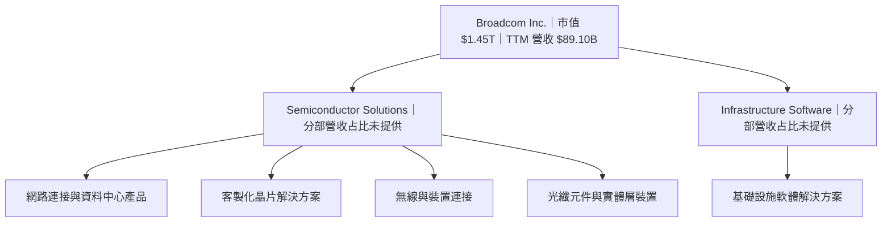
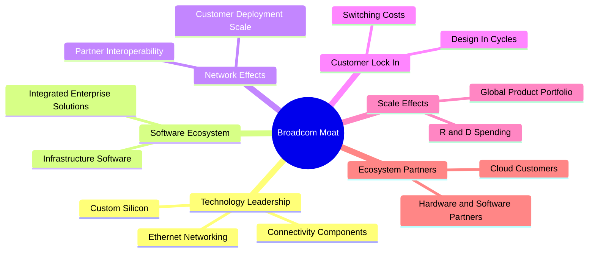
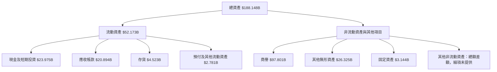
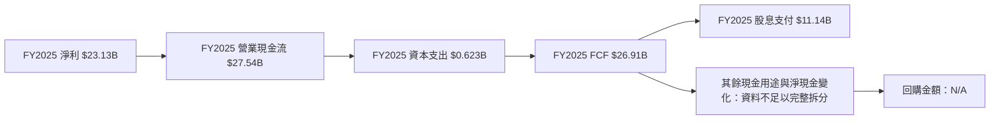
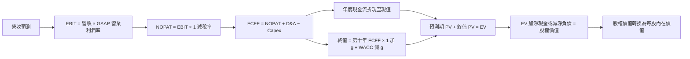
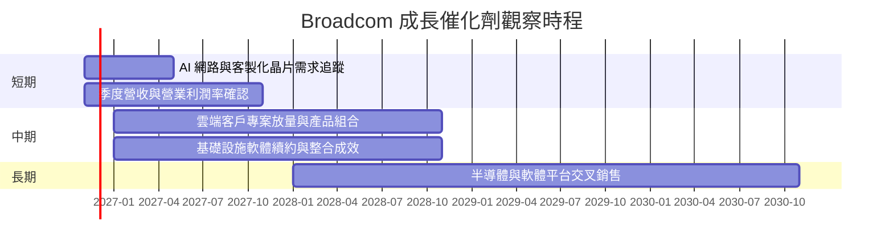
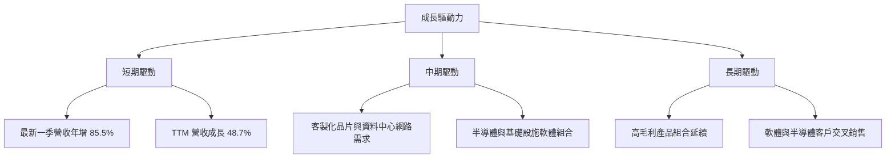
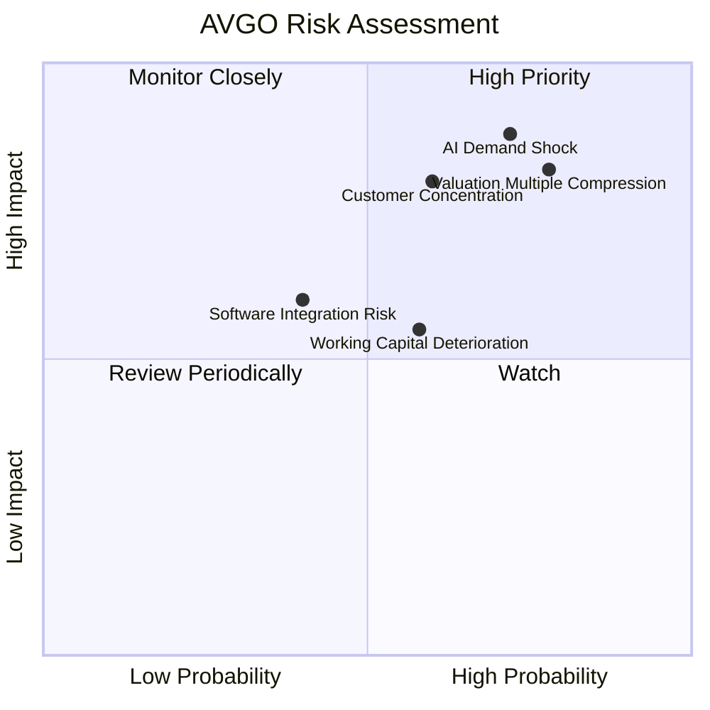
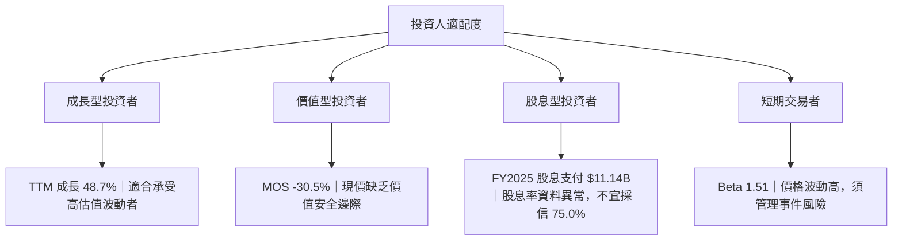

# AVGO 基本面深度分析報告
> **報告日期**：2026-11-21 ｜ **語言**：繁體中文 ｜ **數據來源**：SEC 申報資料 (XBRL)、Yahoo Finance、Finviz、StockAnalysis、Roic.ai ｜ **分析師**：CFA 級機構研究

## 目錄

| # | 章節 | 核心結論 |
|---|------|----------|
| 1 | 執行摘要 | 賣出；加權合理價值 $233.33，MOS -30.5% |
| 2 | 公司概覽與商業模式 | 半導體與基礎設施軟體並行，產品黏著度構成護城河 |
| 3 | 損益表深度分析 | TTM 營收 $89.10B、年增 48.7%；最新一季年增 85.5% |
| 4 | 資產負債表分析 | 淨負債 $35.44B；流動比率 2.504，營運資金天數上升 |
| 5 | 現金流量深度分析 | TTM FCF $39.40B，FCF Yield 2.71% |
| 6 | 獲利能力與資本效率 | ROIC 30.0% 高於 WACC 11.32%，仍創造經濟價值 |
| 7 | 相對估值分析 | 多項估值倍數高於自身五年中位數；DCF 情境分化大 |
| 8 | DCF 內在價值評估 | 基準 DCF $216.69；加權合理價值 $233.33 |
| 9 | 成長催化劑 | AI 網路、客製化晶片與軟體整合是主要增長看點 |
| 10 | 風險矩陣 | AI 客戶需求、估值回檔與整合執行為主要風險 |
| 11 | 投資建議 | 估值安全邊際不足；以營運里程碑與估值重新評估 |

---

## 1. 執行摘要

AVGO 的 TTM 營收為 **$89.10B**，TTM 年增 **48.7%**，最新一季年增 **85.5%**；TTM FCF 為 **$39.40B**、ROIC 為 **30.0%**，高於 **11.32% WACC**。然而，以基準 DCF 每股 **$216.69**、同業估值與分析師共識加權後的合理價值為 **$233.33**，低於 **2026-11-20 收盤價 $304.41**；依 MOS 門檻應為 **賣出**，MOS 為 **-30.5%**。成長和資本回報有基本面支撐，但價格已要求高成長延續，且 DCF 基準情境提供的下檔保護不足。

### 1.0 一頁式投資儀表板

| 項目 | 內容 |
|------|------|
| **投資論點（3 句）** | ① TTM 營收年增 48.7%，最新一季年增 85.5%，顯示增長動能加速。② TTM FCF $39.40B、ROIC 30.0% 對比 WACC 11.32%，公司仍在創造股東價值。③ 加權合理價值 $233.33 低於現價 $304.41，MOS -30.5%，估值風險大於當前價值緩衝。 |
| **綜合評分** | **6.8/10**（引用 1.1 評分卡） |
| **財務健康** | 🟡 淨負債 $35.44B，但流動比率 2.504、現金與短期投資 $23.98B |
| **ROIC vs WACC** | **30.0% vs 11.32%**；利差 18.68 個百分點，創造價值 |
| **FCF 趨勢** | 上升；TTM FCF $39.40B，FCF Yield **2.71%** |
| **估值** | Forward P/E **15.702569x** ｜ EV/EBITDA **28.506x** ｜ FCF Yield **2.71%** |
| **DCF 內在價值（基準）** | **$216.69** ｜ 現價相對 DCF 溢價 **40.5%** |
| **安全邊際（MOS）** | **-30.5%**＝($233.33 − $304.41) ÷ $233.33；🔴 <10% 無 |
| **預期報酬（基準情境 12M）** | **-28.8%**（基準 DCF $216.69 相對現價） |
| **關鍵風險（前二）** | AI 客戶需求與訂單集中；估值倍數收縮 |
| **評級 + 信心度** | 🔴 **賣出** ｜ 信心：中（DCF 對終值、成長與 WACC 敏感） |

### 1.1 綜合評分卡

| 維度 | 評分（1–10） | 主要依據（引用數字與其來源章節） |
|------|--------------|----------------------------------|
| 成長性 | 8.5 | TTM 營收年增 48.7%、最新一季年增 85.5%（第 3 章）；但單季加速不宜直接外推 |
| 獲利能力 | 9.0 | TTM 營業利益率 48.0%、ROIC 30.0%、F-Score 7/8（第 3、6 章） |
| 財務健康 | 7.5 | 淨負債 $35.44B、流動比率 2.504，CCC 由 53 天增至 63 天（第 4 章） |
| 估值 | 2.0 | MOS -30.5%；P/E 38.8x，高於自身五年中位數 5.5x（第 7、8 章） |
| 護城河 | 8.0 | 高毛利、產品與軟體整合及客戶轉換成本；但分部收入與市場份額資料未提供（第 2 章） |
| 管理層與資本配置 | 6.0 | FY2025 SBC $7.57B，稀釋股數測試未通過；FY2025 股息支付 $11.14B（第 3、5 章） |
| **綜合評分** | **6.8** | 六項算術平均：**(8.5 + 9.0 + 7.5 + 2.0 + 8.0 + 6.0) ÷ 6 = 6.833… ≈ 6.8** |

### 1.2 五大投資論點 + 三大核心風險

| 類型 | 項目 | 具體依據 | 信心度 |
|------|------|----------|--------|
| 🟢 **投資論點①** | AI 網路與客製化晶片帶動增長 | TTM 營收年增 48.7%；最新一季營收年增 85.5%，顯示需求與產品組合變化對成長貢獻顯著 | 🟢 高 |
| 🟢 **投資論點②** | 高現金流轉換能力 | TTM 營業現金流 $40.65B、Capex $1.25B、FCF $39.40B，FCF Yield 2.71% | 🟢 高 |
| 🟢 **投資論點③** | 經濟回報高於資本成本 | ROIC 30.0% 對比 WACC 11.32%，利差 18.68pp | 🟢 高 |
| 🟢 **投資論點④** | 軟體業務提高收入黏著度 | 公司營運包含 Infrastructure Software；財務資料未提供分部收入與訂閱占比，不能量化其貢獻 | 🟡 中 |
| 🟢 **投資論點⑤** | 財務彈性尚可 | 現金與短期投資 $23.98B、總債務 $59.42B，流動比率 2.504 | 🟡 中 |
| 🟡 **風險①** | AI 需求與大客戶計畫波動 | 新聞資料提及市場對 Google AI 晶片計畫調整的報導；若客戶專案延後，可能影響高增長基期 | 🟡 中 |
| 🔴 **風險②** | 估值對預期變化敏感 | P/E 38.8x、P/S 16.7x；DCF 基準 $216.69，低於現價 28.8% | 🔴 高 |
| 🟡 **風險③** | 股權薪酬與股數稀釋 | FY2025 SBC $7.57B；Piotroski 稀釋股數測試未通過 | 🟡 中 |

### 1.3 快速統計卡片

| 指標 | 公司實際值（期間） | 同業中位數 | 狀態 |
|------|--------------------|------------|------|
| 營收成長（TTM） | **48.7%** | — | 🟢 |
| 營收成長（最新一季年增） | **85.5%** | **36.5%** | 🟢 |
| 毛利率（TTM） | **75.5%** | **53.1%** | 🟢 |
| 營業利益率（TTM） | **48.0%** | — | 🟢 |
| ROIC（TTM） | **30.0%** | — | 🟢 |
| Forward P/E | **15.702569x** | **12.3x** | 🟡 |
| FCF Yield（TTM） | **2.71%** | — | 🟡 |
| Piotroski F-Score | **7 / 8** | — | 🟢 |

同業中位數僅列有完整可比數據的項目：NVDA、MRVL、QCOM 的最新一季營收成長率中位數為 36.5%；三者毛利率中位數為 53.1%；Forward P/E 中位數為 12.3x。

### 1.4 投資結論

```text
╔══════════════════════════════════════════════════════════════════╗
║                    📊 投資結論摘要                               ║
╠══════════════════════════════════════════════════════════════════╣
║  評級：賣出（MOS -30.5%，符合 MOS < -25% 門檻）                 ║
║  價格（2026-11-20 收盤）：$304.41                               ║
║  DCF 內在價值（基準）：$216.69（現價溢價 40.5%）                ║
║  安全邊際 MOS：-30.5%（以加權合理價值 $233.33 為分母）          ║
║  加權合理價值（8.8）：$233.33                                    ║
║  DCF 情境價值：                                                  ║
║    悲觀情境：$89.27（-70.7%）                                    ║
║    基準情境：$216.69（-28.8%）                                   ║
║    樂觀情境：$479.09（+57.4%）                                   ║
║  綜合評分：6.8/10（引用 1.1）                                    ║
║  適合投資人：能承受高波動、願意追蹤 AI 資本支出與估值的長線投資人║
╚══════════════════════════════════════════════════════════════════╝
```

---

## 2. 公司概覽與商業模式

### 2.1 業務結構與收入來源

公司資料指出 AVGO 經營 Semiconductor Solutions 與 Infrastructure Software 兩個分部，提供網路連接、客製化晶片、乙太網路交換與路由、NIC 控制器、無線連接等產品，以及基礎設施軟體解決方案。分部營收、收入占比及軟體訂閱占比未提供，因此不以估計比例繪製收入占比圖。



半導體業務受益於資料中心網路、客製化運算與連接需求；軟體業務則可提供較高黏著度的基礎設施產品。由於沒有分部營收、毛利與訂閱收入數據，無法把兩條業務線的成長貢獻或估值拆分量化。

### 2.2 市場份額

**市場份額數據未提供**，因此不列市場占比或繪製市占圖。以現有數字觀察，AVGO TTM 營收 $89.10B、TTM 成長 48.7%，最新一季營收年增 85.5%；但這些數字衡量公司規模與成長，不能直接替代特定產品市場份額。

### 2.3 競爭護城河分析



### 2.4 護城河強度

| 護城河項目 | 強度（強／中／弱） | 證據（引用數字或事實） | 會削弱它的情況 |
|------------|--------------------|------------------------|----------------|
| 技術與產品整合 | 強 | 覆蓋客製化晶片、乙太網路交換／路由、NIC、光纖與無線連接；TTM 毛利率 75.5% | 客戶自研晶片、競品性能與成本優勢擴大 |
| 軟體生態系統 | 中至強 | 公司另有 Infrastructure Software 分部；軟體收入占比與留存率未提供 | 產品替代、續約下降、整合後服務品質惡化 |
| 客戶鎖定 | 中至強 | 客製化晶片通常需設計導入與驗證，切換需重新工程整合；公司資料未提供客戶留存率 | 主要客戶改用內製或替代供應商 |
| 規模效應 | 強 | TTM 營收 $89.10B、研發費用 FY2025 $10.98B | 研發投資回報下降或高增長市場轉移 |
| 網路效應 | 中 | 互通性與生態相容性可能增加產品價值；未提供可量化網路效應指標 | 生態標準碎片化、客戶採多供應商策略 |
| 生態夥伴 | 中 | 業務跨晶片、網路與基礎設施軟體；合作夥伴及收入資料未提供 | 夥伴改變採購策略或形成競爭性聯盟 |

1.1 護城河評分 **8.0/10**，主要依據是多類產品與軟體組合、TTM 毛利率 75.5% 及規模；客戶集中度、分部收入與市占資料缺漏，限制了更高評分的證據強度。

---

## 3. 損益表深度分析

### 3.1 年度收入成長趨勢（近 4 年）

```text
╔══════════════════════════════════════════════════════════════════╗
║       Broadcom 年度收入趨勢（FY2022–FY2025，USD）                ║
╠══════════════════════════════════════════════════════════════════╣
║  FY2022  $33.20B  ████████████░░░░░░░░░░░  YoY：基期 🟡        ║
║  FY2023  $35.82B  █████████████░░░░░░░░░░  YoY：+7.88% 🟡      ║
║  FY2024  $51.57B  ███████████████████░░░░  YoY：+43.98% 🟢     ║
║  FY2025  $63.89B  ████████████████████████ YoY：+23.87% 🟢     ║
║                                                                  ║
║  FY2022–FY2025 三年 CAGR：約 24.4%                               ║
╚══════════════════════════════════════════════════════════════════╝
```

FY2025 營收年增率由 FY2024 的 43.98% 降至 23.87%，仍屬高增長但顯示基期提高。FY2026 TTM 營收升至 $89.10B，對比前一 TTM 成長 48.7%；最新一季年增 85.5%，代表近期增長顯著加速，但單季表現不宜直接視為長期年化速度。

### 3.2 季度收入趨勢分析

| 季度 | 營收（$B） | QoQ 成長 | YoY 成長 | 備註 |
|------|-----------:|---------:|---------:|------|
| FY2025 Q4 | 18.015 | +12.93% | +28.18% | 相對 FY2025 Q3 延續成長 |
| FY2026 Q1 | 19.311 | +7.19% | +29.47% | 增速高於 FY2025 全年營收成長 |
| FY2026 Q2 | 22.187 | +14.89% | +47.87% | 季度增速加快 |
| FY2026 Q3 | 29.591 | +33.37% | +85.50% | 最新季度出現明顯加速 |

QoQ 以本季營收 ÷ 前季營收 − 1 計算；YoY 採季度同比數據。Q3 2026 的強勁增長可能反映需求、產品組合與客戶專案放量，但現有資料不足以拆分 AI、軟體及其他業務的各自貢獻。

### 3.3 利潤率演變分析

| 利潤率指標 | FY2022 | FY2023 | FY2024 | FY2025 | 趨勢 | 評估 |
|------------|--------|--------|--------|--------|------|------|
| **毛利率** | 66.5% | 69.0% | 63.0% | 67.8% | 年度波動；FY2025 回升 | 🟢 |
| **營業利益率** | 43.0% | 45.9% | 29.1% | 40.8% | FY2024 下滑、FY2025 回升 | 🟢 |
| **淨利率** | 34.6% | 39.3% | 11.4% | 36.2% | FY2024 受淨利低基期影響 | 🟡 |

表中年度比率依所列年度營收、毛利、營業利益與淨利計算；跨年度併購與無形資產攤銷可能使 GAAP 年度利潤率較難作同口徑比較。TTM 毛利率 **75.5%**、TTM 營業利益率 **48.0%** 與單年度數據口徑不同，應優先作為當前營運狀況參照。季度營業利益率最新值依 SEC 10-Q 口徑為 **53.9%**，反映近期收入增長伴隨營業槓桿；但另一彙總資料列示 48.8%，存在口徑差異，本文依 VERIFIED FIGURES 優先採用 53.9%。

### 3.4 費用結構分析

完整費用細項不足以計算營業成本、研發、銷管、併購攤銷等占比，因此不繪製費用結構圓餅圖。可確認 FY2025 研發費用 **$10.98B**，約為 FY2025 營收 $63.89B 的 **17.2%**；研發支出規模支撐產品迭代，但也意味維持競爭力需要持續投入。

```text
╔══════════════════════════════════════════════════════════════════╗
║                   費用結構可核實資料                             ║
╠══════════════════════════════════════════════════════════════════╣
║  FY2025 研發費用：$10.98B                                        ║
║  FY2025 營收：  $63.89B                                          ║
║  研發費用／營收：$10.98B ÷ $63.89B = 17.2%                       ║
║  其他費用分類占比：未提供，故不推估或補足                        ║
╚══════════════════════════════════════════════════════════════════╝
```

### 3.5 季度 EPS 趨勢與盈餘品質（Quality of Earnings）

最近四季 EPS 實際值依季度資料為 2025 Q4 **$1.74**、2026 Q1 **$1.50**、2026 Q2 **$1.91**、2026 Q3 **$2.68**。季度 EPS 預估值在來源資料中為 NaN，故不能判斷是否超預期或不及預期。

| 季度 | EPS 實際 | EPS 預估 | 超預期／不及預期 |
|------|---------:|---------:|------------------|
| 2025-10-31 | $1.74 | N/A | 無法判定：預估值缺漏 |
| 2026-01-31 | $1.50 | N/A | 無法判定：預估值缺漏 |
| 2026-04-30 | $1.91 | N/A | 無法判定：預估值缺漏 |
| 2026-07-31 | $2.68 | N/A | 無法判定：預估值缺漏 |

| 盈餘品質項目 | 數值／佔比 | 評估 |
|--------------|------------|------|
| 股權薪酬 SBC / 營收 | FY2025：$7.57B ÷ $63.89B = **11.9%** | 🔴 比例偏高；稀釋成本不可忽略 |
| SBC / 營業現金流 | FY2025：$7.57B ÷ $27.54B = **27.5%** | 🟡 現金流強，但 SBC 占比顯著 |
| FCF / 淨利（現金轉換率） | FY2025：$26.91B ÷ $23.13B = **116.3%** | 🟢 現金轉換高於會計淨利 |
| 一次性／非經常性損益 | FY2024 淨利 $5.89B，FY2025 $23.13B；細項資料 N/A | 🟡 年度淨利波動大，未能完整剔除一次性項目 |
| 有效稅率異常 | DCF 採 21.0% 預設稅率；實際有效稅率明細 N/A | 🟡 無法判斷是否由稅務利益驅動 |
| 資本化支出 vs 費用化 | TTM Capex $1.25B；資本化政策細項 N/A | 🟡 未見足夠資料判斷成本是否延後認列 |

FY2025 現金流量表列示 SBC $7.57B，而非把 SBC 當作現金流出直接扣除；高 FCF/淨利率有利於盈餘品質，但 SBC 會透過股數稀釋侵蝕每股股東回報。Piotroski 稀釋股數測試未通過，需與高現金轉換率一併看待。因季度 EPS consensus 欄位缺值，不能為最近四季杜撰「超預期」紀錄。

---

## 4. 資產負債表分析

### 4.1 資產結構分解

最新 TTM 資產負債表列示總資產 **$188.148B**、流動資產 **$52.173B**、商譽 **$97.801B**、其他無形資產 **$26.325B**、固定資產 **$3.144B**。所列細項未涵蓋全部非流動資產，故只展示有數字項目。



### 4.2 流動性與營運資金分析

| 指標 | 最新值 | 歷史參照 | 評估 |
|------|-------:|---------:|------|
| 流動比率 | 2.504 | FY2025 依年度資產負債表約 1.706 | 🟢 流動資產覆蓋短期負債 |
| 速動比率 | 2.153 | 歷史趨勢 N/A | 🟢 現金及應收資產提供流動性 |
| 現金與短期投資 | $23.98B | FY2025 $16.18B | 🟢 增加 |
| 淨負債 | $35.44B | FY2025 債務 $65.14B、現金 $16.18B | 🟡 槓桿需持續管理 |

**營運資金天數**（照抄 QUALITY FIGURES）：

| 指標 | 最新 TTM | 一年前 TTM | 變化 | 解讀 |
|------|----------|------------|------|------|
| DSO 應收帳款天數 | 56 天 | 40 天 | +16 天 | 收款週期變長，可能反映業務組合或收款節奏變化，需追蹤應收帳款增幅 |
| DIO 存貨天數 | 59 天 | 40 天 | +19 天 | 存貨占用增加，若需求不及預期可能帶來去庫存風險 |
| DPO 應付帳款天數 | 52 天 | 26 天 | +26 天 | 付款週期延長，對營運資金形成部分抵銷 |
| CCC 現金轉換週期 | 63 天 | 53 天 | +10 天 | 資金由採購至回收時間增加，現金轉換效率略有惡化 |

### 4.3 債務結構分析

```text
╔══════════════════════════════════════════════════════════════════╗
║                 Broadcom 債務健康診斷                            ║
╠══════════════════════════════════════════════════════════════════╣
║  總債務：          $59.42B  ████████████████████  🟡            ║
║  現金及短期投資：  $23.98B  ████████░░░░░░░░░░░░  🟢            ║
║  淨負債：          $35.44B  ████████████░░░░░░░░  🟡            ║
║                                                                  ║
║  流動比率：2.504x  🟢                                              ║
║  速動比率：2.153x  🟢                                              ║
║  Debt/EBITDA：約 1.13x（$59.42B ÷ TTM EBITDA 約 $52.6B）*         ║
║  利息保障倍數：N/A（利息費用未提供）                              ║
╚══════════════════════════════════════════════════════════════════╝
```

\* TTM EBITDA 可由市場數據所列 EBITDA Margin 58.7% × TTM Revenue $89.10B 估算，約 $52.30B；因此債務／EBITDA 約 **1.14x**。此處屬估算值，非 VERIFIED FIGURES 的直接指定值。公司並非淨現金狀態，但流動性比率與自由現金流提供償債緩衝。

### 4.4 股東權益趨勢

| 財政年度 | 股東權益（$B） | 年變動 | 說明 |
|----------|---------------:|-------:|------|
| FY2022 | 22.71 | — | 基期 |
| FY2023 | 23.99 | +5.6% | 緩步增加 |
| FY2024 | 67.68 | +182.1% | 資產負債表規模與併購相關項目出現大幅變化 |
| FY2025 | 81.29 | +20.1% | 繼續增加 |

```text
╔══════════════════════════════════════════════════════════════════╗
║                  股東權益歷年變化（USD）                         ║
╠══════════════════════════════════════════════════════════════════╣
║  FY2022  $22.71B  ██████░░░░░░░░░░░░░░░░                         ║
║  FY2023  $23.99B  ███████░░░░░░░░░░░░░░░                        ║
║  FY2024  $67.68B  █████████████████░░░░░                        ║
║  FY2025  $81.29B  ████████████████████                          ║
╚══════════════════════════════════════════════════════════════════╝
```

權益增加不能單獨代表內生獲利品質改善；商譽及無形資產規模較大，且 FY2024 權益跳升，需結合併購與無形資產攤銷分析。

---

## 5. 現金流量深度分析

### 5.1 現金流量瀑布圖

現金流量數據能確認營業現金流、資本支出、FCF 與股息支付；回購、淨現金變化與完整現金流調節項目沒有足夠一致的期間數字，故不填入虛構值。



### 5.2 FCF 轉換率趨勢

| 財政年度 | FCF（$B） | 淨利（$B） | FCF / 淨利 | 趨勢 |
|----------|----------:|-----------:|-----------:|------|
| FY2022 | 16.31 | 11.49 | 142.0% | 高於 100% |
| FY2023 | 17.63 | 14.08 | 125.2% | 仍高於 100% |
| FY2024 | 19.41 | 5.89 | 329.5% | 淨利低基期放大比率 |
| FY2025 | 26.91 | 23.13 | 116.3% | 正常化但仍高於 100% |

FY2024 轉換率異常高，主要受淨利基數偏低影響，不能視為可持續常態。FY2025 FCF 轉換率 116.3% 仍顯示現金流覆蓋會計盈餘。

### 5.3 自由現金流趨勢

| 期間 | FCF（$B） | YoY 成長 | 來源口徑 |
|------|----------:|---------:|----------|
| FY2022 | 16.31 | — | 年度現金流量表 |
| FY2023 | 17.63 | +8.1% | 年度現金流量表 |
| FY2024 | 19.41 | +10.1% | 年度現金流量表 |
| FY2025 | 26.91 | +38.6% | 年度現金流量表 |
| 最新 TTM 至 2026-08-02 | **39.40** | — | VERIFIED FIGURES：營業現金流 $40.65B − Capex $1.25B |

```text
╔══════════════════════════════════════════════════════════════════╗
║               FCF 趨勢（年度實際與最新 TTM）                     ║
╠══════════════════════════════════════════════════════════════════╣
║  FY2022  $16.31B  ████████░░░░░░░░░░░░░░                         ║
║  FY2023  $17.63B  █████████░░░░░░░░░░░░░                        ║
║  FY2024  $19.41B  ██████████░░░░░░░░░░░░                        ║
║  FY2025  $26.91B  ██████████████░░░░░░░░                        ║
║  TTM     $39.40B  ████████████████████░░                        ║
║  TTM FCF Yield：2.71%                                             ║
╚══════════════════════════════════════════════════════════════════╝
```

### 5.4 資本配置評估

完整的回購、併購、償債與留存現金年度拆分未提供，因此不繪製資本配置圓餅圖。

| 資本配置項目 | 可核實數據 | 評估 |
|--------------|------------|------|
| 股息 | FY2025 $11.14B | 約為 FY2025 FCF 的 41.4%，仍保留現金再投資空間 |
| Capex | FY2025 $0.623B；TTM $1.25B | 相對營收低，但仍需確認長期資本需求是否上升 |
| SBC | FY2025 $7.57B | 金額高，應視為股東經濟成本，追蹤稀釋股數 |
| 回購 | N/A | 財務數據未提供可核實回購金額 |
| 併購／債務償還 | N/A | 無完整期間拆分，不推估 |

---

## 6. 獲利能力與資本效率

### 6.1 ROE / ROA / ROIC 趨勢

| 指標 | 最新 TTM | 歷史可比數據 | 評估 |
|------|---------:|--------------|------|
| ROE | **38.4%**（QUALITY FIGURES） | 另一彙總口徑列示 44.2% | 🟢 高，但口徑有差異 |
| ROA | 15.4%（市場資料） | 長期同口徑序列 N/A | 🟢 資產回報良好 |
| ROIC | **30.0%** | 10 年歷史連續序列 N/A | 🟢 高於資本成本 |
| WACC | **11.32%** | 成本資本輸入值 | ROIC 高出 18.68pp |

### 6.2 ROIC vs WACC 分析（核心價值創造判斷）

ROIC 與 WACC 依 VERIFIED FIGURES 原值採用；WACC 的權重、beta 調整與成本資本輸入值如下，不另建替代 WACC。

```text
╔══════════════════════════════════════════════════════════════════╗
║                 ROIC vs WACC 深度分析                            ║
╠══════════════════════════════════════════════════════════════════╣
║  WACC 輸入：                                                     ║
║  ├── 無風險利率（10Y 美債）：       4.91%                        ║
║  ├── 市場風險溢酬 ERP：             5.00%                        ║
║  ├── 原始 Beta：                    1.51                         ║
║  ├── 調整後 Beta：                  1.34                         ║
║  ├── Ke = 4.91% + 1.34 × 5.00% = 11.61%                         ║
║  ├── 稅前 Kd：                      5.40%                        ║
║  ├── 稅後 Kd = 5.40% × (1−21.0%) = 4.27%                       ║
║  ├── 股權／債務權重：               96.1%／3.9%                  ║
║  └── 採用 WACC：                    11.32%                       ║
║                                                                  ║
║  ROIC（TTM）：                    30.0%                          ║
║  ROIC − WACC：                    30.0% − 11.32% = 18.68pp       ║
║                                                                  ║
║  ROIC 30.0%  ▓▓▓▓▓▓▓▓▓▓▓▓▓▓▓▓▓▓▓▓▓▓▓▓▓▓▓▓▓▓ 🟢              ║
║  WACC 11.32% ▓▓▓▓▓▓▓▓▓▓▓░░░░░░░░░░░░░░░░░░ ──                 ║
║  EVA 利差 +18.68pp：資本回報高於資本成本                         ║
╚══════════════════════════════════════════════════════════════════╝
```

CAPM：**Ke = 4.91% + 1.34 × 5.00% = 11.61%**。調整後 beta 為 \(⅔ × 1.51 + ⅓ × 1 = 1.34\)；成本資本資料沒有提供無風險利率觀察日期、利息費用金額及平均計息負債明細，故直接採用來源列示的 WACC **11.32%**，不以缺漏輸入自行重算。ROIC 30.0% 高於 WACC，表示目前投入資本創造正經濟利潤；主要風險是高回報能否在競爭、客戶需求及併購後整合下延續。

### 6.3 杜邦三因素分解

| 因素 | 數值（TTM） | 解讀 |
|------|-------------|------|
| 淨利率 | 42.9% | 高淨利率是 ROE 的主要支撐 |
| 資產週轉率 | 0.47 | 每一美元資產對應約 0.47 美元營收 |
| 權益乘數 | 1.89 | 有槓桿但不是極高槓桿 |
| **ROE** | **38.4%** | **42.9% × 0.47 × 1.89 = 38.4%** |

杜邦拆解顯示 ROE 主要來自高淨利率，權益乘數提供次要放大，並非單靠財務槓桿推高回報。

### 6.4 財務體質：Piotroski F-Score

Piotroski F-Score 為 **7/8**。分母低於九項，是因長期負債／總資產比較缺少輸入，該項被排除。

| 測試 | 結果 | 解讀 |
|------|------|------|
| ROA > 0 | ✅ 通過 | TTM 獲利為正 |
| 營業現金流 > 0 | ✅ 通過 | 現金營運能力為正 |
| ROA 高於一年前 | ✅ 通過 | 獲利能力改善 |
| 營業現金流 > 淨利 | ✅ 通過 | 支持應計品質 |
| 長期負債 ÷ 總資產低於一年前 | — 無法判定（缺資料） | 不納入可判定分母 |
| 流動比率高於一年前 | ✅ 通過 | 短期流動性改善 |
| 稀釋股數未增加 | ❌ 未通過 | 股數增加會稀釋每股經濟利益 |
| 毛利率高於一年前 | ✅ 通過 | 定價或產品組合可能改善 |
| 資產週轉率高於一年前 | ✅ 通過 | 資產使用效率改善 |

---

## 7. 相對估值分析

### 7.1 同業估值比較

AVGO 的本公司 P/E、P/S 與 EV/EBITDA 依 VERIFIED FIGURES 歷史估值資料採用；同業倍數依 Peer multiples 區塊。不同資料彙總欄位會有口徑差異，故本表各欄保留來源指定數字。

| 估值指標 | **AVGO** | **NVDA** | **MRVL** | **QCOM** | 本公司評估 |
|----------|---------:|---------:|---------:|---------:|-----------|
| **Trailing P/E** | 38.8x | 13.5x | 40.2x | 11.8x | 🟡 同業差距大，需看成長與獲利口徑 |
| **Forward P/E** | 15.702569x | 7.6x | 16.6x | 12.3x | 🟡 高於同業中位數 12.3x |
| **P/S Ratio** | 16.7x | 8.4x | 11.6x | 3.7x | 🔴 明顯高於三家同業 |
| **EV/EBITDA** | 35.1x | 12.2x | 38.1x | 15.9x | 🔴 高於同業中位數 15.9x |
| **最新一季營收年增** | 85.5% | 103.2% | 36.5% | -8.4% | 🟢 成長快於 MRVL、QCOM |
| **毛利率（TTM）** | 75.5% | 74.9% | 52.2% | 53.1% | 🟢 高於三家同業 |

AVGO 的高速增長與毛利率為較高倍數提供基本面支撐，但 P/S 16.7x、EV/EBITDA 35.1x 同時意味未來成長或利潤率稍有落差時，估值下修可能放大。

### 7.2 歷史估值區間分析

```text
╔══════════════════════════════════════════════════════════════════╗
║              AVGO 自身五年估值位置（TTM）                        ║
╠══════════════════════════════════════════════════════════════════╣
║  P/E        1.8x ───────── 中位數 5.5x ───────── 77.5x           ║
║                           當前 38.8x｜百分位 70%                 ║
║  P/S        0.6x ───────── 中位數 1.5x ───────── 28.1x           ║
║                           當前 16.7x｜百分位 65%                 ║
║  EV/EBITDA  0.5x ───────── 中位數 5.6x ───────── 70.7x           ║
║                           當前 35.1x｜百分位 55%                 ║
╚══════════════════════════════════════════════════════════════════╝
```

現行倍數在公司自身五年估值區間的中高位置。歷史區間受到資本結構、業務組合與期間併購影響，不能只按中位數推定合理價值；但三項倍數的當前值均遠高於所列歷史中位數。

### 7.3 情境價值（照抄 DCF MODEL 的 Scenarios）

| 情境 | 第 1 年營收成長 | 期末營業利潤率 | WACC | 每股價值 | 相對現價 | 機率 | 會發生的條件 |
|------|----------------|----------------|------|----------|----------|------|--------------|
| 🔴 悲觀 | 15.0% | 36.4% | 12.32% | $89.27 | -70.7% | 25% | AI 專案延後或客戶轉向、增長降速且競爭壓低長期利潤率 |
| 🟡 基準 | 30.0% | 42.8% | 11.32% | $216.69 | -28.8% | 50% | 第一年高增長後逐步線性減速，長期利潤率回落至歷史中位數 |
| 🟢 樂觀 | 45.0% | 47.1% | 10.32% | $479.09 | +57.4% | 25% | AI 需求延續、客製化晶片放量，並維持較高長期利潤率 |

### 7.4 相對估值隱含價格區間

```text
╔══════════════════════════════════════════════════════════════════╗
║                 相對估值與市場參考價值                           ║
╠══════════════════════════════════════════════════════════════════╣
║  $137.39 ───── $216.69 ───── $238.62 ───── $304.41 ───── $526.47║
║  EV/EBITDA       DCF          Forward P/E        現價       共識價║
╚══════════════════════════════════════════════════════════════════╝
```

| 方法 | 每股價值 | 計算依據 |
|------|---------:|----------|
| 同業 EV/EBITDA | $137.39 | NVDA、MRVL、QCOM 同業中位數 15.9x × TTM EBITDA，再加回淨現金／扣除淨負債 |
| DCF（基準） | $216.69 | 10 年 FCFF、WACC 11.32%、永續成長率 3.0% |
| 同業 Forward P/E | $238.62 | 同業 Forward P/E 中位數 12.3x × Forward EPS $19.39 |
| 分析師共識目標價 | $526.47 | 47 位分析師平均目標價；參考而非獨立現金流估值 |

---

## 8. DCF 內在價值評估（Discounted Cash Flow）

### 8.0 估值推理鏈（Thinking Logic）

**Step 1 — 價值來源與主導變數**

AVGO 的價值主要由半導體與基礎設施軟體的現金流、AI／網路相關產品增長，以及高營業利潤率共同決定；兩分部的營收占比未提供，不能拆出可驗證的比重。模型中最主導估值的變數是長期 FCFF，而其受營收成長與營業利潤率共同影響；敏感性矩陣顯示 WACC 與永續成長率亦會顯著改變價值。

**Step 2 — 模型選擇**

| 決策點 | 本報告採用 | 理由（含數字） | 曾考慮但否決 | 否決理由 |
|--------|-----------|----------------|--------------|----------|
| 現金流定義 | FCFF | WACC 折現後得到企業價值；模型明確定義 FCFF = NOPAT + D&A − Capex | FCFE | 來源模型採 FCFF，不能另建模型 |
| 預測期 N | 10 年 | DCF 模型指定 10 年，營收成長由 30% 逐步降至 3% | 5 年 | 會改動來源模型及終值起算年 |
| 終值方法 | Gordon Growth | 模型以 3.0% 永續成長率計算 | 退出倍數法 | DCF 模型未提供可直接複製的退出倍數終值 |
| EBIT 基礎 | GAAP | 模型明定使用 GAAP EBIT，SBC 已計入費用 | 非 GAAP EBIT | 會造成與模型假設不一致 |

**Step 3 — 關鍵假設推導鏈**

- **營收成長**：錨點＝TTM 年增 48.7%、最新一季年增 85.5% → 調整＝考慮高基期與單季增長不可長期直線外推 → 採用第一年 30.0%，逐年線性降至第十年 3.0% → 曾考慮將最新一季 85.5% 外推，因缺乏持續性證據而否決。
- **期末營業利潤率**：錨點＝TTM 營業利益率 48.0% → 調整＝模型以近五年中位數作成熟期錨點 → 採用第十年 42.8% → 曾考慮持續維持 48.0%，但未納入模型，因來源模型設定為逐步回歸歷史中位數。
- **永續成長率 g**：錨點＝DCF 模型採 3.0% → 調整＝需低於 WACC 且反映成熟期成長 → 採用 3.0% → 不採用 4.0% 以上，因會接近或超過長期成熟成長可支持的水準，並增加終值依賴。
- **預測期 N**：錨點＝模型指定 10 年 → 調整＝不自行改變模型期間 → 採用 10 年 → 曾考慮縮短至 5 年，但會改變估值輸入而非解讀既有模型。
- **Capex／營收**：錨點＝TTM Capex $1.25B ÷ TTM 營收 $89.10B，約 1.4% → 調整＝模型設為由 1.4% 降至 0.8% → 採用模型逐年假設 → 不採用固定維持 1.4%，因模型已設定成熟後下降。
- **EBIT 與 SBC**：錨點＝模型明定 GAAP EBIT → 調整＝SBC 已在 GAAP 營業費用內，不再重扣 → 採用 GAAP EBIT、固定股數、不另增年稀釋率 → 不採用「再扣 SBC」或另加稀釋，避免重複計成本。
- **終值方法**：錨點＝模型給定 Gordon Growth → 調整＝因 WACC 11.32% 高於 g 3.0%，公式有效 → 採用 Gordon Growth → 退出倍數值因模型未提供，不能自建替代。
- **WACC**：錨點＝成本資本資料所列 11.32% → 調整＝不另算或替換 → 採用 11.32% → 不採用其他折現率，以維持與模型、ROIC 對照一致。

**Step 4 — 最脆弱一環**

最脆弱的是高增長向 3.0% 長期成長的過渡與終值估值；基準情境下終值現值占企業價值 **53.4%**，若長期成長或折現率偏離，價值會依 8.6 矩陣大幅變動。

**Step 5 — 計算路徑圖**



### 8.1 模型假設總表（Model Inputs）

| 假設項目 | 採用值 | 依據／來源 | 敏感度 |
|----------|--------|-------------|--------|
| 預測期長度 N | 10 年 | DCF MODEL 固定輸入 | 🟡 中 |
| 營收成長 | 第 1 年 30.0%，第 10 年 3.0%，線性遞減 | TTM 成長 48.7%；模型限制第一年最高 30.0% | 🔴 高 |
| 營業利潤率 | 第 1 年 48.0% → 第 10 年 42.8% | TTM 48.0%；模型回落至近五年中位數 | 🔴 高 |
| 有效稅率 | 21.0% | DCF 模型預設稅率 | 🟢 低 |
| Capex／營收 | 第 1 年 1.4% → 第 10 年 0.8% | TTM Capex／營收約 1.4%；模型逐步下降 | 🟡 中 |
| D&A／營收 | 0.7% | TTM 比率，模型持平 | 🟢 低 |
| 營運資金變動 | 未建模 | DCF MODEL 明確表示 working capital is not modelled | 🟢 低，但有漏算風險 |
| EBIT 基礎 | GAAP EBIT | DCF MODEL 指定 GAAP | 🟡 中 |
| SBC 處理 | GAAP 費用已含 SBC，不另扣 | DCF MODEL 明定；固定股數、不另加年稀釋 | 🟡 中 |
| 年稀釋率 | 0%（固定股數處理） | 組合 A：GAAP EBIT 已含 SBC | 🟡 中 |
| 永續成長率 g | 3.0% | DCF MODEL 固定輸入；低於 WACC | 🔴 高 |
| 終值方法 | Gordon Growth | DCF MODEL 明確列示 | 🔴 高 |
| WACC | 11.32% | 成本資本資料原值 | 🔴 高 |

本模型採用 **(A) GAAP EBIT + 固定股數**，故 SBC 影響已計入一次；FCFF 不再扣 SBC，股數不逐年稀釋。FCFF 公式採來源模型：**FCFF = NOPAT + D&A − Capex**，營運資金變動未建模，不能自行加入。

### 8.2 折現率推導（WACC）

```text
╔══════════════════════════════════════════════════════════════════╗
║                    WACC 推導（折現率）                           ║
╠══════════════════════════════════════════════════════════════════╣
║  股權成本 Ke（CAPM）：                                           ║
║  ├── 無風險利率 Rf：                   4.91%                     ║
║  ├── 市場風險溢酬 ERP：                5.00%                     ║
║  ├── 原始 Beta（Yahoo）：               1.51                      ║
║  ├── 調整後 Beta：                      1.34                      ║
║  ├── 規模／國別溢酬：                  0.00%（未另加）           ║
║  └── Ke = 4.91% + 1.34 × 5.00% = 11.61%                         ║
║                                                                  ║
║  債務成本 Kd：                                                   ║
║  ├── 稅前 Kd（來源值）：                5.40%                     ║
║  ├── 稅率：                             21.0%                     ║
║  └── 稅後 Kd = 5.40% × (1−21.0%) = 4.27%                        ║
║                                                                  ║
║  資本結構權重：                                                  ║
║  ├── 股權 E 權重：                      96.1%                     ║
║  ├── 債務 D 權重：                       3.9%                     ║
║  └── 採用 WACC：                       11.32%                     ║
╚══════════════════════════════════════════════════════════════════╝
```

**逐步演算與可用資料範圍**

1. **Ke（CAPM）**：  
   \(4.91\% + 1.34 × 5.00\% = 4.91\% + 6.70\% = 11.61\%\)。

2. **稅前 Kd**：來源直接列示 **5.40%**。利息費用金額與平均計息負債分母未提供，故不能按利息費用 ÷ 平均計息負債複算；不以總負債或應付帳款代替。

3. **稅後 Kd**：  
   \(5.40\% × (1 − 21.0\%) = 5.40\% × 79.0\% = 4.266\% ≈ 4.27\%\)。

4. **資本權重**：成本資本資料直接列示股權／債務權重 **96.1%／3.9%**，合計 **100.0%**。用於精確重算權重的市值與同範圍計息負債分母未逐項提供，故照用來源權重。

5. **WACC**：來源採用 **11.32%**。以已顯示的四捨五入輸入作示意驗算：  
   \(96.1\% × 11.61\% + 3.9\% × 4.266\% = 11.1602\% + 0.1664\% = 11.3266\% ≈ 11.32\%\)。  
   採用值與 DCF 模型一致；Rf 日期在成本資本輸入中未提供，故不另行假定日期。

### 8.3 逐年自由現金流預測（基準情境）

以下數字照抄 DCF MODEL。金額單位為 **$B**；折現因子保留三位小數。模型未納入營運資金變化，亦無 SBC 額外扣除列。

| 年度 | FY+1 | FY+2 | FY+3 | FY+4 | FY+5 | FY+6 | FY+7 | FY+8 | FY+9 | FY+10 |
|------|-----:|-----:|-----:|-----:|-----:|-----:|-----:|-----:|-----:|------:|
| 營收 | 115.84 | 147.11 | 182.42 | 220.72 | 260.46 | 299.52 | 335.47 | 365.66 | 387.60 | 399.23 |
| 營收 YoY | 30.0% | 27.0% | 24.0% | 21.0% | 18.0% | 15.0% | 12.0% | 9.0% | 6.0% | 3.0% |
| 營業利潤率 | 48.0% | 47.5% | 46.9% | 46.3% | 45.7% | 45.2% | 44.6% | 44.0% | 43.4% | 42.8% |
| EBIT（GAAP） | 55.66 | 69.83 | 85.54 | 102.23 | 119.12 | 135.26 | 149.54 | 160.89 | 168.30 | 171.04 |
| − 稅（21.0%） | (11.69) | (14.67) | (17.96) | (21.47) | (25.02) | (28.40) | (31.40) | (33.79) | (35.34) | (35.92) |
| = NOPAT | 43.97 | 55.17 | 67.58 | 80.76 | 94.10 | 106.85 | 118.14 | 127.10 | 132.96 | 135.12 |
| + D&A | 0.82 | 1.04 | 1.29 | 1.57 | 1.85 | 2.12 | 2.38 | 2.59 | 2.75 | 2.83 |
| − Capex | (1.62) | (1.96) | (2.31) | (2.64) | (2.93) | (3.17) | (3.31) | (3.36) | (3.29) | (3.11) |
| **= FCFF** | **43.17** | **54.25** | **66.56** | **79.69** | **93.02** | **105.81** | **117.21** | **126.34** | **132.41** | **134.84** |
| 折現因子 @11.32% | 0.898 | 0.807 | 0.725 | 0.651 | 0.585 | 0.526 | 0.472 | 0.424 | 0.381 | 0.342 |
| **FCFF 現值 PV** | **38.78** | **43.78** | **48.26** | **51.90** | **54.42** | **55.61** | **55.34** | **53.58** | **50.45** | **46.15** |

預測期現值合計（按模型列示年度 PV）：  
**$38.78 + $43.78 + $48.26 + $51.90 + $54.42 + $55.61 + $55.34 + $53.58 + $50.45 + $46.15 = $498.27B**（依未四捨五入底層數據加總；顯示值相加尾差在四捨五入範圍內）。

**逐步演算（FY+1 代表年度；表內金額依模型精度列示）**

1. **營收**：\(89.10 × (1 + 30.0\%) = 89.10 × 1.30 = 115.83\)，模型列示 **$115.84B**（未四捨五入輸入導致尾差）。
2. **EBIT**：\(115.84 × 48.0\% = 55.6032\)，模型列示 **$55.66B**（採模型未四捨五入底層值）。
3. **稅**：模型列示 **$11.69B**；公式為 \(EBIT × 21.0\%\)。
4. **NOPAT**：模型列示 **$43.97B**。
5. **D&A**：模型列示 **$0.82B**，依營收與 0.7% 比率計算。
6. **Capex**：模型列示 **$1.62B**，依模型 Capex 假設計算。
7. **ΔWC**：模型未建模，沒有扣除項。
8. **FCFF**：模型列示 **$43.17B**；公式為 \(NOPAT + D&A − Capex\)。
9. **折現因子及 PV**：\(1 ÷ (1 + 11.32\%)^1\) 模型列示為 **0.898**；\(43.17 × 0.898\) 依模型未四捨五入現金流計得 PV **$38.78B**。

> **複算口徑說明**：模型輸出的單格數字經四捨五入，部分列間直接以已四捨五入的顯示數字重乘會產生小幅尾差；不得以尾差替換來源模型的 FCFF、PV 或估值輸出。來源只提供模型逐年輸出，未提供完整未四捨五入底層數據。

**合理性自檢**

- 預測期 FCFF 由 FY+1 $43.17B 增至 FY+10 $134.84B，十年 CAGR 約 **12.1%**；歷史 FY2022–FY2025 FCF CAGR 約 **18.2%**，預測較歷史慢，反映增長與利潤率逐步回落。
- FY+10 FCFF 利潤率：**$134.84B ÷ $399.23B = 33.8%**；目前 TTM FCF 利潤率：**$39.40B ÷ $89.10B = 44.2%**。同業最佳 FCF 利潤率未提供，不能對照。
- 各預測年度 FCFF 均為正；營運資金未建模，因此若營收快速擴張帶來額外應收或存貨資金需求，模型 FCF 可能偏高。

```text
╔══════════════════════════════════════════════════════════════════╗
║            自由現金流：歷史實際 vs 模型預測                      ║
╠══════════════════════════════════════════════════════════════════╣
║  FY2023(實)  $17.63B  █████░░░░░░░░░░░░░░░░  YoY：+8.1%         ║
║  FY2024(實)  $19.41B  ██████░░░░░░░░░░░░░░░  YoY：+10.1%        ║
║  FY2025(實)  $26.91B  ████████░░░░░░░░░░░░░  YoY：+38.6%        ║
║  FY+1 (預)   $43.17B  █████████████░░░░░░░  YoY：相對 TTM 非同口徑║
║  FY+10(預)  $134.84B  ████████████████████  十年 CAGR：約 12.1%  ║
╠══════════════════════════════════════════════════════════════════╣
║  預測 FCFF CAGR 約 12.1%，低於 FY2022–FY2025 FCF CAGR 約 18.2%  ║
╚══════════════════════════════════════════════════════════════════╝
```

### 8.4 終值計算（Terminal Value）

適用性檢查：**WACC 11.32% vs g 3.0% → WACC > g？✅**

| 方法 | 計算式 | 終值 TV | TV 現值 | 佔總 EV 比重 |
|------|--------|---------|---------|--------------|
| Gordon Growth | $134.84B × (1 + 3.0%) ÷ (11.32% − 3.0%) | $1,669.84B | $571.55B | 53.4% |
| 退出倍數法 | N/A | N/A | N/A | N/A |

**逐步演算（Gordon Growth）**

1. FY+10 FCFF：**$134.84B**。
2. 分子：\(134.84 × (1 + 3.0\%) = 134.84 × 1.03\)，模型列示 **$138.89B**（模型未四捨五入輸入）。
3. 分母：\(11.32\% − 3.0\% = 8.32\%\)；TV：\(138.89 ÷ 8.32\% = $1,669.84B\)（依模型未四捨五入輸入）。
4. PV(TV)：\(1,669.84 × 0.342 = $571.55B\)（以未四捨五入折現因子計算）。
5. 終值占 EV：\(571.55 ÷ 1,069.82 = 53.4\%\)。

模型沒有提供退出倍數法所需的期末 EBITDA 倍數及交叉驗證輸出，故不自建第二種終值。終值 PV 占 EV 53.4%，低於 75% 警戒值，但仍是估值的重要來源。

### 8.5 企業價值 → 每股內在價值（Bridge）

```text
╔══════════════════════════════════════════════════════════════════╗
║              企業價值 → 每股內在價值 橋接表                      ║
╠══════════════════════════════════════════════════════════════════╣
║  預測期 FCF 現值合計              +$498.27B                       ║
║  終值現值 PV(TV)                  +$571.55B                       ║
║  = 企業價值 EV                   $1,069.82B                       ║
║  + Net cash（負值代表淨負債）      -$35.44B                        ║
║  = 股權價值                      $1,034.38B                       ║
║  每股內在價值（模型輸出）           $216.69                        ║
║  當前股價（2026-11-20 收盤）        $304.41                        ║
║  折溢價（現價÷DCF內在價值−1）       +40.5% 溢價                    ║
╚══════════════════════════════════════════════════════════════════╝
```

1. **EV**：\(498.27 + 571.55 = \mathbf{1,069.82B}\)。
2. **股權價值**：\(1,069.82 + (-35.44) = \mathbf{1,034.38B}\)。
3. **每股內在價值**：DCF MODEL 指定公式為「股權價值 × 價格 ÷ 市值」，來源模型輸出 **$216.69**。市值與股數展示值經四捨五入，故不以其反算替換模型結果。
4. **折溢價**：\((304.41 ÷ 216.69) − 1 = 40.5\%\)，現價相對 DCF 基準價值溢價。
5. **本節不計算 MOS**；MOS 只在 8.8 以加權合理價值為分母計算。

現金與債務採最新 TTM 資產負債表口徑：現金及短期投資 $23.98B、總債務 $59.42B，合計淨負債 $35.44B。DCF 模型固定股數，不另外以年稀釋率放大；精確稀釋股數未在模型輸出中單獨列出。

### 8.6 敏感性分析（WACC × 永續成長率）

下表價值照抄 DCF MODEL；括號內上行／下行以同一現價 $304.41 計算。基準格為 **WACC 11.32%、g 3.0%**。

| g（列）／WACC（欄） | 9.32% | 10.32% | **11.32%（基準）** | 12.32% | 13.32% |
|-----------|------:|-------:|------------------:|-------:|-------:|
| **2.0%** | $269.92 (-11.3%) | $232.22 (-23.7%) | $202.80 (-33.4%) | $179.25 (-41.1%) | $160.00 (-47.4%) |
| **2.5%** | $282.62 (-7.2%) | $241.19 (-20.8%) | $209.35 (-31.2%) | $184.15 (-39.5%) | $163.74 (-46.2%) |
| **3.0%（基準）** | $297.33 (-2.3%) | $251.40 (-17.5%) | **$216.69 (-28.8%)** | $189.58 (-37.7%) | $167.85 (-44.9%) |
| **3.5%** | $314.57 (+3.3%) | $263.10 (-13.6%) | $224.96 (-26.1%) | $195.62 (-35.7%) | $172.38 (-43.4%) |
| **4.0%** | $335.05 (+10.1%) | $276.65 (-9.1%) | $234.37 (-23.0%) | $202.39 (-33.5%) | $177.39 (-41.7%) |

**逐步演算（非基準格：WACC 10.32%、g 3.0%）**  
所選格 **WACC 10.32% > g 3.0% ✅**。

- 模型敏感度矩陣列示該格每股價值 **$251.40**。
- DCF MODEL 沒有提供該格重算所需的完整逐年 PV、TV 與橋接中間值；依規則不自行另建模型。故無法在不改動來源模型的前提下列出此格的逐步 EV 中間項，格內數字僅照抄來源矩陣。

**三情境 DCF**

| 情境 | 營運假設 | 永續 g | WACC | 每股價值 | 相對現價 | 機率 |
|------|----------|--------|------|----------|----------|------|
| 🔴 悲觀 | 第一年成長 15.0%；第十年營業利潤率 36.4% | 情境值未另列 | 12.32% | $89.27 | -70.7% | 25% |
| 🟡 基準 | 第一年成長 30.0%；第十年營業利潤率 42.8% | 3.0% | 11.32% | $216.69 | -28.8% | 50% |
| 🟢 樂觀 | 第一年成長 45.0%；第十年營業利潤率 47.1% | 情境值未另列 | 10.32% | $479.09 | +57.4% | 25% |

DCF MODEL 僅提供各情境的輸入假設與每股結果，未提供悲觀及樂觀情境的逐年營收、FCFF、TV 中間表，故不自行重算或填入中間數字。來源另列機率加權值 **$250.43**，但 8.8 規定加權估值採基準 DCF，不以此替代。

**敏感度結論**

- **g 每 +1pp**：在基準 WACC 11.32% 下，DCF 矩陣中 g 由 2.5% 至 3.5%：$209.35 → $224.96，增加 **$15.61／7.5%**。
- **WACC 每 +1pp**：g 3.0% 下，WACC 10.32% 至 12.32%：$251.40 → $189.58，變動 **-$61.82／-24.6%**；兩個百分點區間取值，平均每 +1pp 約 **-$30.91**。
- **期末營業利潤率每 +1pp**：基準模型未提供單變數利潤率敏感度矩陣，**N/A（無單項敏感度輸出）**。
- 在可直接核實的矩陣數字中，WACC 變動造成的估值彈性較大；但無法由現有矩陣單獨比較營業利潤率敏感度。

### 8.7 反推 DCF（Reverse DCF）

來源模型僅提供兩項反推結果，其餘變數不提供，故依規則列為未計算，不自行試算。

| 求解的變數（一次一個） | 固定基準值 | 市場隱含值（令 DCF = 現價） | 公司歷史實際 | 判斷 |
|------------------------|------------|------------------------------|--------------|------|
| 第一年營收成長 | 其餘維持基準模型 | **39.3%**（基準 30.0%） | TTM 年增 48.7% | 🔴 市場要求高於基準模型的第一年假設 |
| 固定營業利潤率 | 其餘維持基準模型 | **61.1%** | 目前 TTM 48.0% | 🔴 顯著高於目前利潤率 |
| 永續成長率 g | 未計算 | 未計算 | — | 未提供 |
| 預測期長度 N | 未計算 | 未計算 | — | 未提供 |

營收成長率反推結果的試算迭代軌跡未包含於來源模型，不能自行編造各次試算每股價值。反推結果顯示，若其他基準假設不變，要令 DCF 等於現價，市場需要約 **39.3% 第一年營收成長**，高於基準假設 30.0%；另一個單變數解則要求固定營業利潤率 61.1%，高於目前 TTM 48.0%。因此現價隱含較高增長或利潤率持續擴張的預期。

### 8.8 估值三角驗證與安全邊際

| 估值方法 | 隱含每股價值 | 上行空間（÷現價） | 權重 | 說明 |
|----------|--------------|-------------------|------|------|
| DCF（基準） | $216.69 | -28.8% | 40% | 10 年 FCFF，WACC 11.32%、g 3.0% |
| 同業 Forward P/E | $238.62 | -21.6% | 25% | 同業中位數 12.3x × Forward EPS $19.39 |
| 同業 EV/EBITDA | $137.39 | -54.9% | 25% | 同業中位數 15.9x × TTM EBITDA，加回淨現金／扣除淨負債 |
| 分析師共識目標價 | $526.47 | +72.9% | 10% | 47 位分析師平均目標價 |
| **加權合理價值** | **$233.33** | **-23.4%** | **100%** | profitable 公司類型固定權重 |

**逐步演算（權重與總和）**：  
\(216.69 × 40\% + 238.62 × 25\% + 137.39 × 25\% + 526.47 × 10\%\)  
\(= 86.676 + 59.655 + 34.3475 + 52.647 = 233.3255 \approx \mathbf{\$233.33}\)。  
方法權重合計：\(40\% + 25\% + 25\% + 10\% = 100\%\)。此為 profitable 公司類型的固定權重；沒有方法被剔除。

```text
╔══════════════════════════════════════════════════════════════════╗
║                  估值區間與安全邊際                              ║
╠══════════════════════════════════════════════════════════════════╣
║  $89.27 ───── $216.69 ───── $233.33 ───── $304.41 ───── $479.09║
║  悲觀DCF       基準DCF        加權合理值          現價       樂觀DCF║
║                                                                  ║
║  MOS = ($233.33 − $304.41) ÷ $233.33 = -30.5%                  ║
║  MOS 評估：🔴 <10% 無安全邊際                                    ║
║  上行空間 = ($233.33 − $304.41) ÷ $304.41 = -23.4%             ║
║  建議買入區間：不適用於賣出評級；低於現價的估值不是買入建議     ║
║  合理持有區間：以重新評估基本面與估值為條件，不設虛構價格區間   ║
║  減碼考慮：現價高於加權合理價值 $233.33                         ║
╚══════════════════════════════════════════════════════════════════╝
```

> 🔎 **程式複算（Python，依本節各項自動重算）**
>
> 加權合理價值 = $216.69 × 40% + $238.62 × 25% + $137.39 × 25% + $526.47 × 10% = **$233.33**（權重合計 100%）
>
> 以價格 $304.41 計：MOS = **-30.5%**，上行空間 = **-23.4%**
>
> ✅ 與本節所寫數值一致。

### 8.9 DCF 模型的局限與失效條件

- **終值依賴度**：終值 PV 占 EV **53.4%**，價值有超過一半依賴 FY+10 之後的現金流假設。
- **最脆弱假設**：WACC 與 g。基準 DCF $216.69；敏感度矩陣中 WACC 13.32%、g 2.0% 對應 $160.00；WACC 9.32%、g 4.0% 對應 $335.05。
- **營運資金限制**：模型沒有 ΔWC，實際 DSO、DIO、CCC 均上升，可能使未來現金需求高於模型。
- **SBC 與股數限制**：採 GAAP EBIT 固定股數組合，避免重複扣除，但稀釋股數測試未通過；固定股數假設若不成立，實際每股價值可能更低。
- **適用性**：TTM FCF 為正且規模大，DCF 有參考價值；但 AI 需求增長及高估值使長期外推不確定，應搭配同業倍數和情境分析。
- **風險連結**：AI 專案取消／延後會衝擊營收成長；競爭與客戶自研會壓低營業利潤率；資本市場風險溢酬上升則會推高 WACC。

### 8.10 複算檢核表（Audit Trail）

| # | 檢核項目 | 檢查方式 | 結果 |
|---|----------|----------|------|
| 1 | 所有高／中敏感度假設均有推導 | 逐項核對 8.0 Step 3 與 8.1 | ✅ |
| 2 | 每個假設均有來歷 | 8.1 依據欄逐項列示 | ✅ |
| 3 | WACC 算式與權重 | 採來源 WACC 11.32%；四捨五入輸入可驗算至約 11.33% | ⚠️來源 WACC 保留原值，不以顯示位數重算取代 |
| 4 | Kd 分母與債務權重範圍一致 | 利息與平均計息負債明細缺漏，採來源 WACC 與權重 | ⚠️無法獨立核對底層範圍 |
| 5 | WACC 與第 6.2 節一致 | 兩處均為 11.32% | ✅ |
| 6 | 預測年度數等於 N | FY+1 至 FY+10 共 10 年 | ✅ |
| 7 | FY+1 算式可複算 | 已列示代表年度；模型未四捨五入輸入缺漏造成尾差 | ⚠️顯示值不能完全重現底層精度 |
| 8 | 預測期 PV 合計 | 逐年 PV 相加，模型總額 $498.27B | ✅ |
| 9 | WACC > g | 11.32% > 3.0% | ✅ |
| 10 | 終值以 FY+N FCFF 折現 10 期 | 採 FY+10 $134.84B，折現因子 0.342 | ✅ |
| 11 | EV 至股權價值橋接 | $498.27B + $571.55B = $1,069.82B；加淨負債 -$35.44B = $1,034.38B | ✅ |
| 12 | SBC 組合一致 | GAAP EBIT、無 SBC 額外扣除、固定股數 | ✅ |
| 13 | 敏感性基準格等於 DCF 基準 | 矩陣基準格 $216.69 | ✅ |
| 14 | 敏感性矩陣有效性 | 矩陣所有 WACC 均大於最高 g 4.0% | ✅ |
| 15 | 三情境機率合計 | 25% + 50% + 25% = 100% | ✅ |
| 16 | 反推 DCF 一次一個變數 | 僅照抄來源提供的兩個反推結果；未提供迭代軌跡 | ⚠️來源未提供軌跡 |
| 17 | MOS 基準及折溢價基準一致 | MOS 用 $233.33；DCF 折溢價用 $216.69 | ✅ |
| 18 | 報告涵蓋至第 11 章 | 已列出第 1 至第 11 章 | ✅ |
| 19 | 加權合理價值等於加權總和 | 加權合計 $233.3255，四捨五入 $233.33 | ✅ |
| 20 | 評級符合 MOS 門檻 | MOS -30.5%，評級賣出 | ✅ |

---

## 9. 成長催化劑

### 9.1 催化劑時間軸

事件資料未提供已確認的財報發布日期與產品上市節點，因此以下以研究期間標示可追蹤的業務方向，不把它當作公司承諾時程。



### 9.2 TAM 市場規模分析

**N/A（TAM 數據未提供）**。公司 TTM 營收 $89.10B、TTM 成長 48.7%，最新一季年增 85.5%，顯示業務擴張速度高；但沒有可引用的市場總量、滲透率或市場份額，不能推算 TAM 或滲透率。

### 9.3 成長驅動力結構圖



---

## 10. 風險矩陣

### 10.1 風險評分矩陣

機率與衝擊分數為研究者的定性風險排序，不是財務數據推算；可量化財務影響目前沒有足夠資料，避免填入偽精確百分比。



### 10.2 風險清單詳細分析

| # | 風險項目 | 發生機率 | 財務衝擊 | 風險評分 | 緩解措施 |
|---|----------|----------|----------|----------|----------|
| 1 | 🔴 AI／客製化晶片需求回落 | 中高 | 高；營收增長與估值可能同時下修，精確幅度 N/A | 🔴 高 | 追蹤分部訂單、客戶專案延後、最新一季營收年增率與管理層財測 |
| 2 | 🔴 高估值倍數收縮 | 高 | 高；基準 DCF $216.69，相對現價有 28.8% 下行 | 🔴 高 | 分批管理曝險，檢視 Forward P/E、P/S、EV/EBITDA 及 FCF Yield |
| 3 | 🟠 客戶集中與單一專案風險 | 中 | 高；單一客戶減單可能影響客製化晶片營收，集中度數據 N/A | 🟠 中高 | 追蹤前五大客戶收入占比及新客戶導入，數據披露前不假設分散程度 |
| 4 | 🟡 營運資金惡化 | 中 | 中；CCC 年增 10 天至 63 天，應收與存貨天數上升 | 🟡 中 | 每季追蹤 DSO、DIO、CCC 與營業現金流轉換 |
| 5 | 🟡 股權薪酬稀釋 | 中 | 中；FY2025 SBC $7.57B，占營收 11.9% | 🟡 中 | 監控稀釋股數、SBC／營收及回購是否足以抵銷稀釋 |
| 6 | 🟡 併購整合與商譽風險 | 中 | 中至高；商譽 $97.801B、無形資產 $26.325B | 🟡 中 | 追蹤商譽減損、軟體續約、整合成本及分部現金流 |

---

## 11. 投資建議

### 11.1 最終評級與評分

依 MOS -30.5%，規則 20 評級為 **🔴 賣出**，沒有質化調整一級。公司品質仍具吸引力，1.1 六項評分為成長性 8.5、獲利能力 9.0、財務健康 7.5、估值 2.0、護城河 8.0、管理層與資本配置 6.0，綜合評分 **6.8/10**；品質分數不替代 MOS 評級。

### 11.2 合理價值與隱含報酬率

| 估值基準 | 每股價值 | 相對現價報酬／上行空間 | 機率 |
|----------|---------:|------------------------:|-----:|
| 加權合理價值 | **$233.33** | **-23.4%** | 不適用 |
| 🔴 悲觀 DCF | $89.27 | -70.7% | 25% |
| 🟡 基準 DCF | $216.69 | -28.8% | 50% |
| 🟢 樂觀 DCF | $479.09 | +57.4% | 25% |

### 11.3 買入時機與觸發因素

```text
╔══════════════════════════════════════════════════════════════════╗
║                  ✅ 交易與監控觸發因素 Checklist                  ║
╠══════════════════════════════════════════════════════════════════╣
║  重新評估買入條件：                                              ║
║  ☐ 加權合理價值上升至現價以上，且 MOS 至少回到 -10% 以上        ║
║  ☐ AI／網路業務增長有多季連續性，而非僅單季高增長               ║
║  ☐ 營業利益率維持在 48.0% 附近，FCF 持續為正                   ║
║                                                                  ║
║  加碼觸發條件：                                                  ║
║  ☐ 股價回落至重新計算後合理價值附近，且基本面假設未惡化         ║
║  ☐ DSO、DIO、CCC 回落，FCF／淨利持續高於 100%                   ║
║                                                                  ║
║  減碼／重新檢視條件：                                            ║
║  ☐ AI 專案延遲或客戶需求下降，令營收成長低於模型基準             ║
║  ☐ TTM 營業利益率較 48.0% 明顯收縮                               ║
║  ☐ FCF 轉負，或 ROIC 下滑至 WACC 11.32% 以下                    ║
║  ☐ 股價仍高於加權合理價值，且估值倍數未由盈利成長消化           ║
╚══════════════════════════════════════════════════════════════════╝
```

### 11.4 投資人適配度分析



### 11.5 每季財報監控清單（Quarterly Watch List）

| 監控指標 | 最新基準 | 加碼／正面觸發 | 減碼／負面觸發 |
|----------|----------|----------------|----------------|
| 營收成長 | TTM +48.7%；最新一季 YoY +85.5% | 多季增長維持，且分部動能可確認 | 連續兩季營收年增低於模型第一年成長假設所隱含的長期軌跡，並伴隨財測下修 |
| 營業利益率 | TTM 48.0%；最新季度 53.9%（SEC 口徑） | 維持約 48.0% 或更高 | TTM 低於 42.8%，即低於模型第十年營業利潤率 |
| 營業現金流 | TTM $40.65B | OCF 與淨利同步增長 | OCF 持續低於淨利且應收、存貨同步增加 |
| FCF | TTM $39.40B | FCF 維持正值並增長 | FCF 轉負或明顯低於淨利 |
| Capex | TTM $1.25B | 投資增加能帶來對應營收與產能回報 | Capex 上升但營收、FCF 未同步改善 |
| DSO／DIO／CCC | 56／59／63 天 | CCC 回落至 53 天或以下 | CCC 進一步高於 63 天且現金流轉弱 |
| SBC／稀釋 | FY2025 SBC $7.57B，占營收 11.9%；稀釋測試未通過 | SBC 占營收下降、稀釋股數穩定 | SBC 占比上升或股數持續增加而回購未抵銷 |
| 淨負債 | $35.44B | 隨 FCF 增加而下降 | 淨負債上升且利息成本提高 |
| 分部／AI 專案 | 分部數據未提供 | 公司披露 AI／客製化晶片收入及訂單持續增長 | 客戶專案取消、延期或客戶集中加劇 |
| 財測 | 下一期公司財測未提供 | 營收與利潤率指引高於既有預期 | 指引下修，尤其是 AI 與網路相關產品 |

### 11.6 反面論證：什麼會證明論點錯誤（What Would Change My Mind）

```text
╔══════════════════════════════════════════════════════════════════╗
║              ⚠️ 論點失效條件（Disconfirming Evidence）           ║
╠══════════════════════════════════════════════════════════════════╣
║  本投資論點若出現以下情況，應重新檢視或退出：                    ║
║  ☐ TTM 營收成長連續兩季低於 30%，且管理層下修成長指引            ║
║  ☐ TTM 營業利益率低於 42.8%，跌破模型第十年利潤率假設            ║
║  ☐ FCF 轉負，或 FCF／淨利持續低於 100% 並伴隨應收、存貨惡化       ║
║  ☐ ROIC 跌破 WACC 11.32%，代表經濟價值創造中止                   ║
║  ☐ CCC 高於目前 63 天且連續惡化，顯示現金轉換效率進一步下降       ║
║  ☐ SBC／營收高於 FY2025 的 11.9%，且稀釋股數持續增加              ║
║  ☐ AI 相關客戶專案取消或延後，足以使第一年 30.0% 成長假設失效     ║
╚══════════════════════════════════════════════════════════════════╝
```

> **免責聲明**：本報告為 AI 自動生成，僅供研究參考，不構成投資建議。投資有風險，入市需謹慎。

---

## 資料與來源

| 項目 | 內容 |
|------|------|
| 價格 | 304.41 USD，2026-11-20 收盤（Yahoo Finance 即時報價（該交易日已收盤）） |
| 財務報表 | SEC 10-Q filed 2026-09-10，最新季度 2026-08-02（FY2026 Q3） |
| 有回應的資料來源 | SEC 申報資料 (XBRL)、Yahoo Finance、Finviz、StockAnalysis、Roic.ai |
| 由程式計算 | TTM 數字、WACC、DCF 模型、估值方法與權重、加權合理價值、MOS、評級門檻、F-Score、杜邦分解、營運資金天數、綜合評分 |
| 撰寫模型 | openai / gpt-6-luna |

> 本區塊由產生報告的程式依實際取得的資料填寫，非模型撰寫。「由程式計算」的數字不是模型的估計；其餘判斷（評分、情境、策略）是模型的分析。
