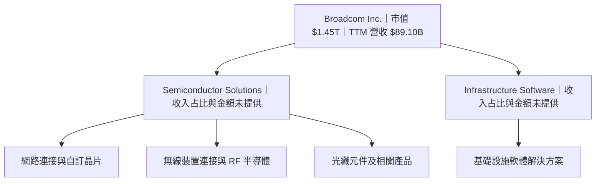
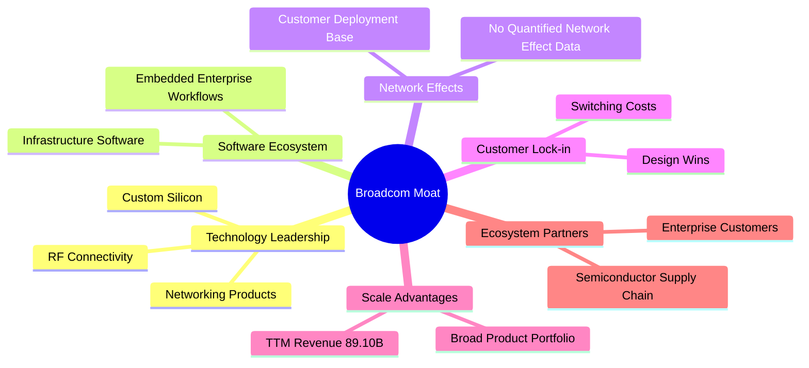
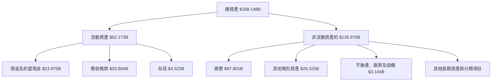
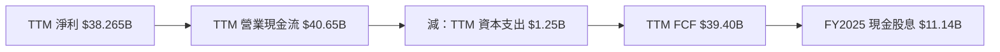
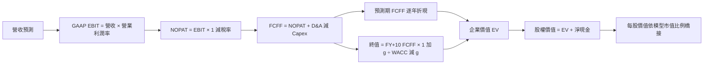
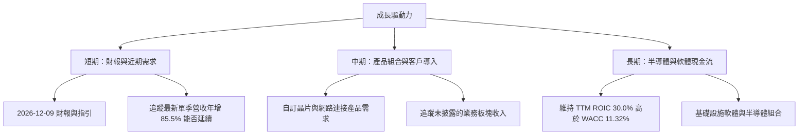
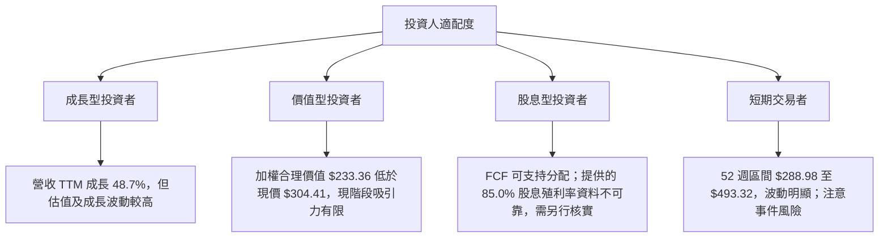

# AVGO 基本面深度分析報告
> **報告日期**：2026-11-22 ｜ **語言**：繁體中文 ｜ **數據來源**：SEC 申報資料 (XBRL)、Yahoo Finance、Finviz、StockAnalysis、Roic.ai ｜ **分析師**：CFA 級機構研究

## 目錄

| # | 章節 | 核心結論 |
|---|------|----------|
| 1 | 執行摘要 | 賣出；加權合理價值 $233.36；MOS −30.4% |
| 2 | 公司概覽與商業模式 | 半導體與基礎設施軟體並行；市場份額數據未提供 |
| 3 | 損益表深度分析 | TTM 營收 $89.10B，TTM 年增 48.7%；近期單季成長加速 |
| 4 | 資產負債表分析 | 淨負債 $35.44B；流動比率 2.50 倍 |
| 5 | 現金流量深度分析 | TTM FCF $39.40B；FCF Yield 2.71% |
| 6 | 獲利能力與資本效率 | ROIC 30.0%，高於 WACC 11.32% |
| 7 | 相對估值分析 | 多數同業倍數估值低於 AVGO；自身估值處於五年區間偏高位置 |
| 8 | DCF 內在價值評估 | 基準 DCF $216.69；加權合理價值 $233.36 |
| 9 | 成長催化劑 | AI 相關需求是重要成長背景，但未提供可量化 TAM |
| 10 | 風險矩陣 | 估值、AI 需求集中與營運資金惡化為主要風險 |
| 11 | 投資建議 | 依 MOS 評級為賣出；應以估值與營運門檻持續追蹤 |

---

## 1. 執行摘要

AVGO 最新 TTM 營收為 **$89.10B**，相較前一 TTM 成長 **48.7%**，最新單季年增 **85.5%**；TTM FCF 為 **$39.40B**、ROIC 為 **30.0%**，高於 **11.32% WACC**，顯示營運具有價值創造能力。不過，2026-11-20 收盤價 **$304.41** 高於基準 DCF 每股價值 **$216.69**，且加權合理價值僅 **$233.36**；以加權合理價值計算的 MOS 為 **−30.4%**，依規則 20 評級為 **賣出**。公司品質與成長動能不等於現價具吸引力，當前主要矛盾是良好的營運數據與偏高的估值並存。

### 1.0 一頁式投資儀表板（Portfolio Manager 30 秒速讀）

| 項目 | 內容 |
|------|------|
| **投資論點（3 句）** | ① TTM 營收年增 **48.7%**，最新單季年增 **85.5%**，成長動能仍高。② TTM FCF **$39.40B**、ROIC **30.0%**，高於 WACC **11.32%**。③ 現價 **$304.41** 高於加權合理價值 **$233.36**，MOS **−30.4%**。 |
| **綜合評分** | **6.6/10**（引用 1.1） |
| **財務健康** | 🟡 現金及短期投資 $23.98B，總債務 $59.42B，淨負債 $35.44B；流動比率 2.50 倍。 |
| **ROIC vs WACC** | **30.0% vs 11.32%**，ROIC 高出 18.68 個百分點，創造經濟價值。 |
| **FCF 趨勢** | TTM FCF $39.40B；近年現金流增加，TTM FCF Yield **2.71%**。 |
| **估值** | Forward P/E **15.68x** ｜ EV/EBITDA（市場資料）**28.48x** ｜ FCF Yield **2.71%**。Peer-multiples 區塊 EV/EBITDA 為 35.1x；因來源與口徑不同，兩者不混用。 |
| **DCF 內在價值（基準）** | **$216.69** ｜ 現價相對 DCF 基準溢價 **40.5%**（$304.41 ÷ $216.69 − 1）。 |
| **安全邊際（MOS）** | **−30.4%＝($233.36 − $304.41) ÷ $233.36**；以加權合理價值為基準，🔴 無安全邊際。 |
| **預期報酬（基準情境）** | 基準 DCF 情境價值 **$216.69**，相對現價 **−28.8%**；這是模型情境價差，不代表可驗證的 12 個月報酬預測。 |
| **關鍵風險（前二）** | AI 需求成長與客戶資本支出可能回落；營運資金天數上升，CCC 由 53 天升至 63 天。 |
| **評級 + 信心度** | 🔴 **賣出** ｜ 信心：中（營運數據有力，但估值與來源間的部分指標口徑不完全一致）。 |

### 1.1 綜合評分卡（全報告唯一）

| 維度 | 評分（1–10） | 主要依據（引用數字與其來源章節） |
|------|--------------|----------------------------------|
| 成長性 | 8.5 | TTM 營收成長 48.7%、最新單季年增 85.5%（第 3 章）；成長速度高，但須考量單季高增幅不宜直接線性外推。 |
| 獲利能力 | 9.0 | TTM 營業利益率 48.0%、ROIC 30.0%，高於 WACC 11.32%；F-Score 7/8（第 6 章）。 |
| 財務健康 | 6.5 | 淨負債 $35.44B，流動比率 2.504；CCC 從 53 天升至 63 天（第 4 章）。 |
| 估值 | 2.0 | 加權合理價值 $233.36、MOS −30.4%；P/E、P/S 與 EV/EBITDA 均位於自身五年區間中高位置（第 7、8 章）。 |
| 護城河 | 8.0 | 營業利益率 48.0%、TTM 毛利率 75.5%，半導體與基礎設施軟體的業務組合具黏著性；未提供市場份額數據（第 2 章）。 |
| 管理層與資本配置 | 6.0 | FCF 支持股息與投資，但 FY2025 SBC $7.57B；稀釋股數測試未通過（第 3、5、6 章）。 |
| **綜合評分** | **6.7** | 六項算術平均：\((8.5+9.0+6.5+2.0+8.0+6.0)÷6=6.67\)，四捨五入至小數一位。 |

### 1.2 五大投資論點 + 三大核心風險

| 類型 | 項目 | 具體依據 | 信心度 |
|------|------|----------|--------|
| 🟢 **投資論點①** | 成長動能加快 | TTM 營收 $89.10B、TTM 成長 48.7%；最新單季營收年增 85.5%。 | 🟢 高 |
| 🟢 **投資論點②** | 高現金創造力 | TTM 營業現金流 $40.65B，扣除資本支出 $1.25B 後，FCF 為 $39.40B。 | 🟢 高 |
| 🟢 **投資論點③** | 高於資本成本的報酬 | ROIC 30.0%，較 WACC 11.32% 高 18.68 個百分點。 | 🟢 高 |
| 🟢 **投資論點④** | 高毛利與營業槓桿 | TTM 毛利率 75.5%、TTM 營業利益率 48.0%；最新季度營業利益率為 53.9%。 | 🟢 中高 |
| 🟢 **投資論點⑤** | 軟體與半導體組合 | 公司同時經營 Semiconductor Solutions 與 Infrastructure Software；業務組合有助分散單一產品週期，但各板塊營收占比未提供。 | 🟡 中 |
| 🟡 **風險①** | 估值回檔風險 | 加權合理價值 $233.36，較現價低 $71.05；MOS 為 −30.4%。 | 🔴 高衝擊 |
| 🔴 **風險②** | 成長預期過高 | 基準 DCF 的第 1 年成長假設為 30.0%；Reverse DCF 顯示現價隱含第 1 年營收成長 39.3%。 | 🔴 高衝擊 |
| 🟡 **風險③** | 營運資金與稀釋 | CCC 年增 10 天、DSO 年增 16 天；F-Score 的稀釋股數未增加測試未通過。 | 🟡 中高 |

### 1.3 快速統計卡片

| 指標 | 公司實際值（期間） | 同業中位數 | 狀態 |
|------|--------------------|------------|------|
| 營收成長（TTM） | **48.7%** | — | 🟢 |
| 營收成長（最新一季年增） | **85.5%** | **36.5%** | 🟢 |
| 毛利率（TTM） | **75.5%** | **53.1%** | 🟢 |
| 營業利益率（TTM） | **48.0%** | — | 🟢 |
| ROIC（TTM） | **30.0%** | — | 🟢 |
| Forward P/E | **15.68x** | **12.3x** | 🟡 |
| FCF Yield（TTM） | **2.71%** | — | 🟡 |
| Piotroski F-Score | **7 / 8** | — | 🟢 |

*註：同業中位數由 NVDA、MRVL、QCOM 的 Peer multiples 計算。Forward P/E 中位數為 12.3x；毛利率中位數為 53.1%；最新一季營收成長中位數為 36.5%。*

### 1.4 投資結論

```text
╔══════════════════════════════════════════════════════════════════╗
║                    📊 投資結論摘要                               ║
╠══════════════════════════════════════════════════════════════════╣
║  評級：🔴 賣出（由 8.8 MOS 門檻決定，未作質化調整）              ║
║  價格（2026-11-20 收盤）：$304.41                                ║
║  DCF 內在價值（基準）：$216.69（現價溢價 40.5%）                ║
║  安全邊際 MOS：−30.4%（以加權合理價值 $233.36 為分母）          ║
║  加權合理價值（8.8）：$233.36                                    ║
║  DCF 情境價值：悲觀 $89.27（−70.7%）                             ║
║                基準 $216.69（−28.8%）                            ║
║                樂觀 $479.09（+57.4%）                            ║
║  綜合評分：6.7/10（引用 1.1）                                    ║
║  適合投資人：能承受高波動、願意等待估值回落的長線投資人          ║
╚══════════════════════════════════════════════════════════════════╝
```

---

## 2. 公司概覽與商業模式

### 2.1 業務結構與收入來源

公司資料顯示 Broadcom 主要營運兩個板塊：Semiconductor Solutions 與 Infrastructure Software。未提供各板塊營收、占比及軟體訂閱收入數字，因此不以估計比例繪製收入結構。



公司產品包含網路連接、自訂晶片、乙太網路交換與路由、NIC 控制器、RF 半導體、光纖元件及基礎設施軟體。各產品的營收、毛利與訂閱性收入拆分未提供，無法精確比較各業務對整體利潤的貢獻。

### 2.2 市場份額

市場份額數據未提供，因此不繪製份額圓餅圖或填入推估比例。以可比數據觀察，AVGO 最新單季營收年增 85.5%，高於 NVDA、MRVL、QCOM 最新單季成長率中位數 36.5%；但三家公司產品組合不同，這只能作為成長速度比較，不能直接推論市場份額。

### 2.3 競爭護城河分析



### 2.4 護城河強度

| 護城河項目 | 強度（強／中／弱） | 證據（引用數字或事實） | 會削弱它的情況 |
|------------|--------------------|------------------------|----------------|
| 技術與產品組合 | 強 | 涵蓋自訂晶片、乙太網路、RF 與光纖元件；TTM 毛利率 75.5%。 | 競爭者在性能、成本或供應能力上取得持續優勢。 |
| 軟體生態系統 | 中強 | 公司另有 Infrastructure Software 板塊；板塊營收占比與留存率未提供。 | 客戶遷移成本下降、續約率下滑或產品整合效益未實現。 |
| 網路效應 | 中／資料有限 | 未提供使用者網絡或市場份額量化指標。 | 競爭替代品增多，客戶可多供應商採購。 |
| 客戶鎖定 | 中強 | 半導體設計導入通常涉及產品設計與驗證週期；公司也提供企業軟體。特定合約數據未提供。 | 客戶集中度升高、主要客戶轉向自研或切換供應商。 |
| 規模效應 | 強 | TTM 營收 $89.10B，TTM 營業利益率 48.0%。 | 併購整合成本上升、研發與銷售費用增速高於營收。 |
| 生態夥伴 | 中 | 產品涉及半導體供應鏈與企業客戶部署；合作夥伴收入貢獻未提供。 | 供應鏈瓶頸或大型合作夥伴改採替代方案。 |

1.1 護城河評分 **8.0/10**，主要依據是 75.5% 的 TTM 毛利率、48.0% 的 TTM 營業利益率，以及涵蓋半導體與基礎設施軟體的產品組合；市場份額與客戶留存數據缺失，使評分未給更高。

---

## 3. 損益表深度分析

### 3.1 年度收入成長趨勢（近 4 年）

FY2022 至 FY2025 營收分別為 $33.20B、$35.82B、$51.57B、$63.89B。FY2022–FY2025 三年 CAGR 約為 24.4%；計算式為 \((63.89÷33.20)^{1/3}−1=24.4\%\)。

```text
╔══════════════════════════════════════════════════════════════════╗
║              Broadcom 年度收入趨勢（FY2022-FY2025）             ║
╠══════════════════════════════════════════════════════════════════╣
║  FY2022  $33.20B  ██████████░░░░░░░░░░░░░  🟡                 ║
║  FY2023  $35.82B  ███████████░░░░░░░░░░░░  YoY +7.9%  🟡    ║
║  FY2024  $51.57B  ████████████████░░░░░░░  YoY +44.0% 🟢    ║
║  FY2025  $63.89B  ████████████████████░░░  YoY +23.9% 🟢    ║
╠══════════════════════════════════════════════════════════════════╣
║  FY2022-FY2025 三年營收 CAGR：約 +24.4%                         ║
╚══════════════════════════════════════════════════════════════════╝
```

FY2024 成長加速，與公司業務規模擴大及產品組合變化一致；FY2025 仍成長 23.9%，而 TTM 成長升至 48.7%。目前最新單季的 85.5% 年增率進一步加速，但高基期與單季波動使它不宜直接視為長期成長率。

### 3.2 季度收入趨勢分析

| 季度（資料期） | 營收（$B） | QoQ 成長 | YoY 成長 | 備註 |
|---|---:|---:|---:|---|
| 2025-10-31 | 18.02 | — | — | 缺少前一季同來源比較列，故不填算 QoQ。 |
| 2026-01-31 | 19.31 | +7.2% | — | 以季度收入資料計算 QoQ；年度同期比較缺少一致列。 |
| 2026-04-30 | 22.19 | +14.9% | — | 以季度收入資料計算 QoQ。 |
| 2026-07-31 | 29.59 | +33.4% | +85.5% | 最新單季年增率採用 SEC 對應的 VERIFIED FIGURES；該季度欄位在不同來源呈現的期間標籤略有差異。 |

季度 QoQ 算式依次為：\(19.31÷18.02−1=7.2\%\)、\(22.19÷19.31−1=14.9\%\)、\(29.59÷22.19−1=33.4\%\)。最新季度大幅增加可能反映需求與產品組合的變化；因未提供各業務板塊季度營收，無法拆解其來源。

### 3.3 利潤率演變分析

以下年度毛利率由年度毛利除以年度營收計算。年度營業利益率以年度報表數據計算，與 TTM VERIFIED FIGURES 的口徑分開列示。

| 利潤率指標 | FY2022 | FY2023 | FY2024 | FY2025 | 趨勢 | 評估 |
|------------|-------:|-------:|-------:|-------:|------|------|
| **毛利率** | 66.5% | 68.9% | 63.0% | 67.8% | 2024 下降、2025 回升 | 🟢 |
| **營業利益率** | 43.0% | 45.9% | 29.1% | 40.8% | 2024 下滑、2025 修復 | 🟡 |
| **淨利率** | 34.6% | 39.3% | 11.4% | 36.2% | 2024 顯著下降、2025 回升 | 🟡 |

FY2024 營業利益率降至 29.1%，FY2025 回升至 40.8%；淨利率也由 39.3% 降至 11.4% 後回升至 36.2%。資料顯示 FY2024 的非線性變化顯著，但未提供可完整拆分的併購攤銷、重組費用與稅務調節表，不能將變化歸因於單一因素。TTM 營業利益率採 VERIFIED FIGURES 的 **48.0%**；另有來源報出 48.5%，本報告依規則優先使用經核實數字。

### 3.4 費用結構分析

財務資料提供 FY2025 研發費用 $10.98B、營收 $63.89B、毛利 $43.29B、營業利益 $26.07B；但未提供完整且一致的銷售、管理、研發及其他營業費用分類，因此不將不完整數字拼成費用結構圓餅圖。

可計算 FY2025 研發費用占營收約 \(10.98÷63.89=17.2\%\)。此比率顯示研發投入具一定規模，但未提供各業務板塊的研發分配及費用分類，無法進一步推算單位產品的研發回報。

### 3.5 季度 EPS 趨勢與盈餘品質（Quality of Earnings）

| 季度 | EPS 實際 | EPS 估值 | 超預期／不及預期 | 說明 |
|---|---:|---:|---|---|
| 2026-07-31 | N/A | N/A | 無法判定 | EPS beat/miss 資料列為 nan，沒有可用估值。 |
| 2026-04-30 | N/A | N/A | 無法判定 | EPS beat/miss 資料列為 nan，沒有可用估值。 |
| 2026-01-31 | N/A | N/A | 無法判定 | EPS beat/miss 資料列為 nan，沒有可用估值。 |
| 2025-10-31 | N/A | N/A | 無法判定 | EPS beat/miss 資料列為 nan，沒有可用估值。 |

提供的另一組季度 EPS 數字為 $2.68、$1.91、$1.50、$1.74，但各來源期間標籤並不完全一致；在分析師估值缺失下，不能將營收或 EPS 年增率當作「超預期」。

| 盈餘品質項目 | 數值／佔比 | 評估 |
|--------------|-----------|------|
| 股權薪酬 SBC / 營收 | FY2025：$7.57B ÷ $63.89B = **11.9%** | 🔴 金額重大；SBC 是經濟成本，長期可能稀釋股東權益。 |
| SBC / 營業現金流 | FY2025：$7.57B ÷ $27.54B = **27.5%** | 🟡 SBC 相對現金流規模不低。 |
| FCF / 淨利（現金轉換率） | TTM：$39.40B ÷ $38.265B = **103.0%** | 🟢 現金轉換率高於 100%；淨利數值取 StockAnalysis TTM。 |
| 一次性／非經常性損益 | N/A | 缺少可一致核對的 TTM 非經常性項目明細，不判斷有無。 |
| 有效稅率異常 | N/A | 未提供 TTM 所得稅費用與稅前利潤的完整一致拆分。 |
| 資本化支出 vs 費用化 | TTM Capex $1.25B；資本化明細 N/A | 資本支出金額可引用，但不能據此判定資本化政策是否造成當期利潤高估。 |

FY2025 SBC 對營收占比 11.9%，且 Piotroski 的稀釋股數測試未通過，應把 SBC 視為股東回報成本，而不能只因其非現金性便忽略。另一方面，TTM FCF 對淨利轉換率約 103.0%，現金流對帳面獲利有支持。整體而言，現金獲利含金量良好，但股權薪酬稀釋需要持續監控。

---

## 4. 資產負債表分析

### 4.1 資產結構分解

依 StockAnalysis 2026-08-02 資產負債表，總資產 $188.148B，流動資產 $52.173B；下圖為兩者關係及可取得的主要非流動資產項目，其他資產與項目分類未列明部分不另行推算。



非流動資產約為 \(188.148−52.173=135.975\)B。商譽與無形資產合計 $124.126B，為重大帳面資產，主要增加減值風險與收購整合的重要性；未提供減值測試假設，不能量化潛在減值金額。

### 4.2 流動性與營運資金分析

| 指標 | 最新 TTM | 一年前 TTM | 變化 | 解讀 |
|------|----------:|-----------:|------:|------|
| 流動比率 | 2.504 | N/A | N/A | 最新流動資產覆蓋流動負債約 2.5 倍；同口徑一年前比率未提供。 |
| 速動比率 | 2.153 | N/A | N/A | 即使排除部分存貨後，短期流動性仍有緩衝。 |
| DSO 應收帳款天數 | 56 天 | 40 天 | +16 天 | 收款天數延長，需追蹤應收帳款增速是否持續高於營收。 |
| DIO 存貨天數 | 59 天 | 40 天 | +19 天 | 存貨天數增加，可能反映備貨與供應安排，也提高庫存減值風險。 |
| DPO 應付帳款天數 | 52 天 | 26 天 | +26 天 | 付款天數延長，對 CCC 有部分抵銷；不能單獨等同供應商議價力提升。 |
| CCC 現金轉換週期 | 63 天 | 53 天 | +10 天 | DSO 與 DIO 上升幅度超過 DPO 的改善，營運資金占用較一年前增加。 |

營運資金日數均照錄品質指標，未重新計算。CCC 由 53 天升至 63 天是值得留意的現金轉換訊號，尤其在營收快速成長時，應確認應收款回收與存貨周轉是否同步改善。

### 4.3 債務結構分析

```text
╔══════════════════════════════════════════════════════════════════╗
║                   Broadcom 債務健康診斷                          ║
╠══════════════════════════════════════════════════════════════════╣
║  總債務：              $59.42B  ████████████████████             ║
║  現金及短期投資：      $23.98B  ████████                         ║
║  淨負債：              $35.44B  🟡                               ║
║  ROIC：                 30.0%   高於 WACC 11.32%                 ║
║  Debt/EBITDA：          N/A     缺少與債務同期間、同口徑 EBITDA   ║
║  利息保障倍數：         N/A     缺少可核對的利息費用與 EBIT 配對   ║
╚══════════════════════════════════════════════════════════════════╝
```

淨負債算式為 \(59.42−23.98=35.44\)B。公司仍有淨負債，但 TTM 營業現金流 $40.65B 及 FCF $39.40B 提供償債能力；未提供同口徑利息保障倍數及債務期限表，故不推算償債年限或到期風險。

### 4.4 股東權益趨勢

| 財年 | 股東權益（$B） | YoY 變化 |
|------|---------------:|---------:|
| FY2022 | 22.71 | — |
| FY2023 | 23.99 | +5.6% |
| FY2024 | 67.68 | +182.1% |
| FY2025 | 81.29 | +20.1% |

FY2024 股東權益大幅增加，但同期資產也由 $72.86B 升至 $165.65B，且商譽由 $43.65B 升至 $97.87B；這反映資產負債表規模和無形資產結構明顯變化，不能把權益增加直接解讀成內生累積的現金資本。

---

## 5. 現金流量深度分析

### 5.1 現金流量瀑布圖

年度與 TTM 淨利口徑未完全同期間，圖中分開列示，避免以不同期間數字拼接為單一瀑布。



### 5.2 FCF 轉換率趨勢

| 財年 | 營業現金流（$B） | FCF（$B） | 淨利（$B） | FCF / 淨利 |
|------|------------------:|----------:|-----------:|-----------:|
| FY2022 | 16.74 | 16.31 | 11.49 | 142.0% |
| FY2023 | 18.09 | 17.63 | 14.08 | 125.2% |
| FY2024 | 19.96 | 19.41 | 5.89 | 329.5% |
| FY2025 | 27.54 | 26.91 | 23.13 | 116.3% |

FY2024 的高轉換率主要是因淨利分母較低，不宜視為常態水準。FY2025 FCF 對淨利轉換率回到 116.3%，TTM 約為 103.0%，均顯示現金流仍能支持會計獲利。

### 5.3 自由現金流趨勢

```text
╔══════════════════════════════════════════════════════════════════╗
║                    自由現金流趨勢                                ║
╠══════════════════════════════════════════════════════════════════╣
║  FY2022  $16.31B  ████████████░░░░░░░░  🟢                     ║
║  FY2023  $17.63B  █████████████░░░░░░░  YoY +8.1%             ║
║  FY2024  $19.41B  ██████████████░░░░░░  YoY +10.1%            ║
║  FY2025  $26.91B  ████████████████████  YoY +38.6%            ║
║  TTM     $39.40B  期間涵蓋至 2026-08-02，非同一財年比較         ║
╠══════════════════════════════════════════════════════════════════╣
║  TTM FCF Yield：2.71%                                            ║
╚══════════════════════════════════════════════════════════════════╝
```

TTM FCF **$39.40B** 定義固定為營業現金流 **$40.65B** 減資本支出 **$1.25B**。FY2025 的 FCF 年增 38.6%，而 TTM 數字又更高，但最新 TTM 與年度財報區間不同，不能直接視作單一年度 YoY。

### 5.4 資本配置評估

FY2025 現金股息支付 $11.14B，相當於 FY2025 FCF $26.91B 的約 41.4%；FY2025 SBC $7.57B。其餘資本用途（回購、併購或其他投資）的同期間可比明細不足，因此不畫資本配置圓餅圖。

| 資本配置項目 | 可用數字 | 評估 |
|--------------|----------|------|
| 股息 | FY2025 現金股息 $11.14B | FCF 能覆蓋股息；提供的股息殖利率 85.0% 與其他財務指標明顯不相容，故不作估值依據。 |
| 資本支出 | TTM $1.25B | 相對 TTM FCF 不高，但不可僅憑低 Capex 推論長期投資需求不足。 |
| SBC | FY2025 $7.57B | 對股東有稀釋成本；需同時看股數變化與現金流。 |
| 回購／收購／留存 | N/A | 未提供完整且一致的同期資本配置明細。 |

---

## 6. 獲利能力與資本效率

### 6.1 ROE / ROA / ROIC 趨勢

| 指標 | 最新可用值 | 期間／來源 | 評估 |
|------|-----------:|-------------|------|
| ROE | 38.4% | TTM，QUALITY FIGURES；closing balances | 🟢 |
| ROA | N/A | 品質指標提供 F-Score 測試結果，但未提供可直接引用的 ROA 數值 | — |
| ROIC | 30.0% | TTM，VERIFIED FIGURES | 🟢 |
| 歷年 ROE／ROA／ROIC 同口徑序列 | N/A | 未提供一致的歷史計算序列 | — |

未提供可核對的同業資本報酬率或行業均值，故不作行業均值對比。另有市場資料來源提供 ROE 44.2%，與品質指標所列 38.4% 不同；本報告對杜邦分解與 ROE 採用指定品質指標的 **38.4%**。

### 6.2 ROIC vs WACC 分析（核心價值創造判斷）

```text
╔══════════════════════════════════════════════════════════════════╗
║                ROIC vs WACC 深度分析                            ║
╠══════════════════════════════════════════════════════════════════╣
║  WACC 輸入（成本資本資料）：                                      ║
║  ├── 無風險利率 Rf：                 4.91%                       ║
║  ├── 市場風險溢酬 ERP：              5.00%                       ║
║  ├── 原始 Beta：                     1.51                        ║
║  ├── 調整後 Beta：                   1.34                        ║
║  ├── 股權成本 Ke：                   11.61%                      ║
║  ├── 稅前債務成本：                  5.40%                       ║
║  ├── 股權／債務權重：                96.1%／3.9%                 ║
║  └── 採用 WACC：                     11.32%                      ║
║                                                                  ║
║  ROIC：                              30.0%                       ║
║  EVA 差額：                          30.0% − 11.32% = 18.68pp   ║
║                                                                  ║
║  ROIC  30.0%  ▓▓▓▓▓▓▓▓▓▓▓▓▓▓▓▓▓▓▓▓▓▓▓▓▓▓▓▓▓▓░░░░░░░░          ║
║  WACC  11.32% ▓▓▓▓▓▓▓▓▓▓▓▓░░░░░░░░░░░░░░░░░░░░░░░░          ║
║                                                                  ║
║  結論：ROIC 高於 WACC 18.68 個百分點，TTM 口徑下創造股東價值。 ║
╚══════════════════════════════════════════════════════════════════╝
```

原始 Beta 1.51 按提供的調整方式處理：\(⅔×1.51+⅓×1=1.34\)。成本資本區塊給出的 Ke 為 11.61%，WACC 為 11.32%，本報告直接採用區塊提供的 WACC，不另以四捨五入的權重和組成項重算取代。WACC 的完整來源推導見 8.2。

### 6.3 杜邦三因素分解

以下數字照錄 QUALITY FIGURES，採 TTM closing balances 口徑。

| 因素 | 數值（TTM） | 解讀 |
|------|-------------|------|
| 淨利率 | 42.9% | 高淨利率是 ROE 的重要來源。 |
| 資產週轉率 | 0.47 | 每單位資產帶來約 0.47 單位營收。 |
| 權益乘數 | 1.89 | 財務槓桿對 ROE 有貢獻，但非唯一驅動因素。 |
| **ROE** | **38.4%** | **42.9% × 0.47 × 1.89 = 38.1%**；與原始列示 ROE 38.4% 的差異來自因子四捨五入。 |

### 6.4 財務體質：Piotroski F-Score

Piotroski F-Score 為 **7/8**；因一項測試缺少輸入而不納入分母，故可判定測試數為 8，而非 9。

| 測試 | 結果 | 解讀 |
|------|------|------|
| ROA > 0 | ✅ 通過 | 盈利能力為正。 |
| 營業現金流 > 0 | ✅ 通過 | 現金營運成果為正。 |
| ROA 高於一年前 | ✅ 通過 | 資產報酬趨勢改善。 |
| 營業現金流 > 淨利（應計品質） | ✅ 通過 | 現金流高於淨利，有利盈餘品質。 |
| 長期負債 ÷ 總資產低於一年前 | — 無法判定 | 缺少輸入，不計入 8 項分母。 |
| 流動比率高於一年前 | ✅ 通過 | 流動性相對改善。 |
| 稀釋股數未增加 | ❌ 未通過 | 股數增加，SBC 等稀釋因素須持續監控。 |
| 毛利率高於一年前 | ✅ 通過 | 毛利率趨勢改善。 |
| 資產週轉率高於一年前 | ✅ 通過 | 資產利用效率改善。 |

---

## 7. 相對估值分析

### 7.1 同業估值比較表格

本表同業倍數採 Peer multiples 區塊；AVGO 倍數按同一區塊中的公司值列示，避免與其他資料來源的不同口徑混用。

| 估值指標 | **AVGO** | **NVDA** | **MRVL** | **QCOM** | 本公司評估 |
|----------|---------:|---------:|---------:|---------:|------------|
| **Trailing P/E** | 38.8x | 13.5x | 40.2x | 11.8x | 🔴 高於 NVDA、QCOM，略低於 MRVL。 |
| **Forward P/E** | 15.7x | 7.6x | 16.6x | 12.3x | 🟡 高於同業中位數 12.3x，但低於 MRVL。 |
| **P/S Ratio** | 16.7x | 8.4x | 11.6x | 3.7x | 🔴 高於三家同業。 |
| **EV/EBITDA** | 35.1x | 12.2x | 38.1x | 15.9x | 🔴 高於 NVDA、QCOM；與 MRVL 接近。 |
| **最新單季營收 YoY** | 85.5% | 103.2% | 36.5% | −8.4% | 🟢 高於兩家同業、低於 NVDA。 |
| **Gross Margin TTM** | N/A* | 74.9% | 52.2% | 53.1% | — |

\*AVGO TTM 毛利率 75.5% 可從公司財務資料引用，但此 Peer multiples 區塊未列 AVGO 同欄毛利率；此列不以不同來源補入以免混淆表格口徑。另於 1.3 已比較指定公司與三家同業毛利率。

### 7.2 歷史估值區間分析

```text
╔══════════════════════════════════════════════════════════════════╗
║               AVGO 五年歷史估值區間（TTM）                       ║
╠══════════════════════════════════════════════════════════════════╣
║  P/E：      1.8x ───── 中位數 5.5x ───────── 現值 38.8x ─ 77.5x ║
║                                  現值百分位：70%                 ║
║  P/S：      0.6x ───── 中位數 1.5x ──────── 現值 16.7x ─ 28.1x ║
║                                  現值百分位：65%                 ║
║  EV/EBITDA：0.5x ───── 中位數 5.6x ──────── 現值 35.1x ─ 70.7x ║
║                                  現值百分位：55%                 ║
╚══════════════════════════════════════════════════════════════════╝
```

當前三項估值倍數均高於自身五年中位數；P/E 與 P/S 分別位於歷史百分位 70% 與 65%。這些歷史倍數受公司業務組成、財報期間及資本結構變化影響，不能單獨作為合理價值，但支持現價估值不便宜的判斷。

### 7.3 情境價值（Bear / Base / Bull）

| 情境 | 第 1 年營收成長 | 期末營業利潤率 | WACC | 每股價值 | 相對現價 | 機率 | 會發生的條件 |
|------|----------------:|----------------:|-----:|---------:|---------:|-----:|--------------|
| 🔴 悲觀 | 15.0% | 36.4% | 12.32% | $89.27 | −70.7% | 25% | AI 與半導體需求降速、競爭加劇，利潤率向下修正且資本成本上升。 |
| 🟡 基準 | 30.0% | 42.8% | 11.32% | $216.69 | −28.8% | 50% | 成長由第一年高增逐年降至第十年 3%，利潤率逐步回歸長期中位數。 |
| 🟢 樂觀 | 45.0% | 47.1% | 10.32% | $479.09 | +57.4% | 25% | AI、自訂晶片與網路產品需求超預期，利潤率保持較高水準、折現率下降。 |

以上情境值與假設均照錄 DCF MODEL。各情境為長期模型情境，不應視作一年期目標價。

### 7.4 相對估值隱含價格區間

```text
╔══════════════════════════════════════════════════════════════════╗
║               估值方法隱含每股價值與現價位置                     ║
╠══════════════════════════════════════════════════════════════════╣
║  $137.19 ── $216.69 ── $238.96 ── $304.41 ── $526.47           ║
║  EV/EBITDA     DCF      Forward P/E   現價      分析師共識       ║
╚══════════════════════════════════════════════════════════════════╝
```

| 方法 | 每股價值 | 依據 |
|------|---------:|------|
| 同業 EV/EBITDA | $137.19 | NVDA、MRVL、QCOM 中位數 15.9x × TTM EBITDA，再加淨現金；實際採用值照錄估值方法區塊。 |
| DCF（基準） | $216.69 | 10 年 FCFF、WACC 11.32%、永續成長率 3.0%。 |
| 同業 Forward P/E | $238.96 | 同業 Forward P/E 中位數 12.3x × Forward EPS $19.41。 |
| 分析師共識目標價 | $526.47 | 47 位分析師平均目標價。 |

---

## 8. DCF 內在價值評估（Discounted Cash Flow）

DCF 使用已計算的 10 年 FCFF 模型。模型假設、FCF、折現因子、終值、橋接、情境與敏感度均依程式模型照錄；下文著重揭露假設來源與模型限制，不另建替代模型。

### 8.0 估值推理鏈（Thinking Logic）

**Step 1 — 價值來源與主導變數**

AVGO 的估值由現有半導體與基礎設施軟體業務所產生的現金流，以及半導體需求成長帶來的未來現金流共同決定。兩板塊收入占比未提供，故不虛構拆分比例。模型的主要敏感變數是 **WACC 與永續成長率 g**：依敏感度表，WACC 11.32%、g 3.0% 時每股價值為 $216.69；WACC 變動會同時影響預測期折現與終值折現。

**Step 2 — 模型選擇**

| 決策點 | 本報告採用 | 理由（含數字） | 曾考慮但否決 | 否決理由 |
|--------|-----------|----------------|--------------|----------|
| 現金流定義 | FCFF | 與 WACC 折現、由 EV 橋接至股權價值的模型一致。 | FCFE | 債務融資現金流未逐年提供，不採股權現金流建模。 |
| 預測期 N | 10 年 | 模型預測期固定為 10 年；企業產品與半導體週期長度無精確量化資料。 | 5 年 | 短於指定模型，且不允許另建模型替換。 |
| 終值方法 | Gordon Growth | DCF MODEL 指定永續成長率 3.0%。 | 退出倍數 | 模型區塊未提供退出倍數法終值數字；不另行建模。 |
| EBIT 基礎 | GAAP | 模型採用 GAAP EBIT，SBC 已列為費用。 | 非 GAAP | 另加回 SBC 會改變既定模型口徑。 |

**Step 3 — 主要假設的錨點與取捨**

- **營收成長**：錨點＝TTM 成長 48.7%、最新單季年增 85.5%；調整理由＝最新成長率不宜長期外推，模型將成長由 30.0% 線性降至 3.0%；**採用第 1 年 30.0%、第 10 年 3.0%**；否決以 48.7% 作為 10 年固定成長，因會忽略高基期與週期性。
- **營業利潤率**：錨點＝TTM 營業利益率 48.0%；調整理由＝模型假設隨期程逐步回歸過去五個財年的中位數；**FY+1 48.0% 至 FY+10 42.8%**；否決永久維持 48.0%，因長期競爭與組合變動可能侵蝕利潤率。
- **預測期 N**：錨點＝模型預設 10 年；調整理由＝用較長期間捕捉成長退坡；**採用 10 年**；否決自行改成較短期，因不得更動模型。
- **Capex／營收**：錨點＝TTM 1.4%；模型按既定假設由 FY+1 的 1.4% 降至 FY+10 的 0.8%，以不低於 D&A 的長期關係作為調節邏輯；否決固定使用 0.8%，因忽略近端投資水準。
- **D&A／營收**：錨點＝TTM 0.7%；**採用固定 0.7%**；此為依模型設定，未另行調整。
- **有效稅率**：錨點與採用值均為模型預設 **21.0%**；未提供逐年稅務預測，不能稱作公司管理層財測。
- **營運資金**：模型標明未建模，故 ΔWC 不進 FCFF 公式；**不是假設 ΔWC 等於零的經濟結論**，而是模型省略項目。拒絕自行補入推估值。
- **EBIT 與 SBC**：採 GAAP EBIT，已含 SBC 費用；FCFF 不再次扣 SBC，股數不再額外稀釋。**本模型採用 (A)，故 SBC 影響已計入一次。**
- **年稀釋率**：採模型組合 (A)，固定股數、不另計年稀釋；拒絕把 SBC 再以股數稀釋重複扣除。
- **永續成長率 g**：錨點＝模型設定 3.0%，且低於 WACC 11.32%；**採用 3.0%**；否決高於 3.0% 的長期成長假設，避免超過可持續長期成長的限制。
- **終值方法**：採 Gordon Growth，因模型已提供終值；未以缺失的退出倍數法額外建立終值。
- **WACC**：採成本資本資料提供的 11.32%；不另算第二個 WACC，也不以四捨五入後組成項取代核定值。

**Step 4 — 最脆弱環節**

最脆弱環節是營收成長與折現率：若 AI 需求不支持模型假設，或資本成本上升，DCF 會下降；基準敏感度表顯示 WACC 從 11.32% 上升至 12.32%、g 維持 3.0% 時，價值由 $216.69 降至 $189.58。

**Step 5 — 計算路徑圖**



### 8.1 模型假設總表（Model Inputs）

| 假設項目 | 採用值 | 依據／來源 | 敏感度 |
|----------|--------|-------------|--------|
| 預測期長度 N | 10 年 | DCF MODEL 固定預測期。 | 🟡 中 |
| 營收成長 | FY+1 30.0%，FY+10 3.0%，逐年線性退坡 | TTM 成長 48.7%；模型限制在最高 30.0%，並退坡至 3.0%。 | 🔴 高 |
| 營業利潤率 | FY+1 48.0% 至 FY+10 42.8% | FY+1 採 TTM 48.0%；期末回歸最近五個財年中位數。 | 🔴 高 |
| 有效稅率 | 21.0% | DCF MODEL 預設稅率。 | 🟢 低 |
| Capex／營收 | FY+1 1.4% 至 FY+10 0.8% | TTM 1.4%，逐步降至模型設定值。 | 🟡 中 |
| D&A／營收 | 0.7% | TTM 比率，模型固定。 | 🟢 低 |
| 營運資金變動 | 未建模 | DCF MODEL 明列 working capital is not modelled；不是資料推算為零。 | 🟡 中 |
| EBIT 基礎 | GAAP | 模型使用 GAAP EBIT。 | 🟡 中 |
| SBC 處理 | 組合 (A)：GAAP EBIT、不再扣 SBC | SBC 已含於 GAAP 費用；不另扣 SBC。 | 🟡 中 |
| 年稀釋率 | 模型不另計稀釋 | 與組合 (A) 一致；模型股數不再額外放大。 | 🟡 中 |
| 永續成長率 g | 3.0% | DCF MODEL；低於 WACC 11.32%。 | 🔴 高 |
| 終值方法 | Gordon Growth | DCF MODEL 已提供終值。 | 🔴 高 |
| WACC | 11.32% | 成本資本資料提供值，與第 6.2 節一致。 | 🔴 高 |
| 目標股數與每股橋接 | 依模型：股權價值 × 價格 ÷ 市值 | DCF MODEL「Per share」行；不改用另行估算的稀釋股數。 | 🟡 中 |

FCFF 公式依模型為 **NOPAT + D&A − Capex**，未包含營運資金變動。SBC 僅計入一次，模型採組合 (A)。

### 8.2 折現率推導（WACC）

```text
╔══════════════════════════════════════════════════════════════════╗
║                    WACC 推導（折現率）                           ║
╠══════════════════════════════════════════════════════════════════╣
║  股權成本 Ke（CAPM）：                                           ║
║  ├── 無風險利率 Rf（10Y 美債）：      4.91%                     ║
║  ├── 市場風險溢酬 ERP：               5.00%                     ║
║  ├── 原始 Beta（Yahoo）：              1.51                      ║
║  ├── 調整 Beta：                       ⅔×1.51＋⅓×1＝1.34        ║
║  ├── 規模／國別溢酬：                  未另加                    ║
║  └── Ke = 4.91% + 1.34×5.00% = 11.61%                          ║
║                                                                  ║
║  債務成本 Kd：                                                    ║
║  ├── 稅前債務成本（區塊提供）：         5.40%                     ║
║  ├── 稅率：                             21.0%                    ║
║  └── 稅後 Kd = 5.40%×(1−21.0%) = 4.266%                        ║
║                                                                  ║
║  資本權重（成本資本資料）：股權 96.1%／債務 3.9%                 ║
║  採用 WACC：11.32%（原值引用，不另以四捨五入分項重算替代）      ║
╚══════════════════════════════════════════════════════════════════╝
```

- **Ke（CAPM）**：\(4.91\%+1.34×5.00\%=11.61\%\)。無風險利率採成本資本資料所列 10 年期美債 4.91%；未提供觀察日期，故不另指定日期。ERP 5.00% 為成本資本資料採用值，屬假設輸入。Beta 原值 1.51 以 \(⅔×原始Beta+⅓×1\) 調整為 1.34。
- **稅前 Kd**：採用資料區塊所列 5.40%。該區塊將其描述為利息／債務代理值，但未提供可完整核驗的利息費用與平均計息負債，因此不自行重建分母。
- **稅後 Kd**：\(5.40\%×(1−21.0\%)=4.266\%\)，約 4.27%。
- **權重**：採用資料區塊所列股權 96.1%、債務 3.9%，合計 \(96.1\%+3.9\%=100.0\%\)。缺少股權市值與計息債務權重的完整同口徑推導資料，故不另造 E、D 金額。
- **WACC**：成本資本資料指定採用 **11.32%**。分項為已四捨五入呈現，不能用其重新計算後取代原值；此處與第 6.2 節一致。

### 8.3 逐年自由現金流預測（基準情境）

單位：$B。表中數值、折現因子及現值照錄 DCF MODEL。金額取兩位小數，折現因子取三位小數。

| 年度 | FY+1 | FY+2 | FY+3 | FY+4 | FY+5 | FY+6 | FY+7 | FY+8 | FY+9 | FY+10 |
|------|-----:|-----:|-----:|-----:|-----:|-----:|-----:|-----:|-----:|------:|
| 營收 | 115.84 | 147.11 | 182.42 | 220.72 | 260.46 | 299.52 | 335.47 | 365.66 | 387.60 | 399.23 |
| 營收 YoY | 30.0% | 27.0% | 24.0% | 21.0% | 18.0% | 15.0% | 12.0% | 9.0% | 6.0% | 3.0% |
| 營業利潤率 | 48.0% | 47.5% | 46.9% | 46.3% | 45.7% | 45.2% | 44.6% | 44.0% | 43.4% | 42.8% |
| 營業利益 EBIT（GAAP） | 55.66 | 69.83 | 85.54 | 102.23 | 119.12 | 135.26 | 149.54 | 160.89 | 168.30 | 171.04 |
| − 稅（21.0%） | (11.69) | (14.67) | (17.96) | (21.47) | (25.02) | (28.40) | (31.40) | (33.79) | (35.34) | (35.92) |
| = NOPAT | 43.97 | 55.17 | 67.58 | 80.76 | 94.10 | 106.85 | 118.14 | 127.10 | 132.96 | 135.12 |
| + D&A | 0.82 | 1.04 | 1.29 | 1.57 | 1.85 | 2.12 | 2.38 | 2.59 | 2.75 | 2.83 |
| − Capex | (1.62) | (1.96) | (2.31) | (2.64) | (2.93) | (3.17) | (3.31) | (3.36) | (3.29) | (3.11) |
| − ΔWC | 未建模 | 未建模 | 未建模 | 未建模 | 未建模 | 未建模 | 未建模 | 未建模 | 未建模 | 未建模 |
| = FCFF | 43.17 | 54.25 | 66.56 | 79.69 | 93.02 | 105.81 | 117.21 | 126.34 | 132.41 | 134.84 |
| 折現因子 @11.32% | 0.898 | 0.807 | 0.725 | 0.651 | 0.585 | 0.526 | 0.472 | 0.424 | 0.381 | 0.342 |
| FCFF 現值 PV | 38.78 | 43.78 | 48.26 | 51.90 | 54.42 | 55.61 | 55.34 | 53.58 | 50.45 | 46.15 |

預測期現值加總（依模型原值）：

\[
38.78+43.78+48.26+51.90+54.42+55.61+55.34+53.58+50.45+46.15
=498.27\text{B}
\]

**FY+1 逐步演算：**

1. **營收**：\(89.10×(1+30.0\%)=115.83\)B；模型表格列示 $115.84B，差異為原模型顯示精度與中間值四捨五入。
2. **EBIT**：模型列示 \(115.84×48.0\%\)，EBIT 為 $55.66B。
3. **稅**：\(55.66×21.0\%=11.69\)B。
4. **NOPAT**：\(55.66−11.69=43.97\)B。
5. **D&A**：\(115.84×0.7\%=0.81\)B；模型列示 $0.82B，顯示模型採未展示的精確中間值。
6. **Capex**：模型列示 $1.62B，Capex／營收約 1.4%。
7. **ΔWC**：未建模，故不納入公式。
8. **FCFF**：模型列示 \(43.97+0.82−1.62=43.17\)B。
9. **折現與 PV**：模型列示折現因子 0.898；\(43.17×0.898=38.77\)B，與模型列示 $38.78B 的差異來自未四捨五入的中間值。

**合理性自檢：**

- 預測 FCF CAGR：以 FY+1 $43.17B 至 FY+10 $134.84B 計，九個年度間隔 CAGR 約 \((134.84÷43.17)^{1/9}−1=13.5\%\)；FY2022–FY2025 FCF CAGR 約 \((26.91÷16.31)^{1/3}−1=18.2\%\)，預測低約 4.7 個百分點，反映成長逐年退坡。
- FY+10 FCFF 利潤率：\(134.84÷399.23=33.8\%\)；現有 TTM FCF 利潤率：\(39.40÷89.10=44.2\%\)。未提供同口徑同業最佳值，故不作同業最佳比較。
- 預測各年 FCFF 均為正；模型沒有營運資金變動列，這會降低對高成長期間營運資金占用的呈現完整性。

```text
╔══════════════════════════════════════════════════════════════════╗
║            自由現金流：歷史實際 vs 模型預測                      ║
╠══════════════════════════════════════════════════════════════════╣
║  FY2023(實)  $17.63B  █████░░░░░░░░░░░░░░░  YoY: +8.1%         ║
║  FY2024(實)  $19.41B  ██████░░░░░░░░░░░░░░  YoY: +10.1%        ║
║  FY2025(實)  $26.91B  ████████░░░░░░░░░░░░  YoY: +38.6%        ║
║  FY+1 (預)   $43.17B  █████████████░░░░░░░  模型預測           ║
║  FY+10(預)  $134.84B  ████████████████████  10年模型終值年     ║
╠══════════════════════════════════════════════════════════════════╣
║  預測 FCF CAGR 約 13.5%，低於 FY2022-FY2025 歷史約 18.2%。      ║
╚══════════════════════════════════════════════════════════════════╝
```

### 8.4 終值計算（Terminal Value）

**適用性檢查：** \(WACC 11.32\%>g 3.0\%\) → ✅

| 方法 | 計算式 | 終值 TV | TV 現值 | 佔總 EV 比重 |
|------|--------|---------:|--------:|-------------:|
| Gordon Growth | \(134.84×(1+3.0\%)÷(11.32\%−3.0\%)\) | $1,669.84B | $571.55B | 53.4% |
| 退出倍數法 | N/A | N/A | N/A | N/A |

退出倍數法所需的 FY+10 EBITDA 與模型指定退出倍數未提供；依規則不自行建立第二種終值法。以終值現值占 EV **53.4%** 觀察，估值仍顯著依賴長期現金流，但未高於 75% 警示門檻。

**逐步演算：**

1. **FY+N FCFF**：FY+10 FCFF = $134.84B。
2. **分子**：\(134.84×(1+3.0\%)=138.8852\)B，約 $138.89B。
3. **分母與 TV**：\(11.32\%−3.0\%=8.32\%\)；模型列示 \(134.84×1.03÷(11.32\%−3.0\%)=$1,669.84B\)。
4. **PV(TV)**：模型列示 \(1,669.84×0.342=$571.55B\)。
5. **終值佔比**：\(571.55÷1,069.82=53.4\%\)。

以上數字照錄模型；以表格顯示值直接相乘時，因精確中間值未展示，可能有小幅四捨五入差異。

### 8.5 企業價值 → 每股內在價值（Bridge）

```text
╔══════════════════════════════════════════════════════════════════╗
║              企業價值 → 每股內在價值 橋接表                      ║
╠══════════════════════════════════════════════════════════════════╣
║  預測期 FCF 現值合計            +$498.27B                        ║
║  終值現值 PV(TV)                +$571.55B                        ║
║  ─────────────────────────────────────────────                  ║
║  = 企業價值 EV                  $1,069.82B                       ║
║  + 現金及短期投資               +$23.98B                         ║
║  − 總債務                       −$59.42B                         ║
║  = 股權價值                     $1,034.38B                       ║
║  每股價值：依模型指定市值比例橋接 $216.69                        ║
║  當前股價（2026-11-20 收盤）     $304.41                         ║
║  折溢價（現價÷DCF內在價值−1）    +40.5%（溢價）                  ║
╚══════════════════════════════════════════════════════════════════╝
```

**逐步演算：**

1. **EV**：\(498.27+571.55=1,069.82\)B。
2. **股權價值**：\(1,069.82+23.98−59.42=1,034.38\)B。
3. **每股內在價值**：DCF MODEL 指定以「股權價值 × 價格 ÷ 市值」橋接，照錄 **$216.69**。此模型行未列出稀釋股數直接除法，故不改用股數反推替代。
4. **折溢價**：\((304.41÷216.69)−1=40.5\%\)。
5. **本節不計算 MOS**：MOS 一律以 8.8 的加權合理價值為分母，並只在 8.8 計算。

現金 $23.98B、債務 $59.42B 採最新 TTM 資產負債表數據；每股價值依指定模型的市值比例橋接，並非以另一個自行估算的股數重新計算。

### 8.6 敏感性分析（WACC × 永續成長率）

每股價值矩陣照錄 DCF MODEL，價格上行／下行以 2026-11-20 收盤價 $304.41 計算；基準格為 **$216.69**。

| g（列）／WACC（欄） | 9.32% | 10.32% | **11.32%（基準）** | 12.32% | 13.32% |
|-----------|------:|-------:|--------------------:|-------:|-------:|
| 2.0% | $269.92（−11.3%） | $232.22（−23.7%） | $202.80（−33.4%） | $179.25（−41.1%） | $160.00（−47.4%） |
| 2.5% | $282.62（−7.2%） | $241.19（−20.8%） | $209.35（−31.2%） | $184.15（−39.5%） | $163.74（−46.2%） |
| 3.0% | $297.33（−2.3%） | $251.40（−17.5%） | **$216.69（−28.8%）** | $189.58（−37.7%） | $167.85（−44.9%） |
| 3.5% | $314.57（+3.3%） | $263.10（−13.6%） | $224.96（−26.1%） | $195.62（−35.7%） | $172.38（−43.4%） |
| 4.0% | $335.05（+10.1%） | $276.65（−9.1%） | $234.37（−23.0%） | $202.39（−33.5%） | $177.39（−41.7%） |

**敏感度示範：** 所選格 \(WACC=12.32\%>g=3.0\%\) ✅。模型敏感度表在此格為 **$189.58**；如要重建此格，須以同一組逐年 FCFF，分別用 12.32% 計算預測期現值與終值現值，再加現金減債務並套用模型每股橋接。DCF MODEL 未列該格所需的逐年新折現因子與新 EV 橋接中間值，因此本報告照錄矩陣，不另造中間數字。

**三情境 DCF（照錄模型）**

| 情境 | 第 1 年成長 | 期末營業利潤率 | g | WACC | 每股價值 | 相對現價 | 機率 |
|------|------------:|----------------:|--:|-----:|---------:|---------:|-----:|
| 🔴 悲觀 | 15.0% | 36.4% | 3.0%* | 12.32% | $89.27 | −70.7% | 25% |
| 🟡 基準 | 30.0% | 42.8% | 3.0%* | 11.32% | $216.69 | −28.8% | 50% |
| 🟢 樂觀 | 45.0% | 47.1% | 3.0%* | 10.32% | $479.09 | +57.4% | 25% |
| **機率加權** | — | — | — | — | **$250.43** | **−17.7%** | 100% |

\*情境區塊未列各情境不同的永續成長率；表中 3.0% 是基準 DCF 模型的永續成長率，不代表情境模組另提供該項明細。三情境每股值及假設照錄，未自行改動。

情境區塊未提供 FY+10 營收、FY+10 FCFF、TV 逐項中間值，因此不能在不重建模型的情況下寫出三條完整數值推導鏈；此處不以假設數字填補。

**敏感度結論：**

- \(g=3.0\%\) 不變，WACC 由 10.32% 增至 11.32%：\(251.40−216.69=34.71\) 美元，價值下降約 \(34.71÷251.40=13.8\%\)。
- WACC 11.32% 不變，g 由 2.0% 增至 3.0%：\(216.69−202.80=13.89\) 美元，增加約 \(13.89÷202.80=6.8\%\)。
- 期末營業利潤率每增加 1pp 的每股價值敏感度：模型未提供該項單變數矩陣，故為 N/A。
- 就已提供矩陣而言，WACC 變動對價值影響較大，與 8.0 Step 1 將折現率列為主要敏感變數一致。

### 8.7 反推 DCF（Reverse DCF：市場在預期什麼）

反推結果照錄模型。模型提供兩項單變數解；其餘輸入固定在基準模型，但未列完整逐點迭代軌跡，因此不虛構試算路徑。

| 求解變數（一次一個） | 固定條件 | 市場隱含值 | 基準模型／歷史錨點 | 判斷 |
|----------------------|----------|------------:|--------------------|------|
| 第 1 年營收成長 | 其他條件固定為基準模型 | 39.3% | 基準為 30.0%；TTM 成長 48.7% | 🔴 現價要求高於基準假設。 |
| 固定營業利潤率 | 其他條件固定為基準模型 | 61.1% | 基準起點 48.0%，期末 42.8% | 🔴 明顯高於基準利潤率路徑。 |
| 永續成長率 g | 未提供解 | N/A | 基準 3.0% | 未計算。 |
| 預測期 N | 未提供解 | N/A | 基準 10 年 | 未計算。 |

**反推結論：** 在其他基準假設固定時，現價隱含第 1 年營收成長 **39.3%**，高於模型採用的 30.0%；或要求固定營業利潤率達 **61.1%**，遠高於目前 TTM 48.0%。市場價格因此需要更高的營收成長、利潤率，或兩者組合，才與基準 DCF 相符。

### 8.8 估值三角驗證與安全邊際

| 估值方法 | 隱含每股價值 | 上行空間（÷現價） | 權重 | 說明 |
|----------|--------------:|-------------------:|------:|------|
| DCF（基準） | $216.69 | −28.8% | 40% | 10 年 FCFF、WACC 11.32%、g 3.0%。 |
| 同業 Forward P/E | $238.96 | −21.5% | 25% | 同業中位數 12.3x × Forward EPS $19.41。 |
| 同業 EV/EBITDA | $137.19 | −54.9% | 25% | 同業中位數 15.9x × TTM EBITDA，加淨現金。 |
| 分析師共識目標價 | $526.47 | +72.9% | 10% | 47 位分析師平均目標價；作參考而非核心估值錨。 |
| **加權合理價值** | **$233.36** | **−23.3%** | **100%** | 公司類型為 profitable；方法及權重依固定規則。 |

逐步計算：

\[
216.69×40\%+238.96×25\%+137.19×25\%+526.47×10\%
\]
\[
=86.676+59.740+34.2975+52.647=233.3605\approx \$233.36
\]

權重合計：\(40\%+25\%+25\%+10\%=100\%\)。

```text
╔══════════════════════════════════════════════════════════════════╗
║                  估值區間與安全邊際                              ║
╠══════════════════════════════════════════════════════════════════╣
║  $89.27 ─── $216.69 ─── $233.36 ─── $304.41 ─── $479.09        ║
║  悲觀情境      基準DCF    加權合理值      現價      樂觀情境     ║
║                                                                  ║
║  MOS = ($233.36 − $304.41) ÷ $233.36 = −30.4%                  ║
║  MOS 評估：🔴 無安全邊際                                        ║
║  上行空間 = ($233.36 − $304.41) ÷ $304.41 = −23.3%              ║
║  DCF 折溢價：$304.41 ÷ $216.69 − 1 = +40.5%                     ║
╚══════════════════════════════════════════════════════════════════╝
```

- **MOS**＝\((233.36−304.41)÷233.36=−30.4\%\)，以加權合理價值為分母。
- **上行空間**＝\((233.36−304.41)÷304.41=−23.3\%\)，以現價為分母。
- **DCF 折溢價**＝\(304.41÷216.69−1=+40.5\%\)，以 DCF 基準內在價值為基準。
- **依 MOS 的評級**：−30.4% 低於 −25%，為 🔴 賣出。按規則 20，不作質化調整。
- 建議買入價位若以 MOS 至少 10% 為條件，價格上限為 \(233.36×(1−10\%)=210.02\)；此為相對加權合理價值的估值門檻，不等同保證價格底部。

> 🔎 **程式複算（Python，依本節各項自動重算）**
>
> 加權合理價值 = $216.69 × 40% + $238.96 × 25% + $137.19 × 25% + $526.47 × 10% = **$233.36**（權重合計 100%）
>
> 以價格 $304.41 計：MOS = **-30.4%**，上行空間 = **-23.3%**
>
> ✅ 與本節所寫數值一致。

### 8.9 DCF 模型的局限與失效條件

- **終值依賴度**：終值現值占 EV **53.4%**，超過一半企業價值來自預測期之後的現金流。
- **最脆弱假設**：成長與 WACC。WACC 由 11.32% 升至 12.32%、g 維持 3.0% 時，基準價值由 $216.69 降至 $189.58；悲觀營運情境的每股價值為 $89.27。
- **營運資金缺漏**：模型不含 ΔWC。最新 CCC 為 63 天，高於一年前 53 天；若營收成長需要更大應收與存貨投入，未建模的營運資金需求可能令真實 FCFF 低於模型。
- **SBC 與股數**：模型採 GAAP EBIT、固定股數組合；財務資料顯示 FY2025 SBC $7.57B、稀釋股數測試未通過。模型處理遵守既定組合，但仍需留意實際股數增長。
- **適用性**：公司目前 FCF 為正、TTM FCF $39.40B，DCF 可作為估值工具；然而營收快速成長、併購後商譽與無形資產規模大，應同時參考同業倍數與情境估值。
- **風險連結**：AI 需求降速影響營收成長；競爭及產品組合轉弱影響營業利潤率；利率上升影響 WACC；收款與存貨週期惡化影響模型未納入的營運資金。

### 8.10 複算檢核表（Audit Trail）

| # | 檢核項目 | 結果 |
|---|----------|------|
| 1 | 高／中敏感度假設均有來源及推理說明 | 🟡 有列出；模型未公開部分逐項中間值。 |
| 2 | 假設依據欄無空白；缺失資料明確標示 | ✅ |
| 3 | WACC 組成與採用值依原資料引用 | 🟡 原值採用 11.32%；分項經四捨五入後不以其重算替代。 |
| 4 | Kd 分母及 D 權重的完整計息負債範圍可核驗 | 🟡 未提供完整利息及債務明細，引用指定 WACC 組成與權重。 |
| 5 | WACC 與第 6.2 節一致 | ✅ 11.32%。 |
| 6 | 預測年度數等於 N，無省略年度 | ✅ 10 年。 |
| 7 | FY+1 公式可由展示精度完整重算 | 🟡 模型中間值未全公開，部分數字只在未四捨五入精度下吻合。 |
| 8 | 預測期 PV 加總 | ✅ 展示值加總 $498.27B。 |
| 9 | WACC > g | ✅ 11.32% > 3.0%。 |
| 10 | 終值以 FY+10 FCFF、折現 10 期 | ✅ 依模型照錄。 |
| 11 | EV 與股權價值橋接 | ✅ \(498.27+571.55=1,069.82\)，\(1,069.82+23.98−59.42=1,034.38\)。 |
| 12 | SBC 組合相容 | ✅ GAAP EBIT、不另減 SBC、不另加年稀釋。 |
| 13 | 敏感度基準格等於 DCF 基準價值 | ✅ $216.69。 |
| 14 | 敏感度格均符合 WACC > g | ✅ 最低 WACC 9.32% 仍高於最高 g 4.0%。 |
| 15 | 三情境機率加總 | ✅ 25% + 50% + 25% = 100%。 |
| 16 | Reverse DCF 每列只放開一變數 | ✅ 只列模型提供的兩個解；逐點迭代軌跡未提供。 |
| 17 | MOS、上行空間及 DCF 折溢價分母一致 | ✅ MOS 用 $233.36；DCF 折溢價用 $216.69。 |
| 18 | 報告完整至第 11 章 | ✅ |
| 19 | 加權合理價值為各方法加權總和 | ✅ $233.3605，四捨五入 $233.36。 |
| 20 | 評級符合 MOS 門檻 | ✅ MOS −30.4%，評級賣出。 |

---

## 9. 成長催化劑

### 9.1 催化劑時間軸

資料所列近期公司財報相關新聞指出，下一次財報觀察日為 **2026-12-09**。其他催化劑的確切日期與量化目標未提供，因此不以假設日期製作長期甘特圖。

| 時間 | 催化劑／觀察事項 | 可追蹤數字 |
|------|------------------|------------|
| 近期：2026-12-09 | 公司財報與管理層展望 | 核對營收、營業利益率、FCF、AI 相關需求與下一季指引。 |
| 未提供日期 | AI 伺服器與網路相關產品需求 | 觀察公司披露的 AI 相關收入及成長率；目前缺少分部量化數字。 |
| 未提供日期 | 基礎設施軟體業務表現 | 追蹤軟體收入、續約與客戶留存；公開數據未提供。 |
| 長期 | 半導體與軟體產品組合的現金流貢獻 | 觀察 TTM FCF、營業利潤率與 ROIC 是否維持高於 WACC。 |

### 9.2 TAM 市場規模分析

N/A（TAM 數據未提供：缺少可引用的市場規模、來源與年份）。AVGO TTM 營收 $89.10B、TTM 成長 48.7%，最新單季年增 85.5%，顯示營運規模和成長速度提高；但無法由此推導市場總額、滲透率或可服務市場占比。

### 9.3 成長驅動力結構圖



---

## 10. 風險矩陣

### 10.1 風險評分矩陣

財務資料未提供各風險的客觀發生機率及衝擊分布，因此不以主觀數字製作 quadrantChart。以下以有財務依據的風險指標排序，並於 10.2 列示可追蹤的觸發條件。

### 10.2 風險清單詳細分析

| # | 風險項目 | 發生機率 | 財務衝擊 | 風險評估 | 緩解措施 |
|---|----------|----------|----------|----------|----------|
| 1 | 🔴 **估值壓縮** | 無法量化；目前估值已高於加權合理價值 | 基準 DCF $216.69，較現價低 28.8%；悲觀情境 $89.27 | 🔴 高 | 以分批投入及 MOS 門檻管理曝險；避免只依分析師共識目標價判斷。 |
| 2 | 🔴 **AI／半導體需求降速** | 無法量化 | 基準 DCF 第一年成長假設 30.0%；現價反推 39.3% | 🔴 高 | 每季追蹤披露的 AI 相關收入、訂單與管理層指引；目前分部數據不足。 |
| 3 | 🟡 **營運資金占用上升** | 已觀察到週期延長 | CCC 63 天，年增 10 天；DSO 年增 16 天、DIO 年增 19 天 | 🟡 中高 | 監控 DSO、DIO 與營業現金流；若現金流增速低於淨利及營收，需重新評估。 |
| 4 | 🟡 **SBC 與股數稀釋** | 已有稀釋測試未通過訊號 | FY2025 SBC $7.57B，占營收 11.9% | 🟡 中高 | 追蹤 SBC／營收、稀釋股數及回購抵銷程度。 |
| 5 | 🟡 **併購資產減值** | 無法量化 | 商譽 $97.80B、其他無形資產 $26.33B | 🟡 中 | 追蹤商譽減值測試、收購後營收與現金流貢獻。 |
| 6 | 🟡 **負債及利率風險** | 無法量化 | 總債務 $59.42B、淨負債 $35.44B | 🟡 中 | 追蹤到期結構、利息成本及自由現金流償債能力；債務期限表未提供。 |

---

## 11. 投資建議

### 11.1 最終評級與評分

現價 $304.41 高於加權合理價值 $233.36，MOS **−30.4%**，按規則 20 評級為 **🔴 賣出**，未作質化調整。1.1 綜合評分為 **6.7/10**，由成長性 8.5、獲利能力 9.0、財務健康 6.5、估值 2.0、護城河 8.0、管理層與資本配置 6.0 六項算術平均得出；公司營運品質良好，但估值拉低整體吸引力。

### 11.2 合理價值與隱含報酬率

| 估值 | 每股價值 | 相對現價 | 情境機率 | 說明 |
|------|---------:|---------:|---------:|------|
| 加權合理價值 | $233.36 | −23.3% | — | MOS 門檻使用此價值。 |
| DCF 悲觀情境 | $89.27 | −70.7% | 25% | 需求及利潤率低於基準，WACC 12.32%。 |
| DCF 基準情境 | $216.69 | −28.8% | 50% | 第一年度成長 30.0%、第十年利潤率 42.8%、WACC 11.32%。 |
| DCF 樂觀情境 | $479.09 | +57.4% | 25% | 第一年度成長 45.0%、期末利潤率 47.1%、WACC 10.32%。 |
| 機率加權 DCF（參考） | $250.43 | −17.7% | 100% | 情境參考值；8.8 加權估值使用 DCF 基準值，而非此數字。 |

### 11.3 買入時機與觸發因素

```text
╔══════════════════════════════════════════════════════════════════╗
║                  ✅ 投資觸發因素 Checklist                        ║
╠══════════════════════════════════════════════════════════════════╣
║  目前狀態：現價 $304.41，高於加權合理價值 $233.36。             ║
║                                                                  ║
║  重新考慮建立部位的條件：                                        ║
║  ☐ 股價回落至 $210.02 或以下，對應加權合理價值約 10% MOS。     ║
║  ☐ TTM FCF 維持正值，且營業現金流能支撐淨利。                  ║
║  ☐ ROIC 維持高於 WACC 11.32%。                                  ║
║  ☐ CCC 停止延長，或 DSO、DIO 開始回落。                         ║
║                                                                  ║
║  加碼觸發條件：                                                  ║
║  ☐ AI／半導體分部收入披露，且成長率與指引持續符合預期。        ║
║  ☐ 最新財報確認營業利益率維持在 48.0% TTM 基準附近或以上。     ║
║                                                                  ║
║  減碼／重新檢視條件：                                            ║
║  ☐ 估值仍高於加權合理價值，且營收成長明顯低於基準路徑。        ║
║  ☐ FCF 下降或營運資金占用持續增加。                             ║
║  ☐ ROIC 跌至 WACC 11.32% 以下。                                  ║
╚══════════════════════════════════════════════════════════════════╝
```

### 11.4 投資人適配度分析



### 11.5 每季財報監控清單（Quarterly Watch List）

| 指標 | 最新參考值 | 加碼觀察門檻 | 減碼／重新檢視門檻 |
|------|-----------:|--------------|---------------------|
| 營收成長 | TTM +48.7%；最新單季 YoY +85.5% | 最新單季成長維持於 30% 以上，並有分部披露支持 | 連續兩季低於 20%，或管理層指引下修 |
| 營業利益率 | TTM 48.0%；最新季度 53.9% | 維持在 48.0% 附近或以上 | 較 48.0% 下滑超過 5 個百分點，且非短期組合因素 |
| FCF | TTM $39.40B | FCF 維持正值且現金流跟上淨利 | FCF 明顯低於淨利或轉負 |
| Capex | TTM $1.25B | 投資增加同時形成可見收入與現金流回報 | Capex 上升但營收、FCF 不增 |
| 營運資金 | CCC 63 天；DSO 56 天、DIO 59 天 | CCC 停止上升或回落 | CCC 再增加 10 天以上，或 DSO 持續擴張 |
| SBC／股數稀釋 | FY2025 SBC $7.57B；稀釋股數測試未通過 | SBC 占營收下降、稀釋股數穩定 | SBC 占營收維持在約 12% 或更高且股數持續增加 |
| 資本效率 | ROIC 30.0%；WACC 11.32% | ROIC 持續高於 WACC | ROIC 跌破 11.32% |
| 管理層指引 | 下一財報觀察日 2026-12-09 | 指引支持基準 DCF 成長路徑 | 指引與 30% 第一年度成長假設明顯不符 |

### 11.6 反面論證：什麼會證明論點錯誤（What Would Change My Mind）

```text
╔══════════════════════════════════════════════════════════════════╗
║              ⚠️ 論點失效條件（Disconfirming Evidence）           ║
╠══════════════════════════════════════════════════════════════════╣
║  下列任一條件出現，應重新檢視估值與持倉：                        ║
║  ☐ 最新單季營收年增率連續兩季低於 20%。                          ║
║  ☐ TTM 營業利益率較 48.0% 收縮超過 5 個百分點。                 ║
║  ☐ TTM FCF 轉負，或 FCF／淨利低於 80% 並持續兩季。              ║
║  ☐ ROIC 跌破 WACC 11.32%，代表價值創造優勢消失。                ║
║  ☐ CCC 較目前 63 天再延長 10 天以上，且應收或存貨增速高於營收。 ║
║  ☐ SBC 占營收維持在 FY2025 的 11.9% 附近，且稀釋股數持續增加。║
║  ☐ 公司指引無法支持 DCF 基準第一年 30.0% 成長假設。             ║
╚══════════════════════════════════════════════════════════════════╝
```

> **免責聲明**：本報告為 AI 自動生成，僅供研究參考，不構成投資建議。投資有風險，入市需謹慎。

---

## 資料與來源

| 項目 | 內容 |
|------|------|
| 價格 | 304.41 USD，2026-11-20 收盤（Yahoo Finance 日線） |
| 財務報表 | SEC 10-Q filed 2026-09-10，最新季度 2026-08-02（FY2026 Q3） |
| 有回應的資料來源 | SEC 申報資料 (XBRL)、Yahoo Finance、Finviz、StockAnalysis、Roic.ai |
| 由程式計算 | TTM 數字、WACC、DCF 模型、估值方法與權重、加權合理價值、MOS、評級門檻、F-Score、杜邦分解、營運資金天數、綜合評分 |
| 撰寫模型 | openai / gpt-6-luna |

> 本區塊由產生報告的程式依實際取得的資料填寫，非模型撰寫。「由程式計算」的數字不是模型的估計；其餘判斷（評分、情境、策略）是模型的分析。
