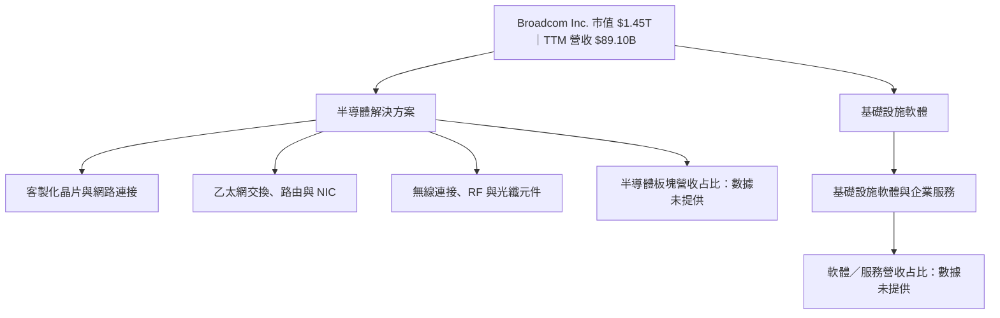
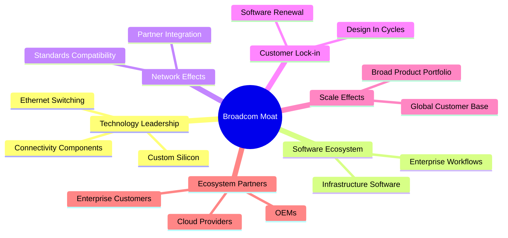
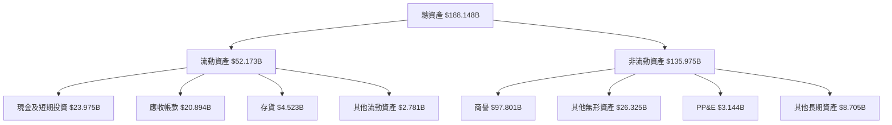
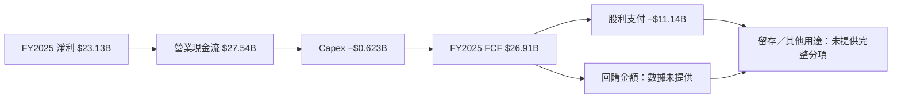
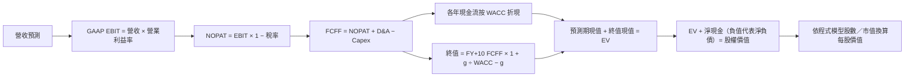
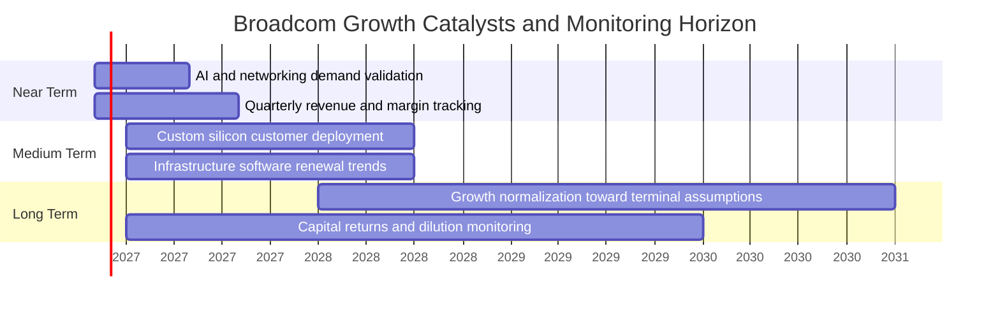
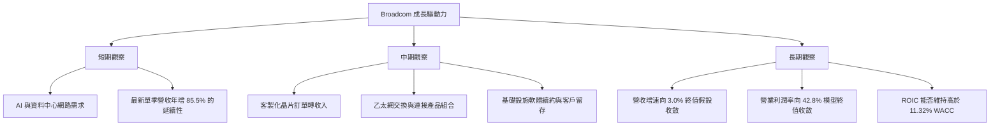
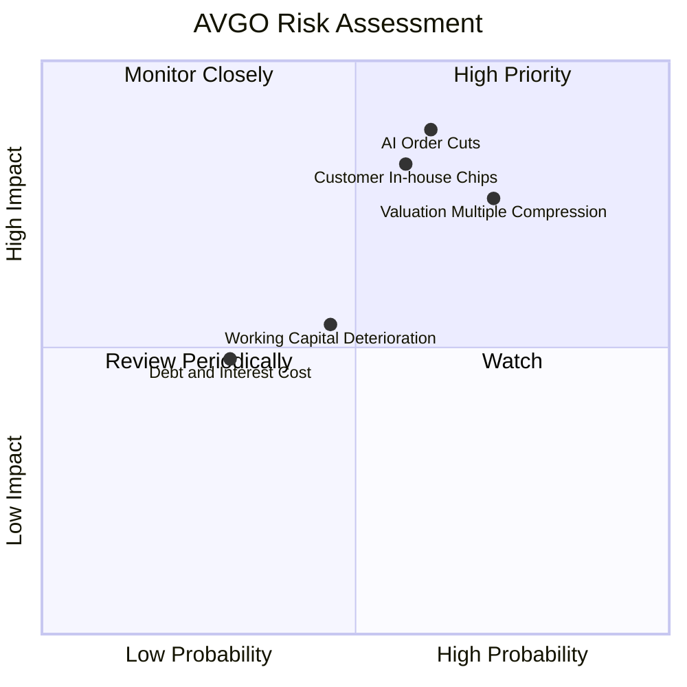
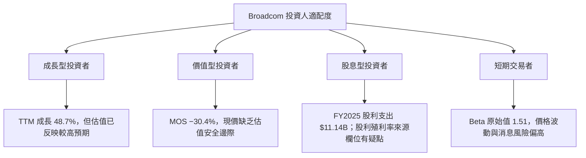

# AVGO 基本面深度分析報告
> **報告日期**：2026-11-23 ｜ **語言**：繁體中文 ｜ **數據來源**：SEC 申報資料 (XBRL)、Yahoo Finance、Finviz、StockAnalysis、Roic.ai ｜ **分析師**：CFA 級機構研究

## 目錄

| # | 章節 | 核心結論 |
|---|------|----------|
| 1 | 執行摘要 | 賣出；加權合理價值 $233.36，MOS −30.4% |
| 2 | 公司概覽與商業模式 | 半導體與基礎設施軟體雙業務；護城河主要來自客戶整合、產品組合與軟體黏著度 |
| 3 | 損益表深度分析 | TTM 營收 $89.10B、TTM 成長 48.7%；最新單季年增 85.5% |
| 4 | 資產負債表分析 | 淨負債 $35.44B；流動比率 2.504，營運資金天數有所惡化 |
| 5 | 現金流量深度分析 | TTM FCF $39.40B；高現金轉換，但 SBC 仍是重要股東成本 |
| 6 | 獲利能力與資本效率 | ROIC 30.0% 高於 WACC 11.32%，仍在創造經濟價值 |
| 7 | 相對估值分析 | 估值高於歷史中位數；不同同業倍數方法給出明顯分歧 |
| 8 | DCF 內在價值評估 | 基準 DCF $216.69；終值佔 EV 53.4%，估值對長期假設敏感 |
| 9 | 成長催化劑 | AI 網路與客製化晶片是主要增長方向；TAM 數字未提供 |
| 10 | 風險矩陣 | AI 訂單集中、客戶自研及估值下修是前三大風險 |
| 11 | 投資建議 | 依 MOS 評級為賣出；設定估值、成長與 FCF 監控條件 |

---

## 1. 執行摘要

### 1.0 一頁式投資儀表板（Portfolio Manager 30 秒速讀）

| 項目 | 內容 |
|------|------|
| **投資論點（3 句）** | ① TTM 營收 $89.10B、年增 48.7%，最新一季營收年增 85.5%，反映近期需求加速。② TTM FCF 為 $39.40B、ROIC 為 30.0%，高於 11.32% 的 WACC，核心業務仍創造價值。③ 但 8.8 加權合理價值為 $233.36，低於 2026-11-20 收盤價 $304.41，MOS 為 −30.4%。 |
| **綜合評分** | **6.7/10**（引用 1.1 評分卡） |
| **財務健康** | 🟡 現金與短期投資 $23.98B、總債務 $59.42B，淨負債 $35.44B；流動比率 2.504。 |
| **ROIC vs WACC** | 30.0% vs 11.32%：創造股東價值，差距 18.68 個百分點。 |
| **FCF 趨勢** | TTM FCF $39.40B；FCF Yield 2.71%。近年 FCF 上升，但 SBC 對普通股股東仍有稀釋成本。 |
| **估值** | Forward P/E 15.67989x ｜ EV/EBITDA（TTM）28.484x ｜ FCF Yield 2.71%。 |
| **DCF 內在價值（基準）** | $216.69 ｜ 現價相對 DCF 基準溢價 **40.5%**（計算：$304.41 ÷ $216.69 − 1）。 |
| **安全邊際（MOS）** | **−30.4%**＝($233.36 − $304.41) ÷ $233.36，分母為加權合理價值；🔴 無安全邊際。 |
| **預期報酬（基準情境 12M）** | DCF 基準值對現價的隱含上行空間為 **−28.8%**；此為估值差距，不是短期價格預測。 |
| **關鍵風險（前二）** | AI 客戶訂單／需求集中度；主要客戶自研晶片或削減訂單。 |
| **評級 + 信心度** | 🔴 **賣出** ｜ 信心：中。評級由估值差距支持，但公司成長與 DCF 輸入存在較高不確定性。 |

### 1.1 綜合評分卡（全報告唯一）

| 維度 | 評分（1–10） | 主要依據（引用數字與其來源章節） |
|------|--------------|----------------------------------|
| 成長性 | 8 | TTM 營收年增 48.7%、最新單季年增 85.5%（第 3 章）；但高基期下增速能否延續尚待驗證。 |
| 獲利能力 | 9 | TTM 營業利益率 48.0%、ROIC 30.0%、F-Score 7/8（第 3、6 章）。 |
| 財務健康 | 7 | 淨負債 $35.44B、流動比率 2.504；CCC 由 53 天升至 63 天（第 4 章）。 |
| 估值 | 2 | MOS −30.4%；P/E 38.8x，高於自身五年中位數 5.5x（第 7、8 章）。 |
| 護城河 | 8 | 半導體產品與軟體業務組合、TTM 毛利率 75.5%、營業利益率 48.0%（第 2、3 章）；客戶自研風險限制評價。 |
| 管理層與資本配置 | 6 | FY2025 SBC $7.57B，約為營收 11.9%；FY2025 股利支出 $11.14B，稀釋股數測試未通過（第 3、5、6 章）。 |
| **綜合評分** | **6.7** | 六項算術平均：(8 + 9 + 7 + 2 + 8 + 6) ÷ 6 = 6.6667，四捨五入至小數一位。 |

### 1.2 五大投資論點 + 三大核心風險

| 類型 | 項目 | 具體依據 | 信心度 |
|------|------|----------|--------|
| 🟢 **投資論點①** | AI 與資料中心需求推動近期增長 | TTM 營收年增 48.7%；最新一季營收 $29.591B，單季年增 85.5%。但單季加速不應直接外推為長期成長率。 | 🟢 高 |
| 🟢 **投資論點②** | 高營業利潤率形成現金流底盤 | TTM 營業利益率 48.0%、TTM FCF $39.40B，顯示營收增長可轉化為大量現金。 | 🟢 高 |
| 🟢 **投資論點③** | 資本回報高於資本成本 | ROIC 30.0% 對比 WACC 11.32%，正差距 18.68 個百分點。 | 🟢 高 |
| 🟢 **投資論點④** | 軟體業務補充半導體週期性 | 公司同時經營半導體與基礎設施軟體；但財務數據未提供各板塊營收占比，無法量化抵銷效果。 | 🟡 中 |
| 🟢 **投資論點⑤** | 現金流可支撐股利及投資 | TTM 營業現金流 $40.65B、Capex $1.25B、FCF $39.40B；但股東回報須一併考量 SBC 稀釋。 | 🟢 高 |
| 🟡 **風險①** | AI 訂單集中與客戶削減需求 | 新聞報導提及主要客戶 AI 晶片訂單削減風險；若訂單下滑，會直接壓低預測成長率與終值。 | 🟡 中 |
| 🔴 **風險②** | 估值高於內在價值估計 | 現價 $304.41，高於 DCF 基準 $216.69 及加權合理價值 $233.36。 | 🔴 高 |
| 🔴 **風險③** | 股權薪酬稀釋 | FY2025 SBC $7.57B，占當年營收約 11.9%；Piotroski 稀釋股數測試未通過。 | 🔴 高 |

### 1.3 快速統計卡片

| 指標 | 公司實際值（期間） | 同業中位數 | 狀態 |
|------|--------------------|------------|------|
| 營收成長（TTM） | **48.7%** | — | 🟢 |
| 營收成長（最新一季年增） | **85.5%** | 36.5% | 🟢 |
| 毛利率（TTM） | **75.5%** | 53.1% | 🟢 |
| 營業利益率（TTM） | **48.0%** | — | 🟢 |
| ROIC（TTM） | **30.0%** | — | 🟢 |
| Forward P/E | **15.67989x** | 12.3x | 🟡 |
| FCF Yield（TTM） | **2.71%** | — | 🟡 |
| Piotroski F-Score | **7 / 8** | — | 🟢 |

> 同業中位數依 NVDA、MRVL、QCOM 的 Peer multiples 計算；Forward P/E 中位數為 12.3x，毛利率中位數為 53.1%，最新單季營收年增中位數為 36.5%。

### 1.4 投資結論

```text
╔══════════════════════════════════════════════════════════════════╗
║                    📊 投資結論摘要                               ║
╠══════════════════════════════════════════════════════════════════╣
║  評級：🔴 賣出（依 8.8 的 MOS 門檻；未作質化上調或下調）          ║
║  價格（2026-11-20 收盤）：$304.41                                ║
║  DCF 內在價值（基準）：$216.69（現價溢價 40.5%）                 ║
║  安全邊際 MOS：−30.4%（以加權合理價值為分母）                    ║
║  加權合理價值（8.8）：$233.36                                    ║
║  DCF 情境價值：                                                   ║
║    悲觀情境：$89.27（相對現價 −70.7%）                           ║
║    基準情境：$216.69（相對現價 −28.8%）                          ║
║    樂觀情境：$479.09（相對現價 +57.4%）                          ║
║  綜合評分：6.7/10（引用 1.1）                                    ║
║  適合投資人：重視現金流與長期產業成長、可承受高波動者；           ║
║              不適合只以當前估值折價作為買進依據者。               ║
╚══════════════════════════════════════════════════════════════════╝
```

---

## 2. 公司概覽與商業模式

### 2.1 業務結構與收入來源

公司概覽顯示 Broadcom 經營半導體解決方案與基礎設施軟體兩大板塊。可用資料未提供板塊營收、板塊占比或子業務金額，因此圖表不填入推估比例。



半導體業務提供網路、連接與客製化運算元件，軟體業務則可能帶來較高續約黏著度。由於缺少分部營收與利潤數據，無法精確拆分 AI 晶片、一般半導體及軟體各自對 48.7% TTM 成長的貢獻。

### 2.2 市場份額

市場份額數據未提供，無法可靠量化 Broadcom 在客製化 AI 晶片、乙太網交換或基礎設施軟體市場的份額。相對規模方面，Broadcom TTM 營收為 $89.10B，TTM 成長 48.7%；Peer 資料顯示 NVDA 最新一季年增 103.2%、MRVL 36.5%、QCOM −8.4%，但各公司業務組合不同，不能直接視為同一市場份額比較。

### 2.3 競爭護城河分析



### 2.4 護城河強度

| 護城河項目 | 強度（強／中／弱） | 證據（引用數字或事實） | 會削弱它的情況 |
|------------|--------------------|------------------------|----------------|
| 技術與產品整合 | 強 | 公司提供客製化晶片、乙太網交換與路由、NIC、RF 及光纖元件；TTM 毛利率 75.5%。 | 客戶改採自研晶片、替代架構成熟或價格競爭加劇。 |
| 軟體生態系統 | 中 | 公司另有基礎設施軟體業務，但分部營收與續約率數據未提供。 | 客戶整併 IT 支出、替換軟體供應商或訂閱成長放緩。 |
| 客戶鎖定 | 中至強 | 客製化晶片及企業軟體一般需經整合與驗證；量化客戶集中度與合約期限資料未提供。 | 主要客戶砍單、改用內部設計或供應商轉換成本下降。 |
| 規模效應 | 強 | TTM 營收 $89.10B、營業利益率 48.0%，具備較大的研發與產品投入能力。 | 研發投入未能維持技術競爭力，或規模未能轉化為新產品訂單。 |
| 生態夥伴 | 中 | 公司產品涵蓋多種連接與資料中心元件，具備跨產品搭配可能；夥伴營收貢獻未提供。 | 雲端平台供應鏈改變、合作夥伴轉向競品。 |
| 網路效應 | 弱至中 | 互通標準與部署基礎可能降低客戶轉換意願，但沒有可量化的網路效應指標。 | 標準替換或客戶架構轉向封閉式自研方案。 |

1.1「護城河」評分為 8 分，依據是 75.5% TTM 毛利率、48.0% 營業利益率與跨產品組合，但因缺少分部及客戶集中度數據，未進一步提高。

---

## 3. 損益表深度分析

### 3.1 年度收入成長趨勢（近 4 年）

FY2022 至 FY2025 的年增率依各年度營收計算；2023、2024、2025 年年增率亦與 StockAnalysis 年度成長數據大致一致。

```text
╔══════════════════════════════════════════════════════════════════╗
║            Broadcom 年度收入趨勢（FY2022-FY2025）                ║
╠══════════════════════════════════════════════════════════════════╣
║  FY2022  $33.20B  ████████████░░░░░░░░░░░░  基準年               ║
║  FY2023  $35.82B  █████████████░░░░░░░░░░░  YoY: +7.9%  🟡      ║
║  FY2024  $51.57B  ███████████████████░░░░░  YoY: +44.0% 🟢      ║
║  FY2025  $63.89B  ████████████████████████  YoY: +23.9% 🟢      ║
║                                                                  ║
║  FY2022-FY2025 CAGR = (63.89 ÷ 33.20)^(1/3) − 1 ≈ 24.4%         ║
╚══════════════════════════════════════════════════════════════════╝
```

FY2024 收入增幅加快，FY2025 仍維持 23.9% 年增。TTM 收入升至 $89.10B、年增 48.7%，且 FY2026 Q3 單季營收年增 85.5%；這表明近期需求強於年度歷史趨勢，但單季增速可能受產品交付時點、併購整併及基期影響，不宜直接當作長期 CAGR。

### 3.2 季度收入趨勢分析

| 季度 | 營收（$B） | QoQ 成長 | YoY 成長 | 備註 |
|------|------------:|---------:|---------:|------|
| 2025 Q4 | 18.015 | 12.9% | 28.18% | QoQ 以 2025 Q3 $15.952B 計算。 |
| 2026 Q1 | 19.311 | 7.2% | 29.47% | QoQ 成長仍為正，增速低於後續季度。 |
| 2026 Q2 | 22.187 | 14.9% | 47.87% | 年增率較前季加速。 |
| 2026 Q3 | 29.591 | 33.4% | 85.5% | 最近季度大幅加速；此為**單季年增率**，不是 TTM 成長率。 |

**計算方式示例**：2026 Q3 QoQ = ($29.591B ÷ $22.187B) − 1 = 33.4%。單季高成長需搭配後續訂單、客戶集中度及管理層財測驗證，否則年化推估可能過度樂觀。

### 3.3 利潤率演變分析

下表年度毛利率及營業利益率由年度損益表金額計算；TTM 利潤率採 VERIFIED FIGURES。不同資料源在部分年度及最新季度的營業數據存在差異，估值與核心比較以 VERIFIED FIGURES 的 TTM 營業利益率 48.0% 為準。

| 利潤率指標 | FY2022 | FY2023 | FY2024 | FY2025 | 趨勢 | 評估 |
|------------|--------:|--------:|--------:|--------:|------|------|
| **毛利率** | 66.5% | 69.0% | 63.0% | 67.8% | 年度數據波動；TTM 為 75.5% | 🟢 |
| **營業利益率** | 43.0% | 45.9% | 29.1% | 40.8% | FY2024 回落、FY2025 回升；TTM 為 48.0% | 🟢 |
| **淨利率** | 34.6% | 39.3% | 11.4% | 36.2% | FY2024 淨利受明顯波動影響；TTM 為 42.9% | 🟡 |

**利潤率演變深度解析**：年度營業利益率由 FY2023 的 45.9% 降至 FY2024 的 29.1%，FY2025 回升至 40.8%。營收快速增長與產品組合變化可能帶來營業槓桿，但收購相關攤銷、併購整合費用及半導體產品組合也可能造成年度波動；可用資料不足以把利潤率變化精確分解到單一因素。TTM 營業利益率 48.0% 高於 FY2025 年度比率，表示最近十二個月的獲利表現改善，但應以 GAAP 利潤持續性檢驗。

### 3.4 費用結構分析

完整費用項目及可核對的 TTM 費用拆分未提供，因此不繪製比例圓餅圖，以免將部分成本誤當成完整費用結構。已知 FY2025 研發費用為 $10.98B，約占 FY2025 營收 $63.89B 的 17.2%；FY2025 SBC 為 $7.57B。研發支出支持產品迭代與客製化晶片能力，但 SBC 亦需視為股東經濟成本。

### 3.5 季度 EPS 趨勢與盈餘品質（Quality of Earnings）

| 季度 | EPS（$） | EPS YoY | EPS 超預期／不及預期 |
|------|---------:|--------:|----------------------|
| 2025 Q4 | 1.74 | 94.51% | 無法判定：一致預期與實際值的歷史欄位為 NaN。 |
| 2026 Q1 | 1.50 | 31.58% | 無法判定：一致預期與實際值的歷史欄位為 NaN。 |
| 2026 Q2 | 1.91 | 85.44% | 無法判定：一致預期與實際值的歷史欄位為 NaN。 |
| 2026 Q3 | 2.68 | 215.29% | 無法判定：一致預期與實際值的歷史欄位為 NaN。 |

EPS 數據取自 StockAnalysis 季度歷史資料；EPS surprise 資料缺失，故不把 EPS 年增當作「超預期」。

| 盈餘品質項目 | 數值／佔比 | 評估 |
|--------------|-----------|------|
| 股權薪酬 SBC / 營收 | 依 2026 Q3 前四季季度 SBC 合計 $8.48B ÷ TTM 營收 $89.10B = **9.52%** | 🟡 金額重大。SBC 非即時現金支出，但會透過股份稀釋轉嫁給股東。 |
| SBC / 營業現金流 | $8.48B ÷ $40.65B = **20.86%** | 🟡 SBC 相當於約五分之一 TTM 營業現金流，評估股東回報時不能忽略。 |
| FCF / 淨利（現金轉換率） | $39.40B ÷ $38.265B = **103.0%** | 🟢 現金流略高於淨利；現金轉換表現良好。 |
| 一次性／非經常性損益 | N/A（未提供完整明細） | 無法確認一次性項目對 TTM 淨利的淨影響。 |
| 有效稅率異常 | N/A（未提供 TTM 實際有效稅率拆分）；DCF 採用稅率 21.0% | 不能判定近期 EPS 增長是否受稅率變化帶動。 |
| 資本化支出 vs 費用化 | TTM Capex $1.25B；FY2025 研發費用 $10.98B | Capex 金額相對營收低；資本化政策、資本化軟體成本明細未提供。 |

**盈餘品質結論**：TTM FCF $39.40B 對 TTM 淨利 $38.265B 的轉換率約 103%，支持 GAAP 獲利的現金含量。但 SBC 約為 TTM 營收 9.52%、營業現金流 20.86%，若只看報表 FCF 而不衡量稀釋，會高估普通股股東實際取得的每股經濟利益。有效稅率及一次性項目資料不足，這兩項仍是盈餘品質檢查缺口。

---

## 4. 資產負債表分析

### 4.1 資產結構分解

採用截至 2026-08-02 的資產負債表資料；單位為 $B。



商譽與其他無形資產合計 $124.126B，約占總資產 66.0%。這反映併購後資產結構中無形資產比重高；若相關業務未達收購預期，可能面臨減損風險。

### 4.2 流動性與營運資金分析

| 流動性指標 | 最新值 | 歷史比較 | 評估 |
|------------|-------:|----------|------|
| 流動比率 | 2.504 | 一年前比率未提供 | 🟢 短期流動資產對流動負債有覆蓋。 |
| 速動比率 | 2.153 | 一年前比率未提供 | 🟢 扣除存貨後流動性仍充足。 |
| 現金及短期投資 | $23.98B | FY2025 為 $16.18B | 🟢 現金餘額提高。 |
| 淨負債 | $35.44B | FY2025 年底總債務 $65.14B；不可直接與最新 TTM 混作同一期 | 🟡 淨負債規模可觀，但不表示短期流動性緊張。 |

營運資金天數照錄品質指標資料：

| 指標 | 最新 TTM | 一年前 TTM | 變化 | 解讀 |
|------|----------|------------|------|------|
| DSO 應收帳款天數 | 56 天 | 40 天 | +16 天 | 收款天數拉長，可能反映快速擴張下應收帳款增長較快，需觀察回款與客戶組合。 |
| DIO 存貨天數 | 59 天 | 40 天 | +19 天 | 存貨天數增加，可能是供應鏈備貨或需求預期提高；若出貨不如預期，須留意庫存風險。 |
| DPO 應付帳款天數 | 52 天 | 26 天 | +26 天 | 付款天數增加，可能改善短期現金週轉；仍需確認不是供應鏈付款壓力上升。 |
| CCC 現金轉換週期 | 63 天 | 53 天 | +10 天 | 現金轉換週期延長，營運資金佔用增加；與營收高速增長並存，需持續觀察。 |

### 4.3 債務結構分析

```text
╔══════════════════════════════════════════════════════════════════╗
║                   Broadcom 債務健康診斷                          ║
╠══════════════════════════════════════════════════════════════════╣
║  總債務：        $59.42B  ████████████████████  🟡              ║
║  現金+短期投資： $23.98B  ████████░░░░░░░░░░░░  🟢              ║
║  淨負債：        $35.44B  ████████████░░░░░░░░  🟡              ║
║                                                                  ║
║  流動比率：       2.504x   🟢                                    ║
║  速動比率：       2.153x   🟢                                    ║
║  Debt/EBITDA：   N/A（缺少同口徑債務與 EBITDA 的核對項目）       ║
║  利息保障倍數：  N/A（未提供利息費用）                           ║
╚══════════════════════════════════════════════════════════════════╝
```

淨負債計算：$59.42B − $23.98B = $35.44B。公司具有高現金流與流動性，但不能將「淨負債可管理」等同於「無槓桿風險」；未來收購、利率及自由現金流變化都會影響償債彈性。

### 4.4 股東權益趨勢

```text
╔══════════════════════════════════════════════════════════════════╗
║               Broadcom 歷年股東權益（$B）                        ║
╠══════════════════════════════════════════════════════════════════╣
║  FY2022  $22.71B  ██████░░░░░░░░░░░░░░░░░░                       ║
║  FY2023  $23.99B  ███████░░░░░░░░░░░░░░░░░                       ║
║  FY2024  $67.68B  ████████████████████░░░░                       ║
║  FY2025  $81.29B  ████████████████████████                       ║
╚══════════════════════════════════════════════════════════════════╝
```

FY2024 股東權益大幅上升，需結合併購後資產、商譽及無形資產規模理解，不能單純視為留存盈餘累積。FY2025 權益進一步增至 $81.29B；商譽 $97.80B 及其他無形資產 $26.33B 的比重仍高。

---

## 5. 現金流量深度分析

### 5.1 現金流量瀑布圖

以下年度現金流數字取 FY2025；資本支出以現金流支出方向呈現。



FY2025 營業現金流高於淨利，表示營運產生的現金充足；但股利之外的資本配置、回購與其他用途未能由資料完整拆分，不能把未列用途假設為留存現金。

### 5.2 FCF 轉換率趨勢

| 財年 | FCF（$B） | 淨利（$B） | FCF / 淨利 |
|------|----------:|----------:|-----------:|
| FY2022 | 16.31 | 11.49 | 142.0% |
| FY2023 | 17.63 | 14.08 | 125.2% |
| FY2024 | 19.41 | 5.89 | 329.5% |
| FY2025 | 26.91 | 23.13 | 116.3% |
| TTM | 39.40 | 38.265 | 103.0% |

FY2024 比率偏高，主要是淨利基數顯著較低，不能直接解讀為現金轉換品質永久改善。TTM 轉換率 103.0% 較接近常態參照，但仍需觀察應收帳款天數增加 16 天及 CCC 增加 10 天是否持續。

### 5.3 自由現金流趨勢

```text
╔══════════════════════════════════════════════════════════════════╗
║               Broadcom 自由現金流（實際）                        ║
╠══════════════════════════════════════════════════════════════════╣
║  FY2022  $16.31B  ███████████████░░░░░░░░░  FCF Yield：N/A      ║
║  FY2023  $17.63B  ████████████████░░░░░░░░  FCF Yield：N/A      ║
║  FY2024  $19.41B  ██████████████████░░░░░░  FCF Yield：N/A      ║
║  FY2025  $26.91B  █████████████████████████  FCF Yield：N/A      ║
║  TTM     $39.40B  ████████████████████████████████████          ║
║          TTM FCF Yield：2.71%                                     ║
╚══════════════════════════════════════════════════════════════════╝
```

FY2022 至 FY2025 FCF CAGR = ($26.91B ÷ $16.31B)^(1/3) − 1 ≈ 18.2%。TTM FCF 升至 $39.40B，較 FY2025 年度值更高，但兩者期間不同，不能把差額直接視為年度成長率。

### 5.4 資本配置評估

完整資本配置圓餅圖所需的回購、併購、留存等分項金額未完整提供，因此不繪製比例圖。

| 項目 | 已知數據 | 評估 |
|------|----------|------|
| 營運再投資 | TTM Capex $1.25B | Capex 相對 TTM 營收有限，但研發費用是重要投入；TTM 研發費用未提供。 |
| 股利 | FY2025 現金股利 $11.14B | FY2025 股利約為當年 FCF $26.91B 的 41.4%；股利政策需與 SBC 稀釋一併評估。 |
| 股票回購 | 金額 N/A | 無法判斷回購是否抵銷 SBC 所造成的股數稀釋。 |
| 留存／收購 | 分項金額 N/A | 無法核對現金餘額變化與資本配置用途。 |
| 股權薪酬 | FY2025 SBC $7.57B | 約占 FY2025 營收 11.9%；對每股價值具有實質稀釋成本。 |

Yahoo Finance 的股利殖利率欄位顯示 85.0%，與股利現金流及其他資訊口徑明顯不一致，本報告不採用該數字作為實際殖利率結論。

---

## 6. 獲利能力與資本效率

### 6.1 ROE / ROA / ROIC 趨勢

| 指標 | 歷史／最新數據 | 評估 |
|------|----------------|------|
| ROE（TTM） | 38.4%（品質指標）；其他資料來源列 44.2% | 採用 QUALITY FIGURES 的 38.4%；資料口徑有差異，避免混用。 |
| ROA（TTM） | 15.4% | 獲利相對資產規模表現良好；收購後商譽與無形資產擴大資產基礎。 |
| ROIC（TTM） | 30.0% | 明顯高於 11.32% WACC，支持價值創造判斷。 |
| 行業均值對比 | N/A（可比公司同口徑 ROIC／ROA 數據未提供） | 不以未驗證的同業均值補值。 |

### 6.2 ROIC vs WACC 分析（核心價值創造判斷）

```text
╔══════════════════════════════════════════════════════════════════╗
║                ROIC vs WACC 深度分析                            ║
╠══════════════════════════════════════════════════════════════════╣
║  資本成本輸入（採用成本資料中的數值）：                           ║
║  ├── 無風險利率（10Y美債）：      4.91%                          ║
║  ├── 市場風險溢酬（假設）：       5.00%                          ║
║  ├── 原始 Beta：                  1.51                           ║
║  ├── 調整後 Beta：                1.34                           ║
║  ├── 股權成本：                   11.61%                         ║
║  ├── 稅前債務成本：               5.40%                          ║
║  ├── 資本權重 E/D：               96.1% / 3.9%                   ║
║  └── WACC：                       11.32%                         ║
║                                                                  ║
║  價值創造：                                                       ║
║  ├── ROIC（TTM）：                30.0%                          ║
║  ├── WACC：                       11.32%                         ║
║  └── ROIC − WACC：                +18.68 個百分點                ║
║                                                                  ║
║  結論：ROIC 約為 WACC 的 2.65 倍；現階段創造經濟價值。            ║
╚══════════════════════════════════════════════════════════════════╝
```

比率：30.0% ÷ 11.32% = 2.65 倍。ROIC − WACC = 30.0% − 11.32% = 18.68 個百分點。這代表公司目前投入資本的回報高於資本成本；但若 AI 訂單降溫、併購資產減值或利潤率下滑，未來 ROIC 可能下行。此處 WACC 使用 VERIFIED FIGURES 指定值，不另行重建模型。

### 6.3 杜邦三因素分解

| 因素 | 數值（TTM） | 解讀 |
|------|-------------|------|
| 淨利率 | 42.9% | 對 ROE 有主要貢獻，反映高獲利能力。 |
| 資產週轉率 | 0.47 | 資產周轉並非主要驅動因素；併購後商譽與無形資產擴大資產基礎。 |
| 權益乘數 | 1.89 | 槓桿提供部分 ROE 放大，但不是主要來源。 |
| **ROE** | **38.4%** | 42.9% × 0.47 × 1.89 = 38.15%，與品質指標列示 38.4% 的差異來自底層未四捨五入數值。 |

### 6.4 財務體質：Piotroski F-Score

F-Score：**7 / 8**。原始九項測試中，長期負債／總資產比較因缺少輸入而無法判定；因此可判定分母為 8，分數不得改寫為 7/9。

| 測試 | 結果 | 解讀 |
|------|------|------|
| ROA > 0 | ✅ 通過 | 具正向資產報酬。 |
| 營業現金流 > 0 | ✅ 通過 | TTM 營業現金流為 $40.65B。 |
| ROA 高於一年前 | ✅ 通過 | 獲利能力相較前一年改善。 |
| 營業現金流 > 淨利（應計品質） | ✅ 通過 | TTM 營業現金流高於 TTM 淨利。 |
| 長期負債 ÷ 總資產低於一年前 | — 無法判定 | 缺少該項比較所需資料。 |
| 流動比率高於一年前 | ✅ 通過 | 流動性相較一年前改善。 |
| 稀釋股數未增加 | ❌ 未通過 | 股數增加表示 SBC 或其他增發可能稀釋每股經濟價值。 |
| 毛利率高於一年前 | ✅ 通過 | 毛利率比較結果為改善。 |
| 資產週轉率高於一年前 | ✅ 通過 | 資產周轉效率改善。 |

---

## 7. 相對估值分析

### 7.1 同業估值比較

公司本身估值倍數採估值快照；同行估值及成長、毛利率取 Yahoo Finance Peer multiples。

| 估值指標 | **AVGO** | **NVDA** | **MRVL** | **QCOM** | 本公司評估 |
|----------|--------:|--------:|--------:|--------:|-----------|
| **Trailing P/E** | 38.8x | 13.5x | 40.2x | 11.8x | 🟡 介於 MRVL 與 NVDA／QCOM 之間；盈利與會計口徑差異可能影響比較。 |
| **Forward P/E** | 15.67989x | 7.6x | 16.6x | 12.3x | 🟡 高於同業中位數 12.3x。 |
| **P/S Ratio** | 16.308367x | 8.4x | 11.6x | 3.7x | 🔴 顯著高於三家可比公司。 |
| **EV/EBITDA（TTM）** | 28.484x | 12.2x | 38.1x | 15.9x | 🟡 高於 NVDA、QCOM，低於 MRVL。 |
| **最新一季營收年增** | 85.5% | 103.2% | 36.5% | −8.4% | 🟢 高於 MRVL、QCOM，低於 NVDA。 |
| **毛利率（TTM）** | 75.5% | 74.9% | 52.2% | 53.1% | 🟢 高於三家可比公司。 |

同業倍數不能完全反映 Broadcom 軟體與半導體業務組合差異，但當公司 P/S 為 16.3x，而 NVDA、MRVL、QCOM 分別為 8.4x、11.6x、3.7x 時，市場已要求 Broadcom 維持較高成長與獲利品質。

### 7.2 歷史估值區間分析

```text
╔══════════════════════════════════════════════════════════════════╗
║              AVGO 五年 P/E 歷史區間（TTM）                      ║
╠══════════════════════════════════════════════════════════════════╣
║  最低 1.8x ├──────────────────────────────────────┤ 最高 77.5x   ║
║                            ● 目前 38.8x                          ║
║                                                                  ║
║  五年中位數：5.5x ｜ 當前百分位：70%                             ║
║  評估：目前 P/E 位於自身歷史區間偏高位置，估值要求較高。          ║
╚══════════════════════════════════════════════════════════════════╝
```

| 倍數 | 目前 | 五年中位數 | 五年範圍 | 目前百分位 |
|------|-----:|-----------:|---------:|-----------:|
| P/E | 38.8x | 5.5x | 1.8x–77.5x | 70% |
| P/S | 16.7x | 1.5x | 0.6x–28.1x | 65% |
| EV/EBITDA | 35.1x | 5.6x | 0.5x–70.7x | 55% |

歷史中位數受併購、稅務與獲利基期變化影響，不能直接當作合理目標倍數；但三項估值目前均高於各自五年中位數，顯示市場估值包含較高的未來成長預期。

### 7.3 情境價值（Bear / Base / Bull）

以下每股價值、機率與相對現價幅度照錄 DCF MODEL。情境模型未提供各情境完整逐年路徑與終值成長率細節，故不另行補造。

| 情境 | 第 1 年營收成長 | 期末營業利潤率 | WACC | 每股價值 | 相對現價 | 機率 | 會發生的條件 |
|------|----------------|----------------|------|----------|----------|------|--------------|
| 🔴 悲觀 | 15.0% | 36.4% | 12.32% | $89.27 | −70.7% | 25% | AI 客製晶片需求放緩、客戶砍單或競爭壓低利潤率。 |
| 🟡 基準 | 30.0% | 42.8% | 11.32% | $216.69 | −28.8% | 50% | 成長由高位逐步回落，營業利潤率向歷史中位數收斂。 |
| 🟢 樂觀 | 45.0% | 47.1% | 10.32% | $479.09 | +57.4% | 25% | AI 需求與客製化晶片訂單超預期，且利潤率維持高位、資本成本下降。 |

情境權重加總為 25% + 50% + 25% = 100%。程式列示的機率加權價值為 $250.43（−17.7%），僅供情境參考；第 8.8 節固定使用基準 DCF 與其他估值方法加權，不使用該機率加權值。

### 7.4 相對估值隱含價格區間

```text
╔══════════════════════════════════════════════════════════════════╗
║             相對估值與共識目標價（每股）                         ║
╠══════════════════════════════════════════════════════════════════╣
║  $137.19 ───── $216.69 ───── $238.96 ─── $304.41 ───── $526.47   ║
║  EV/EBITDA       DCF          Forward P/E   現價       分析師共識  ║
╚══════════════════════════════════════════════════════════════════╝
```

| 方法 | 每股價值 | 依據 |
|------|---------:|------|
| 同業 EV/EBITDA | $137.19 | NVDA、MRVL、QCOM 中位數 EV/EBITDA 15.9x，乘以 AVGO TTM EBITDA，再加淨現金／扣除淨負債影響。 |
| DCF（基準） | $216.69 | 10 年 FCFF、WACC 11.32%、終值成長率 3.0%。 |
| 同業 Forward P/E | $238.96 | 同業 Forward P/E 中位數 12.3x × 公司 Forward EPS $19.41。 |
| 分析師共識目標價 | $526.47 | 47 位分析師平均目標價；僅作參考。 |

相對估值顯示分布相當寬：同業 EV/EBITDA 法僅 $137.19，而共識目標價為 $526.47。這種分歧反映市場對 AI 增長可持續性與估值倍數的看法差異，不能只選取較高的目標價作為基準。

---

## 8. DCF 內在價值評估（Discounted Cash Flow）

> 本節逐年假設、現金流、敏感度矩陣、情境及反推結果，採用程式計算的 DCF MODEL。DCF 模型部分中間輸入未提供，以下明確標示缺漏，不另建模型或替換模型輸出。

### 8.0 估值推理鏈（Thinking Logic）

**Step 1 — 價值由哪些變數決定？**

AVGO 的價值可理解為「半導體與客製化晶片現金流 + 基礎設施軟體現金流 + 未來 AI 需求的增長選擇權」。但可用資料沒有分部營收占比，不能將三者拆成具體營收百分比。已知公司 TTM 營收 $89.10B、TTM 營業利益率 48.0%、TTM FCF $39.40B。DCF 主要由營收成長、營業利潤率及終值假設支配；終值現值占 EV 53.4%，因此長期現金流與折現率特別關鍵。

**Step 2 — 模型選擇**

| 決策點 | 本報告採用 | 理由（含數字） | 曾考慮但否決 | 否決理由 |
|--------|-----------|----------------|--------------|----------|
| 現金流定義 | FCFF | 模型以 GAAP EBIT 計算 NOPAT，再以 WACC 折現至企業價值。 | FCFE | 資本結構與債務可變，且程式模型已採 FCFF。 |
| 預測期 N | 10 年 | 模型列出 FY+1 至 FY+10，營收成長由 30.0% 線性降至 3.0%。 | 5 年 | 無法照用既定 DCF 模型；也較難呈現模型設定的成長收斂。 |
| 終值方法 | Gordon Growth | 模型採永續成長率 3.0%，WACC 11.32%。 | 退出倍數 | DCF MODEL 未提供退出倍數法終值或未來 EBITDA 倍數，不能自行補算。 |
| EBIT 基礎 | GAAP EBIT | DCF MODEL 明示使用 GAAP EBIT。 | 非 GAAP EBIT | 未提供非 GAAP 調整項，且會產生 SBC 重複或漏扣風險。 |

**Step 3 — 關鍵假設的推導鏈**

- **營收成長**：錨點＝TTM 營收年增 48.7%，最新單季年增 85.5%；調整＝模型將第 1 年限制在 30.0%，並逐年線性下降至第 10 年 3.0%，反映短期高增長不宜永久化；**採用第 1 年 30.0%、第 10 年 3.0%**；曾考慮直接外推 48.7%，但會把近期高增速不合理地延伸至預測初期。
- **期末營業利潤率**：錨點＝TTM GAAP 營業利益率 48.0%；調整＝模型將利潤率逐年降至最近五個財年的中位數 42.8%，代表成長成熟與利潤率回歸；**採用 FY+10 42.8%**；曾考慮維持 48.0%，但未能反映模型採用的歷史中位數回歸。
- **永續成長率 g**：錨點＝長期成熟企業通常需低於 WACC，模型使用 3.0%；調整＝維持既定基準假設；**採用 3.0%**，低於 11.32% WACC；曾考慮更高終值成長，但在終值占 EV 53.4% 的情況下會提高估值對遠期假設的依賴。
- **預測期 N**：錨點＝DCF MODEL 預測 10 年；調整＝按模型由 30.0% 線性遞減至 3.0%；**採用 10 年**；曾考慮更短期間，但與既定模型不一致，也會改變終值起算年。
- **Capex／營收**：錨點＝TTM Capex $1.25B、營收 $89.10B；模型採第一年 1.4%、第十年 0.8%，其間逐步收斂；**採用模型逐年比例**；曾考慮固定採用 TTM 比例，但模型設定 Capex 比率隨業務成熟而下降。
- **EBIT 基礎與 SBC**：錨點＝FY2025 SBC $7.57B，TTM 營業現金流 $40.65B；調整＝採 GAAP EBIT，SBC 已列為費用，避免再次從 FCFF 扣減；**採用組合 (A)：GAAP EBIT＋固定股數，年稀釋率 0%**；否決「GAAP EBIT 再扣 SBC」及「GAAP EBIT 同時再放大股數」，避免重複計入成本。
- **年稀釋率**：錨點＝Piotroski 稀釋股數測試未通過，但 DCF MODEL 明示股數不再稀釋；**模型採用固定股數／0% 額外稀釋**；此處不是認定實際稀釋不存在，而是遵照模型以 GAAP EBIT 已費用化 SBC 的指定口徑。
- **稅率**：錨點＝模型預設 21.0%；**採用 21.0%**。TTM 實際有效稅率拆分未提供，故不能宣稱 21.0% 為近期實際稅率。
- **D&A／營收**：錨點＝TTM 比例 0.7%；**採用 0.7% 固定**，依模型設定。
- **營運資金變動**：錨點＝模型說明「Working capital is not modelled」；**不建模，非零現金流估計**；因此不新增 ΔWC 項。這會忽略 CCC 由 53 天升至 63 天可能造成的營運資金占用。
- **WACC**：錨點＝成本資本資料指定 11.32%；調整＝無；**採用 11.32%**；不另造替代 WACC，組成與限制詳見 8.2。

**Step 4 — 最脆弱一環**

最脆弱的假設是高營收成長及高營業利潤率能否同時持續；若客戶削減 AI 訂單或競爭壓低利潤率，價值可能向悲觀情境 $89.27 靠攏。相反，若成長與利潤率超出基準且資本成本下降，樂觀情境可達 $479.09。

**Step 5 — 計算路徑**



### 8.1 模型假設總表（Model Inputs）

| 假設項目 | 採用值 | 依據／來源 | 敏感度 |
|----------|--------|-------------|--------|
| 預測期長度 N | 10 年 | DCF MODEL 列示 FY+1 至 FY+10 | 🟡 中 |
| 營收成長路徑 | 第 1 年 30.0%，第 10 年 3.0%，線性淡出 | TTM 成長 48.7%；模型將第一年限制在 0%–30% | 🔴 高 |
| 營業利潤率 | FY+1 48.0% → FY+10 42.8% | 以 TTM 48.0% 起步，淡化至最近五個財年中位數 | 🔴 高 |
| 有效稅率 | 21.0% | DCF MODEL 預設稅率；不是已核對的 TTM 實際稅率 | 🟢 低 |
| Capex／營收 | FY+1 1.4% → FY+10 0.8% | 模型由 TTM 比率逐步收斂 | 🟡 中 |
| D&A／營收 | 0.7% | DCF MODEL 的 TTM 比例，固定使用 | 🟢 低 |
| 營運資金變動 | 未建模 | DCF MODEL 明示 working capital is not modelled | 🟢 低，但可能低估營運資金需求 |
| EBIT 基礎 | GAAP | DCF MODEL 採 GAAP EBIT | 🟡 中 |
| SBC 處理 | GAAP 費用中已扣；不再扣 SBC | DCF MODEL 指定組合 (A) | 🟡 中 |
| 年稀釋率 | 0%（模型口徑） | 固定股數；SBC 已反映於 GAAP EBIT | 🟡 中 |
| 永續成長率 g | 3.0% | DCF MODEL 假設，低於 WACC 11.32% | 🔴 高 |
| 終值方法 | Gordon Growth | DCF MODEL 提供 Gordon Growth 終值 | 🔴 高 |
| WACC | 11.32% | 成本資本資料指定值，詳見 8.2 | 🔴 高 |

本模型採用 **(A) GAAP EBIT + 固定股數**，故 SBC 影響已計入一次；FCFF 不再減 SBC，股數不再逐年放大。FCFF 定義為 `NOPAT + D&A − Capex`；營運資金未建模，亦不另填入 ΔWC 數字。

### 8.2 折現率推導（WACC）

```text
╔══════════════════════════════════════════════════════════════════╗
║                    WACC 推導（折現率）                           ║
╠══════════════════════════════════════════════════════════════════╣
║  股權成本 Ke（CAPM）：                                           ║
║  ├── 無風險利率 Rf（10Y 美債）：      4.91%                      ║
║  ├── 市場風險溢酬 ERP（假設）：       5.00%                      ║
║  ├── 原始 Beta（Yahoo）：             1.51                       ║
║  ├── 調整後 Beta：                   1.34                       ║
║  │   調整方式：⅔ × 1.51 + ⅓ × 1 = 1.34                         ║
║  ├── 規模／國別溢酬：                 0.00%（未另加）            ║
║  └── Ke = 4.91% + 1.34 × 5.00% = 11.61%                        ║
║                                                                  ║
║  債務成本 Kd：                                                    ║
║  ├── 稅前 Kd（提供值）：              5.40%                      ║
║  ├── 稅率：                          21.0%                      ║
║  └── 稅後 Kd = 5.40% × (1−21.0%) = 4.266%                      ║
║                                                                  ║
║  資本結構（成本資本資料提供權重）：                               ║
║  ├── 股權權重 E：                    96.1%                      ║
║  ├── 債務權重 D：                     3.9%                      ║
║  └── WACC = 96.1%×11.61% + 3.9%×4.266% = 11.32%                ║
╚══════════════════════════════════════════════════════════════════╝
```

**逐步演算（WACC）**

1. **Ke（CAPM）** = Rf + β × ERP = 4.91% + 1.34 × 5.00% = **11.61%**。
2. **稅前 Kd**：提供的稅前債務成本為 **5.40%**。利息費用及平均計息負債的詳細金額未提供，故無法以「利息 ÷ 平均計息負債」獨立重算；不把應付帳款等無息負債納入。
3. **稅後 Kd** = 5.40% × (1 − 21.0%) = 5.40% × 0.79 = **4.266%**。
4. **權重**：採用成本資本資料所列 E/D 權重 **96.1% / 3.9%**，兩者相加 = 100.0%。市值精確值及成本資本資料的權重推導明細未提供，因此不以四捨五入後的市值、股數另造權重。
5. **WACC** = 96.1% × 11.61% + 3.9% × 4.266% = 11.15721% + 0.166374% = 11.323584% ≈ **11.32%**。

Rf 的具體觀測日期未列出；ERP 為假設輸入。原始 Beta 1.51 經指定的調整公式後採用 1.34。未另加規模／國別溢酬。第 6.2 節與本節均使用 **11.32%**；債務成本及權重沿用成本資本資料，而非另建 WACC。

### 8.3 逐年自由現金流預測（基準情境）

單位為 $B；折現因子保留三位小數。下表逐年數字照錄 DCF MODEL；Working capital is not modelled，故不列 ΔWC 行。

| 年度 | FY+1 | FY+2 | FY+3 | FY+4 | FY+5 | FY+6 | FY+7 | FY+8 | FY+9 | FY+10 |
|------|-----:|-----:|-----:|-----:|-----:|-----:|-----:|-----:|-----:|------:|
| 營收 | 115.84 | 147.11 | 182.42 | 220.72 | 260.46 | 299.52 | 335.47 | 365.66 | 387.60 | 399.23 |
| 營收 YoY | 30.0% | 27.0% | 24.0% | 21.0% | 18.0% | 15.0% | 12.0% | 9.0% | 6.0% | 3.0% |
| 營業利潤率 | 48.0% | 47.5% | 46.9% | 46.3% | 45.7% | 45.2% | 44.6% | 44.0% | 43.4% | 42.8% |
| EBIT（GAAP） | 55.66 | 69.83 | 85.54 | 102.23 | 119.12 | 135.26 | 149.54 | 160.89 | 168.30 | 171.04 |
| − 稅（21.0%） | (11.69) | (14.67) | (17.96) | (21.47) | (25.02) | (28.40) | (31.40) | (33.79) | (35.34) | (35.92) |
| = NOPAT | 43.97 | 55.17 | 67.58 | 80.76 | 94.10 | 106.85 | 118.14 | 127.10 | 132.96 | 135.12 |
| + D&A | 0.82 | 1.04 | 1.29 | 1.57 | 1.85 | 2.12 | 2.38 | 2.59 | 2.75 | 2.83 |
| − Capex | (1.62) | (1.96) | (2.31) | (2.64) | (2.93) | (3.17) | (3.31) | (3.36) | (3.29) | (3.11) |
| = FCFF | **43.17** | **54.25** | **66.56** | **79.69** | **93.02** | **105.81** | **117.21** | **126.34** | **132.41** | **134.84** |
| 折現因子 @11.32% | 0.898 | 0.807 | 0.725 | 0.651 | 0.585 | 0.526 | 0.472 | 0.424 | 0.381 | 0.342 |
| FCFF 現值 PV | **38.78** | **43.78** | **48.26** | **51.90** | **54.42** | **55.61** | **55.34** | **53.58** | **50.45** | **46.15** |

**預測期 FCF 現值合計：**

$38.78 + $43.78 + $48.26 + $51.90 + $54.42 + $55.61 + $55.34 + $53.58 + $50.45 + $46.15 = **$498.27B**

**逐步演算（FY+1）**

1. **營收** = $89.10B × (1 + 30.0%) = $115.83B；模型列示 **$115.84B**。此差異是輸入數字精度／模型計算路徑差異，以下以模型列示值為準。
2. **EBIT** = 模型列示 $55.66B；按表中營收與利潤率核算，$115.84B × 48.0% = $55.6032B，與模型 EBIT 有約 $0.06B 差異。為遵守模型輸出，後續沿用 $55.66B，並在 8.10 列為需注意的複核差異。
3. **稅** = $55.66B × 21.0% = $11.6886B ≈ **$11.69B**。
4. **NOPAT** = $55.66B − $11.69B = **$43.97B**。
5. **D&A** = 模型列示 **$0.82B**；模型 D&A／營收假設 0.7%。
6. **Capex** = 模型列示 **$1.62B**；模型第一年 Capex／營收假設 1.4%。
7. **ΔWC** = DCF MODEL 未建模，故不列入 FCFF 算式。
8. **FCFF** = $43.97B + $0.82B − $1.62B = **$43.17B**。
9. **折現因子** = 1 ÷ (1 + 11.32%)¹ = **0.898**；PV = $43.17B × 0.898 = **$38.78B**（以模型未四捨五入折現因子計算）。

**合理性自檢**

- 預測 FCFF CAGR：($134.84B ÷ $43.17B)^(1/9) − 1 ≈ **13.5%**；FY2022–FY2025 實際 FCF CAGR 約 **18.2%**，預測低約 4.7 個百分點，反映成長逐步淡出。
- FY+10 FCFF 利潤率 = $134.84B ÷ $399.23B = **33.8%**；目前 TTM FCF 利潤率 = $39.40B ÷ $89.10B = **44.2%**。同業最佳同口徑 FCF 利潤率未提供，不能判斷相對產業位置。
- 模型逐年 FCFF 均為正值；DCF 未建模營運資金，因此沒有反映 CCC 增加可能造成的現金流拖累。

```text
╔══════════════════════════════════════════════════════════════════╗
║            自由現金流：歷史實際 vs 模型預測                      ║
╠══════════════════════════════════════════════════════════════════╣
║  FY2023(實)  $17.63B  █████░░░░░░░░░░░░░░░  YoY: +8.1%         ║
║  FY2024(實)  $19.41B  ██████░░░░░░░░░░░░░░  YoY: +10.1%        ║
║  FY2025(實)  $26.91B  ████████░░░░░░░░░░░░  YoY: +38.6%        ║
║  FY+1 (預)   $43.17B  █████████████░░░░░░░  模型值              ║
║  FY+10(預)  $134.84B  ████████████████████████████████████████  ║
╠══════════════════════════════════════════════════════════════════╣
║  FY+1 至 FY+10 FCFF CAGR 約 13.5%，低於 FY2022-FY2025 約 18.2%。║
║  預測仍要求現金流持續擴大，須以營收與利潤率逐季驗證。           ║
╚══════════════════════════════════════════════════════════════════╝
```

### 8.4 終值計算（Terminal Value）

適用性檢查：**WACC 11.32% vs g 3.0% → WACC > g？✅**

| 方法 | 計算式 | 終值 TV | TV 現值 | 佔總 EV 比重 |
|------|--------|---------|---------|--------------|
| Gordon Growth | $134.84B × (1 + 3.0%) ÷ (11.32% − 3.0%) | $1,669.84B | $571.55B | 53.4% |
| 退出倍數法 | N/A（DCF MODEL 未提供未來 EBITDA 或退出倍數） | N/A | N/A | N/A |

**逐步演算**

1. **FY+10 FCFF** = **$134.84B**，取自 8.3 最後一欄。
2. **分子** = $134.84B × (1 + 3.0%) = $134.84B × 1.03 = $138.8852B。
3. **分母** = 11.32% − 3.0% = **8.32%**；TV = $138.8852B ÷ 8.32% ≈ **$1,669.84B**（模型列示值）。
4. **PV(TV)** = $1,669.84B × 0.342 = **$571.55B**（模型使用未四捨五入折現因子）。
5. **終值佔比** = $571.55B ÷ $1,069.82B = **53.4%**。

終值現值低於 EV 的 75% 警示門檻，但仍超過 EV 一半，估值對長期成長率及 WACC 敏感。退出倍數法缺少模型輸入，不以外部倍數自行補算。

### 8.5 企業價值 → 每股內在價值（Bridge）

```text
╔══════════════════════════════════════════════════════════════════╗
║              企業價值 → 每股內在價值 橋接表                      ║
╠══════════════════════════════════════════════════════════════════╣
║  預測期 FCF 現值合計             +$498.27B                       ║
║  終值現值 PV(TV)                 +$571.55B                       ║
║  ─────────────────────────────────────────────                  ║
║  = 企業價值 EV                    $1,069.82B                     ║
║  + 現金及短期投資                +$23.98B                        ║
║  − 總債務                        −$59.42B                        ║
║  ─────────────────────────────────────────────                  ║
║  = 股權價值                       $1,034.38B                     ║
║  稀釋後股數／換算口徑              模型指定換算口徑               ║
║  ─────────────────────────────────────────────                  ║
║  ★ DCF 每股內在價值               $216.69                        ║
║    當前股價                       $304.41                        ║
║    折溢價（現價÷內在價值−1）      +40.5%（溢價）                 ║
╚══════════════════════════════════════════════════════════════════╝
```

1. **EV** = $498.27B + $571.55B = **$1,069.82B**。
2. **股權價值** = $1,069.82B + $23.98B − $59.42B = **$1,034.38B**。
3. **每股內在價值**：DCF MODEL 指定公式為「股權價值 × 價格 ÷ 市值」，並列示結果 **$216.69**。市場資料列示流通股數 4.77B，但以 $1,034.38B ÷ 4.77B 直接計算會得到不同數值；底層未四捨五入市值／股數未提供，故不以外部四捨五入數字替換程式模型輸出。
4. **折溢價** = $304.41 ÷ $216.69 − 1 = **+40.5%**。正值代表現價相對 DCF 基準價溢價。
5. **本節不計算 MOS**：安全邊際只在 8.8 以加權合理價值為分母計算。

現金、總債務採截至 2026-08-02 的 TTM／最新季度資料。DCF 模型採固定股數，不對 4.77B 股數另加年稀釋；每股價值則照錄程式 DCF MODEL 的轉換結果。

### 8.6 敏感性分析（WACC × 永續成長率）

括號內為相對現價 $304.41 的上行空間：`(每股價值 ÷ $304.41) − 1`。矩陣價值照錄 DCF MODEL。

| g（列）／WACC（欄） | 9.32% | 10.32% | **11.32%（基準）** | 12.32% | 13.32% |
|-----------|------:|-------:|-------------------:|-------:|-------:|
| **2.0%** | $269.92（−11.3%） | $232.22（−23.7%） | $202.80（−33.4%） | $179.25（−41.1%） | $160.00（−47.4%） |
| **2.5%** | $282.62（−7.2%） | $241.19（−20.8%） | $209.35（−31.3%） | $184.15（−39.5%） | $163.74（−46.2%） |
| **3.0%（基準）** | $297.33（−2.3%） | $251.40（−17.5%） | **$216.69（−28.8%）** | $189.58（−37.7%） | $167.85（−44.9%） |
| **3.5%** | $314.57（+3.3%） | $263.10（−13.6%） | $224.96（−26.1%） | $195.62（−35.7%） | $172.38（−43.4%） |
| **4.0%** | $335.05（+10.1%） | $276.65（−9.1%） | $234.37（−23.0%） | $202.39（−33.5%） | $177.39（−41.7%） |

模型提供的敏感度矩陣只有終值成長率與 WACC 下的每股結果，未提供每個敏感度格的預測期 PV、終值與股權價值中間表；為遵守不重建模型的規則，不以自製中間數字聲稱可逐格複算。

**三情境 DCF**

| 情境 | 營收成長假設 | 期末營業利潤率 | WACC | 每股內在價值 | 相對現價 | 主觀機率 |
|------|-------------:|----------------:|-----:|--------------:|---------:|---------:|
| 🔴 悲觀 | 第 1 年 15.0% | 36.4% | 12.32% | $89.27 | −70.7% | 25% |
| 🟡 基準 | 第 1 年 30.0% | 42.8% | 11.32% | $216.69 | −28.8% | 50% |
| 🟢 樂觀 | 第 1 年 45.0% | 47.1% | 10.32% | $479.09 | +57.4% | 25% |

情境資料未提供逐年營收、FY+10 營收、FY+10 FCFF、情境 g 或折現現金流細節，故不另造「營收 CAGR → 終年 FCFF → TV」算式。程式列示的機率加權結果為：$89.27 × 25% + $216.69 × 50% + $479.09 × 25% = **$250.43**（使用未四捨五入底層數字時）；本值為情境參考，不取代 8.8 加權合理價值。

**敏感度結論**

- **g 增加 1 個百分點**：在基準 WACC 11.32% 欄，g 2.0% 價值 $202.80，g 3.0% 價值 $216.69，差額 **+$13.89／+6.8%**。
- **WACC 增加 1 個百分點**：在 g 3.0% 列，WACC 11.32% 價值 $216.69，WACC 12.32% 價值 $189.58，差額 **−$27.11／−12.5%**。
- **期末營業利潤率每 +1pp**：DCF MODEL 未提供該變數的獨立敏感度矩陣，N/A；不能用不同情境同時變更成長與 WACC 的結果反推單一利潤率敏感度。
- 已提供的矩陣顯示 WACC 變化的估值影響大於 g 增加 1pp；與 8.0 提出的「長期現金流與折現率重要」一致，另有成長與利潤率交互影響。

### 8.7 反推 DCF（Reverse DCF：市場在預期什麼）

固定基準輸入依 DCF MODEL：WACC 11.32%、稅率 21.0%、Capex 路徑沿用基準、營運資金未建模、預測期 10 年、股數沿用模型固定口徑。只有程式已解出的變數列入；未解出的項目不自行試算。

| 求解的變數（一次一個） | 其餘變數設定 | 市場隱含值（令 DCF = 現價） | 公司歷史實際 | 判斷 |
|------------------------|--------------|------------------------------|--------------|------|
| 第 1 年營收成長率 | 其他輸入固定於基準值 | 39.3%（基準 30.0%） | TTM 成長 48.7%；最新一季年增 85.5% | 🔴 現價要求比基準更高的持續成長，但低於最新 TTM 增速。 |
| 固定營業利潤率 | 其他輸入固定於基準值 | 61.1% | TTM 營業利益率 48.0% | 🔴 明顯高於目前利潤率及基準預測。 |
| 永續成長率 g | N/A（模型未列出求解值） | 未計算 | — | 不自行反解。 |
| 預測期長度 N | N/A（模型未列出求解值） | 未計算 | — | 不自行反解。 |

DCF MODEL 未提供營收成長率反推的試算迭代軌跡，故不虛構逐步收斂表。反推結果的方向性訊息是：若 WACC、現金流結構及其他基準輸入固定，現價需要第 1 年營收成長 39.3%，或固定營業利潤率 61.1%；後者較 TTM 48.0% 高 13.1 個百分點，顯示現價對經營假設的要求偏高。

### 8.8 估值三角驗證與安全邊際

| 估值方法 | 隱含每股價值 | 上行空間（÷現價） | 權重 | 說明 |
|----------|--------------:|-------------------:|------:|------|
| DCF（基準） | $216.69 | −28.8% | 40% | 10 年 FCFF，WACC 11.32%、終值成長率 3.0%。 |
| 同業 Forward P/E | $238.96 | −21.5% | 25% | 同業中位數 12.3x × Forward EPS $19.41。 |
| 同業 EV/EBITDA | $137.19 | −54.9% | 25% | 同業中位數 15.9x × TTM EBITDA，再納入淨負債。 |
| 分析師共識目標價 | $526.47 | +72.9% | 10% | 47 位分析師平均目標價，作參考項。 |
| **加權合理價值** | **$233.36** | **−23.3%** | **100%** | — |

**逐步演算（權重外顯）**：

$216.69 × 40% + $238.96 × 25% + $137.19 × 25% + $526.47 × 10%  
= $86.676 + $59.740 + $34.2975 + $52.647  
= $233.3605 ≈ **$233.36**

估值類型為「profitable」公司，權重依固定方法設定，未增刪估值方法。方法價值與權重照錄程式輸出；分析師共識權重僅 10%，不主導合理價值。

MOS = ($233.36 − $304.41) ÷ $233.36 = **−30.4%**。  
上行空間 = ($233.36 − $304.41) ÷ $304.41 = **−23.3%**。  
折溢價相對 DCF 基準值則為 $304.41 ÷ $216.69 − 1 = **+40.5%**。

```text
╔══════════════════════════════════════════════════════════════════╗
║                  估值區間與安全邊際                              ║
╠══════════════════════════════════════════════════════════════════╣
║  $89.27 ───── $233.36 ───── $304.41 ───── $479.09                ║
║  悲觀DCF      加權合理值       現價           樂觀DCF              ║
║                                                                  ║
║  MOS = ($233.36 − $304.41) ÷ $233.36 = −30.4%                   ║
║  上行空間 = ($233.36 − $304.41) ÷ $304.41 = −23.3%              ║
║  DCF 折溢價 = $304.41 ÷ $216.69 − 1 = +40.5%                    ║
║                                                                  ║
║  MOS 評估：🔴 無安全邊際                                          ║
║  MOS ≥10% 所對應的價格上限：$233.36 × 90% = $210.02              ║
║  價格高於加權合理值：估值偏高；依門檻評級為賣出。                 ║
╚══════════════════════════════════════════════════════════════════╝
```

按 MOS ≥10% 設定的估值條件，價格需不高於 **$210.02**；此為數學門檻，不代表價格會到達該水準，也不構成價格保證。MOS 與第 1.0 儀表板一致，均為 **−30.4%**。

> 🔎 **程式複算（Python，依本節各項自動重算）**
>
> 加權合理價值 = $216.69 × 40% + $238.96 × 25% + $137.19 × 25% + $526.47 × 10% = **$233.36**（權重合計 100%）
>
> 以價格 $304.41 計：MOS = **-30.4%**，上行空間 = **-23.3%**
>
> ✅ 與本節所寫數值一致。

### 8.9 DCF 模型的局限與失效條件

- **終值依賴度**：終值現值占 EV **53.4%**，代表超過一半企業價值來自 FY+10 之後的假設。
- **最脆弱假設**：第 1 年營收成長 30.0% 與 FY+10 營業利潤率 42.8%。悲觀情境為 $89.27；若高成長持續不及預期，估值可能低於基準 $216.69。
- **營運資金限制**：模型未建模 ΔWC，但 CCC 已由 53 天升至 63 天；若營收快速擴張需要更多應收與存貨資金，DCF 可能高估可分配現金流。
- **SBC 限制**：模型用 GAAP EBIT 及固定股數，使 SBC 在模型口徑下只反映一次；若實際未來稀釋持續增加，固定股數假設會高估每股價值。
- **適用情境**：公司目前 TTM FCF 為正且達 $39.40B，DCF 有可用現金流基礎；但終值占比高，應與同業倍數及情境分析合併判讀，不能單獨視為精確目標價。
- **風險連結**：主要客戶削單會壓低營收成長；客戶自研或價格競爭會壓低營業利益率；利率上升會提高 WACC；CCC 惡化會增加未納入模型的營運資金需求。

### 8.10 複算檢核表（Audit Trail）

| # | 檢核項目 | 檢查方式 | 結果 |
|---|----------|----------|------|
| 1 | 所有 🔴高／🟡中敏感度輸入均有推導 | 對照 8.0 Step 3 與 8.1 | ✅ 已列出成長、利潤率、g、N、Capex、SBC、股數、終值及 WACC 的來歷；部分輸入仍受原始資料限制。 |
| 2 | 每個假設都有來歷 | 檢查 8.1 依據欄 | ✅ 已列出錨點、程式假設或缺漏。 |
| 3 | WACC 算式與權重 | 96.1% + 3.9%；逐步重算 | ✅ 權重 100.0%，計算得 11.323584% ≈ 11.32%。 |
| 4 | Kd 分母與 D 權重口徑一致 | 核對債務範圍與原始輸入 | ⚠️ 稅前 Kd 5.40% 與 E/D 權重為指定輸入，但利息費用、平均計息負債及債務權重底層明細未提供，無法獨立核對。 |
| 5 | WACC 與第 6.2 節一致 | 比較兩節 | ✅ 均為 11.32%。 |
| 6 | 年度欄位數等於 N，無省略 | 核對逐年表 | ✅ 10 個年度，FY+1 至 FY+10。 |
| 7 | FY+1 FCFF 與 PV 可複算 | $43.97 + $0.82 − $1.62；乘模型折現因子 | ⚠️ FCFF 可重算；營收與 EBIT 的模型列示數有約 $0.06B 差異，遵照模型未改動輸出。 |
| 8 | 預測期 PV 加總 | 逐項加總十年 PV | ✅ $498.27B。 |
| 9 | WACC > g | 11.32% > 3.0% | ✅ Gordon Growth 適用。 |
| 10 | 終值基於 FY+N 並折現 N 期 | FY+10 FCFF、10 期折現 | ✅ 模型列示 TV $1,669.84B、PV(TV) $571.55B。 |
| 11 | EV 至每股價值橋接 | 重算 EV、股權價值與換算 | ⚠️ EV 與股權價值相加無誤；每股換算依程式模型輸出，精確市值／股數底層值未提供，無法用顯示值完整復算。 |
| 12 | SBC 組合相容 | 檢查 EBIT、SBC 扣除列、稀釋率 | ✅ 組合 (A)：GAAP EBIT、無 −SBC 列、模型稀釋率 0%。 |
| 13 | 敏感度基準格等於 DCF 基準價 | 比較 8.5 與 8.6 | ✅ 均為 $216.69。 |
| 14 | 敏感度格的 WACC > g | 掃描矩陣 | ✅ 矩陣內各 WACC 均高於各 g。 |
| 15 | 情境機率相加 | 25% + 50% + 25% | ✅ 合計 100%；機率加權價值照錄 $250.43。 |
| 16 | 反推 DCF 每列只放開一個變數且具試算軌跡 | 核對提供的求解結果 | ⚠️ 僅程式列出兩個反推結果，未提供逐步迭代軌跡；未補造試算點。 |
| 17 | MOS 分母為 8.8 加權值；折溢價基準為 DCF | 對照 1.0、8.5、8.8 | ✅ MOS −30.4%；DCF 折溢價 +40.5%。 |
| 18 | 完整輸出至第 11 章 | 核對章節 | ✅ 報告含第 1 至第 11 章。 |
| 19 | 加權合理價值為加總結果 | 重算四種方法加權值 | ✅ $233.3605 ≈ $233.36，未再微調。 |
| 20 | 評級符合 MOS 門檻 | MOS −30.4% 對照規則 | ✅ MOS < −25%，評級賣出，未作質化調整。 |

需注意的模型複核差異已列明：FY+1 營收與 EBIT 的顯示值有小額不一致，DCF 每股換算所用的精確市值／股數底層輸入未提供，Reverse DCF 亦缺少迭代軌跡。依數據規則，保留程式提供的 DCF 及估值方法輸出，不自行重建或更換。

---

## 9. 成長催化劑

### 9.1 催化劑時間軸

具體產品推出日期、訂單交付日與公司財測日期未提供，以下按近期／中期／長期觀察期分類，不代表公司正式時程。



### 9.2 TAM 市場規模分析

**N/A（TAM 數據未提供）**。公司 TTM 營收 $89.10B、TTM 成長 48.7%，最新一季營收年增 85.5%，顯示近期可服務市場需求擴大；但缺少 TAM、各市場滲透率及分部營收資料，不能自行填入市場規模或滲透率。

### 9.3 成長驅動力結構圖



近期增長是否具有持續性，應以各季營收、毛利率、客戶訂單及現金轉換檢驗，而不是只看單季年增 85.5%。若 AI 訂單由少數客戶集中貢獻，營收波動可能大於公司整體 TTM 數字所呈現的穩定性。

---

## 10. 風險矩陣

### 10.1 風險評分矩陣

概率與衝擊座標為研究判斷，不是公司公告的量化預測；圖表不把座標視為財務事實。



### 10.2 風險清單詳細分析

| # | 風險項目 | 發生機率 | 財務衝擊 | 風險評估 | 緩解措施 |
|---|----------|----------|----------|----------|----------|
| 1 | 🔴 **AI 訂單集中／主要客戶砍單** | 中高；精確概率 N/A | 若 TTM 成長 48.7% 無法延續，DCF 基準可能向悲觀情境 $89.27 靠近；收入衝擊幅度未提供，不能虛構百分比。 | 🔴 高衝擊 | 追蹤主要客戶訂單、AI 產品收入披露及連續季度營收增速；避免以單季 85.5% 年增外推長期。 |
| 2 | 🔴 **客戶自研晶片與競爭替代** | 中高；精確概率 N/A | 可能降低客製晶片訂單與產品定價，壓低 DCF 營業利潤率假設；基準終值利潤率為 42.8%。 | 🔴 高衝擊 | 檢查客戶自研進度、設計導入週期、訂單續約與產品組合。 |
| 3 | 🔴 **估值倍數收縮** | 高 | P/E 38.8x、P/S 16.7x；現價高於加權合理價值，估值回歸可能擴大價格下行。 | 🔴 高 | 以 $233.36 加權合理價值及 $210.02 的 MOS 10% 門檻作估值監控，不以分析師共識單獨作為買進依據。 |
| 4 | 🟡 **營運資金占用惡化** | 中 | DSO 56 天、DIO 59 天，CCC 63 天，較一年前增加 10 天；若營運資金持續增長，實際 FCF 可能低於未建模 WC 的 DCF。 | 🟡 中 | 逐季追蹤 DSO、DIO、DPO、CCC 與營業現金流／淨利比率。 |
| 5 | 🟡 **SBC 與股數稀釋** | 中 | TTM SBC 約 $8.48B，占 TTM 營收 9.52%；Piotroski 稀釋股數測試未通過。 | 🟡 中 | 比較 SBC、稀釋股數及回購金額；回購資料未提供，應於後續報表補核。 |
| 6 | 🟡 **債務與利率成本** | 低至中 | 淨負債 $35.44B；WACC 11.32%，利率升高可能提高折現率與再融資成本。 | 🟡 中 | 追蹤債務期限、利息費用及利率敏感度；目前平均計息債務明細未提供。 |

---

## 11. 投資建議

### 11.1 最終評級與評分

8.8 加權合理價值 $233.36 對比 2026-11-20 收盤價 $304.41，MOS 為 −30.4%；依規則 20，評級為 **🔴 賣出**，未作質化調整。1.1 綜合評分為 **6.7/10**，六項分數依序為成長性 8、獲利能力 9、財務健康 7、估值 2、護城河 8、管理層與資本配置 6。

### 11.2 合理價值與隱含報酬率

| 方法／情境 | 每股價值 | 相對現價 | 機率 | 解讀 |
|------------|---------:|---------:|-----:|------|
| 加權合理價值（8.8） | $233.36 | −23.3% | — | MOS −30.4%，規則 20 評級依據。 |
| 悲觀 DCF | $89.27 | −70.7% | 25% | 成長放慢、利潤率下滑、WACC 上升的程式情境。 |
| 基準 DCF | $216.69 | −28.8% | 50% | 10 年 FCFF、WACC 11.32%、終值成長 3.0%。 |
| 樂觀 DCF | $479.09 | +57.4% | 25% | 成長、利潤率及 WACC 均較基準有利。 |
| 機率加權 DCF（參考） | $250.43 | −17.7% | 100% | 只作情境參考，不取代 8.8 加權合理價值。 |

### 11.3 買入時機與觸發因素

```text
╔══════════════════════════════════════════════════════════════════╗
║                  ✅ 買入觸發因素 Checklist                      ║
╠══════════════════════════════════════════════════════════════════╣
║  估值觸發條件：                                                   ║
║  ☐ 股價降至 $210.02 或以下，對應加權合理價值 MOS 至少 10%       ║
║  ☐ DCF 基準假設由最新財報支持，而非只靠短期 AI 敘事             ║
║                                                                  ║
║  基本面確認條件：                                                 ║
║  ☐ TTM FCF 維持正值，且 FCF / 淨利不低於 100%                   ║
║  ☐ ROIC 持續高於 11.32% WACC                                     ║
║  ☐ 營業利益率大致維持 48.0% TTM 水準，未出現連續惡化             ║
║                                                                  ║
║  加碼觸發條件：                                                   ║
║  ☐ 客製化晶片與網路產品需求有財報或管理層數據確認               ║
║  ☐ CCC 由 63 天改善，DSO／DIO 不再持續上升                       ║
║                                                                  ║
║  減碼／退出觸發條件：                                             ║
║  ☐ 核心產品營收增速連續兩季顯著低於 TTM 48.7% 且趨勢續降         ║
║  ☐ ROIC 跌破 WACC 11.32%                                          ║
║  ☐ FCF 轉負或 SBC 持續侵蝕每股價值、且回購未能抵銷稀釋           ║
║  ☐ AI 客戶訂單削減落實，令基準營收或利潤率假設失效               ║
╚══════════════════════════════════════════════════════════════════╝
```

### 11.4 投資人適配度分析



- **成長型投資者**：公司 TTM 營收年增 48.7%，最新一季年增 85.5%，具成長特徵；但需承受現價高於加權合理價值的風險。
- **價值型投資者**：現價 $304.41 高於 $233.36 加權合理價值，MOS 為負，估值上不符合安全邊際要求。
- **股息型投資者**：FY2025 現金股利支付 $11.14B；但股利殖利率欄位 85.0% 不可靠，應以公司實際股利金額及股價重新核對。
- **短期交易者**：原始 Beta 1.51，且股價資料顯示近期高低價區間波動明顯；單季 AI 訂單消息可能放大價格波動。

### 11.5 每季財報監控清單（Quarterly Watch List）

| 監控指標 | 目前參照值 | 觸發加碼／正向訊號 | 觸發減碼／負向訊號 |
|----------|-----------:|--------------------|--------------------|
| 營收成長 | TTM 48.7%；最新單季年增 85.5% | 連續季度維持增長，且由訂單、出貨與財測支持 | 連續兩季增速下滑，並伴隨主要客戶訂單減少 |
| 營業利益率 | TTM 48.0%；最新一季 53.9%（VERIFIED FIGURES） | GAAP 利潤率維持高位且非一次性因素造成 | 利潤率由高位連續收縮，或低於基準模型終值 42.8% |
| FCF | TTM $39.40B | 營業現金流維持高於 Capex，FCF 正值 | FCF 轉負或明顯低於淨利且無營運資金解釋 |
| FCF Yield | 2.71% | 股價下跌而 FCF 穩定，使殖利率提高 | FCF 下滑而估值倍數仍上升 |
| SBC／營收 | TTM 估算 9.52% | SBC 比率下降且稀釋股數增速受控 | SBC 比率增加、稀釋股數持續上升 |
| 營運資金 | DSO 56 天、DIO 59 天、CCC 63 天 | CCC 回落，收款與存貨周轉改善 | DSO、DIO 與 CCC 持續惡化 |
| ROIC vs WACC | 30.0% vs 11.32% | ROIC 維持高於 WACC | ROIC 跌至 11.32% 以下 |
| AI／客製化晶片訂單 | 分部數字未提供 | 管理層披露訂單與收入轉換保持正向 | 主要客戶砍單或內製替代成為已確認趨勢 |
| 估值 | 加權合理價值 $233.36；MOS −30.4% | 股價降至 $210.02 或以下且基本面假設未惡化 | 股價維持高於合理價值，同時增長或利潤率下修 |

### 11.6 反面論證：什麼會證明論點錯誤（What Would Change My Mind）

```text
╔══════════════════════════════════════════════════════════════════╗
║              ⚠️ 論點失效條件（Disconfirming Evidence）           ║
╠══════════════════════════════════════════════════════════════════╣
║  本報告的核心論點是「公司業務品質高，但現價估值偏高」。           ║
║  出現以下條件時，應重新檢視估值與基本面判斷：                     ║
║                                                                  ║
║  ☐ 最新單季營收年增連續兩季低於 30%，且管理層下修需求展望         ║
║  ☐ GAAP 營業利益率較 TTM 48.0% 收縮超過 5 個百分點                ║
║  ☐ TTM FCF 轉負，或 FCF／淨利連續兩季低於 80%                    ║
║  ☐ ROIC 跌至 11.32% WACC 以下                                     ║
║  ☐ DSO 高於 56 天、DIO 高於 59 天且 CCC 高於 63 天並持續惡化      ║
║  ☐ SBC／營收持續高於目前估算 9.52%，且稀釋股數加速增加           ║
║  ☐ AI 主要客戶訂單削減或自研替代，導致基準情境營收假設失效       ║
╚══════════════════════════════════════════════════════════════════╝
```

> **免責聲明**：本報告為 AI 自動生成，僅供研究參考，不構成投資建議。投資有風險，入市需謹慎。

---

## 資料與來源

| 項目 | 內容 |
|------|------|
| 價格 | 304.41 USD，2026-11-20 收盤（Yahoo Finance 日線） |
| 財務報表 | SEC 10-Q filed 2026-09-10，最新季度 2026-08-02（FY2026 Q3） |
| 有回應的資料來源 | SEC 申報資料 (XBRL)、Yahoo Finance、Finviz、StockAnalysis、Roic.ai |
| 由程式計算 | TTM 數字、WACC、DCF 模型、估值方法與權重、加權合理價值、MOS、評級門檻、F-Score、杜邦分解、營運資金天數、綜合評分 |
| 撰寫模型 | openai / gpt-6-luna |

> 本區塊由產生報告的程式依實際取得的資料填寫，非模型撰寫。「由程式計算」的數字不是模型的估計；其餘判斷（評分、情境、策略）是模型的分析。
