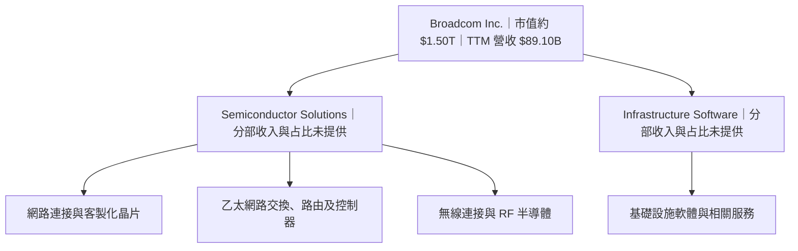
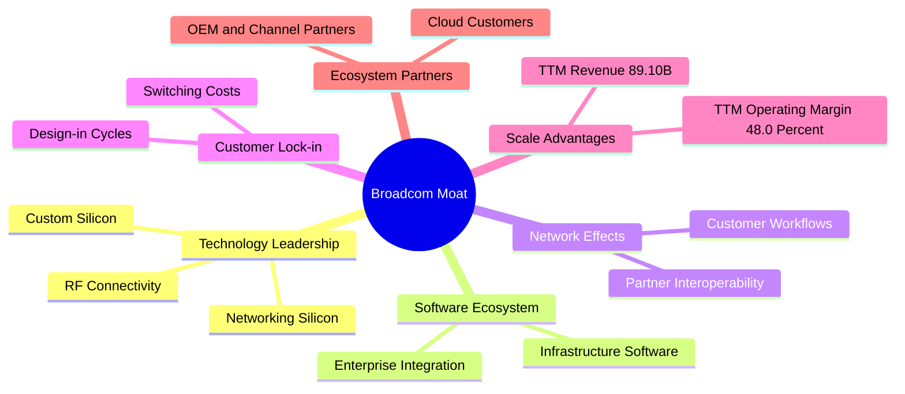
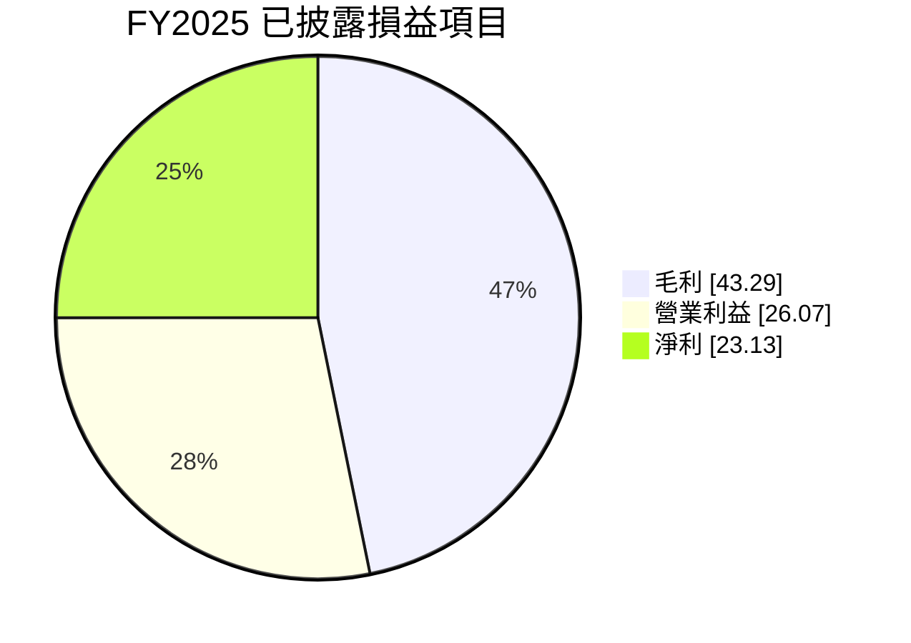
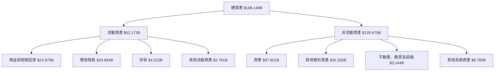
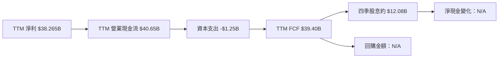
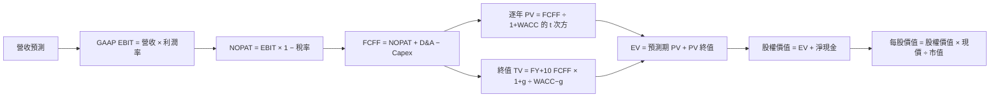
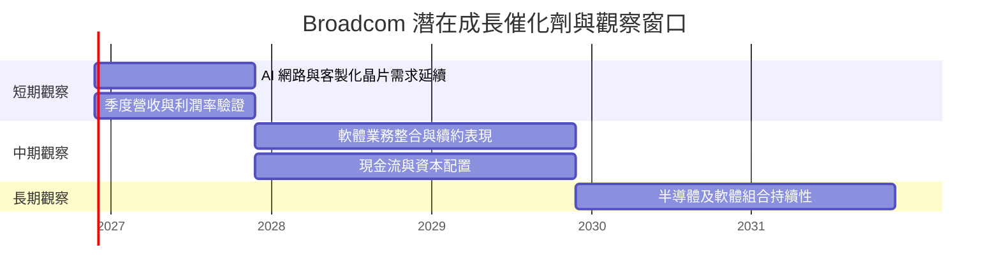
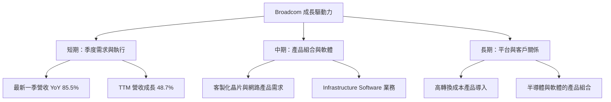
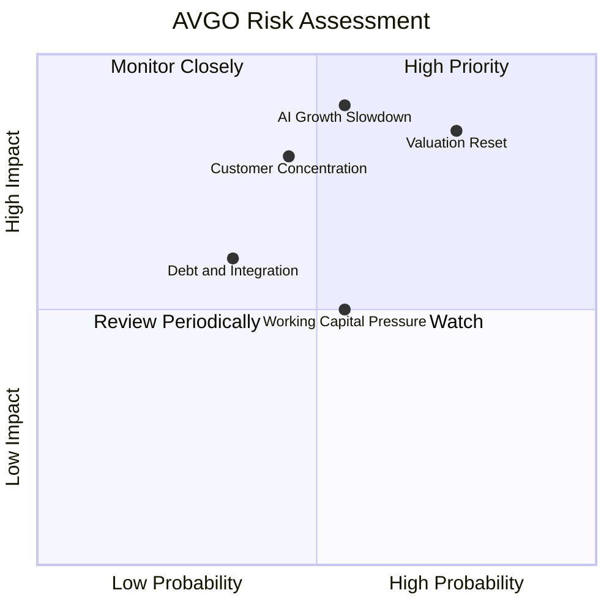
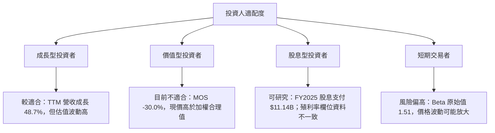

# AVGO 基本面深度分析報告
> **報告日期**：2026-11-24 ｜ **語言**：繁體中文 ｜ **數據來源**：SEC 申報資料 (XBRL)、Yahoo Finance、Finviz、StockAnalysis、Roic.ai ｜ **分析師**：CFA 級機構研究

## 目錄

| # | 章節 | 核心結論 |
|---|------|----------|
| 1 | 執行摘要 | 評級：賣出；加權合理價值 $241.28，MOS -30.0% |
| 2 | 公司概覽與商業模式 | 半導體與基礎設施軟體雙引擎；分部收入占比未提供 |
| 3 | 損益表深度分析 | TTM 營收 $89.10B、TTM 成長 48.7%；最新一季 YoY 成長 85.5% |
| 4 | 資產負債表分析 | 淨負債 $35.44B；流動比率 2.504 |
| 5 | 現金流量深度分析 | TTM FCF $39.40B，FCF Yield 2.63% |
| 6 | 獲利能力與資本效率 | ROIC 30.0% 高於 WACC 11.33%，仍在創造價值 |
| 7 | 相對估值分析 | 相對同業估值偏高；自身歷史估值位於偏高區間 |
| 8 | DCF 內在價值評估 | DCF 基準值 $216.26；加權合理價值 $241.28 |
| 9 | 成長催化劑 | AI 網路與客製化晶片、軟體訂閱為潛在增長支點 |
| 10 | 風險矩陣 | 估值重定價、AI 成長預期落差、整合與負債為主要風險 |
| 11 | 投資建議 | 依 MOS 門檻評級為賣出；需等待估值與基本面重新匹配 |

## 1. 執行摘要

AVGO 的基本面由高速成長、現金流和資本效率支撐：TTM 營收 $89.10B、年增 48.7%，TTM FCF $39.40B、ROIC 30.0%，高於 11.33% WACC。然而，2026-11-23 收盤價 $313.55 高於 DCF 基準價值 $216.26，且四種估值方法加權後合理價值為 $241.28，對應 MOS -30.0%。依 MOS 門檻，評級為 **賣出**；即使公司品質良好，現價仍包含偏高的成長預期。

### 1.0 一頁式投資儀表板（Portfolio Manager 30 秒速讀）

| 項目 | 內容 |
|------|------|
| **投資論點（3 句）** | ① TTM 營收年增 48.7%，最新一季單季 YoY 成長 85.5%，反映需求加速。② TTM FCF $39.40B、ROIC 30.0% 對照 WACC 11.33%，基本面仍創造經濟價值。③ 加權合理價值 $241.28 低於 $313.55 現價，MOS -30.0%，估值風險抵銷部分營運優勢。 |
| **綜合評分** | **6.4/10**（引用 1.1 評分卡） |
| **財務健康** | 🟡 現金與短期投資 $23.98B、總債務 $59.42B，淨負債 $35.44B；流動比率 2.504。 |
| **ROIC vs WACC** | 30.0% vs 11.33%：🟢 創造股東價值，差距 18.67 個百分點。 |
| **FCF 趨勢** | TTM FCF $39.40B；FCF Yield 2.63%。歷史年度 FCF 由 FY2022 $16.31B 增至 FY2025 $26.91B。 |
| **估值** | Forward P/E 16.15x（Peer multiples 比較採公司報價資料；同業中位數 13.6x）｜EV/EBITDA 29.32x｜FCF Yield 2.63%。 |
| **DCF 內在價值（基準）** | $216.26 ｜現價相對 DCF 基準值溢價 **45.0%**。 |
| **安全邊際（MOS）** | **-30.0%＝($241.28 − $313.55) ÷ $241.28**（基準為 8.8 加權合理價值）｜🔴 無安全邊際。 |
| **預期報酬（基準情境 12M）** | DCF 基準情境相對現價 **-31.0%**；此為模型情境值，不是保證的 12 個月報酬。 |
| **關鍵風險（前二）** | ① 市場對 AI 成長與持續性的預期偏高。② 估值倍數回落會放大股價下行。 |
| **評級 + 信心度** | 🔴 **賣出**｜信心：中；估值差距明確，但 DCF 長期假設仍有不確定性。 |

### 1.1 綜合評分卡（全報告唯一）

| 維度 | 評分（1–10） | 主要依據（引用數字與其來源章節） |
|------|--------------|----------------------------------|
| 成長性 | 8.5 | TTM 營收成長 48.7%，最新一季單季 YoY 成長 85.5%（第 3 章）；高成長也提高基期與持續性風險。 |
| 獲利能力 | 9.0 | TTM 營業利益率 48.0%、ROIC 30.0% 對照 WACC 11.33%，F-Score 7/8（第 6 章）。 |
| 財務健康 | 7.0 | 淨負債 $35.44B、流動比率 2.504；CCC 由 53 天升至 63 天（第 4 章）。 |
| 估值 | 2.0 | 加權合理價值 $241.28，MOS -30.0%；P/E、P/S 均高於自身五年中位數（第 7–8 章）。 |
| 護城河 | 8.0 | 半導體與基礎設施軟體並行，TTM 營業利益率 48.0%；客戶、分部收入及市場份額明細未提供（第 2 章）。 |
| 管理層與資本配置 | 6.5 | FY2025 SBC $7.57B；Piotroski 測試顯示稀釋股數未增加未通過，回購金額未提供（第 3、5 章）。 |
| **綜合評分** | **6.8** | 六項算術平均：$(8.5+9.0+7.0+2.0+8.0+6.5)÷6=6.833…$，四捨五入至一位小數。 |

### 1.2 五大投資論點 + 三大核心風險

| 類型 | 項目 | 具體依據 | 信心度 |
|------|------|----------|--------|
| 🟢 **投資論點①** | 營收成長加速 | TTM 營收 $89.10B、TTM YoY +48.7%；最新一季單季 YoY +85.5%。若需求延續，收入規模可支撐營業槓桿。 | 🟢 高 |
| 🟢 **投資論點②** | 現金流規模大 | TTM OCF $40.65B、資本支出 $1.25B，按定義計得 FCF $39.40B。 | 🟢 高 |
| 🟢 **投資論點③** | 資本回報高於資本成本 | ROIC 30.0% 高於 WACC 11.33%，差距 18.67 個百分點。 | 🟢 高 |
| 🟢 **投資論點④** | 業務具多元化基礎 | 公司經營 Semiconductor Solutions 與 Infrastructure Software；但分部營收及利潤占比未提供。 | 🟡 中 |
| 🟢 **投資論點⑤** | 財務流動性尚可 | 現金與短期投資 $23.98B、流動比率 2.504；但同時有 $59.42B 總債務。 | 🟡 中 |
| 🟡 **風險①** | 估值回落 | DCF $216.26、加權合理價值 $241.28，均低於 $313.55 現價；DCF 折溢價為 +45.0% 溢價。 | 🔴 高衝擊 |
| 🔴 **風險②** | 成長預期過高 | 基準 DCF 年 1 營收成長假設 30.0%；反推 DCF 顯示現價隱含年 1 成長 40.2%。 | 🟡 中高 |
| 🟡 **風險③** | 稀釋與營運資金 | F-Score 中「稀釋股數未增加」未通過；DSO 由 40 天升至 56 天、CCC 由 53 天升至 63 天。 | 🟡 中 |

### 1.3 快速統計卡片

| 指標 | 公司實際值（期間） | 同業中位數 | 狀態 |
|------|--------------------|------------|------|
| 營收成長（TTM） | **48.7%** | — | 🟢 |
| 營收成長（最新一季年增） | **85.5%** | 36.5%（NVDA、MRVL、QCOM 單季 YoY 中位數） | 🟢 |
| 毛利率（TTM） | **75.5%** | 53.1% | 🟢 |
| 營業利益率（TTM） | **48.0%** | — | 🟢 |
| ROIC（TTM） | **30.0%** | — | 🟢 |
| Forward P/E | **16.15x** | 13.6x | 🟡 |
| FCF Yield（TTM） | **2.63%** | — | 🟡 |
| Piotroski F-Score | **7 / 8** | — | 🟢 |

> 同業毛利率中位數按 NVDA 74.9%、MRVL 52.2%、QCOM 53.1% 計算；同業倍數與成長數據來源為 Yahoo Finance。AVGO 毛利率採公司實際值資料；各資料來源的個別利潤率口徑存在差異，分析時優先使用 VERIFIED FIGURES 列示值。

### 1.4 投資結論

╔══════════════════════════════════════════════════════════════════╗  
║                    📊 投資結論摘要                               ║  
╠══════════════════════════════════════════════════════════════════╣  
║  評級：🔴 賣出（MOS -30.0%，符合規則 20）                         ║  
║  價格（2026-11-23 收盤）：$313.55                                ║  
║  DCF 內在價值（基準）：$216.26（現價溢價 45.0%）                 ║  
║  安全邊際 MOS：-30.0%（＝($241.28−$313.55)÷$241.28）            ║  
║  加權合理價值（8.8）：$241.28                                    ║  
║  DCF 情境價值：                                                   ║  
║    悲觀情境：$89.11（相對現價 -71.6%）                            ║  
║    基準情境：$216.26（相對現價 -31.0%）                           ║  
║    樂觀情境：$478.02（相對現價 +52.5%）                           ║  
║  綜合評分：6.8/10（引用 1.1）                                    ║  
║  適合投資人：能承受高波動、採分批操作的長期成長型投資人；         ║  
║              不適合只依估值折價進場的價值型投資人                ║  
╚══════════════════════════════════════════════════════════════════╝

## 2. 公司概覽與商業模式

### 2.1 業務結構與收入來源

公司概覽顯示 Broadcom 經營半導體解決方案與基礎設施軟體。TTM 營收為 $89.10B，但各分部收入、營業利潤及收入占比未提供，因此不以估算數字填補。

半導體產品組合包括網路連接、客製化晶片、乙太網路設備與無線元件；軟體業務提供另一種營收來源。訂閱收入比例、續約率及分部毛利率沒有可引用數據，不能量化軟體經常性收入對整體的貢獻。

### 2.2 市場份額

市場份額數據未提供，亦沒有可引用的 TAM 或市場份額年份資料，故不製作份額圖表。就相對規模而言，AVGO TTM 營收為 $89.10B，最新一季單季營收年增 85.5%；該增速高於所列三家同業的最新一季 YoY 成長中位數 36.5%，但不等於市場份額已提升。

### 2.3 競爭護城河分析

上述定性護城河類型依公司業務組成與產業特性描述；客戶集中度、轉換成本金額、設計週期及合作夥伴收入均未提供，不能將質化判斷當作已驗證的量化證據。

### 2.4 護城河強度

| 護城河項目 | 強度（強／中／弱） | 證據（引用數字或事實） | 會削弱它的情況 |
|------------|--------------------|------------------------|----------------|
| 技術與產品組合 | 強 | 涵蓋客製化晶片、乙太網路交換與路由、控制器及 RF；TTM 營業利益率 48.0%。 | 競爭者在客製化晶片、網路產品或無線元件取得設計案。 |
| 軟體生態系統 | 中 | 有 Infrastructure Software 業務；收入、續約率及分部利潤未提供，無法驗證黏著度。 | 客戶遷移替代方案或軟體整合成本下降。 |
| 客戶鎖定 | 中 | 半導體設計導入與企業基礎設施軟體可能形成轉換成本；客戶集中度與設計週期未提供。 | 客戶自研晶片、供應來源多元化或軟體替換。 |
| 規模效應 | 強 | TTM 營收 $89.10B、FCF $39.40B，具備大規模研發與供應鏈運作能力。 | 市場需求下滑、產品組合不利或併購整合成本上升。 |
| 網路效應 | 弱至中 | 所列資料沒有直接量化使用者、開發者或網路外部性。 | 開放標準與替代平台削弱相容性優勢。 |
| 生態夥伴 | 中 | 業務跨半導體與軟體，但合作夥伴及渠道營收數據未提供。 | 主要平台、雲端客戶或 OEM 轉向其他供應商。 |

1.1 的護城河評分為 **8.0/10**，主要依據 TTM 營業利益率 48.0%、TTM FCF $39.40B 及多元產品組合；客戶鎖定與軟體經常性收入缺少直接量化資料，故未給滿分。

## 3. 損益表深度分析

### 3.1 年度收入成長趨勢（近 4 年）

年度營收採損益表所列 FY2022–FY2025。FY2022–FY2025 的累計 CAGR 為約 24.4%：$(63.89÷33.20)^{1/3}-1≈24.4\%$。年度營收快速增加，反映業務組合、需求與整合後規模擴大；單一年度的淨利則受到非經常性項目影響較大。

╔══════════════════════════════════════════════════════════════════╗  
║              Broadcom 年度收入趨勢（FY2022–FY2025）              ║  
╠══════════════════════════════════════════════════════════════════╣  
║ FY2022  $33.20B  ██████████░░░░░░░░░░░░░░░░░░  YoY：基期       ║  
║ FY2023  $35.82B  ███████████░░░░░░░░░░░░░░░░░  YoY：+7.9% 🟡   ║  
║ FY2024  $51.57B  ████████████████░░░░░░░░░░░░  YoY：+44.0% 🟢  ║  
║ FY2025  $63.89B  ████████████████████░░░░░░░░  YoY：+23.9% 🟢  ║  
╠══════════════════════════════════════════════════════════════════╣  
║ FY2022–FY2025 營收 CAGR：約 +24.4%                               ║  
╚══════════════════════════════════════════════════════════════════╝

### 3.2 季度收入趨勢分析

QoQ 以相鄰已列季度收入計算；YoY 使用季度收入歷史資料。2026 年 8 月 2 日為最新季報期間，季度表中 2026-07-31 的收入與該期數值近似，但日期口徑不同，分析以 VERIFIED FIGURES 的最新季度 YoY 85.5% 為準。

| 季度 | 營收 | QoQ 成長 | YoY 成長 | 備註 |
|------|------:|---------:|---------:|------|
| 2025-10-31 | $18.02B | +20.1% | +28.2% | QoQ 對 2025-07-31 $15.95B。 |
| 2026-01-31 | $19.31B | +7.2% | +29.5% | QoQ 對 $18.02B。 |
| 2026-04-30 | $22.19B | +14.9% | +47.9% | QoQ 對 $19.31B；同比成長加速。 |
| 2026-07-31／最新申報季度截至 2026-08-02 | $29.59B | +33.4% | +85.5% | QoQ 對 $22.19B；同比以 VERIFIED FIGURES 單季率為準。 |

最新季度的營收增長明顯快於前幾季，可能反映 AI 相關網路與客製化晶片需求增加；然而產品別收入拆分未提供，因此不能把全部增長歸因於單一產品線。若成長集中於少數大客戶或大型專案，後續季度的比較基期也會迅速提高。

### 3.3 利潤率演變分析

以下以年度損益表所列毛利、營業利益與淨利除以同年度營收計算；與 TTM VERIFIED FIGURES 口徑不同，不應混為同一期間。

| 利潤率指標 | FY2022 | FY2023 | FY2024 | FY2025 | 趨勢 | 評估 |
|------------|-------:|-------:|-------:|-------:|------|------|
| **毛利率** | 66.5% | 68.9% | 63.0% | 67.8% | 先升、FY2024 回落後回升 | 🟡 年度數據波動；產品組合與併購攤銷可能影響比較。 |
| **營業利益率** | 43.0% | 45.9% | 29.1% | 40.8% | FY2024 下滑、FY2025 回升 | 🟡 年度營業利益受費用與組合變化影響。 |
| **淨利率** | 34.6% | 39.3% | 11.4% | 36.2% | FY2024 明顯下降後回升 | 🟡 FY2024 淨利偏低，不能直接視作穩態盈利能力。 |

TTM 營業利益率採 VERIFIED FIGURES 的 **48.0%**；最新一季營業利益率採 **53.9%**。年度表格與其他彙整來源的營業利益率數字存在差異，故趨勢解讀以各自期間與來源口徑分開處理。毛利及營業利潤率變動可能受到半導體與軟體收入占比、收購後攤銷及研發費用影響，但分部數據不足以拆分各因素的貢獻。

### 3.4 費用結構分析

年度 FY2025 損益表提供收入 $63.89B、毛利 $43.29B、營業利益 $26.07B、研發費用 $10.98B、淨利 $23.13B。研發費用占收入約 17.2%（$10.98B÷$63.89B）；毛利至營業利益的差額為 $17.22B，但包含多項營運費用，不能全部視為單一費用項。

圖中列示的是不同損益層級，彼此包含關係重疊，**不是**互斥費用構成，故不應將扇區解讀成可加總至營收的費用比例。

╔══════════════════════════════════════════════════════════════════╗  
║                    FY2025 費用結構觀察                           ║  
╠══════════════════════════════════════════════════════════════════╣  
║ 營收              $63.89B                                        ║  
║ 毛利              $43.29B                                        ║  
║ 研發費用          $10.98B（收入的 17.2%）                        ║  
║ 營業利益          $26.07B                                        ║  
║ 淨利              $23.13B                                        ║  
║ 其他營運費用明細  N/A（未提供完整費用分類）                      ║  
╚══════════════════════════════════════════════════════════════════╝

### 3.5 季度 EPS 趨勢與盈餘品質（Quality of Earnings）

| 季度 | EPS 實際 | EPS 預估／超預期狀況 | 備註 |
|------|---------:|----------------------|------|
| 2025-10-31 | $1.74 | N/A（估值資料為 nan，無法判斷 beat/miss） | 不推定超預期或不及預期。 |
| 2026-01-31 | $1.50 | N/A（估值資料為 nan，無法判斷 beat/miss） | StockAnalysis 季度資料。 |
| 2026-04-30 | $1.91 | N/A（估值資料為 nan，無法判斷 beat/miss） | StockAnalysis 季度資料。 |
| 2026-07-31／最新季度 | $2.68 | N/A（估值資料為 nan，無法判斷 beat/miss） | 最新季度 EPS YoY 成長 215.3%。 |

| 盈餘品質項目 | 數值／佔比 | 評估 |
|--------------|-----------|------|
| 股權薪酬 SBC / 營收 | 約 **9.5%**：季度四季 SBC 合計 $8.48B ÷ TTM 營收 $89.10B | 🟡 SBC 金額不低，對經濟股東回報有稀釋成本。 |
| SBC / 營業現金流 | 約 **20.9%**：$8.48B ÷ $40.65B | 🟡 現金流未直接等於無成本收益；SBC 的價值轉移須與股數變化一併考慮。 |
| FCF / 淨利（現金轉換率） | 約 **103.0%**：$39.40B ÷ StockAnalysis TTM 淨利 $38.265B | 🟢 現金轉換高於淨利，支持盈利含金量；數據來源與期間口徑須注意。 |
| 一次性／非經常性損益 | 具體金額 N/A | FY2024 淨利 $5.89B，與 FY2023 $14.08B、FY2025 $23.13B 差異大；缺少調節表，不能確定一次性項目金額。 |
| 有效稅率異常 | N/A（TTM 有效稅率未提供） | 不足以判定淨利是否受特定稅務利益推動。DCF 模型採用 21.0% 稅率。 |
| 資本化支出 vs 費用化 | TTM Capex $1.25B；資本化軟體成本與攤銷明細 N/A | 資本支出規模低於 OCF，但無法據此確認資本化政策是否影響盈餘。 |

SBC 估算依據為四季列示 SBC 的加總：$2.02B+$2.09B+$2.18B+$2.19B=$8.48B。報表將 SBC 加回 OCF，並不代表其對股東沒有成本；F-Score 顯示稀釋股數測試未通過，也提醒股東回報需考慮股份稀釋。綜合來看，現金流轉換支持 GAAP 盈利的現金含量，但 SBC 及年度淨利波動降低單純以 EPS 外推的可靠性。

## 4. 資產負債表分析

### 4.1 資產結構分解

最新資產負債表截至 2026-08-02。非流動資產 $135.975B 為總資產減流動資產計算結果；其組成包括商譽、無形資產、固定資產及其他長期資產。

### 4.2 流動性與營運資金分析

流動性指標來自所列資產負債表資料；營運資金天數照 QUALITY FIGURES 原值列示，不另重算。

| 指標 | 最新 TTM | 一年前 TTM | 變化 | 解讀 |
|------|----------|------------|------|------|
| 流動比率 | 2.504 | N/A | N/A | 流動資產對短期負債覆蓋充足；比較值未列。 |
| 速動比率 | 2.153 | N/A | N/A | 排除存貨後仍有流動性緩衝。 |
| DSO 應收帳款天數 | 56 天 | 40 天 | +16 天 | 應收回收時間延長，需留意大型客戶付款條件與應收品質。 |
| DIO 存貨天數 | 59 天 | 40 天 | +19 天 | 存貨占用時間上升；可能與需求準備及供應安排有關，需觀察是否轉為滯銷。 |
| DPO 應付帳款天數 | 52 天 | 26 天 | +26 天 | 付款天數增加，短期可支持現金，但不能單獨視作議價能力改善。 |
| CCC 現金轉換週期 | 63 天 | 53 天 | +10 天 | 現金從投入至回收的時間拉長，營運資金占用增加。 |

現金與短期投資為 $23.98B，短期流動比率高，但 DSO、DIO 同時上升，仍應追蹤應收帳款、存貨及現金轉換週期是否持續惡化。

### 4.3 債務結構分析

╔══════════════════════════════════════════════════════════════════╗  
║                   Broadcom 債務健康診斷                          ║  
╠══════════════════════════════════════════════════════════════════╣  
║ 總債務：          $59.42B  ████████████████████  🟡              ║  
║ 現金+短期投資：   $23.98B  ████████░░░░░░░░░░░░  🟢              ║  
║ 淨負債：          $35.44B  ████████████░░░░░░░░  🟡              ║  
║ 流動比率：        2.504x   🟢                                    ║  
║ Debt/EBITDA：     N/A（未提供與同一期間匹配的 TTM EBITDA）        ║  
║ 利息保障倍數：    N/A（未提供利息費用）                           ║  
╚══════════════════════════════════════════════════════════════════╝

淨負債以 VERIFIED FIGURES 列示的 -$35.44B（負淨現金）表達。資產負債表另列 FY2025 總債務 $65.14B，而最新 TTM 欄列 $59.42B；本節採用最新 TTM 數值，不將不同日期混作同期比率。

### 4.4 股東權益趨勢

╔══════════════════════════════════════════════════════════════════╗  
║                 Broadcom 股東權益趨勢                            ║  
╠══════════════════════════════════════════════════════════════════╣  
║ FY2022  $22.71B  ██████░░░░░░░░░░░░░░░░░░░░░░░░                ║  
║ FY2023  $23.99B  ███████░░░░░░░░░░░░░░░░░░░░░░░░                ║  
║ FY2024  $67.68B  █████████████████████████░░░░░░                ║  
║ FY2025  $81.29B  ██████████████████████████████                ║  
╠══════════════════════════════════════════════════════════════════╣  
║ FY2023 至 FY2024 權益大幅增加；同期資產亦由 $72.86B 升至        ║  
║ $165.65B，應視為併購與資產負債表規模變化，不宜只解讀為內生累積。║  
╚══════════════════════════════════════════════════════════════════╝

## 5. 現金流量深度分析

### 5.1 現金流量瀑布圖

TTM 淨利以 StockAnalysis TTM $38.265B 作為參考；其餘 OCF、Capex 與 FCF 使用 VERIFIED FIGURES。股息按已列四季合計，回購及淨現金變動缺少匹配期間數據。

### 5.2 FCF 轉換率趨勢

年度 FCF 轉換率按年度 FCF 除以年度淨利計算。FY2024 淨利異常偏低，使轉換率特別高，不宜直接外推。

| 財年 | FCF | 淨利 | FCF / 淨利 | 趨勢與解讀 |
|------|----:|----:|-----------:|------------|
| FY2022 | $16.31B | $11.49B | 142.0% | 現金流高於淨利。 |
| FY2023 | $17.63B | $14.08B | 125.2% | 現金轉換仍高於 100%。 |
| FY2024 | $19.41B | $5.89B | 329.5% | 淨利基數偏低，比例不可視為常態。 |
| FY2025 | $26.91B | $23.13B | 116.3% | 現金轉換仍高於淨利。 |
| TTM | $39.40B | $38.265B | 103.0% | 現金轉換約略高於淨利。 |

### 5.3 自由現金流趨勢

╔══════════════════════════════════════════════════════════════════╗  
║              自由現金流趨勢（年度實際與 TTM）                    ║  
╠══════════════════════════════════════════════════════════════════╣  
║ FY2022  $16.31B  ████████████░░░░░░░░░░░░░░░░  FCF Yield N/A    ║  
║ FY2023  $17.63B  █████████████░░░░░░░░░░░░░░░  FCF Yield N/A    ║  
║ FY2024  $19.41B  ██████████████░░░░░░░░░░░░░░  FCF Yield N/A    ║  
║ FY2025  $26.91B  ████████████████████░░░░░░░░  FCF Yield N/A    ║  
║ TTM     $39.40B  ██████████████████████████████  FCF Yield 2.63% ║  
╠══════════════════════════════════════════════════════════════════╣  
║ FY2022–FY2025 FCF CAGR：約 18.2%；年度市值未提供，故不回填歷史殖利率。║  
╚══════════════════════════════════════════════════════════════════╝

TTM FCF 直接引用定義：營業現金流 $40.65B − 資本支出 $1.25B = $39.40B。FCF 成長提供資本配置能力，但以 $1.50T 市值衡量的 FCF Yield 僅 2.63%，顯示股價已先行反映相當程度的未來成長。

### 5.4 資本配置評估

FY2025 現金股息支付 $11.14B，FY2025 SBC $7.57B；回購、投資與留存現金的同年度完整分配額未提供，不製作不完整比例圓餅圖。

| 資本配置項目 | 可引用金額 | 評估 |
|--------------|-----------:|------|
| FY2025 現金股息 | $11.14B | 約為 FY2025 FCF $26.91B 的 41.4%；股息有現金流覆蓋。 |
| TTM 資本支出 | $1.25B | 相對 TTM OCF $40.65B 較低；資本密集程度有限，但未含全部研發投資。 |
| FY2025 SBC | $7.57B | 非現金列報不代表無成本，可能造成持股稀釋。 |
| 股票回購 | N/A | 未提供可核對的同期回購金額。 |
| 併購與投資 | N/A | 未提供匹配期間的現金支出拆分。 |

資料中的股息殖利率 85.0% 與常見殖利率呈現顯著不一致，且未能由股息金額和股價資料核對；因此本報告不以該欄數字作為投資判斷依據。

## 6. 獲利能力與資本效率

### 6.1 ROE / ROA / ROIC 趨勢

| 指標 | 最新可用數值 | 歷史或比較資料 | 評估 |
|------|-------------:|----------------|------|
| ROE | TTM 38.4%（QUALITY FIGURES） | 另一彙整來源列 44.2%，口徑不一致 | 本報告採 38.4%。 |
| ROA | 15.4% | 歷史可比序列未提供 | 獲利對資產回報良好。 |
| ROIC | 30.0% | 歷史可比序列未提供 | 顯著高於 WACC。 |
| 行業均值 | N/A | 未提供一致口徑來源 | 不填入估計值。 |

### 6.2 ROIC vs WACC 分析（核心價值創造判斷）

WACC 與組成直接採 VERIFIED FIGURES；未另行重算或替換。無風險利率為 10 年期美債 4.92%，該數值未提供精確觀測日；ERP 為假設 5.00%，原始 Yahoo Beta 1.51，調整後 Beta 1.34。採用的股權成本為 11.61%、稅前債務成本 5.40%、預設稅率 21.0%，股權／債務權重分別為 96.2%／3.8%，WACC 為 11.33%。

╔══════════════════════════════════════════════════════════════════╗  
║                ROIC vs WACC 深度分析                            ║  
╠══════════════════════════════════════════════════════════════════╣  
║ WACC 組成（採用財務數據列示值）：                               ║  
║ ├── 無風險利率（10Y 美債）：4.92%                                ║  
║ ├── 市場風險溢酬 ERP：5.00%（假設值）                            ║  
║ ├── Beta：原始 1.51；調整後 1.34                                 ║  
║ ├── 股權成本 Ke：11.61%                                          ║  
║ ├── 稅前債務成本：5.40%；稅後約 4.27%                            ║  
║ ├── 股權／債務權重：96.2%／3.8%                                  ║  
║ └── WACC：11.33%                                                 ║  
║                                                                  ║  
║ ROIC（TTM）：30.0%                                               ║  
║ EVA spread = ROIC − WACC = 30.0% − 11.33% = +18.67 個百分點      ║  
║                                                                  ║  
║ ROIC  30.0%  ▓▓▓▓▓▓▓▓▓▓▓▓▓▓▓▓▓▓▓▓▓▓▓▓▓▓▓▓▓▓  🟢             ║  
║ WACC  11.33% ▓▓▓▓▓▓▓▓▓▓▓░░░░░░░░░░░░░░░░░░░░  ──             ║  
║                                                                  ║  
║ 結論：ROIC / WACC = 30.0% ÷ 11.33% = 2.65 倍；目前創造股東價值。║  
╚══════════════════════════════════════════════════════════════════╝

債務成本為利息支出除以債務的估算輸入；利息費用明細與平均計息負債沒有提供，因此無法獨立重現其 5.40% 來源。此處依指定規則採用已列 WACC 組成，並不把總負債中無息負債另當作計息負債。

### 6.3 杜邦三因素分解

| 因素 | 數值（TTM） | 解讀 |
|------|-------------|------|
| 淨利率 | 42.9% | 高淨利率是 ROE 的重要來源。 |
| 資產週轉率 | 0.47 | 資產每年約產生 0.47 倍營收。 |
| 權益乘數 | 1.89 | 存在槓桿，但 ROE 不主要依賴高權益乘數。 |
| **ROE** | **38.4%** | QUALITY FIGURES 原值：42.9% × 0.47 × 1.89 = 38.4%。 |

杜邦因子顯示高淨利率與 0.47 倍資產週轉共同支持 ROE；1.89 倍權益乘數提供放大效果，但不是唯一驅動力。

### 6.4 財務體質：Piotroski F-Score

Piotroski F-Score 為 **7/8**；一項因資料缺漏無法判定，因此此處沿用 QUALITY FIGURES 的 7/8，而不是將其改寫為九項測試中的分母。

| 測試 | 結果 | 解讀 |
|------|------|------|
| ROA > 0 | ✅ 通過 | 正向獲利。 |
| 營業現金流 > 0 | ✅ 通過 | 營運產生正現金。 |
| ROA 高於一年前 | ✅ 通過 | 獲利效率改善。 |
| 營業現金流 > 淨利 | ✅ 通過 | 應計品質測試通過。 |
| 長期負債 ÷ 總資產低於一年前 | — 無法判定（缺資料） | 不納入可判定測試。 |
| 流動比率高於一年前 | ✅ 通過 | 短期流動性相對改善。 |
| 稀釋股數未增加 | ❌ 未通過 | 股數稀釋可能降低每股價值成長。 |
| 毛利率高於一年前 | ✅ 通過 | 毛利率比較測試通過。 |
| 資產週轉率高於一年前 | ✅ 通過 | 資產運用效率改善。 |

## 7. 相對估值分析

### 7.1 同業估值比較表格

同業倍數採 Yahoo Finance 的 Peer multiples；AVGO 倍數採財務數據中的市場估值。Forward P/E 公司數值 16.15x 與 Peer multiples 區塊未列公司 Forward P/E 同口徑值，採市場估值欄位；股價估值法則依指定的同業中位數輸入。

| 估值指標 | **AVGO** | **NVDA** | **MRVL** | **QCOM** | 本公司評估 |
|----------|---------:|---------:|---------:|--------:|-----------|
| **Trailing P/E** | 40.0x | 13.5x | 47.6x | 11.8x | 🔴 高於 NVDA、QCOM，低於 MRVL；同業中位數 13.5x。 |
| **Forward P/E** | 16.15x | 9.9x | 19.6x | 13.6x | 🟡 高於 NVDA、QCOM，低於 MRVL；同業中位數 13.6x。 |
| **P/S Ratio** | 16.8x | 11.0x | 13.8x | 4.1x | 🔴 高於三家同業中位數 11.0x。 |
| **EV/EBITDA** | 29.3x | 16.1x | 45.0x | 17.4x | 🔴 高於 NVDA、QCOM，中位數 17.4x；低於 MRVL。 |
| **最新一季營收 YoY** | 85.5% | 103.2% | 36.5% | -8.4% | 🟢 成長高於 MRVL、QCOM，低於 NVDA。 |
| **毛利率（TTM）** | 75.5% | 74.9% | 52.2% | 53.1% | 🟢 略高於 NVDA，且高於 MRVL、QCOM。 |

同業差異很大，特別是 NVDA、QCOM 與 MRVL 的營收成長及產品組合不同；倍數比較是價格參照，不代表各公司的風險、成長和獲利品質完全可比。

### 7.2 歷史估值區間分析

╔══════════════════════════════════════════════════════════════════╗  
║                 AVGO 五年估值區間（TTM P/E）                     ║  
╠══════════════════════════════════════════════════════════════════╣  
║ 區間低點：1.8x ├──────────────────────────────────┤ 區間高點：77.5x║  
║ 五年中位數：5.5x                                                  ║  
║ 當前 P/E：40.0x　百分位：70%                                      ║  
║ 判讀：高於五年中位數，位於自身歷史偏高位置 🟡／🔴                ║  
╚══════════════════════════════════════════════════════════════════╝

其他自身歷史倍數：P/S 現值 17.2x、五年中位數 1.5x、百分位 65%；EV/EBITDA 現值 36.1x、五年中位數 5.6x、百分位 55%。數據中的歷史中位數明顯受公司業務組合、財務期間及歷史低倍數影響，不能機械地視為合理估值目標，但目前倍數相對歷史仍偏高。

### 7.3 情境價值（Bear / Base / Bull，照抄 DCF MODEL 的 Scenarios）

| 情境 | 第 1 年營收成長 | 期末營業利潤率 | WACC | 每股價值 | 相對現價 | 機率 | 會發生的條件 |
|------|----------------:|----------------:|-----:|----------:|----------:|-----:|--------------|
| 🔴 悲觀 | 15.0% | 36.4% | 12.33% | $89.11 | -71.6% | 25% | AI 需求減速、客製化晶片與網路收入成長降溫，並伴隨利潤率收縮及風險溢酬上升。 |
| 🟡 基準 | 30.0% | 42.8% | 11.33% | $216.26 | -31.0% | 50% | 收入成長由 30.0% 線性遞減至 3.0%，利潤率按模型逐步回落。 |
| 🟢 樂觀 | 45.0% | 47.1% | 10.33% | $478.02 | +52.5% | 25% | AI 與網路需求超預期延續，規模效益維持高利潤率且資本成本下降。 |

DCF 程式情境的期末利潤率與 WACC 同時變動；由於缺少各情境的逐年營收、FCFF 與終值明細，本節不自行補造中間模型數字。

### 7.4 相對估值隱含價格區間

╔══════════════════════════════════════════════════════════════════╗  
║                  估值方法隱含每股價值                            ║  
╠══════════════════════════════════════════════════════════════════╣  
║ $145.33 ───── $216.26 ───── $263.57 ──── $313.55 ──── $525.51 ║  
║ EV/EBITDA     DCF 基準      Forward P/E      現價       分析師均值║  
╚══════════════════════════════════════════════════════════════════╝

| 方法 | 每股價值 | 依據 |
|------|---------:|------|
| 同業 EV/EBITDA | $145.33 | NVDA、QCOM 同業中位數 16.8x × TTM EBITDA，並加回淨現金／扣除淨負債。 |
| DCF 基準 | $216.26 | 10 年 FCFF、WACC 11.33%、永續成長 3.0%。 |
| 同業 Forward P/E | $263.57 | 同業中位數 13.6x × Forward EPS $19.41。 |
| 分析師共識目標價 | $525.51 | 47 位分析師目標價平均值，作為參考，不視為內在價值。 |

## 8. DCF 內在價值評估（Discounted Cash Flow）

### 8.0 估值推理鏈（Thinking Logic：在算之前先想清楚）

#### Step 1 — 價值由哪些變數決定？

AVGO 的價值可理解為半導體方案與基礎設施軟體兩項業務的現金流能力，以及未來 AI 網路與客製化晶片需求帶來的增長；但兩分部收入占比未提供，不能量化拆分。模型最關鍵的變數是收入成長、營業利潤率及 WACC，因為它們共同影響預測期現金流及終值。敏感性矩陣顯示 WACC 與終值成長率會顯著改變估值；模型中終值現值占 EV 53.4%。

#### Step 2 — 模型選擇

| 決策點 | 本報告採用 | 理由（含數字） | 曾考慮但否決 | 否決理由 |
|--------|-----------|----------------|--------------|----------|
| 現金流定義 | FCFF | 以 WACC 折現，並由企業價值橋接至股權價值；模型 FCFF 定義為 NOPAT + D&A − Capex。 | FCFE | 債務與資本結構可能變動，以企業現金流折現較一致。 |
| 預測期 N | 10 年 | DCF MODEL 固定使用 10 年，收入成長由 30.0% 逐步降至 3.0%。 | 5 年 | 會縮短模型設定的成長遞減路徑，不能擅自替代程式模型。 |
| 終值方法 | Gordon Growth | WACC 11.33% 大於永續成長率 3.0%，終值公式可用。 | 僅退出倍數 | DCF MODEL 指定 Gordon Growth；沒有提供退出倍數終值。 |
| EBIT 基礎 | GAAP EBIT | 模型明確以 GAAP EBIT 建模。 | 非 GAAP EBIT | 可能將 SBC 加回而低估股東成本，且不是指定模型基礎。 |

#### Step 3 — 關鍵假設推導鏈

- **收入成長**：錨點＝TTM 營收年增 48.7%、最新季度單季 YoY 85.5% → 調整＝以最新成長高於可持續增速及基期墊高為由，模型將年 1 成長限制在 30.0%，並線性降至年 10 的 3.0% → **採用 DCF MODEL 逐年 30.0%、27.0%、24.0%、21.0%、18.0%、15.0%、12.0%、9.0%、6.0%、3.0%** → 曾考慮延續 TTM 48.7%，但否決，因其代表將高成長持續期拉長，且市場反推現價已要求年 1 成長 40.2%。
- **期末營業利潤率**：錨點＝TTM GAAP 營業利益率 48.0% → 調整＝模型將利潤率逐年遞減至過去五年中位數 → **採用年 1 48.0% 至年 10 42.8%** → 曾考慮維持 48.0%，否決理由是模型的長期收斂假設較能反映競爭與成熟期風險。
- **永續成長率 g**：錨點＝模型採 3.0%，與模型年 10 成長 3.0%一致 → 調整＝不再假設成熟後持續高於經濟長期成長 → **採用 3.0%** → 不採高於 WACC 的設定，因為 Gordon Growth 公式將失效。
- **預測期 N**：錨點＝模型列出的 10 個年度 FCFF → 調整＝不另改模型期間 → **採用 10 年** → 未改用較短期間，因會改變既定預測及終值起點。
- **Capex／營收**：錨點＝TTM 資本支出 $1.25B、TTM 營收 $89.10B，約 1.4% → 調整＝模型由年 1 的 1.4% 逐步下降至年 10 的 0.8% → **採用模型逐年值** → 不固定在 1.4%，因模型假設資本支出率向折舊支出相對水準收斂。
- **D&A／營收**：錨點＝模型輸入 0.7% → **採用 0.7% 固定**；TTM 明細未提供可獨立重算比率，直接沿用模型值。
- **有效稅率**：錨點＝模型採用預設 21.0% → **採用 21.0%**；實際 TTM 有效稅率未提供，故此項屬模型假設。
- **營運資金**：錨點＝CCC 63 天、DSO 56 天、DIO 59 天、DPO 52 天 → **DCF 模型不建模營運資金變化**；不能將 0 誤述為實際 ΔWC，也不能在 FCFF 裡自行加入估計值。
- **SBC 與稀釋**：錨點＝DCF 採 GAAP EBIT，GAAP 營業利益已包含 SBC 費用 → **採用組合 (A)：GAAP EBIT + 固定股數、年稀釋率 0%** → 不另扣 SBC，也不再放大股數，避免重複計算。這與 SBC 作為非現金費用但具股東稀釋成本的經濟現實仍有估值限制。
- **終值方法**：錨點＝程式模型指定 Gordon Growth → **採用 Gordon Growth、g=3.0%** → 不另加未提供的退出倍數交叉估值。
- **WACC**：錨點＝VERIFIED FIGURES WACC 11.33% → **採用 11.33%** → 不另選較低折現率；因價格對 WACC 敏感，採用不同值會改變模型結果。

#### Step 4 — 最脆弱環節

最脆弱的一環是超高成長從 30.0% 快速遞減仍能支撐長期現金流；若收入增長或利潤率低於模型，價值向下，悲觀情境值為 $89.11，基準為 $216.26。

#### Step 5 — 計算路徑圖

### 8.1 模型假設總表（Model Inputs）

| 假設項目 | 採用值 | 依據／來源 | 敏感度 |
|----------|--------|-------------|--------|
| 預測期長度 N | 10 年 | DCF MODEL 指定，逐年遞減成長假設。 | 🟡 中 |
| 收入成長 | FY+1 30.0% 線性降至 FY+10 3.0% | TTM 成長 48.7%；模型限制年 1 最高 30.0%。 | 🔴 高 |
| 營業利潤率 | FY+1 48.0% 降至 FY+10 42.8% | TTM 營業利益率 48.0%；長期收斂至過去五年中位數。 | 🔴 高 |
| 有效稅率 | 21.0% | DCF MODEL 預設值；實際 TTM 稅率未提供。 | 🟢 低 |
| Capex／營收 | 1.4% 降至 0.8% | TTM $1.25B ÷ $89.10B 約 1.4%；後續逐步下降。 | 🟡 中 |
| D&A／營收 | 0.7% | DCF MODEL TTM 輸入。 | 🟢 低 |
| 營運資金變動 | 不建模 | DCF MODEL 明確排除營運資金；不以估算替代。 | 🟢 低 |
| EBIT 基礎 | GAAP EBIT | DCF MODEL 採 GAAP。 | 🟡 中 |
| SBC 處理 | 組合 (A)：GAAP EBIT，FCFF 不再扣 SBC；固定股數 | SBC 已進 GAAP EBIT；股數不另稀釋。 | 🟡 中 |
| 年稀釋率 | 0%（模型假設） | 配合組合 (A)；股數不再增加。 | 🟡 中 |
| 永續成長率 g | 3.0% | DCF MODEL 指定，低於 WACC 11.33%。 | 🔴 高 |
| 終值方法 | Gordon Growth | DCF MODEL 終值公式。 | 🔴 高 |
| WACC | 11.33% | VERIFIED FIGURES Cost of capital。 | 🔴 高 |

本章所有現金流採 **FCFF = NOPAT + D&A − Capex**，不含 ΔWC；與模型一致。組合 (A) 已由 GAAP EBIT 扣除 SBC，因此不再另扣 SBC，亦不在每股計算中增加年稀釋。

### 8.2 折現率推導（WACC）

╔══════════════════════════════════════════════════════════════════╗  
║                    WACC 推導（折現率）                           ║  
╠══════════════════════════════════════════════════════════════════╣  
║ 股權成本 Ke（CAPM）：                                            ║  
║ ├── 無風險利率 Rf（10Y 美債）：4.92%                             ║  
║ ├── ERP：5.00%（假設值）                                         ║  
║ ├── 原始 Beta（Yahoo）：1.51                                     ║  
║ ├── 調整後 Beta：⅔×1.51+⅓×1=1.34                                ║  
║ ├── 規模／國別溢酬：0.00%（模型未另計）                          ║  
║ └── 採用股權成本 Ke：11.61%（直接引用）                          ║  
║                                                                  ║  
║ 債務成本：稅前 5.40%；稅率 21.0%                                ║  
║ 稅後 Kd = 5.40%×(1−21.0%) = 4.266%                               ║  
║                                                                  ║  
║ 股權／債務權重：96.2%／3.8%                                     ║  
║ WACC = 96.2%×11.61% + 3.8%×4.266%                               ║  
║       = 11.1708% + 0.1621% = 11.3329% ≈ 11.33%                   ║  
╚══════════════════════════════════════════════════════════════════╝

逐步演算與資料限制：

1. **Ke（CAPM）**：資料列示 $4.92\% + 1.34×5.00\%$，按已四捨五入輸入計算為 11.62%；資料區塊採用 Ke **11.61%**。差異約 0.01 個百分點，源自 Beta 或輸入精度未顯示，本報告依規則採用 11.61%。
2. **稅前 Kd**：採用資料區塊 **5.40%**。利息費用與平均計息負債的細分數字未提供，無法另行完整重建其分子與分母。
3. **稅後 Kd**：$5.40\%×(1−21.0\%)=4.266\%$。
4. **權重**：股權 96.2%，債務 3.8%；兩者相加為 100.0%。市值及債務權重直接引用資本成本資料，未另以報價股數重推。
5. **WACC**：$96.2\%×11.61\%+3.8\%×4.266\%=11.3329\%\approx11.33\%$。

WACC 與第 6.2 節及 DCF MODEL 一致。成本資本資料使用的債務口徑及市場價值權重由資本成本來源給定；利息費用、平均計息負債與精確市值權重未提供底層明細，故不能宣稱已獨立核實。

### 8.3 逐年自由現金流預測（基準情境）

金額單位為 $B；逐年數字照 DCF MODEL 原值。模型未納入營運資金，表中不另列 ΔWC 數字。

| 年度 | FY+1 | FY+2 | FY+3 | FY+4 | FY+5 | FY+6 | FY+7 | FY+8 | FY+9 | FY+10 |
|------|-----:|-----:|-----:|-----:|-----:|-----:|-----:|-----:|-----:|------:|
| 營收 | 115.84 | 147.11 | 182.42 | 220.72 | 260.46 | 299.52 | 335.47 | 365.66 | 387.60 | 399.23 |
| 營收 YoY | 30.0% | 27.0% | 24.0% | 21.0% | 18.0% | 15.0% | 12.0% | 9.0% | 6.0% | 3.0% |
| 營業利潤率 | 48.0% | 47.5% | 46.9% | 46.3% | 45.7% | 45.2% | 44.6% | 44.0% | 43.4% | 42.8% |
| EBIT（GAAP） | 55.66 | 69.83 | 85.54 | 102.23 | 119.12 | 135.26 | 149.54 | 160.89 | 168.30 | 171.04 |
| − 稅 | (11.69) | (14.67) | (17.96) | (21.47) | (25.02) | (28.40) | (31.40) | (33.79) | (35.34) | (35.92) |
| NOPAT | 43.97 | 55.17 | 67.58 | 80.76 | 94.10 | 106.85 | 118.14 | 127.10 | 132.96 | 135.12 |
| + D&A | 0.82 | 1.04 | 1.29 | 1.57 | 1.85 | 2.12 | 2.38 | 2.59 | 2.75 | 2.83 |
| − Capex | (1.62) | (1.96) | (2.31) | (2.64) | (2.93) | (3.17) | (3.31) | (3.36) | (3.29) | (3.11) |
| − ΔWC | 未建模 | 未建模 | 未建模 | 未建模 | 未建模 | 未建模 | 未建模 | 未建模 | 未建模 | 未建模 |
| **FCFF** | **43.17** | **54.25** | **66.56** | **79.69** | **93.02** | **105.81** | **117.21** | **126.34** | **132.41** | **134.84** |
| 折現因子 | 0.898 | 0.807 | 0.725 | 0.651 | 0.585 | 0.525 | 0.472 | 0.424 | 0.381 | 0.342 |
| **FCFF 現值 PV** | **38.77** | **43.77** | **48.24** | **51.87** | **54.39** | **55.57** | **55.29** | **53.53** | **50.40** | **46.09** |

**逐年 PV 合計：**  
$38.77+43.77+48.24+51.87+54.39+55.57+55.29+53.53+50.40+46.09=\mathbf{497.92B}$。

**FY+1 逐步演算：**

1. 營收：$89.10×(1+30.0\%)=115.83B$；模型原列 **$115.84B**，差異為中間數字精度與模型內部未四捨五入基數。
2. EBIT：模型原列 $55.66B；按表列收入與利潤率示範：$115.84×48.0\%=55.6032B$，模型原值仍為 $55.66B。兩者差異顯示模型使用未展示的內部精度或原始輸入；為符合「數值照抄」規則，DCF 全表採模型原列值，而不以表面四捨五入數字替換。
3. 稅：模型原列 $11.69B；顯示值計算 $55.66×21.0\%=11.6886B≈11.69B。
4. NOPAT：$55.66−11.69=43.97B$。
5. D&A：模型原列 $0.82B$。
6. Capex：模型原列 $1.62B$。
7. ΔWC：DCF MODEL 明示不建模，故不扣除。
8. FCFF：模型原列 $43.17B$；以表列已四捨五入值重算 $43.97+0.82−1.62=43.17B$。
9. 折現與 PV：模型原列折現因子 0.898；$43.17×0.898=38.767≈38.77B$。

**合理性自檢：**

- FY+1 至 FY+10 FCFF CAGR：$(134.84÷43.17)^{1/9}-1≈13.5\%$；FY2022–FY2025 實際年度 FCF CAGR 約 18.2%，預測低約 4.7 個百分點，反映成長遞減，但首年 FCF 水準較高。
- FY+10 FCFF 利潤率：$134.84÷399.23≈33.8\%$；目前 TTM FCF 利潤率：$39.40÷89.10≈44.2\%$。模型假設十年後 FCF 利潤率下降，沒有隱含超越目前比例。
- 模型列示的 10 年 FCFF 均為正；營運資金未建模，可能使實際現金需求高於模型。

╔══════════════════════════════════════════════════════════════════╗  
║          自由現金流：歷史實際 vs 模型預測（$B）                  ║  
╠══════════════════════════════════════════════════════════════════╣  
║ FY2023 實際  $17.63B  ████████░░░░░░░░░░░░  YoY：+8.1%          ║  
║ FY2024 實際  $19.41B  █████████░░░░░░░░░░░  YoY：+10.1%         ║  
║ FY2025 實際  $26.91B  █████████████░░░░░░░  YoY：+38.6%         ║  
║ FY+1 預測    $43.17B  ████████████████████  模型值              ║  
║ FY+10 預測  $134.84B  ██████████████████████████████  模型值     ║  
╠══════════════════════════════════════════════════════════════════╣  
║ 歷史 FY2022–FY2025 FCF CAGR 約 18.2%；FY+1 由 $26.91B 升至       ║  
║ $43.17B，模型首年成長幅度高，需以季度 FCF 追蹤驗證。             ║  
╚══════════════════════════════════════════════════════════════════╝

### 8.4 終值計算（Terminal Value）

**適用性檢查：** WACC 11.33% vs g 3.0% → WACC > g？✅

DCF MODEL 未提供退出倍數法終值，因此只引用模型中的 Gordon Growth 終值，不另造退出倍數。

| 方法 | 計算式 | 終值 TV | TV 現值 | 佔總 EV 比重 |
|------|--------|---------:|--------:|-------------:|
| Gordon Growth | $134.84×(1+3.0\%)÷(11.33\%−3.0\%)$ | $1,667.07B | $569.89B | 53.4% |
| 退出倍數法 | N/A（DCF MODEL 未提供此法輸入與結果） | N/A | N/A | N/A |

逐步演算：

1. FY+10 FCFF：**$134.84B**。
2. 分子：$134.84×(1+3.0\%)=138.8852B$；模型列示數字計算結果為 $1,667.07B 的終值。
3. 分母：$11.33\%−3.0\%=8.33\%$；$134.84×1.03÷0.0833=1,667.07B$。
4. PV(TV)：$1,667.07×0.342=570.13B$（以已四捨五入因子計）；DCF MODEL 原列 **$569.89B**，使用其未四捨五入折現因子。為遵守原模型值，本報告後續 EV 橋接採原列 $569.89B。
5. 終值佔比：$569.89÷1,067.81=53.4\%$。估值有過半來自終值假設，但低於 75% 警示門檻。

### 8.5 企業價值 → 每股內在價值（Bridge）

╔══════════════════════════════════════════════════════════════════╗  
║              企業價值 → 每股內在價值 橋接表                      ║  
╠══════════════════════════════════════════════════════════════════╣  
║ 預測期 FCF 現值合計             +$497.92B                         ║  
║ 終值現值 PV(TV)                 +$569.89B                         ║  
║ = 企業價值 EV                    $1,067.81B                       ║  
║ + 淨現金（負值，即扣除淨負債）  -$35.44B                          ║  
║ = 股權價值                       $1,032.37B                       ║  
║ 每股價值（模型原列）             $216.26                           ║  
║ 當前股價（2026-11-23 收盤）      $313.55                           ║  
║ 折溢價（現價÷DCF價值−1）         +45.0% 溢價                      ║  
╚══════════════════════════════════════════════════════════════════╝

逐步演算：

1. **EV**：$497.92B+$569.89B=$1,067.81B$。
2. **股權價值**：$1,067.81B−$35.44B=$1,032.37B$。
3. **每股內在價值**：DCF MODEL 原列公式為股權價值 × 價格 ÷ 市值，結果 **$216.26**。模型沒有明列精確市值與未四捨五入稀釋股數對應值，不能以 $4.77B 股的約數替換程式結果。
4. **折溢價**：$(313.55÷216.26)-1=45.0\%$（四捨五入至一位小數）。
5. **本節不計算 MOS**：MOS 僅在 8.8 以加權合理價值為分母計算。

股數與淨負債處理：模型使用價格乘市值換算每股價值，沒有提供可單獨核驗的完整稀釋股數細節；SBC 採組合 (A)，即 GAAP EBIT、固定股數、不再扣 SBC。淨負債 $35.44B 採最新 TTM 數值；現金 $23.98B、總債務 $59.42B 為其組成，模型橋接直接採淨負債原值。

### 8.6 敏感性分析（WACC × 永續成長率）

矩陣每格為 DCF MODEL 原列每股值；括號中的上行空間按 $(價值÷現價)-1$ 計算，現價 $313.55。基準格以粗體標示。

| g（列）／WACC（欄） | 9.33% | 10.33% | **11.33%（基準）** | 12.33% | 13.33% |
|-----------|------:|-------:|-------------------:|-------:|-------:|
| 2.0% | $269.33 (-14.1%) | $231.76 (-26.1%) | $202.44 (-35.4%) | $178.95 (-42.9%) | $159.76 (-49.0%) |
| 2.5% | $281.96 (-10.1%) | $240.69 (-23.2%) | $208.96 (-33.4%) | $183.84 (-41.4%) | $163.49 (-47.9%) |
| **3.0%（基準）** | $296.60 (-5.4%) | $250.85 (-20.0%) | **$216.26 (-31.0%)** | $189.24 (-39.6%) | $167.58 (-46.6%) |
| 3.5% | $313.74 (+0.1%) | $262.49 (-16.3%) | $224.50 (-28.4%) | $195.26 (-37.7%) | $172.09 (-45.1%) |
| 4.0% | $334.09 (+6.6%) | $275.97 (-12.0%) | $233.87 (-25.4%) | $202.00 (-35.6%) | $177.08 (-43.5%) |

矩陣基準格 $216.26 與 8.5 相同。逐格 PV、終值與股權價值的敏感性中間計算未在 DCF MODEL 輸出，故為避免自行重建第二個模型，直接照抄矩陣結果；可見在 WACC 11.33% 下，g 從 2.0% 升至 4.0%，價值由 $202.44 升至 $233.87，仍低於現價。

**DCF MODEL 三情境（原列）**

| 情境 | 營收成長假設 | 期末營業利潤率 | 永續成長 g | WACC | 每股價值 | 相對現價 | 機率 |
|------|-------------|----------------|------------|------|----------:|----------:|-----:|
| 🔴 悲觀 | 年 1 15.0% | 36.4% | 3.0%（基準模型值） | 12.33% | $89.11 | -71.6% | 25% |
| 🟡 基準 | 年 1 30.0% | 42.8% | 3.0% | 11.33% | $216.26 | -31.0% | 50% |
| 🟢 樂觀 | 年 1 45.0% | 47.1% | 3.0%（基準模型值） | 10.33% | $478.02 | +52.5% | 25% |
| **機率加權** | — | — | — | — | **$249.91** | **-20.3%** | 100% |

三情境的逐年 FCFF、終值與每股橋接明細沒有提供，故不自行補造情境營收或 FCFF；三個情境目標價及機率直接引用 DCF MODEL。機率加權核對：$89.11×25%+$216.26×50%+$478.02×25%=$249.9125≈$249.91$。

**敏感度觀察：**

- g 從 2.0% 升至 4.0%，在 WACC 11.33% 欄：$202.44→$233.87，增加 $31.43，約 +15.5%（相對 $202.44）。
- WACC 從 10.33% 升至 11.33%，在 g=3.0% 欄：$250.85→$216.26，下降 $34.59，約 -13.8%（相對 $250.85）。
- 期末營業利潤率每 +1 個百分點的單獨價值彈性，DCF MODEL 未提供，故 N/A；不能從同步變動的情境價值拆解出純利潤率效果。
- 已有數據顯示 WACC 一個百分點的影響大於 g 一個百分點的相鄰測試；與 8.0 指出折現率及終值假設主導估值一致。

### 8.7 反推 DCF（Reverse DCF：市場在預期什麼）

反推結果直接引用 DCF MODEL。程式提供的基準固定值為 WACC 11.33%、稅率 21.0%、預測期 10 年、g 3.0%、GAAP EBIT 及固定股數；Capex 路徑採模型年 1 至年 10 設定。ΔWC 不建模。股數與完整逐年反推試算軌跡未提供。

| 求解的變數（一次一個） | 其餘變數設定 | 市場隱含值（令 DCF = 現價） | 公司歷史實際 | 判斷 |
|------------------------|--------------|------------------------------:|--------------|------|
| 年 1 營收成長 | 其餘基準值固定 | 40.2% | TTM 成長 48.7%；最新季單季 85.5% | 🟡 短期數據高於此門檻，但需確認可持續性。 |
| 固定營業利潤率 | 其餘基準值固定 | 63.0% | TTM 營業利潤率 48.0% | 🔴 高於目前水平 15.0 個百分點。 |
| 永續成長率 g | 其餘基準值固定 | 未提供 | — | 未計算。 |
| 高成長持續年數 N | 其餘基準值固定 | 未提供 | — | 未計算；不能自行疊代。 |

**反推結論：** 若其他基準假設不變，市場價格要求年 1 營收成長達 40.2%，或固定營業利潤率達 63.0%；兩個反推值是一次只改一項變數的結果，不能當成同時成立的預測。前者接近但低於 TTM 48.7% 成長，後者則明顯高於目前 48.0% 營業利潤率，較難由現有資料支持。

### 8.8 估值三角驗證與安全邊際

| 估值方法 | 隱含每股價值 | 上行空間（÷現價） | 權重 | 說明 |
|----------|--------------:|-------------------:|-----:|------|
| DCF（基準） | $216.26 | -31.0% | 40% | 10 年 FCFF、WACC 11.33%、g 3.0%。 |
| 同業 Forward P/E | $263.57 | -15.9% | 25% | 同業中位數 13.6x × 公司 Forward EPS $19.41。 |
| 同業 EV/EBITDA | $145.33 | -53.7% | 25% | NVDA、QCOM 中位數 16.8x × TTM EBITDA，再考慮淨負債。 |
| 分析師共識目標價 | $525.51 | +67.6% | 10% | 47 位分析師平均目標價；只作參照。 |
| **加權合理價值** | **$241.28** | **-23.0%** | **100%** | 盈利型公司固定權重；不另增減估值方法。 |

**逐步演算：**

$216.26×40\% + $263.57×25\% + $145.33×25\% + $525.51×10\%$  
$=86.504+65.8925+36.3325+52.551$  
$=241.280=\mathbf{\$241.28}$。

權重合計 40%+25%+25%+10%=100%。公司類型為 profitable；方法與權重全部採估值方法表列值，沒有剔除任何已提供方法。

╔══════════════════════════════════════════════════════════════════╗  
║                  估值區間與安全邊際                              ║  
╠══════════════════════════════════════════════════════════════════╣  
║ $89.11 ───── $216.26 ───── [$241.28] ───── $313.55 ───── $478.02 ║  
║ 悲觀 DCF      基準 DCF       加權合理值        現價        樂觀 DCF ║  
║                                                                  ║  
║ MOS = ($241.28−$313.55)÷$241.28 = -29.95% ≈ -30.0%             ║  
║ MOS 評估：🔴 小於 10%，無安全邊際                               ║  
║ 上行空間 = ($241.28−$313.55)÷$313.55 = -23.0%                  ║  
║                                                                  ║  
║ 買入區間：若按 MOS ≥10%，價格上限約 $217.15                     ║  
║ （$241.28×90%= $217.152；目前評級為賣出，非即時買入建議）       ║  
║ 合理持有區間：本報告不另設自訂區間；追蹤價值與基本面變化。        ║  
║ 減碼考慮：現價 $313.55 已高於加權合理價值與基準 DCF。             ║  
╚══════════════════════════════════════════════════════════════════╝

> 🔎 **程式複算（Python，依本節各項自動重算）**
>
> 加權合理價值 = $216.26 × 40% + $263.57 × 25% + $145.33 × 25% + $525.51 × 10% = **$241.28**（權重合計 100%）
>
> 以價格 $313.55 計：MOS = **-30.0%**，上行空間 = **-23.0%**
>
> ✅ 與本節所寫數值一致。

### 8.9 DCF 模型的局限與失效條件

- **終值依賴度**：終值現值占企業價值 53.4%，代表超過一半 EV 依賴第 10 年以後的現金流假設。
- **最脆弱假設**：年 1 成長 30.0% 並逐年降至 3.0%；期末營業利潤率仍維持 42.8%。若收入及利潤率落向悲觀情境，模型價值為 $89.11。
- **現金流限制**：模型未納入營運資金變動，儘管 CCC 已由 53 天升至 63 天；若營運資金占用繼續增加，FCFF 可能低於模型。
- **SBC 處理限制**：採 GAAP EBIT 與固定股數組合，避免重複扣除，但固定股數可能未反映未來實際稀釋。
- **適用性**：TTM FCF 為正且規模大，DCF 可作估值參考；但併購與年度淨利波動、分部數據缺漏，以及軟體與半導體業務成長差異，降低單一公司 DCF 的精準度。相對 P/E、EV/EBITDA 與分部估值可作交叉檢查。
- **第 10 章連結**：AI 資本支出放緩會壓低收入成長；價格競爭會壓低營業利潤率；利率上升會提高 WACC；應收與存貨上升會使未建模的營運資金現金需求增加。

### 8.10 複算檢核表（Audit Trail：輸出前自我驗算）

| # | 檢核項目 | 檢查方式 | 結果 |
|---|----------|----------|------|
| 1 | 所有高／中敏感度輸入有推導 | 對照 8.0 Step 3 與 8.1；未提供細項處明確標註資料限制 | ✅ |
| 2 | 每個假設都有來歷 | 8.1 依據欄逐項填列 | ✅ |
| 3 | WACC 五步與算術 | 股債權重合計 100%；按顯示值計算約 11.33%，Ke 微小差異已揭露 | ✅（資料輸入有精度限制） |
| 4 | Kd 分母與債務權重同範圍 | 成本資本輸入直接引用；平均計息負債底層資料未提供，已揭露 | ✅（無法獨立核實） |
| 5 | WACC 與第 6.2 同值 | 均為 11.33% | ✅ |
| 6 | 年度數與 N | N=10，表列 FY+1 至 FY+10，無年度省略 | ✅ |
| 7 | FY+1 算式 | 展示營收、稅、NOPAT、FCFF、PV；收入與 EBIT 存在模型內部精度差異，未改模型原值 | ✅（差異揭露） |
| 8 | 預測期 PV 加總 | 10 項加總 $497.92B | ✅ |
| 9 | WACC > g | 11.33% > 3.0% | ✅ |
| 10 | 終值以 FY+N 現金流折現 | 使用 FY+10 FCFF $134.84B、10 期折現 | ✅ |
| 11 | EV 與股權橋接 | $497.92B+$569.89B=$1,067.81B；扣淨負債得 $1,032.37B | ✅ |
| 12 | SBC 組合一致 | GAAP EBIT；不另扣 SBC；股數不另稀釋，組合 (A) | ✅ |
| 13 | 矩陣基準格 | $216.26，與 DCF 基準相同 | ✅ |
| 14 | 敏感性矩陣有效性 | 所列 WACC 均高於 g 的最大值 4.0% | ✅ |
| 15 | 情境機率與加權 | 25%+50%+25%=100%；加權值 $249.91 | ✅ |
| 16 | 反推 DCF | 只列程式已解的兩項；未提供的解與疊代軌跡不臆造 | ⚠️ 原始資料未提供完整試算軌跡 |
| 17 | MOS 與折溢價基準 | MOS 用 $241.28；DCF 溢價用 $216.26 | ✅ |
| 18 | 報告完整到第 11 章 | 章節 1–11 均列出 | ✅ |
| 19 | 加權價值 | 四方法 × 權重加總為 $241.28，未事後調整 | ✅ |
| 20 | 評級門檻 | MOS -30.0% < -25%，評級賣出；ROIC > WACC 不改變 MOS 門檻 | ✅ |

**限制說明：**敏感性格子的逐年折現中間值、情境逐年 FCFF、反推求解試算軌跡及精確稀釋股數沒有在模型輸出中提供，故依照原模型值引用，未自行搭建替代模型；因此對 DCF 結論採中等信心。

## 9. 成長催化劑

### 9.1 催化劑時間軸

以下時間範圍為研究追蹤框架，不是公司財測或承諾；催化劑數字未由公司分部資料確認。

### 9.2 TAM 市場規模分析

**N/A（TAM 數據未提供）**。財務資料未提供 AI 網路、客製化晶片或基礎設施軟體的可引用市場總額、來源及年份，因此不估算滲透率。可觀察到公司 TTM 營收為 $89.10B、TTM 成長 48.7%，最新一季單季 YoY 成長 85.5%；實際成長的市場來源仍需分部收入揭露驗證。

### 9.3 成長驅動力結構圖

## 10. 風險矩陣

### 10.1 風險評分矩陣

機率與衝擊位置為研究分析的定性評估，不是公司揭露的機率估計。

### 10.2 風險清單詳細分析

| # | 風險項目 | 發生機率 | 財務衝擊 | 風險評分 | 緩解措施 |
|---|----------|----------|----------|----------|----------|
| 1 | 🔴 **估值倍數收縮** | 中高（研究判斷約 60%） | 高；DCF $216.26 比現價低 31.0%，加權價值低 23.0% | 🔴 8/10 | 分批或等待估值回到合理區；以 FCF、營收與指引確認股價是否由基本面支撐。 |
| 2 | 🔴 **AI／網路需求減速** | 中（研究判斷約 45%） | 高；最新季度單季營收 YoY 85.5%，高基期若回落會影響收入成長和終值 | 🔴 8/10 | 逐季追蹤公司分部成長、客戶採購及指引；若成長連續放緩，調降模型成長假設。 |
| 3 | 🟡 **客戶集中與內部自研** | 中（約 40%） | 高；客戶集中度及分部客戶收入未提供，難量化 | 🟠 7/10 | 追蹤客戶集中度、設計案及主要客戶自研晶片進度。 |
| 4 | 🟡 **高負債與整合風險** | 中低（約 30%） | 中高；總債務 $59.42B、淨負債 $35.44B | 🟠 6/10 | 關注債務償還、利息成本、併購整合及軟體續約。 |
| 5 | 🟡 **營運資金占用上升** | 中（約 45%） | 中；CCC 增加 10 天至 63 天，DSO 增 16 天、DIO 增 19 天 | 🟠 6/10 | 監控應收回收、存貨周轉與現金流轉換率；若惡化，重估未建模的 ΔWC。 |

## 11. 投資建議

### 11.1 最終評級與評分

加權合理價值 $241.28，相較 2026-11-23 收盤價 $313.55 的 MOS 為 -30.0%；依規則 20 評級為 **賣出**，未作一級調整。綜合評分為 **6.8/10**，引用 1.1 六項分數：成長性 8.5、獲利能力 9.0、財務健康 7.0、估值 2.0、護城河 8.0、管理層與資本配置 6.5。

### 11.2 合理價值與隱含報酬率

| 估值項目 | 每股價值 | 相對現價 | 機率／權重 |
|----------|----------:|----------:|-----------:|
| 加權合理價值（8.8） | $241.28 | -23.0% | 固定估值權重加總 |
| DCF 悲觀情境 | $89.11 | -71.6% | 25% |
| DCF 基準情境 | $216.26 | -31.0% | 50% |
| DCF 樂觀情境 | $478.02 | +52.5% | 25% |
| DCF 情境機率加權參考值 | $249.91 | -20.3% | 100% |

### 11.3 買入時機與觸發因素

╔══════════════════════════════════════════════════════════════════╗  
║                  ✅ 買入觸發因素 Checklist                      ║  
╠══════════════════════════════════════════════════════════════════╣  
║  目前操作立場：現價高於加權合理價值及 DCF 基準值，避免追價。     ║  
║                                                                  ║  
║  重新評估買入條件（多數符合）：                                  ║  
║  ☐ 股價回到加權合理價值 $241.28 以下；若需 MOS ≥10%，觀察約 $217.15║  
║  ☐ TTM 營收成長仍為正，且連續季度能維持穩定成長                 ║  
║  ☐ TTM FCF 維持正值，FCF Yield 較目前 2.63% 改善                 ║  
║  ☐ ROIC 仍高於 WACC 11.33%                                       ║  
║                                                                  ║  
║  加碼觸發條件（出現以下任一並確認估值合理）：                    ║  
║  ☐ AI／網路相關分部收入揭露後，成長與利潤率可驗證               ║  
║  ☐ CCC 由 63 天回落，DSO 與 DIO 不再惡化                         ║  
║  ☐ 每股稀釋速度下降，SBC 占營收比例持續改善                     ║  
║                                                                  ║  
║  減碼／停損觸發條件（出現以下任一）：                             ║  
║  ☐ 營收成長連續兩季低於 10%                                      ║  
║  ☐ TTM 營業利益率較 48.0% 收縮超過 5 個百分點                   ║  
║  ☐ FCF 轉負，或 ROIC 跌破 WACC 11.33%                            ║  
║  ☐ 淨負債持續增加且利息成本上升                                  ║  
╚══════════════════════════════════════════════════════════════════╝

上述價格與營運門檻為投資監控規則，不是公司指引。買入區間依 8.8 加權價值計算，並非以單一 DCF 值作 MOS 分母。

### 11.4 投資人適配度分析

### 11.5 每季財報監控清單（Quarterly Watch List）

| 監控指標 | 最新基準 | 觸發加碼／正面訊號 | 觸發減碼／負面訊號 |
|----------|---------|--------------------|--------------------|
| 營收成長 | TTM +48.7%；最新季 YoY +85.5% | 最新季度 YoY 維持正成長並能由分部揭露佐證 | 連續兩季 YoY 低於 10% |
| 營業利益率 | TTM 48.0%；最新季度 53.9% | 維持 48.0% 以上且獲利增長非由一次性項目造成 | 較 48.0% 基準下滑超過 5 個百分點 |
| FCF 與 OCF | TTM OCF $40.65B、FCF $39.40B | FCF 保持正值、現金轉換率持續高於 100% | FCF 轉負或 FCF／淨利低於 80% |
| 資本支出 | TTM $1.25B | 投資增加但收入與 FCF 同步增長 | Capex 上升、收入及 FCF 未同步改善 |
| 營運資金 | DSO 56 天、DIO 59 天、CCC 63 天 | CCC 回落至低於 63 天 | CCC 持續上升或應收、存貨增幅超越營收 |
| SBC 與股數 | 四季 SBC 約 $8.48B；F-Score 稀釋股數測試未通過 | SBC／營收下降、稀釋速度放慢 | SBC 占營收升高且每股現金流成長停滯 |
| 淨負債 | $35.44B | 淨負債逐季下降且流動性維持 | 淨負債增加並伴隨利息負擔上升 |
| AI／軟體業務與指引 | 分部明細未提供 | 分部營收、訂單或續約等披露證明成長可持續 | 分部成長放慢或管理層下修前景 |

### 11.6 反面論證：什麼會證明論點錯誤（What Would Change My Mind）

╔══════════════════════════════════════════════════════════════════╗  
║              ⚠️ 論點失效條件（Disconfirming Evidence）           ║  
╠══════════════════════════════════════════════════════════════════╣  
║ 本報告的估值與基本面判斷若遇下列情況，應重新檢視或退出：        ║  
║ ☐ 最新季度營收 YoY 連續兩季低於 10%                              ║  
║ ☐ TTM 營業利益率由 48.0% 下跌超過 5 個百分點                    ║  
║ ☐ FCF 轉負，或 FCF／淨利轉換率連續兩季低於 80%                  ║  
║ ☐ ROIC 跌至 11.33% WACC 以下                                    ║  
║ ☐ DSO 或 DIO 持續上升，CCC 明顯高於目前 63 天                   ║  
║ ☐ SBC／營收高於目前約 9.5%，且稀釋股數增長加速                  ║  
║ ☐ AI／網路收入無法支持基準模型年 1 成長 30.0%                   ║  
╚══════════════════════════════════════════════════════════════════╝

> **免責聲明**：本報告為 AI 自動生成，僅供研究參考，不構成投資建議。投資有風險，入市需謹慎。

---

## 資料與來源

| 項目 | 內容 |
|------|------|
| 價格 | 313.55 USD，2026-11-23 收盤（Yahoo Finance 日線） |
| 財務報表 | SEC 10-Q filed 2026-09-10，最新季度 2026-08-02（FY2026 Q3） |
| 有回應的資料來源 | SEC 申報資料 (XBRL)、Yahoo Finance、Finviz、StockAnalysis、Roic.ai |
| 由程式計算 | TTM 數字、WACC、DCF 模型、估值方法與權重、加權合理價值、MOS、評級門檻、F-Score、杜邦分解、營運資金天數、綜合評分 |
| 撰寫模型 | openai / gpt-6-luna |

> 本區塊由產生報告的程式依實際取得的資料填寫，非模型撰寫。「由程式計算」的數字不是模型的估計；其餘判斷（評分、情境、策略）是模型的分析。
