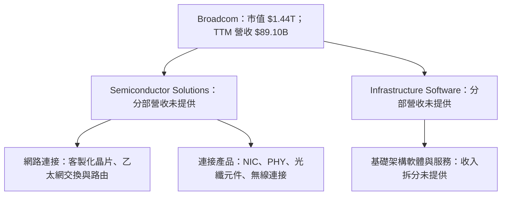
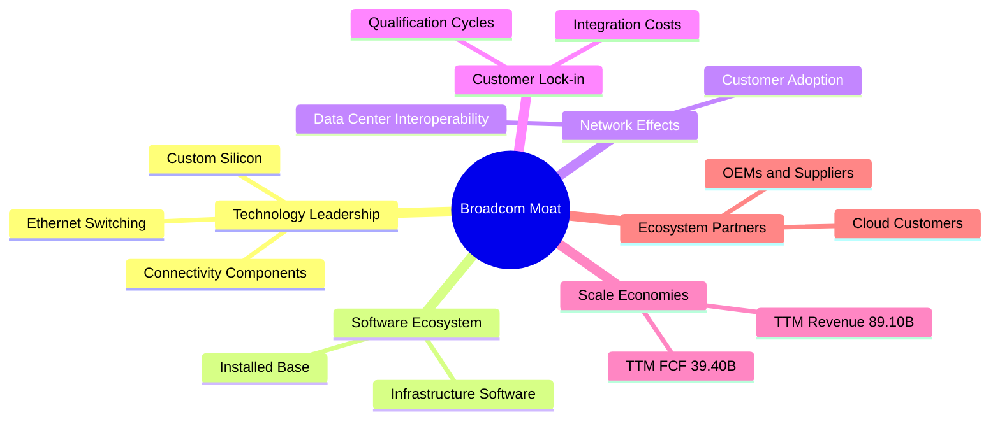
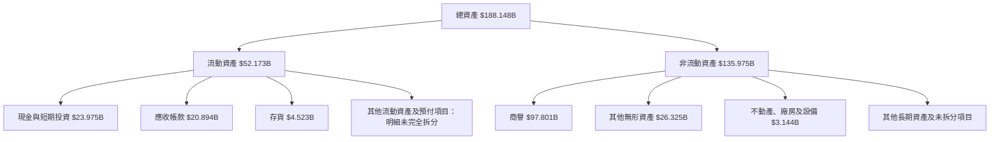
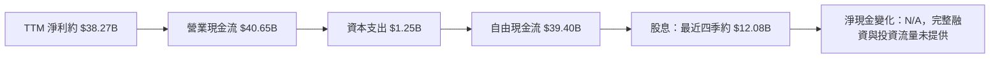
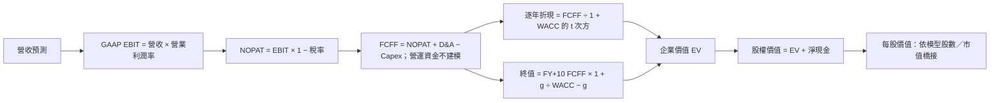
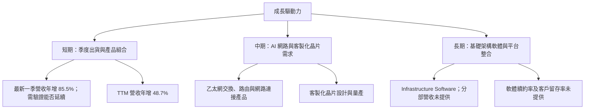
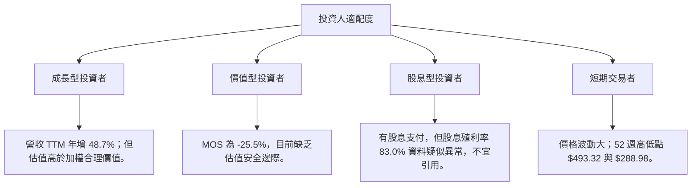

# AVGO 基本面深度分析報告

> **報告日期**：2026-11-25 ｜ **語言**：繁體中文 ｜ **數據來源**：SEC 申報資料 (XBRL)、Yahoo Finance、Finviz、StockAnalysis、Roic.ai ｜ **分析師**：CFA 級機構研究

## 目錄

| # | 章節 | 核心結論 |
|---|------|----------|
| 1 | 執行摘要 | 賣出；加權合理價值 $239.98；MOS -25.5% |
| 2 | 公司概覽與商業模式 | 半導體與基礎架構軟體雙業務，市場份額數據未提供 |
| 3 | 損益表深度分析 | TTM 營收 $89.10B、年增 48.7%；成長加速但利潤率口徑有差異 |
| 4 | 資產負債表分析 | 淨負債 $35.44B；流動比率 2.504 |
| 5 | 現金流量深度分析 | TTM FCF $39.40B、FCF Yield 2.74% |
| 6 | 獲利能力與資本效率 | ROIC 30.0% 高於 WACC 11.31%，營運創造價值 |
| 7 | 相對估值分析 | AVGO 估值高於多數同業及自身歷史中位數 |
| 8 | DCF 內在價值評估 | 基準每股價值 $217.01；估值對成長與終值假設敏感 |
| 9 | 成長催化劑 | AI 網路與客製化晶片是潛在推力；TAM 與分部數據未提供 |
| 10 | 風險矩陣 | 估值回落、AI 投資放緩與併購／整合風險 |
| 11 | 投資建議 | 依 MOS 評級為賣出；等待估值或基本面改善 |

## 1. 執行摘要

### 1.0 一頁式投資儀表板

| 項目 | 內容 |
|------|------|
| **投資論點（3 句）** | ① TTM 營收 $89.10B、年增 48.7%，且最新一季年增 85.5%，反映近期需求明顯加速。② TTM FCF $39.40B、ROIC 30.0%，高於 11.31% WACC，顯示營運仍有價值創造能力。③ 但 2026-11-24 收盤價 $301.08 高於 DCF 基準價 $217.01，且加權合理價值 $239.98，估值緩衝不足。 |
| **綜合評分** | **6.5/10**（引用 1.1 評分卡） |
| **財務健康** | 🟡 現金 $23.98B、總債務 $59.42B，淨負債 $35.44B；流動比率 2.504，但非淨現金狀態。 |
| **ROIC vs WACC** | 30.0% vs 11.31%；🟢 ROIC 高出 18.69 個百分點，營運創造價值。 |
| **FCF 趨勢** | TTM FCF $39.40B；FCF Yield 2.74%。 |
| **估值** | Forward P/E 15.57x ｜ EV/EBITDA 28.18x ｜ FCF Yield 2.74%。 |
| **DCF 內在價值（基準）** | $217.01 ｜ 現價相對 DCF 溢價 **38.7%**（折溢價＝$301.08 ÷ $217.01 − 1）。 |
| **安全邊際（MOS）** | **-25.5%**＝($239.98 − $301.08) ÷ $239.98；🔴 小於 10%，無下檔保護。 |
| **預期報酬（基準情境 12M）** | DCF 基準情境相對現價 **-27.9%**；此為模型情境價值，不是獨立 12 個月價格預測。 |
| **關鍵風險（前二）** | AI／雲端資本支出放緩，及估值倍數下修；另有淨負債與稀釋風險。 |
| **評級 + 信心度** | 🔴 **賣出** ｜ 信心：中。MOS 與 DCF、同業估值均指向估值偏高，但高成長持續性仍有不確定性。 |

### 1.1 綜合評分卡

| 維度 | 評分（1–10） | 主要依據（引用數字與其來源章節） |
|------|--------------|----------------------------------|
| 成長性 | 8.5 | TTM 營收年增 48.7%、最新一季年增 85.5%（第 3 章）；但近季加速未必可持續。 |
| 獲利能力 | 9.0 | TTM 營業利益率 48.0%、ROIC 30.0%，高於 WACC 11.31%；Piotroski 7/8（第 6 章）。 |
| 財務健康 | 6.5 | 現金 $23.98B、債務 $59.42B、淨負債 $35.44B；流動比率 2.504（第 4 章）。 |
| 估值 | 2.0 | 加權合理價值 $239.98，MOS -25.5%；AVGO P/E 38.4x，高於自身五年中位數 5.5x（第 7、8 章）。 |
| 護城河 | 8.0 | 半導體與基礎架構軟體產品組合、TTM 營業利益率 48.0%及 FCF $39.40B，顯示規模與現金流優勢；分部資料不足以量化各自貢獻（第 2 章）。 |
| 管理層與資本配置 | 5.0 | FY2025 SBC $7.57B、最新可得稀釋股數測試未通過；收購整合與資本配置回報需持續監控。 |
| **綜合評分** | **6.5** | 六項算術平均：(8.5 + 9.0 + 6.5 + 2.0 + 8.0 + 5.0) ÷ 6 = 6.5。 |

### 1.2 五大投資論點 + 三大核心風險

| 類型 | 項目 | 具體依據 | 信心度 |
|------|------|----------|--------|
| 🟢 **投資論點①** | 成長動能升高 | TTM 營收年增 48.7%；最新一季年增 85.5%，單季營收 $29.59B。單季跳升值得留意，但不能直接外推成長率。 | 🟢 高 |
| 🟢 **投資論點②** | 高現金流轉換 | TTM 營業現金流 $40.65B、Capex $1.25B、FCF $39.40B，低資本支出負擔支撐股東回報彈性。 | 🟢 高 |
| 🟢 **投資論點③** | 資本回報高於資金成本 | ROIC 30.0% 對 WACC 11.31%，利差 18.69 個百分點。若回報維持，可持續創造經濟價值。 | 🟢 高 |
| 🟢 **投資論點④** | 半導體與軟體組合 | 公司同時經營 Semiconductor Solutions 與 Infrastructure Software，收入來源不只單一晶片類別；分部營收未提供，無法驗證組合平衡度。 | 🟡 中 |
| 🟡 **投資論點⑤** | 資產負債流動性尚可 | 現金與短期投資 $23.98B、流動比率 2.504，但仍有 $35.44B 淨負債。 | 🟡 中 |
| 🟡 **風險①** | 估值回落 | DCF 基準價 $217.01，低於現價 27.9%；加權合理價值 $239.98，MOS -25.5%。 | 🔴 高衝擊 |
| 🔴 **風險②** | 成長率難以持續 | 最新一季年增 85.5%，高於 TTM 年增 48.7%；若需求回歸常態，估值預期可能同步下修。 | 🔴 高衝擊 |
| 🟡 **風險③** | 稀釋及併購整合 | F-Score 稀釋股數測試未通過，FY2025 SBC $7.57B；若股數增長高於內部盈餘增長，股東每股價值受壓。 | 🟡 中度 |

### 1.3 快速統計卡片

| 指標 | 公司實際值（期間） | 同業中位數 | 狀態 |
|------|--------------------|------------|------|
| 營收成長（TTM） | **48.7%** | — | 🟢 |
| 營收成長（最新一季年增） | **85.5%** | **36.5%**（NVDA、MRVL、QCOM 中位數） | 🟢 |
| 毛利率（TTM） | **75.5%** | **53.1%** | 🟢 |
| 營業利益率（TTM） | **48.0%** | — | 🟢 |
| ROIC（TTM） | **30.0%** | — | 🟢 |
| Forward P/E | **15.57x** | **13.5x** | 🟡 |
| FCF Yield（TTM） | **2.74%** | — | 🟡 |
| Piotroski F-Score | **7 / 8** | — | 🟢 |

> 同業中位數以 NVDA、MRVL、QCOM 可得數據計算；Forward P/E 中位數為三者 9.4x、17.8x、13.5x 的中位數 13.5x。AVGO Forward P/E 採市場估值資料 15.57x，與同業表格中的公司數據來源口徑不同，僅作方向性比較。

### 1.4 投資結論

```text
╔══════════════════════════════════════════════════════════════════╗
║                    📊 投資結論摘要                               ║
╠══════════════════════════════════════════════════════════════════╣
║  評級：🔴 賣出（依 8.8 MOS -25.5%，未作質化調整）                 ║
║  價格（2026-11-24 收盤）：$301.08                                ║
║  DCF 內在價值（基準）：$217.01（現價溢價 38.7%）                 ║
║  安全邊際 MOS：-25.5%（＝(加權合理價值−現價)÷加權合理價值）     ║
║  加權合理價值（8.8）：$239.98                                    ║
║  DCF 情境價值：                                                  ║
║    悲觀情境：$89.38（-70.3%）                                    ║
║    基準情境：$217.01（-27.9%）                                   ║
║    樂觀情境：$479.93（+59.4%）                                   ║
║  綜合評分：6.5/10（引用 1.1）                                    ║
║  適合投資人：可承受高波動、願意等待估值回落的長線成長型投資人；  ║
║              目前價位不適合以估值安全邊際為首要考量者。         ║
╚══════════════════════════════════════════════════════════════════╝
```

## 2. 公司概覽與商業模式

### 2.1 業務結構與收入來源

Broadcom 設計、開發並供應半導體產品及基礎架構軟體，主要分為 Semiconductor Solutions 與 Infrastructure Software。總市值為 $1.44T，TTM 營收 $89.10B。分部營收及子業務收入占比未提供，因此不以推估比例繪製收入圖。



### 2.2 市場份額

市場份額數據未提供，無法可靠量化 AVGO 在特定晶片或軟體市場的占比。以可得公司數據觀察，TTM 營收為 $89.10B、年增 48.7%，最新一季年增 85.5%；同業最新一季年增率中位數為 36.5%，顯示其近期增長高於所列同業，但不能據此推導市場份額。

### 2.3 競爭護城河分析



### 2.4 護城河強度

| 護城河項目 | 強度（強／中／弱） | 證據（引用數字或事實） | 會削弱它的情況 |
|------------|--------------------|------------------------|----------------|
| 技術與產品組合 | 強 | 公司供應客製化晶片、交換與路由、NIC、PHY、光纖元件等；TTM 毛利率 75.5%。 | 客戶改採內製晶片、替代方案性能提升或價格競爭加劇。 |
| 軟體生態系統 | 中 | 公司有 Infrastructure Software 業務，但分部營收、續約率及留存率未提供。 | 訂閱續約轉弱、整合失敗或客戶移轉成本下降。 |
| 網路效應 | 中 | 網路設備需與客戶資料中心環境互通，但沒有客戶數或生態系統規模資料可量化。 | 開放標準降低互通成本，或主要客戶轉向單一供應商以外的方案。 |
| 客戶鎖定 | 中 | 企業軟體及客製化晶片通常涉及整合與認證；具體客戶集中度、合約期限未提供。 | 大客戶重新議價、轉換供應商或自研替代產品。 |
| 規模效應 | 強 | TTM 營收 $89.10B、TTM FCF $39.40B，營業利益率 48.0%。 | 收購整合成本、研發支出或低毛利業務占比上升。 |
| 生態夥伴 | 中 | 產品服務於雲端、網路與企業基礎設施；可得資料未提供夥伴營收占比。 | 供應鏈受限、夥伴集中或競爭平台排除產品。 |

護城河評分 **8.0/10**，依據是產品組合、48.0% TTM 營業利益率與 $39.40B TTM FCF；分部與客戶資料不足，使評估未給更高分。

## 3. 損益表深度分析

### 3.1 年度收入成長趨勢（近4年）

依年度損益表列示 FY2022–FY2025 營收。FY2023–FY2025 成長率依年度營收計算；FY2022 的前一年營收未在同一年度表中列出，成長率不補算。

```text
╔══════════════════════════════════════════════════════════════════╗
║              Broadcom 年度收入趨勢（FY2022–FY2025）              ║
╠══════════════════════════════════════════════════════════════════╣
║  FY2022  $33.20B  █████████████░░░░░░░░░░░░░  YoY：N/A          ║
║  FY2023  $35.82B  ██████████████░░░░░░░░░░░░  YoY：+7.9% 🟡     ║
║  FY2024  $51.57B  █████████████████████░░░░░░  YoY：+44.0% 🟢   ║
║  FY2025  $63.89B  ██████████████████████████░  YoY：+23.9% 🟢   ║
║                                                                  ║
║  FY2022–FY2025 CAGR：(63.89 ÷ 33.20)^(1/3) − 1 ≈ 24.4%         ║
╚══════════════════════════════════════════════════════════════════╝
```

FY2024 增長加速、FY2025 增幅放緩但仍達 23.9%；TTM 年增 48.7% 高於 FY2025，代表近期成長再加速。年度營收與 TTM 營收涵蓋期間不同，不宜把短期高成長直接視為長期常態。

### 3.2 季度收入趨勢分析

以下季度金額取 StockAnalysis 季度列示，QoQ 以相鄰季度營收計算；最新一季 YoY 依已核實單季年增率引用。

| 季度 | 營收（$B） | QoQ 成長 | YoY 成長 | 備註 |
|------|------------|----------|----------|------|
| 2025 Q4 | 18.015 | +20.7% | +28.2% | 以 2025 Q3 $15.952B 為比較基期。 |
| 2026 Q1 | 19.311 | +7.2% | +29.5% | QoQ 成長放緩，仍高於去年同期。 |
| 2026 Q2 | 22.187 | +14.9% | +47.9% | 年增率擴大。 |
| 2026 Q3 | 29.591 | +33.4% | +85.5% | 單季營收顯著上升；以 TTM 年增 48.7% 作為較長週期參考。 |

QoQ 公式為「本季營收 ÷ 前季營收 − 1」。季度營收顯示成長動能集中在最近兩季；應追蹤後續訂單、產品組合與比較基期，避免將單季增速線性外推。

### 3.3 利潤率演變分析

| 利潤率指標 | FY2022 | FY2023 | FY2024 | FY2025 | 趨勢 | 評估 |
|------------|--------|--------|--------|--------|------|------|
| **毛利率** | 66.5% | 69.0% | 63.0% | 67.8% | 近年波動；FY2025 回升 | 🟡 |
| **營業利益率** | 43.0% | 45.9% | 29.1% | 40.8% | FY2024 下滑後 FY2025 回升 | 🟢 |
| **淨利率** | 34.6% | 39.3% | 11.4% | 36.2% | FY2024 受淨利低基期影響 | 🟡 |

年度毛利率以所列年度毛利除以年度營收，營業利益率以年度營業利益除以營收。TTM 淨利率採已核實的 42.9%；年度數據與 TTM 不可混用。另有財務資料來源列出的 TTM 營業利益率 48.5%，與已核實的 48.0% 不同，本報告一致採用 48.0%。

**利潤率演變深度解析：**FY2024 營收增長 44.0%，但年度營業利益率由 FY2023 的約 45.9% 降至 29.1%，顯示該年度營業利益未跟上收入成長；FY2025 營業利益回升至 $26.07B、利益率約 40.8%。資料沒有提供足以拆解產品組合、收購無形資產攤銷或整合成本的完整分部橋接，因此不把利潤率變化單一歸因於某一因素。

### 3.4 費用結構分析

精確費用結構圖所需的完整 TTM 研發、銷售、管理、重組及攤銷費用拆分未提供，故不繪製 pie chart，避免以不完整科目湊成比例。可確認 FY2025 研發費用 $10.98B，約為年度營收 $63.89B 的 17.2%；FY2025 SBC $7.57B，屬需持續監控的股東成本。

### 3.5 季度 EPS 趨勢與盈餘品質（Quality of Earnings）

**EPS 超預期／不及預期：**近四季 EPS Est 與 EPS Act 欄位均為空值，無法判斷實際超預期或不及預期；不得將空值狀態標為盈餘 beat 或 miss。季度淨利與 EPS 成長率顯示獲利增加，但不能替代市場預期比較。

| 盈餘品質項目 | 數值／佔比 | 評估 |
|--------------|-----------|------|
| 股權薪酬 SBC / 營收 | 最新四個季度 SBC 合計約 $8.48B；$8.48B ÷ $89.10B ≈ **9.5%** | 🟡 比重具實質性，會透過稀釋影響每股收益與股東回報。 |
| SBC / 營業現金流 | $8.48B ÷ $40.65B ≈ **20.9%** | 🟡 SBC 是非現金費用，但代表股東承擔的稀釋成本，不能只因其非現金而忽略。 |
| FCF / 淨利（現金轉換率） | TTM FCF $39.40B ÷ TTM 淨利 $38.27B ≈ **103.0%** | 🟢 現金流略高於淨利；現金轉換品質良好。 |
| 一次性／非經常性損益 | TTM 明細未提供 | N/A；年度淨利 FY2024 僅 $5.89B，FY2025 回升至 $23.13B，但無法從彙總資料單獨拆出非經常項目。 |
| 有效稅率異常 | TTM 有效稅率未提供 | N/A；DCF 採用的 21.0% 是模型稅率，不是本期實際有效稅率。 |
| 資本化支出 vs 費用化 | TTM Capex $1.25B；研發費用 FY2025 $10.98B | Capex 低於營收，但軟體開發資本化明細未提供，無法排除成本資本化對報表的影響。 |

**盈餘品質結論：**TTM FCF 約為淨利的 103.0%，表示盈餘具現金支持；但 SBC 相當於 TTM 營收的約 9.5%，股權薪酬仍是重要經濟成本。DCF 採 GAAP EBIT，已將 SBC 作為費用反映，避免在現金流中再扣一次。

## 4. 資產負債表分析

### 4.1 資產結構分解

最新 TTM 資產負債表列示總資產 $188.148B、流動資產 $52.173B。非流動資產按總資產減流動資產計為 $135.975B；不應將不同來源的年度資產明細與最新季度餘額混在同一圖中。



### 4.2 流動性與營運資金分析

流動比率 2.504、速動比率 2.153，提供短期負債緩衝；但應收與存貨天數上升，資金占用有增加跡象。

| 指標 | 最新 TTM | 一年前 TTM | 變化 | 解讀 |
|------|----------|------------|------|------|
| DSO 應收帳款天數 | 56 天 | 40 天 | +16 天 | 收款週期變長，應追蹤應收增幅是否跟上營收，並確認沒有信用條件放寬。 |
| DIO 存貨天數 | 59 天 | 40 天 | +19 天 | 存貨占用上升；可能與供應鏈備貨或出貨組合有關，現有資料不足以確認原因。 |
| DPO 應付帳款天數 | 52 天 | 26 天 | +26 天 | 付款期間延長，有助短期資金，但需確認是否屬正常供應商條件。 |
| CCC 現金轉換週期 | 63 天 | 53 天 | +10 天 | CCC 拉長 10 天，顯示營運資金效率較一年前下降。 |

### 4.3 債務結構分析

```text
╔══════════════════════════════════════════════════════════════════╗
║                   Broadcom 債務健康診斷                          ║
╠══════════════════════════════════════════════════════════════════╣
║  總債務：        $59.42B  ████████████████████  🟡              ║
║  現金及短期投資：$23.98B  ████████░░░░░░░░░░░░  🟡              ║
║  淨負債：        $35.44B  （總債務減現金）       🟡              ║
║                                                                  ║
║  流動比率：      2.504    🟢 短期流動性有緩衝                    ║
║  速動比率：      2.153    🟢                                    ║
║  Debt/EBITDA：   N/A（缺少可比口徑的驗證值）                    ║
║  利息保障倍數：  N/A（利息費用與營業利益同期間明細未提供）      ║
╚══════════════════════════════════════════════════════════════════╝
```

淨負債以已核實數據引用：$59.42B − $23.98B = $35.44B。未用不同期間 EBITDA 或推估利息費用計算槓桿倍數。

### 4.4 股東權益趨勢

| 年度 | 股東權益（$B） | 年變化 | 解讀 |
|------|----------------|--------|------|
| FY2022 | 22.71 | — | 基期。 |
| FY2023 | 23.99 | +1.28 | 較前一年增加。 |
| FY2024 | 67.68 | +43.69 | 變動幅度大，可能涉及併購或資本結構變化；僅憑彙總資料無法拆解。 |
| FY2025 | 81.29 | +13.61 | 繼續增加。 |

```text
╔══════════════════════════════════════════════════════════════════╗
║                   股東權益歷年變化                               ║
╠══════════════════════════════════════════════════════════════════╣
║ FY2022  $22.71B  ██████░░░░░░░░░░░░░░░░░░░░                    ║
║ FY2023  $23.99B  ███████░░░░░░░░░░░░░░░░░░░                   ║
║ FY2024  $67.68B  █████████████████████░░░░░                   ║
║ FY2025  $81.29B  ██████████████████████████                   ║
╚══════════════════════════════════════════════════════════════════╝
```

## 5. 現金流量深度分析

### 5.1 現金流量瀑布圖

TTM 淨利約 $38.27B，係將列示的最近四季淨利相加；下列其他 TTM 數字依已核實現金流資料引用。



### 5.2 FCF 轉換率趨勢

| 年度 | FCF（$B） | 淨利（$B） | FCF / 淨利 | 備註 |
|------|-----------|------------|------------|------|
| FY2022 | 16.31 | 11.49 | 142.0% | FCF 高於淨利。 |
| FY2023 | 17.63 | 14.08 | 125.2% | 仍高於淨利。 |
| FY2024 | 19.41 | 5.89 | 329.4% | 分母淨利偏低，比例容易被放大。 |
| FY2025 | 26.91 | 23.13 | 116.3% | 現金轉換維持在 100% 以上。 |
| TTM | 39.40 | 約 38.27 | 約 103.0% | 採 TTM FCF 與最近四季淨利合計。 |

### 5.3 自由現金流趨勢

```text
╔══════════════════════════════════════════════════════════════════╗
║                  自由現金流：歷史實際                            ║
╠══════════════════════════════════════════════════════════════════╣
║ FY2022  $16.31B  ███████████░░░░░░░░░  年度 FCF                  ║
║ FY2023  $17.63B  ████████████░░░░░░░░  年增約 8.1%               ║
║ FY2024  $19.41B  █████████████░░░░░░░  年增約 10.1%              ║
║ FY2025  $26.91B  ██████████████████░░  年增約 38.6%              ║
║ TTM     $39.40B  ██████████████████████████  FCF Yield 2.74%     ║
╚══════════════════════════════════════════════════════════════════╝
```

TTM FCF 高於 FY2025 年度數據，期間差異及最近季度現金流上升均有影響；不能將 TTM 與完整 FY 的數值視作相同期間比較。

### 5.4 資本配置評估

FY2025 現金股利支付 $11.14B，資本支出 $0.623B，SBC $7.57B。回購、併購現金支出與完整投資項目未提供，故不畫含有推估占比的資本配置 pie chart。

| 項目 | 可得數據 | 評估 |
|------|----------|------|
| 股息 | FY2025 支付 $11.14B；最新四季約 $12.08B | 現金分配規模大，但資料中的股息殖利率 83.0% 與每股股息紀錄不相容，視為資料異常，不用於收益判斷。 |
| Capex | TTM $1.25B | 相對 $89.10B TTM 營收較低，代表現金流資本需求不高；仍需觀察 AI 業務擴張是否提高投資需求。 |
| SBC | FY2025 $7.57B；TTM 四季約 $8.48B | 具有稀釋成本，應和現金股利一起衡量股東實際回報。 |
| 回購／併購 | N/A（期間現金流明細未提供） | 不據此判斷回購成效或併購資本回報。 |

## 6. 獲利能力與資本效率

### 6.1 ROE / ROA / ROIC 趨勢

| 指標 | 可得期間 | 數值 | 評估 |
|------|----------|------|------|
| ROE | TTM，Quality Figures | 38.4% | 高回報；須同時留意權益乘數 1.89。 |
| ROA | TTM，市場資料 | 15.4% | 正向；其他歷史同口徑序列未提供。 |
| ROIC | TTM，已核實數據 | 30.0% | 高於 WACC 11.31%，代表目前創造經濟價值。 |
| 行業均值比較 | N/A | N/A | 沒有一致口徑行業數據，不列空泛比較。 |

### 6.2 ROIC vs WACC 分析（核心價值創造判斷）

```text
╔══════════════════════════════════════════════════════════════════╗
║                ROIC vs WACC 深度分析                            ║
╠══════════════════════════════════════════════════════════════════╣
║  WACC（依資本成本資料）：                                        ║
║  ├── 無風險利率（10Y美債）：     4.90%                            ║
║  ├── 市場風險溢酬 ERP：          5.00%                            ║
║  ├── Beta：原始 1.51；採用調整後 1.34                           ║
║  ├── 股權成本 = 4.90% + 1.34 × 5.00% = 11.60%                   ║
║  ├── 稅前債務成本：5.40%；稅後約 4.27%                           ║
║  ├── 資本結構權重：股權 96.0%，債務 4.0%                         ║
║  └── ✅ WACC = 11.31%                                            ║
║                                                                  ║
║  ROIC（TTM，已核實數字）：30.0%                                  ║
║  經濟利差 = ROIC − WACC = 30.0% − 11.31% = 18.69 個百分點        ║
║                                                                  ║
║  ROIC  30.0%  ▓▓▓▓▓▓▓▓▓▓▓▓▓▓▓▓▓▓▓▓▓▓▓▓▓▓▓▓  🟢               ║
║  WACC  11.31% ▓▓▓▓▓▓▓▓▓▓▓░░░░░░░░░░░░░░░░░░  ──               ║
║  EVA利差 +18.69pp                            🟢 價值創造          ║
╚══════════════════════════════════════════════════════════════════╝
```

ROIC 約為 WACC 的 2.65 倍（30.0% ÷ 11.31%）。這表示現有投入資本回報顯著高於資金成本；但不能據此推定未來新增投資也能維持同一回報率。

### 6.3 杜邦三因素分解

| 因素 | 數值（TTM） | 解讀 |
|------|-------------|------|
| 淨利率 | 42.9% | 每美元營收帶來約 42.9 美分淨利。 |
| 資產週轉率 | 0.47 | 每美元資產創造約 $0.47 營收。 |
| 權益乘數 | 1.89 | 有一定財務槓桿，但 ROE 並非僅靠高槓桿支撐。 |
| **ROE** | **38.4%** | 42.9% × 0.47 × 1.89 ≈ 38.4%；依規定照錄品質指標數據。 |

### 6.4 財務體質：Piotroski F-Score

品質資料記錄為 **7 / 8**；九項測試中有一項缺少輸入而不列入分母，依原始欄位照錄。

| 測試 | 結果 | 解讀 |
|------|------|------|
| ROA > 0 | ✅ 通過 | 資產產生正回報。 |
| 營業現金流 > 0 | ✅ 通過 | 營業現金流為正。 |
| ROA 高於一年前 | ✅ 通過 | 資產報酬改善。 |
| 營業現金流 > 淨利 | ✅ 通過 | 應計品質測試通過。 |
| 長期負債 ÷ 總資產低於一年前 | — 無法判定 | 缺少輸入，未納入可判定分母。 |
| 流動比率高於一年前 | ✅ 通過 | 短期流動性指標改善。 |
| 稀釋股數未增加 | ❌ 未通過 | 股數稀釋需留意，與 SBC 成本一致。 |
| 毛利率高於一年前 | ✅ 通過 | 毛利率同比改善。 |
| 資產週轉率高於一年前 | ✅ 通過 | 資產使用效率改善。 |

## 7. 相對估值分析

### 7.1 同業估值比較表格

公司估值採市場估值資料；同業倍數採 Yahoo Finance peer multiples，估值日期與會計口徑可能存在差異，宜作相對定位而非精確套利比較。

| 估值指標 | **AVGO** | **NVDA** | **MRVL** | **QCOM** | AVGO 評估 |
|----------|----------|---------|---------|---------|-----------|
| **Trailing P/E** | 38.45x | 17.7x | 43.3x | 13.0x | 🟡 高於 NVDA、QCOM，低於 MRVL。 |
| **Forward P/E** | 15.57x | 9.4x | 17.8x | 13.5x | 🟡 高於同業中位數 13.5x。 |
| **P/S Ratio** | 16.13x | 10.4x | 12.5x | 4.1x | 🔴 高於三家同業。 |
| **EV/EBITDA** | 28.18x | 15.2x | 41.0x | 17.4x | 🟡 高於 NVDA、QCOM，低於 MRVL。 |
| **最新一季營收年增** | 85.5% | 103.2% | 36.5% | -8.4% | 🟢 高於 MRVL、QCOM，低於 NVDA。 |
| **毛利率（TTM）** | 75.5% | 74.9% | 52.2% | 53.1% | 🟢 高於所列同業。 |

AVGO 的毛利率與成長數據有競爭力，但市場已給予較高 P/S；若成長回落，倍數壓縮可能抵銷營運成長。

### 7.2 歷史估值區間分析

```text
╔══════════════════════════════════════════════════════════════════╗
║             AVGO 五年估值區間（TTM 倍數）                         ║
╠══════════════════════════════════════════════════════════════════╣
║ P/E：       1.8x ───────── 中位數 5.5x ───────── 現值 38.4x     ║
║             五年區間 1.8x–77.5x；現值百分位 70%                  ║
║ P/S：       0.6x ───────── 中位數 1.5x ───────── 現值 16.5x     ║
║             五年區間 0.6x–28.1x；現值百分位 65%                  ║
║ EV/EBITDA： 0.5x ───────── 中位數 5.6x ───────── 現值 34.7x     ║
║             五年區間 0.5x–70.7x；現值百分位 55%                  ║
╚══════════════════════════════════════════════════════════════════╝
```

歷史估值包含不同業務組合及獲利週期，不應將歷史中位數直接當作公平價；但現值在三項估值的歷史分布中均高於中位數。

### 7.3 情境價值（Bear / Base / Bull）

以下情境值照錄 DCF 情境模型。年度營收路徑、情境終值成長率等未逐項列於來源模型，因此不自行補造其餘變數。

| 情境 | 第 1 年營收成長 | 期末營業利潤率 | WACC | 每股價值 | 相對現價 | 機率 | 會發生的條件 |
|------|----------------|----------------|------|----------|----------|------|--------------|
| 🔴 悲觀 | 15.0% | 36.4% | 12.31% | $89.38 | -70.3% | 25% | AI／雲端需求放緩、競爭加劇且成熟期利潤率下滑。 |
| 🟡 基準 | 30.0% | 42.8% | 11.31% | $217.01 | -27.9% | 50% | 成長自目前高位逐步回落，長期利潤率收斂至模型假設。 |
| 🟢 樂觀 | 45.0% | 47.1% | 10.31% | $479.93 | +59.4% | 25% | AI 網路與客製化晶片持續放量，競爭與資本成本均較有利。 |

### 7.4 相對估值隱含價格區間

```text
╔══════════════════════════════════════════════════════════════════╗
║             估值方法回推每股價值（USD）                          ║
╠══════════════════════════════════════════════════════════════════╣
║ $140.72 ───── $217.01 ─── 現價 $301.08 ───────── $525.51         ║
║ EV/EBITDA       DCF基準       ●                 分析師共識        ║
║                 Forward P/E：$261.79                              ║
╚══════════════════════════════════════════════════════════════════╝
```

- 同業 Forward P/E：同業中位數 13.5x × AVGO Forward EPS $19.33 = 每股 $261.79。
- 同業 EV/EBITDA：同業中位數 16.3x（NVDA、QCOM）套用 TTM EBITDA 並加回淨現金，模型回推 $140.72。
- DCF 基準 $217.01；分析師共識目標價 $525.51（47 位分析師平均值）。

## 8. DCF 內在價值評估（Discounted Cash Flow）

### 8.0 估值推理鏈（Thinking Logic）

**核心命題：**AVGO 價值主要來自半導體方案與基礎架構軟體的現金流，但分部收入占比未提供，無法將兩條業務各自的營收比重及估值拆分；可驗證的整體錨點是 TTM 營收 $89.10B、TTM FCF $39.40B。模型估值最受長期成長、利潤率、折現率及終值影響。

| 決策點 | 本報告採用 | 理由（含數字） | 曾考慮但否決 | 否決理由 |
|--------|-----------|----------------|--------------|----------|
| 現金流定義 | FCFF | 以 GAAP EBIT 算 NOPAT，折現後得企業價值，再加淨現金。 | FCFE | 與已核實 DCF 模型定義不一致。 |
| 預測期 N | 10 年 | 程式模型明列 10 年，涵蓋高成長衰退至成熟期。 | 5 年 | 會改變既定模型期間及終值起點。 |
| 終值方法 | Gordon Growth | 模型提供永續成長率 3.0% 與終值。 | 另加退出倍數 | 已核實模型未提供退出倍數法結果，不自行重建。 |
| EBIT 基礎 | GAAP | 模型採 GAAP EBIT，SBC 已反映為費用。 | 非 GAAP EBIT | 會與既定模型口徑不一致。 |

**假設推導鏈：**

- **營收成長路徑：**錨點＝TTM 成長 48.7%、最新一季年增 85.5% → 調整＝近季數字可能受基期、產品放量與組合影響，避免直接外推 → 採用第 1 年 30.0%，線性降至第 10 年 3.0% → 否決把 85.5% 延續為長期成長，因其非可持續常態假設。
- **期末營業利益率：**錨點＝TTM GAAP 營業利益率 48.0% → 調整＝模型假設規模效益仍存在、但成熟期利潤率回落 → 採用第 10 年 42.8% → 否決長期固定 48.0%，因模型採用過去五個財年中位數作成熟期錨點。
- **終值成長率 g：**錨點＝模型採用 3.0% → 調整＝以長期成熟公司名目成長作假設，不讓終值成長超過折現率 → 採用 3.0%，低於 WACC 11.31% → 否決更高 g，因會不合理地提高終值權重。
- **預測期 N：**錨點＝模型明列 10 年 → 調整＝成長率由 30.0% 逐年遞減至 3.0%，符合成長淡出框架 → 採用 10 年 → 否決縮短期間，因會偏離指定模型。
- **Capex／營收：**錨點＝TTM Capex $1.25B ÷ 營收 $89.10B，模型列示約 1.4% → 調整＝依模型逐步降至 0.8% → 採用第 1 年 1.4% 至第 10 年 0.8% → 否決固定在 0.8%，因模型保留前期較高資本需求。
- **EBIT 基礎與 SBC：**錨點＝GAAP EBIT 已含 SBC 費用 → 採用組合 (A)：GAAP EBIT、不再扣 SBC，固定股數且年稀釋率 0% → 否決再扣 SBC 或另加股數稀釋，避免重複扣除。
- **年稀釋率：**採用 0%，因組合 (A) 已由 GAAP 費用反映 SBC；否決再放大股數，以免同一股權薪酬成本重複計入。
- **D&A／營收：**錨點＝TTM 模型值 0.7% → 採用固定 0.7%；此輸入依模型設定。
- **營運資金變動：**模型明列「Working capital is not modelled」→ 採用不建模、無 ΔWC 列；否決自行填入歷史百分比，因可核對的模型輸入未提供。
- **終值方法：**錨點＝模型採 Gordon Growth → 採用該方法；退出倍數交叉驗證未提供，不另創一個倍數。
- **WACC：**錨點＝已核實 WACC 11.31% → 採用原值，不另建 WACC；原因與組成列於 8.2。

**最脆弱的一環：**第 1 年 30.0% 成長與後續成長淡出假設。反推 DCF 顯示若其餘基準假設不變，市場價格隱含第 1 年成長約 38.9%；若成長低於此水準，估值方向偏下。



### 8.1 模型假設總表（Model Inputs）

| 假設項目 | 採用值 | 依據／來源 | 敏感度 |
|----------|--------|-------------|--------|
| 預測期長度 **N** | 10 年 | DCF 模型明列；營收成長由 30.0% 淡出至 3.0%。 | 🟡 中 |
| 營收成長 | 第 1 年 30.0% → 第 10 年 3.0% | TTM 成長 48.7%；模型把成長上限設為 30%，逐年線性下降。 | 🔴 高 |
| 營業利潤率 | 第 1 年 48.0% → 第 10 年 42.8% | TTM 48.0%；成熟期採模型所列過去五個財年中位數。 | 🔴 高 |
| 有效稅率 | 21.0% | DCF 模型採用預設稅率；不是已核實 TTM 實際有效稅率。 | 🟢 低 |
| Capex / 營收 | 1.4% → 0.8% | TTM 約 1.4%，模型依設定逐步降至 0.8%。 | 🟡 中 |
| D&A / 營收 | 0.7% | 模型列示 TTM 比率並固定。 | 🟢 低 |
| 營運資金變動 | 不建模 | DCF 模型明列 Working capital is not modelled。 | 🟢 低 |
| EBIT 基礎 | GAAP | DCF 模型明列 GAAP EBIT。 | 🟡 中 |
| 股權薪酬 SBC 處理 | 組合 (A)：不另扣 SBC | GAAP EBIT 已包含 SBC 費用。 | 🟡 中 |
| 年稀釋率（股數） | 0% | 組合 (A) 固定股數；SBC 已在費用反映。 | 🟡 中 |
| 永續成長率 g | 3.0% | DCF 模型採用；低於 WACC 11.31%。 | 🔴 高 |
| 終值方法 | Gordon Growth | DCF 模型提供此方法數值；未提供退出倍數結果。 | 🔴 高 |
| WACC | 11.31% | 已核實 Cost of capital；詳見 8.2。 | 🔴 高 |

**模型口徑：**FCFF = NOPAT + D&A − Capex；不含 ΔWC 列。採 GAAP EBIT，SBC 影響已計入一次，不額外扣 SBC，亦不再增列稀釋股數。

### 8.2 折現率推導（WACC）

```text
╔══════════════════════════════════════════════════════════════════╗
║                    WACC 推導（折現率）                           ║
╠══════════════════════════════════════════════════════════════════╣
║  股權成本 Ke（CAPM）：                                           ║
║  ├── 無風險利率 Rf（10Y 美債）：      4.90%                      ║
║  ├── 市場風險溢酬 ERP：               5.00%                      ║
║  ├── Beta 原始值：1.51；調整後採用：1.34                         ║
║  │   調整式：⅔ × 1.51 + ⅓ × 1 = 1.34（四捨五入）                ║
║  ├── 規模／國別溢酬：                 0.00%（未另加）            ║
║  └── Ke = 4.90% + 1.34 × 5.00% = 11.60%                         ║
║                                                                  ║
║  債務成本 Kd：                                                    ║
║  ├── 稅前 Kd：                        5.40%                      ║
║  ├── 稅率：                           21.0%                      ║
║  └── 稅後 Kd = 5.40% × (1 − 21.0%) = 4.266% ≈ 4.27%             ║
║                                                                  ║
║  資本結構權重（採用已核實權重）：                                ║
║  ├── 股權權重 E：                     96.0%                      ║
║  ├── 債務權重 D：                      4.0%                      ║
║  └── ✅ WACC = 96.0%×11.60% + 4.0%×4.266% = 11.31%             ║
╚══════════════════════════════════════════════════════════════════╝
```

**逐步演算：**

1. **Ke（CAPM）** = Rf + β × ERP = 4.90% + 1.34 × 5.00% = **11.60%**。
2. **稅前 Kd**：已核實資本成本資料直接提供 5.40%（利息 ÷ 債務）；利息費用與平均計息負債的金額未提供，不能重建分子、分母。
3. **稅後 Kd** = 5.40% × (1 − 21.0%) = **4.266%**。
4. **權重** = 已核實股權權重 96.0%，債務權重 4.0%；合計 96.0% + 4.0% = **100.0%**。權重使用已核實資本成本輸入，不以帳面權益替代市值。
5. **WACC** = 96.0% × 11.60% + 4.0% × 4.266% = 11.136% + 0.17064% = **11.30664% ≈ 11.31%**。

Rf 及 ERP 期間日期未提供，故不另行假設日期或新增風險溢酬。第 6.2 與本節一致採用 **11.31%**。

### 8.3 逐年自由現金流預測（基準情境）

下表完全依 DCF 模型照錄，金額為 USD billions；折現因子保留三位小數。模型不另列 ΔWC，因原模型未建模營運資金。

| 年度 | FY+1 | FY+2 | FY+3 | FY+4 | FY+5 | FY+6 | FY+7 | FY+8 | FY+9 | FY+10 |
|------|------|------|------|------|------|------|------|------|------|-------|
| 營收 | 115.84 | 147.11 | 182.42 | 220.72 | 260.46 | 299.52 | 335.47 | 365.66 | 387.60 | 399.23 |
| 營收 YoY | 30.0% | 27.0% | 24.0% | 21.0% | 18.0% | 15.0% | 12.0% | 9.0% | 6.0% | 3.0% |
| 營業利潤率 | 48.0% | 47.5% | 46.9% | 46.3% | 45.7% | 45.2% | 44.6% | 44.0% | 43.4% | 42.8% |
| EBIT（GAAP） | 55.66 | 69.83 | 85.54 | 102.23 | 119.12 | 135.26 | 149.54 | 160.89 | 168.30 | 171.04 |
| − 稅（21.0%） | (11.69) | (14.67) | (17.96) | (21.47) | (25.02) | (28.40) | (31.40) | (33.79) | (35.34) | (35.92) |
| = NOPAT | 43.97 | 55.17 | 67.58 | 80.76 | 94.10 | 106.85 | 118.14 | 127.10 | 132.96 | 135.12 |
| + D&A | 0.82 | 1.04 | 1.29 | 1.57 | 1.85 | 2.12 | 2.38 | 2.59 | 2.75 | 2.83 |
| − Capex | (1.62) | (1.96) | (2.31) | (2.64) | (2.93) | (3.17) | (3.31) | (3.36) | (3.29) | (3.11) |
| **= FCFF** | **43.17** | **54.25** | **66.56** | **79.69** | **93.02** | **105.81** | **117.21** | **126.34** | **132.41** | **134.84** |
| 折現因子 @11.31% | 0.898 | 0.807 | 0.725 | 0.652 | 0.585 | 0.526 | 0.472 | 0.424 | 0.381 | 0.343 |
| **FCFF 現值 PV** | **38.78** | **43.79** | **48.27** | **51.92** | **54.45** | **55.64** | **55.37** | **53.63** | **50.50** | **46.20** |

**預測期現值合計：**

38.78 + 43.79 + 48.27 + 51.92 + 54.45 + 55.64 + 55.37 + 53.63 + 50.50 + 46.20  
= **498.55B**。模型列示合計為 **$498.54B**；逐年表格數字均已四捨五入至兩位小數，與模型合計差 $0.01B，屬四捨五入尾差。

**逐步演算（FY+1）：**

1. **營收** = $89.10B × (1 + 30.0%) = $115.83B，模型列示 **$115.84B**（底層未四捨五入值造成尾差）。
2. **EBIT** = 模型營收 $115.84B × 48.0% = **$55.66B**（底層精度四捨五入）。
3. **稅** = 模型 EBIT $55.66B × 21.0% = **$11.69B**。
4. **NOPAT** = $55.66B − $11.69B = **$43.97B**。
5. **D&A** = 模型採用 D&A／營收 0.7%；模型列示 **$0.82B**。
6. **Capex** = 模型採用 Capex／營收 1.4%；模型列示 **$1.62B**。
7. **ΔWC** = 模型不建模營運資金，故不另扣除。
8. **FCFF** = $43.97B + $0.82B − $1.62B = **$43.17B**。
9. **折現因子** = 1 ÷ (1 + 11.31%)¹ = **0.898**；PV = $43.17B × 0.898 = **$38.78B**。

**合理性自檢：**

- 預測 FCF CAGR：FY+1 $43.17B 至 FY+10 $134.84B，十年九個年度間隔 CAGR = (134.84 ÷ 43.17)^(1/9) − 1 ≈ **13.5%**。歷史 FY2022–FY2025 FCF CAGR = (26.91 ÷ 16.31)^(1/3) − 1 ≈ **18.2%**；預測低約 4.7 個百分點，主要反映成長率逐年淡出。
- FY+10 FCF 利潤率 = $134.84B ÷ $399.23B ≈ **33.8%**；TTM FCF 利潤率 = $39.40B ÷ $89.10B ≈ **44.2%**。同業最佳 FCF 利潤率未提供，不能作數字比較。
- 模型十年 FCFF 均為正；預測期 PV 合計採模型列示 $498.54B。

```text
╔══════════════════════════════════════════════════════════════════╗
║            自由現金流：歷史實際 vs 模型預測                      ║
╠══════════════════════════════════════════════════════════════════╣
║ FY2023(實)  $17.63B  ███░░░░░░░░░░░░░░░░░░                      ║
║ FY2024(實)  $19.41B  ███░░░░░░░░░░░░░░░░░░                      ║
║ FY2025(實)  $26.91B  ████░░░░░░░░░░░░░░░░░░                    ║
║ FY+1 (預)   $43.17B  ███████░░░░░░░░░░░░░░░                    ║
║ FY+10(預)  $134.84B  ██████████████████████                     ║
╠══════════════════════════════════════════════════════════════════╣
║ 預測 FCFF CAGR 約 13.5%；歷史 FY2022–FY2025 約 18.2%。           ║
╚══════════════════════════════════════════════════════════════════╝
```

### 8.4 終值計算（Terminal Value）

**適用性檢查：**WACC 11.31% vs g 3.0% → **WACC > g？✅**

DCF 模型提供 Gordon Growth 終值，未提供退出倍數法的 EBITDA 倍數與終值數字；依規則不自行另建退出倍數估值。

1. **FY+N FCFF** = FY+10 FCFF **$134.84B**。
2. **分子** = $134.84B × (1 + 3.0%) = $134.84B × 1.03 = **$138.8852B**。
3. **分母** = 11.31% − 3.0% = **8.31%**；終值 TV = $138.8852B ÷ 8.31% = **$1,672.00B**（依模型底層精度）。
4. **PV(TV)** = $1,672.00B × 0.343 = **$572.85B**（依模型底層精度）。
5. **終值占比** = $572.85B ÷ $1,071.38B = **53.5%**。

終值占 EV 53.5%，未超過 75% 警戒線；但仍是總 EV 的過半，估值對長期 g 與 WACC 具明顯敏感度。

| 方法 | 計算式 | 終值 TV | TV 現值 | 佔總 EV 比重 |
|------|--------|---------|---------|--------------|
| Gordon Growth | FCFF(FY+10) × (1+g) ÷ (WACC−g) | $1,672.00B | $572.85B | 53.5% |
| 退出倍數法 | N/A（模型未提供退出倍數及估值） | N/A | N/A | N/A |

### 8.5 企業價值 → 每股內在價值（Bridge）

```text
╔══════════════════════════════════════════════════════════════════╗
║              企業價值 → 每股內在價值 橋接表                      ║
╠══════════════════════════════════════════════════════════════════╣
║  預測期 FCF 現值合計            +$498.54B                         ║
║  終值現值 PV(TV)                +$572.85B                         ║
║  = 企業價值 EV                   $1,071.38B                       ║
║  + 淨現金（淨負債為負）          −$35.44B                         ║
║  = 股權價值                      $1,035.94B                       ║
║  每股價值（模型橋接）             $217.01                         ║
║  當前股價（2026-11-24 收盤）      $301.08                         ║
║  折溢價（現價÷DCF價值−1）         +38.7%（溢價）                  ║
╚══════════════════════════════════════════════════════════════════╝
```

**逐步演算：**

1. **EV** = $498.54B + $572.85B = $1,071.39B；模型列示 **$1,071.38B**，$0.01B 尾差來自未四捨五入的中間值。
2. **股權價值** = $1,071.38B − $35.44B = **$1,035.94B**。
3. **每股價值**：模型列示公式為「股權價值 × 價格 ÷ 市值」，而不是單純除以稀釋股數；按模型照錄得 **$217.01**。報價日期為 2026-11-24。
4. **折溢價** = $301.08 ÷ $217.01 − 1 = **+38.7% 溢價**。
5. **本節不計算 MOS**；MOS 只在 8.8 以加權合理價值為分母計算。

現金與債務取最新 TTM 資料：現金與短期投資 $23.98B、總債務 $59.42B，淨負債 $35.44B。模型每股橋接採其指定的價格／市值比例法；股數與股權價值直接按模型結果引用，不另換算。

### 8.6 敏感性分析（WACC × 永續成長率）

表格數值照錄 DCF 模型；括號為每股價值相對 $301.08 現價的上行／下行空間，按「價值 ÷ 現價 − 1」計算後取一位小數。

| g（列）／WACC（欄） | 9.31% | 10.31% | **11.31%（基準）** | 12.31% | 13.31% |
|-----------|------|-------|--------------------|-------|-------|
| **2.0%** | $270.39 (-10.2%) | $232.57 (-22.8%) | $203.08 (-32.5%) | $179.47 (-40.4%) | $160.19 (-46.8%) |
| **2.5%** | $283.14 (-5.9%) | $241.58 (-19.8%) | $209.65 (-30.4%) | $184.39 (-38.8%) | $163.94 (-45.5%) |
| **3.0%（基準）** | $297.91 (-1.1%) | $251.82 (-16.4%) | **$217.01 (-27.9%)** | $189.84 (-36.9%) | $168.06 (-44.2%) |
| **3.5%** | $315.22 (+4.7%) | $263.57 (-12.5%) | $225.32 (-25.2%) | $195.90 (-34.9%) | $172.60 (-42.7%) |
| **4.0%** | $335.80 (+11.5%) | $277.18 (-7.9%) | $234.76 (-22.0%) | $202.69 (-32.7%) | $177.63 (-41.0%) |

**矩陣示範格：**所選格 WACC **10.31% > g 2.5% ✅**。該格每股價值 **$241.58** 依 DCF 模型敏感度矩陣照錄；模型未提供該格的預測期 PV、重新折現後的 PV(TV) 及完整中間橋接，因此不另以未提供的年度精度重建算式。

**三情境 DCF：**模型提供情境假設與每股價值，未提供各情境逐年營收及 FY+10 FCFF 明細；依數據規則不反推、不另造情境橋接。

| 情境 | 第 1 年成長 | 期末營業利潤率 | WACC | 每股價值 | 相對現價 | 機率 |
|------|------------|----------------|------|----------|----------|------|
| 🔴 悲觀 | 15.0% | 36.4% | 12.31% | $89.38 | -70.3% | 25% |
| 🟡 基準 | 30.0% | 42.8% | 11.31% | $217.01 | -27.9% | 50% |
| 🟢 樂觀 | 45.0% | 47.1% | 10.31% | $479.93 | +59.4% | 25% |

**機率加權情境值：**$89.38 × 25% + $217.01 × 50% + $479.93 × 25% = **$250.83**；模型列示 $250.84，屬底層數字精度與四捨五入造成的 $0.01 尾差。8.8 依規則採基準 DCF，不以機率加權值替代。

- g 由 3.0% 提至 4.0%、WACC 固定 11.31%：$217.01 變為 $234.76，增加 **$17.75／8.2%**。
- WACC 由 11.31% 升至 12.31%、g 固定 3.0%：$217.01 變為 $189.84，下降 **$27.17／12.5%**。
- 期末營業利潤率每 +1pp：模型敏感度未提供，**N/A**，不自行重算。
- 在已提供的矩陣測試中，WACC ±1pp 對價值影響大於 g +1pp；此結論與 8.0 指出的折現率與終值假設主導估值一致。

### 8.7 反推 DCF（Reverse DCF：市場在預期什麼）

反推結果直接照錄模型；其他固定輸入值或逐輪迭代軌跡未提供，不能杜撰試算表。

| 求解的變數（一次一個） | 其餘變數設定 | 市場隱含值（令 DCF = 現價） | 可比基準 | 判斷 |
|------------------------|--------------|------------------------------|----------|------|
| 第 1 年營收成長 | 其餘基準變數維持模型設定 | 38.9% | 基準第 1 年 30.0%；TTM 成長 48.7% | 市場要求高於基準，但低於近年 TTM 成長。 |
| 固定營業利潤率 | 其餘基準變數維持模型設定 | 60.3% | TTM 48.0% | 🔴 高於目前水準，假設要求偏高。 |
| 永續成長率 g | N/A（模型未列出可核驗解） | 未計算 | — | 不自行求解。 |
| 預測期長度 N | N/A（未提供 N 的反推解） | 未計算 | — | 不自行延長或縮短模型。 |

**反推結論：**以其他基準變數不變，令模型等於現價需要約 38.9% 的第 1 年營收成長，或固定營業利益率約 60.3%；後者明顯高於當前 48.0%。模型未提供反推迭代軌跡及試算點，因此無法列出可稽核的收斂表；本節不把未提供的中間值偽裝為模型結果。

### 8.8 估值三角驗證與安全邊際

| 估值方法 | 隱含每股價值 | 上行空間（÷現價） | 權重 | 說明 |
|----------|--------------|-------------------|------|------|
| DCF（基準） | $217.01 | -27.9% | 40% | 10 年 FCFF、WACC 11.31%、g 3.0%。 |
| 同業 Forward P/E | $261.79 | -13.0% | 25% | 同業中位數 13.5x × AVGO Forward EPS $19.33。 |
| 同業 EV/EBITDA | $140.72 | -53.3% | 25% | NVDA、QCOM 中位數 16.3x，套用 TTM EBITDA 並加回淨現金。 |
| 分析師共識目標價 | $525.51 | +74.5% | 10% | 47 位分析師平均目標價；參考權重。 |
| **加權合理價值** | **$239.98** | **-20.3%** | **100%** | 依盈利型公司固定權重加權。 |

**逐步演算：**

$217.01 × 40% + $261.79 × 25% + $140.72 × 25% + $525.51 × 10%  
= $86.804 + $65.4475 + $35.180 + $52.551  
= **$239.9825 ≈ $239.98**。

方法類型為盈利型公司；使用模型固定權重 40%／25%／25%／10%，未新增或刪除估值方法。

```text
╔══════════════════════════════════════════════════════════════════╗
║                  估值區間與安全邊際                              ║
╠══════════════════════════════════════════════════════════════════╣
║ $89.38 ─── $217.01 ─── $239.98 ─── $301.08 ─── $479.93          ║
║ 悲觀DCF    基準DCF      加權合理值      現價        樂觀DCF       ║
║                                                                  ║
║ MOS = ($239.98 − $301.08) ÷ $239.98 = -25.5%                   ║
║ MOS 評估：🔴 小於 10%，無下檔保護                               ║
║ 上行空間 = ($239.98 − $301.08) ÷ $301.08 = -20.3%              ║
║                                                                  ║
║ 依 MOS ≥10% 推算的買入上限：$215.98                              ║
║ 合理持有觀察區間：$215.98–$263.98（依價值上下約 10% 作參考）     ║
║ 減碼考慮：現價 $301.08 已高於加權合理價值，估值回落風險偏高。    ║
╚══════════════════════════════════════════════════════════════════╝
```

> 上述區間為以加權合理價值 $239.98 作透明參考帶；非模型輸出情境價值。MOS -25.5% 與 1.0 儀表板完全一致。

> 🔎 **程式複算（Python，依本節各項自動重算）**
>
> 加權合理價值 = $217.01 × 40% + $261.79 × 25% + $140.72 × 25% + $525.51 × 10% = **$239.98**（權重合計 100%）
>
> 以價格 $301.08 計：MOS = **-25.5%**，上行空間 = **-20.3%**
>
> ✅ 與本節所寫數值一致。

### 8.9 DCF 模型的局限與失效條件

- **終值依賴度：**PV(TV) 佔 EV 53.5%，代表超過一半企業價值取決於第 10 年後的現金流假設。
- **最脆弱假設：**成長淡出路徑與 11.31% WACC。基準 DCF $217.01；敏感度矩陣中 WACC 12.31%、g 3.0% 時降至 $189.84，WACC 13.31% 時降至 $168.06。
- **模型適用性：**AVGO TTM FCF 為正，且歷史營業利益與 FCF 可觀察，DCF 可作參考；但業務包含多個產品與軟體分部，未取得分部現金流、客戶集中度與營運資金預測，降低模型精確度。
- **失效條件：**若 AI／網路需求下滑，營收成長低於基準路徑，或成熟期營業利潤率低於模型 42.8%，DCF 價值會下降；若資本成本高於 11.31%，敏感度表顯示每股價值同樣下修。
- **與第 10 章連結：**AI 支出放緩主要衝擊營收成長；競爭及客戶內製化衝擊利潤率；利率上升直接推高 WACC；軟體整合或併購成效不佳會傷及現金流與終值。

### 8.10 複算檢核表（Audit Trail）

| # | 檢核項目 | 檢查方式 | 結果 |
|---|----------|----------|------|
| 1 | 高／中敏感度輸入具推導說明 | 對照 8.0 Step 3 與 8.1 | ✅ |
| 2 | 每個假設有來源或明列未提供 | 對照 8.1 依據欄 | ✅ |
| 3 | WACC 五步與加權算式 | 權重 96% + 4% = 100%；重算 WACC 11.31% | ✅ |
| 4 | Kd 分母與債務權重範圍一致 | 直接引用已核實 WACC 組成；平均計息負債明細未提供，無法獨立查核範圍 | ⚠️ |
| 5 | WACC 與第 6.2 節一致 | 均為 11.31% | ✅ |
| 6 | 逐年預測期數與 N 一致 | 10 欄，FY+1 至 FY+10 | ✅ |
| 7 | FY+1 代表年度算式 | 模型四捨五入可能有 $0.01B 尾差，已註明 | ✅ |
| 8 | 預測期 PV 加總 | 表格四捨五入加總 $498.55B；模型底層合計 $498.54B，差 $0.01B | ✅ |
| 9 | WACC > g | 11.31% > 3.0% | ✅ |
| 10 | 終值以 FY+10 FCFF 折現十期 | 取 FY+10 FCFF $134.84B，折現因子 0.343 | ✅ |
| 11 | EV、淨負債與每股價值橋接 | 橋接差額有 $0.01B 模型底層精度尾差，已揭露 | ✅ |
| 12 | SBC 組合相容性 | GAAP EBIT + 無 SBC 列 + 年稀釋率 0%，組合 (A) | ✅ |
| 13 | 敏感度矩陣基準格與 DCF 基準價一致 | 11.31%、g 3.0% 格為 $217.01 | ✅ |
| 14 | 矩陣格依模型直接引用 | 所列矩陣 WACC 均大於 g | ✅ |
| 15 | 三情境機率加總 | 25% + 50% + 25% = 100%；加權結果有 $0.01 尾差 | ✅ |
| 16 | 反推 DCF 每列只解一個變數 | 只引用模型提供的 38.9% 與 60.3%；迭代軌跡未提供並已披露 | ⚠️ |
| 17 | MOS 與折溢價分母 | MOS 以 $239.98；折溢價以 $217.01 | ✅ |
| 18 | 報告輸出至第 11 章 | 全章節完整 | ✅ |
| 19 | 加權合理價值總和 | $239.9825，四捨五入 $239.98，未事後調整 | ✅ |
| 20 | 評級與 MOS 門檻一致 | MOS -25.5% 對應賣出，未調整 | ✅ |

> WACC 中的稅前債務成本有已核實值，但利息費用與平均計息負債明細缺失，故無法自行獨立稽核其分母範圍；反推 DCF 的中間迭代點亦未提供，均已明列限制，未補造數字。

## 9. 成長催化劑

### 9.1 催化劑時間軸

公司產品與市場的具體出貨時間表、管理層財測與訂單時點未提供，故不以假定日期製作 Gantt 時間軸。可觀察的催化劑是後續季度 AI／資料中心網路相關需求能否延續，以及 Infrastructure Software 的收入與現金流貢獻是否增加。

### 9.2 TAM 市場規模分析

**N/A（TAM 數據未提供）。**可量化的公司基礎是 TTM 營收 $89.10B、年增 48.7%，最新一季營收年增 85.5%。沒有市場規模、滲透率或分部營收來源，不推算 TAM 或市場份額。

### 9.3 成長驅動力結構圖



## 10. 風險矩陣

### 10.1 風險評分矩陣

財務資料未提供風險事件的客觀發生機率與衝擊數字。依「圖表數字必須有可引用來源」的原則，不以主觀座標繪製 quadrantChart；下表以定性風險排序，機率百分比與損失幅度未提供時不虛構。

### 10.2 風險清單詳細分析

| # | 風險項目 | 發生機率 | 財務衝擊 | 風險評估 | 緩解措施 |
|---|----------|----------|----------|----------|----------|
| 1 | 🔴 估值與倍數壓縮 | N/A（未提供機率數據） | DCF 基準價較現價低 27.9%；加權合理價值較現價低 20.3% | 🔴 高衝擊 | 以分批部署、估值區間與每季現金流驗證降低進場時點風險。 |
| 2 | 🔴 AI／資料中心投資週期轉弱 | N/A | 最新一季營收年增 85.5%；若增速急降，基準模型 30.0% 首年成長將受挑戰 | 🔴 高衝擊 | 追蹤半導體業務成長、產品組合、訂單與管理層展望。 |
| 3 | 🟡 利潤率下降與競爭加劇 | N/A | DCF 第 10 年營業利益率假設 42.8%，低於目前 48.0% | 🟡 中高 | 監測 GAAP 營業利益率、毛利率與產品組合。 |
| 4 | 🟡 淨負債及利率風險 | N/A | 淨負債 $35.44B；WACC 每升 1pp，基準矩陣價值由 $217.01 降至 $189.84 | 🟡 中高 | 保留現金流覆蓋能力，追蹤債務到期及融資成本；到期表未提供。 |
| 5 | 🟡 SBC 稀釋 | N/A | TTM SBC 約佔營收 9.5%；F-Score 稀釋股數測試未通過 | 🟡 中 | 每季比較股數增長與每股盈餘、FCF 增長。 |

## 11. 投資建議

### 11.1 最終評級與評分

依加權合理價值 $239.98、現價 $301.08 計算的 MOS 為 -25.5%，落在賣出門檻，**依 MOS 應為賣出，未作質化調整**。公司品質綜合評分為 **6.5/10**，六項維度為成長性 8.5、獲利能力 9.0、財務健康 6.5、估值 2.0、護城河 8.0、管理層與資本配置 5.0；這是品質評分，不替代 MOS 評級。

### 11.2 合理價值與隱含報酬率

| 估值項目 | 每股價值 | 相對現價 | 機率／權重 |
|----------|----------|----------|------------|
| 加權合理價值 | $239.98 | -20.3% | 100%估值權重加總 |
| 🔴 悲觀 DCF | $89.38 | -70.3% | 25% |
| 🟡 基準 DCF | $217.01 | -27.9% | 50% |
| 🟢 樂觀 DCF | $479.93 | +59.4% | 25% |

### 11.3 買入時機與觸發因素

```text
╔══════════════════════════════════════════════════════════════════╗
║                  ✅ 買入觸發因素 Checklist                      ║
╠══════════════════════════════════════════════════════════════════╣
║  目前狀態：MOS -25.5%，不符合本報告的估值安全邊際要求。          ║
║                                                                  ║
║  重新考慮買入（需觀察多項條件）：                                ║
║  ☐ 股價回落至加權合理價值 $239.98 以下，並維持基本面假設。       ║
║  ☐ 營收仍成長，且最新一季高增長沒有伴隨營業利益率明顯下滑。     ║
║  ☐ FCF 維持正值，SBC／營收比例與稀釋股數不再惡化。               ║
║                                                                  ║
║  加碼觸發條件（需確認估值與基本面同時改善）：                    ║
║  ☐ 價格低於加權合理價值至少 10%，對應價格約 $215.98 以下。       ║
║  ☐ ROIC 持續高於 WACC 11.31%，且季度現金流支持盈餘。             ║
║                                                                  ║
║  減碼／退出觸發條件：                                             ║
║  ☐ 最新一季營收成長連續兩季低於 TTM 成長 48.7%，且指引下修。     ║
║  ☐ TTM 營業利益率跌破 42.8% 的 DCF 成熟期利潤率假設。            ║
║  ☐ FCF 轉負，或 ROIC 跌至 WACC 11.31% 以下。                     ║
╚══════════════════════════════════════════════════════════════════╝
```

### 11.4 投資人適配度分析



### 11.5 每季財報監控清單（Quarterly Watch List）

| 監控項目 | 最新基準 | 加碼觀察門檻 | 減碼／風險門檻 |
|----------|----------|--------------|----------------|
| 營收成長 | TTM 48.7%；最新一季 YoY 85.5% | 成長保持正值，且財測未下修 | 連續兩季低於 TTM 成長 48.7%，並伴隨指引下調 |
| 營業利益率 | TTM 48.0%；最新一季 53.9% | 維持在 48.0% 左右或以上 | 跌破 DCF 第 10 年假設 42.8% |
| FCF | TTM $39.40B | FCF 正值且現金轉換率維持約 100% 或以上 | FCF 轉負，或 FCF／淨利持續低於 100% |
| Capex | TTM $1.25B | 隨收入增長但資本支出回報可驗證 | Capex 上升但 FCF 及成長未同步改善 |
| 應收與存貨天數 | DSO 56 天、DIO 59 天 | 兩者持平或下降 | DSO 或 DIO 繼續上升、CCC 高於 63 天 |
| SBC／股數 | TTM SBC 約佔營收 9.5%；稀釋股數測試未通過 | SBC 占比下降、股數增長低於每股盈餘增長 | SBC 占比上升或稀釋持續侵蝕每股價值 |
| 軟體及半導體分部 | 分部數字未提供 | 公布可比的分部營收與成長資料 | 軟體或半導體其中一部門連續走弱 |
| 管理層財測 | 財測數值未提供 | 成長與利潤率假設支持模型路徑 | 預測下修，尤其低於模型第 1 年 30.0% 成長假設 |

### 11.6 反面論證：什麼會證明論點錯誤（What Would Change My Mind）

```text
╔══════════════════════════════════════════════════════════════════╗
║              ⚠️ 論點失效條件（Disconfirming Evidence）           ║
╠══════════════════════════════════════════════════════════════════╣
║  目前賣出判斷基於估值高於加權合理價值，不代表公司基本面已反轉。  ║
║  若以下條件出現，應重新檢視模型與評級：                          ║
║                                                                  ║
║  ☐ 營收成長與訂單持續，使基準 DCF 第 1 年 30.0% 假設仍偏保守，    ║
║    且後續年份維持高於模型的成長路徑。                            ║
║  ☐ 營業利益率長期高於 48.0%，而非向模型的 42.8% 成熟期水準收斂。 ║
║  ☐ FCF 增速持續高於淨利，且 SBC／營收低於目前約 9.5%。           ║
║  ☐ ROIC 持續維持高於 WACC 11.31%；若跌破則價值創造論點失效。     ║
║  ☐ 股價回落至加權合理價值 $239.98 以下，或公司基本面提升合理價值。║
╚══════════════════════════════════════════════════════════════════╝
```

> **免責聲明**：本報告為 AI 自動生成，僅供研究參考，不構成投資建議。投資有風險，入市需謹慎。

---

## 資料與來源

| 項目 | 內容 |
|------|------|
| 價格 | 301.08 USD，2026-11-24 收盤（Yahoo Finance 日線） |
| 財務報表 | SEC 10-Q filed 2026-09-10，最新季度 2026-08-02（FY2026 Q3） |
| 有回應的資料來源 | SEC 申報資料 (XBRL)、Yahoo Finance、Finviz、StockAnalysis、Roic.ai |
| 由程式計算 | TTM 數字、WACC、DCF 模型、估值方法與權重、加權合理價值、MOS、評級門檻、F-Score、杜邦分解、營運資金天數、綜合評分 |
| 撰寫模型 | openai / gpt-6-luna |

> 本區塊由產生報告的程式依實際取得的資料填寫，非模型撰寫。「由程式計算」的數字不是模型的估計；其餘判斷（評分、情境、策略）是模型的分析。
