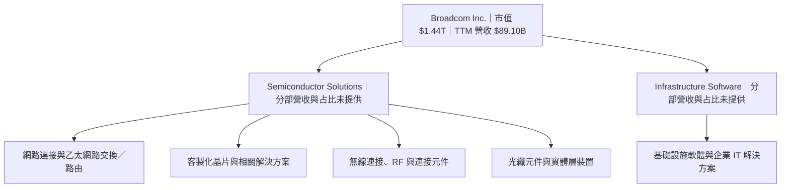
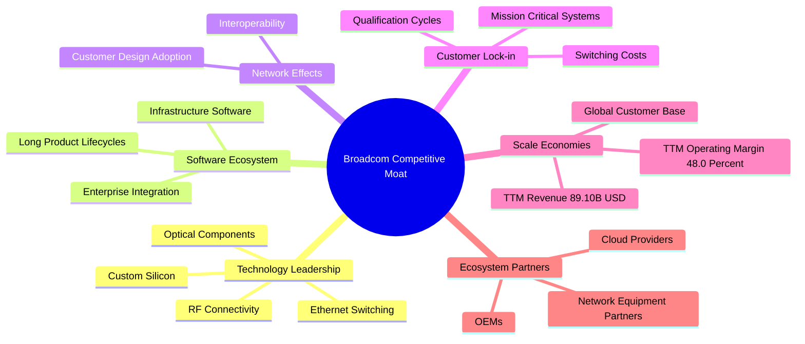
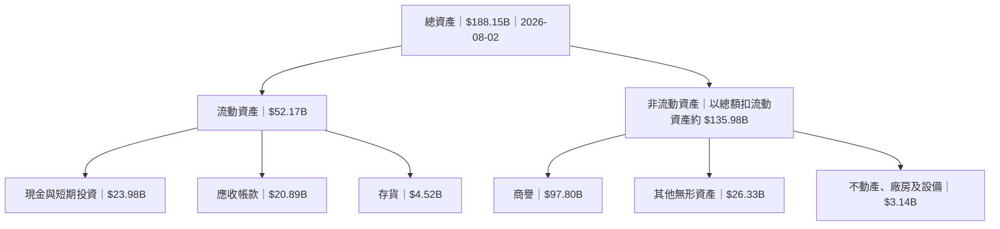
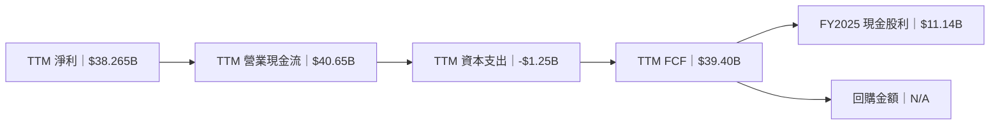
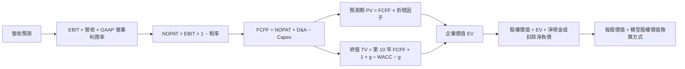
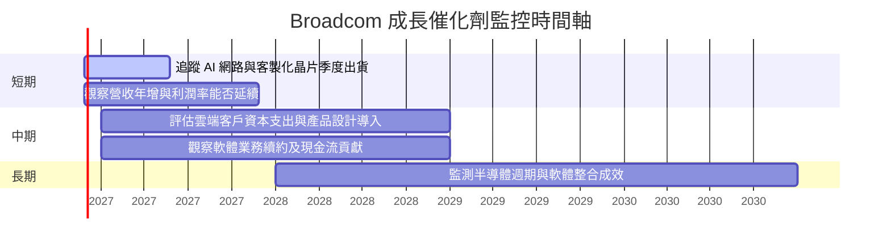
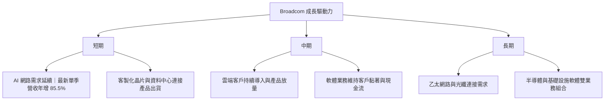
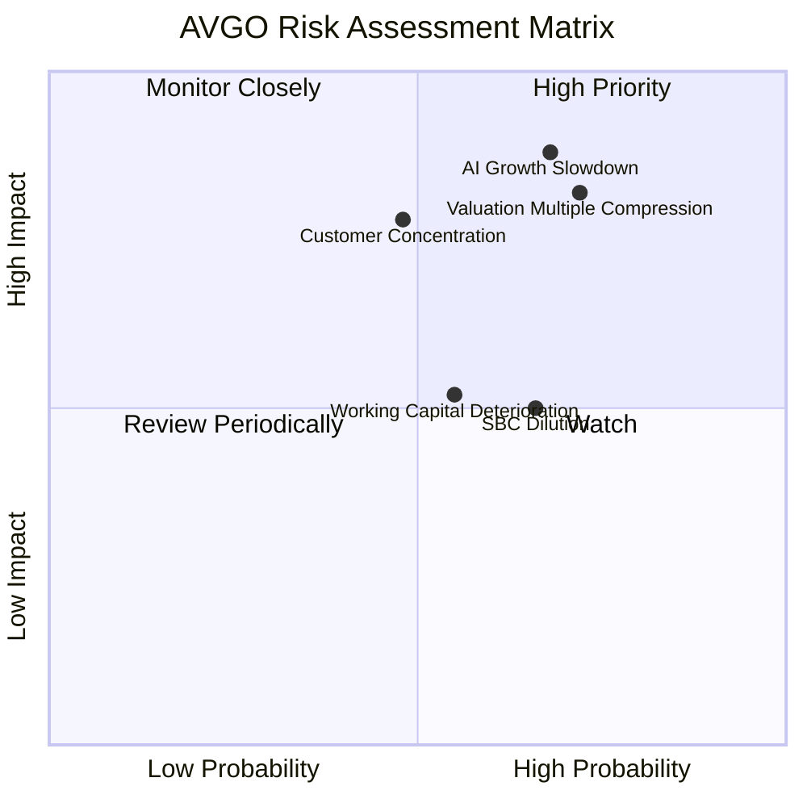
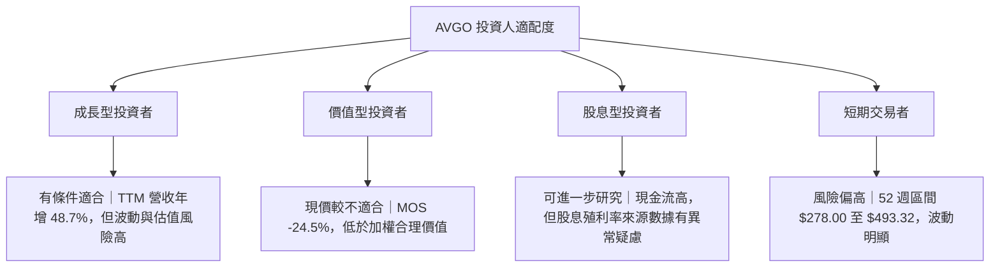

# AVGO 基本面深度分析報告
> **報告日期**：2026-11-26 ｜ **語言**：繁體中文 ｜ **數據來源**：SEC 申報資料 (XBRL)、Yahoo Finance、Finviz、StockAnalysis、Roic.ai ｜ **分析師**：CFA 級機構研究

## 目錄

| # | 章節 | 核心結論 |
|---|------|----------|
| 1 | 執行摘要 | 減碼；加權合理價值 $241.63，MOS -24.5% |
| 2 | 公司概覽與商業模式 | 半導體與基礎設施軟體雙業務，競爭力具規模與客戶黏著，但分部數據不足以量化各自貢獻 |
| 3 | 損益表深度分析 | TTM 營收 $89.10B、年增 48.7%；最新單季年增 85.5%，成長加速但估值已反映高期待 |
| 4 | 資產負債表分析 | 淨負債 $35.44B；流動比率 2.504，流動性良好但併購形成的無形資產與債務值得監控 |
| 5 | 現金流量深度分析 | TTM FCF $39.40B、FCF Yield 2.74%；現金轉換佳，SBC 仍是重要股東成本 |
| 6 | 獲利能力與資本效率 | ROIC 30.0% 對 WACC 11.25%，利差 18.75 個百分點，仍在創造經濟價值 |
| 7 | 相對估值分析 | Forward P/E 15.56x 高於同業中位數 13.8x；自身估值處於歷史偏高區 |
| 8 | DCF 內在價值評估 | 基準 DCF $218.67；加權合理價值 $241.63，兩者均低於現價 $300.86 |
| 9 | 成長催化劑 | AI 網路與客製化晶片需求是主要近中期催化劑；TAM 數據未提供 |
| 10 | 風險矩陣 | AI 成長持續性、估值收縮與客戶集中／競爭是主要風險 |
| 11 | 投資建議 | 評級減碼；等待價格回到估值與基本面更匹配區間，並以季度指標驗證成長延續性 |

---

## 1. 執行摘要

AVGO 的基本面有可量化的優勢：TTM 營收 $89.10B、年增 48.7%，最新一季單季年增 85.5%；TTM 營業利益率 48.0%，FCF $39.40B，ROIC 30.0% 高於 WACC 11.25%。不過，2026-11-25 收盤價 $300.86 對應 TTM P/E 38.4x、P/S 16.5x，且程式計算的加權合理價值為 $241.63，MOS 為 -24.5%。依 MOS 門檻，評級為**減碼**；儘管營運成長與資本回報具吸引力，現價仍要求營收成長、利潤率與估值維持高水準。

### 1.0 一頁式投資儀表板（Portfolio Manager 30 秒速讀）

| 項目 | 內容 |
|------|------|
| **投資論點（3 句）** | ① TTM 營收年增 48.7%，最新一季單季年增 85.5%，反映半導體與 AI 相關需求推升營收，但如此高的成長率能否延續是核心變數。② TTM FCF 為 $39.40B、ROIC 為 30.0%，高於 11.25% WACC，顯示公司目前具強勁現金創造與價值增值能力。③ 加權合理價值 $241.63，低於 $300.86 現價；估值要求持續兌現成長，故風險報酬不利。 |
| **綜合評分** | **6.8/10**（引用 1.1 評分卡） |
| **財務健康** | 🟢 淨負債 $35.44B，但現金及短期投資 $23.98B、流動比率 2.504，短期流動性尚可。 |
| **ROIC vs WACC** | **30.0% vs 11.25%**；ROIC 高出 18.75 個百分點，創造股東價值。 |
| **FCF 趨勢** | 上升；TTM FCF $39.40B，FCF Yield 2.74%。 |
| **估值** | Forward P/E 15.56x ｜ EV/EBITDA 28.16x（市場數據）｜ FCF Yield 2.74%。 |
| **DCF 內在價值（基準）** | **$218.67** ｜ 相對現價折溢價 **+37.6% 溢價**（以 DCF 基準價值計：$300.86 ÷ $218.67 − 1）。 |
| **安全邊際（MOS）** | **-24.5%**＝($241.63 − $300.86) ÷ $241.63；🔴 <10% 無。分母為第 8.8 節加權合理價值。 |
| **預期報酬（基準情境 12M）** | **-27.3%**（DCF 基準情境 $218.67 相對現價；不是一年期公司財測）。 |
| **關鍵風險（前二）** | AI／客製化晶片需求與客戶投資週期降溫；估值偏高時若成長不及預期，倍數收縮可能放大回檔。 |
| **評級 + 信心度** | 🔴 **減碼** ｜ 信心：中（估值方法均指向現價下方，但單一模型對高成長與終值假設敏感）。 |

### 1.1 綜合評分卡（全報告唯一）

| 維度 | 評分（1–10） | 主要依據（引用數字與其來源章節） |
|------|--------------|----------------------------------|
| 成長性 | 8.5 | TTM 營收年增 48.7%，最新單季年增 85.5%；詳見第 3 章。成長突出，但短期增速是否可持續仍不確定。 |
| 獲利能力 | 8.5 | TTM 營業利益率 48.0%、ROIC 30.0%，高於 WACC 11.25%；F-Score 為 7/8；詳見第 3、6 章。 |
| 財務健康 | 6.5 | 淨負債 $35.44B，流動比率 2.504；CCC 由 53 天升至 63 天；詳見第 4 章。 |
| 估值 | 3.0 | MOS -24.5%；Forward P/E 15.56x，高於同業中位數 13.8x；P/E 38.4x 高於自身五年中位數 5.5x；詳見第 7、8 章。 |
| 護城河 | 8.0 | TTM 營收 $89.10B、毛利率 75.5%、營業利益率 48.0%，與客戶設計導入及軟體黏著度相符；缺少分部營收及市占率資料，無法更精確量化；詳見第 2 章。 |
| 管理層與資本配置 | 6.0 | FY2025 SBC $7.57B，約為營收 11.9%；Piotroski 測試顯示稀釋股數未能通過；現金股利支出 FY2025 為 $11.14B；詳見第 3、5 章。 |
| **綜合評分** | **6.8** | 六項算術平均：(8.5 + 8.5 + 6.5 + 3.0 + 8.0 + 6.0) ÷ 6 = 6.75，四捨五入至小數一位為 **6.7**。 |

### 1.2 五大投資論點 + 三大核心風險

| 類型 | 項目 | 具體依據 | 信心度 |
|------|------|----------|--------|
| 🟢 **投資論點①** | 高成長營收底盤 | TTM 營收 $89.10B、TTM 年增 48.7%；最新單季年增 85.5%。需求提升可能帶來規模效益，但需確認不是短期集中出貨。 | 🟢 高 |
| 🟢 **投資論點②** | 高現金轉換 | TTM 營業現金流 $40.65B、資本支出 $1.25B、FCF $39.40B；FCF／TTM 淨利約 103%，現金流能覆蓋會計獲利。 | 🟢 高 |
| 🟢 **投資論點③** | 資本回報高於資金成本 | ROIC 30.0% 對 WACC 11.25%，利差 18.75 個百分點；在目前水準下擴張投資具正向經濟價值。 | 🟢 高 |
| 🟢 **投資論點④** | 半導體與軟體雙業務 | 公司涵蓋連接、網路、客製化晶片及基礎設施軟體，收入來源跨硬體與軟體；但分部占比數據未提供。 | 🟡 中 |
| 🟢 **投資論點⑤** | 資產負債短期承受力 | 現金及短期投資 $23.98B、流動比率 2.504；即使淨負債 $35.44B，仍有一定流動性緩衝。 | 🟡 中 |
| 🟡 **風險①** | AI 成長預期過高 | 現價為加權合理價值的約 1.25 倍；若 AI 相關成長明顯低於市場期待，估值下修可能快於盈餘回落。 | 🟡 中 |
| 🔴 **風險②** | 估值方法普遍低於現價 | DCF $218.67、同業 Forward P/E $267.67、同業 EV/EBITDA $139.67，均低於現價 $300.86。 | 🔴 高 |
| 🔴 **風險③** | SBC 與營運資金占用 | FY2025 SBC $7.57B；最新 TTM CCC 63 天，較一年前 53 天增加 10 天，可能增加股東稀釋及營運資金需求。 | 🟡 中 |

### 1.3 快速統計卡片

| 指標 | 公司實際值（期間） | 同業中位數 | 狀態 |
|------|--------------------|------------|------|
| 營收成長（TTM） | **48.7%** | — | 🟢 |
| 營收成長（最新一季年增） | **85.5%** | **36.5%** | 🟢 |
| 毛利率（TTM） | **75.5%** | **53.1%** | 🟢 |
| 營業利益率（TTM） | **48.0%** | — | 🟢 |
| ROIC（TTM） | **30.0%** | — | 🟢 |
| Forward P/E | **15.56x** | **13.8x** | 🟡 |
| FCF Yield（TTM） | **2.74%** | — | 🟡 |
| Piotroski F-Score | **7 / 8** | — | 🟢 |

### 1.4 投資結論

```text
╔══════════════════════════════════════════════════════════════════╗
║                    📊 投資結論摘要                               ║
╠══════════════════════════════════════════════════════════════════╣
║  評級：減碼（MOS -24.5%，依規則 20）                             ║
║  價格（2026-11-25 收盤）：$300.86                                ║
║  DCF 內在價值（基準）：$218.67（現價溢價 37.6%）                 ║
║  安全邊際 MOS：-24.5%（以加權合理價值 $241.63 為分母）           ║
║  加權合理價值（8.8）：$241.63                                    ║
║  DCF 情境價值：                                                   ║
║    悲觀情境：$89.98（-70.1%）                                    ║
║    基準情境：$218.67（-27.3%）                                   ║
║    樂觀情境：$484.18（+60.9%）                                   ║
║  綜合評分：6.8/10（引用 1.1）                                    ║
║  適合投資人：能承受波動、看好 AI 網路與半導體長期需求者；          ║
║              不適合以安全邊際為首要條件的價值型投資人。           ║
╚══════════════════════════════════════════════════════════════════╝
```

---

## 2. 公司概覽與商業模式

### 2.1 業務結構與收入來源

Broadcom 設計、開發並供應半導體裝置及基礎設施軟體，分為 Semiconductor Solutions 與 Infrastructure Software 兩大部門。公司 TTM 營收為 $89.10B，但分部營收、分部占比及子業務營收數據未提供，因此不以推估比例製作收入結構圖。



公司商業模式結合半導體設計與基礎設施軟體。半導體產品通常受產品世代、客戶設計週期與資料中心投資驅動；軟體業務則可能提高收入可見度及客戶黏著度，但目前缺少兩部門的營收與利潤率明細，無法判斷哪一部門主導近期成長或現金流。

### 2.2 市場份額

市場份額數據未提供，且近期新聞標題沒有可核實的市占率數字，因此不呈現份額圖表。以規模與成長率觀察，AVGO 的 TTM 營收 $89.10B、年增 48.7%，最新單季營收年增 85.5%；但同業 NVDA 最新單季營收年增 103.2%，顯示 AVGO 成長快速，仍需與主要競爭者持續比較。

### 2.3 競爭護城河分析



### 2.4 護城河強度

| 護城河項目 | 強度（強／中／弱） | 證據（引用數字或事實） | 會削弱它的情況 |
|------------|--------------------|------------------------|----------------|
| 技術與產品設計導入 | 強 | 公司供應網路連接、客製化晶片、RF、光纖等元件；TTM 毛利率 75.5%。 | 競爭對手技術追上、客戶轉用自研晶片或重新設計產品。 |
| 軟體生態系統 | 中至強 | 公司有 Infrastructure Software 業務；但軟體分部收入、續約率及留存率未提供。 | 企業客戶削減 IT 支出、產品整合或競品降低轉換成本。 |
| 網路效應 | 中 | 網路設備與互通性、客戶設計導入可形成協同；實際網路效應與客戶數據未提供。 | 標準轉換、客戶集中採購或開放替代方案成熟。 |
| 客戶鎖定 | 強 | 半導體設計導入及企業軟體切換通常涉及驗證和整合成本；公司跨多類產品供應。客戶集中度未提供。 | 大客戶重新設計、內製化或縮短供應商名單。 |
| 規模效應 | 強 | TTM 營收 $89.10B、TTM 營業利益率 48.0%，顯示可觀的營運規模與利潤轉換。 | 產品組合轉差、併購整合成本或固定成本無法隨收入下降調整。 |
| 生態夥伴 | 中 | 業務涉及雲端、OEM、網路設備與企業 IT 生態；合作夥伴營收貢獻未提供。 | 客戶或通路夥伴轉向競品，或供應鏈中斷。 |

1.1「護城河」評分為 **8.0/10**，依據是 75.5% TTM 毛利率、48.0% TTM 營業利益率與多元產品組合；扣分原因是分部營收、客戶集中度及軟體留存資料未提供。

---

## 3. 損益表深度分析

### 3.1 年度收入成長趨勢（近 4 年）

FY2022 至 FY2025 營收由 $33.20B 增至 $63.89B。FY2022–FY2025 三年 CAGR 約 24.4%；成長主要由半導體需求、產品組合及業務規模推進，但 FY2024 大幅成長後 FY2025 增速回落，年度數字顯示成長並非線性。

```text
╔══════════════════════════════════════════════════════════════════╗
║           Broadcom 年度收入趨勢（FY2022-FY2025）                 ║
╠══════════════════════════════════════════════════════════════════╣
║  FY2022  $33.20B  ██████████░░░░░░░░░░░░░░░░  YoY: —             ║
║  FY2023  $35.82B  ███████████░░░░░░░░░░░░░░  YoY: +7.9%  🟡     ║
║  FY2024  $51.57B  ████████████████░░░░░░░░░  YoY: +44.0% 🟢     ║
║  FY2025  $63.89B  ████████████████████░░░░░  YoY: +23.9% 🟢     ║
╠══════════════════════════════════════════════════════════════════╣
║  FY2022–FY2025 三年營收 CAGR：約 +24.4%                           ║
╚══════════════════════════════════════════════════════════════════╝
```

年度 YoY 計算：FY2023：($35.82B ÷ $33.20B) − 1 ≈ 7.9%；FY2024：($51.57B ÷ $35.82B) − 1 ≈ 44.0%；FY2025：($63.89B ÷ $51.57B) − 1 ≈ 23.9%。TTM 成長率 48.7% 與最新季度單季年增 85.5% 的期間不同，不應互相替代。

### 3.2 季度收入趨勢分析

| 季度 | 營收 | QoQ 成長 | YoY 成長 | 備註 |
|------|------:|---------:|---------:|------|
| 2025 Q4 | $18.02B | +20.6% | +28.2% | 相較 2025 Q3 $15.95B；季度資料依財務明細。 |
| 2026 Q1 | $19.31B | +7.2% | +29.5% | 相較 2025 Q1 $14.92B；成長延續。 |
| 2026 Q2 | $22.19B | +14.9% | +47.9% | 相較 2025 Q2 $15.00B，年增加速。 |
| 2026 Q3 | $29.59B | +33.4% | +85.5% | 相較 2025 Q3 $15.95B；最新單季跳升顯著。 |

QoQ 以相鄰季度營收計算，例如 2026 Q3：($29.591B ÷ $22.187B) − 1 ≈ 33.4%。最新季度營收成長加速，可能反映 AI 網路與客製化晶片相關出貨放量；若成長由少數大型專案集中貢獻，季度基期效應與客戶交付時點也會提高波動。

### 3.3 利潤率演變分析

| 利潤率指標 | FY2022 | FY2023 | FY2024 | FY2025 | 趨勢 | 評估 |
|------------|-------:|-------:|-------:|-------:|------|------|
| **毛利率** | 66.5% | 68.9% | 63.0% | 67.7% | FY2024 回落、FY2025 反彈 | 🟢 |
| **營業利益率** | 43.0% | 45.9% | 29.1% | 40.8% | FY2024 明顯收縮、FY2025 修復 | 🟡 |
| **淨利率** | 34.6% | 39.3% | 11.4% | 36.2% | FY2024 低點後回升 | 🟡 |

年度毛利率以年度毛利 ÷ 年度營收計算；年度營業利益率與淨利率亦以相同期間的營業利益或淨利除以營收。FY2024 營業利益率與淨利率下滑，顯示收入擴張並未同步轉化為營業與淨利；但現有資料未提供完整費用明細、收購無形資產攤銷與一次性項目拆分，不能把下滑全歸因於單一因素。FY2025 營業利益回升至 $26.07B、淨利升至 $23.13B，利潤修復可能與收入規模及費用槓桿改善有關。

最新 TTM 毛利率 75.5%、營業利益率 48.0%、淨利率 42.9%，高於 FY2025 年度比率。由於 TTM 涵蓋近期業務組合變化，後續仍需核對季度毛利率、營業費用及併購攤銷，以判斷此幅度是否可維持。

### 3.4 費用結構分析

現有資料提供 FY2025 研發支出 $10.98B、營收 $63.89B、毛利 $43.29B、營業利益 $26.07B，但沒有提供完整、同口徑的銷貨成本、研發、銷售管理、攤銷與其他費用分類。因此不以不完整項目製作費用圓餅圖，避免把不同口徑的財務項目誤當作完整費用結構。

FY2025 研發支出約占營收 17.2%（$10.98B ÷ $63.89B），研發支出由 FY2024 $9.31B 增至 FY2025 $10.98B，約增 17.9%。研發投資有助維持產品競爭力，但若增幅長期高於收入且未轉化為新產品營收，會壓低營業槓桿。

### 3.5 季度 EPS 趨勢與盈餘品質（Quality of Earnings）

| 季度 | EPS 實際 | EPS YoY 成長 | 營收 YoY 成長 | EPS 超預期／不及預期 |
|------|---------:|-------------:|-------------:|----------------------|
| 2025 Q4 | $1.74 | +94.5% | +28.2% | N/A：估值預期值缺漏 |
| 2026 Q1 | $1.50 | +31.6% | +29.5% | N/A：估值預期值缺漏 |
| 2026 Q2 | $1.91 | +85.4% | +47.9% | N/A：估值預期值缺漏 |
| 2026 Q3 | $2.68 | +215.3% | +85.5% | N/A：估值預期值缺漏 |

EPS 預估值及實際差異資料為 NaN，故無法判斷最近四季是否超預期或不及預期；表中呈現的是 EPS 實際值與年增率。季度 EPS 變化與營收加速方向一致，但稀釋股數、稅務與收購會計亦可能影響每股盈餘。

| 盈餘品質項目 | 數值／佔比 | 評估 |
|--------------|-----------|------|
| 股權薪酬 SBC / 營收 | 以最近四季季度數據估算：$8.48B ÷ $89.10B ≈ **9.5%**；FY2025 為 $7.57B ÷ $63.89B ≈ **11.9%** | 🟡 SBC 規模不低，會稀釋未來股東持分；不可只把 SBC 視為非現金費用而忽略經濟成本。 |
| SBC / 營業現金流 | 以最近四季季度 SBC 合計估算：$8.48B ÷ $40.65B ≈ **20.9%** | 🟡 代表股權薪酬相當於約五分之一的 TTM 營業現金流，是重要股東成本。 |
| FCF / 淨利（現金轉換率） | $39.40B ÷ $38.265B ≈ **103.0%** | 🟢 TTM FCF 略高於淨利，現金轉換良好；但營運資金變化可能造成年度波動。 |
| 一次性／非經常性損益 | N/A：未提供 TTM 詳細調節表 | 🟡 無法完整判斷本期淨利是否受重大一次性項目影響。 |
| 有效稅率異常 | N/A：未提供可核實的 TTM 稅前淨利與所得稅費用 | 🟡 DCF 使用 21.0% 標準稅率，不代表已觀察到的實際有效稅率。 |
| 資本化支出 vs 費用化 | TTM Capex $1.25B；資本化研發明細 N/A | 🟢 目前資本支出占營收約 1.4%，但資本化支出分類資料不足，無法審核所有遞延成本。 |

**盈餘品質結論**：FCF／淨利約 103%，代表淨利有現金流支持；但 SBC 對應最近四季營收約 9.5%、營業現金流約 20.9%，不應把全額 FCF 直接視為完全歸屬現有股東的經濟盈餘。估值時應同時監控稀釋股數及回購是否足以抵消 SBC，而不是只看 GAAP 淨利成長。

---

## 4. 資產負債表分析

### 4.1 資產結構分解

2026-08-02 的總資產為 $188.15B。下圖只呈現有財務數據的主要項目；資產細項不是完整互斥分類，故不將所有項目相加成虛假的「總額分解」。



商譽 $97.80B 與其他無形資產 $26.33B 合計約 $124.13B，與歷史併購及無形資產累積相符。這類資產不會直接形成短期償債現金，未來若相關業務現金流低於預期，仍可能產生減損風險。

### 4.2 流動性與營運資金分析

| 指標 | 最新 TTM | 一年前 TTM | 變化 | 解讀 |
|------|----------:|----------:|------:|------|
| DSO 應收帳款天數 | 56 天 | 40 天 | +16 天 | 收款天數拉長，可能與營收快速增長、客戶結算時點或應收款組合改變相關；需追蹤應收款增速是否持續高於營收。 |
| DIO 存貨天數 | 59 天 | 40 天 | +19 天 | 庫存天數增加可能反映備貨或產品組合改變；若需求未如預期，可能帶來庫存調整與現金占用。 |
| DPO 應付帳款天數 | 52 天 | 26 天 | +26 天 | 付款天數延長可能改善短期現金保留，但不應直接視為議價力提升，仍需觀察供應條件與付款紀律。 |
| CCC 現金轉換週期 | 63 天 | 53 天 | +10 天 | DSO 與 DIO 增幅合計高於 DPO 增幅，現金轉換週期延長，營運資金效率略弱。 |

流動比率為 2.504、速動比率為 2.153；現金及短期投資 $23.98B，提供短期償債緩衝。另一方面，DSO、DIO 同步上升，營運規模擴張可能正在吸收更多營運資金，後續需要比較應收帳款與存貨成長是否超過營收成長。

### 4.3 債務結構分析

```text
╔══════════════════════════════════════════════════════════════════╗
║                   Broadcom 債務健康診斷                          ║
╠══════════════════════════════════════════════════════════════════╣
║  總債務：        $59.42B  ████████████████████  🟡               ║
║  現金+短期投資： $23.98B  ████████░░░░░░░░░░░░  🟢               ║
║  淨負債：        $35.44B  ████████████░░░░░░░░  🟡               ║
║                                                                  ║
║  流動比率：      2.504x   🟢                                      ║
║  速動比率：      2.153x   🟢                                      ║
║  Debt/EBITDA：   N/A（未提供一致口徑 TTM EBITDA）                 ║
║  利息保障倍數：  N/A（未提供可核實利息費用與營業利益配對資料）     ║
╚══════════════════════════════════════════════════════════════════╝
```

截至最新 TTM，總債務 $59.42B 減去現金及短期投資 $23.98B，得到淨負債 $35.44B。公司具備正向營運現金流與較高流動比率，短期償債壓力較可控；但在估值及收購活動評估中，不能把淨負債忽略。

### 4.4 股東權益趨勢

| 財政年度 | 股東權益 | YoY 變化 |
|----------|---------:|---------:|
| FY2022 | $22.71B | — |
| FY2023 | $23.99B | +5.6% |
| FY2024 | $67.68B | +182.1% |
| FY2025 | $81.29B | +20.1% |

```text
╔══════════════════════════════════════════════════════════════════╗
║                 Broadcom 股東權益趨勢                            ║
╠══════════════════════════════════════════════════════════════════╣
║  FY2022  $22.71B  ██████░░░░░░░░░░░░░░░░░░░░░░░░                ║
║  FY2023  $23.99B  ███████░░░░░░░░░░░░░░░░░░░░░░░                ║
║  FY2024  $67.68B  █████████████████████████░░░░░                ║
║  FY2025  $81.29B  ██████████████████████████████                ║
╚══════════════════════════════════════════════════════════════════╝
```

FY2024 權益大幅增加與併購後資產負債表擴張相伴，不能單純解讀為留存盈餘累積。近兩期總資產與商譽規模同步上升，評估股東權益品質時應結合商譽可回收性、債務與併購後現金流。

---

## 5. 現金流量深度分析

### 5.1 現金流量瀑布圖

現金流量資料未提供完整的同期間淨利至營業現金流調節表，也沒有回購金額明細，因此只呈現有數字的主要現金流項目，不填補缺漏部分。



### 5.2 FCF 轉換率趨勢

| 財政年度 | FCF | 淨利 | FCF／淨利 | 評估 |
|----------|----:|-----:|----------:|------|
| FY2022 | $16.31B | $11.49B | 約 142.0% | 🟢 現金流高於淨利；含營運資金與非現金項目影響。 |
| FY2023 | $17.63B | $14.08B | 約 125.2% | 🟢 現金轉換仍佳。 |
| FY2024 | $19.41B | $5.89B | 約 329.5% | 🟡 淨利基數較低，比例容易被放大，不能視為常態水準。 |
| FY2025 | $26.91B | $23.13B | 約 116.3% | 🟢 FCF 高於淨利。 |
| TTM | $39.40B | $38.265B | 約 103.0% | 🟢 近期現金轉換仍強，接近盈餘全數轉化為現金。 |

### 5.3 自由現金流趨勢

| 期間 | FCF | FCF YoY | FCF Yield |
|------|----:|--------:|----------:|
| FY2022 | $16.31B | — | N/A |
| FY2023 | $17.63B | +8.1% | N/A |
| FY2024 | $19.41B | +10.1% | N/A |
| FY2025 | $26.91B | +38.6% | N/A |
| TTM | $39.40B | N/A（無同口徑前期 FCF 資料） | 2.74% |

```text
╔══════════════════════════════════════════════════════════════════╗
║                Broadcom 自由現金流趨勢                            ║
╠══════════════════════════════════════════════════════════════════╣
║  FY2022  $16.31B  ████████░░░░░░░░░░░░░░░░                       ║
║  FY2023  $17.63B  █████████░░░░░░░░░░░░░░                       ║
║  FY2024  $19.41B  ██████████░░░░░░░░░░░░░                       ║
║  FY2025  $26.91B  ██████████████░░░░░░░░░                       ║
║  TTM     $39.40B  ████████████████████░░░░                       ║
╠══════════════════════════════════════════════════════════════════╣
║  TTM FCF Yield：2.74%｜TTM FCF＝營業現金流 $40.65B − Capex $1.25B ║
╚══════════════════════════════════════════════════════════════════╝
```

### 5.4 資本配置評估

| 資本配置項目 | 已知數據 | 評估 |
|--------------|----------|------|
| 資本支出 | TTM $1.25B；FY2025 約 $0.623B | TTM Capex 僅占 TTM 營收約 1.4%，顯示資本密集度相對低；但半導體供應鏈的投資亦可能以其他形式反映。 |
| 現金股利 | FY2025 $11.14B；TTM 近四季季度現金股利合計約 $12.08B | 股利支出規模可觀，維持派息須以 FCF 持續性為前提。 |
| 股票回購 | N/A：金額未提供 | 無法計算回購對總資本返還的比例。 |
| 股權薪酬 | FY2025 $7.57B；TTM 最近四季合計約 $8.48B | 股權薪酬造成稀釋成本，不應與現金股利、回購混為一談。 |
| 留存／併購 | 具體金額 N/A | 商譽與無形資產規模較大，歷史併購整合與減損風險須持續檢視。 |

資本配置的主要觀察是：公司產生大量 FCF，能支撐股利與投資；但缺少回購金額與完整併購現金流資料，無法確認資本返還與再投資的相對效率。SBC 是現金股利之外的重要持股稀釋來源。

---

## 6. 獲利能力與資本效率

### 6.1 ROE / ROA / ROIC 趨勢

| 指標 | 可用期間與數值 | 趨勢／評估 |
|------|----------------|------------|
| ROE | TTM 38.4%（QUALITY FIGURES）；其他市場數據來源列 44.2%，口徑有差異 | 高回報，但須留意口徑差異及權益乘數影響；本報告以品質指標的 38.4% 與杜邦分解一致。 |
| ROA | TTM 15.4%（市場數據）；Piotroski 質量區塊確認 ROA 為正且高於一年前 | 🟢 資產使用具獲利能力；歷史完整可比序列未提供。 |
| ROIC | TTM 30.0% | 🟢 顯著高於 11.25% WACC，利差 18.75 個百分點。 |

同業及產業 ROE、ROA、ROIC 平均值未提供，不製作缺少來源的產業均值對比。

### 6.2 ROIC vs WACC 分析（核心價值創造判斷）

```text
╔══════════════════════════════════════════════════════════════════╗
║                  ROIC vs WACC 深度分析                           ║
╠══════════════════════════════════════════════════════════════════╣
║  WACC（採用 VERIFIED Cost of capital）：                         ║
║  ├── 無風險利率（10Y 美債）：     4.85%                           ║
║  ├── 市場風險溢酬 ERP：           5.00%                           ║
║  ├── 原始 Beta：                  1.51                            ║
║  ├── 調整後 Beta：                1.34                            ║
║  ├── 股權成本 Ke：                11.54%                          ║
║  ├── 稅前債務成本：               5.40%                           ║
║  ├── 稅率：                       21.0%                           ║
║  ├── 股權／債務權重：             96.0%／4.0%                     ║
║  └── ✅ WACC：                    11.25%                          ║
║                                                                  ║
║  TTM ROIC：                       30.0%                           ║
║  EVA 利差 = ROIC − WACC：         30.0% − 11.25% = 18.75pp       ║
║                                                                  ║
║  ROIC 30.0%  ▓▓▓▓▓▓▓▓▓▓▓▓▓▓▓▓▓▓▓▓▓▓▓▓▓▓▓▓░░░░░ 🟢             ║
║  WACC 11.25% ▓▓▓▓▓▓▓▓▓▓▓░░░░░░░░░░░░░░░░░░░░░░ ──             ║
║                                                                  ║
║  結論：ROIC 約為 WACC 的 2.67 倍，現況下創造股東價值。           ║
╚══════════════════════════════════════════════════════════════════╝
```

WACC 採用程式計算提供的 **11.25%**，不以其他口徑另行替代。Cost of equity 的報表值為 11.54%；按報表顯示的已四捨五入輸入值，CAPM 直接相乘會有約 0.01 個百分點的顯示尾差，故遵循原始成本資本資料使用 11.54% 與 WACC 11.25%。

ROIC−WACC = 30.0%−11.25% = 18.75 個百分點；30.0% ÷ 11.25% ≈ 2.67 倍。只要 ROIC 不因競爭、產品組合或收購資本回報下降到 WACC 以下，公司仍在創造經濟價值。

### 6.3 杜邦三因素分解

| 因素 | 數值（TTM） | 解讀 |
|------|-------------|------|
| 淨利率 | 42.9% | 高淨利率是 ROE 的主要獲利基礎。 |
| 資產週轉率 | 0.47 | 每單位資產創造的營收有限於高週轉型企業，但高淨利率補足回報。 |
| 權益乘數 | 1.89 | 存在財務槓桿，但不是 ROE 唯一來源。 |
| **ROE** | **38.4%** | 42.9% × 0.47 × 1.89 ≈ 38.4%。 |

杜邦結果顯示 ROE 主要由淨利率與資產週轉共同驅動，權益乘數 1.89 倍有放大效果，但不是極端槓桿水準。來源指標以品質數據為準；不同供應商另列的 ROE 44.2% 不與此處混用。

### 6.4 財務體質：Piotroski F-Score

| 測試 | 結果 | 解讀 |
|------|------|------|
| ROA > 0 | ✅ 通過 | TTM 資產回報為正。 |
| 營業現金流 > 0 | ✅ 通過 | TTM 營業現金流 $40.65B。 |
| ROA 高於一年前 | ✅ 通過 | 獲利效率較前一年改善。 |
| 營業現金流 > 淨利（應計品質） | ✅ 通過 | TTM OCF 高於 TTM 淨利，應計品質測試通過。 |
| 長期負債 ÷ 總資產低於一年前 | — 無法判定 | 缺少所需可比輸入，不補值。 |
| 流動比率高於一年前 | ✅ 通過 | 流動性相較前期改善。 |
| 稀釋股數未增加 | ❌ 未通過 | 代表股數增加或無法符合測試條件，與 SBC 造成的稀釋風險一致。 |
| 毛利率高於一年前 | ✅ 通過 | 毛利率比較測試通過。 |
| 資產週轉率高於一年前 | ✅ 通過 | 資產使用效率較前一年提升。 |

Piotroski F-Score 為 **7 / 8**，即 8 項可判定測試中通過 7 項；長期負債測試因缺資料被排除，不把未判定項目計入分母。未通過的稀釋股數測試與 SBC 是應持續追蹤的股東回報問題。

---

## 7. 相對估值分析

### 7.1 同業估值比較表格

| 估值指標 | **AVGO** | **NVDA** | **MRVL** | **QCOM** | 本公司評估 |
|----------|---------:|---------:|---------:|---------:|-----------|
| **Trailing P/E** | **38.4x** | 16.0x | 43.1x | 13.3x | 🟡 位於同業高低值之間；差異也反映成長預期與財務結構不同。 |
| **Forward P/E** | **15.56x** | 9.0x | 17.8x | 13.8x | 🟡 高於 peer median 13.8x，市場仍給予成長溢價。 |
| **P/S Ratio** | **16.5x** | 10.0x | 12.5x | 4.2x | 🔴 AVGO 高於三家同業，價格對營收的要求高。 |
| **EV/EBITDA** | **34.7x**（歷史估值區塊） | 14.5x | 40.8x | 17.8x | 🔴 明顯高於 NVDA、QCOM；MRVL 為高倍數比較對象。 |
| **最新一季營收 YoY** | **85.5%** | 103.2% | 36.5% | -8.4% | 🟢 成長高於 MRVL、QCOM，略低於 NVDA。 |
| **TTM 毛利率** | **75.5%** | 74.9% | 52.2% | 53.1% | 🟢 高毛利率支持較高估值，但不能單獨證明估值合理。 |

Peer multiples 依 Yahoo Finance 提供。AVGO EV/EBITDA 同時出現 34.7x（歷史估值區塊）及 28.16x（另一市場資料區塊）；此比較表依同一 verified peer multiples 對照欄位列示 **34.7x**，並指出資料源／計算口徑存在差異，不將兩者混為同一序列。

### 7.2 歷史估值區間分析

```text
╔══════════════════════════════════════════════════════════════════╗
║             AVGO 五年估值區間與目前位置                          ║
╠══════════════════════════════════════════════════════════════════╣
║  P/E        1.8x ─────────── 5.5x ───────────────── 77.5x       ║
║  現值 38.4x｜五年中位數 5.5x｜目前百分位 70%                     ║
║                                                                  ║
║  P/S        0.6x ─────── 1.5x ──────────────────── 28.1x        ║
║  現值 16.5x｜五年中位數 1.5x｜目前百分位 65%                     ║
║                                                                  ║
║  EV/EBITDA  0.5x ───────── 5.6x ───────────────── 70.7x        ║
║  現值 34.7x｜五年中位數 5.6x｜目前百分位 55%                     ║
╚══════════════════════════════════════════════════════════════════╝
```

AVGO 的 P/E 38.4x、P/S 16.5x、EV/EBITDA 34.7x，分別位於自身五年歷史的第 70、65、55 百分位。五年中位數倍數與當前倍數差距甚大，可能受歷史會計盈餘、併購及商業組合變動影響，不宜將中位數直接當作精確公允倍數；但目前估值確實不是自身歷史低位。

### 7.3 情境價值（Bear / Base / Bull，照抄 DCF MODEL 的 Scenarios）

| 情境 | 第 1 年營收成長 | 期末營業利潤率 | WACC | 每股價值 | 相對現價 | 機率 | 會發生的條件 |
|------|----------------:|----------------:|-----:|----------:|----------:|------:|--------------|
| 🔴 悲觀 | 15.0% | 36.4% | 12.25% | $89.98 | -70.1% | 25% | AI／客製化晶片需求降溫、競爭使營業利潤率下降，資金成本上升。 |
| 🟡 基準 | 30.0% | 42.8% | 11.25% | $218.67 | -27.3% | 50% | 前期高成長逐年正常化，利潤率由 48.0% 衰減至 42.8%。 |
| 🟢 樂觀 | 45.0% | 47.1% | 10.25% | $484.18 | +60.9% | 25% | AI／客製化晶片需求顯著高於基準，利潤率維持接近高位，折現率下降。 |

上述情境及假設直接採用 DCF 模型。機率加權價值為 $252.88，但第 8.8 節依規則使用各估值方法權重加權，不以機率加權情境價值取代。

### 7.4 相對估值隱含價格區間

```text
╔══════════════════════════════════════════════════════════════════╗
║                   估值方法隱含每股價值                           ║
╠══════════════════════════════════════════════════════════════════╣
║  $139.67 ───────── $218.67 ─── $267.67 ─ $300.86 ───── $523.28 ║
║  EV/EBITDA          DCF        Forward P/E   現價       共識價   ║
╚══════════════════════════════════════════════════════════════════╝
```

- **同業 Forward P/E：$267.67**，依同業中位數 Forward P/E 13.8x × AVGO Forward EPS $19.33。
- **同業 EV/EBITDA：$139.67**，依 NVDA、QCOM peer median 16.2x × TTM EBITDA，再加回淨現金／扣除淨負債調整。
- **DCF 基準：$218.67**，依 10 年 FCFF、WACC 11.25%、終值成長率 3.0%。
- **分析師共識目標價：$523.28**，47 位分析師平均目標價；屬外部參考，與基本面模型存在明顯差距。

---

## 8. DCF 內在價值評估（Discounted Cash Flow）

> 本章採用程式計算的 DCF MODEL 數值，不另建模型。模型為 FCFF、GAAP EBIT，營運資金不建模，股數不再額外稀釋。金額以十億美元計；模型輸出金額保留兩位小數，折現因子保留三位小數，百分比通常保留一位小數，估值逐項引用原模型。

### 8.0 估值推理鏈（Thinking Logic）

#### Step 1 — 價值由哪些變數決定？

AVGO 的價值可拆為半導體業務的現金流底盤、基礎設施軟體帶來的收入黏著性，以及 AI／客製化晶片需求帶來的成長選擇權。現有資料未提供分部營收，無法可靠計算各來源占比；模型以總 TTM 營收 $89.10B 作為共同基礎，不虛構各業務占比。最主導估值的變數是未來營收成長與長期折現假設：終值現值占企業價值 53.7%，WACC 與終值成長率的變動會顯著改變結果。

#### Step 2 — 模型選擇

| 決策點 | 本報告採用 | 理由（含數字） | 曾考慮但否決 | 否決理由 |
|--------|-----------|----------------|--------------|----------|
| 現金流定義 | FCFF | 以 WACC 11.25% 折現得到企業價值，再以淨負債橋接股權價值。 | FCFE | 會直接受融資結構及負債變化影響，與本模型的企業價值架構不一致。 |
| 預測期 N | 10 年 | DCF 模型指定 10 年，允許營收成長由 30.0% 線性降至 3.0%。 | 5 年 | 5 年不足以呈現模型設定的成長正常化路徑；不是本次模型輸入。 |
| 終值方法 | Gordon Growth | 模型以第 10 年 FCFF $134.84B、g 3.0%、WACC 11.25% 計算。 | 退出倍數 | 模型未提供退出倍數終值及對應估值，不另建模型。 |
| EBIT 基礎 | GAAP EBIT | 模型明確以 GAAP EBIT 作為營業利益基礎，EBIT 已含 SBC 費用。 | 非 GAAP EBIT | 若加回 SBC，還需另扣 SBC 或以稀釋股數反映；本模型沒有採用該組合。 |

#### Step 3 — 關鍵假設推導鏈

- **預測期營收成長**：錨點＝TTM 營收年增 48.7%、最新單季年增 85.5% → 調整＝單季高增不能直接外推十年，模型將第一年增長限制於 0%–30%，並逐年線性降至 3.0% → **採用第一年 30.0%、第十年 3.0%** → 曾考慮把 48.7% TTM 成長直接作為第一年，但因模型規則上限為 30%、且單季成長不代表長期持續，否決。
- **營業利潤率**：錨點＝TTM 48.0%；五年中位數已由模型採用作為第十年衰減錨點 → 調整＝模型由 48.0% 線性衰減至 42.8%，反映高成長與產品組合可能逐步正常化 → **採用 FY+1 48.0%、FY+10 42.8%** → 曾考慮長期維持 48.0%，但會假設目前利潤率永久不受競爭、產品組合與成熟化影響，未採用。
- **永續成長率 g**：錨點＝成熟企業長期成長應低於折現率，且需與長期經濟成長相容；可用資料未提供管理層長期指引 → 調整＝採用較低於 WACC 的 **3.0%** → 曾考慮更高 g，但 g 越接近 WACC，終值越敏感且有高估風險，故不採用。
- **預測期 N**：錨點＝模型提供 10 年預測期，營收成長由 30.0% 降至 3.0% → 調整＝採用模型提供的完整十年，反映成長正常化而非短期定格 → **採用 10 年** → 曾考慮 5 年，但會改變終值起算時點且不是既定模型。
- **Capex／營收**：錨點＝TTM Capex $1.25B ÷ TTM 營收 $89.10B 約 1.4% → 調整＝模型逐步降至 0.8%，若高於 D&A 的 1.1 倍則依模型規則衰減 → **第一年 1.4%、第十年 0.8%** → 曾考慮全期維持 1.4%，但模型假設資本支出率隨收入成熟下降，故依既定模型採用。
- **D&A／營收**：錨點＝TTM 約 0.7% → **採用 0.7% 固定**；此為模型設定。
- **有效稅率**：錨點＝模型預設 21.0%，不是本報告觀察到的實際 TTM 有效稅率 → **採用 21.0%**；實際有效稅率明細未提供。
- **EBIT 與 SBC**：錨點＝模型使用 GAAP EBIT，故 SBC 已在費用中 → **採用組合 (A)：GAAP EBIT、FCFF 不再扣 SBC、股數不再額外稀釋** → 否決非 GAAP 加回後再扣一次的混合做法，以免重複計算。
- **ΔWC／營收增額**：錨點＝模型明確不建模營運資金變動 → **採用不納入 ΔWC**。這簡化模型，但 CCC 由 53 天增至 63 天，若營收擴張需要更多營運資金，模型可能偏高。
- **WACC**：錨點＝Cost of capital 資料提供 11.25% → **採用 11.25%**；不另行替換。完整組成見 8.2。
- **終值方法**：錨點＝模型採 Gordon Growth、g 3.0% 且低於 WACC 11.25% → **採用 Gordon Growth** → 退出倍數資料未提供，故不自建退出倍數交叉估值。
- **年稀釋率**：錨點＝模型採 GAAP EBIT 組合 (A) → **採用 0% 額外年稀釋率**；此做法將 SBC 費用留在 GAAP EBIT，但不能代表 SBC 對現有股東的經濟成本不存在。

#### Step 4 — 最脆弱的一環

最脆弱假設是 30.0% 的第一年營收成長能在十年內平順遞減、且營業利潤率僅從 48.0% 緩降至 42.8%；若 AI／客製化晶片需求或產品組合逆轉，悲觀情境價值為 $89.98，顯示估值可大幅低於基準。

#### Step 5 — 計算路徑圖



### 8.1 模型假設總表（Model Inputs）

| 假設項目 | 採用值 | 依據／來源 | 敏感度 |
|----------|--------|-------------|--------|
| 預測期長度 **N** | 10 年 | DCF MODEL 固定輸入；營收成長由 30.0% 降至 3.0%。 | 🟡 中 |
| 營收成長路徑 | FY+1 30.0%，FY+10 3.0%，逐年線性下降 | TTM 營收成長 48.7%；模型限制第一年不高於 30.0%。 | 🔴 高 |
| 營業利潤率 | FY+1 48.0% → FY+10 42.8% | TTM 營業利益率 48.0%；終點依模型過去五個財年的中位數錨定。 | 🔴 高 |
| 有效稅率 | 21.0% | 模型預設稅率；實際 TTM 稅率資料未提供。 | 🟢 低 |
| Capex／營收 | FY+1 1.4% → FY+10 0.8% | TTM Capex $1.25B ÷ 營收 $89.10B 約 1.4%；後續依模型設定逐步下降。 | 🟡 中 |
| D&A／營收 | 0.7% | 模型採 TTM 比率並固定。 | 🟢 低 |
| 營運資金變動／營收增額 | 未建模 | DCF MODEL 明確不納入 working capital；並非假設為零的實際觀測值。 | 🟢 低 |
| EBIT 基礎 | GAAP EBIT | DCF MODEL 指定 GAAP EBIT。 | 🟡 中 |
| SBC 處理 | 組合 (A)：GAAP EBIT 已含 SBC，不再扣 SBC | 模型明示 SBC 已在 GAAP EBIT 中反映。 | 🟡 中 |
| 年稀釋率 | 0% 額外稀釋 | 模型不再稀釋股數，與組合 (A) 相容。 | 🟡 中 |
| 永續成長率 g | 3.0% | DCF MODEL 指定，低於 WACC 11.25%。 | 🔴 高 |
| 終值方法 | Gordon Growth | DCF MODEL 提供公式及數值；未提供退出倍數法。 | 🔴 高 |
| WACC | 11.25% | Cost of capital 區塊原值，推導見 8.2。 | 🔴 高 |

**FCF 定義**：本模型採 FCFF，公式為 `NOPAT + D&A − Capex`；Working Capital 未建模，不列 ΔWC 現金流項。模型採 GAAP EBIT，SBC 已費用化，不再次扣除；股數不另作稀釋。

### 8.2 折現率推導（WACC）

```text
╔══════════════════════════════════════════════════════════════════╗
║                    WACC 推導（折現率）                           ║
╠══════════════════════════════════════════════════════════════════╣
║  股權成本 Ke（CAPM，依 Cost of capital 輸入）：                  ║
║  ├── 無風險利率 Rf（10Y 美債）：       4.85%                      ║
║  ├── 市場風險溢酬 ERP：                5.00%                      ║
║  ├── 原始 Beta（Yahoo）：              1.51                       ║
║  ├── 調整後 Beta：                     1.34                       ║
║  │   調整方式：⅔ × 1.51 + ⅓ × 1.00 = 1.34（四捨五入）           ║
║  ├── 規模／國別溢酬：                  0.00%（美國公司，未另加）  ║
║  └── Ke（原始資料值）：                11.54%                     ║
║                                                                  ║
║  債務成本 Kd：                                                    ║
║  ├── 稅前 Kd（利息 ÷ 債務）：           5.40%                      ║
║  ├── 稅率：                            21.0%                      ║
║  └── 稅後 Kd = 5.40% × (1 − 21.0%)：   4.266%                     ║
║                                                                  ║
║  資本結構（Cost of capital 輸入）：                               ║
║  ├── 股權權重 E：                      96.0%                      ║
║  ├── 債務權重 D：                      4.0%                       ║
║  └── ✅ 採用 WACC：                    11.25%                     ║
╚══════════════════════════════════════════════════════════════════╝
```

**逐步演算（依已提供的資本成本組成）**

1. **Ke**：資料所列 CAPM 輸出為 **11.54%**；以顯示至兩位小數的 Rf、Beta、ERP 重算會有 0.01 個百分點的四捨五入尾差，故沿用原始 Ke。
2. **稅前 Kd**：採 Cost of capital 區塊原值 **5.40%**；利息費用與平均計息負債的底層金額未提供，無法獨立重算。
3. **稅後 Kd**：5.40% × (1 − 21.0%) = **4.266%**。
4. **權重**：股權 96.0%、債務 4.0%；96.0% + 4.0% = **100.0%**。市值與期末計息負債用於重算權重的完整底層數字未提供，故不反推。
5. **WACC**：96.0% × 11.54% + 4.0% × 4.266% = 11.0784% + 0.17064% = 11.24904%，按原始資料採用 **11.25%**。

Rf 的日期未在成本資本資料內明列，故只標示為 10Y Treasury 輸入值 4.85%，不擅自補寫日期。原始 Beta 1.51，採用調整後 Beta 1.34；不另加規模／國別溢酬。第 6.2 節與本節均使用 11.25%。

### 8.3 逐年自由現金流預測（基準情境）

下表逐年照錄 DCF MODEL。計算結果保留原模型精度；表中稅額為 EBIT 的 21.0%，NOPAT＝EBIT−稅額，FCFF＝NOPAT+D&A−Capex。

| 年度 | FY+1 | FY+2 | FY+3 | FY+4 | FY+5 | FY+6 | FY+7 | FY+8 | FY+9 | FY+10 |
|------|-----:|-----:|-----:|-----:|-----:|-----:|-----:|-----:|-----:|------:|
| 營收 | 115.84 | 147.11 | 182.42 | 220.72 | 260.46 | 299.52 | 335.47 | 365.66 | 387.60 | 399.23 |
| 營收 YoY | 30.0% | 27.0% | 24.0% | 21.0% | 18.0% | 15.0% | 12.0% | 9.0% | 6.0% | 3.0% |
| 營業利潤率 | 48.0% | 47.5% | 46.9% | 46.3% | 45.7% | 45.2% | 44.6% | 44.0% | 43.4% | 42.8% |
| 營業利益 EBIT（GAAP） | 55.66 | 69.83 | 85.54 | 102.23 | 119.12 | 135.26 | 149.54 | 160.89 | 168.30 | 171.04 |
| − 稅（21.0%） | (11.69) | (14.67) | (17.96) | (21.47) | (25.02) | (28.40) | (31.40) | (33.79) | (35.34) | (35.92) |
| = NOPAT | 43.97 | 55.17 | 67.58 | 80.76 | 94.10 | 106.85 | 118.14 | 127.10 | 132.96 | 135.12 |
| + D&A | 0.82 | 1.04 | 1.29 | 1.57 | 1.85 | 2.12 | 2.38 | 2.59 | 2.75 | 2.83 |
| − Capex | (1.62) | (1.96) | (2.31) | (2.64) | (2.93) | (3.17) | (3.31) | (3.36) | (3.29) | (3.11) |
| **= FCFF** | **43.17** | **54.25** | **66.56** | **79.69** | **93.02** | **105.81** | **117.21** | **126.34** | **132.41** | **134.84** |
| 折現因子 @11.25% | 0.899 | 0.808 | 0.726 | 0.653 | 0.587 | 0.527 | 0.474 | 0.426 | 0.383 | 0.344 |
| **FCFF 現值 PV** | **38.80** | **43.83** | **48.34** | **52.02** | **54.58** | **55.80** | **55.56** | **53.83** | **50.72** | **46.42** |

**預測期 FCF 現值合計：**

38.80 + 43.83 + 48.34 + 52.02 + 54.58 + 55.80 + 55.56 + 53.83 + 50.72 + 46.42 = **499.90B**（模型總計為 $499.91B，兩者差異約 0.01B，屬逐年金額四捨五入尾差）。

**逐步演算（FY+1，依模型輸出）**

1. **營收** = $89.10B × (1 + 30.0%) = **$115.84B**（中間金額與模型採用精度有四捨五入差異）。
2. **EBIT** = $115.84B × 48.0% ≈ **$55.66B**。
3. **稅** = $55.66B × 21.0% ≈ **$11.69B**。
4. **NOPAT** = $55.66B − $11.69B = **$43.97B**。
5. **D&A** = $115.84B × 0.7% ≈ **$0.82B**。
6. **Capex** = $115.84B × 模型第一年 Capex 比率 ≈ **$1.62B**。
7. **ΔWC** = **不納入模型**，不是以資料估得的零值。
8. **FCFF** = $43.97B + $0.82B − $1.62B = **$43.17B**。
9. **折現因子與 PV**：模型折現因子 0.899；$43.17B × 0.899 ≈ **$38.80B**。

**合理性自檢**

- 預測 FCFF 由 FY+1 $43.17B 增至 FY+10 $134.84B；九年端點 CAGR 約 13.5%（($134.84B ÷ $43.17B)^(1/9) − 1）。與 FY2022–FY2025 FCF 約 18.2% CAGR 相比低約 4.7 個百分點；但 FY2025 至 TTM FCF 增幅較大，歷史基期與週期不穩定，不宜直接外推。
- FY+10 FCFF 利潤率 = $134.84B ÷ $399.23B ≈ **33.8%**；目前 TTM FCF 利潤率 = $39.40B ÷ $89.10B ≈ **44.2%**。同業最佳 FCF 利潤率資料未提供，不作比較。模型實際假設未來現金流率較目前下降。
- 模型預測各年度 FCFF 均為正值；沒有負 FCFF 年度。

```text
╔══════════════════════════════════════════════════════════════════╗
║            自由現金流：歷史實際 vs 模型預測                      ║
╠══════════════════════════════════════════════════════════════════╣
║  FY2023(實)  $17.63B  ███░░░░░░░░░░░░░░░░░░░░░░                 ║
║  FY2024(實)  $19.41B  ███░░░░░░░░░░░░░░░░░░░░░░                 ║
║  FY2025(實)  $26.91B  █████░░░░░░░░░░░░░░░░░░░░                 ║
║  TTM(實)     $39.40B  ███████░░░░░░░░░░░░░░░░░░                 ║
║  FY+1(預)    $43.17B  ████████░░░░░░░░░░░░░░░░                 ║
║  FY+10(預)  $134.84B  █████████████████████████                 ║
╠══════════════════════════════════════════════════════════════════╣
║  FY+1 至 FY+10 FCFF CAGR 約 13.5%；歷史與預測口徑不同，          ║
║  預測建立在十年營收增長與高利潤率持續的假設上。                  ║
╚══════════════════════════════════════════════════════════════════╝
```

### 8.4 終值計算（Terminal Value）

**適用性檢查**：`WACC 11.25% vs g 3.0% → WACC > g？✅`

模型提供 Gordon Growth 終值，未提供退出倍數法的模型輸入，故退出倍數法不另行建構。

| 方法 | 計算式 | 終值 TV | TV 現值 | 佔總 EV 比重 |
|------|--------|---------:|--------:|-------------:|
| Gordon Growth | $134.84B × (1 + 3.0%) ÷ (11.25% − 3.0%) | $1,682.94B | $579.40B | 53.7% |
| 退出倍數法 | N/A：DCF MODEL 未提供退出倍數 | N/A | N/A | N/A |

**逐步演算**

1. FY+10 FCFF = **$134.84B**。
2. 分子 = $134.84B × (1 + 3.0%) = $134.84B × 1.03 = **$138.8852B**。
3. 分母 = 11.25% − 3.0% = **8.25%**；TV = $138.8852B ÷ 8.25% = **$1,682.85B**。DCF MODEL 原值為 **$1,682.94B**，兩者有四捨五入／底層精度差異；估值橋接遵循模型原值。
4. PV(TV) = 模型 TV $1,682.94B × 第十年模型折現因子 0.344 = **模型原值 $579.40B**。以顯示後因子直接相乘會有尾差，沿用原模型輸出。
5. 終值現值占比 = $579.40B ÷ $1,079.30B ≈ **53.7%**。

終值占 EV 53.7%，低於 75% 高度依賴警示門檻，但仍超過企業價值一半；g 與 WACC 是估值敏感輸入。

### 8.5 企業價值 → 每股內在價值（Bridge）

```text
╔══════════════════════════════════════════════════════════════════╗
║              企業價值 → 每股內在價值 橋接表                      ║
╠══════════════════════════════════════════════════════════════════╣
║  預測期 FCF 現值合計             +$499.91B                        ║
║  終值現值 PV(TV)                 +$579.40B                        ║
║  ─────────────────────────────────────────────                  ║
║  = 企業價值 EV                  $1,079.30B                        ║
║  + Net cash（− 表示淨負債）       −$35.44B                         ║
║  = 股權價值                     $1,043.86B                        ║
║  每股內在價值（模型原值）          $218.67                         ║
║  當前股價（2026-11-25 收盤）       $300.86                         ║
║  折溢價（現價÷DCF價值−1）          +37.6%（溢價）                  ║
╚══════════════════════════════════════════════════════════════════╝
```

**逐步演算（橋接）**

1. **EV**：模型提供的預測期現值 $499.91B + TV 現值 $579.40B = 算術加總 **$1,079.31B**；模型 EV 原值為 **$1,079.30B**，差異為 0.01B 的四捨五入尾差。
2. **股權價值**：模型 EV $1,079.30B + Net cash（−$35.44B）= **$1,043.86B**。
3. **每股內在價值**：模型原值 **$218.67**；DCF MODEL 使用「股權價值 × 價格 ÷ 市值」的換算公式。股數／底層市值在模型使用的精度未完整列示，故不另以市場股數重算或替換原值。
4. **折溢價**：($300.86 ÷ $218.67) − 1 = 約 **+37.6%**，即現價相對 DCF 基準價值溢價。
5. **本節不計算 MOS**：MOS 僅在 8.8 以加權合理價值為分母計算一次。

股權價值橋接採用最新 TTM 淨負債 $35.44B。DCF 的 SBC 組合為 **(A)：GAAP EBIT 已含 SBC、FCFF 不再扣 SBC、股數不額外稀釋**。資料未提供 DCF 對應精確稀釋股數，因此不以外部股數重算每股值。

### 8.6 敏感性分析（WACC × 永續成長率）

下表每格先列 DCF 模型每股價值，再以該格價值相對 2026-11-25 收盤價 $300.86 計算括號內上行／下行幅度；模型原值保持不變。

| g（列）／WACC（欄） | 9.25% | 10.25% | **11.25%（基準）** | 12.25% | 13.25% |
|-----------|------:|------:|------------------:|------:|------:|
| 2.0% | $272.73 (-9.4%) | $234.37 (-22.1%) | $204.50 (-32.0%) | $180.63 (-40.0%) | $161.14 (-46.4%) |
| 2.5% | $285.74 (-5.0%) | $243.54 (-19.1%) | $211.18 (-29.8%) | $185.62 (-38.3%) | $164.94 (-45.2%) |
| 3.0% | $300.82 (0.0%) | $253.98 (-15.6%) | **$218.67 (-27.3%)** | $191.15 (-36.5%) | $169.12 (-43.8%) |
| 3.5% | $318.53 (+5.9%) | $265.96 (-11.6%) | $227.13 (-24.5%) | $197.31 (-34.4%) | $173.73 (-42.3%) |
| 4.0% | $339.61 (+12.9%) | $279.86 (-7.0%) | $236.75 (-21.3%) | $204.22 (-32.1%) | $178.84 (-40.6%) |

**逐步演算（矩陣非基準格）**

所選格 **WACC 10.25% > g 3.0% ✅**。模型給出的此格每股價值為 **$253.98**；其預測現金流在不同 WACC 下重新折現，TV 也使用 10.25% 折現。DCF MODEL 未列出此格的逐年現值合計及終值現值分項，故依規則直接引用敏感度矩陣原值，不另行建立或補造中間值。

**三情境 DCF**

情境每股值、機率與相對現價依 DCF MODEL 原值列示。該模型沒有提供每種情境的 FY+10 營收、FCFF、TV 逐項表，因此不另外推造不存在的中間輸入。

| 情境 | 營收成長假設 | 期末營業利潤率 | 永續成長 g | WACC | 每股內在價值 | 相對現價 | 機率 |
|------|--------------|----------------:|------------:|-----:|--------------:|----------:|------:|
| 🔴 悲觀 | 第 1 年 15.0% | 36.4% | DCF MODEL 情境未另列 | 12.25% | $89.98 | -70.1% | 25% |
| 🟡 基準 | 第 1 年 30.0% | 42.8% | 3.0% | 11.25% | $218.67 | -27.3% | 50% |
| 🟢 樂觀 | 第 1 年 45.0% | 47.1% | DCF MODEL 情境未另列 | 10.25% | $484.18 | +60.9% | 25% |
| **機率加權** | — | — | — | — | **$252.88** | **-15.9%** | 100% |

情境機率加權算式：$89.98 × 25% + $218.67 × 50% + $484.18 × 25% = **$252.875，四捨五入為 $252.88**。

**敏感度結論**

- g 由 2.5% 升至 3.5%、WACC 固定 11.25%：$211.18 → $227.13，增加 **$15.95，約 +7.6%**。
- WACC 由 10.25% 升至 12.25%、g 固定 3.0%：$253.98 → $191.15，下降 **$62.83，約 -24.7%**。
- 期末營業利潤率每 +1 個百分點的每股變化：DCF MODEL 未提供該項單變數敏感度，**N/A**，不自建數字。
- 在已提供的矩陣測試幅度內，WACC 變動造成的價值差距較大；這與 8.0 指出估值受折現率及長期成長假設主導的判斷一致。

### 8.7 反推 DCF（Reverse DCF：市場在預期什麼）

以現價 $300.86 為目標值，模型已提供兩項單變數解。其餘輸入固定於基準情境；沒有提供的反推變數不臆測解答。

| 求解的變數（一次一個） | 其餘變數設定 | 市場隱含值（令 DCF = 現價） | 可比基準 | 判斷 |
|------------------------|--------------|------------------------------:|----------|------|
| 第 1 年營收成長率 | 其餘基準假設固定 | **38.7%** | 基準 30.0%；TTM 年增 48.7% | 🔴 市場價格需要高於基準第一年成長。 |
| 固定營業利潤率 | 其餘基準假設固定 | **59.8%** | 基準路徑 48.0% → 42.8% | 🔴 高於現有 TTM 48.0%，要求明顯利潤率提升。 |
| 永續成長率 g | N/A：模型未提供反推值 | 未計算 | 基準 g 3.0% | N/A |
| 預測期長度 N | N/A：模型未提供反推值 | 未計算 | 基準 N 10 年 | N/A |

反推模型只提供求解結果，未提供每 0.5 個百分點的疊代軌跡、對應 FY+N 營收及 FCFF，因此不編造試算表。市場價格要由基準 DCF 支撐，需提高近端營收增速至 38.7%，或長期固定營業利潤率提高至 59.8%；後者高於目前 48.0% TTM 利潤率，達成難度較高。

### 8.8 估值三角驗證與安全邊際

| 估值方法 | 隱含每股價值 | 上行空間（÷現價） | 權重 | 說明 |
|----------|--------------:|-------------------:|-----:|------|
| DCF（基準） | $218.67 | -27.3% | 40% | 10 年 FCFF、WACC 11.25%、終值成長 3.0%。 |
| 同業 Forward P/E | $267.67 | -11.0% | 25% | 同業中位數 13.8x × AVGO Forward EPS $19.33。 |
| 同業 EV/EBITDA | $139.67 | -53.6% | 25% | 同業中位數 16.2x（NVDA、QCOM）× TTM EBITDA，再加回淨現金／扣除淨負債調整。 |
| 分析師共識目標價 | $523.28 | +73.9% | 10% | 47 位分析師平均目標價；作為參考來源。 |
| **加權合理價值** | **$241.63** | **-19.7%** | **100%** | 依 profitable company 固定權重。 |

加權計算：
$218.67 × 40% + $267.67 × 25% + $139.67 × 25% + $523.28 × 10%  
= $87.468 + $66.9175 + $34.9175 + $52.328  
= **$241.631，依模型列示 $241.63**。

公司類型為 profitable，估值方法與權重完全照列。四項方法均有數值，沒有方法因無法計算而剔除。

```text
╔══════════════════════════════════════════════════════════════════╗
║                  估值區間與安全邊際                              ║
╠══════════════════════════════════════════════════════════════════╣
║  $89.98 ───── $218.67 ───── [$241.63] ───── $300.86 ───── $484.18║
║  悲觀DCF       基準DCF       加權合理值       現價         樂觀DCF║
║                                                                  ║
║  安全邊際 MOS = ($241.63 − $300.86) ÷ $241.63 = -24.5%           ║
║  MOS 評估：🔴 <10% 無                                            ║
║  上行空間 = ($241.63 − $300.86) ÷ $300.86 = -19.7%               ║
║                                                                  ║
║  建議買入區間：未達規則 20 買入評級；現價以上不建議新建部位。     ║
║  合理持有區間：$218.67 – $241.63（DCF 至加權合理價值）            ║
║  減碼考慮區間：高於 $241.63 時，尤其現價 $300.86 附近             ║
╚══════════════════════════════════════════════════════════════════╝
```

> 🔎 **程式複算（Python，依本節各項自動重算）**
>
> 加權合理價值 = $218.67 × 40% + $267.67 × 25% + $139.67 × 25% + $523.28 × 10% = **$241.63**（權重合計 100%）
>
> 以價格 $300.86 計：MOS = **-24.5%**，上行空間 = **-19.7%**
>
> ✅ 與本節所寫數值一致。

### 8.9 DCF 模型的局限與失效條件

- **終值依賴度**：終值現值占 EV **53.7%**，超過一半估值由 FY+10 之後現金流假設決定。
- **最脆弱假設**：第一年營收成長 30.0% 以及十年營業利潤率僅由 48.0% 降至 42.8%。模型悲觀情境價值為 **$89.98**，反映成長與利潤率同時惡化時估值可能大幅下降。
- **營運資金限制**：CCC 已由 53 天升至 63 天，但 DCF 未建模 ΔWC；若成長需要更高應收帳款與庫存，FCFF 可能被高估。
- **SBC 限制**：採 GAAP EBIT，SBC 已作費用；同時設定股數不額外稀釋。這符合模型組合 (A)，但實際股數增長仍可能使每股價值偏高。
- **不適用情境**：公司目前 FCF 為正且獲利能力高，DCF 可作為主估值工具；但大型併購、產品組合快速變化或 AI 投資週期轉折時，單一 DCF 的可靠度下降，應配合同業倍數與分部估值。
- **與第 10 章風險連結**：AI 需求下降會衝擊營收成長；競爭加劇會壓縮 EBIT 利潤率；利率上升會推高 WACC；營運資金週期延長則使模型未計入的現金流出增加。

### 8.10 複算檢核表（Audit Trail）

| # | 檢核項目 | 檢查方式 | 結果 |
|---|----------|----------|------|
| 1 | 所有高／中敏感度輸入有推導 | 對照 8.0 Step 3 與 8.1 假設表 | ⚠️ 已逐項說明；模型沒有提供全部替代值與業務分部錨點，已明示資料限制。 |
| 2 | 每個假設都有來歷 | 檢查 8.1 依據欄 | ✅ 有數據或明示未提供。 |
| 3 | WACC 算式及權重 | 96.0% + 4.0% = 100.0%；組成依原始成本資本資料 | ✅ 採用 WACC 11.25%；底層利息與平均負債金額未提供，不能獨立重建 Kd。 |
| 4 | Kd 分母與債務權重範圍一致 | 檢查成本資本提供欄位與負債範圍 | ⚠️ 5.40% 為原始提供值，未提供其利息與平均計息負債明細，故無法獨立稽核範圍。 |
| 5 | WACC 與第 6.2 節同值 | 比對兩節 | ✅ 均為 11.25%。 |
| 6 | 逐年表格年度數等於 N | 計數 FY+1 至 FY+10 | ✅ 共 10 年，無省略年度。 |
| 7 | FY+1 代表年度算式 | 以模型顯示值重算 FCFF 與 PV | ✅ 可按顯示值近似複算，存在精度四捨五入。 |
| 8 | 預測期 PV 合計 | 逐項相加 | ⚠️ 顯示值加總 $499.90B，模型總額 $499.91B，差 $0.01B，低於 1% 尾差。 |
| 9 | WACC > g | 比較 11.25% 與 3.0% | ✅ 成立。 |
| 10 | 終值基期與折現期 | 檢查第 10 年 FCFF 與折現期 | ✅ 使用 FY+10 FCFF、折現 10 期；顯示精度造成微小尾差。 |
| 11 | 橋接算式 | 逐項核對 EV 與淨負債 | ⚠️ 顯示值相加 $1,079.31B，模型 EV $1,079.30B，差 $0.01B；原值照錄。 |
| 12 | SBC 組合相容性 | GAAP EBIT、無 −SBC 列、0% 額外稀釋 | ✅ 採組合 (A)。 |
| 13 | 敏感性基準格等於 DCF 基準值 | 比對矩陣與 8.5 | ✅ 均為 $218.67。 |
| 14 | 敏感度格有效性 | 所有 WACC 均高於 g | ✅ 矩陣全部格子 WACC > g。 |
| 15 | 情境機率及加權值 | 25% + 50% + 25%；加權算式 | ✅ 機率合計 100%，加權值 $252.88。 |
| 16 | 反推每列只放開一個變數 | 對照模型提供的反推結果 | ⚠️ 僅兩個已解變數可引用；模型未提供疊代軌跡與另兩項解，未自行編造。 |
| 17 | MOS 與折溢價口徑 | MOS 用 $241.63；折溢價用 $218.67 | ✅ MOS -24.5%；DCF 折溢價 +37.6%。 |
| 18 | 報告完整至第 11 章 | 檢查章節 | ✅ 完整輸出。 |
| 19 | 加權合理價值等於加權總和 | 重算各方法價值 × 權重 | ✅ $241.63，未事後調整。 |
| 20 | 評級符合 MOS 門檻 | MOS -24.5% 對照規則 20 | ✅ 減碼，未作質化調整。 |

資料精度檢核發現顯示至兩位小數的 DCF 現值加總與模型總額差 $0.01B，橋接 EV 亦有 $0.01B 尾差；保留 DCF MODEL 原始總額及每股價值，不以四捨五入後自行替代。

---

## 9. 成長催化劑

### 9.1 催化劑時間軸

可量化的催化劑時間點與管理層指引未提供；下圖以未定日期標示監控項目，不代表公司已公告的產品時程。



### 9.2 TAM 市場規模分析

**N/A（TAM 數據未提供）**。可用公司財務數字顯示，TTM 營收為 $89.10B、TTM 年增 48.7%，最新單季營收年增 85.5%；這些數字表明近期業務增長快速，但不能替代可引用的市場總量或滲透率資料。

### 9.3 成長驅動力結構圖



成長驅動力中，只有公司總營收與季度成長有明確財務數字；各產品線營收、訂單與市占率未提供。投資追蹤應將公司整體營收、毛利率、營業利益率與現金轉換作為可驗證代理指標。

---

## 10. 風險矩陣

### 10.1 風險評分矩陣

機率與衝擊座標為分析師定性評估，不是財務報表數字；矩陣中的財務影響門檻於 10.2 明確列為監控假設。



### 10.2 風險清單詳細分析

| # | 風險項目 | 發生機率 | 財務衝擊 | 風險評分 | 緩解措施 |
|---|----------|----------|----------|----------|----------|
| 1 | 🔴 **AI／客製化晶片需求低於預期** | 中高（分析師估計 45%） | 高；監控條件為營收年增跌至 20% 以下或連續兩季減速 | 🔴 8.5/10 | 追蹤單季營收年增、分部訂單與客戶資本支出；若需求降溫，重估 30.0% DCF 第一年度成長假設。 |
| 2 | 🔴 **估值倍數收縮** | 高（分析師估計 55%） | 高；現價 $300.86，高於加權合理價值 $241.63 約 24.5% MOS 缺口 | 🔴 8.5/10 | 採分批投資及設定估值上限；除非盈餘增速同步提升，避免用分析師目標價取代基本面估值。 |
| 3 | 🟡 **客戶集中與內製替代** | 中（分析師估計 35%） | 高；客戶集中度與單一客戶收入占比未提供，若大客戶內製可能影響成長 | 🟡 7.5/10 | 追蹤客戶集中度揭露、客製化晶片訂單與產品設計導入；觀察客戶是否轉向內部解決方案。 |
| 4 | 🟡 **營運資金效率惡化** | 中（分析師估計 40%） | 中；CCC 已由 53 天升至 63 天，若再延長可能降低實際 FCF | 🟡 6.0/10 | 每季追蹤 DSO、DIO、DPO；若 CCC 持續擴大且 OCF 落後淨利，降低現金流估值信心。 |
| 5 | 🟡 **SBC 稀釋股東回報** | 中高（分析師估計 50%） | 中；FY2025 SBC $7.57B，約占營收 11.9% | 🟡 6.5/10 | 追蹤稀釋股數與回購抵消量；若股數持續增加且每股 FCF 成長弱於總 FCF，調整每股價值。 |
| 6 | 🟡 **高負債及併購資產減損** | 中（分析師估計 30%） | 中高；淨負債 $35.44B，商譽 $97.80B | 🟡 6.5/10 | 追蹤債務償還、利息成本、併購業務現金流與商譽減損測試。 |

機率與風險分數是研究判斷，不是由公司財務數據直接計算。量化門檻的用途是監控與重新評估，不代表已發生相關事件。

---

## 11. 投資建議

### 11.1 最終評級與評分

AVGO 的加權合理價值為 $241.63，對照 2026-11-25 收盤價 $300.86，MOS 為 -24.5%，依規則 20 評級為**減碼**，未作一級質化調整。公司品質綜合評分為 **6.8/10**，六項分數依序為成長性 8.5、獲利能力 8.5、財務健康 6.5、估值 3.0、護城河 8.0、管理層與資本配置 6.0；評分反映營運品質與現價估值之間的落差。

### 11.2 合理價值與隱含報酬率

| 方法／情境 | 每股價值 | 相對現價 | 機率／權重 |
|------------|---------:|---------:|-----------:|
| 加權合理價值 | **$241.63** | **-19.7%** | 估值方法權重合計 100% |
| DCF 悲觀情境 | $89.98 | -70.1% | 25% |
| DCF 基準情境 | $218.67 | -27.3% | 50% |
| DCF 樂觀情境 | $484.18 | +60.9% | 25% |
| DCF 機率加權參考值 | $252.88 | -15.9% | 100% 情境機率加權 |

### 11.3 買入時機與觸發因素

```text
╔══════════════════════════════════════════════════════════════════╗
║                  ✅ 買入觸發因素 Checklist                      ║
╠══════════════════════════════════════════════════════════════════╣
║  現階段策略：以觀察為主，不因分析師共識目標價單獨追買。           ║
║                                                                  ║
║  重新評估買入條件（多數符合）：                                  ║
║  ☐ 股價回落至加權合理價值 $241.63 附近或以下                     ║
║  ☐ 最新單季營收年增維持在 30% 以上且非單季集中出貨               ║
║  ☐ TTM 營業利益率維持 45% 以上                                  ║
║  ☐ TTM FCF 維持正值且 FCF／淨利不低於 90%                       ║
║                                                                  ║
║  加碼觸發條件（出現以下任一）：                                  ║
║  ☐ 股價低於 DCF 基準價 $218.67，且營收與利潤率未破壞             ║
║  ☐ ROIC 維持高於 WACC 11.25%，且淨負債持續下降                  ║
║                                                                  ║
║  減碼／退出觸發條件（出現以下任一）：                            ║
║  ☐ 連續兩季營收年增低於 20%                                      ║
║  ☐ TTM 營業利益率較 48.0% 回落超過 5 個百分點                   ║
║  ☐ TTM FCF 轉負，或 FCF／淨利低於 80%                           ║
║  ☐ ROIC 跌至 WACC 11.25% 以下                                    ║
╚══════════════════════════════════════════════════════════════════╝
```

以上為研究監控門檻，不是公司已公告的財測。買入區間必須配合股價、季度營運及估值更新；若價格下跌但基本面亦同步惡化，不應機械式加碼。

### 11.4 投資人適配度分析



配息資料列示殖利率 86.0%，此數值與常見殖利率呈現不一致，且未提供相應股價與股利計算口徑，因此不將其作為可靠股息指標；股息型投資人應以 SEC 申報及公司公告的每股股利重新核對。

### 11.5 每季財報監控清單（Quarterly Watch List）

| 監控項目 | 最新基準 | 觸發加碼／正向訊號 | 觸發減碼／負向訊號 |
|----------|----------|--------------------|--------------------|
| 營收年增率 | 最新單季 85.5%；TTM 48.7% | 單季年增維持 30% 以上，且連續性良好 | 連續兩季低於 20%，或快速下滑並伴隨財測下修 |
| 營業利益率 | TTM 48.0%；模型最新季度資料口徑另列 53.9% | TTM 維持 45% 以上 | TTM 低於 43%，或較目前收縮超過 5 個百分點 |
| TTM FCF | $39.40B | 保持正值，且與淨利轉換率高於 90% | FCF 轉負或轉換率低於 80% |
| Capex | TTM $1.25B | 支出增加能對應收入與產能回報 | Capex 上升但營收與 FCF 未同步改善 |
| DSO／DIO／CCC | DSO 56 天、DIO 59 天、CCC 63 天 | CCC 穩定或回落 | CCC 再增加 10 天以上且 OCF 落後淨利 |
| SBC／稀釋股數 | FY2025 SBC $7.57B；F-Score 稀釋測試未通過 | 股數穩定，回購能有效抵銷稀釋 | 稀釋股數連續上升且每股 FCF 成長弱於總 FCF |
| AI／客製化晶片成長 | 分部營收未提供 | 公司分部揭露或指引顯示訂單與營收延續 | 相關需求放緩、客戶延後採購或轉向內製 |
| 財測與估值 | 分析師共識目標價 $523.28；DCF 基準 $218.67 | 獲利上修能實際追上現價所隱含預期 | 盈餘預估下修、估值仍高於基本面推導價值 |

### 11.6 反面論證：什麼會證明論點錯誤（What Would Change My Mind）

```text
╔══════════════════════════════════════════════════════════════════╗
║              ⚠️ 論點失效條件（Disconfirming Evidence）           ║
╠══════════════════════════════════════════════════════════════════╣
║  若下列條件成立，應重新檢視估值與持倉：                          ║
║  ☐ 最新一季營收年增連續兩季低於 20%                              ║
║  ☐ TTM 營業利益率由 48.0% 下滑超過 5 個百分點                   ║
║  ☐ TTM FCF 轉負，或 FCF／淨利低於 80%                           ║
║  ☐ ROIC 跌破 WACC 11.25%                                         ║
║  ☐ CCC 較目前 63 天再增加 10 天以上，且營業現金流減弱            ║
║  ☐ SBC 持續高於營收 10%，並伴隨稀釋股數增加                     ║
║  ☐ AI／客製化晶片需求未能支持基準情境所需的成長路徑              ║
╚══════════════════════════════════════════════════════════════════╝
```

若營收成長與營業利益率同時落在上述失效區間，現價所需的高成長與高利潤率假設就更難成立，投資論點應轉向保守；若 ROIC 低於 WACC，則代表公司新增投資不再創造經濟價值，應重新評估持有必要性。

> **免責聲明**：本報告為 AI 自動生成，僅供研究參考，不構成投資建議。投資有風險，入市需謹慎。

---

## 資料與來源

| 項目 | 內容 |
|------|------|
| 價格 | 300.86 USD，2026-11-25 收盤（Yahoo Finance 日線） |
| 財務報表 | SEC 10-Q filed 2026-09-10，最新季度 2026-08-02（FY2026 Q3） |
| 有回應的資料來源 | SEC 申報資料 (XBRL)、Yahoo Finance、Finviz、StockAnalysis、Roic.ai |
| 由程式計算 | TTM 數字、WACC、DCF 模型、估值方法與權重、加權合理價值、MOS、評級門檻、F-Score、杜邦分解、營運資金天數、綜合評分 |
| 撰寫模型 | openai / gpt-6-luna |

> 本區塊由產生報告的程式依實際取得的資料填寫，非模型撰寫。「由程式計算」的數字不是模型的估計；其餘判斷（評分、情境、策略）是模型的分析。
