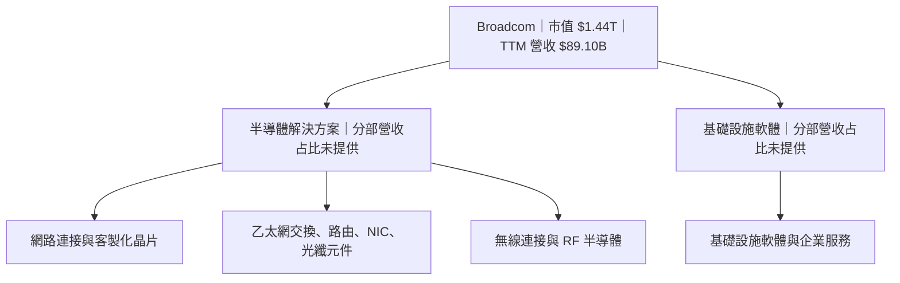
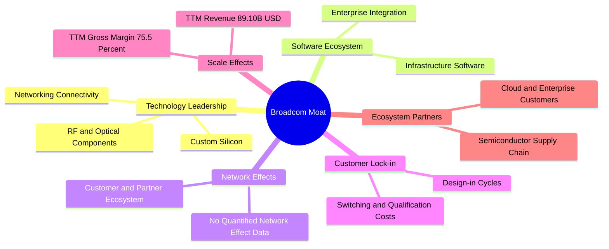
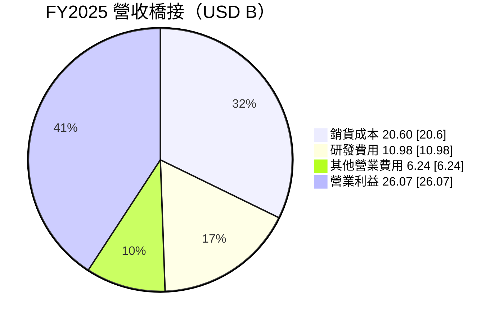
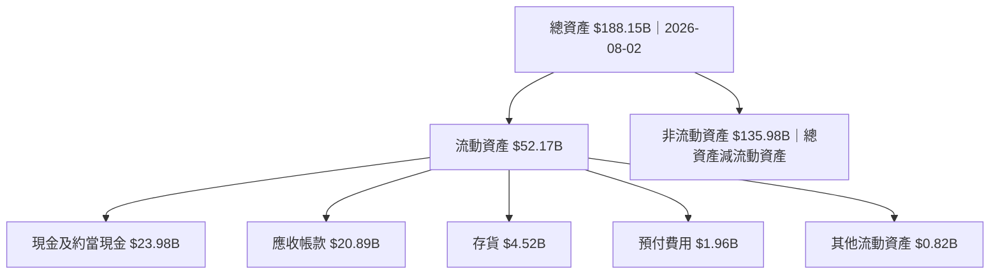
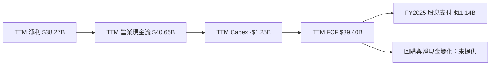
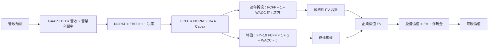
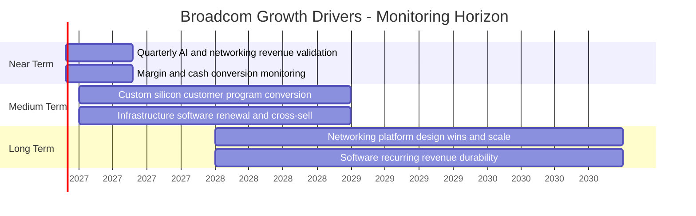
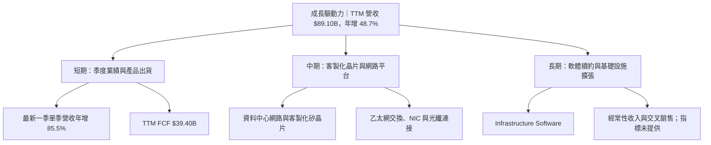
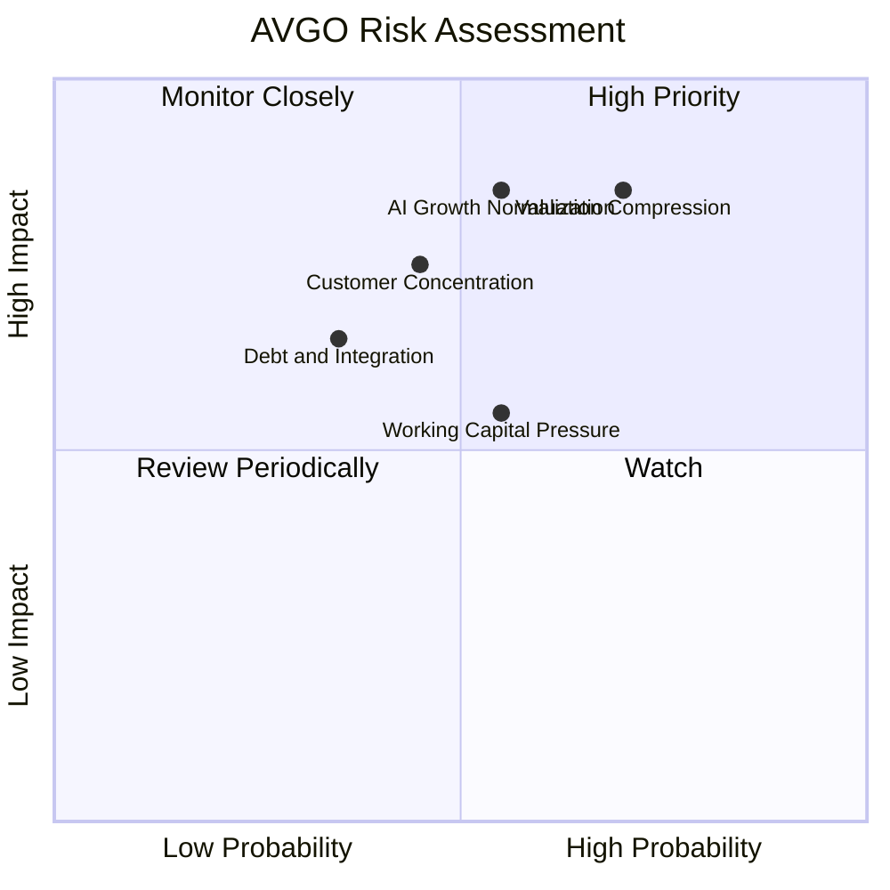
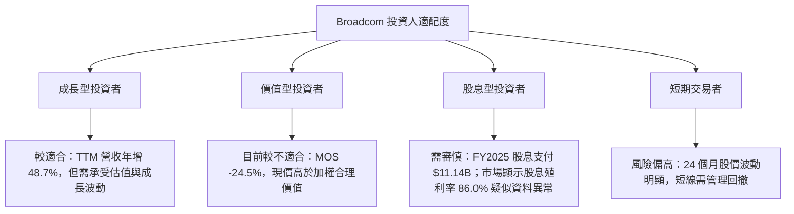

# AVGO 基本面深度分析報告
> **報告日期**：2026-11-27 ｜ **語言**：繁體中文 ｜ **數據來源**：SEC 申報資料 (XBRL)、Yahoo Finance、Finviz、StockAnalysis、Roic.ai ｜ **分析師**：CFA 級機構研究

## 目錄

| # | 章節 | 核心結論 |
|---|------|----------|
| 1 | 執行摘要 | 減碼；加權合理價值 $241.63，MOS -24.5% |
| 2 | 公司概覽與商業模式 | 半導體與基礎設施軟體並行；分部營收占比未提供 |
| 3 | 損益表深度分析 | TTM 營收 $89.10B、成長 48.7%；最新一季年增 85.5% |
| 4 | 資產負債表分析 | 淨負債 $35.44B；流動性比率良好，營運資金週期延長 |
| 5 | 現金流量深度分析 | TTM FCF $39.40B，FCF Yield 2.74% |
| 6 | 獲利能力與資本效率 | ROIC 30.0% 高於 WACC 11.25%，仍創造經濟價值 |
| 7 | 相對估值分析 | 相對同業與自身歷史估值偏高 |
| 8 | DCF 內在價值評估 | DCF 基準 $218.67；加權合理價值 $241.63 |
| 9 | 成長催化劑 | AI 網路與客製化晶片是主要質化驅動；TAM 數據未提供 |
| 10 | 風險矩陣 | 估值、AI 成長延續性及併購／負債為主要風險 |
| 11 | 投資建議 | 依 MOS 評級減碼；建議等待估值與營運驗證 |

---

## 1. 執行摘要

Broadcom 的 TTM 營收為 **$89.10B**、TTM 成長 **48.7%**，最新一季單季營收年增 **85.5%**；TTM FCF 為 **$39.40B**，但 FCF Yield 僅 **2.74%**。資本效率方面，TTM ROIC **30.0%** 高於採用的 WACC **11.25%**，利差為 **18.75 個百分點**，顯示公司仍在創造經濟價值。另一方面，DCF 基準價值為 **$218.67**，低於 2026-11-25 收盤價 **$300.86**；三角驗證後加權合理價值為 **$241.63**，對應 MOS **-24.5%**。因此依規則 20 評級為 **減碼**；沒有另作質化調整。

### 1.0 一頁式投資儀表板

| 項目 | 內容 |
|------|------|
| **投資論點（3 句）** | ① TTM 營收年增 48.7%，最新一季單季年增 85.5%，反映目前成長動能加速。② TTM FCF $39.40B、ROIC 30.0% 高於 WACC 11.25%，現金創造與資本回報具支撐。③ 加權合理價值 $241.63 低於 $300.86 收盤價，MOS 為 -24.5%，估值風險高於基本面優勢。 |
| **綜合評分** | **7.2/10**（引用 1.1 評分卡） |
| **財務健康** | 🟡 現金及短期投資 $23.98B，總債務 $59.42B，淨負債 $35.44B；流動比率 2.504。 |
| **ROIC vs WACC** | 30.0% vs 11.25%；🟢 創造股東價值，利差 18.75 個百分點。 |
| **FCF 趨勢** | TTM FCF $39.40B；年度 FCF 由 FY2022 $16.31B 增至 FY2025 $26.91B；FCF Yield 2.74%。 |
| **估值** | Forward P/E 15.56x ｜ EV/EBITDA 28.16x ｜ FCF Yield 2.74%。 |
| **DCF 內在價值（基準）** | $218.67 ｜ 相對現價折價？不；現價相對 DCF 溢價 **37.6%**。 |
| **安全邊際（MOS）** | **-24.5%**＝($241.63 − $300.86) ÷ $241.63；🔴 低於 10%，沒有安全邊際。 |
| **預期報酬（基準情境 12M）** | DCF 基準相對現價 **-27.3%**；模型不是 12 個月預測，僅作估值參考。 |
| **關鍵風險（前二）** | AI／客製化晶片成長率回落；高估值與終值假設使估值對折現率敏感。 |
| **評級 + 信心度** | 🔴 **減碼** ｜ 信心：中（財務數據有支撐，但資料間部分口徑不一致，且模型依賴終值）。 |

### 1.1 綜合評分卡

| 維度 | 評分（1–10） | 主要依據（引用數字與其來源章節） |
|------|--------------|----------------------------------|
| 成長性 | 9 | TTM 營收年增 48.7%，最新一季單季年增 85.5%（第 3 章）。 |
| 獲利能力 | 9 | TTM 營業利益率 48.0%、ROIC 30.0%、Piotroski 7/8（第 3、6 章）。 |
| 財務健康 | 7 | 淨負債 $35.44B、流動比率 2.504、CCC 由 53 天升至 63 天（第 4 章）。 |
| 估值 | 3 | MOS -24.5%；P/E 38.4x，處於自身五年估值分布第 70 百分位（第 7、8 章）。 |
| 護城河 | 9 | TTM 營收 $89.10B、TTM 毛利率 75.5%、基礎設施軟體與半導體雙業務（第 2 章）。 |
| 管理層與資本配置 | 6 | FY2025 SBC $7.57B，稀釋股數測試未通過；股息與回購細項不足以完整評估（第 3、5 章）。 |
| **綜合評分** | **7.2** | 六項算術平均：(9 + 9 + 7 + 3 + 9 + 6) ÷ 6 = **7.2**。 |

### 1.2 五大投資論點 + 三大核心風險

| 類型 | 項目 | 具體依據 | 信心度 |
|------|------|----------|--------|
| 🟢 **投資論點①** | AI 相關需求提供成長選擇權 | TTM 營收年增 48.7%，最新一季單季年增 85.5%；但分部數據未提供，不能把全部增長歸因於 AI。 | 🟢 高 |
| 🟢 **投資論點②** | 現金流規模可觀 | TTM 營業現金流 $40.65B、Capex $1.25B、FCF $39.40B。 | 🟢 高 |
| 🟢 **投資論點③** | 投入資本回報高於資金成本 | ROIC 30.0% 對 WACC 11.25%，利差 18.75 個百分點。 | 🟢 高 |
| 🟢 **投資論點④** | 高毛利反映產品與軟體組合價值 | TTM 毛利率 75.5%，營業利益率（TTM，指定口徑）48.0%。 | 🟢 高 |
| 🟢 **投資論點⑤** | 軟體業務增加經常性收入特徵 | 公司同時經營 Infrastructure Software，但軟體收入占比與續約指標未提供。 | 🟡 中 |
| 🟡 **風險①** | 市場定價包含較高預期 | 收盤價 $300.86，高於 DCF 基準 $218.67，也高於加權合理價值 $241.63。 | 🔴 高衝擊 |
| 🔴 **風險②** | AI／客製化晶片成長可能正常化 | DCF 基準預設第一年營收成長 30.0%，而十年後降至 3.0%；若需求增速更快回落，估值下修。 | 🟡 中 |
| 🟡 **風險③** | 淨負債與股權稀釋 | 淨負債 $35.44B；Piotroski 稀釋股數測試未通過。 | 🟡 中 |

### 1.3 快速統計卡片

| 指標 | 公司實際值（期間） | 同業中位數 | 狀態 |
|------|--------------------|------------|------|
| 營收成長（TTM） | **48.7%** | — | 🟢 |
| 營收成長（最新一季年增） | **85.5%** | **36.5%** | 🟢 |
| 毛利率（TTM） | **75.5%** | **53.1%** | 🟢 |
| 營業利益率（TTM） | **48.0%** | — | 🟢 |
| ROIC（TTM） | **30.0%** | — | 🟢 |
| Forward P/E | **15.56x** | **13.8x** | 🟡 |
| FCF Yield（TTM） | **2.74%** | — | 🟡 |
| Piotroski F-Score | **7 / 8** | — | 🟢 |

同業營收成長、毛利率中位數分別採 NVDA、MRVL、QCOM 三家公司數據計算；Forward P/E 中位數為 13.8x。公司 Forward P/E 15.56x 高於同業中位數。

### 1.4 投資結論

╔══════════════════════════════════════════════════════════════════╗  
║                    📊 投資結論摘要                               ║  
╠══════════════════════════════════════════════════════════════════╣  
║  評級：減碼（依 MOS -24.5%，符合 -25% 至 -10% 門檻）             ║  
║  價格（2026-11-25 收盤）：$300.86                                ║  
║  DCF 內在價值（基準）：$218.67（現價溢價 37.6%）                 ║  
║  安全邊際 MOS：-24.5%（＝($241.63−$300.86)÷$241.63）             ║  
║  加權合理價值（8.8）：$241.63                                    ║  
║  DCF 情境價值：                                                   ║  
║    悲觀情境：$89.98（相對現價 -70.1%）                           ║  
║    基準情境：$218.67（相對現價 -27.3%）                          ║  
║    樂觀情境：$484.18（相對現價 +60.9%）                          ║  
║  綜合評分：7.2/10（引用 1.1）                                    ║  
║  適合投資人：已持有者可觀察基本面；新資金宜等待估值回落或成長驗證 ║  
╚══════════════════════════════════════════════════════════════════╝  

---

## 2. 公司概覽與商業模式

### 2.1 業務結構與收入來源

Broadcom 設計、開發並供應半導體產品及基礎設施軟體。公司總市值約 **$1.44T**，TTM 營收 **$89.10B**。財務數據未提供半導體解決方案與基礎設施軟體的分部營收，因此不填分部占比或金額。

### 2.2 市場份額

市場份額數據未提供，故不作比例圖或份額推估。可確認的是 Broadcom TTM 營收達 $89.10B，最新一季單季營收年增 85.5%；相較 NVDA、MRVL、QCOM 最新一季年增率分別為 103.2%、36.5%、-8.4%，Broadcom 的單季增速位於這組同業的高端，但不等同於市場份額變化。

### 2.3 競爭護城河分析

### 2.4 護城河強度

| 護城河項目 | 強度（強／中／弱） | 證據（引用數字或事實） | 會削弱它的情況 |
|------------|--------------------|------------------------|----------------|
| 技術與產品設計導入 | 強 | 客製化晶片、網路、無線連接等多類產品；TTM 毛利率 75.5%。 | 替代方案性能追上，或大型客戶改採自研／第二來源。 |
| 軟體生態系統 | 中至強 | 公司有 Infrastructure Software 業務；收入占比與續約率未提供。 | 軟體整合效益不足、續約率下降、客戶轉換成本降低。 |
| 客戶鎖定 | 中至強 | 半導體設計導入與企業軟體整合通常具有認證和遷移成本；未提供客戶集中度。 | 大客戶削減採購或自製晶片。 |
| 規模效應 | 強 | TTM 營收 $89.10B、營業利益率 48.0%。 | 併購整合成本、競爭性定價或需求循環令利潤率下滑。 |
| 網路效應 | 中 | 客戶與供應鏈生態可擴大產品部署，但未提供可量化網路效應數據。 | 產品標準化或生態夥伴轉向競爭方案。 |
| 生態夥伴 | 中 | 業務覆蓋資料中心網路與企業基礎設施；合作收入資料未提供。 | 供應鏈限制、客戶合作策略改變。 |

1.1 護城河評分 **9/10** 的依據是高毛利、規模與多產品設計導入；因缺少分部收入、客戶集中度及軟體續約率，不能把護城河視為無條件穩固。

---

## 3. 損益表深度分析

### 3.1 年度收入成長趨勢（FY2022–FY2025）

年度營收與年增率來自年度損益表；2025 年營收較 2022 年的三年 CAGR 約 24.4%。

$$CAGR = (63.89 \div 33.20)^{1/3} - 1 = 24.4\%$$

╔══════════════════════════════════════════════════════════════════╗  
║              Broadcom 年度收入趨勢（FY2022–FY2025）              ║  
╠══════════════════════════════════════════════════════════════════╣  
║ FY2022  $33.20B  ████████████░░░░░░░░░░░░░░  基期             ║  
║ FY2023  $35.82B  █████████████░░░░░░░░░░░░░  YoY +7.9% 🟡    ║  
║ FY2024  $51.57B  ███████████████████░░░░░░░  YoY +44.0% 🟢   ║  
║ FY2025  $63.89B  ████████████████████████░░░  YoY +23.9% 🟢   ║  
╠══════════════════════════════════════════════════════════════════╣  
║ FY2022–FY2025 三年營收 CAGR：+24.4%                              ║  
╚══════════════════════════════════════════════════════════════════╝  

成長並非線性：FY2023 增長 7.9%，FY2024 加速至 44.0%，FY2025 回落至 23.9%。TTM 成長 48.7% 高於 FY2025，最新季度更出現加速，但高基期使未來成長率回落是合理風險。

### 3.2 季度收入趨勢分析

| 季度 | 營收 | QoQ 成長 | YoY 成長 | 備註 |
|------|------|----------|----------|------|
| 2025-10-31 | $18.02B | — | 28.18% | QoQ 前一季未列入本表。 |
| 2026-01-31 | $19.31B | 7.2% | 29.47% | 以四捨五入後營收計算 QoQ。 |
| 2026-04-30 | $22.19B | 14.9% | 47.87% | 年增率為單季口徑。 |
| 2026-07-31 | $29.59B | 33.4% | 85.50% | 最新季營收跳升；季節性與業務組合影響未能由現有資料拆解。 |

QoQ 算式示例：($29.59B ÷ $22.19B) − 1 = **33.4%**。最新一季年增率 85.5% 是單季數字，不可與 TTM 成長 48.7% 混用。

### 3.3 利潤率演變分析

| 利潤率指標 | FY2022 | FY2023 | FY2024 | FY2025 | 趨勢 | 評估 |
|------------|--------|--------|--------|--------|------|------|
| **毛利率** | 66.5% | 68.9% | 63.2% | 67.7% | FY2024 下滑、FY2025 回升 | 🟢 |
| **營業利益率** | 43.0% | 46.1% | 29.1% | 40.8% | FY2024 明顯收縮，FY2025 修復 | 🟡 |
| **淨利率** | 34.6% | 39.3% | 11.4% | 36.2% | FY2024 受淨利低基期影響，FY2025 回升 | 🟡 |

年度毛利率以毛利除以營收計算；年度營業利益率以年度損益表營業利益除以營收計算。這些歷史年度口徑與指定 TTM 營業利益率 **48.0%** 不同，可能受期間與資料來源口徑影響，不能直接視為完全可比序列。

**利潤率演變深度解析：** FY2024 年營收成長 44.0%，但年度營業利益由 FY2023 的 $16.45B 降至 $15.00B，反映當年成本、費用或併購相關項目對報表利潤造成壓力。FY2025 營業利益升至 $26.07B、營收 $63.89B，年度營業利益率回升至 40.8%。TTM 毛利率 75.5% 與 TTM 營業利益率 48.0% 則顯示近期組合與規模效益較佳；但資料不足以將改善精確拆解至半導體或軟體分部。

### 3.4 費用結構分析

FY2025 可由已披露的毛利、研發費用及營業利益構成簡化營運橋接；「其他營業費用」為毛利減研發費用與營業利益的差額，並非單一申報科目。

╔══════════════════════════════════════════════════════════════════╗  
║             FY2025 營收與營業利潤橋接（USD B）                   ║  
╠══════════════════════════════════════════════════════════════════╣  
║ 營收 $63.89B                                                      ║  
║ ├─ 毛利 $43.29B（毛利率 67.7%）                                  ║  
║ │  ├─ 研發費用 $10.98B                                            ║  
║ │  ├─ 其他營業費用估算 $6.24B                                     ║  
║ │  └─ 營業利益 $26.07B（營業利益率 40.8%）                        ║  
║ └─ 銷貨成本 $20.60B                                               ║  
╚══════════════════════════════════════════════════════════════════╝  

### 3.5 季度 EPS 趨勢與盈餘品質（Quality of Earnings）

| 盈餘品質項目 | 數值／佔比 | 評估 |
|--------------|-----------|------|
| 股權薪酬 SBC / 營收 | TTM 約 $8.48B ÷ $89.10B = **9.5%** | 🟡 SBC 規模顯著，會稀釋股東經濟利益；股數測試亦未通過。 |
| SBC / 營業現金流 | TTM 約 $8.48B ÷ $40.65B = **20.9%** | 🟡 非現金費用，但需視為股東成本，不宜忽略。 |
| FCF / 淨利（現金轉換率） | $39.40B ÷ TTM 淨利 $38.265B = **103.0%** | 🟢 現金轉換略高於淨利；但淨利來源及一次性項目仍需檢視。 |
| 一次性／非經常性損益 | N/A（缺少完整調節表） | 無法判斷 TTM 淨利是否受一次性項目重大影響。 |
| 有效稅率異常 | N/A（TTM 實際稅率未提供） | DCF 使用 21.0% 為模型假設，不代表已核實的 TTM 有效稅率。 |
| 資本化支出 vs 費用化 | TTM Capex $1.25B；資本化政策細節未提供 | 不足以判斷是否有成本遞延或資本化政策異常。 |

過去四季每股盈餘呈上升趨勢，StockAnalysis 列示季度 EPS 由 2025 年 Q4 的 $1.74、2026 年 Q1 的 $1.55、Q2 的 $1.96 至 Q3 的 $2.75；但這與其他來源的 EPS 口徑並不完全一致，故不混作同一序列。EPS 預期值與實際值資料均為 `nan`，因此**不能判斷過去四季是否超預期或不及預期，也不能推定原因**。

**盈餘品質結論：** TTM FCF 高於淨利，現金轉換支持盈餘含金量；但 SBC 約占營收 9.5%、占營業現金流 20.9%，是重要股東成本。DCF 採 GAAP EBIT，已把 SBC 作為費用反映，且不另做股數稀釋，以免重複計算；估值仍需留意實際流通股數增長。

---

## 4. 資產負債表分析

### 4.1 資產結構分解

以下以最新可得 TTM 資產負債表數據為主；未提供的資產細項不作反推或拆分。

非流動資產為總資產減流動資產的差額：$188.148B − $52.173B = **$135.975B**。由於這是推算分類差額，並非獨立列示項目，不再將其拆分至商譽、無形資產或固定資產。

### 4.2 流動性與營運資金分析

| 指標 | 最新值 | 前期／對比 | 變化 | 解讀 |
|------|--------|------------|------|------|
| 流動比率 | 2.504 | FY2025 約 1.706 | 上升 | 最新流動資產 $52.17B；流動負債按 FY2025 年報 $18.51B 計算的歷史比率不可直接替代最新同期期末比率，故僅作方向性參考。 |
| 速動比率 | 2.153 | N/A | N/A | 依市場資料列示；即期流動性較佳。 |
| DSO 應收帳款天數 | 56 天 | 40 天 | +16 天 | 應收款回收週期延長；應追蹤客戶付款條件及應收帳款增速。 |
| DIO 存貨天數 | 59 天 | 40 天 | +19 天 | 存貨天數上升；可能是供應備貨或需求轉換，需與後續出貨及庫存撥備一起驗證。 |
| DPO 應付帳款天數 | 52 天 | 26 天 | +26 天 | 付款天數增加，短期有助現金，但也可能反映付款時點或採購規模變化。 |
| CCC 現金轉換週期 | 63 天 | 53 天 | +10 天 | 雖 DPO 延長，但 DSO、DIO 合計上升仍使 CCC 惡化。 |

營運資金天數依 SEC 流量與 Yahoo 季度資產負債表計算，照錄品質指標結果。DSO、DIO、DPO 的變化提示需要關注應收與存貨增速，不能僅因營收增長就視為無風險。

### 4.3 債務結構分析

╔══════════════════════════════════════════════════════════════════╗  
║                   Broadcom 債務健康診斷                          ║  
╠══════════════════════════════════════════════════════════════════╣  
║  總債務：        $59.42B  ████████████████████  🟡             ║  
║  現金及短期投資：$23.98B  ████████░░░░░░░░░░░░  🟢             ║  
║  淨負債：        $35.44B  ████████████░░░░░░░░  🟡             ║  
║  Debt/EBITDA：   N/A（指定數據未提供同口徑 TTM EBITDA）          ║  
║  利息保障倍數：  N/A（利息費用資料未提供）                       ║  
║  流動性：        流動比率 2.504、速動比率 2.153                  ║  
╚══════════════════════════════════════════════════════════════════╝  

2025 年末總債務為 $65.14B，最新 TTM 數據為 $59.42B；現金及短期投資 $23.98B，淨負債仍為正數。公司具備流動性緩衝，但應避免把淨負債表述為淨現金。

### 4.4 股東權益趨勢

╔══════════════════════════════════════════════════════════════════╗  
║                  Broadcom 歷年股東權益（USD B）                  ║  
╠══════════════════════════════════════════════════════════════════╣  
║ FY2022  $22.71B  ██████░░░░░░░░░░░░░░░░                         ║  
║ FY2023  $23.99B  ███████░░░░░░░░░░░░░░                           ║  
║ FY2024  $67.68B  ███████████████████░░░                           ║  
║ FY2025  $81.29B  ████████████████████████                         ║  
╚══════════════════════════════════════════════════════════════════╝  

FY2023 至 FY2024 股東權益大幅上升，與資產負債表規模變化同時發生；商譽及無形資產亦明顯增加，提示併購與購買會計可能影響帳面資產結構。帳面權益增加本身不代表有機資本回報同步提高。

---

## 5. 現金流量深度分析

### 5.1 現金流量瀑布圖

季度與年度資料的現金流口徑並不完全一致；圖中以可核對的 TTM 營業現金流、Capex、FCF 與年度股息支出呈現，未提供回購金額及淨現金變化，故不補造數字。

### 5.2 FCF 轉換率趨勢

| 財年 | FCF | 淨利 | FCF／淨利 |
|------|-----|------|-----------|
| FY2022 | $16.31B | $11.49B | 142.0% |
| FY2023 | $17.63B | $14.08B | 125.2% |
| FY2024 | $19.41B | $5.89B | 329.5% |
| FY2025 | $26.91B | $23.13B | 116.3% |

FY2024 的比率因淨利分母較低而異常偏高，不能視為可持續常態。最新 TTM FCF／TTM 淨利約 103.0%，現金轉換仍良好，但 SBC 的稀釋成本需另行衡量。

### 5.3 自由現金流趨勢

╔══════════════════════════════════════════════════════════════════╗  
║                Broadcom 年度 FCF（USD B）                        ║  
╠══════════════════════════════════════════════════════════════════╣  
║ FY2022  $16.31B  ███████████████░░░░░░░░░  年增資料未列         ║  
║ FY2023  $17.63B  ████████████████░░░░░░░░  YoY +8.1%            ║  
║ FY2024  $19.41B  ██████████████████░░░░░░  YoY +10.1%           ║  
║ FY2025  $26.91B  █████████████████████████  YoY +38.6%           ║  
╠══════════════════════════════════════════════════════════════════╣  
║ TTM FCF $39.40B；TTM FCF Yield 2.74%                             ║  
╚══════════════════════════════════════════════════════════════════╝  

TTM FCF 的定義為營業現金流減資本支出：**$40.65B − $1.25B = $39.40B**。年度 FCF 增長表示營運擴張具有現金支撐；但 2.74% 的 FCF Yield 顯示股價已反映相當程度的未來增長。

### 5.4 資本配置評估

FY2025 現金股息支付為 $11.14B，FY2025 資本支出為 $0.623B，FY2025 SBC 為 $7.57B。回購、併購與留存現金的完整年度分配未提供，故不畫無法核驗比例的圓餅圖。

| 資本配置項目 | 已披露金額 | 評估 |
|--------------|-----------|------|
| 股息 | FY2025 $11.14B | 有穩定現金支出；現金流足以覆蓋，但實際股息殖利率資料有異常（見第 7 章）。 |
| Capex | FY2025 $0.623B；TTM $1.25B | 相較營收規模較低；需留意資料期間與現金流報表差異。 |
| SBC | FY2025 $7.57B | 形成顯著股東稀釋成本。 |
| 回購／併購／留存 | N/A | 缺少足以分拆的現金流資料。 |

---

## 6. 獲利能力與資本效率

### 6.1 ROE／ROA／ROIC 趨勢

| 指標 | 最新數值 | 歷史可比資料 | 評估 |
|------|----------|--------------|------|
| ROE | TTM 38.4%（品質指標）；另一市場資料列 44.2% | 歷史同口徑序列未提供 | 🟢 高回報；來源口徑有差異，採指定品質指標 38.4%。 |
| ROA | TTM 15.4% | FY2026 TTM 期間品質測試顯示 ROA 高於一年前 | 🟢 資產獲利為正且改善。 |
| ROIC | TTM 30.0% | 歷史完整序列未提供 | 🟢 高於資本成本。 |
| 行業均值對比 | N/A | 無可引用的同口徑行業 ROE／ROA／ROIC | 不以非來源數據填補。 |

### 6.2 ROIC vs WACC 分析（核心價值創造判斷）

╔══════════════════════════════════════════════════════════════════╗  
║                ROIC vs WACC 深度分析                            ║  
╠══════════════════════════════════════════════════════════════════╣  
║  資金成本（依資本成本資料直接採用）：                            ║  
║  ├── 無風險利率：4.85%                                            ║  
║  ├── 市場風險溢酬：5.00%                                          ║  
║  ├── Beta（調整後）：1.34；原始 Beta：1.51                       ║  
║  ├── 股權成本（資料列示）：11.54%                                 ║  
║  ├── 稅前債務成本：5.40%；稅率：21.0%                             ║  
║  ├── 權重：股權 96.0%、債務 4.0%                                  ║  
║  └── 採用 WACC：11.25%                                            ║  
║                                                                  ║  
║  資本回報：                                                       ║  
║  ├── TTM ROIC：30.0%                                              ║  
║  ├── 經濟利差：30.0% − 11.25% = +18.75 個百分點                  ║  
║  └── ROIC/WACC：30.0% ÷ 11.25% = 2.67 倍                         ║  
║                                                                  ║  
║  ROIC 30.0%  ▓▓▓▓▓▓▓▓▓▓▓▓▓▓▓░░░░░  🟢                          ║  
║  WACC 11.25% ▓▓▓▓▓░░░░░░░░░░░░░░░  ──                           ║  
║  結論：現有回報高於資金成本，仍創造股東價值                       ║  
╚══════════════════════════════════════════════════════════════════╝  

**資料一致性提示：**指定成本資本資料的 WACC 為 11.25%，本報告依要求採用此值。但以所列股權成本 11.54%、債務成本稅後 5.40% × (1 − 21%) = 4.266%、權重 96%／4%代入，結果為 **11.049%**，不是 11.25%；故模型 WACC 與列示組成存在約 0.20 個百分點差異。依規定不另行替換模型 WACC，並在第 8.10 節列為未通過的算式一致性檢核。ROIC 與 WACC 比較仍使用統一採用值 11.25%。

### 6.3 杜邦三因素分解

| 因素 | 數值（TTM） | 解讀 |
|------|-------------|------|
| 淨利率 | 42.9% | 獲利率是 ROE 的主要支撐。 |
| 資產週轉率 | 0.47 | 每單位資產產生約 0.47 單位營收。 |
| 權益乘數 | 1.89 | 槓桿有貢獻，但不是唯一回報來源。 |
| **ROE** | **38.4%** | 42.9% × 0.47 × 1.89 = 約 38.2%；與列示 38.4% 的差異來自未四捨五入原始值。 |

以上杜邦分解照錄品質指標；不同來源列示 ROE 44.2%，本節依指定 DuPont 數值 38.4% 討論。

### 6.4 財務體質：Piotroski F-Score

**Piotroski F-Score：7 / 8**。長期負債／總資產測試因缺資料不納入可判定分母；稀釋股數測試未通過。

| 測試 | 結果 | 解讀 |
|------|------|------|
| ROA > 0 | ✅ 通過 | 資產回報為正。 |
| 營業現金流 > 0 | ✅ 通過 | 營運產生正現金。 |
| ROA 高於一年前 | ✅ 通過 | 資產獲利能力改善。 |
| 營業現金流 > 淨利 | ✅ 通過 | 現金流支持盈餘品質。 |
| 長期負債／總資產低於一年前 | — 無法判定 | 缺少輸入，不推估。 |
| 流動比率高於一年前 | ✅ 通過 | 短期流動性改善。 |
| 稀釋股數未增加 | ❌ 未通過 | 流通股稀釋是股東回報的扣減因素。 |
| 毛利率高於一年前 | ✅ 通過 | 毛利率比較測試改善。 |
| 資產週轉率高於一年前 | ✅ 通過 | 資產使用效率改善。 |

---

## 7. 相對估值分析

### 7.1 同業估值比較

| 估值指標 | **AVGO** | **NVDA** | **MRVL** | **QCOM** | AVGO 評估 |
|----------|----------|---------|---------|---------|-----------|
| **Trailing P/E** | 38.4x | 16.0x | 43.1x | 13.3x | 🟡 高於 NVDA、QCOM，低於 MRVL。 |
| **Forward P/E** | 15.56x | 9.0x | 17.8x | 13.8x | 🟡 高於同業中位數 13.8x。 |
| **P/S Ratio** | 16.5x | 10.0x | 12.5x | 4.2x | 🔴 高於三家同業。 |
| **EV/EBITDA** | 34.7x（歷史估值區塊）；另有市場資料 28.16x | 14.5x | 40.8x | 17.8x | 🟡 AVGO 採 Peer 區塊自身歷史估值列示 34.7x；不同來源另列 28.16x，口徑不一致。 |
| **最新一季營收年增** | 85.5% | 103.2% | 36.5% | -8.4% | 🟢 增速高於 MRVL、QCOM，低於 NVDA。 |
| **TTM 毛利率** | 75.5% | 74.9% | 52.2% | 53.1% | 🟢 高於三家同業。 |

Peer multiples 僅採 Yahoo Finance 的指定同業數據；AVGO EV/EBITDA 有來源差異，估值方法本身另依指定方法區塊採用同業中位數。

### 7.2 歷史估值區間分析

╔══════════════════════════════════════════════════════════════════╗  
║                 AVGO 五年估值位置（TTM 倍數）                    ║  
╠══════════════════════════════════════════════════════════════════╣  
║ P/E：        1.8x ───────── 中位數 5.5x ───────── 77.5x          ║  
║                         ▲ 現值 38.4x；第 70 百分位               ║  
║ P/S：        0.6x ───────── 中位數 1.5x ───────── 28.1x          ║  
║                         ▲ 現值 16.5x；第 65 百分位               ║  
║ EV/EBITDA：  0.5x ───────── 中位數 5.6x ───────── 70.7x          ║  
║                         ▲ 現值 34.7x；第 55 百分位               ║  
╚══════════════════════════════════════════════════════════════════╝  

三項估值倍數目前均高於五年中位數，P/E 與 P/S 分別位於第 70 與第 65 百分位。歷史區間包含公司獲利與資產結構變動，不宜單獨視作回歸目標，但顯示現價估值不便宜。

### 7.3 情境價值（照錄 DCF MODEL Scenarios）

| 情境 | 第 1 年營收成長 | 期末營業利潤率 | WACC | 每股價值 | 相對現價 | 機率 | 會發生的條件 |
|------|----------------|----------------|------|----------|----------|------|--------------|
| 🔴 悲觀 | 15.0% | 36.4% | 12.25% | $89.98 | -70.1% | 25% | AI／網路需求顯著降溫，成長與利潤率同時下修，資金成本上升。 |
| 🟡 基準 | 30.0% | 42.8% | 11.25% | $218.67 | -27.3% | 50% | 近期高成長逐年正常化，利潤率向模型期末假設收斂。 |
| 🟢 樂觀 | 45.0% | 47.1% | 10.25% | $484.18 | +60.9% | 25% | AI 相關需求持續擴張、規模效益延續且資金成本下降。 |

三個情境價值及假設照錄 DCF 模型；各情境逐年營收、FY+N FCFF、TV 中間值未提供，因此不另建模型或反推中間數字。

### 7.4 相對估值隱含價格區間

╔══════════════════════════════════════════════════════════════════╗  
║              估值方法回推的每股價值（USD）                       ║  
╠══════════════════════════════════════════════════════════════════╣  
║ 同業 EV/EBITDA       $139.67                                      ║  
║ DCF 基準             $218.67                                      ║  
║ 同業 Forward P/E     $267.67                     現價 $300.86     ║  
║ 分析師共識目標價     $523.28                                      ║  
╚══════════════════════════════════════════════════════════════════╝  

- **同業 Forward P/E：**Peer 中位數 13.8x × AVGO Forward EPS $19.33 = 方法區塊列示價值 **$267.67**；原始 EPS 使用 $19.33，區塊價值依原值照錄。
- **同業 EV/EBITDA：**NVDA、QCOM 中位數 16.2x × TTM EBITDA，再加回淨現金的估值方法，列示 **$139.67**；但 AVGO 實際是淨負債，方法橋接細項依估值區塊原值採用。
- **分析師共識：**47 位分析師平均目標價 **$523.28**，僅作參考，不取代現金流估值。

---

## 8. DCF 內在價值評估（Discounted Cash Flow）

### 8.0 估值推理鏈（Thinking Logic）

**Step 1 — 價值由哪些變數決定？**  
AVGO 的價值主要來自半導體與基礎設施軟體兩類業務；TTM 營收合計 $89.10B，但分部營收比重未提供，不能量化各自貢獻。估值主導變數是營收成長路徑與 GAAP 營業利潤率，其次為 WACC 和永續成長率；敏感度矩陣顯示折現率變化對每股價值的影響顯著。

**Step 2 — 模型選擇**

| 決策點 | 本報告採用 | 理由（含數字） | 曾考慮但否決 | 否決理由 |
|--------|-----------|----------------|--------------|----------|
| 現金流定義 | FCFF | 與 WACC 折現後得到企業價值；TTM FCF $39.40B。 | FCFE | 資本結構與債務需透過企業價值橋接呈現。 |
| 預測期 N | 10 年 | DCF 模型固定提供 10 年逐年預測。 | 5 年 | 與指定模型輸入不同，不另建模型。 |
| 終值方法 | Gordon Growth | 模型採永續成長率 3.0%。 | 退出倍數 | 指定 DCF 模型未提供退出倍數終值，不另算。 |
| EBIT 基礎 | GAAP | EBIT 已包含 SBC 費用。 | 非 GAAP | 避免加回 SBC 後漏計股東成本。 |

**Step 3 — 關鍵假設推導鏈**

- **營收成長：**錨點＝TTM 營收年增 48.7%、FY2025 年增 23.87%；調整＝最新一季單季年增 85.5% 不宜外推十年，且基期擴大後應逐步正常化；**採用第一年 30.0%，線性降至第十年 3.0%**；曾考慮把 48.7% 延伸為長期成長，但否決，因 TTM 增速不可代表十年複合增速。
- **期末營業利潤率：**錨點＝TTM GAAP 營業利益率 48.0%；調整＝成熟期採五年中位數方向收斂；**採用第一年 48.0% 降至第十年 42.8%**；曾考慮維持 48.0%，但否決，因長期競爭與組合變化不應假設利潤率永久不降。
- **永續成長率 g：**錨點＝長期成熟企業需要低於 WACC；採用 **3.0%**，且低於 WACC 11.25%；曾考慮 4.0%，但否決，因終值占比已超過一半，較高 g 會明顯放大終值。
- **預測期 N：**錨點＝DCF 程式模型為 10 年；採用 **10 年**；曾考慮 5 年，但否決，因不符合指定模型且成長正常化需要逐年反映。
- **Capex／營收：**錨點＝TTM Capex $1.25B ÷ TTM 營收 $89.10B 約 1.4%；採用第一年 **1.4%**，逐年降至第十年 **0.8%**；未另選固定 1.4%，因模型假設成熟期投資強度下降。
- **EBIT 基礎與 SBC：**錨點＝GAAP EBIT 已把 SBC 計入費用；採用 **GAAP EBIT + 固定股數**；FCFF 不再扣 SBC，年稀釋率 0%。否決「非 GAAP 加回但不扣 SBC」，因會漏掉股東成本。
- **WACC：**錨點＝資本成本資料指定 **11.25%**；依規定採用，不另重算替代折現率；但組成項目算式有不一致，列為模型風險。
- **有效稅率、D&A／營收：**採用稅率 21.0%、D&A／營收 0.7%；前者為模型預設，後者錨點為 TTM。歷史有效稅率未提供，須視為假設而非已核實實際稅率。
- **營運資金：**模型不建模 ΔWC；因此沒有以歷史數據推定占比。這會在高速成長時高估現金流，尤其 CCC 已由 53 天升至 63 天。
- **終值方法：**採 Gordon Growth，模型 g 3.0%；不另加退出倍數，因指定模型沒有該終值數字。

**Step 4 — 最脆弱環節**  
最脆弱的是十年成長與終值假設；基準估值的終值現值占 EV 53.7%，若高成長快速回落或 WACC 上升，價值會下移，矩陣中 WACC 由 11.25% 升至 12.25%、g 維持 3.0% 時每股價值降至 $191.15。

**Step 5 — 計算路徑**

### 8.1 模型假設總表（Model Inputs）

| 假設項目 | 採用值 | 依據／來源 | 敏感度 |
|----------|--------|-------------|--------|
| 預測期長度 N | 10 年 | 指定 DCF 模型預測期。 | 🟡 中 |
| 營收成長 | 年 1 30.0%，年 10 3.0%，線性下降 | TTM 成長 48.7%；模型限制第一年最高 30.0%，之後淡出。 | 🔴 高 |
| 營業利潤率 | 48.0% 降至 42.8% | TTM 營業利益率 48.0%，期末採近五年中位數假設。 | 🔴 高 |
| 有效稅率 | 21.0% | 模型預設；TTM 實際有效稅率 N/A。 | 🟢 低 |
| Capex／營收 | 1.4% 降至 0.8% | TTM 約 1.4%；模型假設逐步回落。 | 🟡 中 |
| D&A／營收 | 0.7% | TTM 模型輸入，固定。 | 🟢 低 |
| ΔWC／營收增額 | 不建模 | 指定模型明確不納入營運資金。 | 🟢 低，但可能高估現金流 |
| EBIT 基礎 | GAAP EBIT | 與模型一致。 | 🟡 中 |
| SBC 處理 | GAAP 已費用化，不另扣 | 模型組合 (A)。 | 🟡 中 |
| 年稀釋率 | 0% | 模型採固定股數，SBC 已在 GAAP EBIT 費用化。 | 🟡 中 |
| 永續成長率 g | 3.0% | 指定 DCF 模型；低於 WACC。 | 🔴 高 |
| 終值方法 | Gordon Growth | 指定模型提供 Gordon Growth 終值。 | 🔴 高 |
| WACC | 11.25% | 指定資本成本數值，並非本報告重算。 | 🔴 高 |

FCFF 定義為 **NOPAT + D&A − Capex**；模型不含 ΔWC 列。**本模型採用組合 (A)：GAAP EBIT + 固定股數，故 SBC 影響已計入一次，不再從 FCFF 扣除，也不另加年稀釋率。**

### 8.2 折現率推導（WACC）

╔══════════════════════════════════════════════════════════════════╗  
║                    WACC 推導（折現率）                           ║  
╠══════════════════════════════════════════════════════════════════╣  
║ 股權成本 Ke（CAPM，直接採用資本成本資料）：                      ║  
║ ├── 無風險利率 Rf：4.85%                                         ║  
║ ├── ERP：5.00%                                                    ║  
║ ├── 原始 Beta：1.51；調整後 Beta：1.34                            ║  
║ ├── 調整方式：⅔ × 1.51 + ⅓ × 1.00 = 1.34（四捨五入）              ║  
║ ├── Ke 資料列示：11.54%                                          ║  
║ ├── 稅前 Kd：5.40%；稅率：21.0%                                  ║  
║ ├── 權重：E 96.0%、D 4.0%                                        ║  
║ └── WACC：指定值 11.25%                                           ║  
╚══════════════════════════════════════════════════════════════════╝  

**逐步演算與一致性檢查：**

1. **Ke（CAPM）**：  
   $$Ke = 4.85\% + 1.34 \times 5.00\% = 11.55\%$$  
   成本資本區塊列示 **11.54%**；差異為四捨五入／輸入精度差異，故報告保留區塊列示值。

2. **稅前 Kd**：利息費用與平均計息負債原始金額未提供，不能獨立重算；指定成本資本資料列示 **5.40%**。

3. **稅後 Kd**：  
   $$5.40\% \times (1 - 21.0\%) = 4.266\%$$

4. **資本權重**：指定權重股權 96.0%、債務 4.0%，合計 **100.0%**。最新收盤價為 $300.86，但不能在缺少精確市場市值口徑及債務成分明細時重建權重。

5. **WACC 核對**：  
   $$96.0\% \times 11.54\% + 4.0\% \times 4.266\% = 11.049\%$$  
   這與指定採用 WACC **11.25%** 不相等。依規則直接採用 **11.25%** 作為第 6.2 節與 DCF 折現率，並披露差異；不能把這項差異用「四捨五入」掩蓋。

### 8.3 逐年自由現金流預測（基準情境）

金額單位為 USD B；折現因子照錄模型，保留三位小數。表格中的稅額、NOPAT、FCFF 與 PV 為模型輸出；不另加入 ΔWC。

| 年度 | FY+1 | FY+2 | FY+3 | FY+4 | FY+5 | FY+6 | FY+7 | FY+8 | FY+9 | FY+10 |
|------|------|------|------|------|------|------|------|------|------|-------|
| 營收 | 115.84 | 147.11 | 182.42 | 220.72 | 260.46 | 299.52 | 335.47 | 365.66 | 387.60 | 399.23 |
| 營收 YoY | 30.0% | 27.0% | 24.0% | 21.0% | 18.0% | 15.0% | 12.0% | 9.0% | 6.0% | 3.0% |
| 營業利潤率 | 48.0% | 47.5% | 46.9% | 46.3% | 45.7% | 45.2% | 44.6% | 44.0% | 43.4% | 42.8% |
| EBIT（GAAP） | 55.66 | 69.83 | 85.54 | 102.23 | 119.12 | 135.26 | 149.54 | 160.89 | 168.30 | 171.04 |
| − 稅（21.0%） | (11.69) | (14.67) | (17.96) | (21.47) | (25.02) | (28.40) | (31.40) | (33.79) | (35.34) | (35.92) |
| = NOPAT | 43.97 | 55.17 | 67.58 | 80.76 | 94.10 | 106.85 | 118.14 | 127.10 | 132.96 | 135.12 |
| + D&A | 0.82 | 1.04 | 1.29 | 1.57 | 1.85 | 2.12 | 2.38 | 2.59 | 2.75 | 2.83 |
| − Capex | (1.62) | (1.96) | (2.31) | (2.64) | (2.93) | (3.17) | (3.31) | (3.36) | (3.29) | (3.11) |
| = FCFF | 43.17 | 54.25 | 66.56 | 79.69 | 93.02 | 105.81 | 117.21 | 126.34 | 132.41 | 134.84 |
| 折現因子 | 0.899 | 0.808 | 0.726 | 0.653 | 0.587 | 0.527 | 0.474 | 0.426 | 0.383 | 0.344 |
| FCFF 現值 PV | 38.80 | 43.83 | 48.34 | 52.02 | 54.58 | 55.80 | 55.56 | 53.83 | 50.72 | 46.42 |

**預測期 FCF 現值合計：**

$$38.80 + 43.83 + 48.34 + 52.02 + 54.58 + 55.80 + 55.56 + 53.83 + 50.72 + 46.42 = 499.90\text{B}$$

指定模型列示合計為 **$499.91B**；與逐項四捨五入後加總差 $0.01B，屬金額取兩位小數的尾差。

**逐步演算（FY+1）：**

1. **營收**：$89.10B × (1 + 30.0%) = $115.83B；模型依未四捨五入底數列示 **$115.84B**。
2. **EBIT**：$115.84B × 48.0% = **$55.60B**；模型未四捨五入列示 **$55.66B**。
3. **稅**：$55.66B × 21.0% = **$11.69B**。
4. **NOPAT**：$55.66B − $11.69B = **$43.97B**。
5. **D&A**：$115.84B × 0.7% 約為 **$0.81B**；模型列示 **$0.82B**（未四捨五入底數）。
6. **Capex**：模型列示 **$1.62B**。
7. **ΔWC**：模型未建模，不納入 FCFF。
8. **FCFF**：$43.97B + $0.82B − $1.62B = **$43.17B**。
9. **折現與 PV**：1 ÷ (1 + 11.25%)¹ = 約 **0.899**；$43.17B × 0.899 = 約 **$38.80B**。

> **算式精度說明：**模型年度欄位以未四捨五入數字計算，再列示至 $0.01B；因此直接用已四捨五入的營收、利潤率相乘，可能與模型 EBIT 有微小差異。以披露的兩位小數輸入無法精確重建每一筆未披露的內部精度，不能假稱每個中間值完全相等。

**合理性自檢：**

- 預測 FCFF 由 FY+1 $43.17B 增至 FY+10 $134.84B；九年間年化約 **13.5%**。年度實際 FCF 由 FY2022 $16.31B 增至 FY2025 $26.91B，三年 CAGR 約 **18.2%**；模型預測低於近期歷史增速，主要因成長逐步正常化。
- FY+10 FCFF 利潤率 = $134.84B ÷ $399.23B = **33.8%**；目前 TTM FCF 利潤率 = $39.40B ÷ $89.10B = **44.2%**。模型期末利潤率低於目前值，並未假設利潤率超越現況。
- 模型十年 FCFF 均為正；ΔWC 未建模，可能低估成長所需營運資金，特別是 CCC 已增加 10 天。

╔══════════════════════════════════════════════════════════════════╗  
║            自由現金流：歷史實際 vs 模型預測                      ║  
╠══════════════════════════════════════════════════════════════════╣  
║ FY2023（實） $17.63B  ███░░░░░░░░░░░░░░░░░░                     ║  
║ FY2024（實） $19.41B  ████░░░░░░░░░░░░░░░░░                    ║  
║ FY2025（實） $26.91B  █████░░░░░░░░░░░░░░░░                   ║  
║ FY+1（預）   $43.17B  ████████░░░░░░░░░░░░                    ║  
║ FY+10（預）  $134.84B ████████████████████████                 ║  
╠══════════════════════════════════════════════════════════════════╣  
║ 歷史 FY2022–FY2025 FCF CAGR 約 18.2%；模型未來 FCFF 年化約 13.5% ║  
╚══════════════════════════════════════════════════════════════════╝  

### 8.4 終值計算（Terminal Value）

**適用性檢查：**WACC **11.25%** vs g **3.0%** → WACC > g？✅

| 方法 | 計算式 | 終值 TV | TV 現值 | 佔總 EV 比重 |
|------|--------|---------|---------|--------------|
| Gordon Growth | $134.84B × (1 + 3.0%) ÷ (11.25% − 3.0%) | $1,682.94B（模型列示） | $579.40B（模型列示） | 53.7% |
| 退出倍數法 | N/A（指定 DCF 模型未提供退出倍數終值） | N/A | N/A | N/A |

**逐步演算（照錄模型數字）：**

1. FY+10 FCFF = **$134.84B**。
2. 分子：$134.84B × 1.03 = **$138.8852B**。
3. 分母：11.25% − 3.0% = **8.25%**；以列示數值計算，TV 約為 $1,683.46B，而模型列示 **$1,682.94B**。
4. 模型列示 PV(TV) = $1,682.94B × 0.344 = 約 **$578.93B**；模型列示 **$579.40B**。
5. 模型列示 TV 現值占 EV **53.7%**，終值依賴度顯著，但低於 75% 警示門檻。

模型提供的終值與折現結果未能用已四捨五入的輸入完全重現，可能涉及內部精度或模型輸出誤差。本報告按指定要求保留模型的 DCF 基準價值，不靜默改動模型數字；此差異列入複算檢核。

### 8.5 企業價值 → 每股內在價值（Bridge）

╔══════════════════════════════════════════════════════════════════╗  
║              企業價值 → 每股內在價值 橋接表                      ║  
╠══════════════════════════════════════════════════════════════════╣  
║ 預測期 FCF 現值合計             +$499.91B                        ║  
║ 終值現值 PV(TV)                 +$579.40B                        ║  
║ = 企業價值 EV                    $1,079.30B                       ║  
║ + 淨現金（負值代表淨負債）       −$35.44B                         ║  
║ = 股權價值                       $1,043.86B                       ║  
║ 每股內在價值（模型列示）         $218.67                          ║  
║ 現價（2026-11-25）               $300.86                          ║  
║ 折溢價：現價÷DCF價值−1           +37.6%（現價溢價）               ║  
╚══════════════════════════════════════════════════════════════════╝  

**逐步演算與模型口徑：**

1. **EV**：$499.91B + $579.40B = **$1,079.31B**；模型列示 EV **$1,079.30B**，相差 $0.01B，為列示精度差異。
2. **股權價值**：$1,079.30B − $35.44B = **$1,043.86B**。
3. **每股內在價值**：模型列示算式為「股權價值 × 價格 ÷ 市值」，列示 **$218.67**；按市場市值 $1.44T 與收盤價 $300.86 的四捨五入值計算會有小幅差異，故保留模型每股價值。
4. **折溢價**：($300.86 ÷ $218.67) − 1 = **+37.6%**。
5. **本節不計算 MOS**；MOS 僅在第 8.8 節以加權合理價值為分母計算。

股數處理採指定 DCF 模型的 GAAP EBIT + 固定股數組合 (A)，不另放大股數。模型明確使用最新資產負債表淨負債 **$35.44B**，但精確稀釋股數與市場市值的未四捨五入基礎沒有完整列出，因此每股值沿用模型輸出。

### 8.6 敏感性分析（WACC × 永續成長率）

下表每股價值照錄指定 DCF 敏感度矩陣；括號內上行空間按「矩陣價值 ÷ 現價 − 1」計算。

| g／WACC | 9.25% | 10.25% | **11.25%（基準）** | 12.25% | 13.25% |
|-----------|------:|-------:|------------------:|-------:|-------:|
| 2.0% | $272.73（-9.4%） | $234.37（-22.1%） | $204.50（-32.0%） | $180.63（-40.0%） | $161.14（-46.4%） |
| 2.5% | $285.74（-5.0%） | $243.54（-19.1%） | $211.18（-29.8%） | $185.62（-38.3%） | $164.94（-45.2%） |
| 3.0% | $300.82（-0.0%） | $253.98（-15.6%） | **$218.67（-27.3%）** | $191.15（-36.5%） | $169.12（-43.8%） |
| 3.5% | $318.53（+5.9%） | $265.96（-11.6%） | $227.13（-24.5%） | $197.31（-34.4%） | $173.73（-42.3%） |
| 4.0% | $339.61（+12.9%） | $279.86（-7.0%） | $236.75（-21.3%） | $204.22（-32.1%） | $178.84（-40.6%） |

**非基準格演算限制：**指定模型提供敏感度矩陣，但沒有提供各格對應的預測期 PV、終值及股權橋接明細。依規則不得自行另建 DCF 或改寫模型格值，因此不虛構中間計算表；矩陣值本身照錄，且全部格子均滿足 WACC > g。

**三情境 DCF：**悲觀／基準／樂觀的年 1 成長、期末利潤率、WACC、每股價值與機率見第 7.3 節。模型未提供各情境 FY+N 營收與 FCFF 的中間步驟，不另行推導；照錄機率加權值：

$$89.98 \times 25\% + 218.67 \times 50\% + 484.18 \times 25\% = 252.875 \approx 252.88$$

機率合計：25% + 50% + 25% = **100%**。機率加權價值 $252.88 僅作參考；第 8.8 節按估值方法區塊使用 DCF 基準值。

**敏感度結論：**

- **g 上升 1 個百分點（2.0% 至 3.0%，WACC 11.25%）**：$204.50 → $218.67，增加 **$14.17／6.9%**。
- **WACC 上升 1 個百分點（11.25% 至 12.25%，g 3.0%）**：$218.67 → $191.15，減少 **$27.52／12.6%**。
- **期末營業利潤率每 +1pp：**指定敏感度矩陣沒有此變數的單變量矩陣數字，故每股變化 **N/A（未提供）**。
- 在已提供的矩陣測試範圍內，WACC 每上升 1pp 的影響大於 g 每上升 1pp；與 8.0 Step 1 將資金成本列為重要估值變數一致。

### 8.7 反推 DCF（Reverse DCF）

指定反推模型以現價為基準，單次只改一個變數；求解方法及部分逐次試算點未提供，因此不杜撰迭代軌跡。

| 求解的變數（一次一個） | 其餘變數設定 | 市場隱含值 | 公司歷史實際 | 判斷 |
|------------------------|--------------|------------|--------------|------|
| 年 1 營收成長率 | 其餘維持基準假設 | 38.7%（基準 30.0%） | TTM 成長 48.7% | 市場要求高於基準假設，但低於目前 TTM 增速。 |
| 固定營業利潤率 | 其餘維持基準假設 | 59.8% | TTM 營業利益率 48.0% | 🔴 高於目前利潤率，要求明顯改善。 |
| 永續成長率 g | N/A | 未提供 | — | 不推算。 |
| 高成長持續年數 N | N/A | 未提供 | — | 不推算。 |

反推結果顯示，若其他假設不變，現價要求第一年營收成長 38.7%，或固定營業利潤率 59.8%。後者高於 TTM 48.0%，代表現價需要相當高的成長或利潤率實現度；資料未提供相應營運里程碑的確定性。

### 8.8 估值三角驗證與安全邊際

| 估值方法 | 隱含每股價值 | 上行空間（÷現價） | 權重 | 說明 |
|----------|--------------|-------------------|------|------|
| DCF（基準） | $218.67 | -27.3% | 40% | 十年 FCFF、WACC 11.25%、終值 g 3.0%。 |
| 同業 Forward P/E | $267.67 | -11.0% | 25% | 同業中位數 13.8x × AVGO Forward EPS $19.33。 |
| 同業 EV/EBITDA | $139.67 | -53.6% | 25% | 同業中位數 16.2x × TTM EBITDA，再加回淨現金的指定方法。 |
| 分析師共識目標價 | $523.28 | +73.9% | 10% | 47 位分析師平均目標價。 |
| **加權合理價值** | **$241.63** | **-19.7%** | **100%** | 盈利型公司固定權重。 |

**逐步演算：**

$$218.67 \times 40\% + 267.67 \times 25\% + 139.67 \times 25\% + 523.28 \times 10\%$$
$$= 87.468 + 66.9175 + 34.9175 + 52.328 = 241.631 \approx \mathbf{241.63}$$

權重合計：40% + 25% + 25% + 10% = **100%**。此方法已列出區塊提供的全部四項估值方法，沒有方法因缺資料而剔除。

╔══════════════════════════════════════════════════════════════════╗  
║                  估值區間與安全邊際                              ║  
╠══════════════════════════════════════════════════════════════════╣  
║ 悲觀 DCF $89.98 ─ 現價 $300.86 ─ 加權合理值 $241.63             ║  
║                  ─ 基準 DCF $218.67 ─ 樂觀 DCF $484.18           ║  
║                                                                  ║  
║ MOS = ($241.63 − $300.86) ÷ $241.63 = -24.5%                    ║  
║ 上行空間 = ($241.63 − $300.86) ÷ $300.86 = -19.7%                ║  
║ 折溢價（相對 DCF）= $300.86 ÷ $218.67 − 1 = +37.6%               ║  
║                                                                  ║  
║ 建議買入區間（MOS ≥10%）：$0–$217.47；僅為估值門檻，不是目標價  ║  
║ 合理持有區間（MOS -10% 至 +10%）：約 $217.47–$265.79            ║  
║ 減碼考慮區間：高於約 $265.79；現價 $300.86 已在此範圍            ║  
╚══════════════════════════════════════════════════════════════════╝  

MOS 算式：($241.63 − $300.86) ÷ $241.63 = **-24.5%**。MOS 的分母為加權合理價值，與折溢價使用 DCF 基準價值不同。

> 🔎 **程式複算（Python，依本節各項自動重算）**
>
> 加權合理價值 = $218.67 × 40% + $267.67 × 25% + $139.67 × 25% + $523.28 × 10% = **$241.63**（權重合計 100%）
>
> 以價格 $300.86 計：MOS = **-24.5%**，上行空間 = **-19.7%**
>
> ✅ 與本節所寫數值一致。

### 8.9 DCF 模型的局限與失效條件

- **終值依賴度：**終值現值占企業價值 **53.7%**，約一半估值由第十年之後的假設決定。
- **最脆弱假設：**年 1 成長 30.0% 及十年後仍維持 42.8% GAAP 營業利益率；若需求快速正常化，悲觀情境價值為 $89.98。
- **營運資金缺漏：**模型不納入 ΔWC，但 CCC 由 53 天上升至 63 天；若應收與庫存繼續消耗現金，模型可能高估 FCFF。
- **SBC 與股數：**採 GAAP EBIT + 固定股數的組合，避免雙重扣除，但流通股稀釋測試未通過，固定股數假設可能偏樂觀。
- **WACC 算式不一致：**資本成本各組成代入為 11.049%，與模型採用 11.25% 不符；折現率若變動，估值會顯著改變。
- **資料適用性：**公司目前 FCF 為正，DCF 可作參考；但高成長、併購後資產結構與終值依賴度使相對估值與現金流交叉驗證同樣必要。
- **與風險矩陣連結：**AI 需求放緩衝擊營收成長；價格競爭影響營業利潤率；營運資金惡化影響模型未納入的 ΔWC；利率上升直接推高 WACC。

### 8.10 複算檢核表（Audit Trail）

| # | 檢核項目 | 檢查方式 | 結果 |
|---|----------|----------|------|
| 1 | 高／中敏感度輸入都有完整推導 | 對照 8.0、8.1 | 🟡 已列出假設來源；部分模型原始依據細節未提供。 |
| 2 | 每個假設都有來歷 | 對照 8.1 依據欄 | 🟡 ΔWC 明確不建模；若干歷史參照值不完整。 |
| 3 | WACC 算式齊全且相乘相加正確 | 重算權重與 WACC | ❌ 權重合計正確，但依列示組成得 11.049%，不等於採用 11.25%。 |
| 4 | Kd 分母與 D 權重為相同範圍計息負債 | 檢查利息與負債明細 | ❌ 利息費用、平均計息負債及債務成分資料未提供，無法核驗。 |
| 5 | WACC 與第 6.2 節同值 | 比對 | ✅ 兩處均採 11.25%。 |
| 6 | 逐年表格年度數 = N，無省略 | 核對 FY+1 至 FY+10 | ✅ 共 10 年。 |
| 7 | FY+1 代表年度可複算 | 重算 FCFF、PV | 🟡 以列示四捨五入數字存在微小差異；模型採未四捨五入底數。 |
| 8 | 預測期 PV 加總誤差 ≤1% | 加總十年 PV | ✅ 列示加總 $499.90B，模型合計 $499.91B，差 $0.01B。 |
| 9 | WACC > g | 11.25% 對 3.0% | ✅ |
| 10 | 終值以 FY+N 為基礎、折現 N 期 | 核對 FY+10 與折現因子 | 🟡 期間符合；已列示終值與 PV 無法以四捨五入欄位完全重現。 |
| 11 | EV 至每股價值橋接 | 核對 EV、淨負債、股權價值 | 🟡 EV 加總差 $0.01B；每股價沿用模型輸出。 |
| 12 | SBC 組合經濟一致 | GAAP、SBC 列、股數 | ✅ 組合 (A)：GAAP、無 SBC 再扣、稀釋率 0%。 |
| 13 | 矩陣基準格 = DCF 基準 | 比對 11.25%／3.0% 格 | ✅ $218.67。 |
| 14 | 矩陣均為 WACC > g | 掃描各格 | ✅ |
| 15 | 三情境機率加總與加權 | 25% + 50% + 25% | ✅ 100%；加權 $252.88。 |
| 16 | 反推每列只放開一變數且有迭代軌跡 | 核對反推區塊 | 🟡 反推輸出只提供兩項解，未提供試算軌跡，故不補造。 |
| 17 | MOS 分母及報告一致性 | 比對 1.0、8.8 | ✅ MOS 均為 -24.5%；折溢價以 DCF 為基準。 |
| 18 | 完整至第 11 章 | 核對章節 | ✅ |
| 19 | 加權合理價值等於加權總和 | 重算 8.8 | ✅ $241.631，列示 $241.63。 |
| 20 | 評級符合 MOS 門檻 | 對照門檻 | ✅ -24.5% 對應減碼；未作一級調整。 |

未通過項目是輸入資料／模型輸出本身存在不一致，而非本報告自行更換模型：採用指定 WACC 11.25%、DCF 基準價值 $218.67 與指定加權合理價值 $241.63，並降低估值結論信心度。

---

## 9. 成長催化劑

### 9.1 催化劑時間軸

目前可核驗數據提供了成長表現，但沒有具體產品上市日期或管理層時程；以下按觀察期間整理，不把未提供的事件日期當作公司指引。

### 9.2 TAM 市場規模分析

**N/A（TAM 數據未提供）**。TTM 營收 $89.10B、年增 48.7%，顯示公司目前處於快速增長期，但缺少可引用的市場總量、產品市場滲透率與分部收入，不以自訂 TAM 數字外推市場空間。

### 9.3 成長驅動力結構圖

---

## 10. 風險矩陣

### 10.1 風險評分矩陣

下圖座標為分析師的定性風險排序，不是公司披露的統計機率；標籤文字使用英文以符合圖表語法要求。

### 10.2 風險清單詳細分析

| # | 風險項目 | 發生機率 | 財務衝擊 | 風險評分 | 緩解措施 |
|---|----------|----------|----------|----------|----------|
| 1 | 🔴 **估值倍數壓縮** | 中高（分析師定性） | DCF 基準比現價低 27.3%；加權價值低 19.7% | 🔴 高 | 分批交易；以 MOS 與估值方法交叉驗證，不只依賴分析師目標價。 |
| 2 | 🔴 **AI／網路業務成長正常化** | 中（分析師定性） | TTM 成長 48.7%、最新一季單季 85.5%；若增長快速回落，DCF 基準的 30.0% 首年假設難以維持 | 🔴 高 | 每季追蹤分部成長；若公司未披露分部數據，避免只用整體營收增速推論。 |
| 3 | 🟡 **客戶集中與自研替代** | 中（數據未提供） | 大客戶採購波動可能影響客製化晶片與網路收入；客戶集中度 N/A | 🟡 中高 | 監控主要客戶披露、設計導入與第二來源進展。 |
| 4 | 🟡 **淨負債與併購整合** | 中 | 淨負債 $35.44B，總債務 $59.42B | 🟡 中 | 追蹤去槓桿、利息支出與併購後軟體續約／現金轉換。 |
| 5 | 🟡 **營運資金壓力** | 中 | DSO 56 天、DIO 59 天、CCC 63 天，較一年前增加 10 天 | 🟡 中 | 監控應收帳款、存貨與營業現金流增速是否持續落後營收。 |

---

## 11. 投資建議

### 11.1 最終評級與評分

依加權合理價值 $241.63、2026-11-25 收盤價 $300.86，MOS 為 **-24.5%**，故評級為 **減碼**，沒有依質化因素調整。公司品質的六項評分為成長性 9、獲利能力 9、財務健康 7、估值 3、護城河 9、管理層與資本配置 6，綜合評分 **7.2/10**；品質良好不代表當前價格具吸引力。

### 11.2 合理價值與隱含報酬率

| 方法／情境 | 每股價值 | 相對現價 | 機率／權重 |
|------------|----------|----------|------------|
| 加權合理價值 | $241.63 | -19.7% | 估值方法固定權重合計 100% |
| 悲觀 DCF | $89.98 | -70.1% | 25% |
| 基準 DCF | $218.67 | -27.3% | 50% |
| 樂觀 DCF | $484.18 | +60.9% | 25% |
| DCF 機率加權（參考） | $252.88 | -15.9% | 100% |

加權合理價值與 DCF 機率加權值屬不同計算口徑；評級與 MOS 依規則採用加權合理價值，不以機率加權 DCF 替代。

### 11.3 買入時機與觸發因素

╔══════════════════════════════════════════════════════════════════╗  
║                  ✅ 買入觸發因素 Checklist                      ║  
╠══════════════════════════════════════════════════════════════════╣  
║  立即買入觸發條件（多數符合）：                                  ║  
║  ☐ 股價回落至 $217.47 或以下，對 $241.63 加權價值提供至少 10% MOS ║  
║  ☐ 營收成長維持，且營業利益率不由 TTM 48.0% 顯著收縮              ║  
║  ☐ FCF 持續為正，且現金轉換不因 DSO／DIO 延長而惡化               ║  
║                                                                  ║  
║  加碼觸發條件：                                                  ║  
║  ☐ 實際分部披露確認 AI／網路收入可持續，且客戶集中風險可控         ║  
║  ☐ 淨負債由 $35.44B 持續下降，並維持正 FCF                        ║  
║                                                                  ║  
║  減碼／停損觸發條件：                                            ║  
║  ☐ 營收成長連續兩季明顯低於 DCF 年 1 假設 30.0%                   ║  
║  ☐ TTM 營業利益率由 48.0% 明顯下滑，且無法由組合改善解釋           ║  
║  ☐ FCF 轉負、CCC 持續延長，或 ROIC 跌破 WACC 11.25%               ║  
╚══════════════════════════════════════════════════════════════════╝  

$217.47 為在加權合理價值 $241.63 下，達到 MOS 10% 的價格上限：$241.63 × (1 − 10%) = **$217.47**。這是估值門檻，不是對短期股價的預測。

### 11.4 投資人適配度分析

### 11.5 每季財報監控清單（Quarterly Watch List）

| 監控指標 | 最新基準 | 加碼觀察門檻 | 減碼／重新評估門檻 |
|----------|----------|--------------|--------------------|
| 營收年增 | TTM 48.7%；最新季單季 85.5% | 成長延續，並有分部數據支持 | 連續兩季低於 DCF 年 1 假設 30.0% |
| 營業利益率 | TTM 48.0% | 維持在目前高水準且成長有現金支持 | 明顯低於 48.0%，且趨勢持續 |
| FCF | TTM $39.40B | 維持正值，FCF 增速不低於營收長期增速太多 | FCF 轉負或現金轉換惡化 |
| Capex | TTM $1.25B | 資本支出帶來可見營收與現金流回報 | Capex 上升但收入及毛利未跟進 |
| SBC／稀釋 | TTM SBC 約 $8.48B；Piotroski 稀釋測試未通過 | SBC／營收比例下降、稀釋放緩 | SBC 持續接近或高於營收 9.5% 且股數增加 |
| 營運資金 | DSO 56、DIO 59、DPO 52、CCC 63 天 | CCC 回落、應收與存貨增速低於營收 | CCC 繼續延長或應收／庫存增速持續超越營收 |
| 淨負債 | $35.44B | 逐季下降 | 淨負債上升且 FCF 同步轉弱 |
| 財測與 AI 需求 | 管理層財測未提供於此報告資料 | 公布可核驗的業務指標與訂單轉化 | 財測下修或需求集中度升高 |

### 11.6 反面論證：什麼會證明論點錯誤（What Would Change My Mind）

╔══════════════════════════════════════════════════════════════════╗  
║              ⚠️ 論點失效條件（Disconfirming Evidence）           ║  
╠══════════════════════════════════════════════════════════════════╣  
║ ☐ 核心營收成長連續兩季低於 DCF 第一年的 30.0% 假設                ║  
║ ☐ TTM 營業利益率較目前 48.0% 收縮超過 5 個百分點且持續兩季        ║  
║ ☐ FCF 轉負，或 FCF／淨利持續低於 80%                              ║  
║ ☐ ROIC 跌破採用 WACC 11.25%，代表經濟利差消失                     ║  
║ ☐ DSO、DIO 持續上升，CCC 明顯高於目前 63 天且營業現金流轉弱        ║  
║ ☐ 流通股數持續增加，SBC／營收長期高於目前約 9.5%                  ║  
║ ☐ AI／客製化晶片需求無法轉化為可驗證收入，或重要客戶改採替代方案   ║  
╚══════════════════════════════════════════════════════════════════╝  

若上述條件出現，應重新檢視營收成長、營業利潤率、營運資金與股數假設，而非僅因市場共識目標價偏高而維持原有看法。

> **免責聲明**：本報告為 AI 自動生成，僅供研究參考，不構成投資建議。投資有風險，入市需謹慎。

---

## 資料與來源

| 項目 | 內容 |
|------|------|
| 價格 | 300.86 USD，2026-11-25 收盤（Yahoo Finance 日線） |
| 財務報表 | SEC 10-Q filed 2026-09-10，最新季度 2026-08-02（FY2026 Q3） |
| 有回應的資料來源 | SEC 申報資料 (XBRL)、Yahoo Finance、Finviz、StockAnalysis、Roic.ai |
| 由程式計算 | TTM 數字、WACC、DCF 模型、估值方法與權重、加權合理價值、MOS、評級門檻、F-Score、杜邦分解、營運資金天數、綜合評分 |
| 撰寫模型 | openai / gpt-6-luna |

> 本區塊由產生報告的程式依實際取得的資料填寫，非模型撰寫。「由程式計算」的數字不是模型的估計；其餘判斷（評分、情境、策略）是模型的分析。
