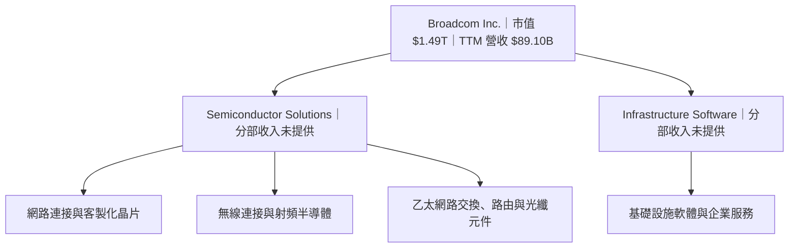
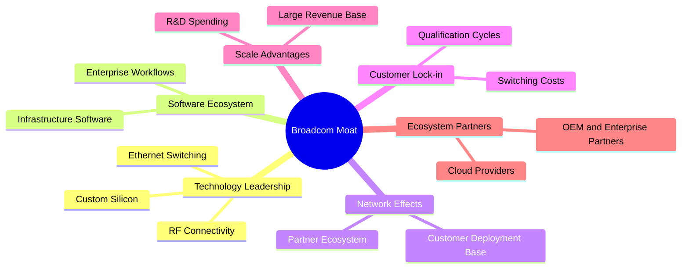
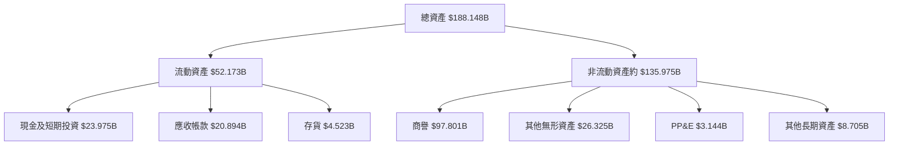
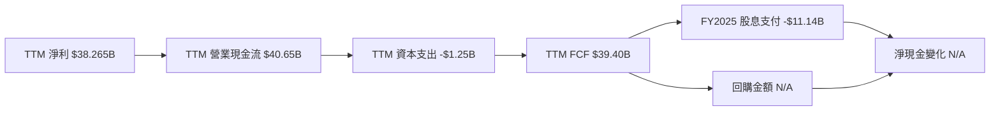
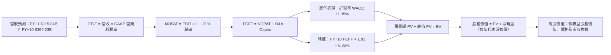
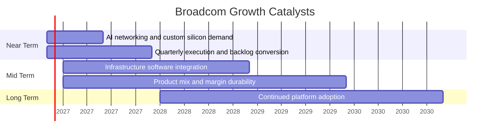
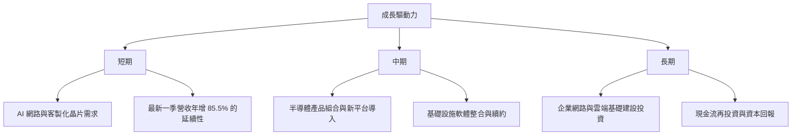
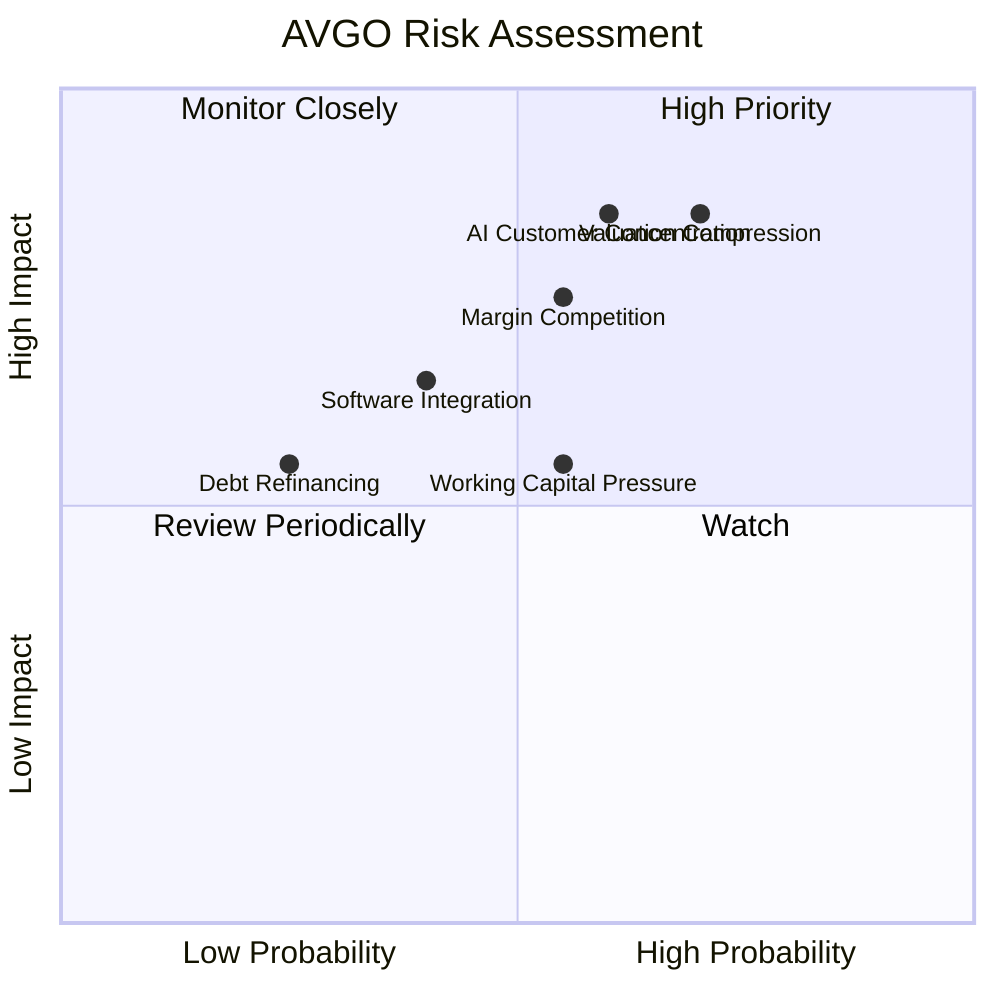
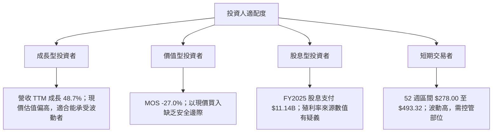

# AVGO 基本面深度分析報告
> **報告日期**：2026-11-28 ｜ **語言**：繁體中文 ｜ **數據來源**：SEC 申報資料 (XBRL)、Yahoo Finance、Finviz、StockAnalysis、Roic.ai ｜ **分析師**：CFA 級機構研究

## 目錄

| # | 章節 | 核心結論 |
|---|------|----------|
| 1 | 執行摘要 | 賣出；加權合理價值 $246.01，MOS -27.0% |
| 2 | 公司概覽與商業模式 | 半導體與基礎設施軟體雙業務；分部收入比例未提供 |
| 3 | 損益表深度分析 | TTM 營收 $89.10B、年增 48.7%；最新一季年增 85.5% |
| 4 | 資產負債表分析 | 淨負債 $35.44B；流動比率 2.504 |
| 5 | 現金流量深度分析 | TTM FCF $39.40B，FCF Yield 2.64% |
| 6 | 獲利能力與資本效率 | ROIC 30.0% 高於 WACC 11.35%，創造經濟價值 |
| 7 | 相對估值分析 | 估值高於多數同業與自身歷史中位數 |
| 8 | DCF 內在價值評估 | 基準 DCF $215.77；加權合理價值 $246.01 |
| 9 | 成長催化劑 | AI 網路與客製化晶片具成長可能；TAM 數據未提供 |
| 10 | 風險矩陣 | 估值、AI 訂單集中度與軟體整合風險最需追蹤 |
| 11 | 投資建議 | 賣出；待估值與營運指標改善後重新評估 |

---

## 1. 執行摘要

截至 **2026-11-27 收盤價 $312.34**，AVGO 的 TTM 營收為 $89.10B、年增 48.7%，最新一季營收年增 85.5%，TTM FCF 為 $39.40B；ROIC 30.0% 高於 WACC 11.35%。然而，估值交叉驗證後的加權合理價值為 $246.01，安全邊際 MOS 為 -27.0%，且基準 DCF 每股價值 $215.77，顯示現價高於估值基準。依 MOS 門檻，評級為**賣出**；此評級未作質化調整。

### 1.0 一頁式投資儀表板

| 項目 | 內容 |
|------|------|
| **投資論點（3 句）** | ① TTM 營收年增 48.7%、最新一季年增 85.5%，收入動能顯著加快。② TTM FCF $39.40B、ROIC 30.0%，現金創造與資本回報具支撐。③ 加權合理價值 $246.01 低於現價 $312.34，MOS -27.0%，估值是主要負面因素。 |
| **綜合評分** | **7.0/10**（引用 1.1 評分卡） |
| **財務健康** | 🟡 現金與短期投資 $23.98B，總債務 $59.42B，淨負債 $35.44B；流動比率 2.504。 |
| **ROIC vs WACC** | 30.0% vs 11.35%；利差 18.65 個百分點，創造股東價值。 |
| **FCF 趨勢** | TTM FCF $39.40B；FCF Yield 2.64%。 |
| **估值** | Forward P/E 16.16x ｜ EV/EBITDA 35.9x（自身歷史估值序列）｜ FCF Yield 2.64%。 |
| **DCF 內在價值（基準）** | $215.77 ｜現價相對 DCF 溢價 **44.7%**（現價 ÷ DCF 價值 − 1）。 |
| **安全邊際（MOS）** | **-27.0%**＝($246.01 − $312.34) ÷ $246.01；以 8.8 加權合理價值為基準。🔴 |
| **預期報酬（基準情境 12M）** | 以加權合理價值衡量，上行空間 **-21.2%**。 |
| **關鍵風險（前二）** | AI／客製化晶片成長與大客戶訂單集中；現價估值對成長延續要求高。 |
| **評級 + 信心度** | 🔴 **賣出** ｜信心：中（營運數據強，但估值與部分資料來源存在差異）。 |

### 1.1 綜合評分卡

| 維度 | 評分（1–10） | 主要依據（引用數字與其來源章節） |
|------|--------------|----------------------------------|
| 成長性 | 9.0 | TTM 營收年增 48.7%、最新一季年增 85.5%（第 3 章）。 |
| 獲利能力 | 9.0 | TTM 營業利益率 48.0%、ROIC 30.0%、Piotroski 7/8（第 3、6 章）。 |
| 財務健康 | 7.0 | 淨負債 $35.44B、流動比率 2.504、CCC 由 53 天升至 63 天（第 4 章）。 |
| 估值 | 2.0 | MOS -27.0%；P/E、P/S、EV/EBITDA 均高於自身歷史中位數（第 7、8 章）。 |
| 護城河 | 9.0 | TTM 營業利益率 48.0%、TTM FCF $39.40B；半導體與基礎設施軟體組合具客戶黏著特徵（第 2 章）。 |
| 管理層與資本配置 | 6.0 | FY2025 股息支付 $11.14B、SBC $7.57B；稀釋股數測試未通過（第 3、5、6 章）。 |
| **綜合評分** | **7.0** | 六項算術平均： (9 + 9 + 7 + 2 + 9 + 6) ÷ 6 = 7.0。 |

### 1.2 五大投資論點 + 三大核心風險

| 類型 | 項目 | 具體依據 | 信心度 |
|------|------|----------|--------|
| 🟢 **投資論點①** | AI 與網路需求帶動營收加速 | TTM 營收年增 48.7%；最新一季年增 85.5%。若需求延續，營收成長可支持高營業槓桿。 | 🟢 高 |
| 🟢 **投資論點②** | 現金流規模具支撐力 | TTM OCF $40.65B、Capex $1.25B、FCF $39.40B，FCF Yield 2.64%。 | 🟢 高 |
| 🟢 **投資論點③** | 資本回報高於資金成本 | ROIC 30.0% 對 WACC 11.35%，利差 18.65pp。 | 🟢 高 |
| 🟢 **投資論點④** | 半導體與軟體組合分散部分收入來源 | 公司經營 Semiconductor Solutions 與 Infrastructure Software；各分部營收比例未提供，無法量化分散效果。 | 🟡 中 |
| 🟢 **投資論點⑤** | 資產負債表有充足流動性緩衝 | 現金及短期投資 $23.98B、流動比率 2.504；但淨負債仍為 $35.44B。 | 🟡 中 |
| 🟡 **風險①** | 高估值對成長不及預期敏感 | 加權合理價值 $246.01，低於現價 $312.34；DCF 基準 $215.77。 | 🔴 高衝擊 |
| 🔴 **風險②** | AI／客製化晶片訂單集中與客戶變更 | 新聞資訊提及 Google 晶片訂單削減的市場議題；具體訂單金額與營收占比未提供，須觀察後續季度數字。 | 🟡 中 |
| 🟡 **風險③** | 股權薪酬與股數稀釋 | FY2025 SBC $7.57B，Piotroski 稀釋股數測試未通過；SBC 會稀釋每股價值。 | 🟡 中 |

### 1.3 快速統計卡片

| 指標 | 公司實際值（期間） | 同業中位數 | 狀態 |
|------|--------------------|------------|------|
| 營收成長（TTM） | **48.7%** | — | 🟢 |
| 營收成長（最新一季年增） | **85.5%** | 36.5% | 🟢 |
| 毛利率（TTM） | **75.5%** | 53.1% | 🟢 |
| 營業利益率（TTM） | **48.0%** | — | 🟢 |
| ROIC（TTM） | **30.0%** | — | 🟢 |
| Forward P/E | **16.16x** | 14.7x | 🟡 |
| FCF Yield（TTM） | **2.64%** | — | 🟡 |
| Piotroski F-Score | **7 / 8** | — | 🟢 |

> 同業中位數按 NVDA、MRVL、QCOM 的 Peer multiples 計算；同業 Forward P/E 中位數為 14.7x，最新一季營收成長中位數為 36.5%，TTM 毛利率中位數為 53.1%。

### 1.4 投資結論

```text
╔══════════════════════════════════════════════════════════════════╗
║                    📊 投資結論摘要                               ║
╠══════════════════════════════════════════════════════════════════╣
║  評級：賣出（MOS -27.0%，符合 MOS < -25% 門檻）                 ║
║  價格（2026-11-27 收盤）：$312.34                               ║
║  DCF 內在價值（基準）：$215.77（現價溢價 44.7%）                ║
║  安全邊際 MOS：-27.0%（以加權合理價值 $246.01 為基準）          ║
║  加權合理價值（8.8）：$246.01                                   ║
║  DCF 情境價值：                                                 ║
║    悲觀情境：$88.94（相對現價 -71.5%）                          ║
║    基準情境：$215.77（相對現價 -30.9%）                         ║
║    樂觀情境：$476.76（相對現價 +52.6%）                         ║
║  綜合評分：7.0/10（引用 1.1）                                   ║
║  適合投資人：已持有且能承受波動者可追蹤；不適合以現價追價者      ║
╚══════════════════════════════════════════════════════════════════╝
```

---

## 2. 公司概覽與商業模式

### 2.1 業務結構與收入來源

Broadcom 提供半導體裝置及基礎設施軟體，主要分為 Semiconductor Solutions 與 Infrastructure Software。分部營收及占比未提供，因此不推估各業務收入比例。



### 2.2 市場份額

市場份額的可引用數字與年份未提供，因此不製作市占圖表。可觀察到 AVGO TTM 營收 $89.10B、最新一季成長 85.5%；Peer data 顯示 NVDA 同期營收年增 103.2%、MRVL 36.5%，AVGO 的單季成長位於兩者之間。

### 2.3 競爭護城河分析



以上護城河屬質化分析；市場份額與客戶留存率等直接量化證據未提供。FY2025 研發費用 $10.98B，顯示持續投入技術與產品開發；但不能單憑研發規模推定市占或競爭優勢必然維持。

### 2.4 護城河強度

| 護城河項目 | 強度 | 證據 | 會削弱它的情況 |
|------------|------|------|----------------|
| 技術與產品組合 | 強 | 半導體產品涵蓋客製化晶片、乙太網路與無線連接；FY2025 研發費用 $10.98B。 | 大客戶自行設計、替代方案性能或成本改善。 |
| 軟體生態系統 | 中至強 | 公司設有 Infrastructure Software 業務；分部營收與續約率未提供。 | 客戶削減 IT 支出、整合成效不佳或競品替換。 |
| 客戶鎖定 | 中 | 半導體平台導入及企業軟體轉換通常涉及驗證與遷移；客戶留存率資料未提供。 | 客戶集中、採購轉向或主要專案取消。 |
| 規模效應 | 強 | TTM 營收 $89.10B、TTM FCF $39.40B。 | 收購後整合成本、研發回報降低或價格競爭加劇。 |
| 網路效應與生態夥伴 | 中 | 產品需融入客戶與合作夥伴系統；量化網路效應資料未提供。 | 雲端客戶平台封閉化或供應鏈替代。 |

**1.1 護城河評分 9.0/10**，依據是收入規模、現金流與跨半導體及基礎設施軟體的產品布局；但客戶留存、分部收入及市場份額缺乏數字佐證。

---

## 3. 損益表深度分析

### 3.1 年度收入成長趨勢（近 4 年）

```text
╔══════════════════════════════════════════════════════════════════╗
║              Broadcom 年度收入趨勢（FY2022-FY2025）              ║
╠══════════════════════════════════════════════════════════════════╣
║  FY2022  $33.20B  ███████████░░░░░░░░░░░░░  YoY:  —             ║
║  FY2023  $35.82B  ████████████░░░░░░░░░░░░  YoY: +7.9%          ║
║  FY2024  $51.57B  █████████████████░░░░░░░  YoY: +44.0%         ║
║  FY2025  $63.89B  █████████████████████░░░  YoY: +23.9%         ║
╠══════════════════════════════════════════════════════════════════╣
║  FY2022-FY2025 收入 CAGR：約 24.4%                               ║
╚══════════════════════════════════════════════════════════════════╝
```

FY2025 收入 $63.89B，較 FY2022 的 $33.20B 增長約 92.4%；三年 CAGR 約 24.4%。年度成長在 FY2024 加速至 44.0%，FY2025 回落至 23.9%，但 TTM 成長再升至 48.7%，顯示最近期間需求及併購／產品組合等因素帶動的成長較年度歷史更快。分項貢獻未提供，不能把加速完全歸因於單一產品線。

### 3.2 季度收入趨勢分析

季度資料以 StockAnalysis 的期間列示；QoQ 為依季度收入計算，YoY 直接引用最新季度年增序列。

| 季度 | 營收（$B） | QoQ | YoY | 備註 |
|------|------------:|----:|----:|------|
| FY2025 Q4 | 18.015 | 6.8% | 28.18% | QoQ 對 FY2025 Q3。 |
| FY2026 Q1 | 19.311 | 7.2% | 29.47% | YoY 與季度資料列相符。 |
| FY2026 Q2 | 22.187 | 14.9% | 47.87% | 成長加速。 |
| FY2026 Q3 | 29.591 | 33.4% | 85.50% | 單季年增率，不是 TTM 成長率。 |

最新一季營收比前一季增加 $7.404B。成長加速對利潤率有利，但若高成長來自少數客戶或短期供應節奏，季度年增率可能有較大波動。

### 3.3 利潤率演變分析

年度歷史損益表的 FY2025、FY2024、FY2023、FY2022 毛利與營業利益數字，與另一來源 StockAnalysis 的 TTM／年度數列存在差異；下表依同一組年度損益表列示計算，TTM 指標另引用明確列示數值。

| 利潤率指標 | FY2022 | FY2023 | FY2024 | FY2025 | 趨勢 | 評估 |
|------------|-------:|-------:|-------:|-------:|------|------|
| **毛利率** | 66.5% | 68.9% | 63.0% | 67.8% | 年度資料波動；TTM 為 75.5% | 🟢 |
| **營業利益率** | 43.0% | 45.9% | 29.1% | 40.8% | FY2024 下滑後回升；TTM 為 48.0% | 🟢 |
| **淨利率** | 34.6% | 39.3% | 11.4% | 36.2% | FY2024 淨利異常低，FY2025 回升 | 🟡 |

年度淨利 FY2024 為 $5.89B、FY2025 為 $23.13B，變化幅度大；目前資料不足以拆分有效稅率、無形資產攤銷、一次性項目或其他調節項目。TTM 毛利率 75.5% 與年度報表計算值差異明顯，可能涉及期間或來源口徑不同，不宜混用。TTM 營業利益率採官方驗證數值 48.0%。

### 3.4 費用結構分析

費用項目在不同來源、期間與口徑間有差異，且年度列示的毛利與營業利益數字在部分年度不具一致性；因此不以不完整數據繪製費用占比圓餅圖。FY2025 研發費用為 $10.98B，約為同年度營收 $63.89B 的 17.2%；這代表公司持續投入研發，但費用明細不足以推算其他營運費用占比。

### 3.5 季度 EPS 趨勢與盈餘品質（Quality of Earnings）

| 季度 | EPS 實際值 | EPS 預估值 | 超預期／不及預期 |
|------|------------:|-----------:|------------------|
| 2026-07-31 | $2.75 | N/A | N/A：估值預期未提供 |
| 2026-04-30 | $1.96 | N/A | N/A：估值預期未提供 |
| 2026-01-31 | $1.55 | N/A | N/A：估值預期未提供 |
| 2025-10-31 | $1.80 | N/A | N/A：估值預期未提供 |

Earnings History 的四季 EPS Est 均為缺值，因此無法判斷超預期或不及預期；不能以「收入成長」代替盈餘預期差分析。

| 盈餘品質項目 | 數值／佔比 | 評估 |
|--------------|------------|------|
| 股權薪酬 SBC / 營收 | FY2025：$7.57B ÷ $63.887B = **11.9%** | 🟡 SBC 是重要股東成本；若持續高於營收成長，會稀釋每股經濟利益。 |
| SBC / 營業現金流 | FY2025：$7.57B ÷ $27.54B = **27.5%** | 🟡 比重不低；雖為非現金費用，仍需視為股權稀釋成本。 |
| FCF / 淨利（現金轉換率） | TTM：$39.40B ÷ $38.265B = **103.0%** | 🟢 現金流略高於淨利，現金轉換良好。 |
| 一次性／非經常性損益 | N/A（無完整調節表） | 不能確定收購會計、稅務或其他一次性項目對年度淨利的影響。 |
| 有效稅率異常 | N/A（有效稅率實際序列未提供） | DCF 使用 21.0% 標準假設，不等同實際 TTM 稅率。 |
| 資本化支出 vs 費用化 | TTM Capex $1.25B；資本化政策細節 N/A | Capex 占營收約 1.4%，但無法只依此判定是否存在成本資本化或費用遞延。 |

**盈餘品質結論：** TTM FCF 高於淨利，支持獲利具現金含量；然而 FY2025 SBC 達營收 11.9%，股東報酬需扣除稀釋影響。年度淨利波動與有效稅率調節資料不足，估值應優先看持續性 FCF，而非單年 GAAP EPS。

---

## 4. 資產負債表分析

### 4.1 資產結構分解

以下採最新 TTM 資產負債表數據，總資產 $188.148B；流動資產 $52.173B、商譽 $97.801B、其他無形資產 $26.325B、PP&E $3.144B、其他長期資產 $8.705B。各列可能因四捨五入或分類而有差異。



商譽與無形資產規模較大，意味收購相關資產及其減損風險值得持續監控；但現有資料不足以拆分商譽所對應的收購標的與現金產生單位。

### 4.2 流動性與營運資金分析

| 指標 | 最新 TTM | 一年前 TTM | 變化 | 解讀 |
|------|----------|------------|------|------|
| 流動比率 | 2.504 | N/A | N/A | 流動資產相對流動負債具緩衝；歷史可比值未列入品質指標。 |
| DSO 應收帳款天數 | 56 天 | 40 天 | +16 天 | 收款週期變長；需確認是否與營收快速放量、客戶付款條件或應收款品質有關。 |
| DIO 存貨天數 | 59 天 | 40 天 | +19 天 | 庫存天數增加；若需求放緩，需注意庫存去化及存貨跌價風險。 |
| DPO 應付帳款天數 | 52 天 | 26 天 | +26 天 | 付款週期延長可能提供營運資金支持，但其原因及供應商條件未提供。 |
| CCC 現金轉換週期 | 63 天 | 53 天 | +10 天 | 即使 DPO 增加，DSO、DIO 上升仍使現金週期變長。 |

### 4.3 債務結構分析

```text
╔══════════════════════════════════════════════════════════════════╗
║                   Broadcom 債務健康診斷                          ║
╠══════════════════════════════════════════════════════════════════╣
║  總債務：       $59.42B   ████████████████████  🟡              ║
║  現金及短期投資：$23.98B   ████████░░░░░░░░░░░░  🟢              ║
║  淨負債：       $35.44B   ████████████░░░░░░░░  🟡              ║
║                                                                  ║
║  流動比率：     2.504     🟢                                      ║
║  Debt/EBITDA：  N/A（口徑與同期間 EBITDA 未提供一致數字）         ║
║  利息保障倍數： N/A（利息費用與營業利益同期間資料未提供）         ║
╚══════════════════════════════════════════════════════════════════╝
```

淨負債是資產負債表主要限制，但相對於 TTM OCF $40.65B，具備持續償債與降槓桿能力的現金流基礎。未提供債務到期表與利息覆蓋資料，無法分析再融資風險分布。

### 4.4 股東權益趨勢

```text
╔══════════════════════════════════════════════════════════════════╗
║                Broadcom 歷年股東權益變化                         ║
╠══════════════════════════════════════════════════════════════════╣
║  FY2022  $22.71B  ██████░░░░░░░░░░░░░░░░░░░░                   ║
║  FY2023  $23.99B  ██████░░░░░░░░░░░░░░░░░░░░                   ║
║  FY2024  $67.68B  ██████████████████░░░░░░░░                   ║
║  FY2025  $81.29B  ██████████████████████░░░░                   ║
╚══════════════════════════════════════════════════════════════════╝
```

FY2024 權益較 FY2023 明顯增加，與資產負債表規模擴大同期出現；現有資料不足以逐項分解收購、股權發行、留存盈餘及其他權益變動來源。

---

## 5. 現金流量深度分析

### 5.1 現金流量瀑布圖



FY2025 股息支付是年度數字，與 TTM 現金流期間不同，故圖中僅作資本配置參考，不作同期間現金流勾稽。回購金額與淨現金變化資料未提供。

### 5.2 FCF 轉換率趨勢

| 財年 | FCF（$B） | 淨利（$B） | FCF／淨利 | 解讀 |
|------|----------:|-----------:|----------:|------|
| FY2023 | 17.63 | 14.08 | 125.2% | FCF 高於淨利。 |
| FY2024 | 19.41 | 5.89 | 329.5% | 淨利基數異常低，轉換率不宜解讀為常態。 |
| FY2025 | 26.91 | 23.13 | 116.3% | 現金轉換高於 100%。 |
| TTM 至 2026-08-02 | 39.40 | 38.265 | 103.0% | 以相同 TTM 指標比較，轉換仍具支持。 |

### 5.3 自由現金流趨勢

```text
╔══════════════════════════════════════════════════════════════════╗
║                   自由現金流歷史趨勢                             ║
╠══════════════════════════════════════════════════════════════════╣
║  FY2023  $17.63B  █████████░░░░░░░░░░░░░░░  FCF Yield：N/A      ║
║  FY2024  $19.41B  ██████████░░░░░░░░░░░░░░  FCF Yield：N/A      ║
║  FY2025  $26.91B  ██████████████░░░░░░░░░░  FCF Yield：N/A      ║
║  TTM     $39.40B  ████████████████████░░░░  FCF Yield：2.64%    ║
╚══════════════════════════════════════════════════════════════════╝
```

年度 FCF 從 FY2023 的 $17.63B 增至 FY2025 的 $26.91B，兩年 CAGR 約 23.6%。TTM FCF 擴大至 $39.40B，代表現金生成加速；但估值仍反映市場對此增長可持續性的高度期待。

### 5.4 資本配置評估

| 配置項目 | 已知數據 | 評估 |
|----------|----------|------|
| 股息 | FY2025 支付 $11.14B | 約占 FY2025 FCF $26.91B 的 41.4%；期間一致度可比，但仍需保留投資與降債能力。 |
| 回購 | N/A | 回購金額未提供，不作估計。 |
| 資本支出 | TTM $1.25B | 相對 TTM 營收約 1.4%；資本密集程度較低，但不能據此判斷完整再投資需求。 |
| 研發投入 | FY2025 $10.98B | 對維持產品能力重要；後續應追蹤研發投入與產品收入增量。 |
| 留存與降債 | N/A | 未提供同期間現金用途明細。 |

股息收益率資料源列示 86.0%，但此數字與股息支付、公司股價及 32.4% payout ratio 等資料顯著不一致，可能存在欄位或小數點錯誤，本報告不將 86.0% 當作可依賴的現金殖利率。

---

## 6. 獲利能力與資本效率

### 6.1 ROE / ROA / ROIC 趨勢

| 指標 | 最新可用數值 | 歷史趨勢／限制 | 評估 |
|------|--------------:|----------------|------|
| ROE | 38.4%（品質指標口徑） | 另一來源列示 44.2%；口徑或期間差異，採品質指標口徑作 DuPont | 🟢 |
| ROA | 15.4% | 兩期比較的完整年度序列未提供 | 🟢 |
| ROIC | 30.0%（TTM） | 歷史完整可比序列未提供 | 🟢 |
| 行業均值比較 | N/A | 無可引用、同口徑的同業 ROIC／ROE／ROA 數據 | N/A |

### 6.2 ROIC vs WACC 分析（核心價值創造判斷）

```text
╔══════════════════════════════════════════════════════════════════╗
║                ROIC vs WACC 深度分析                             ║
╠══════════════════════════════════════════════════════════════════╣
║  WACC（採用程式計算值）：11.35%                                  ║
║  ├── 無風險利率 Rf（10Y 美債）：4.94%                            ║
║  ├── 市場風險溢酬 ERP：5.00%                                     ║
║  ├── 原始 Beta：1.51；調整後 Beta：1.34                          ║
║  ├── 股權成本 Ke（來源列示）：11.63%                             ║
║  ├── 稅前債務成本：5.40%；稅率：21.0%                            ║
║  ├── 股權／債務權重：96.2%／3.8%                                 ║
║  └── ✅ WACC：11.35%                                             ║
║                                                                  ║
║  ROIC（TTM）：30.0%                                               ║
║  EVA 利差 = ROIC − WACC = 30.0% − 11.35% = +18.65pp              ║
║                                                                  ║
║  ROIC 30.0%  ▓▓▓▓▓▓▓▓▓▓▓▓▓▓▓▓▓▓▓▓▓▓▓▓▓▓▓▓░░░░  🟢              ║
║  WACC 11.35% ▓▓▓▓▓▓▓▓▓▓▓░░░░░░░░░░░░░░░░░░░░░  ──              ║
║  結論：ROIC 約為 WACC 的 2.64 倍，創造股東價值                  ║
╚══════════════════════════════════════════════════════════════════╝
```

計算：30.0% ÷ 11.35% = 2.64 倍。此利差顯示目前投入資本回報高於資金成本；若未來 AI 業務競爭導致毛利或資本回報下降，經濟利差會收窄。WACC 各組成依第 8.2 節詳列。

### 6.3 杜邦三因素分解

| 因素 | 數值（TTM） | 解讀 |
|------|-------------|------|
| 淨利率 | 42.9% | 高淨利率為 ROE 的主要來源之一。 |
| 資產週轉率 | 0.47 | 相對較低的資產周轉，與商譽及無形資產規模較大一致。 |
| 權益乘數 | 1.89 | 槓桿對 ROE 有貢獻，但並非唯一驅動因素。 |
| **ROE** | **38.4%** | 42.9% × 0.47 × 1.89 = 38.2%，與列示 38.4% 有四捨五入差異。 |

### 6.4 財務體質：Piotroski F-Score

Piotroski F-Score 為 **7/8**；一項缺乏輸入而未納入分母，故並非 9 項滿分制度下的 7/9。

| 測試 | 結果 | 解讀 |
|------|------|------|
| ROA > 0 | ✅ 通過 | TTM 資產報酬為正。 |
| 營業現金流 > 0 | ✅ 通過 | TTM OCF $40.65B。 |
| ROA 高於一年前 | ✅ 通過 | 獲利能力改善。 |
| 營業現金流 > 淨利 | ✅ 通過 | 現金流高於淨利，應計品質偏正面。 |
| 長期負債 ÷ 總資產低於一年前 | — 無法判定 | 缺少比較輸入，未納入分母。 |
| 流動比率高於一年前 | ✅ 通過 | 流動性指標改善。 |
| 稀釋股數未增加 | ❌ 未通過 | 股數增加會稀釋每股盈餘與每股價值。 |
| 毛利率高於一年前 | ✅ 通過 | 毛利率改善。 |
| 資產週轉率高於一年前 | ✅ 通過 | 資產使用效率改善。 |

---

## 7. 相對估值分析

### 7.1 同業估值比較表格

| 估值指標 | **AVGO** | **NVDA** | **MRVL** | **QCOM** | AVGO 評估 |
|----------|---------:|---------:|---------:|---------:|-----------|
| **Trailing P/E** | 39.8x | 16.2x | 46.2x | 14.1x | 🟡 高於兩家、低於 MRVL。 |
| **Forward P/E** | 16.16x | 9.1x | 19.0x | 14.7x | 🟡 高於同業中位數 14.7x。 |
| **P/S Ratio** | 17.1x | 10.0x | 13.4x | 4.4x | 🔴 高於三家同業。 |
| **EV/EBITDA** | 35.9x | 14.7x | 43.7x | 18.8x | 🔴 高於同業中位數 18.8x。 |
| **最新一季營收年增** | 85.5% | 103.2% | 36.5% | -8.4% | 🟢 高於 MRVL、QCOM，低於 NVDA。 |
| **毛利率（TTM）** | 75.5% | 74.9% | 52.2% | 53.1% | 🟢 略高於 NVDA，明顯高於 MRVL、QCOM。 |

自身 P/E、P/S 與 EV/EBITDA 的歷史估值區塊與市場估值欄位的倍數存在差異；本節用於同業比較的 AVGO 倍數，優先採用與 Peer multiples 同一估值區塊的數值。

### 7.2 歷史估值區間分析

```text
╔══════════════════════════════════════════════════════════════════╗
║               AVGO 自身 5 年估值區間                             ║
╠══════════════════════════════════════════════════════════════════╣
║ P/E        1.8x ├────────── 5.5x 中位數 ───────────────● 39.8x  ║
║                                                   百分位：70%     ║
║ P/S        0.6x ├────── 1.5x 中位數 ───────────────────● 17.1x  ║
║                                                   百分位：65%     ║
║ EV/EBITDA  0.5x ├───── 5.6x 中位數 ───────────────● 35.9x       ║
║                                                   百分位：55%     ║
╚══════════════════════════════════════════════════════════════════╝
```

當前 P/E、P/S、EV/EBITDA 的歷史百分位分別為 70%、65%、55%；三者均高於自身 5 年中位數。極端低的歷史中位數可能受歷史獲利或期間口徑影響，故不宜把歷史中位數直接視為合理估值目標；但當前估值位置仍顯示市場已反映相當程度成長預期。

### 7.3 情境價值（Bear / Base / Bull）

| 情境 | 第 1 年營收成長 | 期末營業利潤率 | WACC | 每股價值 | 相對現價 | 機率 | 會發生的條件 |
|------|----------------|----------------|------|----------|----------|------|--------------|
| 🔴 悲觀 | 15.0% | 36.4% | 12.35% | $88.94 | -71.5% | 25% | AI 需求降溫、客戶調整訂單、利潤率向下收斂且風險溢酬上升。 |
| 🟡 基準 | 30.0% | 42.8% | 11.35% | $215.77 | -30.9% | 50% | 營收增長逐年減速，利潤率按模型逐步下滑。 |
| 🟢 樂觀 | 45.0% | 47.1% | 10.35% | $476.76 | +52.6% | 25% | AI 客製化晶片與網路需求高於基準，且利潤率維持高檔、折現率下降。 |

### 7.4 相對估值隱含價格區間

```text
╔══════════════════════════════════════════════════════════════════╗
║                 估值方法隱含每股價值                             ║
╠══════════════════════════════════════════════════════════════════╣
║ $145.08 ── $215.77 ── $284.42 ── 現價 $312.34 ── $523.28        ║
║ EV/EBITDA     DCF       Forward P/E      ▲        分析師共識     ║
╚══════════════════════════════════════════════════════════════════╝
```

| 方法 | 每股價值 | 依據 |
|------|---------:|------|
| DCF（基準） | $215.77 | 10 年 FCFF、WACC 11.35%、永續成長率 3.0%。 |
| 同業 Forward P/E | $284.42 | 同業中位數 14.7x × AVGO Forward EPS $19.33。 |
| 同業 EV/EBITDA | $145.08 | 同業中位數 16.8x（NVDA、QCOM）× TTM EBITDA，再加淨現金／扣除淨負債。 |
| 分析師共識 | $523.28 | 47 位分析師平均目標價，作參考而非基本面模型。 |

---

## 8. DCF 內在價值評估（Discounted Cash Flow）

### 8.0 估值推理鏈（Thinking Logic）

**核心命題：** AVGO 的模型價值主要來自現有半導體及基礎設施軟體的現金流底盤，並受 AI 網路與客製化晶片的額外成長推動。公司整體 TTM 營收 $89.10B，但分部占比未提供，不能把營收拆成可核驗的個別業務估值。模型中最主導估值的變數是折現率與長期現金流／終值假設；敏感度表顯示 WACC 每上升 1pp，基準 g 下每股價值由 $215.77 降至 $188.85。

| 決策點 | 本報告採用 | 理由 | 曾考慮但否決 | 否決理由 |
|--------|-----------|------|--------------|----------|
| 現金流定義 | FCFF | 與 WACC 折現並先求 EV，模型已固定此定義。 | FCFE | 模型採企業現金流口徑。 |
| 預測期 N | 10 年 | DCF 模型預先設定；以營收成長由 30% 衰減至 3% 描述長期成熟化。 | 5 年 | 會改變模型既定期間，不可自行替換。 |
| 終值方法 | Gordon Growth | 模型以永續成長率 3.0% 計算。 | 退出倍數主法 | 模型未提供退出倍數估值，不能自行補建。 |
| EBIT 基礎 | GAAP EBIT | DCF 明確採 GAAP EBIT，SBC 已在費用中。 | 非 GAAP | 會造成費用口徑與模型不同。 |

**高／中敏感度輸入的推導鏈：**

- **營收成長：**錨點＝TTM 營收成長 48.7%、最新一季年增 85.5%；調整＝最新單季增速可能不可持續，且模型限制最高年成長 30%；**採用 FY+1 成長 30%，之後線性降至 FY+10 的 3%**；否決 48.7% 持續十年，因其忽略基期變大及成長正常化。
- **期末營業利潤率：**錨點＝TTM 營業利益率 48.0%；調整＝成熟期競爭與收入組合變化可能壓低利潤率；**採用 FY+10 42.8%**；否決永久維持 48.0%，因模型依過去五年中位數收斂。
- **永續成長率 g：**錨點＝模型採用長期 3.0%；調整＝以長期成熟企業仍可維持名目成長作為假設；**採用 3.0%，低於 WACC 11.35%**；否決更高永續成長率，因估值會更依賴遠期現金流，且長期成長不能無限制高於經濟成長。
- **預測期 N：**錨點＝模型固定 10 年；調整＝用十年期逐步淡化成長與營業利潤率；**採用 10 年**；否決縮短預測期，因無法照抄既定 DCF 模型。
- **Capex／營收：**錨點＝TTM Capex $1.25B ÷ TTM 營收 $89.10B 約 1.4%；**採用 FY+1 1.4% 逐步降至 FY+10 0.8%**；否決長期固定 1.4%，模型假設成熟後資本支出比率回落。
- **EBIT 基礎與 SBC：**錨點＝模型指定 GAAP EBIT；調整＝SBC 不額外扣一次、股數不再放大；**採用組合 (A)**；否決再扣 SBC 或再加稀釋，避免同一股權成本重複計算。
- **年稀釋率：**採用模型指定固定股數、年稀釋率 0%；錨點是組合 (A) 的 SBC 已反映在 GAAP EBIT；不採用額外股數放大，否則會重複計入模型未採用的股數稀釋。
- **終值方法：**錨點＝模型提供 Gordon Growth；採用此法以反映永續現金流；不另加退出倍數，因模型未給該倍數及其依據。
- **WACC：**錨點＝成本資本區塊列示 11.35%；採用原值；不另建 WACC，以避免與模型折現率不一致。

**最脆弱環節：**未來營收能否由 FY+1 的 30% 起步並逐年衰減至 3%，以及高營業利潤率能否維持；任一假設走弱，都可能令價值低於基準 DCF $215.77，悲觀情境模型值為 $88.94。



### 8.1 模型假設總表（Model Inputs）

| 假設項目 | 採用值 | 依據／來源 | 敏感度 |
|----------|--------|-------------|--------|
| 預測期長度 N | 10 年 | DCF 模型固定期間。 | 🟡 中 |
| 營收成長 | FY+1 30.0%，線性降至 FY+10 3.0% | TTM 成長 48.7%；模型將初始成長限制在 30%。 | 🔴 高 |
| 營業利潤率 | FY+1 48.0% → FY+10 42.8% | 起點為 TTM 48.0%；終點為近五財年中位數，含 TTM。 | 🔴 高 |
| 有效稅率 | 21.0% | 模型預設值；非實際有效稅率序列。 | 🟢 低 |
| Capex／營收 | FY+1 1.4% → FY+10 0.8% | TTM 約 1.4%，模型逐步淡化至 D&A 的 1.1 倍規則所設值。 | 🟡 中 |
| D&A／營收 | 0.7% | TTM 比率，固定。 | 🟢 低 |
| 營運資金變動 | 未建模 | DCF 模型明示 Working capital is not modelled。 | — |
| EBIT 基礎 | GAAP EBIT | 模型採 GAAP 營業利益。 | 🟡 中 |
| SBC 處理 | 組合 (A)：GAAP EBIT、不再扣 SBC、固定股數 | SBC 已含於 GAAP EBIT；不重複扣除。 | 🟡 中 |
| 年稀釋率 | 0%（模型固定股數） | 組合 (A) 的模型約定；不同於公司實際股數變動。 | 🟡 中 |
| 永續成長率 g | 3.0% | DCF 模型固定值；低於 WACC。 | 🔴 高 |
| 終值方法 | Gordon Growth | DCF 模型給定。 | 🔴 高 |
| WACC | 11.35% | 成本資本輸入；第 8.2 節列示組成。 | 🔴 高 |

本模型使用 FCFF = NOPAT + D&A − Capex；**營運資金變動未建模**。採用組合 **(A)**，因此 SBC 影響已計入一次，模型不再另扣 SBC，也不再按年放大股數。

### 8.2 折現率推導（WACC）

```text
╔══════════════════════════════════════════════════════════════════╗
║                    WACC 推導（折現率）                           ║
╠══════════════════════════════════════════════════════════════════╣
║  股權成本 Ke（CAPM）：                                           ║
║  ├── 無風險利率 Rf（10Y 美債）：4.94%                            ║
║  ├── 市場風險溢酬 ERP：5.00%                                     ║
║  ├── 原始 Beta：1.51；調整後 Beta：1.34                          ║
║  ├── Beta 調整：⅔ × 1.51 + ⅓ × 1 = 1.34                         ║
║  ├── 規模／國別溢酬：0.00%（未另加）                             ║
║  └── Ke（區塊列示）= 11.63%                                      ║
║                                                                  ║
║  債務成本 Kd：                                                    ║
║  ├── 稅前 Kd：5.40%                                              ║
║  ├── 稅率：21.0%                                                 ║
║  └── 稅後 Kd = 5.40% × (1 − 21.0%) = 4.266%                     ║
║                                                                  ║
║  資本結構權重：                                                   ║
║  ├── 股權權重 E：96.2%                                           ║
║  ├── 債務權重 D：3.8%                                            ║
║  └── WACC = 96.2% × 11.63% + 3.8% × 4.266% = 11.35%             ║
╚══════════════════════════════════════════════════════════════════╝
```

**逐步演算：**

1. **Ke（CAPM）**：Rf + β × ERP = 4.94% + 1.34 × 5.00% = 11.64%。成本資本資料列示 Ke 為 11.63%；因輸入只提供兩位小數，存在 0.01 個百分點的四捨五入差異，後續依規則採用區塊 Ke 11.63%。
2. **稅前 Kd**：採用程式計算值 **5.40%**。利息費用及與 Kd 完全一致的平均計息負債明細未提供，故不可用缺漏項目重新反推。
3. **稅後 Kd**：5.40% × (1 − 21.0%) = **4.266%**。
4. **權重**：採用成本資本區塊權重 E = **96.2%**、D = **3.8%**；96.2% + 3.8% = **100.0%**。市值與期末計息負債的完整組成未提供，因此沿用原權重而不重算。
5. **WACC**：96.2% × 11.63% + 3.8% × 4.266% = 11.1861% + 0.1621% = **11.3482% ≈ 11.35%**。

10Y 殖利率的具體觀察日未提供，因此按來源列示值 4.94% 採用；ERP 5.00% 為假設輸入。Beta 採用調整後 1.34，而非原始 1.51。WACC 與第 6.2 節一致，均為 11.35%。

### 8.3 逐年自由現金流預測（基準情境）

| 年度 | 成長 | 營收 | 利潤率 | EBIT | 稅 | NOPAT | D&A | Capex | FCFF | 折現因子 | PV |
|------|------:|------:|-------:|-----:|---:|------:|----:|------:|-----:|---------:|---:|
| FY+1 | 30.0% | 115.84 | 48.0% | 55.66 | 11.69 | 43.97 | 0.82 | 1.62 | 43.17 | 0.898 | 38.77 |
| FY+2 | 27.0% | 147.11 | 47.5% | 69.83 | 14.67 | 55.17 | 1.04 | 1.96 | 54.25 | 0.807 | 43.76 |
| FY+3 | 24.0% | 182.42 | 46.9% | 85.54 | 17.96 | 67.58 | 1.29 | 2.31 | 66.56 | 0.724 | 48.22 |
| FY+4 | 21.0% | 220.72 | 46.3% | 102.23 | 21.47 | 80.76 | 1.57 | 2.64 | 79.69 | 0.651 | 51.84 |
| FY+5 | 18.0% | 260.46 | 45.7% | 119.12 | 25.02 | 94.10 | 1.85 | 2.93 | 93.02 | 0.584 | 54.35 |
| FY+6 | 15.0% | 299.52 | 45.2% | 135.26 | 28.40 | 106.85 | 2.12 | 3.17 | 105.81 | 0.525 | 55.52 |
| FY+7 | 12.0% | 335.47 | 44.6% | 149.54 | 31.40 | 118.14 | 2.38 | 3.31 | 117.21 | 0.471 | 55.23 |
| FY+8 | 9.0% | 365.66 | 44.0% | 160.89 | 33.79 | 127.10 | 2.59 | 3.36 | 126.34 | 0.423 | 53.47 |
| FY+9 | 6.0% | 387.60 | 43.4% | 168.30 | 35.34 | 132.96 | 2.75 | 3.29 | 132.41 | 0.380 | 50.33 |
| FY+10 | 3.0% | 399.23 | 42.8% | 171.04 | 35.92 | 135.12 | 2.83 | 3.11 | 134.84 | 0.341 | 46.03 |

金額取至 $0.01B；比率依來源列示；折現因子三位小數。預測期 PV 加總：

**$38.77 + $43.76 + $48.22 + $51.84 + $54.35 + $55.52 + $55.23 + $53.47 + $50.33 + $46.03 = $497.52B**

模型列示合計為 **$497.51B**；與逐項四捨五入後加總差 $0.01B，為尾差。

**FY+1 逐步演算：**

1. 營收 = $89.10B × (1 + 30.0%) = $115.83B；模型列示 **$115.84B**，差異為輸入精度與四捨五入。
2. EBIT = $115.84B × 48.0% = $55.60B；模型列示 **$55.66B**。此差異顯示模型以未顯示的高精度輸入計算；依要求照抄模型數值，不以顯示精度重算替換。
3. 稅 = EBIT × 21.0%；模型列示 **$11.69B**。
4. NOPAT = EBIT − 稅；模型列示 **$43.97B**。
5. D&A = 營收 × 模型 D&A 比率；模型列示 **$0.82B**。
6. Capex = 營收 × 模型 Capex 比率；模型列示 **$1.62B**。
7. ΔWC = **未建模**。
8. FCFF = NOPAT + D&A − Capex = $43.97B + $0.82B − $1.62B = **$43.17B**。
9. 折現因子 = 1 ÷ (1 + 11.35%)¹ ≈ **0.898**；PV = $43.17B × 0.898 ≈ **$38.77B**。

> 逐年表格是程式模型計算結果，部分已四捨五入數字無法完全以表面兩位小數互相推回。為遵守數字原值引用，保留模型列示值，並將上述精度差異揭露，不另改動模型假設或數值。

**合理性自檢：**
- 預測 FCFF FY+1 至 FY+10 的 CAGR 約為 \((134.84 ÷ 43.17)^{1/9} − 1 ≈ 13.5\%\)；FY2023 至 FY2025 歷史 FCF CAGR 約 23.6%，預測低於歷史，反映成長逐步正常化。
- FY+10 FCFF 利潤率 = $134.84B ÷ $399.23B = **33.8%**；目前 TTM FCF 利潤率 = $39.40B ÷ $89.10B = **44.2%**；同業最佳 FCF 利潤率資料未提供。
- 模型各年 FCFF 均為正；FY+10 FCFF $134.84B。

```text
╔══════════════════════════════════════════════════════════════════╗
║            自由現金流：歷史實際 vs 模型預測                      ║
╠══════════════════════════════════════════════════════════════════╣
║  FY2023(實)  $17.63B  ███░░░░░░░░░░░░░░░░░░░  YoY：N/A         ║
║  FY2024(實)  $19.41B  ███░░░░░░░░░░░░░░░░░░░  YoY：+10.1%      ║
║  FY2025(實)  $26.91B  ████░░░░░░░░░░░░░░░░░░  YoY：+38.6%      ║
║  FY+1 (預)   $43.17B  ███████░░░░░░░░░░░░░░░  模型預測         ║
║  FY+10(預)  $134.84B  ████████████████████░  預測期終點        ║
╠══════════════════════════════════════════════════════════════════╣
║  預測 FCFF CAGR 約 13.5%，低於 FY2023-FY2025 歷史 CAGR 約 23.6% ║
╚══════════════════════════════════════════════════════════════════╝
```

### 8.4 終值計算（Terminal Value）

**適用性檢查：** WACC 11.35% vs g 3.0% → **WACC > g ✅**

| 方法 | 計算式 | 終值 TV | TV 現值 | 佔總 EV 比重 |
|------|--------|---------|---------|--------------|
| Gordon Growth | $134.84B × 1.03 ÷ (11.35% − 3.0%) | $1,663.82B | $567.95B | 53.3% |
| 退出倍數法 | N/A（DCF 模型未提供退出倍數或終年 EBITDA 估值） | N/A | N/A | N/A |

**逐步演算：**

1. FY+N 的 FCFF = FY+10 FCFF **$134.84B**。
2. 分子 = $134.84B × (1 + 3.0%) = **$138.8852B**。
3. 分母 = 11.35% − 3.0% = **8.35%**；TV = $138.8852B ÷ 8.35% = **$1,663.82B**。
4. PV(TV) = $1,663.82B × 0.341 = **$567.95B**（依模型列示）。
5. 終值占 EV = $567.95B ÷ $1,065.46B = **53.3%**。

終值占比未超過 75%，但仍超過企業價值一半，估值對長期假設具有重大依賴。

### 8.5 企業價值 → 每股內在價值（Bridge）

```text
╔══════════════════════════════════════════════════════════════════╗
║              企業價值 → 每股內在價值 橋接表                      ║
╠══════════════════════════════════════════════════════════════════╣
║  預測期 FCF 現值合計             +$497.51B                       ║
║  終值現值 PV(TV)                 +$567.95B                       ║
║  = 企業價值 EV                  $1,065.46B                       ║
║  + 淨現金（負數為淨負債）         -$35.44B                       ║
║  = 股權價值                     $1,030.01B                       ║
║  每股內在價值（模型列示）          $215.77                        ║
║  當前股價                       $312.34                          ║
║  折溢價（現價÷DCF價值−1）        +44.7%（溢價）                  ║
╚══════════════════════════════════════════════════════════════════╝
```

1. EV = $497.51B + $567.95B = **$1,065.46B**。
2. 股權價值 = $1,065.46B − $35.44B = **$1,030.02B**；模型列示 **$1,030.01B**，差 $0.01B 為列示精度差異。
3. 每股內在價值依模型原式：股權價值 × 價格 ÷ 市值 = **$215.77**；模型換算細節與未四捨五入市值／股數未完整提供，故保留程式結果。
4. 折溢價 = $312.34 ÷ $215.77 − 1 = **+44.7%**，代表現價高於 DCF 基準價。
5. 本節不計算 MOS；全報告 MOS 只採 8.8 加權合理價值為分母。

股權價值橋接採用 TTM 現金及短期投資 $23.98B、總債務 $59.42B 所得淨負債 -$35.44B；DCF 模型每股值仍以程式列示值 $215.77 為準。

### 8.6 敏感性分析（WACC × 永續成長率）

括號為相對現價 $312.34 的上行空間；百分比四捨五入至一位小數。

| g（列）／WACC（欄） | 9.35% | 10.35% | **11.35%（基準）** | 12.35% | 13.35% |
|-----------|------:|-------:|-------------------:|-------:|-------:|
| **2.0%** | $268.63 (-14.0%) | $231.22 (-26.0%) | $202.01 (-35.3%) | $178.61 (-42.8%) | $159.47 (-48.9%) |
| **2.5%** | $281.20 (-10.0%) | $240.11 (-23.1%) | $208.50 (-33.2%) | $183.47 (-41.3%) | $163.19 (-47.8%) |
| **3.0%** | $295.74 (-5.3%) | $250.21 (-19.9%) | **$215.77 (-30.9%)** | $188.85 (-39.5%) | $167.26 (-46.5%) |
| **3.5%** | $312.76 (+0.1%) | $261.78 (-16.2%) | $223.97 (-28.3%) | $194.84 (-37.6%) | $171.75 (-45.0%) |
| **4.0%** | $332.97 (+6.6%) | $275.18 (-11.9%) | $233.28 (-25.3%) | $201.55 (-35.5%) | $176.72 (-43.4%) |

**逐步演算限制：**敏感性矩陣是程式模型直接提供的結果；各格在不同 WACC 下的逐年 PV 明細未提供。依「不得自行另建模型」要求，不重算矩陣單格的預測期 PV 與企業價值。

**三情境 DCF：**

| 情境 | 營收假設 | 期末營業利潤率 | g | WACC | 每股內在價值 | 相對現價 | 機率 |
|------|----------|----------------|---:|-----:|--------------:|---------:|-----:|
| 🔴 悲觀 | 第 1 年 15.0% | 36.4% | 模型情境細節未另列 | 12.35% | $88.94 | -71.5% | 25% |
| 🟡 基準 | 第 1 年 30.0% | 42.8% | 3.0% | 11.35% | $215.77 | -30.9% | 50% |
| 🟢 樂觀 | 第 1 年 45.0% | 47.1% | 模型情境細節未另列 | 10.35% | $476.76 | +52.6% | 25% |
| **機率加權** | — | — | — | — | **$249.31** | **-20.2%** | **100%** |

機率加權算式：$88.94 × 25% + $215.77 × 50% + $476.76 × 25% = **$249.31**。此數值僅作情境參考；8.8 估值方法明確使用基準 DCF $215.77，不用機率加權值。

敏感度結論（依矩陣）：

- g 由 3.0% 升至 4.0%，基準 WACC 下價值由 $215.77 升至 $233.28，即增加 **$17.51、約 +8.1%**。
- WACC 由 11.35% 升至 12.35%，g 3.0% 下價值由 $215.77 降至 $188.85，即減少 **$26.92、約 -12.5%**。
- 期末營業利潤率每 +1pp 的價值彈性：**N/A（模型未提供該敏感度矩陣）**。
- 可量化矩陣中，WACC 變動對基準值的影響大於 g +1pp；方向與 8.0 所述終值與折現率敏感性一致。

### 8.7 反推 DCF（Reverse DCF）

固定基準輸入：WACC 11.35%、稅率 21.0%、預測期 10 年、D&A／營收 0.7%、營運資金未建模、Capex 按模型逐年遞減，股數固定；市場價格採 2026-11-27 收盤 $312.34。

| 求解的變數（一次一個） | 其餘變數設定 | 市場隱含值 | 對照值 | 判斷 |
|------------------------|--------------|-----------:|--------|------|
| FY+1 營收成長率 | 其他變數固定基準 | 40.1% | 基準 30.0%；TTM 實際成長 48.7% | 市場要求初始成長高於模型基準，但低於 TTM 成長。 |
| 固定營業利潤率 | 其他變數固定基準 | 62.9% | 基準由 48.0% 降至 42.8% | 🔴 市場價格需要遠高於基準的固定利潤率假設。 |
| 永續成長率 g | N/A | 未提供 | — | 未計算；不得自行補解。 |
| 預測期長度 N | N/A | 未提供 | — | 未計算；不得自行補解。 |

反推模型只提供兩個單變數解，未提供逐步疊代表、輸入精度與求解容差，故不另造收斂軌跡。結論是：要使現價在模型內合理，至少需更高的初期營收成長或遠高於基準的利潤率假設。

### 8.8 估值三角驗證與安全邊際

| 估值方法 | 隱含每股價值 | 上行空間（÷現價） | 權重 | 說明 |
|----------|--------------:|-------------------:|------:|------|
| DCF（基準） | $215.77 | -30.9% | 40% | 10 年 FCFF，WACC 11.35%、g 3.0%。 |
| 同業 Forward P/E | $284.42 | -8.9% | 25% | Peer 中位數 14.7x × AVGO Forward EPS $19.33。 |
| 同業 EV/EBITDA | $145.08 | -53.6% | 25% | Peer 中位數 16.8x × TTM EBITDA，並作淨負債橋接。 |
| 分析師共識目標價 | $523.28 | +67.5% | 10% | 47 位分析師平均目標價。 |
| **加權合理價值** | **$246.01** | **-21.2%** | **100%** | 公司類型：獲利型；依程式固定權重。 |

加權計算：

**$215.77 × 40% + $284.42 × 25% + $145.08 × 25% + $523.28 × 10%  
= $86.308 + $71.105 + $36.270 + $52.328  
= $246.011 ≈ $246.01。**

權重合計為 40% + 25% + 25% + 10% = 100%。無估值方法被剔除；權重依獲利型公司設定。

```text
╔══════════════════════════════════════════════════════════════════╗
║                  估值區間與安全邊際                              ║
╠══════════════════════════════════════════════════════════════════╣
║  $88.94 ───── $246.01 ───── $312.34 ───── $476.76               ║
║ 悲觀DCF       加權合理值        現價          樂觀DCF             ║
║                                                                  ║
║ MOS = ($246.01 − $312.34) ÷ $246.01 = -27.0%                    ║
║ 上行空間 = ($246.01 − $312.34) ÷ $312.34 = -21.2%               ║
║                                                                  ║
║ 建議買入觀察區：$88.94 – $221.41                                 ║
║ 上限 $221.41 = $246.01 × (1 − 10%)；非即時買入評級               ║
║ 合理持有區：$221.41 – $246.01                                    ║
║ 減碼考慮區：高於 $246.01；現價 $312.34 已高於此值                 ║
╚══════════════════════════════════════════════════════════════════╝
```

> 🔎 **程式複算（Python，依本節各項自動重算）**
>
> 加權合理價值 = $215.77 × 40% + $284.42 × 25% + $145.08 × 25% + $523.28 × 10% = **$246.01**（權重合計 100%）
>
> 以價格 $312.34 計：MOS = **-27.0%**，上行空間 = **-21.2%**
>
> ✅ 與本節所寫數值一致。

### 8.9 DCF 模型的局限與失效條件

- **終值依賴度：**終值現值占 EV **53.3%**，約一半企業價值取決於 FY+10 之後的現金流假設。
- **最脆弱假設：**營收成長從 FY+1 30.0% 開始的路徑、長期營業利潤率，以及 WACC 11.35%。若 WACC 升至 12.35%、g 維持 3.0%，每股價值從 $215.77 降為 $188.85。
- **模型限制：**營運資金未建模；GAAP EBIT 與固定股數處理 SBC；公司有收購相關商譽與無形資產，減損風險亦未單獨建模。若實際營運資金需求或股數稀釋高於模型，內在價值可能偏高。
- **替代方法：**估值應同時參考同業 Forward P/E、EV/EBITDA 與現金流；本報告已在 8.8 依固定權重作三角驗證。
- **與第 10 章連結：**AI 訂單削減會直接衝擊營收成長；競爭性價格下降會壓低利潤率；利率上行會推高 WACC；庫存增加與收款延遲會增加模型未反映的營運資金需求。

### 8.10 複算檢核表（Audit Trail）

| # | 檢核項目 | 檢查方式 | 結果 |
|---|----------|----------|------|
| 1 | 高／中敏感度輸入均有推導 | 對照 8.0、8.1 | ✅ 已列主要輸入；部分替代情境模型明細未提供。 |
| 2 | 每個假設都有來歷 | 對照 8.1 依據欄 | ✅ |
| 3 | WACC 五步與加總 | 比對資本成本區塊 | ⚠️ Ke 由已四捨五入組成數字算得 11.64%，區塊列示 11.63%；採區塊 WACC 11.35%。 |
| 4 | Kd 分母與 D 權重範圍一致 | 核對計息負債口徑 | ⚠️ 利息費用與平均計息負債細項未提供；沿用成本資本區塊值。 |
| 5 | WACC 與第 6.2 節同值 | 比對 | ✅ 11.35%。 |
| 6 | 預測年度數等於 N | 計數 10 年 | ✅ |
| 7 | FY+1 九步可複算 | 以表面已四捨五入輸入核算 | ⚠️ 部分中間值因程式使用未顯示精度而不完全重現；保留模型原值。 |
| 8 | PV 逐項相加 | 加總列示 PV | ✅ 差 $0.01B，屬四捨五入尾差。 |
| 9 | WACC > g | 11.35% > 3.0% | ✅ |
| 10 | 終值取 FY+N 並折現 N 期 | FY+10，因子 0.341 | ✅ |
| 11 | EV 與股權價值橋接 | 逐項加減 | ⚠️ $1,065.46B − $35.44B = $1,030.02B，模型列 $1,030.01B，差 $0.01B。 |
| 12 | SBC 組合相容 | GAAP、無 SBC 列、固定股數 | ✅ 組合 (A)。 |
| 13 | 矩陣基準格 = DCF 基準值 | $215.77 比對 | ✅ |
| 14 | 敏感性矩陣有效性 | 由模型提供的矩陣 | ✅ WACC 範圍均高於 g 範圍。 |
| 15 | 情境機率與加權 | 25% + 50% + 25% | ✅ 加權值 $249.31。 |
| 16 | 反推每列僅解一個變數 | 對照程式列示 | ✅ 僅列可取得的兩個解；其餘標未提供。 |
| 17 | MOS 基準與折溢價基準 | 8.8 加權值與 8.5 DCF | ✅ MOS -27.0%；DCF 溢價 +44.7%。 |
| 18 | 完整輸出至第 11 章 | 檢查章節 | ✅ |
| 19 | 加權值無事後調整 | 重算四項權重值 | ✅ $246.011 ≈ $246.01。 |
| 20 | 評級符合 MOS 門檻 | MOS -27.0% | ✅ 賣出，未作一級調整。 |

---

## 9. 成長催化劑

### 9.1 催化劑時間軸

公司營運的具體產品時程、客戶導入日期與訂單金額未提供，以下時間軸僅把已知業務方向轉成追蹤框架，不代表管理層已承諾的時程。



### 9.2 TAM 市場規模分析

**N/A（TAM 數據未提供）**。公司 TTM 營收 $89.10B、TTM 成長 48.7%，足以說明現有業務規模與近期擴張速度，但不足以計算市場滲透率或市場空間。

### 9.3 成長驅動力結構圖



---

## 10. 風險矩陣

### 10.1 風險評分矩陣

機率與衝擊座標為分析判斷，不是公司財務數據；風險量化門檻於 10.2 列出。



### 10.2 風險清單詳細分析

| # | 風險項目 | 發生機率 | 財務衝擊 | 風險評分 | 緩解措施 |
|---|----------|----------|----------|----------|----------|
| 1 | 🔴 估值壓縮 | 中高 | 高；基準 DCF $215.77，低於現價 $312.34 約 30.9% | 🔴 高 | 分批調整部位；監控營收成長與估值是否由盈餘實際兌現。 |
| 2 | 🔴 AI／客製化晶片訂單集中 | 中高 | 若主要客戶減單，會直接壓低 30% 起步的 DCF 成長假設；客戶占比未提供 | 🔴 高 | 追蹤分部收入、主要客戶訂單、取消／遞延與 backlog 轉收入。 |
| 3 | 🟡 毛利與營業利潤率收縮 | 中 | TTM 營業利益率 48.0%；模型期末降至 42.8% | 🟡 中高 | 追蹤產品組合、價格競爭、研發費用率與每季營業利益率。 |
| 4 | 🟡 應收與存貨週期拉長 | 中 | DSO +16 天、DIO +19 天；CCC 增加 10 天至 63 天 | 🟡 中 | 監控應收逾期、庫存周轉、存貨跌價及現金轉換率。 |
| 5 | 🟡 SBC 與股數稀釋 | 中 | FY2025 SBC $7.57B，占營收 11.9%；F-Score 稀釋測試未通過 | 🟡 中 | 觀察稀釋股數年增與 SBC／營收比率是否下降。 |
| 6 | 🟡 淨負債與利率風險 | 低至中 | 淨負債 $35.44B；債務到期明細未提供 | 🟡 中 | 追蹤淨負債／現金流、債務到期表與利息支出。 |

---

## 11. 投資建議

### 11.1 最終評級與評分

加權合理價值 $246.01、現價 $312.34，MOS 為 -27.0%，依評級門檻為**賣出**；ROIC 30.0% 高於 WACC 11.35%，但不改變估值門檻結果。綜合評分為 **7.0/10**，沿用 1.1 的六項分數：成長性 9.0、獲利能力 9.0、財務健康 7.0、估值 2.0、護城河 9.0、管理層與資本配置 6.0。

### 11.2 合理價值與隱含報酬率

| 估值基準 | 每股價值 | 相對現價 | 機率 |
|----------|---------:|---------:|-----:|
| 加權合理價值 | $246.01 | -21.2% | — |
| DCF 悲觀情境 | $88.94 | -71.5% | 25% |
| DCF 基準情境 | $215.77 | -30.9% | 50% |
| DCF 樂觀情境 | $476.76 | +52.6% | 25% |
| DCF 機率加權值（參考） | $249.31 | -20.2% | 100% |

### 11.3 買入時機與觸發因素

```text
╔══════════════════════════════════════════════════════════════════╗
║                  ✅ 買入觸發因素 Checklist                      ║
╠══════════════════════════════════════════════════════════════════╣
║  重新評估／建立部位前，建議多數條件符合：                        ║
║  ☐ 股價回落至加權合理價值 MOS ≥ 10% 對應區間，即不高於 $221.41  ║
║  ☐ TTM 營收成長維持正值，且 AI 相關收入成長不只依賴單一大客戶   ║
║  ☐ TTM 營業利益率維持約 48.0% 附近，未出現持續性收縮            ║
║  ☐ TTM FCF 持續為正，並維持接近 $39.40B 的現金生成能力          ║
║                                                                  ║
║  加碼觸發條件（需結合估值）：                                    ║
║  ☐ 現價低於 $221.41，且營收與 FCF 未同步惡化                    ║
║  ☐ DSO、DIO 回落，CCC 不再高於最新 63 天                        ║
║                                                                  ║
║  減碼／重新檢視條件：                                             ║
║  ☐ AI 或客製化晶片訂單下修並反映至營收指引                       ║
║  ☐ 營業利益率持續低於 DCF 期末假設 42.8%                         ║
║  ☐ 淨負債上升且 FCF 轉換率明顯惡化                               ║
╚══════════════════════════════════════════════════════════════════╝
```

### 11.4 投資人適配度分析



### 11.5 每季財報監控清單（Quarterly Watch List）

| 監控指標 | 最新基準 | 觸發加碼／正面訊號 | 觸發減碼／負面訊號 |
|----------|----------|--------------------|--------------------|
| 營收成長 | TTM +48.7%；最新一季年增 +85.5% | 成長維持正值且主要業務均有貢獻 | 連續兩季年增低於 30%，且未由其他分部補足 |
| 營業利益率 | TTM 48.0%；最新一季 53.9%（驗證值） | 維持高 40% 區間或更佳 | 持續低於 42.8% 模型期末利潤率 |
| FCF | TTM $39.40B | FCF 維持正值、現金轉換率約 100% 或以上 | FCF 轉負，或 FCF／淨利低於 80% 且持續 |
| Capex | TTM $1.25B | Capex 增加與新業務營收同步 | Capex 上升但營收、FCF 未改善 |
| 應收與存貨 | DSO 56 天、DIO 59 天 | DSO／DIO 回落且 CCC 收縮 | CCC 高於 63 天並持續擴大 |
| SBC 與稀釋股數 | FY2025 SBC $7.57B；F-Score 股數測試未通過 | SBC／營收下降、稀釋股數趨穩 | SBC／營收高於 FY2025 約 11.9%，且股數持續增加 |
| 債務及流動性 | 淨負債 $35.44B；流動比率 2.504 | FCF 支持降債、流動性穩定 | 淨負債上升且流動比率明顯下滑 |
| AI／客製化晶片與財測 | 公司分部收入及訂單數據未提供 | 新訂單順利轉化為已確認收入 | 主要客戶訂單取消、延遲或下修 |

### 11.6 反面論證：什麼會證明論點錯誤（What Would Change My Mind）

```text
╔══════════════════════════════════════════════════════════════════╗
║              ⚠️ 論點失效條件（Disconfirming Evidence）           ║
╠══════════════════════════════════════════════════════════════════╣
║  多頭營運論點若出現下列情況，應重新檢視或退出：                  ║
║  ☐ TTM 營收成長連續兩季低於 30%，且原因並非單一季度波動          ║
║  ☐ TTM 營業利益率持續低於 42.8%                                  ║
║  ☐ TTM FCF 轉負，或 FCF／淨利低於 80% 並持續兩季                 ║
║  ☐ ROIC 跌至或低於 WACC 11.35%                                   ║
║  ☐ DSO、DIO 持續攀升，CCC 高於 63 天且營收未同步加速              ║
║  ☐ SBC／營收高於 FY2025 的 11.9%，且稀釋股數持續增加             ║
║  ☐ 主要 AI／客製化晶片客戶取消或下修訂單，造成季度收入指引下滑   ║
╚══════════════════════════════════════════════════════════════════╝
```

> **免責聲明：**本報告為 AI 自動生成，僅供研究參考，不構成投資建議。投資有風險，入市需謹慎。

---

## 資料與來源

| 項目 | 內容 |
|------|------|
| 價格 | 312.34 USD，2026-11-27 收盤（Yahoo Finance 日線） |
| 財務報表 | SEC 10-Q filed 2026-09-10，最新季度 2026-08-02（FY2026 Q3） |
| 有回應的資料來源 | SEC 申報資料 (XBRL)、Yahoo Finance、Finviz、StockAnalysis、Roic.ai |
| 由程式計算 | TTM 數字、WACC、DCF 模型、估值方法與權重、加權合理價值、MOS、評級門檻、F-Score、杜邦分解、營運資金天數、綜合評分 |
| 撰寫模型 | openai / gpt-6-luna |

> 本區塊由產生報告的程式依實際取得的資料填寫，非模型撰寫。「由程式計算」的數字不是模型的估計；其餘判斷（評分、情境、策略）是模型的分析。
