# CRWV 基本面深度分析報告
> **報告日期**：2026-11-14 ｜ **語言**：繁體中文 ｜ **數據來源**：SEC 申報資料 (XBRL)、Yahoo Finance、Finviz、StockAnalysis、Roic.ai ｜ **分析師**：CFA 級機構研究

> **資料口徑說明**：本報告以 VERIFIED FIGURES 區塊作為價格、TTM 成長率、TTM FCF、資本成本及估值模型的優先依據。其他資料來源有若干明顯不一致，例如總債務、單季營業利益率及 FY2025 毛利額；遇到衝突時會明確標示，不以推算填補缺漏。估值方法與 DCF 模型在提供資料中均為 N/A，因此不自行建立估值或給出自創目標價、加權合理價值與 MOS。

## 目錄

| # | 章節 | 核心結論 |
|---|------|----------|
| 1 | 執行摘要 | 高速成長與重資本擴張並存；估值方法 N/A，MOS 與正式 MOS 評級無法計算 |
| 2 | 公司概覽與商業模式 | AI 雲端基礎設施服務商；市場份額、收入分部比重未提供，護城河仍待驗證 |
| 3 | 損益表深度分析 | TTM 營收 $9.89B、TTM 成長 129.6%；TTM 營業利益率 -0.8%，最新單季轉正但資料有衝突 |
| 4 | 資產負債表分析 | 現金及短期投資 $4.18B；債務口徑衝突，流動比率 0.443 |
| 5 | 現金流量深度分析 | TTM FCF -$20.42B、FCF Yield -69.11%；擴張性資本支出消耗現金 |
| 6 | 獲利能力與資本效率 | ROIC N/A，無法判斷已創造股東價值；採用 WACC 7.00% |
| 7 | 相對估值分析 | 同業倍數及自身歷史估值分位數未提供；不臆造目標價 |
| 8 | DCF 內在價值評估 | DCF MODEL 與 VALUATION METHODS 均 N/A；不計算內在價值、MOS 或反推 DCF |
| 9 | 成長催化劑 | AI 基礎設施需求及已披露合約是潛在催化劑；轉化為現金流仍是關鍵 |
| 10 | 風險矩陣 | 融資與資本支出、客戶集中與回款、供應鏈與競爭為核心風險 |
| 11 | 投資建議 | 研究立場偏審慎觀望；須等待債務、FCF、營業利潤及估值資料改善 |

---

## 1. 執行摘要

### 1.0 一頁式投資儀表板（Portfolio Manager 30 秒速讀）

| 項目 | 內容 |
|------|------|
| **投資論點（3 句）** | ① TTM 營收 **$9.89B**、年增 **129.6%**，反映 AI 算力服務需求仍在快速擴張。② 最新單季營收 **$3.661B**，QoQ 約 **42.2%**，但同期資本支出 **$9.44B**，擴張速度遠超現金流自我融資能力。③ TTM FCF **-$20.42B**、淨利率 **-25.6%**，增長尚未轉化為股東可支配現金流。 |
| **護城河評分** | **5.0/10**：軟體平台、部署能力與客戶整合可能形成優勢，但市場份額、續約率、客戶集中度與單位經濟資料不足 |
| **管理層／資本配置評分** | **4.0/10**：投資擴張帶動收入增長，但 TTM Capex 為 $27.62B，遠高於 OCF $7.20B；資本回報尚未證明 |
| **財務健康** | 🔴 **偏弱**：流動比率 0.443、速動比率 0.349；總債務資料相互衝突，須核對原始申報 |
| **ROIC vs WACC** | **ROIC：N/A vs WACC：7.00%**；ROIC 缺資料，不能判定公司已創造或摧毀價值 |
| **FCF 趨勢** | 🔴 TTM FCF **-$20.42B**，FCF Yield **-69.11%**；資本投資速度目前壓過營業現金流 |
| **估值** | Forward P/E **-31.60x**（負盈餘下不具傳統估值意義）｜EV/EBITDA **17.594x**｜FCF Yield **-69.11%** |
| **DCF 內在價值（基準）** | **N/A**；資料包明確標示 DCF MODEL: N/A。折溢價亦為 N/A |
| **安全邊際（MOS）** | **N/A**：加權合理價值無法計算，故不能代入 `(加權合理價值 − $53.13) ÷ 加權合理價值` |
| **預期報酬（基準情境 12M）** | **N/A**；分析師共識均價 $115.47 不是本報告的基本面目標價 |
| **關鍵風險（前二）** | ① 高資本支出與外部融資依賴；② 大型客戶合約、應收帳款及回款集中風險 |
| **評級 + 信心度** | **正式 MOS 評級：N/A**。研究立場：🟡 **觀望／高風險觀察**；信心：中低。由於沒有加權合理價值，不能依規則 20 給出 MOS 買入／賣出評級 |

> 最新收盤價為 **2026-11-13 收盤 $53.13**。股價低於 52 週高點 $138.25 約 61.6%，但單靠跌幅無法證明低估；在 FCF 深度為負、債務口徑未釐清及估值方法無法計算時，價格波動不能替代內在價值分析。

### 1.1 核心評分儀表板

```mermaid
graph TD
    TICKER["🎯 CRWV 綜合研究評分<br/>質化總分：4.5/10<br/>非 MOS 估值評級"]

    F["📊 基本面<br/>5.0/10<br/>營收規模快速擴大"]
    G["🚀 成長性<br/>8.0/10<br/>TTM 成長 129.6%"]
    P["💰 獲利能力<br/>3.0/10<br/>TTM 營業利潤率 -0.8%"]
    B["🏦 財務健康<br/>3.0/10<br/>FCF -$20.42B；流動比率 0.443"]
    V["📈 估值可判讀性<br/>3.0/10<br/>DCF 與估值方法均 N/A"]

    TICKER --> F
    TICKER --> G
    TICKER --> P
    TICKER --> B
    TICKER --> V

    F --> F1["✅ TTM 營收 $9.89B"]
    F --> F2["⚠️ 業務分部占比未提供"]
    G --> G1["✅ 最新單季 YoY 168.3%"]
    G --> G2["⚠️ 高成長伴隨高投資需求"]
    P --> P1["🔴 TTM 淨利率 -25.6%"]
    P --> P2["🟡 最新季度營業利益轉正"]
    B --> B1["🔴 TTM FCF -$20.42B"]
    B --> B2["⚠️ 總債務來源口徑不一致"]
    V --> V1["⚠️ 同業倍數未提供"]
    V --> V2["⚠️ DCF MODEL: N/A"]
```

### 1.2 評分進度條視覺化

```text
╔══════════════════════════════════════════════════════════════╗
║                CRWV 多維度評分儀表板（1-10分）               ║
╠══════════════════════════════════════════════════════════════╣
║ 基本面強度  5.0 ▓▓▓▓▓▓▓▓▓▓░░░░░░░░░░ ★★★☆☆                ║
║ 成長動能    8.0 ▓▓▓▓▓▓▓▓▓▓▓▓▓▓▓▓░░░░ ★★★★☆                ║
║ 獲利品質    3.0 ▓▓▓▓▓▓░░░░░░░░░░░░░░ ★★☆☆☆                ║
║ 財務健康    3.0 ▓▓▓▓▓▓░░░░░░░░░░░░░░ ★★☆☆☆                ║
║ 估值可判讀  3.0 ▓▓▓▓▓▓░░░░░░░░░░░░░░ ★★☆☆☆                ║
║ 護城河深度  5.0 ▓▓▓▓▓▓▓▓▓▓░░░░░░░░░░ ★★★☆☆                ║
║ 管理層執行  4.0 ▓▓▓▓▓▓▓▓░░░░░░░░░░░░ ★★☆☆☆                ║
║ 技術創新力  6.0 ▓▓▓▓▓▓▓▓▓▓▓▓░░░░░░░░ ★★★☆☆                ║
╠══════════════════════════════════════════════════════════════╣
║ 綜合質化分  4.5 ▓▓▓▓▓▓▓▓▓░░░░░░░░░░░ ⚠️ 需驗證現金回報     ║
╚══════════════════════════════════════════════════════════════╝
```

評分為本報告質化研究分數，不等同於依 MOS 得出的買賣評級；各項分數反映已知數據及缺失程度。

### 1.3 五大投資論點 + 三大核心風險

| 類型 | 項目 | 具體依據 | 信心度 |
|------|------|----------|--------|
| 🟢 **投資論點①** | AI 雲端需求帶動快速擴張 | TTM 營收 $9.89B，TTM YoY +129.6%；最新單季 YoY +168.3% | 🟢 高 |
| 🟢 **投資論點②** | 最新季度收入加速 | 2026 Q3 營收 $3.661B，較 Q2 $2.575B 增約 42.2% | 🟢 高 |
| 🟢 **投資論點③** | 最新季營業層面出現正向訊號 | VERIFIED FIGURES 最新季度營業利潤率 5.7%；惟另一資料來源列 -0.5%，需核實 | 🟡 中 |
| 🟡 **投資論點④** | 大型企業合約可能提供需求可見度 | 新聞摘要提及 OpenAI 合約 $22.4B；原始合約條款、收入認列與取消條款未提供 | 🟡 中低 |
| 🟡 **投資論點⑤** | 現金餘額較過往擴大 | 現金及短期投資 $4.18B；但相較 TTM FCF 缺口不足以消除融資風險 | 🟡 中 |
| 🟡 **風險①** | 資本支出與融資壓力 | TTM Capex $27.62B、OCF $7.20B、FCF -$20.42B；擴張需外部資本支持 | 🔴 高 |
| 🔴 **風險②** | 客戶集中與信用／回款風險 | 新聞摘要提及大型 OpenAI 合約及其現金消耗疑慮；應收帳款 $4.28B | 🔴 高 |
| 🔴 **風險③** | 槓桿及流動性資料不清 | 一處資料顯示總債務 $66.22B、淨負債 $61.99B；VERIFIED FIGURES 卻列總債務 N/A，需以申報附註核對 | 🔴 高 |

### 1.4 快速統計卡片

| 指標 | 公司實際值 | 行業均值 | S&P 500 均值 | 狀態 |
|------|-------------|----------|--------------|------|
| 收入 YoY 成長 | **129.6% TTM** | N/A | N/A | 🟢 高成長；比較基準未提供 |
| 最新單季收入 YoY | **168.3%** | N/A | N/A | 🟢 高成長；不可標作 TTM |
| 毛利率 | **66.8% TTM** | N/A | N/A | 🟢 尚佳；來源口徑須留意 |
| 淨利率 | **-25.6% TTM** | N/A | N/A | 🔴 虧損 |
| ROE | **-62.8% TTM** | N/A | N/A | 🔴 股東權益回報為負 |
| Forward P/E | **-31.60x** | N/A | N/A | 🔴 EPS 為負，不適合作一般 P/E 比較 |
| EV/EBITDA | **17.594x** | N/A | N/A | 🟡 倍數可參考但 EBITDA 質量須結合 Capex 判斷 |
| FCF Yield | **-69.11% TTM** | N/A | N/A | 🔴 大幅負值 |

### 1.5 投資結論

```text
╔══════════════════════════════════════════════════════════════════╗
║                    📊 投資結論摘要                               ║
╠══════════════════════════════════════════════════════════════════╣
║  正式 MOS 評級：N/A（加權合理價值未能計算）                     ║
║  研究立場：觀望／高風險觀察                                      ║
║  價格（2026-11-13 收盤）：$53.13                                ║
║  DCF 內在價值（基準）：N/A（DCF MODEL 明確標示 N/A）            ║
║  安全邊際 MOS：N/A（無加權合理價值，禁止自行填值）              ║
║  12 個月本報告目標價：N/A                                       ║
║  分析師共識均價：$115.47（外部共識，非本報告目標價）            ║
║  投資評分：4.5/10（質化綜合評分，非 MOS 評級）                  ║
║  適合投資人：可承受高波動、理解融資及資本支出風險的成長型投資人 ║
╚══════════════════════════════════════════════════════════════════╝
```

---

## 2. 公司概覽與商業模式

### 2.1 業務結構與收入來源

CoreWeave 提供面向 AI 工作負載的雲端基礎設施，涵蓋運算、儲存、網路及管理軟體。已知公司總市值為 **$29.55B**、TTM 營收 **$9.89B**；收入分部金額與占比未提供，因此不把推測的 GPU、儲存或軟體收入比例當成事實。

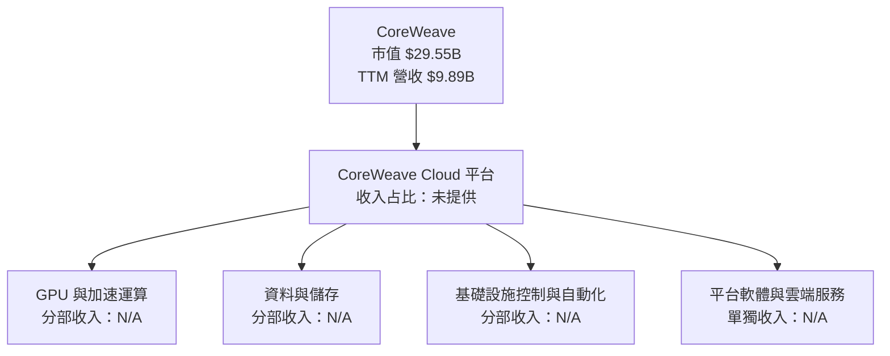

### 2.2 市場份額

資料包沒有可核實的 AI 雲端或 GPU 雲端市場總額、公司出貨量或競爭者收入份額。下圖中的單一「N/A」是資料缺失標記，不代表市場份額為 100%。

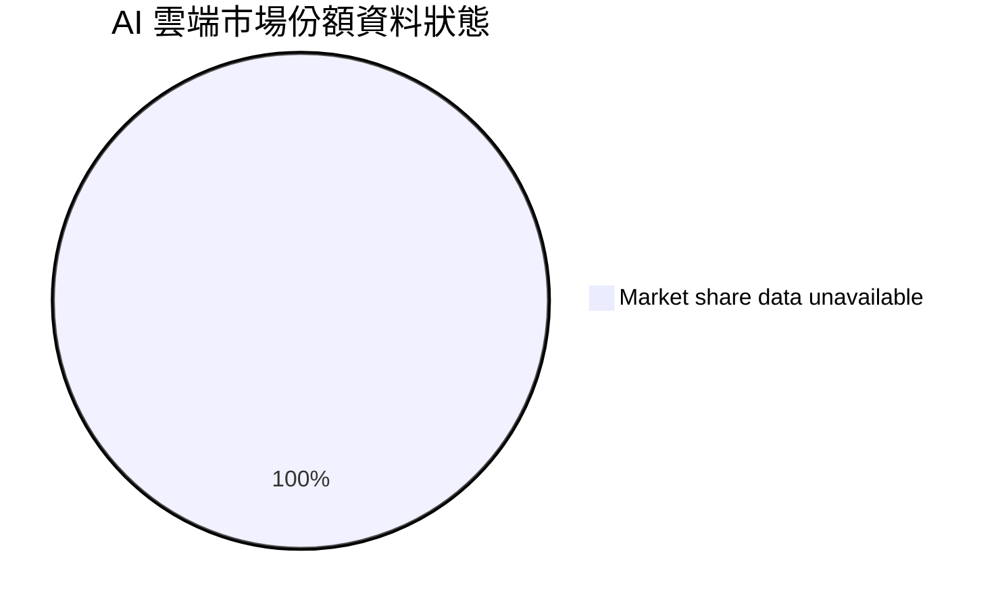

市場份額不可量化時，投資者應以營收增長、資本利用率、客戶留存、GPU 利用率及每單位算力回報等指標替代；這些細項目前未提供。

### 2.3 競爭護城河分析

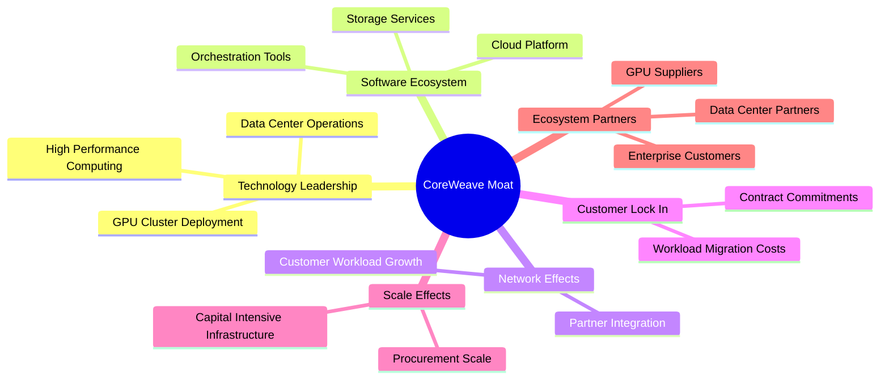

| 護城河來源 | 可觀察證據 | 目前限制 |
|---|---|---|
| 技術與部署能力 | 提供 AI 基礎設施平台，且收入快速增長 | GPU 可用率、延遲、利用率與同業比較資料 N/A |
| 軟體生態 | 有平台軟體、儲存及控制解決方案 | 軟體收入占比、續約率及毛利貢獻 N/A |
| 客戶鎖定 | AI 工作負載遷移可能涉及工程與資料移轉成本 | 合約期限、取消條款、客戶集中度未完整提供 |
| 規模效應 | 資產與資本支出快速增加 | 規模本身也造成高固定成本、折舊與融資風險 |
| 生態夥伴 | GPU、資料中心及大型 AI 客戶關係可能重要 | 關鍵供應商集中度與採購承諾未提供 |

### 2.4 護城河強度評分

```text
╔══════════════════════════════════════════════════════════════╗
║                  CoreWeave 護城河強度評分                    ║
╠══════════════════════════════════════════════════════════════╣
║ 技術與部署能力  6.0/10  ▓▓▓▓▓▓▓▓▓▓▓▓░░░░░░░░ 🟡 有能力但缺比較數據║
║ 軟體生態系統    5.0/10  ▓▓▓▓▓▓▓▓▓▓░░░░░░░░░░ 🟡 收入貢獻未拆分    ║
║ 客戶鎖定        5.0/10  ▓▓▓▓▓▓▓▓▓▓░░░░░░░░░░ 🟡 合約條款未完整披露║
║ 網路效應        3.0/10  ▓▓▓▓▓▓░░░░░░░░░░░░░░ 🔴 證據有限          ║
║ 規模效應        5.0/10  ▓▓▓▓▓▓▓▓▓▓░░░░░░░░░░ 🟡 規模與融資風險並存║
║ 生態夥伴        6.0/10  ▓▓▓▓▓▓▓▓▓▓▓▓░░░░░░░░ 🟡 重要性高、集中度未知║
╠══════════════════════════════════════════════════════════════╣
║ 綜合護城河      5.0/10  ▓▓▓▓▓▓▓▓▓▓░░░░░░░░░░ ⚠️ 尚待經濟性驗證  ║
╚══════════════════════════════════════════════════════════════╝
```

---

## 3. 損益表深度分析

### 3.1 年度收入成長趨勢（近四年）

收入單位依各年財務資料，2022 年為 $15.83M、2023 年 $229M、2024 年 $1.915B、2025 年 $5.131B。早期基數極低，增長率高，不能簡單外推為長期穩態增長。

```text
╔══════════════════════════════════════════════════════════════════╗
║              CoreWeave 年度收入趨勢（FY2022-FY2025）             ║
╠══════════════════════════════════════════════════════════════════╣
║ FY2022  $0.016B  ▏                         起始基數             ║
║ FY2023  $0.229B  ▏                         YoY 約 +1,347%       ║
║ FY2024  $1.915B  ███████                   YoY +736.25%         ║
║ FY2025  $5.131B  ███████████████████       YoY +167.94%         ║
║ TTM     $9.89B   █████████████████████████ YoY +129.6%          ║
╠══════════════════════════════════════════════════════════════════╣
║ ⚠️ TTM 是截至 2026-09-30 的滾動 12 個月，不是 FY2026 全年實績。 ║
╚══════════════════════════════════════════════════════════════════╝
```

年增率自極小基期的三位數／四位數增長逐步收斂至 TTM 129.6%。這種收斂不代表需求衰退，但說明收入規模變大後，百分比增長自然會下降；未來估值需要關注實際部署量、已簽合約轉收入速度及資本供給，而不宜把早期 CAGR 直接當作常態。

### 3.2 季度收入趨勢分析

| 季度 | 營收 | QoQ | YoY | 備註 |
|------|------:|----:|----:|------|
| 2025 Q4 | $1.572B | 約 +15.2% | +110.43% | YoY 依 StockAnalysis |
| 2026 Q1 | $2.078B | 約 +32.2% | +111.61% | 季度收入繼續擴大 |
| 2026 Q2 | $2.575B | 約 +23.9% | +112.46% | QoQ 增長率較 Q1→Q2 前段高增期間有所收斂 |
| 2026 Q3 | $3.661B | 約 +42.2% | **+168.3%** | 最新季度 YoY 使用 VERIFIED FIGURES |

QoQ 計算示例：  
`($3.661B ÷ $2.575B) − 1 = 約 42.2%`。季度收入增長顯示需求與交付仍快速增加，但若新算力容量、供電或融資延遲，營收認列可能與已簽合約時點不同步。

### 3.3 利潤率演變分析

| 指標 | FY2022 | FY2023 | FY2024 | FY2025 | TTM／最新季 | 評估 |
|---|---:|---:|---:|---:|---:|---|
| 毛利率 | 年度口徑不一致 | 約 69.9%* | 約 74.3%* | 約 71.7%* | **66.8% TTM** | 🟡 有毛利，但增長與成本結構仍需追蹤 |
| 營業利益率 | -144.5% | -6.1% | 16.9% | 約 -0.9% | **-0.8% TTM** | 🔴 年度盈利波動大 |
| 最新單季營業利益率 | N/A | N/A | N/A | N/A | **5.7%** | 🟡 VERIFIED FIGURES；另一來源列 -0.5%，數據需核對 |
| 淨利率 | N/A | N/A | N/A | N/A | **-25.6% TTM** | 🔴 利息、折舊及其他費用使淨利仍大幅為負 |

\*年度毛利率以 StockAnalysis 列示毛利額計算：FY2023 $160M ÷ $229M ≈ 69.9%；FY2024 $1.422B ÷ $1.915B ≈ 74.3%；FY2025 $3.678B ÷ $5.131B ≈ 71.7%。但另一份年度損益表把 FY2025 毛利列為 $749M，與上述數據明顯不一致；因此此表的年度毛利趨勢只能作暫定參考，不能視為已核實結論。

**利潤率演變深度解析：** TTM 毛利率 66.8% 顯示服務收入扣除直接成本後仍有毛利空間；但 TTM 營業利益率 -0.8%、淨利率 -25.6%，意味營運費用、折舊、利息及其他成本仍吞噬毛利。最新單季營業轉正可能反映收入規模擴張與固定成本攤薄，但來源對單季營業利益率有 **5.7% 與 -0.5%** 兩種口徑，不能在未核對 SEC 申報前宣稱利潤率已確立拐點。

### 3.4 費用結構分析

費用項目明細未完整提供，以下圖表僅展示已知的毛利與營業結果，不以缺失項目推算費用占比。

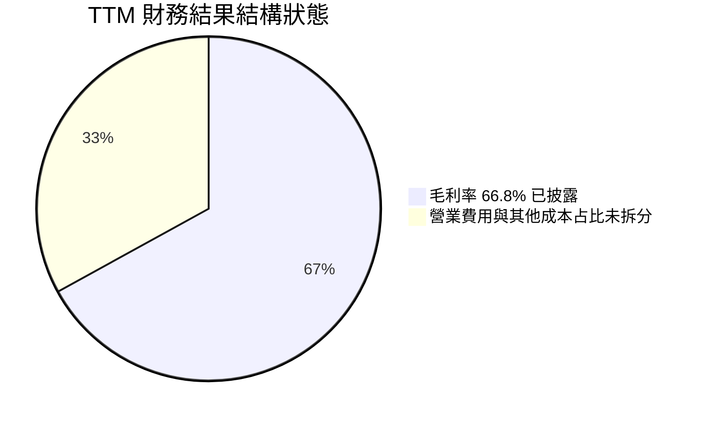

```text
╔══════════════════════════════════════════════════════════════╗
║                 TTM 利潤層級觀察（營收基準）                   ║
╠══════════════════════════════════════════════════════════════╣
║ 營收             $9.89B  ████████████████████ 100%           ║
║ 毛利率           66.8%   █████████████░░░░░░░ 已披露          ║
║ 營業利益率       -0.8%   ◀ 已披露；營業費用明細 N/A           ║
║ 淨利率          -25.6%   ◀ 已披露；利息與其他費用影響重大     ║
╚══════════════════════════════════════════════════════════════╝
```

### 3.5 季度 EPS 趨勢與盈餘品質（Quality of Earnings）

| 季度 | EPS 實際值 | EPS 預期 | 超預期／不及預期 |
|------|-----------:|---------:|------------------|
| 2026 Q3 | -$1.27 | N/A | 無法判斷；估值預期資料為 nan |
| 2026 Q2 | -$1.14 | N/A | EPS 估值未提供 |
| 2026 Q1 | -$1.40 | N/A | EPS 估值未提供 |
| 2025 Q4 | -$0.89 | N/A | EPS 估值未提供 |

EPS 歷史資料中估值與實際值均為 nan，故無法判定過去四季的盈餘是否超預期。季度淨損分別為 -$709M、-$626M、-$740M、-$452M，最新季度虧損並未收窄。

| 盈餘品質項目 | 數值／佔比 | 評估 |
|---|---:|---|
| SBC / 營收 | 最近四季 SBC 約 $634.59M ÷ TTM 營收 $9.89B ≈ **6.4%** | 🔴 對股東有實質稀釋成本；不能只視作非現金項目 |
| SBC / 營業現金流 | $634.59M ÷ $7.20B ≈ **8.8%** | 🟡 有一定規模，但遠小於 Capex 對現金流的影響 |
| FCF / 淨利 | TTM FCF -$20.42B；TTM 淨利約 -$2.527B；數學比率約 +808% | 🔴 分子、分母皆負，正比率沒有「現金轉換良好」含義 |
| 一次性／非經常性損益 | N/A | 無法判斷是否有一次性項目抬高或壓低盈餘 |
| 有效稅率異常 | N/A | 稅費明細不足，不推算有效稅率 |
| 資本化支出 vs 費用化 | TTM Capex $27.62B；資產中 PP&E $75.7B | 🔴 投資大量資本資產，未來折舊與資金成本將影響股東回報 |

**盈餘品質結論：** 目前 GAAP 盈餘為負，且現金流轉換亦不具正面訊號。OCF 為正不等同於經濟獲利：TTM OCF $7.20B 扣除 Capex $27.62B 後，FCF 為 -$20.42B。SBC 約占 TTM 營收 6.4%，若長期維持高比例，即使不直接消耗現金，也會稀釋每股經濟利益。

---

## 4. 資產負債表分析

### 4.1 資產結構分解

以下資產細項依 2026-09-30 的 StockAnalysis 摘要；現金及短期投資 $4.18B 則照 VERIFIED FIGURES 原值引用。因各來源總額及細項可能有四捨五入，不能要求各項精確加總。

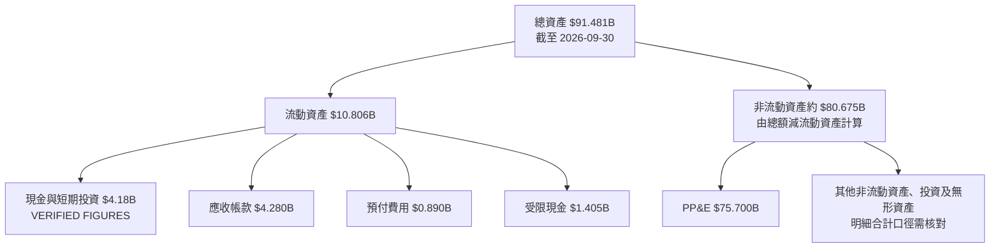

PP&E $75.7B 約為總資產的主要部分，反映公司資產密集及算力基礎設施擴張特性；資產投入能否轉成高利用率收入，是比單看資產規模更重要的問題。應收帳款 $4.28B 亦值得持續追蹤，尤其在大型客戶及合約集中背景下。

### 4.2 流動性指標分析

| 指標 | 2023 年末 | 2024 年末 | 2025 年末 | 最新資料 | 評估 |
|---|---:|---:|---:|---:|---|
| 流動比率 | 約 0.503 | 約 0.387 | 約 0.456 | **0.443** | 🔴 持續低於 1，短期資產不足以覆蓋流動負債 |
| 速動比率 | N/A | N/A | N/A | **0.349** | 🔴 可快速變現資產覆蓋不足 |
| 現金及短期投資 | $0.220B | $1.361B | $3.161B | **$4.18B** | 🟡 餘額成長，但須與資本支出及到期債務比較 |
| 應收帳款 | $0.183B | $0.417B | $3.169B | $4.280B | 🟡 應收擴大；需監控回款周期及客戶集中 |
| 行業均值 | N/A | N/A | N/A | N/A | 未提供可比基準，不臆造 |

FY2025 年末流動比率計算：`$7.49B ÷ $16.44B ≈ 0.456`。最新 0.443 與 FY2025 相近，仍顯示流動負債大於流動資產；在快速擴張且 FCF 大幅為負的情況下，流動性風險與融資可得性相互關聯。

### 4.3 債務結構分析

資料來源出現重大債務口徑差異：VERIFIED FIGURES 的 Total debt 為 **N/A**，但其他財務摘要列總債務 **$66.22B**、淨負債 **$61.99B**；年報表另列 FY2025 債務 $29.82B。下圖採用附加資料中的 $66.22B 作「待核實參考」，不覆蓋 VERIFIED FIGURES 的 N/A。

```text
╔══════════════════════════════════════════════════════════════════╗
║                   CoreWeave 債務健康診斷                         ║
╠══════════════════════════════════════════════════════════════════╣
║  VERIFIED FIGURES 總債務：N/A（缺漏，不自行反推）                ║
║  附加資料總債務：$66.22B（來源口徑待核實） ████████████████████  ║
║  現金+短期投資：$4.18B（VERIFIED）     █                      ║
║  附加資料淨負債：$61.99B（需核對）                            ║
║  Debt/Equity：1645.242（附加來源；資本結構高度槓桿化） 🔴       ║
║  Debt/EBITDA：N/A（總債務口徑及 EBITDA 定義待核對）             ║
║  Interest Coverage：N/A（利息費用明細未提供）                  ║
║  流動比率：0.443 🔴；速動比率：0.349 🔴                        ║
╚══════════════════════════════════════════════════════════════════╝
```

不能把「現金及短期投資 $4.18B」解讀為公司淨現金，因附加資料明確列有大額債務；同時也不能在 VERIFIED FIGURES 的總債務欄為 N/A 時，把其他口徑直接冒充同一統計口徑。投資決策前應核對 10-Q 的借款、融資租賃、資產擔保與到期梯度。

### 4.4 股東權益趨勢

```text
╔══════════════════════════════════════════════════════════════════╗
║                   年末股東權益變化                               ║
╠══════════════════════════════════════════════════════════════════╣
║ FY2023  -$0.597B  ◀░░░░░░░░░░░░░░░░░░░░                         ║
║ FY2024  -$0.414B  ◀░░░░░░░░░░░░░░░░░░░░                         ║
║ FY2025  +$3.330B  ████████████████████                           ║
║ FY2026 Q3：股東權益 N/A（此處資料未提供可一致核對數字）          ║
╠══════════════════════════════════════════════════════════════════╣
║ FY2025 權益回正不等於槓桿下降；同年末債務資料列 $29.82B。          ║
╚══════════════════════════════════════════════════════════════════╝
```

---

## 5. 現金流量深度分析

### 5.1 現金流量瀑布圖

以下使用 TTM 數據。淨利約 -$2.527B 來自 StockAnalysis TTM 損益表摘要；由於淨利和 OCF 之間的營運資金、折舊及其他調節項目未完整提供，圖中不虛構各項差額。

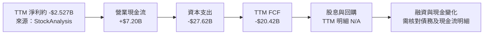

### 5.2 FCF 轉換率趨勢

| 年度 | FCF | 淨利 | FCF／淨利 | 解讀 |
|---|---:|---:|---:|---|
| 2023 | -$1.11B | -$0.594B | 約 +187% | 同為負值，正比率不代表現金轉換良好 |
| 2024 | -$5.95B | -$0.863B | 約 +690% | Capex 擴大，FCF 缺口擴大 |
| 2025 | -$7.25B | -$1.17B | 約 +620% | 營業現金流增加但仍不足以覆蓋投資 |
| TTM | **-$20.42B** | 約 -$2.527B | 約 +808% | 比率方向沒有經濟意義，重點是現金流仍大幅為負 |

### 5.3 自由現金流趨勢

```text
╔══════════════════════════════════════════════════════════════════╗
║                 FCF 歷史趨勢（負值越長代表資金需求越大）          ║
╠══════════════════════════════════════════════════════════════════╣
║ FY2023  -$1.11B   ◀██                                           ║
║ FY2024  -$5.95B   ◀██████                                       ║
║ FY2025  -$7.25B   ◀████████                                     ║
║ TTM     -$20.42B  ◀████████████████████                         ║
╠══════════════════════════════════════════════════════════════════╣
║ TTM FCF Yield：-69.11%（VERIFIED FIGURES；市值基準）             ║
║ TTM OCF $7.20B − Capex $27.62B = FCF -$20.42B                    ║
╚══════════════════════════════════════════════════════════════════╝
```

季度現金流資料顯示 Capex 由 2025 Q4 的 $4.06B 增至 2026 Q3 的 $9.44B；最新季度 FCF 為 -$7.47B。季度資本支出急增可能對應新增算力與基礎設施交付，但其回收期取決於設備利用率、合約價格、供電可得性及融資成本。

### 5.4 資本配置評估

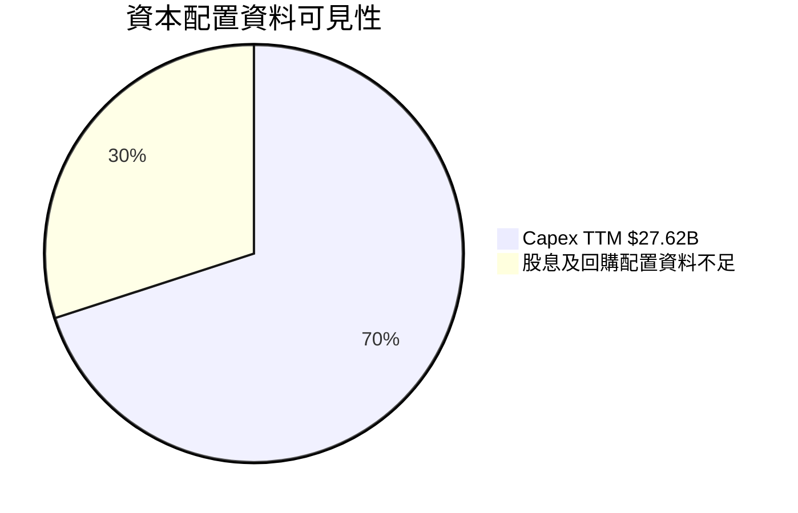

圖中比例僅為呈現資訊可見性，不代表實際資本配置占比；TTM Capex 金額按 VERIFIED FIGURES 引用，其餘項目不以缺漏數據推算。

| 資本配置項目 | 已知資料 | 評估 |
|---|---:|---|
| 資本支出 | TTM $27.62B | 🔴 投資規模遠高於 OCF；須驗證新增設備回報 |
| 營業現金流 | TTM $7.20B | 🟡 營運現金流為正，但無法支應當前 Capex |
| FCF | TTM -$20.42B | 🔴 需要融資、資產融資或資本市場支持 |
| 股息 | 最新季度 $0；公司股息殖利率 0% | 🟡 非收益型投資標的 |
| 股票回購 | N/A | 資料不足，不推估 |
| 外部融資 | 新聞提及 $4B 貸款洽談 | 🟡 新聞摘要不是已完成融資證明，須看實際條款 |

---

## 6. 獲利能力與資本效率

### 6.1 ROE / ROA / ROIC 趨勢

| 指標 | FY2023 | FY2024 | FY2025 | TTM | 行業均值 | 評估 |
|---|---:|---:|---:|---:|---:|---|
| ROE | N/A | N/A | N/A | **-62.8%** | N/A | 🔴 虧損且權益基數曾為負，ROE 解讀需謹慎 |
| ROA | N/A | N/A | N/A | **-0.0%** | N/A | 🟡 接近零，但不代表資產回報已達成本 |
| ROIC | N/A | N/A | N/A | **N/A** | N/A | 無法判斷資本回報是否高於 WACC |
| 營業利益率 | -6.1%* | 16.9%* | -0.9%* | **-0.8% TTM** | N/A | 🔴 盈利波動且 TTM 仍微幅為負 |

\*依年度損益摘要粗算；FY2025 另一來源列營業損失 -$46M，StockAnalysis 列 -$17M，故年度口徑存在差異。

### 6.2 ROIC vs WACC 分析（核心價值創造判斷）

```text
╔══════════════════════════════════════════════════════════════════╗
║                ROIC vs WACC 深度分析                             ║
╠══════════════════════════════════════════════════════════════════╣
║  WACC 採用值：7.00%（VERIFIED FIGURES）                           ║
║  ├── 無風險利率（10Y 美債）：5.15%（資料包日期口徑）              ║
║  ├── 市場風險溢酬 ERP：5.00%（假設值，依資料包）                 ║
║  ├── Beta 原始值：N/A；調整後採用 1.00（資料包假設）              ║
║  ├── 股權成本：5.15% + 1.00 × 5.00% = 10.15%                    ║
║  ├── 稅前債務成本：1.86%；稅後約 1.47%（稅率 21%）                ║
║  ├── 權重 E/D：30.9% / 69.1%                                     ║
║  ├── 加權計算值約 4.15%；因模型限制在 7%-14% 區間，採用 7.00%   ║
║  ├── ROIC：N/A（未提供可一致核對的 NOPAT 與投入資本）             ║
║  └── EVA = ROIC − WACC：N/A                                      ║
║                                                                  ║
║  ROIC  N/A    ░░░░░░░░░░░░░░░░░░░░  無足夠資料                   ║
║  WACC  7.00%  ▓▓▓▓▓▓▓░░░░░░░░░░░░░  採用值                       ║
║  EVA   N/A    ░░░░░░░░░░░░░░░░░░░░  無法判斷                     ║
╠══════════════════════════════════════════════════════════════════╣
║ 結論：不能聲稱 ROIC 高於或低於 WACC；現有負 FCF 與負營業利潤率   ║
║ 是警訊，但不足以替代可核算 ROIC。                                 ║
╚══════════════════════════════════════════════════════════════════╝
```

WACC 檢核計算：  
- CAPM 股權成本：`5.15% + 1.00 × 5.00% = 10.15%`。  
- 稅後債務成本：`1.86% × (1 − 21.0%) = 1.4694%`。  
- 權重加權值：`30.9% × 10.15% + 69.1% × 1.4694% = 4.1530% ≈ 4.15%`。  
- 因 VERIFIED FIGURES 指定計算值被限制於 7%–14% 區間，折現率採用 **7.00%**，且此值與本節及第 8.2 節一致。

### 6.3 杜邦三因素分解

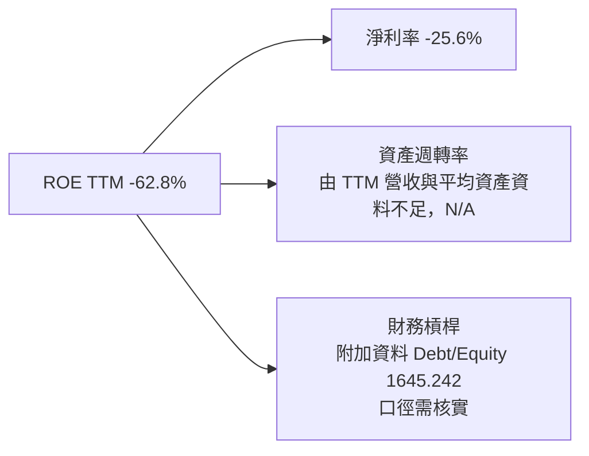

杜邦分解公式為 `ROE = 淨利率 × 資產週轉率 × 財務槓桿`。因平均資產及一致口徑股東權益缺乏，不能用這三個因子精確重算 ROE；財務槓桿倍數也受權益基數較小及資料差異影響。

### 6.4 獲利能力儀表板

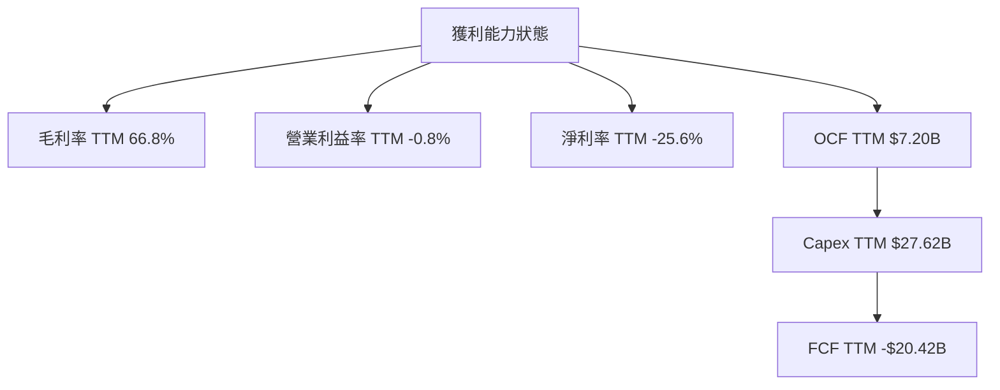

收入規模與毛利率顯示有商業需求，但目前無法忽略重投資和融資成本；在 FCF 轉正前，EV/EBITDA 或 P/S 等倍數只能作為輔助，不能取代現金回收能力分析。

---

## 7. 相對估值分析

### 7.1 同業估值比較表格

Peer multiples 未包含於 VERIFIED FIGURES。以下列出可作商業模式參照的競爭者，但倍數均不提供，不以未核實估計值冒充市場資料。

| 估值指標 | **CRWV** | **Nebius** | **Oracle** | **Microsoft Azure** | CRWV 評估 |
|----------|---------:|---------:|---------:|---------:|-----------|
| Trailing P/E | N/A | N/A | N/A | N/A | CRWV TTM 虧損，P/E 不適用 |
| Forward P/E | -31.60x | N/A | N/A | N/A | 負值不可作一般正盈餘比較 |
| P/S | 2.989x | N/A | N/A | N/A | 公司倍數可引用；同業倍數缺失 |
| EV/EBITDA | 17.594x | N/A | N/A | N/A | 高 Capex 使 EBITDA 不能代表可分配現金 |
| FCF Yield | -69.11% | N/A | N/A | N/A | FCF 為深度負值 |

Nebius 是 AI 雲端及 GPU 基礎設施的上市比較對象；Oracle 和 Microsoft 是規模更大的雲端平台，業務組合並不純粹。因同業倍數資料未提供，本報告不宣稱 CRWV 相較同業便宜或昂貴。

### 7.2 歷史估值區間分析

VERIFIED FIGURES 未提供「Valuation vs own history」數值，因此歷史 P/E 分位數、EV/Sales 區間與估值百分位均為 **N/A**。

| 歷史估值項目 | 數值 |
|---|---:|
| 歷史 P/E 範圍 | N/A |
| 歷史 EV/Revenue 範圍 | N/A |
| 當前歷史估值百分位 | N/A |
| 可觀察股價資料 | 2025-03 至 2026-11 月收盤價 |

```text
╔══════════════════════════════════════════════════════════════╗
║                 歷史價格位置（非估值分位數）                   ║
╠══════════════════════════════════════════════════════════════╣
║ 24 個月月收盤高點：$163.06（2025-06）                         ║
║ 最新收盤：$53.13（2026-11-13）                                ║
║ 相對該月收盤高點：($53.13 ÷ $163.06) − 1 ≈ -67.4%             ║
║ 52 週區間：$40.58 – $138.25                                   ║
║ 注意：股價回撤不是估值折價證據；歷史倍數分位數 N/A。            ║
╚══════════════════════════════════════════════════════════════╝
```

### 7.3 情境目標價（假設驅動，Bear / Base / Bull）

估值方法程式輸出為 N/A，且公司 TTM 營業利益仍為負；沒有可引用的同業中位數倍數或預測假設。故不設定假設性營收 CAGR、退出倍數或目標價，避免產生無法稽核的價格結論。

| 情境 | 營收 CAGR | 營業利潤率 | 退出倍數 | 隱含目標價 | 相對現價 |
|------|-----------|-----------|----------|------------:|----------:|
| 🔴 悲觀 | N/A | N/A | N/A | N/A | N/A |
| 🟡 基準 | N/A | N/A | N/A | N/A | N/A |
| 🟢 樂觀 | N/A | N/A | N/A | N/A | N/A |

> **倍數選擇說明：** CRWV 為重資本且 TTM FCF 大幅為負的企業。P/E 因虧損而失效；EV/EBITDA、EV/Sales 仍可能用於同業比較，但必須以可核對的同業中位數、債務及股數計算。現有資料缺少同業倍數與可一致核對的債務，因此不回推每股價格。

### 7.4 相對估值隱含價格區間

VERIFIED FIGURES 的 VALUATION METHODS 指明 **None could be computed**。因此沒有可列出的相對估值方法、每股價值或同業中位數倍數；現價 $53.13 僅作為價格參考，不存在可稽核的相對估值區間。

---

## 8. DCF 內在價值評估（Discounted Cash Flow）

> **核心限制：** VERIFIED FIGURES 明確標示：`DCF MODEL: N/A — TTM operating income is not positive; a loss discounted forward is not a value.` 同時 VALUATION METHODS 為 `None could be computed`。依指定規則，本章 8.1–8.7 不自建模型，不臆造每股價值、敏感度、情境目標或反推假設；8.8 不給加權合理價值及 MOS。

### 8.0 估值推理鏈（Thinking Logic）

**Step 1 — 價值來源：** CoreWeave 的長期價值理論上取決於 AI 雲端收入轉化為正的營業利潤與自由現金流，以及新增資本支出能否獲得足夠回報。當前 TTM 營收 $9.89B、毛利率 66.8%，但 TTM 營業利益率 -0.8%、FCF -$20.42B；目前無法把現有收入視為穩定現金流底盤。收入分部占比未披露，無法量化各業務的獨立價值。

**Step 2 — 模型選擇：**

| 決策點 | 本報告採用 | 理由（含數字） | 曾考慮但否決 | 否決理由 |
|--------|-----------|----------------|--------------|----------|
| 現金流定義 | N/A | DCF MODEL 明確 N/A | FCFF／FCFE | TTM 營業利益為負，資料包指示不得建立 DCF |
| 預測期 N | N/A | 無程式模型期間資料 | 5–10 年 | 自行設定會違反不得自建模型 |
| 終值方法 | N/A | 終值及永續成長率未提供 | Gordon Growth／退出倍數 | 目前沒有有效基準現金流及指定模型輸出 |
| EBIT 基礎 | N/A | 不進入模型計算 | GAAP／非 GAAP | 不能為 N/A 模型建立新假設 |

**Step 3 — 關鍵輸入推導：** 預測 CAGR、期末營業利潤率、永續成長率、Capex/營收、D&A/營收、ΔWC、稀釋率及 SBC 模型均沒有可引用的 DCF MODEL 輸出。依規則不得以歷史數據自行填入一套替代模型。

**Step 4 — 最脆弱環節：** 最大不確定性是巨額資本支出能否轉化為持續收入與正 FCF；如果算力利用率、價格或融資條件不及預期，價值可能低於以營收增長推導的市場敘事。

**Step 5 — 計算路徑：** 本案沒有可計算的模型路徑，故不得把格式範例中的算式套用為估值結果。

### 8.1 模型假設總表（Model Inputs）

| 假設項目 | 採用值 | 依據／來源 | 敏感度 |
|----------|--------|-------------|--------|
| 預測期長度 N | N/A | DCF MODEL: N/A | N/A |
| 營收 CAGR | N/A | 模型輸出未提供 | N/A |
| 期末營業利潤率 | N/A | TTM 營業利益率 -0.8%，但不可自行外推 | N/A |
| 有效稅率 | N/A | 模型輸出未提供 | N/A |
| Capex／營收 | N/A | 已知 TTM Capex $27.62B，但 DCF 假設未提供 | N/A |
| D&A／營收 | N/A | 未提供可對應模型的假設 | N/A |
| 營運資金變動 | N/A | 模型輸出未提供 | N/A |
| EBIT 基礎 | N/A | 不建立模型 | N/A |
| SBC 處理 | N/A | 不建立模型 | N/A |
| 年稀釋率 | N/A | 不建立模型 | N/A |
| 永續成長率 g | N/A | 模型輸出未提供 | N/A |
| 終值方法 | N/A | 模型輸出未提供 | N/A |
| WACC | 7.00% | VERIFIED FIGURES；受 7%–14% 區間限制 | 原模型其他假設缺失 |

**FCF 定義：** 本報告引用的 TTM FCF 固定採用 `營業現金流 − 資本支出`，即 `$7.20B − $27.62B = -$20.42B`。此為歷史 FCF 指標，不等於自行建立的前瞻 FCFF。

### 8.2 折現率推導（WACC）

```text
╔══════════════════════════════════════════════════════════════════╗
║                    WACC 推導（折現率）                           ║
╠══════════════════════════════════════════════════════════════════╣
║  股權成本 Ke（CAPM）：                                           ║
║  ├── 無風險利率 Rf：5.15%（VERIFIED FIGURES）                    ║
║  ├── ERP：5.00%（VERIFIED FIGURES 假設值）                       ║
║  ├── 原始 Beta：N/A；調整後 Beta：1.00（假設值）                 ║
║  ├── 規模／國別溢酬：未另加計（資料包未提供）                    ║
║  └── Ke = 5.15% + 1.00 × 5.00% = 10.15%                        ║
║                                                                  ║
║  債務成本 Kd：                                                    ║
║  ├── 稅前 Kd：1.86%（依資料包所列）                              ║
║  ├── 稅率：21.0%（資料包預設值）                                 ║
║  └── 稅後 Kd = 1.86% × (1 − 21.0%) = 1.4694%                    ║
║                                                                  ║
║  資本結構與權重：                                                  ║
║  ├── E 權重：30.9%（資料包所列；市值/債務口徑不另行改算）        ║
║  ├── D 權重：69.1%（資料包所列）                                 ║
║  ├── 計算 WACC = 30.9% × 10.15% + 69.1% × 1.4694%               ║
║  │              = 3.13635% + 1.01668% = 4.15303% ≈ 4.15%        ║
║  └── 採用 WACC：7.00%（資料包指定，受 7%-14% 下限限制）          ║
╚══════════════════════════════════════════════════════════════════╝
```

Beta 原始值及利率日期未提供更細資料；因此 1.00、ERP 5.00% 與稅率 21.0% 均按資料包假設引用，不另作市場校準。債務餘額來源口徑亦有差異，WACC 權重照 VERIFIED FIGURES 原值引用，不以附加財務表重算。

### 8.3 逐年自由現金流預測（基準情境）

**N/A。** DCF MODEL 未提供逐年營收、營業利潤率、稅率、Capex、折舊攤銷、營運資金、FCFF 或折現因子。資料包明確禁止自建 DCF，故不列出虛構年度欄位、現金流總和或代表年度演算。

### 8.4 終值計算（Terminal Value）

**適用性檢查：** WACC 採用 7.00%，但永續成長率 g 為 N/A；無法檢查 `WACC > g`。因此 Gordon Growth 與退出倍數法的終值、終值現值及終值占 EV 比重均為 **N/A**，不得自行代入。

### 8.5 企業價值 → 每股內在價值（Bridge）

```text
╔══════════════════════════════════════════════════════════════════╗
║              企業價值 → 每股內在價值 橋接表                      ║
╠══════════════════════════════════════════════════════════════════╣
║  預測期 FCF 現值合計            N/A                              ║
║  終值現值 PV(TV)                N/A                              ║
║  = 企業價值 EV                  N/A                              ║
║  + 現金及短期投資               $4.18B（歷史資產數，不足以估值） ║
║  − 總債務                       N/A（VERIFIED FIGURES）          ║
║  = 股權價值                     N/A                              ║
║  ÷ 稀釋後流通股數               N/A（DCF 股數輸入未提供）        ║
║  ★ 每股內在價值                 N/A                              ║
║    當前股價                     $53.13（2026-11-13 收盤）        ║
║    折溢價                       N/A                              ║
╚══════════════════════════════════════════════════════════════════╝
```

不得因為附加資料顯示現金 $4.23B、總債務 $66.22B，就在本 DCF 橋接中替換 VERIFIED FIGURES 的總債務 N/A；那會混合口徑且違反原資料規則。此處不計算 MOS。

### 8.6 敏感性分析（WACC × 永續成長率）

**N/A。** DCF 基準模型、FCFF、終值與每股價值均不存在，不能生成 5×5 敏感度矩陣、情境估值或機率加權價值。

| 項目 | 結果 |
|---|---|
| WACC × g 每股價值矩陣 | N/A |
| 三情境每股內在價值 | N/A |
| 機率加權估值 | N/A |
| g 每增加 1pp 的價值彈性 | N/A |
| WACC 每增加 1pp 的價值彈性 | N/A |
| 營業利潤率每增加 1pp 的價值彈性 | N/A |

### 8.7 反推 DCF（Reverse DCF：市場在預期什麼）

**N/A。** 現價 $53.13 可引用，但模型現值與其餘固定輸入未提供，不能由單一市場價格反推出營收 CAGR、利潤率、g 或高成長期長度。也不提供試算軌跡，以免把自建模型偽裝成程式輸出。

可確認的市場訊息僅是：截至 2026-11-13，CRWV 市值 $29.55B、EV $91.54B。兩者相差甚大，方向上顯示企業價值受到負債或其他企業價值調整影響；但不以差額重算債務，因 VERIFIED FIGURES 的總債務為 N/A。

### 8.8 估值三角驗證與安全邊際

VERIFIED FIGURES 指出估值方法 **None could be computed**。因此本節依規則列為 N/A，不給加權合理價值、MOS 或 MOS 評級。

| 估值方法 | 隱含每股價值 | 上行空間 | 權重 | 說明 |
|----------|--------------|----------|------|------|
| DCF | N/A | N/A | N/A | DCF MODEL: N/A |
| 相對估值 | N/A | N/A | N/A | 同業倍數未提供，程式無法計算 |
| 分析師共識 | N/A | N/A | N/A | $115.47 是資料包中的共識均價，未列為程式估值方法 |
| **加權合理價值** | **N/A** | **N/A** | **N/A** | 方法值及權重皆不存在 |

```text
╔══════════════════════════════════════════════════════════════════╗
║                  估值區間與安全邊際                              ║
╠══════════════════════════════════════════════════════════════════╣
║  DCF 低值：N/A    現價：$53.13    加權合理值：N/A                ║
║  安全邊際 MOS：N/A（加權合理價值缺漏，不能計算）                 ║
║  上行空間：N/A（合理價值缺漏，不能計算）                         ║
║  折溢價：N/A（DCF 基準內在價值缺漏）                             ║
║  建議買入區間：N/A（未建立可稽核合理價值）                      ║
║  合理持有區間：N/A                                               ║
║  減碼考慮區間：N/A                                               ║
╚══════════════════════════════════════════════════════════════════╝
```

分析師共識均價 **$115.47** 代表 38 位分析師的平均目標價，不等於本報告的加權合理價值，亦不應用來計算 MOS。它相對現價的隱含差距可作市場情緒參考，但在本報告不將其當作基本面上行空間或目標價。

### 8.9 DCF 模型的局限與失效條件

- **終值依賴度：** N/A，因沒有模型結果。
- **最脆弱的實際經營假設：** 算力資產利用率及合約交付速度；Capex TTM $27.62B，若設備投入未能形成收入，FCF 缺口可能延續。
- **模型適用性：** TTM FCF -$20.42B、TTM 營業利益率 -0.8%，以現有負現金流直接折現缺乏有效性。待營業利益、Capex 強度及融資結構較穩定後，可再評估 DCF；目前更應追蹤收入轉化、單位算力經濟性、合約現金流與 EV/Sales 等輔助指標。
- **第 10 章連結：** 融資成本上升會提高資本成本；客戶延遲付款會惡化營運資金；GPU 供應受限會影響營收增長及利用率，三者均可能延後 FCF 轉正。

### 8.10 複算檢核表（Audit Trail）

| # | 檢核項目 | 結果 |
|---|----------|------|
| 1 | 高／中敏感度輸入四段式推導 | 不適用；DCF MODEL 為 N/A |
| 2 | 每個 DCF 假設均有來歷 | ✅ 均標 N/A 並說明缺漏 |
| 3 | WACC 算式及權重重算 | ✅ 權重 30.9% + 69.1% = 100%；計算值約 4.15%，採用值 7.00% |
| 4 | Kd 負債範圍與 D 權重一致 | ⚠️ 輸入來源提供權重與 Kd，但負債明細口徑不足；已標示限制，不另算 |
| 5 | WACC 與第 6.2 節相同 | ✅ 兩處採用 7.00% |
| 6 | 逐年預測期間及省略符號 | ✅ 不適用；未建立逐年模型 |
| 7 | FY+1 FCFF 代表年度演算 | ✅ 不適用；模型 N/A |
| 8 | 預測期 PV 逐項加總 | ✅ 不適用；無 PV 數據 |
| 9 | WACC > g | ⚠️ g 為 N/A，無法比較 |
| 10 | 終值以 FY+N 現金流並折現 N 期 | ✅ 不適用；模型 N/A |
| 11 | EV 至每股價值橋接 | ✅ 明確列 N/A，未跳步計算 |
| 12 | SBC 模型組合相容性 | ✅ 不適用；未建立模型或稀釋假設 |
| 13 | 敏感度矩陣基準格一致 | ✅ 不適用；矩陣 N/A |
| 14 | 矩陣有效格及 WACC ≤ g 格 | ✅ 不適用；矩陣 N/A |
| 15 | 三情境機率加總 | ✅ 不適用；情境估值 N/A |
| 16 | 反推 DCF 一次解一個變數 | ✅ 不適用；反推模型 N/A |
| 17 | MOS 分母與折溢價基準 | ✅ 均列 N/A；未將共識價替代合理價值 |
| 18 | 報告完整至第 11 章 | ✅ 已完整列出 |
| 19 | 加權合理價值等於加權方法值 | ✅ 不適用；無估值方法與權重 |
| 20 | 評級符合 MOS 門檻 | ✅ 不給 MOS 評級，原因為加權合理價值 N/A |

**未修正事項：** 債務、單季營業利潤率及部分毛利資料有來源差異，需回查 SEC 原始申報；這些差異已在相應章節披露，未以估算替代。

---

## 9. 成長催化劑

### 9.1 催化劑時間軸

以下為研究監控時間軸，不代表公司已公告具體財測或日期。

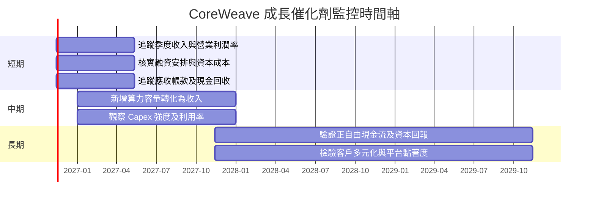

| 催化劑 | 目前證據 | 需驗證的關鍵條件 |
|---|---|---|
| AI 算力需求增長 | TTM 收入 +129.6%；最新單季 YoY +168.3% | 新需求是否能持續、是否有足夠供電和 GPU 供應 |
| 新增容量上線 | TTM Capex $27.62B、PP&E $75.7B | 新資產利用率、租約／融資成本、折舊回收 |
| 大型客戶合約 | 新聞摘要提及 OpenAI $22.4B 合約 | 合約履約期間、取消條款、集中度、實際回款 |
| 營業槓桿 | 最新季度營業利潤率資料有 5.7% 與 -0.5% 兩種口徑 | 必須以財報一致口徑確認，並連續數季維持 |
| 外部融資可得性 | 新聞提及貸款洽談 | 實際利率、抵押品、期限與契約條款 |

### 9.2 TAM 市場規模分析

市場 TAM、滲透率與公司可服務市場份額未提供，故不能自創市場規模數字。AI 雲端基礎設施為潛在市場，但市場增長並不自動代表 CRWV 可取得正回報。

```text
╔══════════════════════════════════════════════════════════════╗
║                   TAM 與收入轉化資料狀態                      ║
╠══════════════════════════════════════════════════════════════╣
║ AI 雲端／GPU 基礎設施 TAM：N/A（資料包未提供）                 ║
║ 市場滲透率：N/A                                                ║
║ CoreWeave 市場份額：N/A                                        ║
║ 公司 TTM 營收：$9.89B（已披露）                                ║
║ TTM 成長：129.6%（VERIFIED FIGURES）                           ║
║ 商業焦點：市場需求 → 部署容量 → 收入認列 → 現金回收            ║
╚══════════════════════════════════════════════════════════════╝
```

### 9.3 成長驅動力結構圖

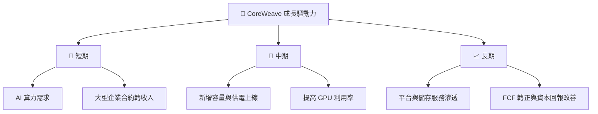

---

## 10. 風險矩陣

### 10.1 風險評分矩陣

象限圖中的位置是研究者的質化風險判斷，並非公司已披露的統計機率。符合圖表英文節點限制。

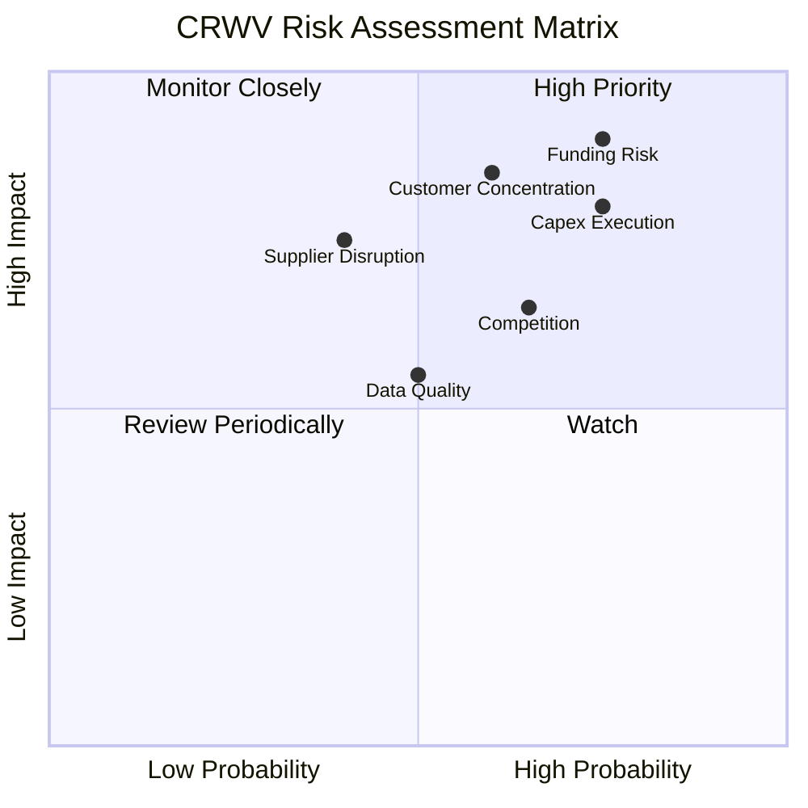

### 10.2 風險清單詳細分析

| # | 風險項目 | 發生機率 | 財務衝擊 | 風險評分 | 緩解措施 |
|---|----------|----------|----------|----------|----------|
| 1 | 🔴 **融資與再融資風險** | 高；量化機率 N/A | 高：TTM FCF -$20.42B，Capex $27.62B | 🔴 9.0/10 | 追蹤貸款實際條款、到期結構、抵押資產、利率及契約限制 |
| 2 | 🔴 **客戶集中及信用風險** | 中高；合約集中度 N/A | 高：應收帳款 $4.28B；大型合約回款延遲會增加資金需求 | 🔴 8.5/10 | 追蹤前五大客戶占比、DSO、逾期應收、預收款與取消權 |
| 3 | 🔴 **Capex 回報與閒置風險** | 高 | 高：資產規模擴大但 TTM FCF 深度為負 | 🔴 8.5/10 | 監控收入／新增 PP&E、利用率、單位算力毛利與資本回收期 |
| 4 | 🟠 **供應商與設備供應中斷** | 中 | 高：設備交期或供應商變化可能延遲營收認列 | 🟠 7.5/10 | 供應商多元化、設備交付節點及備援方案 |
| 5 | 🟠 **價格競爭與雲端替代** | 中高 | 中高：定價下滑可能壓縮 66.8% TTM 毛利率 | 🟠 7.0/10 | 監控毛利率、合約續約價格、客戶工作負載留存 |
| 6 | 🟡 **資料口徑與披露風險** | 中 | 中：債務、營業利潤率及毛利數據有來源差異 | 🟡 6.0/10 | 財報分析以 SEC 原始申報及附註為準，建立一致口徑 |

---

## 11. 投資建議

### 11.1 最終綜合評級雷達圖

```text
╔══════════════════════════════════════════════════════════════╗
║                    CRWV 綜合研究評分                         ║
╠══════════════════════════════════════════════════════════════╣
║ 基本面強度      5.0/10  ▓▓▓▓▓▓▓▓▓▓░░░░░░░░░░ ★★★☆☆        ║
║ 成長動能        8.0/10  ▓▓▓▓▓▓▓▓▓▓▓▓▓▓▓▓░░░░ ★★★★☆        ║
║ 獲利能力        3.0/10  ▓▓▓▓▓▓░░░░░░░░░░░░░░ ★★☆☆☆        ║
║ 財務健康        3.0/10  ▓▓▓▓▓▓░░░░░░░░░░░░░░ ★★☆☆☆        ║
║ 資本效率        3.0/10  ▓▓▓▓▓▓░░░░░░░░░░░░░░ ROIC N/A       ║
║ 護城河深度      5.0/10  ▓▓▓▓▓▓▓▓▓▓░░░░░░░░░░ ★★★☆☆        ║
║ 估值可判讀性    3.0/10  ▓▓▓▓▓▓░░░░░░░░░░░░░░ DCF N/A        ║
╠══════════════════════════════════════════════════════════════╣
║ 質化綜合分      4.5/10  ▓▓▓▓▓▓▓▓▓░░░░░░░░░░░ ⚠️ 觀望        ║
║ 正式 MOS 評級   N/A     加權合理價值缺漏，無法套用評級門檻    ║
╚══════════════════════════════════════════════════════════════╝
```

### 11.2 目標價與隱含報酬率

| 情境／參考 | 目標價 | 隱含報酬率 | 權重 | 解讀 |
|---|---:|---:|---:|---|
| 本報告悲觀情境 | N/A | N/A | N/A | 無可稽核 DCF 或退出倍數 |
| 本報告基準情境 | N/A | N/A | N/A | 不建立自創目標價 |
| 本報告樂觀情境 | N/A | N/A | N/A | 無足夠經營假設及估值方法 |
| 分析師共識均價 | $115.47 | 約 +117.4% | N/A | 38 位分析師共識資料，非本報告估值結論 |

共識價差計算：`($115.47 ÷ $53.13) − 1 ≈ 117.4%`。此結果只說明共識均價相對 2026-11-13 收盤價的差距，不代表本報告認定的預期報酬、MOS 或合理價值。

### 11.3 買入時機與觸發因素

```text
╔══════════════════════════════════════════════════════════════════╗
║                  ✅ 投資觸發因素 Checklist                      ║
╠══════════════════════════════════════════════════════════════════╣
║  建立初始部位前，建議先確認：                                    ║
║  ☐ SEC 申報中總債務、融資租賃與債務到期表已核實                  ║
║  ☐ 單季營業利潤率資料口徑已釐清，並能連續兩季維持正值            ║
║  ☐ 季度 FCF 缺口連續收斂，而非僅靠營運資金時點改善              ║
║  ☐ 應收帳款增長沒有持續快於收入，並披露客戶集中度與回款狀況      ║
║                                                                  ║
║  加碼觸發條件：                                                  ║
║  ☐ TTM FCF 由 -$20.42B 明確向損益兩平收斂                        ║
║  ☐ Capex／營收下降且收入仍維持高雙位數增長                       ║
║  ☐ ROIC 有可核算數據，並證明逐步接近或高於 WACC 7.00%             ║
║                                                                  ║
║  減碼／退出觸發條件：                                            ║
║  ☐ 融資成本或債務條款惡化，資金到期集中且未有再融資方案          ║
║  ☐ 營收 YoY 連續兩季低於 50%，且新增容量利用率未改善              ║
║  ☐ TTM FCF 缺口進一步擴大，或應收帳款增速持續快於收入            ║
║  ☐ 關鍵客戶取消、延遲履約或付款能力顯著惡化                      ║
╚══════════════════════════════════════════════════════════════════╝
```

以上是風險監控門檻，不是公司財測或保證觸發後價格必然上漲／下跌。沒有估值基準前，不提供價格型買入區間。

### 11.4 投資人適配度分析

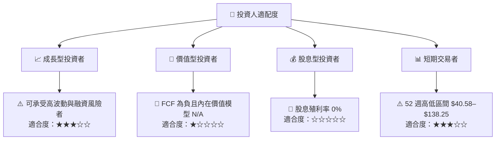

### 11.5 每季財報監控清單（Quarterly Watch List）

| 監控指標 | 最新基準 | 加碼觀察門檻 | 減碼／重新檢視門檻 |
|---|---:|---|---|
| 單季營收與 YoY | Q3 2026 $3.661B；YoY 168.3% | 成長延續且新增容量同步投入 | 連續兩季 YoY <50%，且合約轉收入轉弱 |
| 營業利潤率 | TTM -0.8%；最新季一來源為 5.7% | 連續兩季為正，並以 SEC 口徑核實 | 連續兩季惡化或差異無法釐清 |
| 毛利率 | TTM 66.8% | 維持穩定並有可核實收入組合說明 | 低於 60% 且無暫時性因素解釋 |
| OCF | TTM $7.20B | 增長與回款品質一致 | OCF 下滑、應收逾期增加 |
| Capex | TTM $27.62B | Capex 強度下降且收入保持增長 | Capex 上升但收入或利用率未跟上 |
| FCF | TTM -$20.42B | 缺口連續收斂，最終邁向損益兩平 | 缺口擴大且融資條件惡化 |
| 現金及短期投資 | $4.18B | 現金緩衝與未來 12 個月資金需求匹配 | 現金下降、到期債務集中或契約收緊 |
| 應收帳款 | $4.28B | 增速不高於收入且回款周期穩定 | 應收增速持續高於營收 |
| 債務與租賃 | VERIFIED FIGURES 總債務 N/A；附加來源 $66.22B | 以申報核實期限、成本及擔保 | 槓桿上升或融資成本顯著增加 |
| SBC | 最近四季約 $634.59M | SBC 占營收比例下降 | SBC 持續高於營收 6%–7% 且股數快速增加 |
| EPS | 最近四季均為負；預期資料 N/A | 虧損收窄並且盈餘品質改善 | 虧損擴大且無法取得可靠共識資料 |
| 管理層財測 | N/A | 財測可核對且連續達成 | 財測下修或合約交付延遲 |

### 11.6 反面論證：什麼會證明論點錯誤（What Would Change My Mind）

```text
╔══════════════════════════════════════════════════════════════════╗
║              ⚠️ 論點失效條件（Disconfirming Evidence）           ║
╠══════════════════════════════════════════════════════════════════╣
║ 本報告對成長潛力的觀察，在下列情況出現時應重新檢視：            ║
║                                                                  ║
║ ☐ 最新單季收入 YoY 由 168.3% 降至連續兩季低於 50%                ║
║ ☐ 毛利率由 TTM 66.8% 下滑至低於 60%，且不能以短期組合因素解釋   ║
║ ☐ 營業利潤率連續兩季為負，或無法核實最新季度正負口徑             ║
║ ☐ TTM FCF 低於目前 -$20.42B，且 OCF 增長未能覆蓋 Capex           ║
║ ☐ 應收帳款增速持續高於營收，或重要客戶付款／履約狀況惡化         ║
║ ☐ 核實後的 ROIC 持續低於 WACC 7.00%，而非逐步收斂                 ║
║ ☐ 融資條款、利率或抵押要求惡化，令資本成本及再融資風險上升       ║
╠══════════════════════════════════════════════════════════════════╣
║ 一旦以上條件成立，應降低對「高增長最終轉化為股東現金流」的信心。 ║
╚══════════════════════════════════════════════════════════════════╝
```

> **免責聲明**：本報告為研究參考，不構成個人化投資建議或證券買賣邀約。財務資料存在來源口徑差異，估值模型及加權合理價值未能計算；投資前應核對公司 SEC 原始申報、債務附註及最新管理層指引。投資有風險，入市需謹慎。