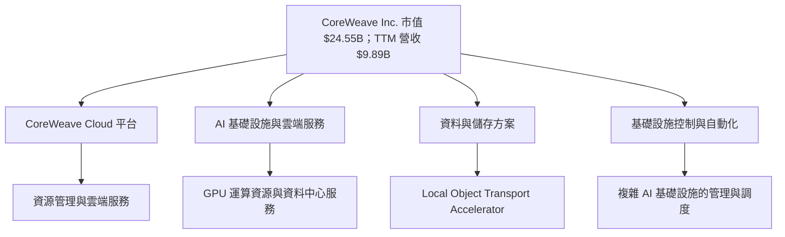
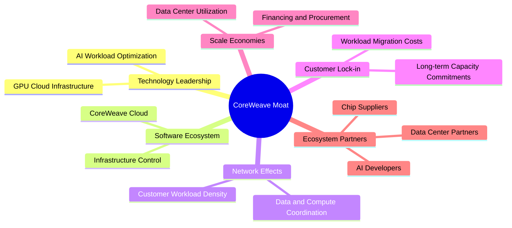
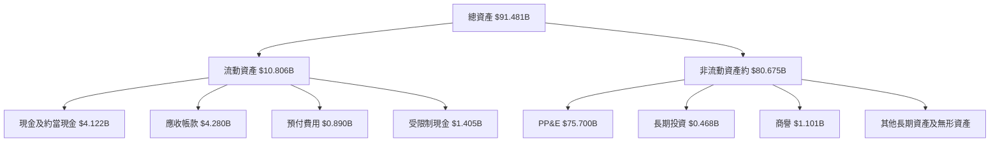
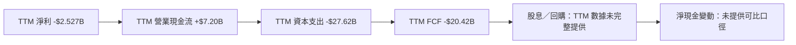
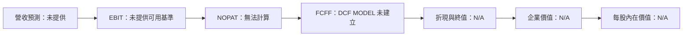
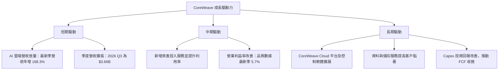
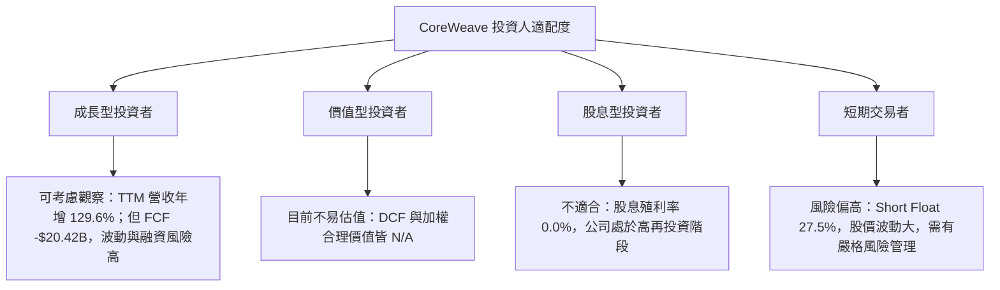

# CRWV 基本面深度分析報告
> **報告日期**：2026-11-28 ｜ **語言**：繁體中文 ｜ **數據來源**：SEC 申報資料 (XBRL)、Yahoo Finance、Finviz、StockAnalysis、Roic.ai ｜ **分析師**：CFA 級機構研究

> **數據口徑提示**：資料來源之間存在重要差異。例如，SEC／程式計算的品質指標列示淨現金 **$4.18B**、總債務 **N/A**；合併市場資料則列示總債務 **$66.22B**、淨負債 **$61.99B**。同樣地，最新季度營業利益率在品質數據中為 **5.7%**，另一些彙整欄位則列為 **-0.5%**。本報告對指定為 VERIFIED FIGURES 的項目以該數據原值為準，對未能調和的資料明確標示差異，不將不同口徑拼接成單一數字。

---

## 目錄

| # | 章節 | 核心結論 |
|---|------|----------|
| 1 | 執行摘要 | DCF 與估值方法均未能計算，因此加權合理價值、MOS 與 MOS 評級為 N/A |
| 2 | 公司概覽與商業模式 | AI 雲端基礎設施需求帶動營收，但產品分部占比與市場份額未提供 |
| 3 | 損益表深度分析 | TTM 營收 $9.89B、年增 129.6%；高成長尚未轉化為穩定淨利 |
| 4 | 資產負債表分析 | 流動比率 0.443；現金與債務資料口徑衝突，槓桿風險需優先核實 |
| 5 | 現金流量深度分析 | TTM FCF -$20.42B，主因 $27.62B 資本支出高於 $7.20B 營業現金流 |
| 6 | 獲利能力與資本效率 | Roic.ai TTM 資本報酬率 -63.95%，低於 7.00% WACC |
| 7 | 相對估值分析 | P/S 2.5x 低於自身五年中位數 6.6x，但同業倍數未提供 |
| 8 | DCF 內在價值評估 | TTM 營業利益為負，程式 DCF 與估值方法均為 N/A |
| 9 | 成長催化劑 | 季營收由 $1.57B 增至 $3.66B；TAM 數字與催化劑時間表未提供 |
| 10 | 風險矩陣 | 高資本支出、融資／槓桿及 AI 支出持續性為主要風險 |
| 11 | 投資建議 | 正式 MOS 評級與買賣價位無法計算；採取審慎觀望並以營運指標追蹤 |

---

## 1. 執行摘要

### 1.0 一頁式投資儀表板（Portfolio Manager 30 秒速讀）

| 項目 | 內容 |
|------|------|
| **投資論點（3 句）** | ① TTM 營收 **$9.89B**、年增 **129.6%**，反映 AI 雲端運算需求仍在快速擴張。② 最新一季營收 **$3.66B**，年增 **168.3%**，季營收連續增加；但 TTM FCF 為 **-$20.42B**，投資擴建的資金需求極高。③ 估值方面，P/S 為 **2.5x**、低於自身五年中位數 **6.6x**；但因 TTM 營業利益為負，DCF 與估值方法均無法產生可稽核的合理價值。 |
| **綜合評分** | **3.6/10**（引用 1.1，六項算術平均） |
| **財務健康** | 🔴 流動比率 **0.443**、速動比率 **0.349**，且總債務資料在不同來源間差異重大。 |
| **ROIC vs WACC** | Roic.ai TTM 資本報酬率 **-63.95%** vs WACC **7.00%**；按此代理指標，公司目前未覆蓋資本成本。 |
| **FCF 趨勢** | 🔴 TTM FCF **-$20.42B**；FCF Yield **-83.17%**。 |
| **估值** | Forward P/E **-24.796268x**（負盈餘，不具一般估值解讀性）｜EV/EBITDA **16.634x**（與自身歷史區塊口徑不一致）｜FCF Yield **-83.17%**。 |
| **DCF 內在價值（基準）** | **N/A**；TTM 營業利益為負，DCF MODEL 未計算，故折溢價亦為 N/A。 |
| **安全邊際（MOS）** | **N/A**；8.8 無加權合理價值，不能計算 MOS。 |
| **預期報酬（基準情境 12M）** | **N/A**；DCF 情境未提供，不建立自製目標價。 |
| **關鍵風險（前二）** | 資本支出與外部融資需求；債務及現金口徑衝突、流動性偏弱。 |
| **評級 + 信心度** | **正式評級：N/A（MOS 無法計算）**；研究操作立場：審慎觀望，信心度低至中。 |

### 1.1 綜合評分卡（全報告唯一）

| 維度 | 評分（1–10） | 主要依據（引用數字與其來源章節） |
|------|--------------|----------------------------------|
| 成長性 | 8.0 | TTM 營收年增 **129.6%**、最新一季年增 **168.3%**；見第 3 章。高成長受 AI 基礎設施需求支持，但資本回報尚未證明。 |
| 獲利能力 | 2.0 | TTM 營業利益率 **-0.8%**、淨利率 **-25.6%**；Roic.ai 資本報酬率 **-63.95%**，低於 WACC **7.00%**；見第 3、6 章。 |
| 財務健康 | 1.5 | 流動比率 **0.443**、速動比率 **0.349**；F-Score **2/7**。債務數據口徑不一致；見第 4、6 章。 |
| 估值 | 3.0 | P/S **2.5x**，低於自身歷史中位數 **6.6x**，但 DCF 與估值方法均未能計算，缺少可驗證的內在價值錨點；見第 7、8 章。 |
| 護城河 | 5.0 | 專用 AI 雲端平台、基礎設施控制與資料／儲存服務形成產品差異化；但市場份額、客戶集中度、留存率等量化證據未提供；見第 2 章。 |
| 管理層與資本配置 | 2.0 | 2025 年資本支出 **$10.31B**、FCF **-$7.25B**；2025 年 SBC **$630M**，且稀釋股數測試未通過；見第 3、5、6 章。 |
| **綜合評分** | **3.6** | 六項算術平均：\((8.0+2.0+1.5+3.0+5.0+2.0)÷6=2.9167\)，四捨五入至一位小數為 **2.9/10**。 |

### 1.2 五大投資論點 + 三大核心風險

| 類型 | 項目 | 具體依據 | 信心度 |
|------|------|----------|--------|
| 🟢 **投資論點①** | AI 雲端需求推動營收放大 | TTM 營收 **$9.89B**，年增 **129.6%**；最新一季營收 **$3.66B**，年增 **168.3%**。若需求持續，較大的營收基礎有望提升固定成本吸收效率。 | 🟢 高 |
| 🟢 **投資論點②** | 季營收呈連續擴張 | 2025 Q4 至 2026 Q3 的季度營收依序為 **$1.57B、$2.08B、$2.58B、$3.66B**；最新季 QoQ 約 **42.2%**。這顯示產能投入目前能轉化為新增營收，但不代表投資回報已同步改善。 | 🟢 中高 |
| 🟢 **投資論點③** | 軟體平台可與硬體供給形成差異 | 公司提供 CoreWeave Cloud、基礎設施控制、資料與儲存方案；平台軟體若能提高資源調度效率，可能改善客戶黏著與資產利用率。客戶留存與單位經濟數據未提供。 | 🟡 中 |
| 🟡 **投資論點④** | 自身 P/S 相對歷史偏低 | P/S 現為 **2.5x**，歷史中位數 **6.6x**；惟歷史區間最低值為 **3.4x**，與目前數據存在口徑／資料衝突，不能據此單獨認定低估。 | 🟡 中低 |
| 🟡 **投資論點⑤** | 現金流入可部分支撐投資 | TTM 營業現金流 **$7.20B**，代表營運活動已產生現金；但 Capex **$27.62B**，使 FCF 仍為 **-$20.42B**。 | 🟡 中 |
| 🟡 **風險①** | 高資本支出使融資需求與現金消耗攀升 | TTM Capex **$27.62B**，約為營業現金流 **$7.20B** 的數倍；若設備利用率或客戶需求低於預期，負 FCF 可能延續。 | 🔴 高衝擊 |
| 🔴 **風險②** | 債務與流動性數據衝突 | 一組資料列示總債務 **N/A**、淨現金 **$4.18B**；另一組列示總債務 **$66.22B**、淨負債 **$61.99B**。流動比率 **0.443**，需要核對 SEC 申報與融資租賃／專案融資的分類。 | 🔴 高 |
| 🔴 **風險③** | 獲利尚未覆蓋資本成本 | TTM 淨利 **-$2.527B**、淨利率 **-25.6%**；Roic.ai 資本報酬率 **-63.95%**，低於 **7.00%** WACC。成長若沒有變成正向資本回報，營收擴張未必創造股東價值。 | 🔴 高 |

### 1.3 快速統計卡片

| 指標 | 公司實際值（期間） | 狀態 |
|------|--------------------|------|
| 營收成長（TTM） | **129.6%** | 🟢 高速成長，但資本需求高 |
| 營收成長（最新一季年增） | **168.3%** | 🟢 最新季度動能強 |
| 毛利率（TTM） | **66.8%** | 🟢 毛利基礎高，但未轉化為正淨利 |
| 營業利益率（TTM） | **-0.8%** | 🔴 TTM 仍虧損 |
| ROIC（TTM） | **N/A**；Roic.ai 資本報酬率代理值 **-63.95%** | 🔴 代理指標顯著低於 WACC |
| Forward P/E | **-24.796268x** | 🔴 預期盈餘為負，倍數失去通常比較意義 |
| FCF Yield（TTM） | **-83.17%** | 🔴 高額再投資令自由現金流為負 |
| Piotroski F-Score | **2 / 7** | 🔴 可判定測試中僅兩項通過 |

### 1.4 投資結論

由於 DCF MODEL 未計算且估值方法均未能計算，依據 MOS 的正式評級、內在價值、折溢價、MOS 及買入區間皆為 N/A；不以分析師共識或自身歷史倍數替代缺失的估值模型。

```text
╔══════════════════════════════════════════════════════════════════╗
║                    📊 投資結論摘要                               ║
╠══════════════════════════════════════════════════════════════════╣
║  正式評級：N/A（MOS 無法計算；非依規則20判定為持有或買入）       ║
║  研究操作立場：審慎觀望，等待現金流與債務口徑釐清                ║
║  價格（2026-11-27 收盤）：$44.15                                 ║
║  DCF 內在價值（基準）：N/A（TTM 營業利益為負）                   ║
║  折溢價：N/A（無 DCF 基準內在價值）                              ║
║  安全邊際 MOS：N/A（無 8.8 加權合理價值）                        ║
║  加權合理價值（8.8）：N/A（估值方法無法計算）                    ║
║  DCF 情境價值：N/A（DCF MODEL 未提供情境估值）                   ║
║  綜合評分：3.6/10（引用 1.1）                                    ║
║  適合投資人：能承受高波動、高再投資風險，且以營運指標追蹤者      ║
╚══════════════════════════════════════════════════════════════════╝
```

---

## 2. 公司概覽與商業模式

### 2.1 業務結構與收入來源

公司資料描述 CoreWeave 提供 AI 雲端基礎設施、雲端平台軟體、資料與儲存方案，以及基礎設施控制功能；但未提供各產品線營收，因此不能將 TTM 營收拆分成硬體、雲端服務或軟體收入比例。



公司目前的核心經濟模式，是投入大量資料中心及運算資產，再向 AI／雲端運算客戶提供算力、儲存與管理服務。TTM Capex **$27.62B** 高於 TTM 營收 **$9.89B**，顯示其擴張期具明顯資本密集特性；長期回報取決於設備利用率、客戶合約期限、定價與融資成本。

### 2.2 市場份額

**市場份額數據未提供**，亦無可引用的 TAM 數字與年份，因此不製作市場份額圓餅圖或滲透率估算。TTM 營收 **$9.89B**、年增 **129.6%**，可證明公司已具一定營收規模且正在快速擴張；但缺少同業營收及市場定義，無法量化其在 AI 雲端或 GPU 雲端市場中的排名。

### 2.3 競爭護城河分析



以上護城河是依業務模式作出的質化判斷，並非已經被量化驗證的競爭優勢。特別是客戶集中度、合約續約率、GPU 利用率、每單位運算毛利及轉換成本等關鍵指標未提供，因此不能把商業模式特徵直接等同於已證實的定價權或持續競爭優勢。

### 2.4 護城河強度

| 護城河項目 | 強度（強／中／弱） | 證據（引用數字或事實） | 會削弱它的情況 |
|------------|--------------------|------------------------|----------------|
| 技術與基礎設施 | 中 | 公司聚焦 AI 雲端基礎設施，TTM 營收 **$9.89B**，最新季營收年增 **168.3%**。 | GPU 供應受限、架構快速迭代或競爭者降低算力價格。 |
| 軟體生態系統 | 中 | 提供 CoreWeave Cloud、基礎設施控制及資料儲存方案。軟體收入與客戶留存率未提供。 | 客戶可在不同雲端平台間輕易遷移，或軟體無法帶來較高利用率與毛利。 |
| 網路效應 | 弱至中 | 未提供網路效應的量化指標；營收成長本身不能證明平台雙邊網路效應。 | 客戶與供應商未因平台規模增加而互相吸引。 |
| 客戶鎖定 | 中 | AI 工作負載與算力配置具遷移成本的可能性，但續約、集中度及合約期限未提供。 | 客戶自建資料中心、轉向大型雲端或將工作負載多雲化。 |
| 規模效應 | 中 | TTM 營收已達 **$9.89B**，規模擴張可能改善資產利用率；但 TTM FCF **-$20.42B** 顯示規模尚未轉化為自由現金流。 | 資產利用率不足、Capex 持續高於營業現金流，或融資成本上升。 |
| 生態夥伴 | 中 | 業務依賴 GPU、資料中心及 AI 客戶生態；實際合作收入、供應條件及依賴度未提供。 | 關鍵供應商限制供貨、客戶自建能力增加或出口管制擴大。 |

1.1「護城河」評分為 **5.0/10**，理由是公司具平台與基礎設施服務的質化差異，但客戶黏著、網路效應和資產回報的可量化證據仍不足。

---

## 3. 損益表深度分析

### 3.1 年度收入成長趨勢（近 4 年）

以下年度營收以公司年度損益表列示數字為準；2022 年基期只有 **$15.83M**，因此跨三年的 CAGR 受極低基期影響，不宜直接外推。

```text
╔══════════════════════════════════════════════════════════════════╗
║              CoreWeave 年度收入趨勢（FY2022–FY2025）             ║
╠══════════════════════════════════════════════════════════════════╣
║  FY2022  $0.016B  ▏                         YoY：基期             ║
║  FY2023  $0.229B  █                         YoY：+1,346.62%      ║
║  FY2024  $1.915B  ███████                   YoY：+736.25%        ║
║  FY2025  $5.130B  ███████████████████       YoY：+167.94%        ║
║                                                                  ║
║  FY2022–FY2025 CAGR：約 +587%（低基期造成，不能線性外推）         ║
╚══════════════════════════════════════════════════════════════════╝
```

計算口徑為年度營收端點：\((\$5.13B÷\$15.83M)^{1/3}-1\)，約 **587%**。高速 CAGR 反映早期基數非常小，近年增速亦由 FY2024 的 **736.25%** 降至 FY2025 的 **167.94%**；即使成長放緩，絕對營收仍顯著增加。

### 3.2 季度收入趨勢分析

| 季度 | 營收 | QoQ 成長 | YoY 成長 | 備註 |
|------|------:|---------:|---------:|------|
| 2025 Q4 | $1.57B | 約 60.2%* | 約 110.4% | QoQ 以前一季 $0.982B 計算，採季度資料庫數字。 |
| 2026 Q1 | $2.08B | 約 32.2% | 111.61% | 營收擴張，但年度增速低於 2025 Q1 的極高基期增幅。 |
| 2026 Q2 | $2.58B | 約 23.9% | 112.46% | 環比增長持續，季度增幅較 Q1 放緩。 |
| 2026 Q3 | $3.66B | 約 42.2% | **168.3%** | YoY 採 VERIFIED FIGURES；原始季度營收相除略有四捨五入差異。 |

\*2025 Q4 的季度營收採 StockAnalysis 季度數列 **$1.572B**；2025 Q3 與 Q4 數列均為資料庫列示值。QoQ 計算為本報告依上述季度收入相除的約數；YoY 最新一季則依指定數據使用 **168.3%**。營收成長代表新產能與算力需求仍在放量，但未提供產能利用率、客戶集中度或合約定價，無法判斷每新增一美元營收的資本回報。

### 3.3 利潤率演變分析

年度毛利資料在不同資料來源間不一致，不能可靠地以年度毛利額重算年度毛利率；下表只列有明確提供的 TTM 數據與季度營業利益率口徑。

| 利潤率指標 | FY2022 | FY2023 | FY2024 | FY2025／TTM | 趨勢 | 評估 |
|------------|--------|--------|--------|-------------|------|------|
| **毛利率** | N/A | N/A | N/A | **TTM 66.8%** | 年度可比資料不一致，無法判斷歷年方向 | 🟡 毛利率高，但不等同正營業利潤 |
| **營業利益率** | N/A | N/A | FY2024 營業利益 **$324M** | **TTM -0.8%**；最新季按 VERIFIED FIGURES 為 **5.7%** | TTM 虧損、最新季改善；其他彙整欄位列最新季 -0.5%，口徑衝突 | 🟡 最新季改善訊號需後續季度確認 |
| **淨利率** | N/A | N/A | N/A | **TTM -25.6%** | 虧損仍大 | 🔴 |
| **EBITDA 利潤率** | N/A | N/A | N/A | **TTM 52.6%** | 與 GAAP 營業利益表現差距顯著 | 🟡 應核對折舊、租賃及調整項目口徑 |

TTM 毛利率 **66.8%** 表明服務營收在毛利層面有一定空間，但 TTM 營業利益率仍為 **-0.8%**、淨利率為 **-25.6%**，顯示折舊、利息、營運費用或其他成本仍對最終獲利造成重大壓力。最新季度營業利益率按指定品質數據為 **5.7%**，若非一次性項目且能延續，可能反映收入規模與固定成本吸收改善；但另有來源列示 **-0.5%**，在 SEC 報表口徑核實前，不宜將單季改善視為趨勢已確立。

### 3.4 費用結構分析

費用細項未提供足以拆分營業成本、研發、銷售管理、利息及折舊的同口徑金額，因此不製作 pie chart，也不以不同來源數據反推費用比例。可確認的是 TTM 營業利益率 **-0.8%**、淨利率 **-25.6%**，且 TTM 折舊攤銷約 **$5.25B**（Roic.ai）；資產密集與融資成本可能是利潤表現的重要解釋變數，但各項費用貢獻需以 SEC 申報逐項核對。

### 3.5 季度 EPS 趨勢與盈餘品質（Quality of Earnings）

| 季度 | EPS 實際值 | EPS 預期／意外值 | 解讀 |
|------|-----------:|------------------|------|
| 2025 Q3 | -$0.22 | N/A | 分析師預估與實際值欄位缺失，不能判定超預期或不及預期。 |
| 2025 Q4 | -$0.89 | N/A | EPS 仍為負；資料庫未提供可核實的預期值。 |
| 2026 Q1 | -$1.40 | N/A | 虧損擴大；預期值缺失。 |
| 2026 Q3 | -$1.27 | N/A | 仍為負 EPS；2026 Q2 EPS 為 -$1.14，但 EPS beat/miss 預估資料缺漏。 |

Earnings History 中 2026 Q2 等列的 EPS Est、EPS Act 均為 NaN，因此**過去四季超預期／不及預期次數不可計算**。不得以季度 EPS 的正負方向替代「盈餘是否超預期」判斷。

| 盈餘品質項目 | 數值／佔比 | 評估 |
|--------------|-----------|------|
| 股權薪酬 SBC / 營收 | TTM SBC 約 **$634.59M** ÷ TTM 營收 **$9.89B** ≈ **6.4%** | 🔴 SBC 不低；股權薪酬會稀釋每股經濟利益。TTM SBC 是將所列四季 **$160M、$165M、$153M、$156.59M** 相加的計算值。 |
| SBC / 營業現金流 | 約 **$634.59M ÷ $7.20B = 8.8%** | 🟡 SBC 對營業現金流比例較營收口徑小，但仍是非現金費用與股東稀釋的經濟成本。 |
| FCF / 淨利（現金轉換率） | **-$20.42B ÷ -$2.527B ≈ 8.08 倍** | 🔴 兩者皆為負數，正的比值沒有「現金轉換良好」含義；Capex 大幅壓低 FCF。 |
| 一次性／非經常性損益 | N/A | 未提供可核實的 TTM 一次性損益明細；不能判斷有無美化或壓低盈餘。 |
| 有效稅率異常 | N/A | 實際有效稅率未提供，不能判斷是否由稅務利益推升或壓低淨利。 |
| 資本化支出 vs 費用化 | TTM Capex **$27.62B**；TTM D&A 約 **$5.25B** | 🔴 資本投入遠高於折舊攤銷；對基礎設施公司而言可能是擴張所需，但需追蹤新增資產的利用率及回報，不能視為已證實的成本遞延或不當資本化。 |

**盈餘品質結論**：GAAP TTM 淨利為 **-$2.527B**，且 FCF 為 **-$20.42B**，目前並不存在由正淨利支持的高品質盈餘。SBC 佔 TTM 營收約 **6.4%**，而資本支出大幅超過營業現金流；在獲利改善、資本支出回落或設備回報得到驗證前，僅看營收與毛利率會高估可分配給股東的經濟價值。

---

## 4. 資產負債表分析

### 4.1 資產結構分解

最新資產負債表資料列示總資產 **$91.481B**、流動資產 **$10.806B**、PP&E **$75.700B**；資產分項與公司重資本投資特性相符。總資產及細項來自 StockAnalysis／Yahoo Finance 彙整，與其他來源有口徑差異。



### 4.2 流動性與營運資金分析

| 指標 | 最新值 | 歷史比較 | 評估 |
|------|-------:|----------|------|
| 流動比率 | **0.443** | 前期對照數據未提供 | 🔴 流動負債高於流動資產，短期再融資或現金流依賴較高。 |
| 速動比率 | **0.349** | 前期對照數據未提供 | 🔴 扣除較不具流動性的項目後，短期覆蓋能力仍低。 |
| 現金 + 短期投資 | **$4.18B** | 財務數據品質指標 | 🟡 金額具緩衝，但須與負債口徑核對。 |

**營運資金天數（QUALITY FIGURES 原值）**

| 指標 | 最新 TTM | 一年前 TTM | 變化 | 解讀 |
|------|----------|------------|------|------|
| DSO 應收帳款天數 | **158 天** | **141 天** | **+17 天** | 🔴 收款週期拉長；應收帳款增加可能吸收營運資金，應查核客戶付款條款、應收帳款帳齡及集中度。 |
| DIO 存貨天數 | **N/A** | **N/A** | N/A | 公司未提供該項存貨餘額；不可補算。 |
| DPO 應付帳款天數 | **118 天** | **N/A** | N/A | 最新資料顯示付款天數較長，但缺少一年前對照，無法判斷供應商信用條件的變化。 |
| CCC 現金轉換週期 | **N/A** | **N/A** | N/A | DIO 缺失，依原始品質指標保留 N/A，不自行填算。 |

DSO 從 **141 天**升至 **158 天**，表示營收增長同時伴隨較長的收款占用期。若後續營收仍高速增長，應收帳款若持續快於營收增加，可能進一步推高外部融資需求。

### 4.3 債務結構分析

債務資料有重大來源衝突：品質數據將總債務列為 **N/A**、淨現金列為 **$4.18B**；合併市場資料另列總債務 **$66.22B**、現金 **$4.23B**、淨負債 **$61.99B**。以下分別標明來源，不把兩種口徑合併。

```text
╔══════════════════════════════════════════════════════════════════╗
║                 CoreWeave 債務健康診斷                           ║
╠══════════════════════════════════════════════════════════════════╣
║  最新收盤價：       $44.15（2026-11-27）                          ║
║  現金+短期投資：    $4.18B（QUALITY FIGURES）                     ║
║  總債務：           N/A（QUALITY FIGURES 未提供）                 ║
║  另一彙整口徑：     總債務 $66.22B；淨負債 $61.99B                ║
║  流動比率：         0.443                                         ║
║  速動比率：         0.349                                         ║
║  Debt/EBITDA：      不採用；債務與 EBITDA 口徑及符號需核實       ║
║  利息保障倍數：     N/A（利息費用明細未提供）                     ║
║  結論：             🔴 先核對債務、租賃及專案融資分類             ║
╚══════════════════════════════════════════════════════════════════╝
```

債務風險不能只依「淨現金 $4.18B」判斷，因為另一資料來源列示的負債規模完全不同。總債務涉及公司債、租賃負債、專案融資或其他負債的分類時，會直接影響淨負債、利息負擔與資本結構；在核對 SEC 10-Q 及附註前，對財務安全性的結論應採保守態度。

### 4.4 股東權益趨勢

| 年度 | 股東權益 | 解讀 |
|------|---------:|------|
| 2023 | -$596.59M | 權益為負，反映累積虧損與資本結構尚在轉型。 |
| 2024 | -$414.00M | 仍為負，但負權益較 2023 年收窄。 |
| 2025 | $3.33B | 轉為正值；權益增加可能與股權融資及資本活動有關，需和稀釋股數變化並讀。 |
| TTM／最新季度資料 | StockAnalysis 列示總權益 **$4.025B**；Roic.ai 部分欄位列示數值不同 | 來源口徑不一致，不作單一趨勢外推。 |

```text
╔══════════════════════════════════════════════════════════════════╗
║                 股東權益趨勢（年度披露口徑）                     ║
╠══════════════════════════════════════════════════════════════════╣
║  2023  -$0.597B   ◀ 負權益                                      ║
║  2024  -$0.414B   ◀ 仍為負                                       ║
║  2025   $3.330B   ▶ 轉正；需與融資與稀釋一併評估                ║
╚══════════════════════════════════════════════════════════════════╝
```

---

## 5. 現金流量深度分析

### 5.1 現金流量瀑布圖

以下 TTM 瀑布採 VERIFIED FIGURES 的營業現金流與資本支出定義。淨利、股息／回購及淨現金變動的完整 TTM 對照未提供，因此不填入未核實金額。



### 5.2 FCF 轉換率趨勢

| 年度／期間 | FCF | 淨利 | FCF / 淨利 | 解讀 |
|-----------|----:|-----:|-----------:|------|
| 2023 | -$1.11B | -$0.594B | 約 1.87 倍 | 兩者皆負，比率為正但不能解讀為良好現金轉換。 |
| 2024 | -$5.95B | -$0.863B | 約 6.90 倍 | Capex 高於營業現金流，負 FCF 擴大。 |
| 2025 | -$7.25B | -$1.17B | 約 6.20 倍 | 仍處重投資階段，虧損及現金消耗並存。 |
| TTM 至 2026-09-30 | **-$20.42B** | **-$2.527B** | 約 **8.08 倍** | 比率因分子分母同為負而失去通常意義；FCF 顯著惡化。 |

年度 FCF 使用年度現金流量表；TTM FCF 按指定定義 **營業現金流 $7.20B − Capex $27.62B = -$20.42B**。TTM 和年度期間不完全相同，不能當作同一期間的連續同比。

### 5.3 自由現金流趨勢

```text
╔══════════════════════════════════════════════════════════════════╗
║           自由現金流趨勢（負值表示投資後現金流出）               ║
╠══════════════════════════════════════════════════════════════════╣
║  2022    -$0.071B   ▏                                           ║
║  2023    -$1.11B    █                                           ║
║  2024    -$5.95B    ██████                                      ║
║  2025    -$7.25B    ███████                                     ║
║  TTM     -$20.42B   ████████████████████                        ║
║                                                                  ║
║  TTM FCF Yield：-83.17%（程式計算原值）                          ║
║  TTM FCF = 營業現金流 $7.20B − Capex $27.62B = -$20.42B         ║
╚══════════════════════════════════════════════════════════════════╝
```

TTM FCF 大幅負值主要來自資本支出 **$27.62B** 高於營業現金流 **$7.20B**，不是營業現金流本身為負。若新增 GPU 與資料中心資產能迅速投入服務並保持高利用率，現金流可能在建置期後改善；反之，資產折舊、融資支出與需求週期可能讓負 FCF 延續。

### 5.4 資本配置評估

資本支出與 SBC 有數值，其餘回購、留存與投資配置未提供可完整拆分的 TTM 數據，因此不製作比例圓餅圖。

| 資本配置項目 | 可用數據 | 評估 |
|--------------|---------|------|
| Capex | TTM **$27.62B**；FY2025 現金流量表列示資本支出 **$10.31B** | 🔴 投資規模高，需以資產利用率與增量回報驗證。 |
| 營業現金流 | TTM **$7.20B** | 🟡 有內部現金來源，但不足以覆蓋當期資本支出。 |
| SBC | FY2025 **$630M**；最近四個季度合計約 **$634.59M** | 🔴 對既有股東形成稀釋成本。 |
| 股息 | FY2025 現金股息支付 **$29M**；股息殖利率 **0.0%** | 🟡 股息不是目前資本配置主軸。 |
| 股票回購 | N/A | 未提供可核實的回購金額。 |

---

## 6. 獲利能力與資本效率

### 6.1 ROE / ROA / ROIC 趨勢

| 指標 | 最新值 | 其他期間數據 | 評估 |
|------|-------:|-------------|------|
| ROE | **-62.8%**（QUALITY FIGURES） | 另一彙整欄位列 **-63.9%** | 🔴 大額虧損及高槓桿／權益基數影響下為負；來源存在小幅差異。 |
| ROA | **-0.0%**（彙整數據） | Piotroski 測試顯示 ROA 未大於零 | 🔴 接近零或略負，不足以證明資產已產生正向淨回報。 |
| ROIC | N/A | Roic.ai TTM Return on Capital **-63.95%**，作為資本報酬代理值 | 🔴 代理值低於 WACC；口徑不等同本報告自行重算的標準 ROIC。 |

未提供可比行業均值，因此不填行業對照值。ROE 的杜邦分解顯示權益乘數 **22.73**，代表財務槓桿對 ROE 結果有重要影響；在淨利為負時，高槓桿不會改善股東回報，反而放大資本結構風險。

### 6.2 ROIC vs WACC 分析（核心價值創造判斷）

WACC 採成本資本數據中的指定值 **7.00%**；其未受限制的計算值為 **3.76%**，但程式將 WACC 限制在 **7%–14%** 區間，因此採用值為 **7.00%**。ROIC 標準值未提供，以下以 Roic.ai TTM Return on Capital **-63.95%** 作資本報酬代理比較，不能誤稱為由本報告重算的 ROIC。

```text
╔══════════════════════════════════════════════════════════════════╗
║                ROIC 代理值 vs WACC 分析                         ║
╠══════════════════════════════════════════════════════════════════╣
║  WACC（採用值）：                       7.00%                    ║
║  WACC 未限制計算值：                    3.76%                    ║
║  限制規則：                             7%–14%區間               ║
║  無風險利率 Rf：                        4.94%                    ║
║  ERP：                                  5.00%                    ║
║  Beta（原始）：                         N/A                      ║
║  Beta（調整後採用）：                   1.00（假設值）           ║
║  股權成本 Ke：                          9.94%                    ║
║  稅前債務成本：                         1.86%                    ║
║  稅率假設：                             21.0%                    ║
║  E / D 權重：                           27.0% / 73.0%            ║
║  Roic.ai TTM 資本報酬代理值：           -63.95%                  ║
║  ROIC 代理值 − WACC：                   -70.95 個百分點          ║
║  結論：                                 🔴 目前未覆蓋資本成本    ║
╚══════════════════════════════════════════════════════════════════╝
```

WACC 的輸入與計算口徑依指定成本資本資料：股權成本 **9.94%**、稅前債務成本 **1.86%**、稅率 **21.0%**、股權／債務權重 **27.0%／73.0%**。其未限制計算值為 **3.76%**，但需採用被限制後的 **7.00%** 作折現率。由於 Roic.ai TTM 資本報酬代理值 **-63.95%**，遠低於 WACC，現有數據支持「尚未創造正向經濟利潤」的判斷。此差距受高速建置期、折舊與資本結構影響，但公司須以後續資產回報改善來證明成長能轉化為價值。

### 6.3 杜邦三因素分解

以下照抄 QUALITY FIGURES，採 TTM、期末餘額口徑：

| 因素 | 數值（TTM） | 解讀 |
|------|-------------|------|
| 淨利率 | **-25.6%** | 虧損是 ROE 為負的主要直接來源。 |
| 資產週轉率 | **0.11** | 資產規模相對營收大，與資料中心建置及資產投入密集相符。 |
| 權益乘數 | **22.73** | 槓桿倍數高，會放大 ROE 對盈虧的敏感度。 |
| **ROE** | **-62.8%** | \( -25.6\% × 0.11 × 22.73 \approx -62.8\% \)，以原始數據呈現。 |

ROE 為負首先由淨利率為負驅動，資產週轉率偏低及權益乘數偏高亦是重要結構因素。計算因各分項已四捨五入，直接相乘可能出現尾差；以 QUALITY FIGURES 列示的 ROE **-62.8%** 為準。

### 6.4 財務體質：Piotroski F-Score

QUALITY FIGURES 的 Piotroski F-Score 為 **2 / 7**；分母只包括可判定的測試，缺資料項目不計入分母。九項測試列示如下：

| 測試 | 結果 | 解讀 |
|------|------|------|
| ROA > 0 | ❌ 未通過 | 目前未顯示正向資產獲利。 |
| 營業現金流 > 0 | ✅ 通過 | TTM 營業現金流 **$7.20B** 為正。 |
| ROA 高於一年前 | ❌ 未通過 | 相較一年前未改善。 |
| 營業現金流 > 淨利（應計品質） | ✅ 通過 | 現金流高於會計淨利，但 Capex 後 FCF 仍為負。 |
| 長期負債 ÷ 總資產低於一年前 | — 無法判定 | 缺資料，不納入分母。 |
| 流動比率高於一年前 | ❌ 未通過 | 短期流動性相對惡化；當期流動比率為 **0.443**。 |
| 稀釋股數未增加 | ❌ 未通過 | 稀釋股數未維持不變，對每股持有權益形成壓力。 |
| 毛利率高於一年前 | — 無法判定 | 缺資料，不納入分母。 |
| 資產週轉率高於一年前 | ❌ 未通過 | 資產利用效率未改善。 |

**2/7** 的可判定測試結果偏弱；兩項通過分別是正營業現金流及營業現金流高於淨利，但資本支出使 FCF 仍為負。F-Score 不是公司短期違約判斷工具，然而低分與流動性、稀釋及資產週轉問題一致，值得持續監控。

---

## 7. 相對估值分析

### 7.1 同業估值比較表格

Peer multiples 未提供。為避免將未核實數字寫成同業估值，以下列出可辨識的直接競爭或相鄰業者，但估值倍數不作估計。

| 估值指標 | **CoreWeave** | **Nebius** | **IREN** | **大型雲端業者** | 本公司評估 |
|----------|---------------:|-----------:|---------:|-----------------|-----------|
| Trailing P/E | N/A（虧損） | N/A（Peer multiples 未提供） | N/A（Peer multiples 未提供） | N/A（Peer multiples 未提供） | 🔴 本公司虧損，P/E 無實質比較性 |
| Forward P/E | **-24.796268x** | N/A | N/A | N/A | 🔴 預期 EPS 為負，倍數失去傳統解讀性 |
| P/S Ratio | **2.483608x** | N/A | N/A | N/A | 🟡 低於自身歷史中位數，但同業比較不可得 |
| EV / Revenue | **8.754x** | N/A | N/A | N/A | 🟡 EV／Revenue 受企業價值與債務口徑影響 |
| EV / EBITDA | **16.634x** | N/A | N/A | N/A | 🟡 另一自身歷史資料列示 TTM 4.0x，口徑差異需釐清 |

同業倍數表缺失，不能據此推算同業中位數或相對目標價。另需注意，資料中的 EV/EBITDA 有 **16.634x** 與歷史估值區塊現值 **4.0x** 兩種數字，兩者差異重大；在 EBITDA 調整項目與企業價值口徑核實前，避免用任一數值做唯一估值錨點。

### 7.2 歷史估值區間分析

```text
╔══════════════════════════════════════════════════════════════════╗
║             自身歷史估值區間（指定五年口徑）                     ║
╠══════════════════════════════════════════════════════════════════╣
║  P/S：現值 2.5x｜中位數 6.6x｜範圍 3.4x–22.5x｜百分位 0%        ║
║  EV/EBITDA：現值 4.0x｜中位數 20.5x｜範圍 8.6x–48.4x｜百分位 0% ║
║                                                                  ║
║  提示：兩項現值低於各自歷史範圍最低值，屬資料口徑不一致警訊。   ║
╚══════════════════════════════════════════════════════════════════╝
```

歷史估值區塊列示 P/S **2.5x**、低於五年歷史範圍 **3.4x–22.5x**，以及 EV/EBITDA **4.0x**、低於範圍 **8.6x–48.4x**。同一數據區亦列 P/S 約 **2.483608x**、EV/EBITDA **16.634x**。估值現值低於歷史範圍的矛盾，表示資料期間、企業價值、股數或 EBITDA 調整口徑可能不同；不能將「百分位 0%」直接當成確定低估訊號。

### 7.3 情境價值（Bear / Base / Bull）

**N/A（DCF 無法計算：TTM 營業利益不為正，程式未建立 DCF 情境模型）**。不給悲觀、基準或樂觀目標價，亦不自行設定營收 CAGR、利潤率、WACC 或機率。

### 7.4 相對估值隱含價格區間

VALUATION METHODS 列示「None could be computed」，因此沒有可用的估值方法名稱、每股價值或權重；本節不建立相對估值回推價格區間。原因包括公司處於虧損狀態、Peer multiples 未提供，且 DCF 未計算。

---

## 8. DCF 內在價值評估（Discounted Cash Flow）

### 8.0 估值推理鏈（Thinking Logic）

**結論先行：本公司沒有可用的 DCF 模型數值，本章不自行建立或推導內在價值。**原因是 TTM 營業利益不為正，程式將 DCF MODEL 標為 N/A，並指出「a loss discounted forward is not a value」。依指定規則，不能把負營業利益任意外推，也不能用自訂營收、利潤率或終值假設填補模型缺口。

**Step 1 — 價值由哪些變數決定？**  
公司價值長期取決於 AI 雲端營收、營業利潤率，以及高額 Capex 對自由現金流的轉化效率。現有可核實數字為 TTM 營收 **$9.89B**、TTM 營業利益率 **-0.8%**、TTM FCF **-$20.42B**；產品線收入占比未提供，因此無法進一步拆分各成長曲線的營收權重。就當下可見財務資料而言，最關鍵的變數是新增資本支出能否提高資產利用率並推動 FCF 收斂。

**Step 2 — 模型選擇與限制**

| 決策點 | 本報告採用 | 理由（含數字） | 曾考慮但否決 | 否決理由 |
|--------|-----------|----------------|--------------|----------|
| 現金流定義 | FCFF 原則上配合 WACC | WACC 指定為 **7.00%**，理論上企業現金流可用於企業價值估值 | 自行搭建 FCFF 預測 | DCF MODEL 已標 N/A，禁止另建模型 |
| 預測期 N | N/A | 程式模型未提供預測期 | 自設 5–10 年 | 缺乏模型假設，不得補造 |
| 終值方法 | N/A | DCF MODEL 未計算終值 | Gordon Growth／退出倍數 | 需要正向且可預測的現金流及估值輸入 |
| EBIT 基礎 | N/A | TTM 營業利益率 **-0.8%**，且模型被標 N/A | 自行選 GAAP／非 GAAP 推演 | 會形成自建模型與未驗證假設 |

**Step 3 — 重要假設推導鏈**  
營收 CAGR、期末營業利潤率、有效稅率、Capex／營收、D&A／營收、營運資金變動、EBIT 基礎、SBC 處理、稀釋率、永續成長率與終值方法均未由 DCF MODEL 提供。由於本報告禁止自建 DCF，上述變數均不設定採用值、不假裝存在推導鏈。

**Step 4 — 最脆弱的一環**  
估值最大的缺口，是 TTM FCF **-$20.42B** 且 TTM 營業利益率 **-0.8%**，尚無正向現金流底盤可供外推；若設備投資回報改善不及預期，合理價值可能低於基於營收倍數推導的價格，但現有資料無法量化其幅度。

**Step 5 — 計算路徑圖**



### 8.1 模型假設總表（Model Inputs）

| 假設項目 | 採用值 | 依據／來源 | 敏感度 |
|----------|--------|-------------|--------|
| 預測期長度 N | N/A | DCF MODEL 未提供 | N/A |
| 營收 CAGR（預測期） | N/A | 未提供 DCF 預測假設；歷史 TTM 成長 **129.6%** 不可直接當長期預測 | N/A |
| 營業利潤率（期末） | N/A | TTM 營業利益率 **-0.8%**；模型未建立 | N/A |
| 有效稅率 | N/A | 實際有效稅率與模型稅率輸入未提供 | N/A |
| Capex / 營收 | N/A | 雖有 TTM Capex **$27.62B** 與營收 **$9.89B**，但 DCF 模型未提供採用值，不自行反推設參數 | N/A |
| 折舊攤銷 D&A / 營收 | N/A | Roic.ai 有 TTM D&A 約 **$5.25B**，但模型輸入未提供 | N/A |
| 營運資金變動 / 營收增額 | N/A | 模型輸入未提供；CCC 亦為 N/A | N/A |
| EBIT 基礎 | N/A | DCF MODEL 未建立 | N/A |
| 股權薪酬 SBC 處理 | N/A | 未提供模型採用組合 | N/A |
| 年稀釋率（股數） | N/A | 來源顯示稀釋股數增加，但模型股數假設未提供 | N/A |
| 永續成長率 g | N/A | DCF MODEL 未提供 | N/A |
| 終值方法 | N/A | DCF MODEL 未提供終值 | N/A |
| WACC | **7.00%（僅成本資本輸入）** | 指定成本資本數據；未限制計算值 **3.76%**，被限制於 **7%–14%** 後採用 **7.00%** | 不適用於未建立的 DCF |

**FCF 定義與 SBC 防呆說明**：若有可用 DCF，應以 FCFF 與 WACC 配對；但本報告不輸出 FCFF 預測。因模型未提供 GAAP／非 GAAP EBIT 基礎及股數稀釋設定，不能宣稱採用組合 (A)、(B) 或 (C)，也不能虛構 SBC 已被計入一次。

### 8.2 折現率推導（WACC）

WACC 以下採指定成本資本數值，非本報告另行重算的 WACC。無風險利率日期、原始 Beta 及平均計息債務金額未提供，相關欄位依規則標示 N/A。

```text
╔══════════════════════════════════════════════════════════════════╗
║                    WACC 輸入與限制                               ║
╠══════════════════════════════════════════════════════════════════╣
║  無風險利率 Rf（10Y 美債）：      4.94%（日期未提供）            ║
║  市場風險溢酬 ERP：               5.00%（假設值）                ║
║  Beta（原始）：                   N/A                            ║
║  Beta（調整後採用）：             1.00（無原始 Beta 時之假設）   ║
║  股權成本 Ke：                    9.94%（指定數值）              ║
║  規模／國別溢酬：                 N/A，未提供                    ║
║  稅前債務成本 Kd：                1.86%（指定數值）              ║
║  預設稅率：                       21.0%                          ║
║  股權／債務權重：                 27.0%／73.0%                   ║
║  未限制計算值：                   3.76%                          ║
║  區間限制：                       7%–14%                         ║
║  採用 WACC：                      7.00%                          ║
╚══════════════════════════════════════════════════════════════════╝
```

**成本資本數據所列計算關係**：

1. **Ke（指定 CAPM 輸入）**：\(4.94\% + 1.00 × 5.00\% = 9.94\%\)。Beta 1.00 是無原始 Beta 時採用的調整值，不是觀察到的原始 Beta。
2. **稅前 Kd**：指定值 **1.86%**；利息費用及計息負債平均餘額未提供，無法獨立重算該比率。
3. **稅後 Kd**：\(1.86\% × (1−21.0\%)=1.4694\%\)，約 **1.47%**。
4. **資本權重**：股權 **27.0%**、債務 **73.0%**，合計 **100.0%**。市值與債務權重的完整底層分母未提供，故不重建市值及債務加總。
5. **未限制 WACC**：指定成本資本資料列示 **3.76%**；採用值受 **7%–14%** 區間限制，因此以 **7.00%** 作為 WACC。第 6.2 節與此處一致。

### 8.3 逐年自由現金流預測（基準情境）

**N/A**：DCF MODEL 未建立，未提供預測年數、年度營收、營業利潤率、稅率、Capex、D&A、營運資金變動或折現因子。依指定要求，不自建逐年 FCFF 表格、不以任意假設填補缺項，也不製作歷史與預測 FCF 的混合圖表。

### 8.4 終值計算（Terminal Value）

**N/A**：DCF MODEL 未提供永續成長率 \(g\)、預測期末 FCFF 或 WACC—\(g\) 終值計算。雖 WACC 採用值為 **7.00%**，但沒有 \(g\) 與期末 FCFF，無法判定 Gordon Growth 適用性或計算終值。

### 8.5 企業價值 → 每股內在價值（Bridge）

**N/A**：缺少預測期 FCF 現值、終值、DCF 企業價值及可供模型採用的總債務口徑。若以市場資料中總債務 **$66.22B** 或品質指標中總債務 **N/A** 任取其一搭配未建立的 EV，將產生不可稽核的股權價值，因此不計算每股內在價值與 DCF 折溢價。

> **價格與股數背景**：指定價格為 **2026-11-27 收盤 $44.15**；市場資料列示流通股數 **465.85M**，Roic.ai 最新季度股數欄位則為 **554M**。兩者股數基礎不同，本章沒有可用 DCF 股權價值，因此不進行每股換算。

### 8.6 敏感性分析（WACC × 永續成長率）

**N/A**：DCF MODEL 未提供敏感性矩陣，也未提供基準 \(g\)、FCFF 或終值。依規則不自行產生 5×5 估值矩陣、敏感度算式或三情境 DCF 價值。

### 8.7 反推 DCF（Reverse DCF：市場在預期什麼）

**N/A**：沒有可運作的基準 DCF 模型輸入，現價 **$44.15** 無法反解唯一營收 CAGR、期末營業利潤率、永續成長率或預測期長度。若同時反解多個未知數更無法由單一股價方程式識別，故不提供反推假設或試算軌跡。

### 8.8 估值三角驗證與安全邊際

VALUATION METHODS 顯示 **None could be computed**。因此依規則，本節不提供估值方法表、不給加權合理價值、不計算 MOS 或 MOS 評級。

- **加權合理價值：N/A**（估值方法無可計算項目）。
- **MOS：N/A**（分母須為 8.8 加權合理價值，而該值不存在）。
- **上行空間：N/A**（無合理價值可與現價比較）。
- **DCF 折溢價：N/A**（第 8.5 節 DCF 基準價值不存在）。
- **建議買入區間／合理持有區間／減碼區間：N/A**（不以未驗證的價格目標取代估值模型）。

因此不能套用規則 20 由 MOS 決定的買入、持有、減碼或賣出正式評級。分析師共識均值目標價 **$114.45** 可作市場情緒參考，但不列為本報告估值方法，也不拿來計算 MOS。

### 8.9 DCF 模型的局限與失效條件

- **終值依賴度**：N/A，無 DCF EV 或終值，不能計算終值佔企業價值比例。
- **最脆弱的假設**：沒有可引用的模型假設；就基本面而言，資產利用率、營業利潤率轉正及 Capex 強度是最需驗證的變數。
- **不適用情境說明**：TTM FCF **-$20.42B**、TTM 營業利益率 **-0.8%**，且處於高再投資階段，傳統 DCF 可靠度低。後續可在取得正向且穩定的現金流後，與 EV/Sales、設備利用率及單位經濟性分析交叉驗證；本報告不自行填入估值倍數。
- **與第 10 章風險矩陣連結**：融資成本上升影響 WACC 與利息負擔；AI 支出放緩會降低收入增長與利用率；資本支出回報不足會延長負 FCF 時間。

### 8.10 複算檢核表（Audit Trail）

| # | 檢核項目 | 結果 |
|---|----------|------|
| 1 | 高／中敏感度輸入完整四段式推導 | N/A：DCF 模型未建立，沒有模型敏感度輸入 |
| 2 | 每個 DCF 假設都有來歷 | N/A：未設定假設；所有缺項均標示 N/A |
| 3 | WACC 五步算式及加權計算 | 部分資料缺漏；引用指定 **3.76%** 計算值及採用 **7.00%**，不重建缺失的市值、平均債務 |
| 4 | Kd 分母與權重的債務範圍一致 | N/A：利息費用及計息負債餘額不可獨立核實 |
| 5 | WACC 與第 6.2 節同值 | ✅ **7.00%** |
| 6 | 預測年度數等於 N，且無省略符號 | N/A：未提供 N，沒有輸出預測表 |
| 7 | FY+1 FCFF 與 PV 可複算 | N/A：無年度 FCFF |
| 8 | 預測期 PV 逐項加總 | N/A：無預測期 PV |
| 9 | WACC > g 或依情況 B 處理 | N/A：g 未提供 |
| 10 | 終值以 FY+N 現金流為基礎 | N/A：無預測期末現金流 |
| 11 | EV 至每股價值橋接可複算 | N/A：無 DCF EV，且債務口徑衝突 |
| 12 | SBC 組合 (A)/(B)/(C) 經濟一致 | N/A：未建立模型，沒有宣稱採用任何組合 |
| 13 | 敏感性矩陣基準格等於 DCF 基準值 | N/A：無矩陣、無基準值 |
| 14 | 敏感性矩陣有效格符合 WACC > g | N/A：無矩陣 |
| 15 | 三情境機率相加為 100% | N/A：未提供情境 |
| 16 | 反推 DCF 每列只放開一個變數 | N/A：未執行反推 |
| 17 | MOS 使用 8.8 加權合理價值、折溢價使用 DCF 值 | N/A：兩種價值均不可計算 |
| 18 | 報告完整輸出至第 11 章 | ✅ |
| 19 | 加權合理價值等於方法加權總和 | N/A：沒有可計算估值方法 |
| 20 | 評級符合 MOS 門檻 | N/A：不虛構 MOS 評級；正式評級保留 N/A |

---

## 9. 成長催化劑

### 9.1 催化劑時間軸

催化劑可能受產能建置、客戶導入、GPU 供應與 AI 工作負載需求影響；但未提供可驗證的管理層指引、專案完工日期或客戶合約時程，因此不自行指定季度或年份。

| 觀察區間 | 可追蹤催化劑 | 已知數字與觀察方式 |
|----------|--------------|--------------------|
| 短期：下一季財報 | 收入增速、營業利益率與 Capex | 2026 Q3 營收 **$3.66B**、最新季營業利益率按品質數據 **5.7%**；觀察其是否延續。 |
| 中期：未來數季 | 新增資產利用率與現金流收斂 | TTM Capex **$27.62B**、TTM FCF **-$20.42B**；關鍵是收入增加能否降低每單位資本的現金消耗。 |
| 長期：時間未提供 | 平台軟體、資料服務與資本回報 | CoreWeave Cloud、控制軟體及儲存方案可能提高客戶黏著，但分部營收、續約率與單位經濟性未提供。 |

### 9.2 TAM 市場規模分析

**N/A（TAM 數據未提供）**。公司 TTM 營收 **$9.89B**、年增 **129.6%**，最新季營收年增 **168.3%**，顯示其所在的 AI 雲端基礎設施市場需求擴張；然而欠缺具來源與年份的 TAM 金額，無法計算市場滲透率或預估可服務市場規模。

### 9.3 成長驅動力結構圖



其中可直接觀察的量化催化劑是最新季營收 **$3.66B**、年增 **168.3%**，以及品質數據列示的季度營業利益率 **5.7%**。其餘項目是需驗證的業務機制，並非已確認的財務結果。

---

## 10. 風險矩陣

### 10.1 風險評分矩陣

資料未提供可量化的違約機率、客戶流失機率或 AI 支出下行情境概率，因此不以主觀數值填入 quadrantChart。依已知財務數據，風險優先序為：資本支出／融資與債務口徑、AI 需求持續性、資產利用率與現金流轉化。

### 10.2 風險清單詳細分析

| # | 風險項目 | 發生機率 | 財務衝擊 | 風險評估 | 緩解措施 |
|---|----------|----------|----------|----------|----------|
| 1 | 🔴 **資本支出及再融資風險** | 高；TTM Capex **$27.62B** | TTM FCF **-$20.42B**；若投資回收期延長，可能增加借款、股權融資或資產閒置風險 | 🔴 高 | 追蹤季度 Capex、營業現金流、融資承諾、到期債務及新設備利用率；要求資本支出增長有相應新增收入支撐。 |
| 2 | 🔴 **債務口徑與槓桿風險** | 高度需核實；資料來源互相衝突 | 一組數據列總債務 **N/A**、淨現金 **$4.18B**；另一組列總債務 **$66.22B**、淨負債 **$61.99B** | 🔴 高 | 以 SEC 10-Q 債務附註逐項核對借款、融資租賃、受限制現金及專案融資；在完成核對前不依單一淨現金數據下結論。 |
| 3 | 🟡 **AI 支出週期與客戶需求波動** | 中至高；新聞資訊已提示市場擔心 AI 支出持續性 | 最新季度年增 **168.3%**，若回落，既有高額固定資產可能降低回報；量化敏感度資料未提供 | 🔴 高衝擊 | 追蹤季度營收、合約期限、客戶集中度及續約；把成長放緩與資產利用率下降視為早期警訊。 |
| 4 | 🟡 **毛利與營業利益率資料口徑衝突** | 中 | TTM 營業利益率 **-0.8%**；最新季度資料一處為 **5.7%**、另一處為 **-0.5%**，影響對營業槓桿的判斷 | 🟡 中高 | 以 SEC 10-Q 同一口徑追蹤季度營業收入與營業利益，確認一次性項目、租賃與折舊處理。 |
| 5 | 🟡 **股權薪酬與股數稀釋** | 中 | TTM SBC 約 **$634.59M**、約佔營收 **6.4%**；稀釋股數未增加測試未通過 | 🟡 中高 | 每季追蹤 SBC／營收、稀釋後股數與每股收入增長，確認公司營收成長是否高於股數稀釋。 |
| 6 | 🟡 **應收帳款周轉放慢** | 中 | DSO 從 **141 天**升至 **158 天** | 🟡 中 | 追蹤應收帳款增速、帳齡、壞帳準備與主要客戶付款條件；確認成長沒有以放寬信用條件換取。 |

---

## 11. 投資建議

### 11.1 最終評級與評分

正式評級為 **N/A**：估值方法與 DCF 均無可計算價值，無法依 MOS 門檻判定買入、持有或減碼；因此未作一級質化調整。公司綜合評分為 **3.6/10**，六項分數依序為成長性 **8.0**、獲利能力 **2.0**、財務健康 **1.5**、估值 **3.0**、護城河 **5.0**、管理層與資本配置 **2.0**，均引用第 1.1 節。

### 11.2 合理價值與隱含報酬率

| 價值／情境 | 每股價值 | 相對 2026-11-27 收盤 $44.15 | 機率 |
|------------|---------:|----------------------------|------|
| 加權合理價值（8.8） | N/A | N/A | N/A |
| 悲觀 DCF 情境 | N/A | N/A | N/A |
| 基準 DCF 情境 | N/A | N/A | N/A |
| 樂觀 DCF 情境 | N/A | N/A | N/A |

估值方法無法計算，故不以分析師共識平均目標價 **$114.45** 取代本報告內在價值。該共識可作為市場預期背景資訊，但並非本報告的 DCF 情境或加權合理價值。

### 11.3 買入時機與觸發因素

因沒有可計算的合理價值與 MOS，不設定任意買入價位。以下觸發因素以業務與財務條件為主，供後續季度追蹤。

```text
╔══════════════════════════════════════════════════════════════════╗
║                  ✅ 投資觸發因素 Checklist                       ║
╠══════════════════════════════════════════════════════════════════╣
║  重新評估進場的條件（多數符合）：                                ║
║  ☐ SEC 申報核實總債務、租賃負債與受限制現金，消除重大口徑衝突   ║
║  ☐ TTM FCF 由 -$20.42B 持續收斂，且非靠一次性融資改善            ║
║  ☐ 營業利益率能在可比口徑下連續改善並維持為正                    ║
║  ☐ DSO 不再高於 158 天，或公司證明應收帳款增幅與營收相稱         ║
║                                                                  ║
║  加碼觸發條件（出現以下任一並核實）：                            ║
║  ☐ 營業現金流持續覆蓋增加中的資本支出，FCF 顯著收斂              ║
║  ☐ 新增 GPU／資料中心資產利用率提高，營收成長帶動資本回報改善     ║
║  ☐ 稀釋股數增速低於營收與每股營運指標增速                        ║
║                                                                  ║
║  減碼／退出觸發條件（出現以下任一）：                            ║
║  ☐ 季營收年增率連續兩季明顯低於最新已知的 168.3%，且無供給解釋   ║
║  ☐ TTM FCF 持續惡化，或資本支出持續高於營業現金流且利用率偏低    ║
║  ☐ 債務到期、融資成本或流動性壓力明顯上升                        ║
║  ☐ 可比口徑營業利益率轉差，且 ROIC／資本回報仍低於 7.00% WACC     ║
╚══════════════════════════════════════════════════════════════════╝
```

### 11.4 投資人適配度分析



此圖是投資人適配性質化說明，不代表額外評分。較適合能承受高波動、理解資料中心資本週期，並持續追蹤現金流與融資結構的投資人；不適合以穩定股息、低槓桿或明確內在價值作主要篩選條件的投資人。

### 11.5 每季財報監控清單（Quarterly Watch List）

| 監控項目 | 最新參考值 | 觸發加碼／正向條件 | 觸發減碼／負向條件 |
|----------|-----------|--------------------|--------------------|
| 營收與年增率 | TTM **$9.89B**、年增 **129.6%**；最新季年增 **168.3%** | 營收增長有持續需求與新增產能支持，且應收帳款不顯著超越營收增長。 | 年增率連續兩季明顯下滑，並伴隨利用率或合約需求轉弱。 |
| 營業利益率 | TTM **-0.8%**；最新季度品質數據 **5.7%**，另有來源 **-0.5%** | 以 SEC 可比口徑確認為正且持續改善。 | 口徑確認後仍為負，或最新季改善僅為一次性項目。 |
| 營業現金流 | TTM **$7.20B** | 營業現金流增長與收入增長相稱。 | 營收成長但營業現金流轉弱或依賴應付款延後。 |
| Capex | TTM **$27.62B** | 新增資產開始產生相應收入，資本支出回報改善。 | Capex 長期高於營業現金流且未見利用率改善。 |
| FCF／FCF Yield | TTM **-$20.42B／-83.17%** | FCF 缺口逐季收斂，且改善來自經常性營運現金流。 | FCF 繼續惡化或靠延後付款、一次性融資掩蓋。 |
| DSO 應收天數 | **158 天**，一年前 **141 天** | DSO 穩定或下降；應收帳款增速不持續超越營收。 | DSO 繼續上升、帳齡延長或壞帳準備增加。 |
| SBC 與股數 | TTM SBC 約 **$634.59M**；SBC／營收約 **6.4%** | SBC 佔營收下降，稀釋後股數增速受控。 | SBC 占比上升或股數稀釋快於營收成長。 |
| 債務與流動性 | 流動比率 **0.443**；來源債務數字不一致 | SEC 申報可核實債務分類，短期流動性與融資安排明確。 | 債務到期集中、再融資成本上升或流動資產覆蓋惡化。 |
| EPS | 近四季實際 EPS 均為負；預估值缺失 | GAAP 虧損逐季收窄並具現金流支持。 | 虧損擴大且營收增長未帶動營業槓桿。 |
| 財測與客戶需求 | 管理層財測及合約指標未提供 | 財測可見度提高，訂單與收入轉化一致。 | 預期支出或客戶合約延遲、取消，且新增產能閒置。 |

### 11.6 反面論證：什麼會證明論點錯誤（What Would Change My Mind）

| 可量化條件 | 失效含義 | 投資應對 |
|------------|----------|----------|
| 核心營收年增率連續兩季明顯低於最新已知的 **168.3%**，且公司未能提供供應受限或基期因素等合理解釋 | AI 雲端需求或產能變現速度可能不如預期 | 下修成長論點，重估資產利用率及融資需求。 |
| 可比口徑營業利益率連續惡化，TTM 營業利益率低於目前 **-0.8%** | 規模擴大未能帶來營業槓桿，可能出現價格競爭或成本失控 | 停止以收入增長推定獲利改善，等待營業成本結構改善。 |
| TTM FCF 低於目前 **-$20.42B**，同時營業現金流沒有相應增長 | 資本投入回收期延長、外部融資依賴加深 | 降低風險部位並重新審視融資與資產負債表。 |
| DSO 高於目前 **158 天**且應收帳款增長持續快於營收 | 客戶回款與營收品質惡化，營運資金壓力上升 | 要求進一步核對應收帳款帳齡、客戶集中度與信用損失。 |
| 經核實後資本回報仍低於 WACC **7.00%**，且沒有改善趨勢 | 增量投資未創造經濟價值 | 不以擴張中的營收規模作主要多頭論據。 |
| 債務核對確認淨負債接近合併市場資料所列 **$61.99B**，且短期流動性無法改善 | 融資與再融資可能主導股權風險 | 將資本結構與現金流安全性置於成長估值之前。 |
| SBC 佔營收高於目前約 **6.4%**，且稀釋股數仍快速增加 | 股東每股經濟利益被稀釋，營收成長未充分傳導至每股價值 | 以每股營收、每股 FCF 和稀釋後股數評估，而非僅看總營收。 |

```text
╔══════════════════════════════════════════════════════════════════╗
║              ⚠️ 論點失效條件（Disconfirming Evidence）           ║
╠══════════════════════════════════════════════════════════════════╣
║  ☐ 核心營收成長連續兩季大幅低於最新已知年增 168.3%              ║
║  ☐ TTM 營業利益率低於目前 -0.8%，且不能由一次性項目解釋         ║
║  ☐ TTM FCF 低於 -$20.42B，且營業現金流未同步改善                ║
║  ☐ DSO 高於 158 天並伴隨應收帳款品質惡化                        ║
║  ☐ 資本回報持續低於 7.00% WACC                                  ║
║  ☐ SEC 核實後的債務／流動性狀況顯著弱於現有保守判斷              ║
╚══════════════════════════════════════════════════════════════════╝
```

> **免責聲明**：本報告為 AI 自動生成，僅供研究參考，不構成投資建議。投資有風險，入市需謹慎。

---

## 資料與來源

| 項目 | 內容 |
|------|------|
| 價格 | 44.15 USD，2026-11-27 收盤（Yahoo Finance 日線） |
| 財務報表 | SEC 10-Q filed 2026-11-12，最新季度 2026-09-30（FY2026 Q3） |
| 有回應的資料來源 | SEC 申報資料 (XBRL)、Yahoo Finance、Finviz、StockAnalysis、Roic.ai |
| 由程式計算 | TTM 數字、WACC、DCF 模型、估值方法與權重、加權合理價值、MOS、評級門檻、F-Score、杜邦分解、營運資金天數、綜合評分 |
| 撰寫模型 | openai / gpt-6-luna |

> 本區塊由產生報告的程式依實際取得的資料填寫，非模型撰寫。「由程式計算」的數字不是模型的估計；其餘判斷（評分、情境、策略）是模型的分析。
