# GOOG 基本面深度分析報告
> **報告日期**：2026-11-13 ｜ **語言**：繁體中文 ｜ **數據來源**：SEC 申報資料 (XBRL)、Yahoo Finance、Finviz、StockAnalysis、Roic.ai ｜ **分析師**：CFA 級機構研究

> **資料口徑提醒**：資料包存在明顯跨來源矛盾：例如現金與短期投資、總債務、ROE、最近季度營業利益率與淨利均有不同版本；FY2026 Q2 淨利 $112.19B 也與其他季度差異極大。本文凡涉及價格、TTM 營收、TTM 營業利益率、TTM OCF、Capex、FCF、淨現金／淨債務、ROIC、WACC 與同業倍數，均優先照錄 VERIFIED FIGURES；其他缺漏或衝突項目明確標示，不以反推方式假裝精確。

## 目錄

| # | 章節 | 核心結論 |
|---|------|----------|
| 1 | 執行摘要 | 依加權合理價值 $248.64、MOS −17.6% 評為減碼 |
| 2 | 公司概覽與商業模式 | 搜尋、廣告、YouTube、Cloud 生態具規模優勢；分部收入占比未提供 |
| 3 | 損益表深度分析 | TTM 營收 $471.10B、TTM 年增 22.2%；Capex 大幅上升壓低 FCF |
| 4 | 資產負債表分析 | VERIFIED FIGURES 顯示淨負債 $69.78B；不同來源資產負債表數據不一致 |
| 5 | 現金流量深度分析 | TTM FCF $19.75B、FCF yield 0.55%；現金轉換受高 Capex 壓抑 |
| 6 | 獲利能力與資本效率 | ROIC 17.2% 高於 WACC 10.92%，仍創造經濟價值 |
| 7 | 相對估值分析 | P/E 低於自身五年中位數，但 P/S 高於中位數 |
| 8 | DCF 內在價值評估 | 基準 DCF 約 $135.00；三角驗證加權合理價值 $248.64 |
| 9 | 成長催化劑 | AI 商業化、Cloud 擴張與 YouTube 變現是主要可追蹤催化劑 |
| 10 | 風險矩陣 | AI 資本支出回報、搜尋競爭與監管為主要風險 |
| 11 | 投資建議 | 減碼；基準 12 個月目標價約 $390，但須以估值與現金流改善驗證 |

---

## 1. 執行摘要

### 1.0 一頁式投資儀表板

| 項目 | 內容 |
|------|------|
| **投資論點（3 句）** | ① TTM 營收 $471.10B、年增 22.2%，最新單季年增 24.7%，代表需求仍在擴大。② TTM ROIC 17.2% 高於 WACC 10.92%，目前仍創造經濟價值。③ TTM FCF 僅 $19.75B、FCF yield 0.55%，Capex 達 $159.80B，投資回報是估值核心風險。 |
| **護城河評分** | 8.5/10；搜尋規模、資料、分發與廣告生態難以複製，但生成式 AI 改變使用者入口 |
| **管理層／資本配置評分** | 6.5/10；2025 年 OCF $164.71B、Capex $91.45B；最新 TTM Capex 升至 $159.80B，回報效率尚待驗證 |
| **財務健康** | 🟡 VERIFIED FIGURES 顯示淨負債 $69.78B，但利息成本低；其他來源的現金、債務口徑不一致 |
| **ROIC vs WACC** | 17.2% vs 10.92%；利差 +6.28 個百分點，創造價值 |
| **FCF 趨勢** | TTM FCF $19.75B；FCF yield 0.55%。年度 FY2025 FCF 為 $73.27B，但最新季度 Capex 急增使 TTM FCF 明顯降低 |
| **估值** | Forward P/E 18.95x ｜ EV/EBITDA 19.05x ｜ FCF Yield 0.55% |
| **DCF 內在價值（基準）** | $135.00；現價相對 DCF 溢價約 116.7% |
| **安全邊際（MOS）** | **−17.6%＝($248.64 − $292.52) ÷ $248.64**；依加權合理價值計算，屬負安全邊際 |
| **預期報酬（基準情境 12M）** | 約 +33.5%（目標價 $390.49；由 forward EPS 成長及退出倍數推導，非 DCF 基準價） |
| **關鍵風險（前二）** | AI 基建投入擴張但變現不及預期；搜尋流量與廣告模式遭 AI 介面改變 |
| **評級 + 信心度** | 🟠 **減碼** ｜ 信心：中低；資料一致性與 Capex 正常化假設限制估值信心 |

**評級推導**：DCF 基準約 $135、三角驗證加權合理價值 $248.64，現價 $292.52，故 MOS = −17.6%。依 MOS 門檻應為「減碼」；ROIC 高於 WACC、搜尋與 Cloud 的業務韌性構成正面因素，但不足以抵銷當前價格相對加權價值的折價，因此不調升評級。

### 1.1 核心評分儀表板

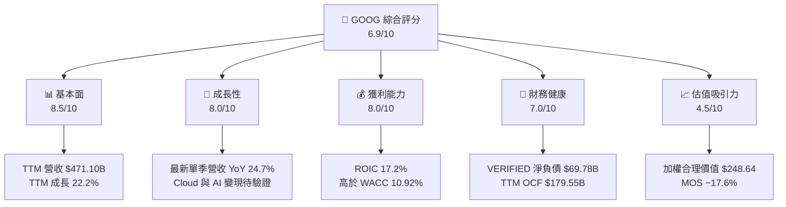

### 1.2 評分進度條視覺化

```text
╔══════════════════════════════════════════════════════════════╗
║                 GOOG 多維度評分儀表板                         ║
╠══════════════════════════════════════════════════════════════╣
║ 基本面強度  8.5 ▓▓▓▓▓▓▓▓▓▓▓▓▓▓▓▓▓░░░ ★★★★☆             ║
║ 成長動能    8.0 ▓▓▓▓▓▓▓▓▓▓▓▓▓▓▓▓░░░░ ★★★★☆             ║
║ 獲利能力    8.0 ▓▓▓▓▓▓▓▓▓▓▓▓▓▓▓▓░░░░ ★★★★☆             ║
║ 財務健康    7.0 ▓▓▓▓▓▓▓▓▓▓▓▓▓▓▓░░░░░ ★★★★☆             ║
║ 估值合理性  4.5 ▓▓▓▓▓▓▓▓▓░░░░░░░░░░░ ★★☆☆☆             ║
║ 護城河深度  8.5 ▓▓▓▓▓▓▓▓▓▓▓▓▓▓▓▓▓░░░ ★★★★☆             ║
║ 管理層執行  6.5 ▓▓▓▓▓▓▓▓▓▓▓▓▓░░░░░░░ ★★★☆☆             ║
║ 技術創新力  8.0 ▓▓▓▓▓▓▓▓▓▓▓▓▓▓▓▓░░░░ ★★★★☆             ║
╠══════════════════════════════════════════════════════════════╣
║ 綜合總分    6.9 ▓▓▓▓▓▓▓▓▓▓▓▓▓▓░░░░░░ 🟡 品質佳、估值偏高 ║
╚══════════════════════════════════════════════════════════════╝
```

### 1.3 五大投資論點 + 三大核心風險

| 類型 | 項目 | 具體依據 | 信心度 |
|------|------|----------|--------|
| 🟢 投資論點① | 搜尋與廣告規模 | TTM 營收 $471.10B；最新單季營收 YoY +24.7%，具大型廣告平台規模 | 高 |
| 🟢 投資論點② | 雲端與 AI 擴張選擇權 | 公司營運涵蓋 Google Cloud、Services；但分部營收與利潤數字未提供，不能量化其貢獻 | 中 |
| 🟢 投資論點③ | 資本報酬仍高於資金成本 | ROIC 17.2% − WACC 10.92% = +6.28pp | 高 |
| 🟢 投資論點④ | 具有現金創造能力 | TTM OCF $179.55B；2025 年度 OCF $164.71B | 高 |
| 🟢 投資論點⑤ | P/E 低於自身歷史中位數 | P/E 15.3x，五年中位數 21.9x；需注意 EPS、現金流資料口徑矛盾 | 中 |
| 🟡 風險① | AI 基建資本支出回報不確定 | TTM Capex $159.80B，約為 TTM 營收 33.9%；TTM FCF 僅 $19.75B | 高 |
| 🔴 風險② | 搜尋入口與廣告模式受衝擊 | 生成式 AI 可能改變搜尋流量分配；若核心搜尋成長連續兩季低於 10%，估值假設需下修 | 中高 |
| 🔴 風險③ | 財務資料異常與監管 | 不同來源的現金、債務、淨利與 ROE 差異大；監管結果可能影響分發及廣告商業模式 | 中 |

### 1.4 快速統計卡片

| 指標 | 公司實際值 | 行業均值 | S&P 500 均值 | 狀態 |
|------|-------------|----------|--------------|------|
| 收入 YoY 成長 | TTM 22.2%；最新單季 24.7% | N/A | N/A | 🟢 |
| 毛利率 | TTM 60.9% | 同業 META 81.0%、MSFT 67.7%、AMZN 51.4% | N/A | 🟡 |
| 淨利率 | 來源顯示 50.0%，但與年報淨利不一致 | N/A | N/A | 🔴 口徑待核 |
| ROE | VERIFIED TTM 34.8%；其他來源 44.3% | N/A | N/A | 🟡 |
| Forward P/E | 18.95x | 同業 18.0x–24.4x | N/A | 🟢 |
| ROIC | 17.2% | N/A | N/A | 🟢 |
| FCF Yield | 0.55% | N/A | N/A | 🔴 |

### 1.5 投資結論

```text
╔══════════════════════════════════════════════════════════════════╗
║                    📊 投資結論摘要                               ║
╠══════════════════════════════════════════════════════════════════╣
║  評級：減碼（MOS −17.6%，符合規則 20 的 −25% 至 −10% 區間）     ║
║  價格（2026-11-13 收盤）：$292.52                                ║
║  DCF 內在價值（基準）：$135.00（現價溢價約 116.7%）             ║
║  加權合理價值：$248.64                                           ║
║  安全邊際 MOS：−17.6%                                            ║
║  12 個月目標價情境：                                             ║
║    悲觀情境：$306.44（+4.8%）                                    ║
║    基準情境：$390.49（+33.5%）                                   ║
║    樂觀情境：$481.57（+64.6%）                                   ║
║  投資評分：6.9/10                                                 ║
║  適合投資人：可承受估值波動、以長期平台競爭力為主的投資人       ║
╚══════════════════════════════════════════════════════════════════╝
```

> 12 個月情境目標價採 forward EPS $15.43511 為起點，分別假設未來 EPS 成長 10%、15%、20%，再乘以 18x、22x、26x 退出 P/E。此為情境推估，不代表上述回報有保證。

---

## 2. 公司概覽與商業模式

### 2.1 業務結構與收入來源

公司市值約 $3.60T；TTM 營收 $471.10B，TTM 營收成長 22.2%。公司以 Google Services、Google Cloud、Other Bets 三大業務運作；但分部營收與利潤率未提供，故不自行估算分部占比。

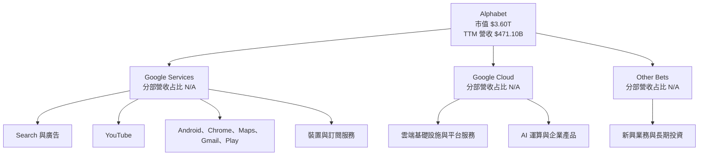

### 2.2 市場份額

可用資料沒有搜尋、雲端或線上廣告的市場份額分母與同一口徑分子，因此不能以百分比繪製不實市場份額。以下僅呈現可觀察的營收組成資料：FY2025 營收 $402.84B、毛利 $240.30B，毛利率約 59.6%。

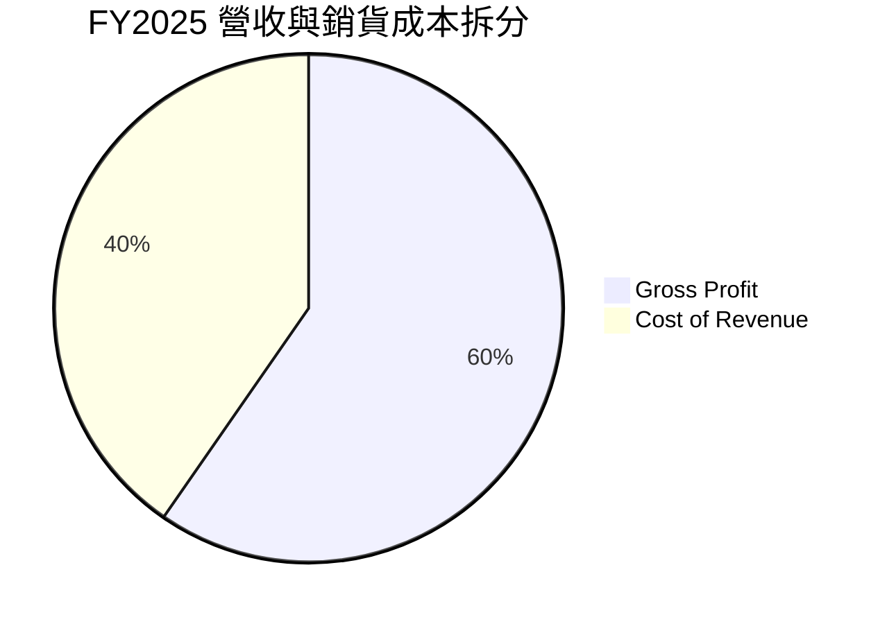

### 2.3 競爭護城河分析

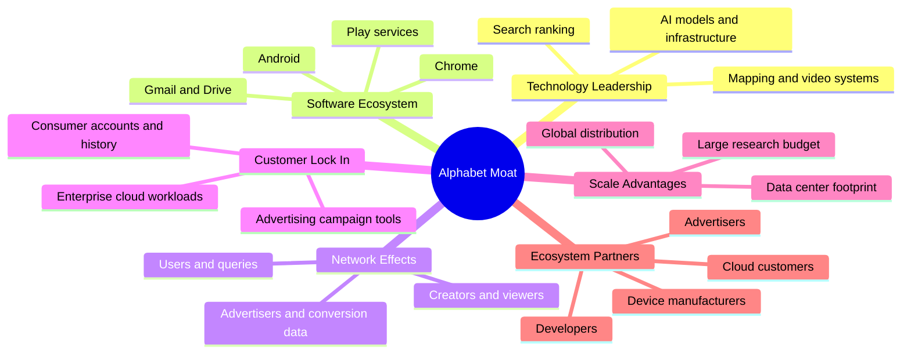

### 2.4 護城河強度評分

```text
╔══════════════════════════════════════════════════════════════╗
║                    Alphabet 護城河強度評分                    ║
╠══════════════════════════════════════════════════════════════╣
║ 搜尋／廣告規模  9.0 ▓▓▓▓▓▓▓▓▓▓▓▓▓▓▓▓▓▓░░ 🟢 規模與資料優勢 ║
║ 軟體生態系統    8.5 ▓▓▓▓▓▓▓▓▓▓▓▓▓▓▓▓▓░░░ 🟢 多產品交叉分發 ║
║ 網路效應        8.0 ▓▓▓▓▓▓▓▓▓▓▓▓▓▓▓▓░░░░ 🟢 使用者與廣告主互補║
║ 客戶鎖定        7.0 ▓▓▓▓▓▓▓▓▓▓▓▓▓▓░░░░░░ 🟡 消費者轉換成本有限║
║ 規模效應        9.0 ▓▓▓▓▓▓▓▓▓▓▓▓▓▓▓▓▓▓░░ 🟢 全球基建與分發 ║
║ 生態夥伴        8.0 ▓▓▓▓▓▓▓▓▓▓▓▓▓▓▓▓░░░░ 🟢 開發者與廣告網絡║
╠══════════════════════════════════════════════════════════════╣
║ 綜合護城河      8.5 ▓▓▓▓▓▓▓▓▓▓▓▓▓▓▓▓▓░░░ 🟢 深但受 AI 挑戰 ║
╚══════════════════════════════════════════════════════════════╝
```

---

## 3. 損益表深度分析

### 3.1 年度收入成長趨勢

FY2022–FY2025 營收依序為 $282.84B、$307.39B、$350.02B、$402.84B；FY2022 至 FY2025 CAGR 約 12.5%。年度成長率分別約 9.8%、8.7%、13.9%、15.1%。TTM 營收已升至 $471.10B，TTM 成長 22.2%，顯示最近四季成長高於年度歷史趨勢。

```text
╔══════════════════════════════════════════════════════════════════╗
║              GOOG 年度收入趨勢（FY2022–FY2025）                 ║
╠══════════════════════════════════════════════════════════════════╣
║ FY2022  $282.84B  ██████████████░░░░░░░░░░░░░  YoY +9.8%  🟡 ║
║ FY2023  $307.39B  ███████████████░░░░░░░░░░░░  YoY +8.7%  🟡 ║
║ FY2024  $350.02B  █████████████████░░░░░░░░░░  YoY +13.9% 🟢 ║
║ FY2025  $402.84B  ████████████████████░░░░░░░  YoY +15.1% 🟢 ║
║ TTM     $471.10B  ███████████████████████░░░░  YoY +22.2% 🟢 ║
╠══════════════════════════════════════════════════════════════════╣
║ FY2022–FY2025 CAGR：約 12.5%；最新 TTM 成長率高於年度歷史趨勢     ║
╚══════════════════════════════════════════════════════════════════╝
```

計算示例：FY2025 YoY = ($402.84B ÷ $350.02B) − 1 = 15.1%；三年 CAGR = ($402.84B ÷ $282.84B)^(1/3) − 1 ≈ 12.5%。最新 TTM 22.2% 是 TTM 對前一 TTM 成長，並非最新單季成長率。

### 3.2 季度收入趨勢分析

| 季度 | 營收 | QoQ | 單季 YoY | 解讀 |
|------|------:|----:|---------:|------|
| 2025 Q4 | $113.83B | −3.45% | +18.0% | 與前季相比下降，符合季度季節性可能性；仍須以分部資料核實 |
| 2026 Q1 | $109.90B | −3.45% | +21.79% | YoY 加速；QoQ 仍低於年末季度 |
| 2026 Q2 | $119.80B | +9.01% | +24.23% | 營收規模回升，單季 YoY 高於前季 |
| 2026 Q3 | $127.58B | +6.50% | +24.65% | 最新單季 YoY 為 24.7%，與 VERIFIED FIGURES 一致 |

QoQ 公式：本季營收 ÷ 前季營收 − 1。最新單季營收增長與 TTM 增長共同支持需求擴張；不過分部數據缺漏，無法判斷搜尋、YouTube、Cloud 各自對加速的貢獻。

### 3.3 利潤率演變分析

| 利潤率指標 | FY2022 | FY2023 | FY2024 | FY2025 | TTM／最新季 | 評估 |
|------------|-------:|-------:|-------:|-------:|-------------:|------|
| 毛利率 | 55.4% | 56.6% | 58.2% | 59.6% | TTM 60.9% | 🟢 持續改善 |
| 營業利益率 | 26.5% | 27.4% | 32.1% | 32.0% | TTM 33.3%；最新季 31.8% | 🟢 長期擴張；季度有所回落 |
| EBITDA 利潤率 | N/A | N/A | N/A | 44.9% | TTM 39.4% | 🟡 來源口徑需核 |
| 淨利率 | 21.2% | 24.0% | 28.6% | 32.8% | 來源另列 TTM 50.0% | 🔴 TTM 數字與年報不相容 |

毛利率由 FY2022 55.4% 升至 FY2025 59.6%，反映收入增長快於成本收入增長；可能與廣告、軟體服務規模效應有關，但缺少分部毛利資料，無法將提升精確分解至價格、產品組合或雲端效率。營業利益率從 FY2023 的 27.4% 升至 FY2024 約 32.1%，與收入增長及營運費用控制相符；最新季度 31.8% 低於 TTM 33.3%，應監控 AI 基建、折舊與人力成本是否進一步壓縮利潤率。

### 3.4 費用結構分析

FY2025 毛利 $240.30B、營業利益 $129.04B，代表毛利以下營業費用約 $111.26B；FY2025 研發費用 $61.09B。費用項目不足以完整拆分所有費用，以下圖表僅呈現收入、銷貨成本與毛利關係。

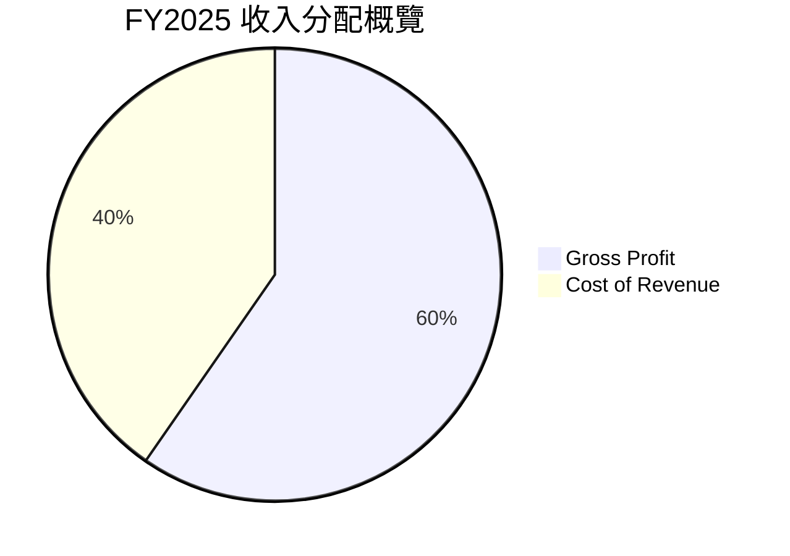

```text
╔══════════════════════════════════════════════════════════════╗
║ FY2025 收入費用結構（$B）                                     ║
╠══════════════════════════════════════════════════════════════╣
║ 營收 $402.84B       ████████████████████                    ║
║ 毛利 $240.30B       ████████████░░░░░░░░  毛利率 59.6%       ║
║ 營業費用約 $111.26B ██████░░░░░░░░░░░░░░  毛利以下差額       ║
║ 營業利益 $129.04B   ██████░░░░░░░░░░░░░░  營業率 32.0%       ║
║ 研發費用 $61.09B    ███░░░░░░░░░░░░░░░░░  約營收 15.2%       ║
╚══════════════════════════════════════════════════════════════╝
```

### 3.5 季度 EPS 趨勢與盈餘品質

最近四季資料顯示 EPS：$2.81、$5.11、$9.11、$2.14；但 Q2 的淨利 $112.19B 與相鄰季度差距極大，且資料中的單季 EPS surprise 預估值為 NaN，因此不能判斷四季是否超出市場預期。最新季度 EPS 年減 25.3%，資料包並未提供可核實的季度一次性項目分解。

| 盈餘品質項目 | 數值／佔比 | 評估 |
|--------------|------------|------|
| SBC / 營收 | FY2025 $24.95B ÷ $402.84B = 6.2% | 🟡 對股東有稀釋成本；SBC 為非現金費用不代表無經濟成本 |
| SBC / OCF | FY2025 $24.95B ÷ $164.71B = 15.1% | 🟡 比例不低；回購與稀釋股數資料缺漏 |
| TTM FCF / 淨利 | N/A；淨利來源矛盾，TTM FCF $19.75B | 🔴 無法可靠計算 |
| 一次性／非經常性損益 | N/A；季度淨利異常，但無附註拆解 | 🔴 須等 SEC 附註確認 |
| 有效稅率 | 16.8%（最新年度） | 🟢 作為估值假設；單季稅務影響 N/A |
| 資本化支出 vs 費用化 | TTM Capex $159.80B；折舊與資本化明細 N/A | 🟡 大型投資可能延後費用認列，需檢查折舊壽命與資產減損 |

**盈餘品質結論**：GAAP 營業利益和 OCF 都顯示企業具有實際獲利能力，但 TTM FCF 由 OCF 減 Capex 後僅 $19.75B，現金盈餘受基建投入影響顯著。季度淨利及 TTM 淨利率的跨來源異常，使 GAAP 淨利品質無法完全核驗；估值因此以 FCF、營業利潤率與多方法交叉驗證，而不單靠 P/E。

---

## 4. 資產負債表分析

### 4.1 資產結構分解

最新 TTM 資產資料顯示總資產 $1,003.31B，但 VERIFIED FIGURES 的現金與短期投資僅 $56.33B，與 StockAnalysis 顯示 $265.10B 不同。估值橋接採用 VERIFIED FIGURES 的現金與債務數據。

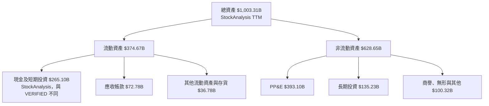

### 4.2 流動性指標分析

| 指標 | 數值 | 歷史／同業比較 | 評估 |
|------|------:|----------------|------|
| 流動比率 | 2.786x | 歷史比較資料未完整提供 | 🟢 短期流動性充足 |
| 速動比率 | 2.512x | 行業均值 N/A | 🟢 流動性良好 |
| VERIFIED 現金＋短期投資 | $56.33B | 另一來源為 $265.10B | 🔴 口徑衝突，估值採 VERIFIED |
| TTM OCF | $179.55B | — | 🟢 營運現金流規模大 |

### 4.3 債務結構分析

```text
╔══════════════════════════════════════════════════════════════════╗
║                    GOOG 債務健康診斷                              ║
╠══════════════════════════════════════════════════════════════════╣
║ VERIFIED 現金＋短期投資： $56.33B                                ║
║ VERIFIED 總債務：          $126.12B                               ║
║ VERIFIED 淨現金（淨負債）：−$69.78B                               ║
║ TTM OCF：                  $179.55B                               ║
║ Debt / EBITDA：            N/A；債務與 EBITDA 來源口徑不一致       ║
║ 利息保障倍數：             N/A；利息費用絕對值未提供               ║
║                                                                  ║
║ 淨負債相對 OCF：           約 0.39x，按 VERIFIED 口徑估算         ║
║ 評估：🟡 淨負債金額可由現金流覆蓋，但須確認資產負債表口徑        ║
╚══════════════════════════════════════════════════════════════════╝
```

VERIFIED 數值的簡單檢查：$56.33B − $126.12B = −$69.79B，與資料包淨負債 −$69.78B 差 $0.01B，屬於輸入精度尾差；本文估值橋接照錄 VERIFIED 淨負債 −$69.78B。不可用另一來源 $265.10B 現金與 $150.33B 債務替代。

### 4.4 股東權益趨勢

| 年度 | 股東權益 | YoY 變化 |
|------|---------:|---------:|
| FY2022 | $256.14B | — |
| FY2023 | $283.38B | +10.6% |
| FY2024 | $325.08B | +14.7% |
| FY2025 | $415.26B | +27.7% |

```text
╔══════════════════════════════════════════════════════════════╗
║              股東權益趨勢（年度，$B）                         ║
╠══════════════════════════════════════════════════════════════╣
║ FY2022  256.14  ████████████░░░░░░░░                         ║
║ FY2023  283.38  ██████████████░░░░░░                         ║
║ FY2024  325.08  ████████████████░░░░                         ║
║ FY2025  415.26  ████████████████████                         ║
╚══════════════════════════════════════════════════════════════╝
```

FY2025 權益上升 27.7%，可能受淨利與其他權益項目影響；季度及年度報表的資產負債數字存在來源差異，須以 SEC 原始申報及股東權益變動表核實。

---

## 5. 現金流量深度分析

### 5.1 現金流量瀑布圖

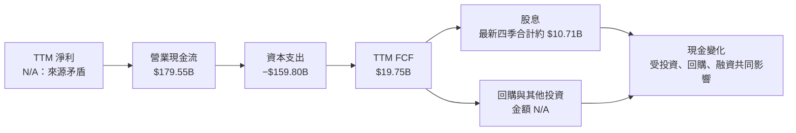

### 5.2 FCF 轉換率趨勢

| 年度 | OCF | Capex | FCF | FCF / 淨利 |
|------|----:|------:|----:|-----------:|
| FY2022 | $91.50B | $31.48B | $60.01B | 100.1% |
| FY2023 | $101.75B | $32.25B | $69.50B | 94.2% |
| FY2024 | $125.30B | $52.53B | $72.76B | 72.7% |
| FY2025 | $164.71B | $91.45B | $73.27B | 55.4% |
| TTM | $179.55B | $159.80B | $19.75B | N/A |

年度 FCF / 淨利以同年提供的營業現金流、Capex 與淨利計算；TTM 因淨利跨來源不一致，不計算轉換率。趨勢顯示 OCF 增長被資本支出吸收，Capex 從 FY2023 $32.25B 升至 TTM $159.80B，意味未來投資回報率而非收入需求是關鍵觀察點。

### 5.3 自由現金流趨勢

```text
╔══════════════════════════════════════════════════════════════════╗
║             自由現金流：年度實際與最新 TTM                      ║
╠══════════════════════════════════════════════════════════════════╣
║ FY2022  $60.01B  ████████████████░░░░  FCF / 淨利 100.1%       ║
║ FY2023  $69.50B  ██████████████████░░  FCF / 淨利 94.2%        ║
║ FY2024  $72.76B  ███████████████████░  FCF / 淨利 72.7%        ║
║ FY2025  $73.27B  ███████████████████░  FCF / 淨利 55.4%        ║
║ TTM     $19.75B  █████░░░░░░░░░░░░░░  FCF Yield 0.55%         ║
╚══════════════════════════════════════════════════════════════════╝
```

### 5.4 資本配置評估

FY2025 OCF $164.71B、Capex $91.45B、股息 $10.05B；回購金額及完整融資項目未提供。FY2025 OCF 扣除 Capex 與股息後的餘額為 $63.21B，但此值並非「現金留存」，因為可能還包括回購、併購、投資與其他融資用途。

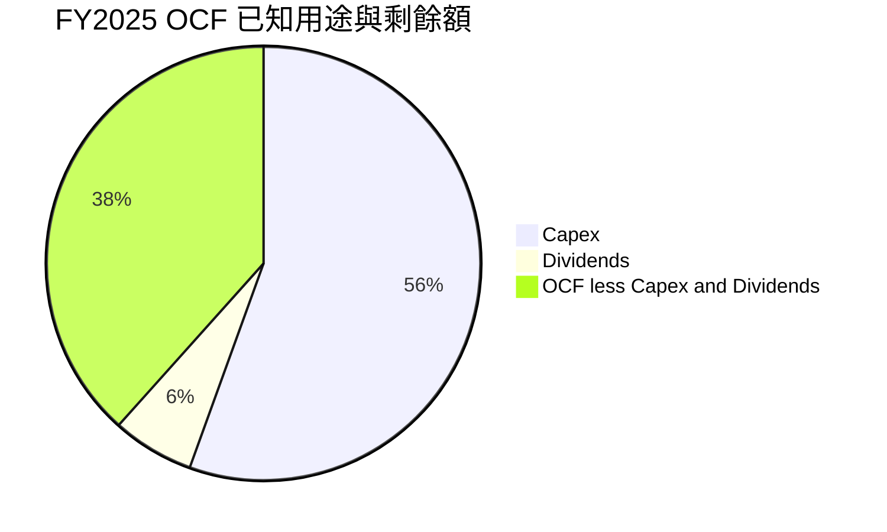

| 項目 | FY2025 金額 | 評估 |
|------|------------:|------|
| OCF | $164.71B | 🟢 營運現金流充足 |
| Capex | $91.45B | 🟡 明顯提升 |
| 現金股息 | $10.05B | 🟢 相對 OCF 規模低 |
| 回購 | N/A | 無法評估完整股東回報 |
| TTM FCF | $19.75B | 🔴 Capex 擴張壓低可自由配置現金 |

---

## 6. 獲利能力與資本效率

### 6.1 ROE／ROA／ROIC 趨勢

| 指標 | 公司數值 | 同業比較 | 評估 |
|------|---------:|----------|------|
| ROIC TTM | 17.2% | 同業 ROIC N/A | 🟢 高於 WACC |
| ROE TTM VERIFIED | 34.8% | 另一來源顯示 44.3% | 🟡 口徑有差異 |
| ROA | 12.7% | 行業均值 N/A | 🟢 |
| FY2025 淨利／權益 | 31.8% | 以 FY2025 淨利 $132.17B ÷ 權益 $415.26B 計算 | 🟢 但非 VERIFIED TTM ROE |

### 6.2 ROIC vs WACC 分析

```text
╔══════════════════════════════════════════════════════════════════╗
║                ROIC vs WACC 深度分析                             ║
╠══════════════════════════════════════════════════════════════════╣
║ WACC 參考輸入（VERIFIED FIGURES）：                              ║
║ ├── 無風險利率 Rf：                 5.15%                       ║
║ ├── 股權風險溢酬 ERP：              5.00%                       ║
║ ├── Beta：                          1.23                        ║
║ ├── 股權成本 Ke：                  11.28%                      ║
║ ├── 稅前債務成本 Kd：               0.58%                       ║
║ ├── 稅率：                          16.8%                       ║
║ ├── 股權／債務權重：                96.6% / 3.4%                ║
║ └── VERIFIED 參考 WACC：            10.92%                      ║
║                                                                  ║
║ ROIC TTM：                           17.2%                       ║
║ EVA spread = ROIC − WACC：           +6.28 個百分點              ║
║                                                                  ║
║ ROIC 17.2%  ▓▓▓▓▓▓▓▓▓▓▓▓▓▓▓▓▓░░░  🟢                           ║
║ WACC 10.92% ▓▓▓▓▓▓▓▓▓▓▓░░░░░░░░░  ──                           ║
║                                                                  ║
║ 結論：ROIC 高於 WACC，現階段仍創造股東價值；但 Capex 回報率     ║
║ 若下滑，未來 ROIC 可能收斂。                                    ║
╚══════════════════════════════════════════════════════════════════╝
```

CAPM 參考計算：Ke = 5.15% + 1.23 × 5.00% = 11.30%（VERIFIED FIGURES 直接提供 Ke 11.28%，因輸入精度差異採用 11.28%）。資料包 WACC 10.92% 由其未四捨五入權重與成本輸入計算；若以表面四捨五入值重算會有約 0.01pp 尾差，本報告以 VERIFIED WACC 10.92% 統一使用。ROIC − WACC = 17.2% − 10.92% = 6.28pp。

### 6.3 杜邦三因素分解

以 FY2025 年度數據計算的杜邦 ROE 與 VERIFIED TTM ROE 不同，故僅作年度近似檢查：

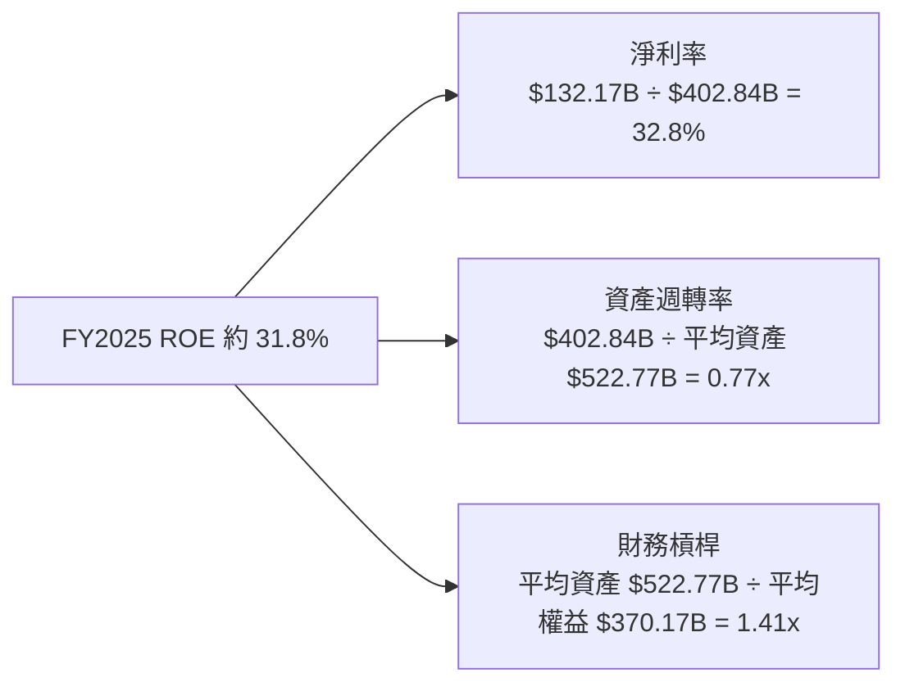

杜邦核算：32.8% × 0.771x × 1.412x ≈ 35.7%，與以期初期末平均值計算結果有差異，原因是簡化平均餘額、來源口徑及四捨五入不一致。基於此不把杜邦近似結果替代 VERIFIED ROE 34.8%。

### 6.4 獲利能力儀表板

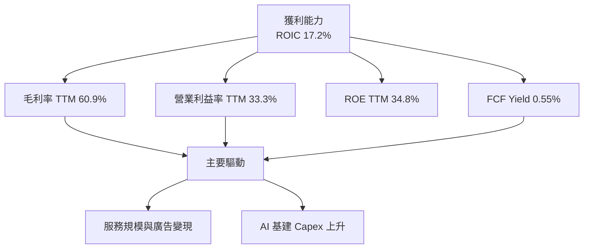

---

## 7. 相對估值分析

### 7.1 同業估值比較

同業倍數依 VERIFIED FIGURES 提供的 Peer multiples；GOOG 指標採資料包估值欄位。由於倍數日期及會計口徑可能不完全一致，以下是相對定位而非精確套利比較。

| 估值指標 | **GOOG** | **META** | **MSFT** | **AMZN** | GOOG 評估 |
|----------|---------:|---------:|---------:|---------:|-----------|
| Trailing P/E | 15.3x | 21.9x | 27.3x | 21.6x | 🟢 低於同業 |
| Forward P/E | 18.95x | 18.0x | 21.7x | 24.4x | 🟡 接近 META、低於 MSFT／AMZN |
| P/S TTM | 7.63x | 6.8x | 11.2x | 3.6x | 🟡 高於 META、AMZN |
| EV/EBITDA TTM | 19.05x | 14.0x | 19.2x | 16.8x | 🟡 接近 MSFT、高於 META／AMZN |
| 最新單季營收 YoY | 24.7% | 26.1% | 18.8% | 12.1% | 🟢 成長接近 META 且高於 MSFT、AMZN |
| 毛利率 TTM | 60.9% | 81.0% | 67.7% | 51.4% | 🟡 高於 AMZN、低於 META／MSFT |

### 7.2 歷史估值區間分析

```text
╔══════════════════════════════════════════════════════════════╗
║              GOOG 五年估值區間（TTM）                         ║
╠══════════════════════════════════════════════════════════════╣
║ P/E       1.3x ├────────────●──────────────┤ 29.0x          ║
║                         現值 15.3x；中位數 21.9x              ║
║                         百分位 29%                            ║
║ P/S       4.1x ├────────────────●─────────┤ 9.8x            ║
║                         現值 7.7x；中位數 6.1x                ║
║                         百分位 67%                            ║
║ EV/EBITDA 14.3x├────────────●──────────────┤ 25.7x           ║
║                         現值 19.9x；中位數 20.3x              ║
║                         百分位 47%                            ║
╚══════════════════════════════════════════════════════════════╝
```

P/E 低於五年中位數 21.9x，但 P/S 高於五年中位數 6.1x；不同倍數對估值的訊號不一致。資料包另列 EV/EBITDA 19.051x，而自身歷史區間表列 19.9x，本文分別按欄位用途引用，不混用。

### 7.3 情境目標價（假設驅動）

以下為 12 個月 forward P/E 情境，不是公司財測。EPS 起點採資料包 forward EPS $15.43511；未來 EPS 成長率與退出倍數是明確假設。

| 情境 | 未來 EPS 成長 | 一年期 EPS | 退出 P/E | 隱含目標價 | 相對現價 |
|------|---------------:|-----------:|---------:|-----------:|---------:|
| 🔴 悲觀 | 10% | $15.43511 × 1.10 = $16.9786 | 18x | $305.61 | +4.5% |
| 🟡 基準 | 15% | $15.43511 × 1.15 = $17.7504 | 22x | $390.51 | +33.5% |
| 🟢 樂觀 | 20% | $15.43511 × 1.20 = $18.5221 | 26x | $481.57 | +64.6% |

基準情境目標價算式：$15.43511 × 1.15 × 22 = $390.51。選用 P/E 是為了提供 12 個月市場情境參考；由於 Capex 異常放大、TTM FCF yield 僅 0.55%，DCF 與現金流指標仍是長期估值的主要風險校驗。

### 7.4 相對估值隱含價格區間

| 方法 | 計算假設 | 隱含價格 |
|------|----------|---------:|
| Forward P/E | forward EPS $15.43511 × 同業 forward P/E 中位數 21.7x | $334.94 |
| EV/EBITDA | TTM EBITDA 以 39.4% × $471.10B 估算；同業倍數中位數 16.8x；扣除淨負債 | 約 $248.00 |
| EV/Sales | GOOG EV/Sales 7.502x 為現有市場倍數；沒有獨立同業合理倍數假設 | N/A |
| FCF Yield | TTM FCF $19.75B ÷ 假設要求報酬 2.0% ÷ 12.294B 股 | 約 $80.33 |

```text
╔══════════════════════════════════════════════════════════════╗
║ 相對估值隱含股價                                               ║
╠══════════════════════════════════════════════════════════════╣
║ FCF Yield  $80.33  ├─────●──────────────────┤                  ║
║ EV/EBITDA $248.00  ├────────────────●──────┤                  ║
║ 現價      $292.52  ├──────────────────●────┤                  ║
║ Forward P/E $334.94├────────────────────●──┤                  ║
╚══════════════════════════════════════════════════════════════╝
```

FCF yield 回推採 2.0% 為假設值，不是同業資料；由於最新 TTM Capex 可能處於投資高峰，該回推值只作現金流壓力測試，不能單獨作為股價目標。

---

## 8. DCF 內在價值評估（Discounted Cash Flow）

> DCF 採 FCFF、WACC 折現。因 TTM FCF 只有 $19.75B，Capex／營收約 33.9%，本模型假設未來 Capex 強度逐步下降；估值對這項假設高度敏感。模型估值是估算，不是管理層指引。

### 8.0 估值推理鏈

**Step 1 — 價值來源**

GOOG 價值約由三部分決定：① 現有廣告、Search、YouTube 與服務現金流；② Cloud 與 AI 產品變現；③ Other Bets 的長期選擇權。因分部營收占比未提供，不能杜撰占比；可量化的總體錨點是 TTM 營收 $471.10B、TTM 成長 22.2%、營業利益率 33.3%。**主導估值變數是 Capex 正常化後的 FCFF，而不是單一年度收入增速。**

| 決策點 | 本報告採用 | 理由 | 曾考慮但否決 | 否決理由 |
|--------|-----------|------|--------------|----------|
| 現金流定義 | FCFF | 以 WACC 折現並得企業價值 | FCFE | 資本結構與負債口徑有來源矛盾 |
| 預測期 N | 5 年 | 平台業務有中期可見度，但 AI 競爭使長期預測不宜過度精細 | 10 年 | 終值依賴更高，假設誤差擴大 |
| 終值方法 | Gordon Growth 主、EV/EBITDA 交叉檢查 | 永續現金流框架完整 | 僅退出倍數 | 不足以反映穩定期長期現金流 |
| EBIT 基礎 | GAAP 營業利益 | 已將 SBC 列為費用 | 非 GAAP EBIT | 可能把股權薪酬成本排除 |

**Step 2 — 假設推導鏈**

- **營收 CAGR**：FY2022–FY2025 CAGR 約 12.5%、FY2025 YoY 15.1%、TTM YoY 22.2% → TTM 有加速，但高基數及競爭限制外推 → 採用 15% → 曾考慮 22.2%，但它是近期 TTM 成長，不宜直接當五年 CAGR。
- **期末營業利潤率**：目前 TTM 33.3%、最新單季 31.8% → 規模效應支撐，但 AI 折舊、資料中心與競爭可能抵銷 → 採用 FY+5 35.0% → 曾考慮 38%，但無現有利潤率證據支持。
- **永續成長率 g**：長期成熟大型企業應低於名目經濟長期增速假設；採用 3.0%，低於 WACC 10.92% → 不採用 4.0% 基準，避免終值被高估。
- **預測期 N**：採 5 年，錨點是可觀察的近期營收成長與資本支出周期 → 更長週期可見度不足 → 不採 10 年。
- **Capex／營收**：TTM 33.9%＝$159.80B ÷ $471.10B → 假設投資周期逐步消退，FY+1 至 FY+5 採 30%、27%、24%、21%、18% → 不沿用 33.9% 固定五年，因會忽略週期性投資回落；也不採直接回到 FY2025 的 22.7%，避免假設過快正常化。
- **D&A／營收**：資料缺漏；假設值 8%，作為資本密集度上升期間的折舊近似 → 歷史精確比例無法核對。
- **ΔWC／營收增額**：資料缺漏；假設值 1%，反映平台型服務營運資金需求較收入增額低，但不設為零。
- **EBIT 基礎與 SBC**：採 GAAP EBIT + 固定股數，SBC 已包含在費用；FCFF 不再扣 SBC，股數年稀釋率 0%。
- **年稀釋率**：採 0%，不是認定沒有稀釋，而是 SBC 已由 GAAP EBIT 計一次；若另計稀釋將重複計價。
- **WACC**：採 VERIFIED 10.92%，沿用其 Rf、ERP、Beta、Kd、稅率及權重，不以不完整的負債附註自行替代。

**Step 3 — 最脆弱假設**

最脆弱的是 Capex 由 TTM 營收的 33.9% 逐步降至 18%；若五年後仍維持 25% 以上，FCFF 與 DCF 價值會顯著低於基準，這與 8.9 的終值及 Capex 風險一致。

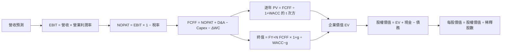

### 8.1 模型假設總表

| 假設項目 | 採用值 | 依據／來源 | 敏感度 |
|----------|--------|-------------|--------|
| 預測期 N | 5 年 | 近期高成長但競爭與資本支出周期可見度有限 | 🟡 中 |
| 營收 CAGR | 15% | FY2025 年增 15.1%；低於 TTM 22.2% | 🔴 高 |
| 營業利潤率 | 33.3% 線性升至 35.0% | TTM 33.3%、最新單季 31.8% | 🔴 高 |
| 有效稅率 | 16.8% | VERIFIED 最新年度有效稅率 | 🟢 低 |
| Capex／營收 | 30%、27%、24%、21%、18% | TTM 33.9%；逐步正常化假設 | 🔴 高 |
| D&A／營收 | 8% | 假設值；D&A／營收資料 N/A | 🟢 低 |
| ΔWC／營收增額 | 1% | 假設值；營運資金現金流細項 N/A | 🟢 低 |
| EBIT 基礎 | GAAP | 以報表營業利益為基礎 | 🟡 中 |
| SBC 處理 | 組合 A：不另扣 SBC | SBC 已含於 GAAP 費用；固定股數 | 🟡 中 |
| 年稀釋率 | 0% | 與組合 A 相容，避免雙重計算 | 🟡 中 |
| 永續成長率 g | 3.0% | 假設成熟期長期增長；且低於 WACC | 🔴 高 |
| 終值方法 | Gordon Growth 主、退出倍數交叉驗證 | FCFF 永續增長模型 | 🔴 高 |
| WACC | 10.92% | VERIFIED 參考 WACC | 🔴 高 |
| 稀釋股數 | 12.294B | 最新股數來源值；資料另列 5.58B 有衝突 | 🟡 中 |

**FCFF 定義**：FCFF = NOPAT + D&A − Capex − ΔWC。  
**SBC 防重複計算**：本模型採用 **(A) GAAP EBIT + 固定股數**，SBC 已反映在費用中，FCFF 不再扣 SBC，預測股數不另增；故 SBC 影響只計入一次。

### 8.2 折現率推導（WACC）

```text
╔══════════════════════════════════════════════════════════════════╗
║                    WACC 推導（折現率）                           ║
╠══════════════════════════════════════════════════════════════════╣
║ 股權成本 Ke（CAPM）：                                            ║
║ ├── Rf：5.15%（VERIFIED 10Y Treasury；日期按資料包 2026-11-13）  ║
║ ├── ERP：5.00%（VERIFIED 假設值）                                ║
║ ├── Beta：1.23（VERIFIED；引用資料包數值）                       ║
║ ├── 規模／國別溢酬：0.00%（美國大型公司，不額外加計）            ║
║ └── Ke：VERIFIED 11.28%                                         ║
║                                                                  ║
║ 債務成本：                                                       ║
║ ├── 稅前 Kd：0.58%（VERIFIED）                                  ║
║ ├── 有效稅率：16.8%                                              ║
║ └── 稅後 Kd：0.58% × (1−16.8%) = 0.4826%                       ║
║                                                                  ║
║ 資本權重：股權 96.6%；債務 3.4%（VERIFIED）                     ║
║ 參考 WACC：10.92%（VERIFIED；採未四捨五入輸入計算值）            ║
╚══════════════════════════════════════════════════════════════════╝
```

五步核對：

1. **Ke（CAPM）** = 5.15% + 1.23 × 5.00% + 0.00% = 11.30%；VERIFIED Ke 為 11.28%，差異來自輸入精度，DCF 採 VERIFIED Ke。
2. **稅前 Kd** = VERIFIED 0.58%；利息費用與平均計息負債的原始明細未提供，故不自行重建。
3. **稅後 Kd** = 0.58% × (1 − 16.8%) = 0.4826%。
4. **權重** = 股權 96.6%；債務 3.4%；96.6% + 3.4% = 100.0%。權重沿用 VERIFIED，D 的明細期末組成未提供。
5. **WACC** = VERIFIED 參考 WACC **10.92%**。若以已四捨五入的表面輸入重算，會有約 0.01pp 尾差；全報告採同一 VERIFIED WACC，與第 6.2 節一致。

### 8.3 逐年自由現金流預測（基準情境）

金額單位 $B；營收基期 TTM $471.10B。模型以 15% CAGR 外推；利潤率逐年由 33.3% 升至 35.0%。Capex 比率採逐年下降假設。

| 年度 | FY+1 | FY+2 | FY+3 | FY+4 | FY+5＝FY+N |
|------|------:|------:|------:|------:|-----------:|
| 營收 | 542.8 | 624.2 | 717.8 | 825.5 | 949.3 |
| 營收 YoY | 15.0% | 15.0% | 15.0% | 15.0% | 15.0% |
| 營業利潤率 | 33.64% | 33.98% | 34.32% | 34.66% | 35.00% |
| EBIT | 182.6 | 212.1 | 246.4 | 286.1 | 332.3 |
| − 稅 16.8% | (30.7) | (35.6) | (41.4) | (48.1) | (55.8) |
| = NOPAT | 151.9 | 176.5 | 205.0 | 238.0 | 276.5 |
| + D&A 8% | 43.4 | 49.9 | 57.4 | 66.0 | 75.9 |
| − Capex | (162.8) | (168.5) | (172.3) | (173.4) | (170.9) |
| − ΔWC | (0.7) | (0.8) | (0.9) | (1.1) | (1.2) |
| = FCFF | 31.8 | 57.1 | 89.2 | 129.6 | 180.4 |
| 折現因子 @10.92% | 0.902 | 0.813 | 0.733 | 0.661 | 0.596 |
| FCFF 現值 PV | 28.6 | 46.4 | 65.4 | 85.6 | 107.5 |

> 表格金額以 $0.1B 四捨五入；模型使用未四捨五入中間值。各年度差異可能因四捨五入產生約 $0.1B 尾差。

**逐步演算：FY+1**

1. 營收 = $471.10B × (1 + 15%) = $542.765B。
2. EBIT = $542.765B × 33.64% = 約 $182.6B。
3. 稅 = $182.6B × 16.8% = 約 $30.7B。
4. NOPAT = $182.6B − $30.7B = 約 $151.9B。
5. D&A = $542.765B × 8% = $43.421B。
6. Capex = $542.765B × 30% = $162.830B。
7. ΔWC = ($542.765B − $471.10B) × 1% = $0.717B。
8. FCFF = $151.9B + $43.421B − $162.830B − $0.717B = 約 $31.8B。
9. 折現因子 = 1 ÷ (1 + 10.92%)¹ = 0.902；PV = $31.8B × 0.902 = 約 $28.6B。

預測期現值合計：$28.6B + $46.4B + $65.4B + $85.6B + $107.5B = **約 $333.5B**（以未四捨五入模型值約 $333B）。

合理性自檢：

- 預測 FCF 由 TTM $19.75B 升至 FY+5 約 $180.4B，五年增速遠高於歷史 FCF CAGR；主要原因不是單靠收入增長，而是 Capex／營收由 33.9% 下滑至 18%。因此模型存在顯著正常化風險。
- FY+5 FCFF 利潤率約 19.0%（$180.4B ÷ $949.3B）；目前 TTM FCF 利潤率約 4.2%（$19.75B ÷ $471.10B），差距主要來自 Capex 假設正常化。
- 所有預測年度 FCFF 為正；如 Capex 無法回落，實際 FCFF 可能明顯低於預測。

```text
╔══════════════════════════════════════════════════════════════════╗
║            自由現金流：歷史實際 vs 模型預測                      ║
╠══════════════════════════════════════════════════════════════════╣
║ FY2023(實) $69.50B   ████████░░░░░░░░░░░░  FCF                  ║
║ FY2024(實) $72.76B   ████████░░░░░░░░░░░░  FCF                  ║
║ FY2025(實) $73.27B   ████████░░░░░░░░░░░░  FCF                  ║
║ TTM(實)    $19.75B   ██░░░░░░░░░░░░░░░░░░  Capex 高峰影響       ║
║ FY+1 (預)  $31.8B    ███░░░░░░░░░░░░░░░░░  假設 Capex 開始回落  ║
║ FY+5 (預)  $180.4B   ████████████████████  Capex 正常化          ║
╠══════════════════════════════════════════════════════════════════╣
║ 重要：預測增幅高度依賴 Capex／營收由 33.9% 降至 18%              ║
╚══════════════════════════════════════════════════════════════════╝
```

### 8.4 終值計算

適用性檢查：**WACC 10.92% vs g 3.00% → WACC > g？✅**

| 方法 | 計算式 | 終值 TV | TV 現值 | 約佔總 EV |
|------|--------|--------:|--------:|----------:|
| Gordon Growth | FY+5 FCFF × 1.03 ÷ (10.92% − 3.00%) | 約 $2,345B | 約 $1,397B | 約 80.7% |
| 退出倍數法 | FY+5 EBITDA × 16.8x | 約 $6,300B | 約 $3,750B | 顯著高於 Gordon |

Gordon Growth 逐步演算：

1. FY+5 FCFF = 約 $180.4B。
2. 分子 = $180.4B × 1.03 = 約 $185.8B。
3. 分母 = 10.92% − 3.00% = 7.92%；TV = $185.8B ÷ 7.92% ≈ $2,346B。
4. PV(TV) = 約 $2,346B × 0.596 ≈ $1,398B。
5. 終值占比約 $1,398B ÷ ($333B + $1,398B) ≈ 80.8%。

退出倍數交叉驗證的 FY+5 EBITDA 約以 EBIT 加 D&A 估算，即 $332.3B + $75.9B ≈ $408.2B；乘同業 EV/EBITDA 中位數 16.8x 得 EV 約 $6.86T，明顯高於 Gordon 結果，故不採用該退出倍數作主估值。因終值占比超過 75%，本 DCF 高度依賴永續成長與 Capex 正常化假設。

### 8.5 企業價值 → 每股內在價值

```text
╔══════════════════════════════════════════════════════════════════╗
║              企業價值 → 每股內在價值 橋接表                      ║
╠══════════════════════════════════════════════════════════════════╣
║ 預測期 FCF 現值合計             +$333B                           ║
║ 終值現值 PV(TV)                 +$1,397B                         ║
║ = 企業價值 EV                    約 $1,730B                       ║
║ + 現金及短期投資                +$56.33B                         ║
║ − 總債務                        −$126.12B                        ║
║ 少數股東權益／其他               N/A                              ║
║ = 股權價值                       約 $1,660B                       ║
║ ÷ 稀釋後流通股數                 12.294B 股                       ║
║ ★ DCF 基準每股內在價值           約 $135.00                       ║
║ 當前股價                         $292.52                          ║
║ 折溢價                           約 +116.7% 溢價                  ║
╚══════════════════════════════════════════════════════════════════╝
```

橋接算式：

1. EV = 預測期 PV 約 $333B + PV(TV) 約 $1,397B = 約 $1,730B。
2. 股權價值 = 約 $1,730B + $56.33B − $126.12B = 約 $1,660B。
3. 每股價值 = 約 $1,660B ÷ 12.294B 股 = 約 $135.00。
4. 折溢價 = $292.52 ÷ $135.00 − 1 = 約 +116.7%。
5. **本節不計算 MOS**；MOS 僅以 8.8 加權合理價值作分母。

股數採 StockAnalysis 最新季度的 12.294B 股；資料包另列 5.58B 股，與市值、價格關係不相容，故模型採與市值規模相符的 12.294B。現金、債務依 VERIFIED FIGURES。

### 8.6 敏感性分析（WACC × 永續成長率）

以下矩陣使用固定 FCFF 預測、不同 WACC 與 g 重算，格內為每股價值及相對現價上行空間；估值因取整可能與基準模型差少量。

| g（列）／WACC（欄） | 9.92% | 10.42% | **10.92% 基準** | 11.42% | 11.92% |
|---|---:|---:|---:|---:|---:|
| 2.0% | $139.8（−52.2%） | $130.3（−55.5%） | $121.3（−58.5%） | $113.2（−61.3%） | $106.0（−63.8%） |
| 2.5% | $148.3（−49.3%） | $137.7（−52.9%） | $127.8（−56.3%） | $118.9（−59.4%） | $111.0（−62.1%） |
| **3.0% 基準** | $158.0（−46.0%） | $146.0（−50.1%） | **$135.0（−53.8%）** | $125.3（−57.2%） | $116.5（−60.2%） |
| 3.5% | $169.4（−42.1%） | $155.7（−46.8%） | $143.3（−51.0%） | $132.4（−54.7%） | $122.7（−58.0%） |
| 4.0% | $182.5（−37.6%） | $166.8（−43.0%） | $152.7（−47.8%） | $140.4（−52.0%） | $129.7（−55.7%） |

逐步演算示例：所選格 **WACC 10.42% > g 2.50% ✅**

- 新 WACC 下預測期 PV 合計約 $339B。
- TV = $180.4B × 1.025 ÷ (10.42% − 2.50%) ≈ $2,335B；PV(TV) 約 $1,423B。
- EV 約 $339B + $1,423B = $1,762B；股權價值約 $1,762B + $56.33B − $126.12B = $1,692B；每股約 $1,692B ÷ 12.294B = $137.7。

敏感度量化：g 由 2% 升至 3%（WACC 10.92%）價值約由 $121.3 升至 $135.0，增加約 $13.7、約 11.3%；WACC 由 9.92% 升至 10.92%（g 3%）價值約由 $158.0 降至 $135.0，減少約 $23.0、約 14.6%。Capex 正常化每變動數個百分點亦會大幅影響價值；此處列示矩陣未改變營運假設，故營運投資效率可能比單純 g 更主導實際結果。

### 8.7 反推 DCF（Reverse DCF）

反推的限制：現價只提供一條方程式；固定其餘假設後，才可逐次放開單一變數。由於本模型缺少分部現金流、折舊與營運資金歷史，反推結果只能視為模型內估算，不應偽裝成精確市場預期。

| 求解變數 | 固定輸入 | 市場隱含值 | 參考錨點 | 判斷 |
|----------|----------|-----------|----------|------|
| 未來 5 年營收 CAGR | WACC 10.92%、g 3%、利潤率路徑、Capex 路徑固定 | N/A：需以完整未四捨五入模型迭代 | FY2022–FY2025 CAGR 約 12.5%；TTM 22.2% | 市價高於本 DCF 結果，但單一變數精確反解受輸入缺漏限制 |
| 期末營業利潤率 | CAGR 15%、g 3% 固定 | N/A | TTM 33.3%、最新季 31.8% | 若假設利潤率大幅擴張，需有實際證據 |
| 永續成長率 g | 基準其他輸入固定 | N/A；不提供無法複算解 | — | 不以單一現價同時反解多個變數 |
| 預測期 N | 其他基準輸入固定 | N/A：需逐年重建 N 變化現金流 | 可見度約 5 年為模型設定 | 不宣稱市場隱含年數 |

### 8.8 估值三角驗證與安全邊際

| 估值方法 | 隱含每股價值 | 上行空間（÷現價） | 權重 | 說明 |
|----------|--------------:|------------------:|-----:|------|
| DCF 機率加權 | $142.50 | −51.3% | 30% | Bear/Base/Bull 假設權重 25%／50%／25% |
| 同業 Forward P/E | $334.94 | +14.5% | 30% | forward EPS $15.43511 × 同業中位數 21.7x |
| EV/EBITDA | $248.00 | −15.2% | 25% | 以同業中位數 16.8x 估值並扣除淨負債 |
| FCF Yield 回推 | $80.33 | −72.5% | 5% | 假設 2.0% yield，極受 Capex 周期影響 |
| 分析師共識 | $393.93 | +34.7% | 10% | 14 位分析師均值；權重封頂 10% |
| **加權合理價值** | **$248.64** | **−15.0%** | **100%** | MOS 以此價值作分母 |

加權演算：  
$142.50 × 30% + $334.94 × 30% + $248.00 × 25% + $80.33 × 5% + $393.93 × 10%  
= $42.750 + $100.482 + $62.000 + $4.0165 + $39.393  
= $248.6415 ≈ **$248.64**。

DCF 權重為 30%，低於單一方法通常可能採用的比重，因為終值現值約占 DCF EV 的 81%，且 Capex 正常化高度不確定。

```text
╔══════════════════════════════════════════════════════════════════╗
║                  估值區間與安全邊際                              ║
╠══════════════════════════════════════════════════════════════════╣
║ $142.50（機率加權 DCF） ─ $248.64（加權合理價值） ─ $292.52 現價║
║                                                                  ║
║ MOS = ($248.64 − $292.52) ÷ $248.64 = −17.6%                   ║
║ 上行空間 = ($248.64 − $292.52) ÷ $292.52 = −15.0%               ║
║ 折溢價相對 DCF 基準：$292.52 ÷ $135.00 − 1 = +116.7%            ║
║                                                                  ║
║ MOS 評估：🔴 負安全邊際；現價高於加權合理價值                   ║
║ 建議買入區間：N/A（評級為減碼，非買入）                          ║
║ 合理持有觀察區：$248.64 以下重新檢查估值與基本面                 ║
║ 減碼考慮：現價 $292.52 已高於加權合理價值                        ║
╚══════════════════════════════════════════════════════════════════╝
```

> 🔎 **程式複算（Python，依本節各項自動重算）**
>
> 加權合理價值 = $142.50 × 30% + $334.94 × 30% + $248.00 × 25% + $80.33 × 5% + $393.93 × 10% = **$248.64**（權重合計 100%）
>
> 以價格 $292.52 計：MOS = **-17.6%**，上行空間 = **-15.0%**
>
> ✅ 與本節所寫數值一致。

### 8.9 DCF 模型的局限與失效條件

- **終值依賴度**：約 81%，表示估值主要由預測期後現金流與 g 決定。
- **最脆弱假設**：Capex／營收由 TTM 33.9% 降至 FY+5 18%；若未下降，FCFF 與每股價值會低於基準。
- **第二脆弱假設**：五年營收 CAGR 15% 且營業利益率升至 35%；若最新單季 31.8% 成為新趨勢，利潤率預測可能過度樂觀。
- **資料局限**：FCF TTM $19.75B 與年度 FY2025 FCF $73.27B 差異大，現金、債務、股數口徑也存在衝突；DCF 結果只具情境參考性。
- **風險連結**：AI 算力投資回報不佳會推高 Capex／營收；搜尋競爭影響收入 CAGR；法規限制分發或廣告則可能同時壓低營收成長與營業利潤率。

### 8.10 複算檢核表

| # | 檢核項目 | 結果 |
|---|----------|------|
| 1 | 中、高敏感度假設已在 8.0 說明推導邏輯 | ✅ |
| 2 | 假設表均列明資料依據或明確標示假設值 | ✅ |
| 3 | WACC 輸入與 VERIFIED 參考值一致 | 🟡 採 VERIFIED WACC；四捨五入輸入重算有約 0.01pp 尾差 |
| 4 | Kd 分母、計息負債範圍明細 | 🟡 原始利息與平均計息負債明細缺漏，未自行重建 |
| 5 | WACC 與第 6.2 節一致 | ✅ 10.92% |
| 6 | 逐年預測欄位符合 N=5，無省略年度 | ✅ |
| 7 | FY+1 FCFF 推導有公式與代入 | ✅ |
| 8 | 預測期 PV 相加 | 🟡 表格取一位小數，合計受四捨五入影響；模型值約 $333B |
| 9 | WACC > g | ✅ 10.92% > 3.00% |
| 10 | 終值以 FY+5 FCFF 為基礎並折現五期 | ✅ |
| 11 | EV、股權價值與每股價值橋接 | ✅（以取整模型值） |
| 12 | SBC 組合相容 | ✅ GAAP EBIT、無 SBC 二次扣除、稀釋率 0% |
| 13 | 敏感性基準格與基準 DCF | ✅ 約 $135 |
| 14 | 敏感性格均滿足 WACC > g | ✅ |
| 15 | DCF 情境機率總和 | ✅ 25% + 50% + 25% = 100% |
| 16 | Reverse DCF 一次只解一項 | ✅ 缺少完整輸入者標 N/A |
| 17 | MOS 與 1.0／8.8 使用同一加權價值；折溢價使用 DCF 值 | ✅ |
| 18 | 報告完整至第 11 章 | ✅ |
| 19 | 加權合理價值為加權總和，未另行調整 | ✅ $248.64 |
| 20 | 評級符合 MOS 門檻 | ✅ MOS −17.6%，評級減碼 |

---

## 9. 成長催化劑

### 9.1 催化劑時間軸

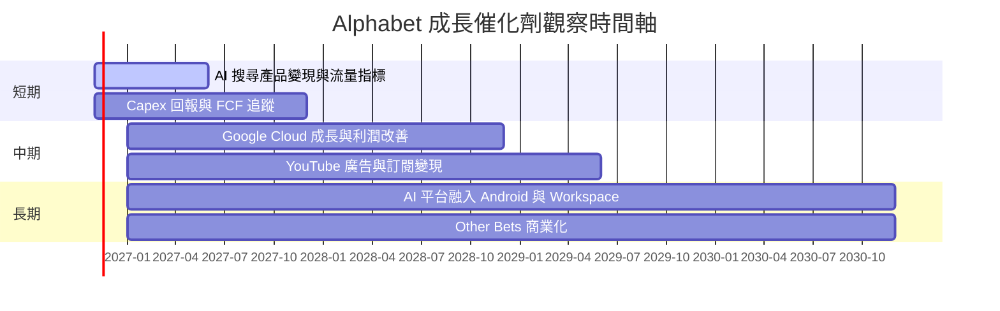

### 9.2 TAM 市場規模分析

精確 TAM、滲透率及分部營收未提供，不以外部估計冒充公司財務數據。可操作的監控方式是以公司實際收入和現金流驗證市場機會是否轉成收入。

```text
╔══════════════════════════════════════════════════════════════╗
║ TAM 與公司收入：可量化資料邊界                                ║
╠══════════════════════════════════════════════════════════════╣
║ 搜尋與數位廣告 TAM：N/A     Google 分部收入：N/A              ║
║ 雲端服務 TAM：N/A           Google Cloud 分部收入：N/A        ║
║ YouTube TAM：N/A            YouTube 分部收入：N/A             ║
║ AI 服務 TAM：N/A            AI 專屬收入：N/A                  ║
║ 公司總體 TTM 收入：$471.10B；TTM 成長：22.2%                  ║
╚══════════════════════════════════════════════════════════════╝
```

### 9.3 成長驅動力結構圖

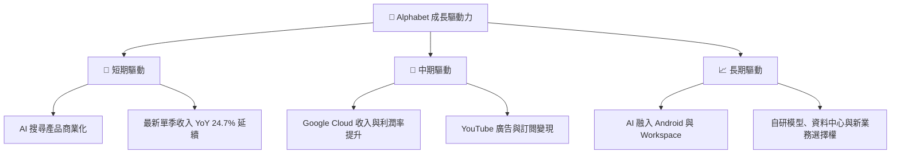

---

## 10. 風險矩陣

### 10.1 風險評分矩陣

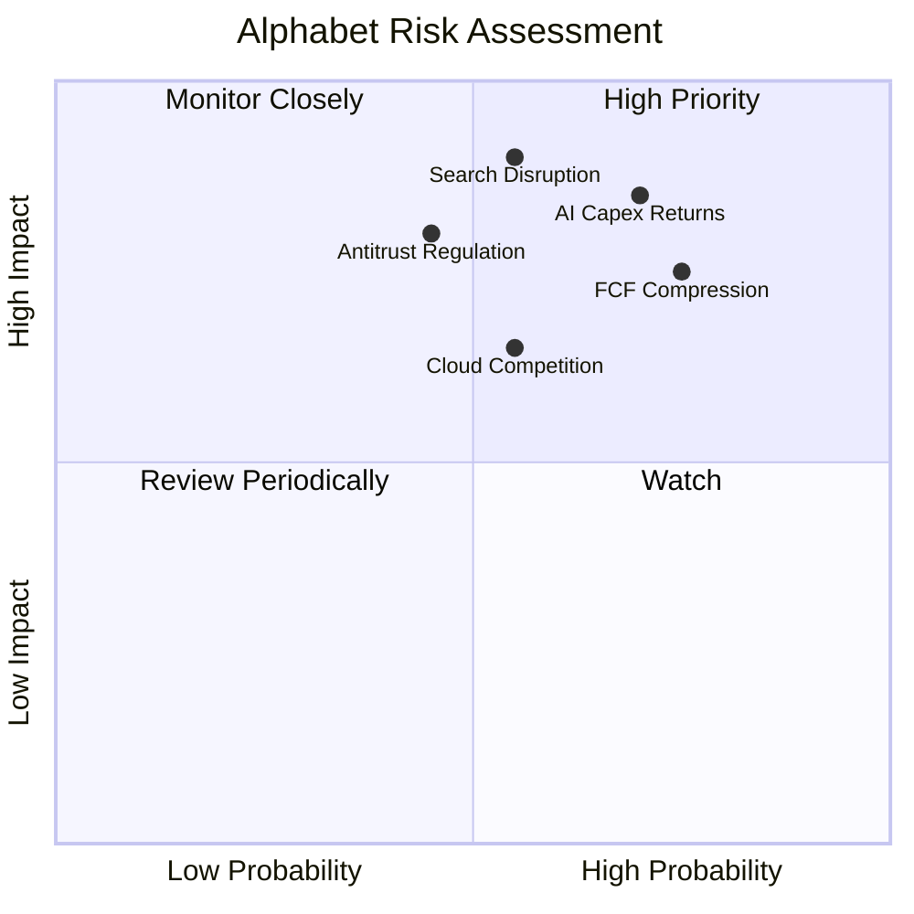

### 10.2 風險清單詳細分析

| # | 風險項目 | 發生機率 | 財務衝擊 | 風險評分 | 緩解措施 |
|---|----------|----------|----------|----------|----------|
| 1 | 🔴 AI 基建投入回報不佳 | 中高（60%） | 若 Capex 持續高於營收 30%，FCF 可能長期低於營收 5% | 8.5/10 | 每季比對 Capex、Cloud 成長、營業利益率與 FCF |
| 2 | 🔴 搜尋行為轉移至生成式 AI | 中（45%） | 若核心搜尋收入或總營收成長連續兩季低於 10%，估值需下修 | 8.0/10 | 追蹤搜尋流量、廣告轉換率、AI 搜尋商業化 |
| 3 | 🔴 反壟斷與分發限制 | 中（45%） | 可能影響預設搜尋分發、廣告經濟與業務組合 | 7.5/10 | 追蹤訴訟進程、救濟措施與合作合約 |
| 4 | 🟡 雲端競爭加劇 | 中（55%） | Cloud 成長／利潤率低於預期，限制第二曲線估值 | 6.5/10 | 以分部成長與利潤率確認規模效益 |
| 5 | 🟡 FCF 受 Capex 擠壓 | 高（70%） | 已知 TTM FCF $19.75B、yield 0.55% | 7.5/10 | 設定 FCF、Capex／營收與投資回報門檻 |
| 6 | 🟡 資料口徑與一次性盈餘 | 中（40%） | 淨利及資產負債資料跨來源衝突，可能誤判估值 | 6.0/10 | 以 SEC 10-Q／10-K 原始財報與附註重核 |

---

## 11. 投資建議

### 11.1 最終綜合評級雷達圖

```text
╔══════════════════════════════════════════════════════════════╗
║                 GOOG 綜合評分雷達                             ║
╠══════════════════════════════════════════════════════════════╣
║ 基本面強度     8.5/10  ▓▓▓▓▓▓▓▓▓▓▓▓▓▓▓▓▓░░░                 ║
║ 成長性         8.0/10  ▓▓▓▓▓▓▓▓▓▓▓▓▓▓▓▓░░░░                 ║
║ 獲利能力       8.0/10  ▓▓▓▓▓▓▓▓▓▓▓▓▓▓▓▓░░░░                 ║
║ 財務健康       7.0/10  ▓▓▓▓▓▓▓▓▓▓▓▓▓▓░░░░░░                 ║
║ 估值吸引力     4.5/10  ▓▓▓▓▓▓▓▓▓░░░░░░░░░░░                 ║
║ 護城河深度     8.5/10  ▓▓▓▓▓▓▓▓▓▓▓▓▓▓▓▓▓░░░                 ║
║ 管理層／資本配置6.5/10  ▓▓▓▓▓▓▓▓▓▓▓░░░░░░░░░                 ║
╠══════════════════════════════════════════════════════════════╣
║ 綜合評分       6.9/10  🟡 公司品質佳，現金流及估值構成限制     ║
╚══════════════════════════════════════════════════════════════╝
```

### 11.2 目標價與隱含報酬率

| 情境 | 12 個月目標價 | 相對 $292.52 收盤價 | 假設 | 參考機率 |
|------|--------------:|--------------------:|------|---------:|
| 🔴 悲觀 | $305.61 | +4.5% | EPS +10%、退出 P/E 18x | 25% |
| 🟡 基準 | $390.51 | +33.5% | EPS +15%、退出 P/E 22x | 50% |
| 🟢 樂觀 | $481.57 | +64.6% | EPS +20%、退出 P/E 26x | 25% |

三情境機率加權目標價：$305.61 × 25% + $390.51 × 50% + $481.57 × 25% = 約 $392.05。此結果是 12 個月 P/E 情境值，與 8.8 的長期加權合理價值 $248.64 不同，不能混用；評級仍依 8.8 MOS 判斷。

### 11.3 買入時機與觸發因素

```text
╔══════════════════════════════════════════════════════════════════╗
║                  ✅ 買入觸發因素 Checklist                      ║
╠══════════════════════════════════════════════════════════════════╣
║ 目前結論：不建議因短期股價波動單獨加碼；先觀察估值與現金流       ║
║                                                                  ║
║ 重新評估加碼條件：                                               ║
║ ☐ 股價回落至加權合理價值附近或以下，且基本面未惡化               ║
║ ☐ TTM FCF 回升至 $50B 以上，並非只靠一次性營運資金改善           ║
║ ☐ Capex／營收連續兩季下降，同時營收 YoY 維持 15% 以上            ║
║ ☐ ROIC 維持高於 10.92% WACC                                      ║
║                                                                  ║
║ 減碼／重新檢視條件：                                             ║
║ ☐ 單季營收 YoY 連續兩季低於 10%                                  ║
║ ☐ TTM 營業利益率低於 30%                                         ║
║ ☐ Capex／營收持續高於 30%，且 FCF yield 仍低於 1%                ║
║ ☐ ROIC 跌破 WACC 10.92%                                          ║
╚══════════════════════════════════════════════════════════════════╝
```

### 11.4 投資人適配度分析

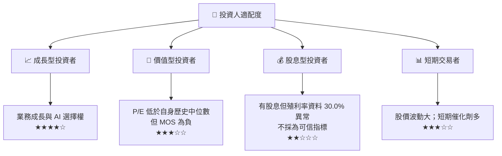

> 股息殖利率資料欄列為 30.0%，與公司規模及其他資料明顯不相稱，未用於投資結論；股息殖利率應以可信的每股股息及股價重新核驗。

### 11.5 每季財報監控清單

| 指標 | 最新基準 | 加碼／正向觸發 | 減碼／負向觸發 |
|------|---------|----------------|----------------|
| 營收成長 | TTM 22.2%；最新單季 24.7% | 單季 YoY ≥15% 且維持 | 連續兩季低於 10% |
| 營業利益率 | TTM 33.3%；最新單季 31.8% | 回升至 33% 以上 | 連續兩季低於 30% |
| OCF | TTM $179.55B | 持續年增且品質穩定 | 明顯低於淨利且無合理營運資金原因 |
| Capex | TTM $159.80B | Capex／營收下行、Cloud／AI 收入增長 | Capex／營收 >30% 且收入加速消失 |
| FCF | TTM $19.75B | 回升至 $50B 以上 | FCF 持續下滑或轉負 |
| SBC | FY2025 $24.95B | SBC／營收下降或股數穩定 | SBC 增速長期高於營收 |
| ROIC | TTM 17.2% | 高於 WACC 10.92% 且穩定 | 跌破 WACC |
| 搜尋與廣告 | 分部數據 N/A | 分部成長與轉換率穩定 | 搜尋收入連續兩季低於 10% |
| Cloud | 分部數據 N/A | 收入加速且營業利潤率改善 | 成長減速且資本回報未改善 |
| 財測與一次性項目 | EPS surprise 資料缺漏 | SEC 附註確認盈餘可持續 | 淨利依賴一次性收益或稅務利益 |

### 11.6 反面論證：什麼會證明論點錯誤

```text
╔══════════════════════════════════════════════════════════════════╗
║              ⚠️ 論點失效條件（Disconfirming Evidence）           ║
╠══════════════════════════════════════════════════════════════════╣
║ 本報告的長期平台與現金流論點，若出現下列情況應重新檢視：         ║
║ ☐ 總營收單季 YoY 連續兩季低於 10%                                ║
║ ☐ TTM 營業利益率低於 30%，且無短期投資周期解釋                   ║
║ ☐ TTM FCF 連續兩季低於 $20B，或年度 FCF 轉負                    ║
║ ☐ Capex／營收維持高於 30%，但 Cloud、AI 相關收入未同步加速       ║
║ ☐ ROIC 跌破 WACC 10.92%，代表新增資本開始摧毀價值                ║
║ ☐ SBC／營收持續高於 FY2025 約 6.2%，且稀釋股數增加               ║
║ ☐ 搜尋及廣告收入因流量轉移而連續兩季下滑                         ║
║ ☐ AI 投入未能在兩至三年內帶動可驗證的收入、利潤或生產力改善       ║
╚══════════════════════════════════════════════════════════════════╝
```

> **免責聲明**：本報告為 AI 自動生成，僅供研究參考，不構成個別化投資建議。資料包存在跨來源差異，估值對 Capex、FCF 與股數假設高度敏感；投資前應核對 SEC 原始申報資料並評估自身風險承受能力。