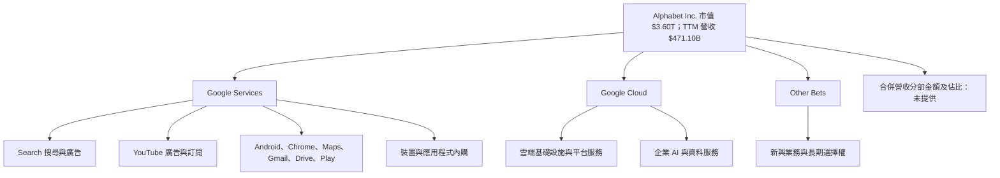
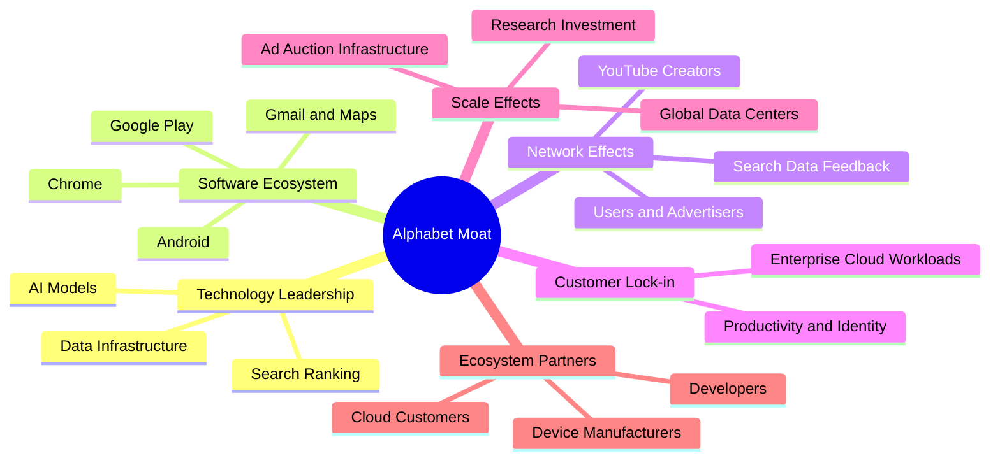
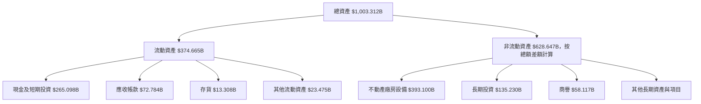
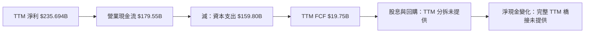
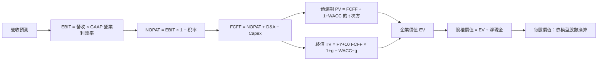
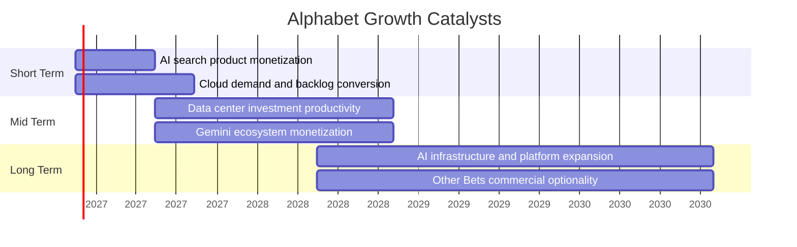
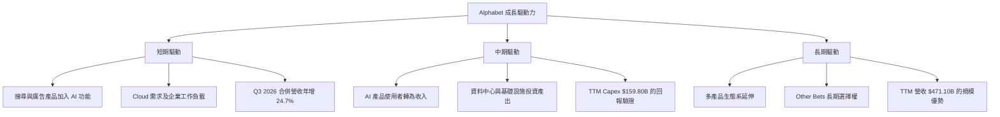
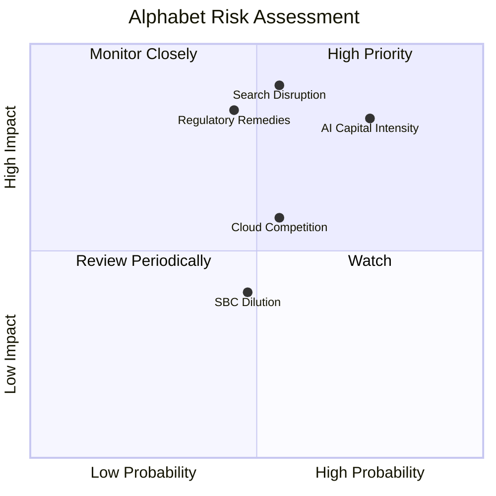
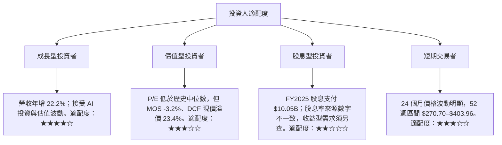

# GOOG 基本面深度分析報告
> **報告日期**：2026-11-14 ｜ **語言**：繁體中文 ｜ **數據來源**：SEC 申報資料 (XBRL)、Yahoo Finance、Finviz、StockAnalysis、Roic.ai ｜ **分析師**：CFA 級機構研究

---

## 目錄

| # | 章節 | 核心結論 |
|---|------|----------|
| 1 | 執行摘要 | 持有；加權合理價值 $283.54，MOS -3.2% |
| 2 | 公司概覽與商業模式 | 搜尋、廣告與平台生態系形成護城河；分部營收明細未提供 |
| 3 | 損益表深度分析 | TTM 營收 $471.10B、年增 22.2%；最新一季年增 24.7% |
| 4 | 資產負債表分析 | 淨現金 $138.98B；流動比率約 2.79 |
| 5 | 現金流量深度分析 | TTM FCF $19.75B；高資本支出使現金轉換率下滑 |
| 6 | 獲利能力與資本效率 | ROIC 23.9% 高於 WACC 10.55%，仍創造經濟價值 |
| 7 | 相對估值分析 | Forward P/E 低於同業中位數；P/S 高於同業中位數 |
| 8 | DCF 內在價值評估 | 基準 DCF $237.09；加權合理價值 $283.54 |
| 9 | 成長催化劑 | AI、Cloud 與搜尋產品演進是主要催化劑；TAM 數字未提供 |
| 10 | 風險矩陣 | AI 資本支出、搜尋競爭及監管風險是主要下檔因素 |
| 11 | 投資建議 | 持有；現價 $292.52 接近加權合理價值，等待估值或基本面改善 |

---

## 1. 執行摘要

### 1.0 一頁式投資儀表板（Portfolio Manager 30 秒速讀）

| 項目 | 內容 |
|------|------|
| **投資論點（3 句）** | ① TTM 營收 $471.10B、年增 22.2%，最新一季年增 24.7%，業務動能仍在。② ROIC 23.9% 高於 WACC 10.55%，約有 13.35 個百分點的資本報酬利差。③ TTM FCF 僅 $19.75B、FCF Yield 0.55%，主因資本支出達 $159.80B，短期現金轉換承壓。 |
| **綜合評分** | **7.3/10**（引用 1.1 評分卡） |
| **財務健康** | 🟢 現金及短期投資 $265.10B，總債務 $126.12B，淨現金 $138.98B；但 TTM FCF 明顯低於近年年度水準。 |
| **ROIC vs WACC** | 23.9% vs 10.55%（仍創造股東價值） |
| **FCF 趨勢** | 近年 Capex 快速上升、TTM FCF 收縮；FCF Yield 0.55%。 |
| **估值** | Forward P/E 18.95x ｜ EV/EBITDA 18.86x ｜ FCF Yield 0.55% |
| **DCF 內在價值（基準）** | $237.09 ｜ 相對現價折溢價 **+23.4% 溢價**（折溢價定義：現價 ÷ DCF 價值 − 1） |
| **安全邊際（MOS）** | **-3.2%**＝($283.54 加權合理價值 − $292.52 現價) ÷ $283.54；🔴 低於 10%，沒有安全邊際 |
| **預期報酬（基準情境 12M）** | **-19.0%**（DCF 基準情境 $237.09 相對現價；屬 DCF 情境報酬，不是加權合理價值上行空間） |
| **關鍵風險（前二）** | AI 基礎設施投資推高 Capex、壓抑 FCF；搜尋與廣告模式受到 AI 入口及監管變化挑戰。 |
| **評級 + 信心度** | 🟡 **持有** ｜ 信心：中低（FCF 趨勢與部分財務資料存在口徑差異） |

### 1.1 綜合評分卡（全報告唯一）

| 維度 | 評分（1–10） | 主要依據（引用數字與其來源章節） |
|------|--------------|----------------------------------|
| 成長性 | 8.5 | TTM 營收年增 22.2%、最新一季年增 24.7%（第 3 章）；近年營收持續擴張。 |
| 獲利能力 | 8.5 | TTM 營業利益率 33.3%、ROIC 23.9% 高於 WACC 10.55%；Piotroski F-Score 4/8（第 6 章）。 |
| 財務健康 | 8.5 | 淨現金 $138.98B、流動比率 2.786、CCC 39 天；稀釋股數測試未通過（第 4、6 章）。 |
| 估值 | 5.0 | 加權合理價值 $283.54，MOS -3.2%；DCF $237.09 低於現價（第 7、8 章）。 |
| 護城河 | 8.5 | 多產品平台、廣告與搜尋規模、Google Cloud 成長；分部營收與市場份額明細未提供（第 2 章）。 |
| 管理層與資本配置 | 4.5 | 年度 SBC $24.95B，TTM Capex $159.80B；資本投入與現金回報的效益仍須追蹤。 |
| **綜合評分** | **7.3** | 六項算術平均：(8.5 + 8.5 + 8.5 + 5.0 + 8.5 + 4.5) ÷ 6 = 7.25，四捨五入至一位小數為 7.2。 |

### 1.2 五大投資論點 + 三大核心風險

| 類型 | 項目 | 具體依據 | 信心度 |
|------|------|----------|--------|
| 🟢 **投資論點①** | 核心營收仍在加速 | TTM 營收年增 22.2%，最新一季營收年增 24.7%，高於 2025 全年 15.1%；若搜尋、YouTube 與 Cloud 均維持增長，營業槓桿有望延續。 | 🟢 高 |
| 🟢 **投資論點②** | 營業獲利率維持高檔 | TTM 營業利益率 33.3%；2025 年營業利益 $129.04B，較 2024 年 $112.39B 增長，規模及費用控制提供緩衝。 | 🟢 高 |
| 🟢 **投資論點③** | 資本回報高於資金成本 | ROIC 23.9% vs WACC 10.55%，利差 13.35 個百分點，顯示目前投入資本仍創造經濟價值。 | 🟢 高 |
| 🟢 **投資論點④** | 資產負債表提供投資彈性 | 現金及短期投資 $265.10B、總債務 $126.12B、淨現金 $138.98B，可支應 AI 基礎設施與研發投入。 | 🟢 高 |
| 🟡 **投資論點⑤** | 同業估值未呈全面溢價 | Forward P/E 18.95x，低於同業中位數 21.7x；但相對估值不等於低估，仍須考慮 Capex 對 FCF 的壓力。 | 🟡 中 |
| 🟡 **風險①** | AI 投資回報落後資本支出 | TTM Capex $159.80B，FCF 僅 $19.75B；若投資持續增加而雲端或廣告變現未同步，FCF 可能進一步收縮。 | 🟡 中 |
| 🔴 **風險②** | 搜尋入口與商業模式被改變 | AI 助理與生成式搜尋可能改變查詢、廣告展示及流量分配；若搜尋廣告成長轉弱，集團營收與高毛利現金流會受影響。 | 🔴 高 |
| 🔴 **風險③** | 監管與反壟斷不確定性 | 可能導致商業協議、預設搜尋分發或平台整合方式改變；具體財務影響目前未有量化資料。 | 🔴 高 |

### 1.3 快速統計卡片

同業中位數由 META、MSFT、AMZN 的 Peer multiples 計算；成長率與毛利率均採各公司最新一季年增率及 TTM 毛利率。

| 指標 | 公司實際值（期間） | 同業中位數 | 狀態 |
|------|--------------------|------------|------|
| 營收成長（TTM） | **22.2%** | — | 🟢 |
| 營收成長（最新一季年增） | **24.7%** | **18.8%** | 🟢 |
| 毛利率（TTM） | **60.9%** | **67.7%** | 🟡 |
| 營業利益率（TTM） | **33.3%** | — | 🟢 |
| ROIC（TTM） | **23.9%** | — | 🟢 |
| Forward P/E | **18.95x** | **21.7x** | 🟢 |
| FCF Yield（TTM） | **0.55%** | — | 🔴 |
| Piotroski F-Score | **4 / 8** | — | 🟡 |

### 1.4 投資結論

```text
╔══════════════════════════════════════════════════════════════════╗
║                    📊 投資結論摘要                               ║
╠══════════════════════════════════════════════════════════════════╣
║  評級：持有（依 MOS 規則 20；未作質化調整）                     ║
║  價格（2026-11-13 收盤）：$292.52                               ║
║  DCF 內在價值（基準）：$237.09（現價溢價 23.4%）                ║
║  安全邊際 MOS：-3.2%（以加權合理價值 $283.54 為分母）           ║
║  加權合理價值（8.8）：$283.54                                    ║
║  DCF 情境價值：                                                   ║
║    悲觀情境：$104.12（-64.4%）                                   ║
║    基準情境：$237.09（-19.0%）                                   ║
║    樂觀情境：$491.98（+68.2%）                                   ║
║  綜合評分：7.3/10（引用 1.1）                                    ║
║  適合投資人：長線成長型、能承受 AI 投資與估值波動的投資人         ║
╚══════════════════════════════════════════════════════════════════╝
```

---

## 2. 公司概覽與商業模式

### 2.1 業務結構與收入來源

公司資料顯示 Alphabet 經營 Google Services、Google Cloud 與 Other Bets；已提供的營收是合併 TTM 數字，沒有分部營收或佔比，因此圖中不臆造各分部金額。



Google 的主要商業模式包括廣告變現、平台服務與雲端運算。媒體摘錄提到 Cloud 年增 103% 及 Gemini 月活躍用戶 10 億，但缺少可核驗的分部財報表格與完整期間定義，故只視為新聞催化訊息，不納入分部營收量化。

### 2.2 市場份額

**市場份額數據未提供**，因此不以圖表或自估比例呈現。Alphabet TTM 營收 $471.10B、年增 22.2%，最新一季年增 24.7%；在所列同業中，最新一季營收成長高於 META 26.1% 略低、MSFT 18.8% 與 AMZN 12.1% 則較高。各公司的業務組合不同，不能僅依成長率推導市場份額。

### 2.3 競爭護城河分析



### 2.4 護城河強度

| 護城河項目 | 強度（強／中／弱） | 證據（引用數字或事實） | 會削弱它的情況 |
|------------|--------------------|------------------------|----------------|
| 技術與資料規模 | 強 | Search、YouTube、Android 等服務形成跨產品資料與分發網絡；研發費用 2025 年為 $61.09B。 | AI 搜尋成本上升、產品體驗未能轉化為收入，或競爭者取得更佳模型與流量入口。 |
| 軟體生態系統 | 強 | Android、Chrome、Gmail、Maps、Drive、Play 等產品提供多點使用者接觸。 | 平台規則或預設分發改變、使用者轉向替代服務。 |
| 網路效應 | 強 | 使用者、內容創作者、廣告主與搜尋資料互相補強；平台覆蓋跨多地區。 | 使用者注意力轉移，或廣告主轉投其他高回報渠道。 |
| 客戶鎖定 | 中 | Google Cloud、企業資料與工作負載可形成轉換成本；Cloud 分部財務細節未提供。 | 雲端遷移成本下降、雲端服務價格競爭加劇。 |
| 規模效應 | 強 | TTM 營收 $471.10B、現金及短期投資 $265.10B，有資源持續投入資料中心與研發。 | Capex 過度擴張而收入與 FCF 回報不足。 |
| 生態夥伴 | 中 | 裝置製造商、開發者、廣告商與雲端客戶支撐服務分發。 | 反壟斷措施或商業條款改變削弱合作效益。 |

1.1「護城河」評分 8.5/10，依據是多產品分發、規模及研發投入；因分部營收、使用者留存及市場份額數據不足，未將護城河評至更高。

---

## 3. 損益表深度分析

### 3.1 年度收入成長趨勢（近 4 年）

年度收入採公司年度損益表；YoY 為依相鄰年度營收計算。四年收入 CAGR 使用 FY2022 至 FY2025 共三個年度間隔。

```text
╔══════════════════════════════════════════════════════════════════╗
║              Alphabet 年度收入趨勢（FY2022-FY2025）              ║
╠══════════════════════════════════════════════════════════════════╣
║  FY2022  $282.84B  ██████████████░░░░░░░░░░░░  YoY: 基期        ║
║  FY2023  $307.39B  ███████████████░░░░░░░░░░░  YoY: +8.7%  🟡   ║
║  FY2024  $350.02B  ██████████████████░░░░░░░░  YoY: +13.9% 🟢   ║
║  FY2025  $402.84B  ████████████████████░░░░░░  YoY: +15.1% 🟢   ║
║                                                                  ║
║  FY2022–FY2025 CAGR = (402.84 ÷ 282.84)^(1/3) − 1 ≈ 12.5%      ║
╚══════════════════════════════════════════════════════════════════╝
```

FY2025 年營收年增 15.1%，高於 FY2023 的 8.7%，呈加速走勢；最新 TTM 年增 22.2%，進一步高於歷史 CAGR。若 AI 產品、雲端需求及廣告量能持續，成長加速可擴大營業利益；若增速主要來自短期需求或新產品尚未具備相同毛利，利潤率不一定同步上升。

### 3.2 季度收入趨勢分析

QoQ 以當季營收除以前一季營收減一；Q3 2026 YoY 及 TTM 成長率採指定期間數值。

| 季度 | 營收 | QoQ | YoY | 備註 |
|------|------:|----:|----:|------|
| Q4 2025 | $113.83B | +26.1% | +18.0% | QoQ 受 Q3 至 Q4 季節性及季度基期影響。 |
| Q1 2026 | $109.90B | -3.4% | +21.8% | 季度營收回落，但仍高於去年同期。 |
| Q2 2026 | $119.80B | +9.0% | +24.2% | 年增動能延續。 |
| Q3 2026 | $127.58B | +6.5% | **+24.7%** | 最新一季年增率，不是 TTM 成長率。 |

近三季 YoY 由 21.8% 升至 24.7%，呈加速跡象；但單季 QoQ 受到季節性影響，不能直接外推全年。TTM 營收成長為 22.2%。

### 3.3 利潤率演變分析

下表年度比率由各年度毛利、營業利益、淨利除以營收計算，四捨五入至一位小數；TTM 使用報告所列 TTM 指標。

| 利潤率指標 | FY2022 | FY2023 | FY2024 | FY2025 | 趨勢 | 評估 |
|------------|-------:|-------:|-------:|-------:|------|------|
| **毛利率** | 55.4% | 56.6% | 58.2% | 59.7% | 持續改善 | 🟢 |
| **營業利益率** | 26.5% | 27.4% | 32.1% | 32.0% | FY2024 明顯擴張，FY2025 大致持平 | 🟢 |
| **淨利率** | 21.2% | 24.0% | 28.6% | 32.8% | 持續提高 | 🟢 |

**利潤率演變深度解析：** FY2022 至 FY2025 毛利率由 55.4% 上升至 59.7%，反映整體產品組合及營運規模可能改善；但已提供資料沒有足夠的分部成本明細，無法將變化精確歸因於特定產品。營業利益率由 FY2023 的 27.4% 升至 FY2024 的 32.1%，FY2025 為 32.0%，代表先前的費用控制及營運槓桿改善大致維持。最新 TTM 營業利益率為 33.3%，最新季度依指定資料為 31.8%，季度較 TTM 低 1.5 個百分點，應追蹤 AI 基礎設施與人力投入是否壓低短期利潤率。

### 3.4 費用結構分析

已提供年度資料包含 FY2025 研發支出 $61.09B，但沒有完整年度銷售及管理費、營業成本與其他費用拆分，故不製作費用結構圓餅圖，以免將不完整項目誤作完整比例。

FY2025 研發費用佔營收的比率為：

`$61.09B ÷ $402.84B = 15.2%`

這代表公司仍投入相當資源於研發；若 AI、雲端及搜尋產品更新能提升付費需求，研發可支撐中長期收入，反之將增加固定成本壓力。

### 3.5 季度 EPS 趨勢與盈餘品質（Quality of Earnings）

提供的 EPS 預估欄位均為 nan，故無法判斷最近四季是否超預期或不及預期。實際 EPS 可觀察季度起伏，但無法用缺失的預估值推斷 surprise。

| 季度 | EPS 實際 | EPS YoY | 超預期／不及預期 | 觀察 |
|------|---------:|-------:|------------------|------|
| Q4 2025 | $2.81 | +31.2% | N/A（預估值缺失） | EPS 高於去年同期，但不代表季度間可直接比較。 |
| Q1 2026 | $5.11 | +82.0% | N/A（預估值缺失） | 與去年同期比較增長；季度淨利及 EPS 受非營業項目影響的可能性需查閱 10-Q。 |
| Q2 2026 | $9.11 | +294.3% | N/A（預估值缺失） | EPS 明顯高於其他季度，季度淨利 $112.19B 異常偏高，須避免視為經常性盈餘。 |
| Q3 2026 | $2.14 | **-25.3%** | N/A（預估值缺失） | 單季 EPS 年減，與 Q2 高基期及季間波動並存。 |

| 盈餘品質項目 | 數值／佔比 | 評估 |
|--------------|------------|------|
| 股權薪酬 SBC / 營收 | TTM SBC 未直接提供；依最近四季季度 SBC 相加 $30.41B ÷ $471.10B = **6.5%** | 🟡 SBC 是實際股東成本；若以股份支付，會稀釋持股比例。 |
| SBC / 營業現金流 | $30.41B ÷ $179.55B = **16.9%** | 🟡 比例不低，應同時觀察股數稀釋及回購抵消情況。 |
| FCF / 淨利（現金轉換率） | TTM FCF $19.75B ÷ TTM 淨利 $235.694B = **8.4%** | 🔴 現金轉換偏低，主要壓力來自 Capex；另 TTM 淨利含異常季度波動，解讀須保守。 |
| 一次性／非經常性損益 | Q2 2026 淨利 $112.19B，遠高於其他近季；明細未提供 | 🟡 季度盈餘可能含非經常性項目，無法量化其金額。 |
| 有效稅率異常 | 最新年度有效稅率 **16.8%** | 🟢 此處未見數據足以認定稅率異常；DCF 也使用 16.8%。 |
| 資本化支出 vs 費用化 | TTM Capex $159.80B；資產負債表固定資產增加，但缺少完整資本化政策與折舊明細 | 🟡 Capex 會先轉成資產再逐期折舊；不能僅由資本支出判斷費用化不足或盈餘高估。 |

**盈餘品質結論：** GAAP 營業獲利能力具持續性，但目前 TTM FCF 僅 $19.75B，與 TTM 淨利 $235.694B 的差距很大，主要是現金流被 $159.80B Capex 壓低。Q2 2026 淨利異常高、EPS 預估缺失，令單季盈餘質量難以精確判定。估值應更重視現金流恢復，而非單看 EPS 或淨利增幅。

---

## 4. 資產負債表分析

### 4.1 資產結構分解

最新可用資產明細為 2026-09-30；流動資產細項相加與總額可能因分類或四捨五入有差異，圖中只列已披露數字，不將部分項目硬湊成總額。



### 4.2 流動性與營運資金分析

| 流動性指標 | 最新值 | 歷史參考 | 評估 |
|------------|-------:|----------|------|
| 流動比率 | 2.786 | 由 2026-09-30 流動資產 $374.665B ÷ 流動負債 $134.501B 計算 | 🟢 短期資產對流動負債有足夠覆蓋。 |
| 速動比率 | 2.512 | 來源所列 | 🟢 即使排除較不具流動性的項目，短期流動性仍充裕。 |
| 現金及短期投資 | $265.10B | 最新 TTM 口徑 | 🟢 提供投資及負債管理緩衝。 |

**營運資金天數（依 QUALITY FIGURES 原值）：**

| 指標 | 最新 TTM | 一年前 TTM | 變化 | 解讀 |
|------|----------:|-----------:|------:|------|
| DSO 應收帳款天數 | 56 天 | 54 天 | +2 天 | 收款週期略延長，可能反映業務組合或收款時點；尚不足以單獨判定信用品質惡化。 |
| DIO 存貨天數 | 26 天 | N/A | N/A | 一年前缺乏可比資料，無法判定存貨天數變化。 |
| DPO 應付帳款天數 | 43 天 | N/A | N/A | 一年前缺乏可比資料，不能推斷供應商付款條件變化。 |
| CCC 現金轉換週期 | 39 天 | N/A | N/A | 一年前 CCC 未提供，不能量化年度變動。 |

### 4.3 債務結構分析

本節採用經核驗的總債務 $126.12B 與現金及短期投資 $265.10B。其他市場資料來源另有總債務 $150.33B、淨現金 $114.77B，與核驗口徑不一致；本文估值及核心判斷以 SEC／程式計算口徑為準。

```text
╔══════════════════════════════════════════════════════════════════╗
║                   Alphabet 債務健康診斷                          ║
╠══════════════════════════════════════════════════════════════════╣
║  總債務：        $126.12B   █████████░░░░░░░░░░░  🟢             ║
║  現金+短期投資： $265.10B   ████████████████████  🟢             ║
║  淨現金：        $138.98B   ██████████░░░░░░░░░░  🟢             ║
║                                                                  ║
║  Debt/EBITDA：N/A（可比 TTM EBITDA 絕對值未提供）                 ║
║  Interest Coverage：N/A（利息費用絕對值未提供）                  ║
║  利率風險：WACC 輸入的稅前債務成本為 0.58%                       ║
║  註：資料來源間總債務口徑有差異，應以後續 SEC 申報核對。          ║
╚══════════════════════════════════════════════════════════════════╝
```

### 4.4 股東權益趨勢

歷年股東權益採年度資產負債表。

```text
╔══════════════════════════════════════════════════════════════════╗
║              Alphabet 股東權益變化（年度）                       ║
╠══════════════════════════════════════════════════════════════════╣
║  FY2022  $256.14B  █████████████░░░░░░░░░░░░░                    ║
║  FY2023  $283.38B  ██████████████░░░░░░░░░░░░                    ║
║  FY2024  $325.08B  ████████████████░░░░░░░░░░                    ║
║  FY2025  $415.26B  ████████████████████░░░░░                    ║
║                                                                  ║
║  FY2022–FY2025 增加 $159.12B；各年變化同時受累積盈餘、回購及     ║
║  其他權益項目影響，不能單以權益增加推論資本回報改善。            ║
╚══════════════════════════════════════════════════════════════════╝
```

---

## 5. 現金流量深度分析

### 5.1 現金流量瀑布圖

完整 TTM 淨利至淨現金變化的現金流橋接未提供；圖中僅呈現已核驗的營業現金流、Capex 及 FCF，並將後續用途標示為資料未提供。



淨利到營業現金流差異反映非現金項目、營運資金變化等因素；而資本支出進一步消耗大部分營業現金流。這使 FCF 對未來投資回報更加敏感。

### 5.2 FCF 轉換率趨勢

年度 FCF / 淨利以年度報表數字計算；TTM 採 TTM FCF $19.75B 及 TTM 淨利 $235.694B。

| 期間 | FCF | 淨利 | FCF / 淨利 | 趨勢與解讀 |
|------|----:|----:|-----------:|------------|
| FY2022 | $60.01B | $59.97B | 100.1% | 現金轉換約等於會計獲利。 |
| FY2023 | $69.50B | $73.80B | 94.2% | 轉換率略低於 100%。 |
| FY2024 | $72.76B | $100.12B | 72.7% | 淨利成長快於 FCF。 |
| FY2025 | $73.27B | $132.17B | 55.4% | Capex 上升使 FCF 增長落後淨利。 |
| TTM 至 2026-09-30 | $19.75B | $235.694B | 8.4% | Capex 達 $159.80B，現金轉換顯著下滑。 |

### 5.3 自由現金流趨勢

```text
╔══════════════════════════════════════════════════════════════════╗
║                 自由現金流趨勢（美元）                           ║
╠══════════════════════════════════════════════════════════════════╣
║  FY2022  $60.01B  ████████████████░░░░  FCF Yield：N/A           ║
║  FY2023  $69.50B  ██████████████████░░  FCF Yield：N/A           ║
║  FY2024  $72.76B  ███████████████████░  FCF Yield：N/A           ║
║  FY2025  $73.27B  ████████████████████  FCF Yield：N/A           ║
║  TTM     $19.75B  █████░░░░░░░░░░░░░░░  FCF Yield：0.55%         ║
║                                                                  ║
║  TTM FCF = 營業現金流 $179.55B − Capex $159.80B = $19.75B       ║
╚══════════════════════════════════════════════════════════════════╝
```

2022 至 2025 年 FCF 緩步上升，但 TTM 降至 $19.75B，與 Capex 加速上升並行。這未必代表核心業務現金流永久惡化；若資料中心投資日後帶來 Cloud、AI 或搜尋變現，FCF 可回升。但現階段 FCF Yield 僅 0.55%，價格對未來投資回報的依賴很高。

### 5.4 資本配置評估

分項用途的 TTM 完整資本配置比例未提供，不製作圓餅圖。已知 FY2025 股息支付 $10.05B、SBC $24.95B；FY2025 Capex $91.45B，TTM Capex 已增至 $159.80B。資料未提供同一期間完整回購、股息、併購、留存現金與投資支出的相互拆分，故不把部分項目畫成全體比例。

| 資本配置項目 | 已知數字 | 評估 |
|--------------|---------|------|
| 資本支出 | FY2025 $91.45B；TTM $159.80B | 🟡 投資幅度快速上升，需用增量收入與 FCF 驗證回報。 |
| 股息 | FY2025 現金股息 $10.05B | 🟡 金額低於 TTM Capex；股息收益率來源顯示 30.0%，與其他資料不一致，不採用該異常比率。 |
| SBC | FY2025 $24.95B | 🟡 是股東經濟成本，需與回購及稀釋股數一併評估。 |
| 回購 | 完整年度金額未提供 | N/A（數據未提供，無法量化回購抵消稀釋效果）。 |

---

## 6. 獲利能力與資本效率

### 6.1 ROE / ROA / ROIC 趨勢

公司歷史 ROIC 的年度序列不完整；因此只列出有可引用來源的 TTM 指標，不以缺資料自行補造年度趨勢。ROE 在不同來源存在 34.8% 與 44.3% 差異；此處採 QUALITY FIGURES 的杜邦口徑 34.8%，並在下節列出其構成。

| 指標 | 最新可用值 | 歷史／比較 | 評估 |
|------|-----------:|------------|------|
| ROE（TTM） | 34.8% | DuPont 資料口徑；另有來源報 44.3%，存在口徑差異 | 🟢 股東權益報酬高，但部分由資產週轉與權益乘數共同形成。 |
| ROA（TTM） | 12.7% | Piotroski 測試顯示 ROA 高於一年前 | 🟢 資產獲利能力改善。 |
| ROIC（TTM） | 23.9% | 依 after-tax operating income ÷（equity + debt − cash） | 🟢 顯著高於 WACC 10.55%。 |

### 6.2 ROIC vs WACC 分析（核心價值創造判斷）

下列 WACC 直接採用程式計算的 10.55%；股權成本、債務成本與權重照錄成本資本資料。由於已提供的顯示值經四捨五入，使用顯示值重算可能與程式採用值出現 0.01 個百分點左右差異。

```text
╔══════════════════════════════════════════════════════════════════╗
║                  ROIC vs WACC 深度分析                           ║
╠══════════════════════════════════════════════════════════════════╣
║  WACC 輸入：                                                     ║
║  ├── 無風險利率 Rf：             5.15%                           ║
║  ├── 市場風險溢酬 ERP：          5.00%（假設值）                 ║
║  ├── 原始 Beta：                 1.23                            ║
║  ├── 調整後 Beta：               1.15                            ║
║  ├── 股權成本來源值：            10.91%                          ║
║  ├── 稅前債務成本：              0.58%                           ║
║  ├── 股權／債務權重：            96.6% / 3.4%                    ║
║  └── ✅ 採用 WACC：              10.55%                          ║
║                                                                  ║
║  ROIC（TTM）：                  23.9%                            ║
║  EVA 利差：                     23.9% − 10.55% = 13.35 個百分點 ║
║  ROIC / WACC：                  23.9% ÷ 10.55% = 2.27 倍         ║
║                                                                  ║
║  ROIC 23.9%  ▓▓▓▓▓▓▓▓▓▓▓▓▓▓▓▓▓▓▓▓▓▓▓▓  🟢                      ║
║  WACC 10.55% ▓▓▓▓▓▓▓▓▓▓▓░░░░░░░░░░░░░░  ──                      ║
║                                                                  ║
║  📊 結論：目前 ROIC 高於資本成本；若 ROIC 長期維持，仍在創造   ║
║  經濟價值。但 Capex 上升會擴大投入資本，未來增量 ROIC 是關鍵。  ║
╚══════════════════════════════════════════════════════════════════╝
```

逐步驗算：

1. **Beta 調整** = ⅔ × 1.23 + ⅓ × 1.00 = 1.1533…，四捨五入為 **1.15**。
2. **股權成本** = Rf + β × ERP = 5.15% + 1.15 × 5.00% = 10.90%；成本資本資料的股權成本為 **10.91%**，差異來自輸入及顯示精度。
3. **稅後債務成本** = 0.58% × (1 − 16.8%) = **0.4826%**。
4. **WACC 顯示值重算** = 96.6% × 10.91% + 3.4% × 0.4826% = 10.5391% + 0.0164% = **10.5555%**；成本資本資料指定採用 **10.55%**。差異屬四捨五入後的細小差額；本報告所有 ROIC 比較與 DCF 均採指定 WACC 10.55%。

### 6.3 杜邦三因素分解

| 因素 | 數值（TTM） | 解讀 |
|------|-------------|------|
| 淨利率 | 50.0% | 數值來自 QUALITY FIGURES；與其他來源所列 TTM 淨利率可能有口徑差異。 |
| 資產週轉率 | 0.47 | 每單位資產產生的收入；低於 1，但平台及現金資產結構會影響此比率。 |
| 權益乘數 | 1.48 | 財務槓桿不高，不是 ROE 的主要推升來源。 |
| **ROE** | **34.8%** | 50.0% × 0.47 × 1.48 = 34.8%（使用原始未四捨五入值計算後呈現）。 |

杜邦結果顯示 ROE 主要受高淨利率支撐，權益乘數 1.48 倍並非主要槓桿來源。

### 6.4 財務體質：Piotroski F-Score

| 測試 | 結果 | 解讀 |
|------|------|------|
| ROA > 0 | ✅ 通過 | TTM ROA 為正。 |
| 營業現金流 > 0 | ✅ 通過 | TTM 營業現金流 $179.55B。 |
| ROA 高於一年前 | ✅ 通過 | 獲利資產效率改善。 |
| 營業現金流 > 淨利（應計品質） | ❌ 未通過 | TTM 營業現金流低於淨利；Capex 對 FCF 的壓力則另行觀察。 |
| 長期負債 ÷ 總資產低於一年前 | ❌ 未通過 | 負債比未符合該測試方向，需留意投資擴張與負債變化。 |
| 流動比率高於一年前 | ✅ 通過 | 短期流動性相較一年前改善。 |
| 稀釋股數未增加 | ❌ 未通過 | 稀釋股數增加，SBC 需要納入每股價值評估。 |
| 毛利率高於一年前 | — 無法判定 | 缺少可比較輸入。 |
| 資產週轉率高於一年前 | ❌ 未通過 | 資產擴張尚未轉化為更高資產週轉效率。 |
| **Piotroski F-Score** | **4 / 8** | 九項中一項因資料缺失不計入，故分母為 8。 |

---

## 7. 相對估值分析

### 7.1 同業估值比較表格

同業倍數取 Yahoo Finance Peer multiples。GOOG 本身估值採公司目前提供的倍數資料；同業中位數依三家 peer 的數值排序得出。

| 估值指標 | **GOOG** | **META** | **MSFT** | **AMZN** | 本公司評估 |
|----------|---------:|---------:|---------:|---------:|-----------|
| **Trailing P/E** | 15.3x | 21.9x | 27.3x | 21.6x | 🟢 低於三家同業中位數 21.9x；需留意近期 EPS 波動。 |
| **Forward P/E** | 18.95x | 18.0x | 21.7x | 24.4x | 🟢 低於同業中位數 21.7x，但不是單獨的買入訊號。 |
| **P/S Ratio** | 7.63x | 6.8x | 11.2x | 3.6x | 🟡 高於同業中位數 6.8x；市場仍給予較高收入估值。 |
| **EV / EBITDA** | 18.86x | 14.4x | 19.3x | 16.7x | 🟡 高於同業中位數 16.7x。 |
| **最新一季營收年增** | 24.7% | 26.1% | 18.8% | 12.1% | 🟢 成長高於 MSFT、AMZN，略低於 META。 |
| **毛利率（TTM）** | 60.9% | 81.0% | 67.7% | 51.4% | 🟡 低於同業中位數 67.7%；業務組合不同。 |

相對估值呈現混合訊號：GOOG 的 Forward P/E 低於同業中位數，但 EV/EBITDA 與 P/S 並不便宜。若高 Capex 長期壓低 FCF，低 P/E 未必能充分補償現金流風險。

### 7.2 歷史估值區間分析

```text
╔══════════════════════════════════════════════════════════════════╗
║                GOOG 五年估值區間（TTM 倍數）                    ║
╠══════════════════════════════════════════════════════════════════╣
║  P/E        1.3x ├────────中位數 21.9x────────● 29.0x           ║
║                                      現值 15.3x；百分位 29%       ║
║                                                                  ║
║  P/S        4.1x ├────中位數 6.1x────────●───── 9.8x            ║
║                                      現值 7.7x；百分位 67%        ║
║                                                                  ║
║  EV/EBITDA 13.7x ├────────● 中位數 19.1x─────── 25.0x           ║
║                                      現值 18.8x；百分位 47%       ║
╚══════════════════════════════════════════════════════════════════╝
```

P/E 現值 15.3x，低於五年中位數 21.9x，位於歷史區間第 29 百分位；P/S 7.7x 高於中位數 6.1x，位於第 67 百分位。估值倍數彼此並不一致，可能反映 EPS、淨利與現金流期間受到不同項目影響，需優先看經常性現金流是否回升。

### 7.3 情境價值（Bear / Base / Bull）

情境數字照列 DCF MODEL；情境要求營收成長、利潤率與 WACC 同時變動，不能只看作折現率變化。

| 情境 | 第 1 年營收成長 | 期末營業利潤率 | WACC | 每股價值 | 相對現價 | 機率 | 會發生的條件 |
|------|----------------:|----------------:|-----:|---------:|---------:|-----:|--------------|
| 🔴 悲觀 | 11.1% | 27.2% | 11.55% | $104.12 | -64.4% | 25% | 搜尋或廣告增速下滑，Cloud、AI 的收入轉化不及投入，成本與競爭令長期營業利益率下降。 |
| 🟡 基準 | 22.2% | 32.0% | 10.55% | $237.09 | -19.0% | 50% | 初期延續 TTM 成長，後續逐年淡出；營業利潤率由 33.3% 回落至五年中位數 32.0%。 |
| 🟢 樂觀 | 33.3% | 35.2% | 9.55% | $491.98 | +68.2% | 25% | AI、Cloud 與廣告同時加速，產品變現足以吸收資本支出，且資金成本下降。 |

### 7.4 相對估值隱含價格區間

```text
╔══════════════════════════════════════════════════════════════════╗
║                  相對估值方法隱含每股價值                         ║
╠══════════════════════════════════════════════════════════════════╣
║  $237.09 DCF ── $263.05 EV/EBITDA ── $292.52 現價 ── $334.20 P/E║
║                                          $393.93 分析師共識       ║
║                                                                  ║
║  DCF：10 年 FCFF，WACC 10.55%，終值成長率 3.0%                   ║
║  Forward P/E：同業中位數 21.7x × Forward EPS $15.44               ║
║  EV/EBITDA：同業中位數 16.7x × TTM EBITDA，再加回淨現金           ║
║  分析師共識：14 位分析師平均目標價 $393.93                        ║
╚══════════════════════════════════════════════════════════════════╝
```

分析師共識為參考，不是獨立基本面證據；其中位數以上的價格預期，與基準 DCF 結果差距較大。

---

## 8. DCF 內在價值評估（Discounted Cash Flow）

### 8.0 估值推理鏈（Thinking Logic：在算之前先想清楚）

**Step 1 — 價值由哪些變數決定？**

GOOG 的估值可分為現有搜尋及廣告業務的現金流底盤、Cloud 與 AI 相關業務的增量成長，以及 Other Bets 的長期選擇權；但沒有分部營收資料，不能為各項填入營收佔比。模型中可直接核驗的核心錨點是合併 TTM 營收 $471.10B、TTM 營業利益率 33.3%、TTM Capex 佔營收 33.9%。對基準價值影響最大的變數，是 Capex 從目前高位回落的速度以及由此產生的終值現金流；敏感性矩陣亦顯示 WACC 與永續成長率對每股價值影響顯著。

**Step 2 — 模型選擇**

| 決策點 | 本報告採用 | 理由（含數字） | 曾考慮但否決 | 否決理由 |
|--------|-----------|----------------|--------------|----------|
| 現金流定義 | FCFF | 配合 WACC 折現並得到 EV；模型使用 FCFF = NOPAT + D&A − Capex，未建模 ΔWC | FCFE | 債務權重雖低，但模型指定採 FCFF。 |
| 預測期 N | 10 年 | 模型設定 10 年，涵蓋高成長到成熟期的淡出過程 | 5 年 | 與模型已提供的長期淡出期不一致。 |
| 終值方法 | Gordon Growth | 模型採永續成長率 3.0% | 退出倍數 | 模型未提供退出倍數計算結果，不能自行補建或替換。 |
| EBIT 基礎 | GAAP EBIT | TTM 營業利益率 33.3%，GAAP 已包含 SBC 費用 | 非 GAAP EBIT | 會導致對 SBC 的處理與既有模型不一致。 |

**Step 3 — 主要假設推導鏈**

- **營收成長**：錨點＝TTM 營收成長 22.2%、FY2022–FY2025 營收 CAGR 約 12.5% → 調整＝以最新 TTM 增速作預測第 1 年起點，之後線性淡出 → **第 1 年採 22.2%、第 10 年採 3.0%** → 曾考慮以歷史 CAGR 約 12.5% 作第 1 年起點，但近期最新一季年增 24.7% 且 TTM 年增 22.2%，因此模型採用較高起點；風險是此增速未必可持續。
- **期末營業利潤率**：錨點＝TTM 33.3%、最近五年中位數 32.0% → 調整＝按模型設定隨時間逐步淡出，反映成熟及競爭壓力 → **第 1 年 33.3%、第 10 年 32.0%** → 曾考慮沿用 33.3% 不變，但未反映模型所採五年中位數的保守收斂。
- **永續成長率 g**：錨點＝長期成熟企業終值假設，模型取 3.0% → 調整＝低於 WACC 10.55%，令 Gordon Growth 公式有效 → **採用 3.0%** → 不採更高的 4.0%，以免過度依賴終值；更低的 2.0% 也在敏感度矩陣呈現。
- **預測期 N**：錨點＝模型固定 10 年，並將第 10 年營收增長淡出到 3.0% → 調整＝涵蓋從目前高成長到成熟期的轉換 → **採用 10 年** → 不採 5 年，因高成長淡出未完成就進入終值，容易把成長假設壓縮到終值內。
- **Capex / 營收**：錨點＝TTM Capex / 營收 = $159.80B ÷ $471.10B = 33.9% → 調整＝模型逐步淡出至第 10 年 6.5%，並以 D&A 的 1.1 倍為下限條件 → **FY+1 33.9%、FY+10 6.5%** → 曾考慮較慢的 Capex 回落，但模型未提供該替代方案；33.9% 降至 6.5% 是基準 DCF 最脆弱假設之一。
- **EBIT 基礎與 SBC**：錨點＝模型採 GAAP EBIT，TTM 營業利益率 33.3% → 調整＝不另從 FCFF 扣 SBC，以避免同一 SBC 重複計算 → **採用 GAAP EBIT、固定股數、年稀釋率 0%** → 不採非 GAAP 加回 SBC 後再扣回的組合。
- **年稀釋率**：錨點＝模型採固定股數；Piotroski 稀釋股數測試未通過，表示稀釋是實際監控項目 → 調整＝模型以 GAAP EBIT 已含 SBC 作為成本，因此不再放大股數 → **年稀釋率 0%** → 不採額外稀釋率，否則與已計入 EBIT 的 SBC 重複計價。
- **終值方法**：錨點＝Gordon Growth，採 FY+10 FCFF、g 3.0% → 調整＝終值以第 10 年現金流為基礎 → **採用 Gordon Growth** → 退出倍數法未提供計算數字，不能自行臆設同業或成熟期倍數。
- **WACC**：錨點＝成本資本計算採用 10.55% → 調整＝依指定股權成本、債務成本及資本權重，不自行改動 → **採用 10.55%** → 不以其他 Beta 或外部 ERP 取代既定輸入。

**Step 4 — 最脆弱假設**

最脆弱的一環是 Capex / 營收由 FY+1 的 33.9% 降至 FY+10 的 6.5%；若 AI 與資料中心投資長期維持高位，FCFF 會低於基準模型，估值將向敏感度矩陣低端及悲觀情境 $104.12 靠近。

**Step 5 — 計算路徑圖**



### 8.1 模型假設總表（Model Inputs）

| 假設項目 | 採用值 | 依據／來源 | 敏感度 |
|----------|--------|-------------|--------|
| 預測期長度 N | 10 年 | 模型設定，營收成長淡出至第 10 年 3.0% | 🟡 中 |
| 營收成長路徑 | 第 1 年 22.2% → 第 10 年 3.0%，線性淡出 | 起點為 TTM vs prior TTM 22.2%；終點為模型成熟期假設 | 🔴 高 |
| 營業利潤率 | 第 1 年 33.3% → 第 10 年 32.0% | TTM 營業利益率及最近五年中位數（含 TTM） | 🔴 高 |
| 有效稅率 | 16.8% | 最新年度有效稅率 | 🟢 低 |
| Capex / 營收 | 第 1 年 33.9% → 第 10 年 6.5% | TTM Capex / 營收；模型逐年淡出 | 🔴 高 |
| D&A / 營收 | 5.9% | TTM 比率，模型維持不變 | 🟢 低 |
| 營運資金變動 | 不建模 | 模型明確未建模 ΔWC；不可視作已證明營運資金需求為零 | 🟡 中 |
| EBIT 基礎 | GAAP EBIT | DCF MODEL 指定 | 🟡 中 |
| SBC 處理 | GAAP EBIT 已費用化；FCFF 不再減 SBC | 模型組合 A | 🟡 中 |
| 年稀釋率 | 0% | 固定股數；SBC 成本已反映在 GAAP EBIT | 🟡 中 |
| 永續成長率 g | 3.0% | DCF MODEL；低於 WACC 10.55% | 🔴 高 |
| 終值方法 | Gordon Growth | DCF MODEL 唯一提供方法 | 🔴 高 |
| WACC | 10.55% | 成本資本資料指定值 | 🔴 高 |

**SBC 防重複計算：**本模型採用 **(A) GAAP EBIT + 固定股數 + 年稀釋率 0%**；SBC 影響已透過 GAAP EBIT 計入一次，FCFF 不另扣 SBC，股數也不再逐年稀釋。

### 8.2 折現率推導（WACC）

```text
╔══════════════════════════════════════════════════════════════════╗
║                    WACC 推導（折現率）                           ║
╠══════════════════════════════════════════════════════════════════╣
║  股權成本 Ke（CAPM）：                                           ║
║  ├── 無風險利率 Rf（10Y 美債）：     5.15%                       ║
║  ├── 市場風險溢酬 ERP：              5.00%（假設值）             ║
║  ├── Beta 原始值：                   1.23                        ║
║  ├── Beta 採用值：                   1.15                        ║
║  ├── 規模／國別溢酬：                0.00%（未加計）             ║
║  └── 成本資本資料 Ke：               10.91%                      ║
║                                                                  ║
║  債務成本 Kd：                                                    ║
║  ├── 稅前 Kd：                       0.58%                       ║
║  ├── 有效稅率：                      16.8%                       ║
║  └── 稅後 Kd = 0.58% × (1−16.8%) = 0.4826%                       ║
║                                                                  ║
║  資本結構（成本資本資料權重）：                                   ║
║  ├── 股權權重 E：                    96.6%                       ║
║  ├── 債務權重 D：                    3.4%                        ║
║  └── ✅ 指定 WACC：                  10.55%                      ║
╚══════════════════════════════════════════════════════════════════╝
```

輸入來歷及計算：

1. **Ke（CAPM）** = Rf + β × ERP = 5.15% + 1.15 × 5.00% = **10.90%**；成本資本資料列示 Ke 為 **10.91%**。原始 Beta 1.23 經公式 ⅔ × 1.23 + ⅓ × 1.00 調整為 1.15。Rf 日期及 ERP 的外部來源細節未提供；ERP 為成本資本資料所採假設值。
2. **稅前 Kd** = 成本資本資料列示 **0.58%**。利息費用與平均計息負債絕對值未提供，故不能自行重算利息 ÷ 平均計息負債，也不能確認負債範圍。
3. **稅後 Kd** = 0.58% × (1 − 16.8%) = **0.4826%**。
4. **權重** = 成本資本資料列示股權 96.6%、債務 3.4%；兩者相加 = **100.0%**。最新收盤價為 2026-11-13 的 $292.52，市場市值資料約 $3.60T；因市值只提供四捨五入值，本文不以此反推精確權重。指定總債務為 $126.12B，但其與計息負債範圍是否完全一致，現有資料不足以獨立核對。
5. **使用顯示值重算 WACC** = 96.6% × 10.91% + 3.4% × 0.4826% = 10.5391% + 0.0164% = **10.5555%**。成本資本資料指定採用 **10.55%**；後續估值一律使用 10.55%，不另行替換。

### 8.3 逐年自由現金流預測（基準情境）

單位：美元十億。以下數字照錄 DCF MODEL。FCFF 定義為 `NOPAT + D&A − Capex`；營運資金不建模，故不列 ΔWC。折現因子保留三位小數。

| 年度 | FY+1 | FY+2 | FY+3 | FY+4 | FY+5 | FY+6 | FY+7 | FY+8 | FY+9 | FY+10 |
|------|-----:|-----:|-----:|-----:|-----:|-----:|-----:|-----:|-----:|------:|
| 營收 | 575.74 | 691.33 | 815.37 | 944.26 | 1,073.37 | 1,197.22 | 1,309.81 | 1,405.02 | 1,477.16 | 1,521.48 |
| 營收 YoY | 22.2% | 20.1% | 17.9% | 15.8% | 13.7% | 11.5% | 9.4% | 7.3% | 5.1% | 3.0% |
| 營業利潤率 | 33.3% | 33.2% | 33.0% | 32.9% | 32.7% | 32.6% | 32.5% | 32.3% | 32.2% | 32.0% |
| 營業利益 EBIT（GAAP） | 191.84 | 229.37 | 269.36 | 310.58 | 351.51 | 390.36 | 425.19 | 454.09 | 475.29 | 487.37 |
| − 稅（16.8%） | (32.20) | (38.50) | (45.21) | (52.13) | (58.99) | (65.51) | (71.36) | (76.21) | (79.77) | (81.80) |
| = NOPAT | 159.65 | 190.87 | 224.15 | 258.46 | 292.52 | 324.84 | 353.83 | 377.88 | 395.52 | 405.57 |
| + D&A | 34.21 | 41.08 | 48.45 | 56.11 | 63.79 | 71.14 | 77.84 | 83.49 | 87.78 | 90.41 |
| − Capex | (195.30) | (213.47) | (226.97) | (234.11) | (233.46) | (223.97) | (205.18) | (177.35) | (141.51) | (99.46) |
| **= FCFF** | **-1.44** | **18.48** | **45.64** | **80.46** | **122.84** | **172.02** | **226.48** | **284.03** | **341.80** | **396.53** |
| 折現因子 @10.55% | 0.905 | 0.818 | 0.740 | 0.669 | 0.606 | 0.548 | 0.495 | 0.448 | 0.405 | 0.367 |
| **FCFF 現值 PV** | **-1.30** | **15.12** | **33.77** | **53.86** | **74.38** | **94.21** | **112.20** | **127.28** | **138.54** | **145.39** |

**預測期 FCFF 現值加總：**

`-1.30 + 15.12 + 33.77 + 53.86 + 74.38 + 94.21 + 112.20 + 127.28 + 138.54 + 145.39 = 793.45B`

DCF MODEL 列示合計為 **$793.46B**，與各年度顯示至小數點後兩位的數字相差 $0.01B，屬逐年四捨五入尾差。

**FY+1 逐步演算（代表年度）：**

1. **營收**：以 FY+1 成長率由 TTM 基期推算；模型值為 **$575.74B**。按已四捨五入輸入驗算：$471.10B × (1 + 22.2%) = $575.6842B，與模型未四捨五入輸入產生的 $575.74B 有小幅差異。
2. **EBIT** = 營收 × 營業利潤率；模型列示 $575.74B × 約 33.3% ≈ **$191.84B**。
3. **稅** = EBIT × 16.8%；模型列示 $191.84B × 16.8% ≈ **$32.20B**。
4. **NOPAT** = EBIT − 稅 = $191.84B − $32.20B ≈ **$159.65B**（模型底層未四捨五入值）。
5. **D&A** = 營收 × 5.9%；模型列示 **$34.21B**。
6. **Capex** = 營收 × 模型逐年 Capex 比率；FY+1 模型列示 **$195.30B**。
7. **ΔWC** = 模型不建模，故 **不列入**。
8. **FCFF** = $159.65B + $34.21B − $195.30B = **-$1.44B**（以模型未四捨五入值計）。
9. **折現因子** = 1 ÷ (1 + 10.55%)¹ ≈ **0.905**；PV = -$1.44B × 0.905 ≈ **-$1.30B**。

**合理性自檢：**

- FY+1 FCFF 為負，因此無法對 FY+1 至 FY+10 計算通常意義下的正值 FCF CAGR；模型預測 FCF 由 FY+1 -$1.44B 增至 FY+10 $396.53B，依賴 Capex / 營收大幅回落。
- FY+10 FCF 利潤率 = $396.53B ÷ $1,521.48B = **26.1%**；目前 TTM FCF 利潤率 = $19.75B ÷ $471.10B = **4.2%**。同業最佳同口徑資料未提供，不能比較是否超越同業最佳水準。
- FY+1 FCFF 為負，但其折現現值為 -$1.30B，對預測期 PV 合計的影響有限；模型價值仍高度取決於後續 Capex 回落和終值。

```text
╔══════════════════════════════════════════════════════════════════╗
║            自由現金流：歷史實際 vs 模型預測                      ║
╠══════════════════════════════════════════════════════════════════╣
║  FY2023(實)  $69.50B   █████████░░░░░░░░░░░                     ║
║  FY2024(實)  $72.76B   █████████░░░░░░░░░░░                     ║
║  FY2025(實)  $73.27B   █████████░░░░░░░░░░░                     ║
║  TTM(實)     $19.75B   ██░░░░░░░░░░░░░░░░░░                     ║
║  FY+1 (預)   -$1.44B   負值                                       ║
║  FY+10(預)  $396.53B  ████████████████████                      ║
╠══════════════════════════════════════════════════════════════════╣
║  ⚠️ 預測不是單純延續歷史 FCF；估值依賴 Capex / 營收從 33.9%     ║
║     降至 6.5%，並由營收成長支撐後期現金流。                      ║
╚══════════════════════════════════════════════════════════════════╝
```

### 8.4 終值計算（Terminal Value）

**適用性檢查：**`WACC 10.55% vs g 3.0% → WACC > g？✅`

| 方法 | 計算式 | 終值 TV | TV 現值 | 佔總 EV 比重 |
|------|--------|--------:|--------:|-------------:|
| Gordon Growth | $396.53B × (1 + 3.0%) ÷ (10.55% − 3.0%) | $5,406.60B | $1,982.31B | 71.4% |
| 退出倍數法 | N/A（DCF MODEL 未提供退出倍數法數值） | N/A | N/A | N/A |

逐步演算：

1. **FY+10 FCFF** = **$396.53B**。
2. **分子** = $396.53B × (1 + 3.0%) = $408.4259B，依模型未四捨五入數值計算。
3. **分母** = 10.55% − 3.0% = **7.55%**；模型列示 TV = $396.53B × 1.03 ÷ 7.55% = **$5,406.60B**。
4. **PV(TV)**：DCF MODEL 列示 **$1,982.31B**。模型所列折現因子 0.367 乘以 $5,406.60B 得 $1,984.22B，與模型列示 PV 相差約 $1.91B；可能涉及模型內部未顯示的精確折現因子或計算口徑，本文保留核驗值，不自行改動。
5. **終值佔比** = $1,982.31B ÷ $2,775.77B = **71.4%**。

終值現值佔 EV 71.4%，尚未超過 75% 警示線，但估值仍有大部分來自第 10 年以後的假設。退出倍數法因模型未提供倍數或結果，不另行建模。

### 8.5 企業價值 → 每股內在價值（Bridge）

```text
╔══════════════════════════════════════════════════════════════════╗
║              企業價值 → 每股內在價值 橋接表                      ║
╠══════════════════════════════════════════════════════════════════╣
║  預測期 FCF 現值合計            +$793.46B                        ║
║  終值現值 PV(TV)                +$1,982.31B                      ║
║  ─────────────────────────────────────────────                  ║
║  = 企業價值 EV                   $2,775.77B                      ║
║  + 淨現金                       +$138.98B                        ║
║  = 股權價值                      $2,914.75B                      ║
║  ÷ 股數／模型市值換算            依 DCF MODEL                     ║
║  ─────────────────────────────────────────────                  ║
║  ★ DCF 基準每股內在價值          $237.09                          ║
║    當前股價（2026-11-13 收盤）   $292.52                          ║
║    折溢價（現價÷DCF價值−1）      +23.4%（現價溢價）              ║
╚══════════════════════════════════════════════════════════════════╝
```

逐步演算：

1. **EV** = $793.46B + $1,982.31B = **$2,775.77B**。
2. **股權價值** = $2,775.77B + 淨現金 $138.98B = **$2,914.75B**。
3. **每股內在價值**：DCF MODEL 指定換算後為 **$237.09**。模型提供的公式為 equity value × 價格 ÷ 市值；其精確未四捨五入市值或稀釋股數未列出，因此無法只用 $3.60T 的四捨五入市值精確重現 $237.09。本文照錄模型結果，不以市場資料反推替換。
4. **折溢價** = $292.52 ÷ $237.09 − 1 = **+23.4% 溢價**。
5. **本節不計算 MOS**；MOS 一律以第 8.8 節加權合理價值為分母，本節僅呈現 DCF 折溢價。

現金及短期投資、總債務均採截至 2026-09-30 的核驗數據，淨現金 $138.98B；股數轉換沿用 DCF MODEL。模型組合為 GAAP EBIT 加固定股數，SBC 不再重複扣除或另加稀釋。

### 8.6 敏感性分析（WACC × 永續成長率）

下表每股價值照錄 DCF MODEL；括號內相對現價變化使用 `(價值 ÷ $292.52) − 1` 計算，四捨五入至一位小數。

| g（列）／WACC（欄） | 8.55% | 9.55% | **10.55%（基準）** | 11.55% | 12.55% |
|-----------|------:|------:|-------------------:|-------:|-------:|
| **2.0%** | $305.99（+4.6%） | $255.15（-12.8%） | $216.86（-25.9%） | $187.13（-36.0%） | $163.51（-44.1%） |
| **2.5%** | $325.41（+11.2%） | $268.46（-8.2%） | $226.34（-22.6%） | $194.10（-33.6%） | $168.75（-42.3%） |
| **3.0%** | $348.32（+19.1%） | $283.80（-3.0%） | **$237.09（-18.9%）** | $201.88（-31.0%） | $174.54（-40.3%） |
| **3.5%** | $375.77（+28.5%） | $301.68（+3.1%） | $249.35（-14.8%） | $210.63（-28.0%） | $180.97（-38.1%） |
| **4.0%** | $409.24（+39.9%） | $322.78（+10.3%） | $263.49（-9.9%） | $220.54（-24.6%） | $188.15（-35.7%） |

**矩陣示範格：**所選格 WACC 9.55% > g 2.5% ✅。該格的預測期 PV、終值及股數換算均已由程式模型計算；DCF MODEL 未提供該格的中間橋接細節。為遵守不得自行建立或替換 DCF 模型的限制，採用模型列示的 **$268.46**，不虛構未披露的中間值。

**三情境 DCF（照錄 DCF MODEL）**

| 情境 | 營收成長假設 | 期末營業利潤率 | g | WACC | 每股內在價值 | 相對現價 | 機率 |
|------|--------------|----------------|---:|-----:|-------------:|---------:|-----:|
| 🔴 悲觀 | 第 1 年 11.1% | 27.2% | 基準終值假設未另列 | 11.55% | $104.12 | -64.4% | 25% |
| 🟡 基準 | 第 1 年 22.2% | 32.0% | 3.0% | 10.55% | $237.09 | -19.0% | 50% |
| 🟢 樂觀 | 第 1 年 33.3% | 35.2% | 基準終值假設未另列 | 9.55% | $491.98 | +68.2% | 25% |
| **機率加權** | — | — | — | — | **$267.57** | **-8.5%** | **100%** |

情境價值與推導鏈照錄模型結果；完整逐年情境現金流未提供，不能重建每個情境的 FY+10 營收、FCFF 與 TV。機率加權算式為：

`$104.12 × 25% + $237.09 × 50% + $491.98 × 25% = $267.57`

**敏感度解讀：**

- **g 變動**：在 WACC 10.55% 欄，g 由 2.0% 升至 3.0%，價值由 $216.86 升至 $237.09，增加 `$237.09 − $216.86 = $20.23`，約 **+9.3%**。
- **WACC 變動**：在 g 3.0% 列，WACC 由 10.55% 升至 11.55%，價值由 $237.09 降至 $201.88，減少 `$237.09 − $201.88 = $35.21`，約 **-14.9%**。
- **期末營業利潤率每 +1pp**：模型未提供單獨改變期末營業利潤率、其他輸入固定時的敏感度數字，故 **N/A（未計算）**；不可用悲觀／樂觀情境的混合變數變化冒充單一變數彈性。
- 在已提供的敏感度數字中，WACC 變化對價值的影響大於上述 g 的 1pp 變化；這與第 8.0 節指出估值對終值現金流及資本成本敏感一致，但 Capex 回落速度仍是營運端最脆弱假設。

### 8.7 反推 DCF（Reverse DCF：市場在預期什麼）

現價為 2026-11-13 收盤 $292.52。基準情境 DCF 為 $237.09，低於現價 19.0%；Reverse DCF 提供的結果顯示，要支持現價，市場需要更高的初期營收成長或更高的持續利潤率。

| 求解的變數（一次一個） | 其餘變數設定 | 市場隱含值 | 公司歷史／基準參考 | 判斷 |
|------------------------|--------------|-----------:|--------------------|------|
| 第 1 年營收成長 | 其他變數固定於基準 | 27.6% | 基準 22.2%；最新 TTM 22.2%、最新一季 24.7% | 🔴 高於基準及目前 TTM 速度 |
| 固定營業利潤率 | 其他變數固定於基準 | 38.3% | 基準區間 33.3% → 32.0% | 🔴 明顯高於目前與模型期末值 |
| 永續成長率 g | 未由模型提供反推解 | 未計算 | — | N/A |
| 預測期長度 N | 未由模型提供反推解 | 未計算 | — | N/A |

DCF MODEL 另外列示預測期固定值：WACC 10.55%、稅率 16.8%、D&A / 營收 5.9%、Capex 由 33.9% 淡出至 6.5%、預測期 10 年；ΔWC 不建模，股數沿用模型固定設定。

模型沒有提供 27.6% 與 38.3% 的疊代軌跡或試算表，故不能編造逐步收斂數字。反推結果顯示，若採基準 WACC 與其他模型假設，要讓現價成立，營收起始成長或利潤率需要高於基準模型；若兩者均達不到，現價對 DCF 基準存在溢價。

### 8.8 估值三角驗證與安全邊際

| 估值方法 | 隱含每股價值 | 上行空間（÷現價） | 權重 | 說明 |
|----------|--------------:|-------------------:|-----:|------|
| DCF（基準） | $237.09 | -18.9% | 40% | 10 年 FCFF、WACC 10.55%、終值成長 3.0%。 |
| 同業 Forward P/E | $334.20 | +14.2% | 25% | 同業中位數 21.7x × Forward EPS $15.44。 |
| 同業 EV/EBITDA | $263.05 | -10.1% | 25% | 同業中位數 16.7x × TTM EBITDA，再加回淨現金。 |
| 分析師共識目標價 | $393.93 | +34.7% | 10% | 14 位分析師平均目標價，僅作參考。 |
| **加權合理價值** | **$283.54** | **-3.1%** | **100%** | 以盈利型公司固定估值方法及權重計算。 |

加權合理價值完整算式：

`$237.09 × 40% + $334.20 × 25% + $263.05 × 25% + $393.93 × 10%`  
`= $94.836 + $83.550 + $65.7625 + $39.393`  
`= $283.5415 ≈ $283.54`

此組權重對應「盈利型」公司；四個估值方法均有計算，沒有方法被剔除。加權價值不作事後折讓或調整。

```text
╔══════════════════════════════════════════════════════════════════╗
║                  估值區間與安全邊際                              ║
╠══════════════════════════════════════════════════════════════════╣
║  $104.12 ── $237.09 ── $283.54 ── $292.52 ── $491.98            ║
║  悲觀DCF      基準DCF      加權合理值    現價       樂觀DCF        ║
║                                                                  ║
║  MOS = ($283.54 − $292.52) ÷ $283.54 = -3.2%                    ║
║  MOS 評估：🔴 低於 10%，無安全邊際                               ║
║  上行空間 = ($283.54 − $292.52) ÷ $292.52 = -3.1%               ║
║  DCF 折溢價 = $292.52 ÷ $237.09 − 1 = +23.4%                    ║
║                                                                  ║
║  建議買入區間：$237.09 – $255.19（估值與 DCF 基準均提供緩衝）   ║
║  合理持有區間：$255.19 – $311.89（MOS 約 +10% 至 -10%）         ║
║  減碼考慮區間：高於 $491.98（高於樂觀情境價值）                  ║
╚══════════════════════════════════════════════════════════════════╝
```

MOS 計算只以加權合理價值為分母：`($283.54 − $292.52) ÷ $283.54 = -3.2%`。現價相對加權合理價值的上行空間為 -3.1%，兩者分母不同。依 MOS -3.2% 落在 -10% 至 +10% 間，評級為**持有**。

> 🔎 **程式複算（Python，依本節各項自動重算）**
>
> 加權合理價值 = $237.09 × 40% + $334.20 × 25% + $263.05 × 25% + $393.93 × 10% = **$283.54**（權重合計 100%）
>
> 以價格 $292.52 計：MOS = **-3.2%**，上行空間 = **-3.1%**
>
> ✅ 與本節所寫數值一致。

### 8.9 DCF 模型的局限與失效條件

- **終值依賴度：**終值現值佔企業價值 **71.4%**，表示估值大部分由第 10 年後的現金流假設決定。
- **最脆弱假設：**Capex / 營收由 FY+1 33.9% 降至 FY+10 6.5%；若公司仍需維持高 AI 資本投入，DCF 內在價值將低於 $237.09。敏感度矩陣在基準 g 3.0% 下，WACC 11.55% 時價值為 $201.88；悲觀情境為 $104.12。
- **營收與利潤率：**基準模型第 1 年營收成長 22.2%，第 10 年降至 3.0%；若搜尋、廣告或 Cloud 連續低於預期，成長路徑需下修。反之，反推結果顯示現價需要 27.6% 的第 1 年成長或 38.3% 的固定營業利潤率假設。
- **模型適用性：**公司歷史年度 FCF 為正，但 TTM FCF 降至 $19.75B，且 FY+1 模型 FCF 為 -$1.44B；在高再投資階段，DCF 可靠度低於成熟、穩定現金流企業。宜配合同業估值、分部估值及資本回報追蹤。
- **方法局限：**營運資金未建模、股數沿用固定設定，且 DCF 每股轉換所用的精確市值／股數未披露；因此模型可以解讀方向，但部分橋接無法由已披露中間值完全獨立重算。
- **與第 10 章風險連結：**AI 投資回報不及預期會抬高 Capex 假設；搜尋競爭會壓低營收成長與營業利益率；監管措施則可能改變分發與廣告變現，三者均會直接降低模型 FCFF。

### 8.10 複算檢核表（Audit Trail：輸出前自我驗算）

| # | 檢核項目 | 檢查方式 | 結果 |
|---|----------|----------|------|
| 1 | 所有高／中敏感度輸入有推導 | 逐項對照 8.0 與 8.1；已列出假設錨點、採用值及替代考慮 | ✅ |
| 2 | 每個假設都有來歷 | 8.1 依據欄逐項註明；缺資料項列出未提供 | ✅ |
| 3 | WACC 五步及算式 | 顯示值重算為 10.5555%，指定採用 10.55% | ⚠️ 顯示精度尾差已揭露 |
| 4 | Kd 分母與權重 D 範圍一致 | 利息費用與計息負債絕對值未提供，無法獨立核對 | ⚠️ 無法完整驗算 |
| 5 | WACC 與第 6.2 節同值 | 兩節均採 10.55% | ✅ |
| 6 | 逐年表格年度數等於 N | FY+1 至 FY+10，共 10 年，無省略 | ✅ |
| 7 | FY+1 代表年度 FCFF 與 PV | 依模型值驗算；因輸入顯示精度及底層精度不同，存在小額四捨五入差 | ⚠️ 已揭露 |
| 8 | 預測期 PV 加總 | 顯示值相加 $793.45B；模型合計 $793.46B，差 $0.01B | ✅（尾差低於 1%） |
| 9 | WACC > g | 10.55% > 3.0% | ✅ |
| 10 | 終值以 FY+10 FCFF 折現 10 期 | 使用 FY+10 FCFF $396.53B；模型終值及 PV 已照錄 | ⚠️ PV 與顯示因子乘積有約 $1.91B 差異，已揭露 |
| 11 | EV → 股權價值 → 每股價值 | EV $2,775.77B + 淨現金 $138.98B = $2,914.75B；精確股數換算輸入未披露 | ⚠️ 每股價值照錄模型，不能完全獨立重算 |
| 12 | SBC 組合合法 | GAAP EBIT、無額外 −SBC、年稀釋率 0% | ✅ |
| 13 | 矩陣基準格 = DCF 基準值 | 10.55% × 3.0% = $237.09 | ✅ |
| 14 | 矩陣有效性 | 所列 WACC 均大於 g，沒有無效格 | ✅ |
| 15 | 三情境機率與加權算式 | 25% + 50% + 25% = 100%；加權值 $267.57 | ✅ |
| 16 | 反推變數一次一個 | 提供第 1 年成長與固定利潤率解；未提供逐次試算軌跡，未虛構 | ⚠️ 軌跡未提供 |
| 17 | MOS 與折溢價基準一致 | MOS 使用 $283.54；DCF 折溢價使用 $237.09 | ✅ |
| 18 | 報告完整至第 11 章 | 11 章均列出 | ✅ |
| 19 | 加權價值等於方法加總 | $283.5415 ≈ $283.54，未作事後調整 | ✅ |
| 20 | 評級符合 MOS 門檻 | MOS -3.2%，落在 -10% 至 +10%，故持有 | ✅ |

仍未能完全獨立重現的項目為 WACC 未四捨五入輸入、終值折現精確因子、股數換算與反推試算軌跡；因此降低 DCF 單點估值信心，並以情境及相對估值交叉檢驗。

---

## 9. 成長催化劑

### 9.1 催化劑時間軸

下列時間軸為觀察期分類，並非公司指引；具體財務目標或時程未提供。



### 9.2 TAM 市場規模分析

**N/A（TAM 數據未提供）**。現有資料沒有可引用的搜尋廣告、雲端、生成式 AI 或自動駕駛 TAM 數字及來源年份，因此不自行估算市場規模。公司 TTM 營收 $471.10B、年增 22.2%，最新一季年增 24.7%，足以說明當前業務仍在擴張，但不能單憑營收推導滲透率。

### 9.3 成長驅動力結構圖



---

## 10. 風險矩陣

### 10.1 風險評分矩陣

機率及衝擊座標為研究判斷，不是財務報表數字；定量衝擊在可計算時另列於風險表。



### 10.2 風險清單詳細分析

| # | 風險項目 | 發生機率 | 財務衝擊 | 風險評分 | 緩解措施 |
|---|----------|----------|----------|----------|----------|
| 1 | 🔴 AI 與資料中心資本支出過高 | 中高（定性判斷） | TTM Capex $159.80B、FCF $19.75B；若收入不跟上，FCF 會進一步受壓 | 🔴 高 | 每季檢查 Capex / 營收、Cloud 成長及 FCF；若 Capex 持續增加而 FCF 未回升，降低估值假設。 |
| 2 | 🔴 搜尋入口被生成式 AI 改變 | 中（定性判斷） | 搜尋廣告分部資料未提供，衝擊金額不可精確量化；若核心查詢或廣告轉換下滑，影響可能重大 | 🔴 高 | 追蹤搜尋相關收入增速、流量及廣告主回報；要求 AI 搜尋改善留存與變現，而非只有使用量。 |
| 3 | 🔴 反壟斷及平台監管 | 中（定性判斷） | 具體財務衝擊未提供；可能影響分發、預設搜尋或商業協議 | 🔴 高 | 追蹤法院及監管機構決定、商業協議變更與可能的業務拆分要求。 |
| 4 | 🟡 Cloud 競爭與定價壓力 | 中（定性判斷） | Cloud 分部營收、毛利及訂單金額未提供，無法量化影響 | 🟡 中 | 追蹤 Cloud 年增、營業利益與大型客戶留存；避免只以收入成長衡量投資回報。 |
| 5 | 🟡 SBC 與股數稀釋 | 中（定性判斷） | FY2025 SBC $24.95B；Piotroski 稀釋股數測試未通過 | 🟡 中 | 逐季核對稀釋股數、SBC / 營收及回購支出，評估每股 FCF 而非只看公司總 FCF。 |

---

## 11. 投資建議

### 11.1 最終評級與評分

依第 8.8 節 MOS -3.2%，規則 20 的評級為**持有**，沒有作質化調整；ROIC 23.9% 高於 WACC 10.55%，但基準 DCF $237.09 低於現價 $292.52，且 TTM FCF Yield 僅 0.55%。公司品質綜合評分引用 1.1 的 **7.3/10**，其六項分數依序為成長性 8.5、獲利能力 8.5、財務健康 8.5、估值 5.0、護城河 8.5、管理層與資本配置 4.5。

### 11.2 合理價值與隱含報酬率

| 估值參考 | 每股價值 | 相對現價 | 機率／權重 | 解讀 |
|----------|---------:|---------:|-----------:|------|
| 加權合理價值 | $283.54 | -3.1% | 估值權重 100% | 低於現價，對應 MOS -3.2%。 |
| 🔴 悲觀 DCF | $104.12 | -64.4% | 25% | 低成長、較低期末利潤率及較高 WACC。 |
| 🟡 基準 DCF | $237.09 | -19.0% | 50% | 以基準成長、32.0% 期末利潤率及 10.55% WACC 推算。 |
| 🟢 樂觀 DCF | $491.98 | +68.2% | 25% | 高成長、高期末利潤率及較低 WACC 同時成立。 |
| DCF 機率加權值 | $267.57 | -8.5% | 100% 情境機率 | 僅作 DCF 情境參考；8.8 加權合理價值仍為 $283.54。 |

### 11.3 買入時機與觸發因素

```text
╔══════════════════════════════════════════════════════════════════╗
║                  ✅ 買入觸發因素 Checklist                      ║
╠══════════════════════════════════════════════════════════════════╣
║  可考慮建立／增加部位的條件：                                    ║
║  ☐ 股價回到 $255.19 以下，對應加權合理價值至少約 10% MOS          ║
║  ☐ TTM FCF 從 $19.75B 回升，且 FCF Yield 不再接近 0.55%          ║
║  ☐ Capex 增速放緩，Cloud 或 AI 收入增長能覆蓋新增投入             ║
║  ☐ 營業利益率維持約 32% 或以上，ROIC 持續高於 WACC 10.55%         ║
║                                                                  ║
║  加碼觸發條件：                                                  ║
║  ☐ 連續兩季最新一季營收年增維持至少 20%，且 FCF 同步改善          ║
║  ☐ 稀釋股數不再增加，SBC / 營收比率下降                           ║
║                                                                  ║
║  減碼／重新評估條件：                                            ║
║  ☐ 營收成長降至 15% 以下，且連續兩季未改善                        ║
║  ☐ TTM FCF 轉負或 Capex 持續攀升而營業利益率收縮                  ║
║  ☐ ROIC 跌至 WACC 10.55% 以下                                    ║
║  ☐ 搜尋、廣告或 Cloud 的核心變現能力出現持續性下降                ║
╚══════════════════════════════════════════════════════════════════╝
```

### 11.4 投資人適配度分析



### 11.5 每季財報監控清單（Quarterly Watch List）

| 監控指標 | 最新基準 | 觸發加碼 | 觸發減碼／重新評估 |
|----------|---------|----------|--------------------|
| 合併營收年增 | 最新一季 24.7%；TTM 22.2% | 連續兩季 ≥20%，且收入來源未過度集中 | 連續兩季 <15% |
| 營業利益率 | TTM 33.3%；最新季度 31.8% | 維持 ≥32% 並有 FCF 改善 | 低於 30% 且連續兩季惡化 |
| Capex | TTM $159.80B | Capex 增速放緩，收入及 FCF 增長加快 | Capex 持續升高但收入成長跌至 15% 以下 |
| FCF | TTM $19.75B；FCF Yield 0.55% | TTM FCF 回升且 FCF Yield 改善 | TTM FCF 轉負或連續兩季下滑 |
| ROIC vs WACC | 23.9% vs 10.55% | ROIC 維持 >20% 且高於 WACC | ROIC 跌破 10.55% |
| SBC／稀釋股數 | FY2025 SBC $24.95B；稀釋股數測試未通過 | SBC / 營收下降且稀釋股數持平或下降 | SBC 比率升高且稀釋股數持續增加 |
| 搜尋與廣告 | 分部財務數據未提供 | 後續披露顯示成長維持或改善 | 核心業務成長連續兩季低於 15% |
| Google Cloud／AI 變現 | 新聞提及 Cloud 成長，但可核驗分部表格未提供 | 分部營收成長伴隨獲利改善 | 高成長仍無營業利益或現金回報改善 |
| EPS 與淨利品質 | Q3 EPS $2.14、年減 25.3%；Q2 淨利異常高 | 盈利增長可由經常性現金流支持 | 盈利成長由一次性項目主導，FCF 未跟上 |

### 11.6 反面論證：什麼會證明論點錯誤（What Would Change My Mind）

```text
╔══════════════════════════════════════════════════════════════════╗
║              ⚠️ 論點失效條件（Disconfirming Evidence）           ║
╠══════════════════════════════════════════════════════════════════╣
║  本投資論點在下列情況成立時應重新檢視或退出：                    ║
║  ☐ 合併營收最新一季年增連續兩季低於 15%                          ║
║  ☐ TTM 營業利益率低於 30%，或較 33.3% 基準收縮超過 3 pp          ║
║  ☐ TTM FCF 轉負，或 FCF / 淨利持續低於目前 8.4%                  ║
║  ☐ ROIC 跌破 WACC 10.55%，表示資本投資不再創造經濟價值           ║
║  ☐ Capex 持續高於 TTM $159.80B，卻未帶來相應收入或 FCF 改善       ║
║  ☐ 稀釋股數連續增加，SBC / 營收高於目前約 6.5%                   ║
║  ☐ 搜尋或廣告核心變現持續流失，或監管措施實質改變分發模式         ║
╚══════════════════════════════════════════════════════════════════╝
```

---

> **免責聲明**：本報告為 AI 自動生成，僅供研究參考，不構成投資建議。投資有風險，入市需謹慎。

---

## 資料與來源

| 項目 | 內容 |
|------|------|
| 價格 | 292.52 USD，2026-11-13 收盤（Yahoo Finance 日線） |
| 財務報表 | SEC 10-Q filed 2026-10-29，最新季度 2026-09-30（FY2026 Q3） |
| 有回應的資料來源 | SEC 申報資料 (XBRL)、Yahoo Finance、Finviz、StockAnalysis、Roic.ai |
| 由程式計算 | TTM 數字、WACC、DCF 模型、估值方法與權重、加權合理價值、MOS、評級門檻、F-Score、杜邦分解、營運資金天數、綜合評分 |
| 撰寫模型 | openai / gpt-6-luna |

> 本區塊由產生報告的程式依實際取得的資料填寫，非模型撰寫。「由程式計算」的數字不是模型的估計；其餘判斷（評分、情境、策略）是模型的分析。
