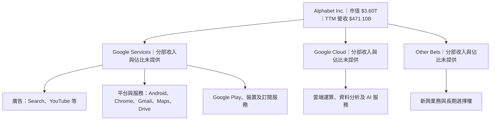
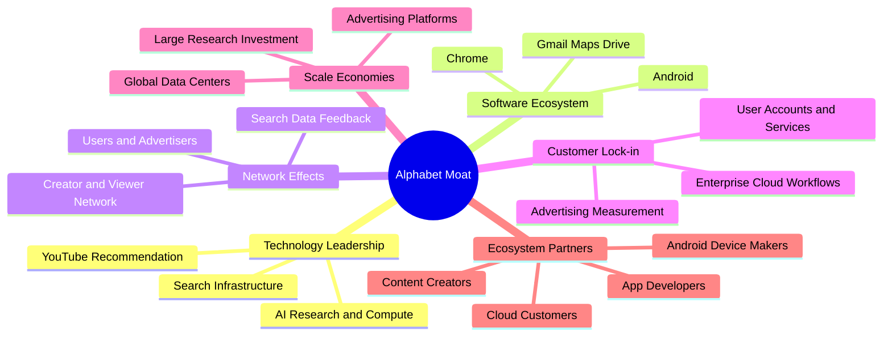
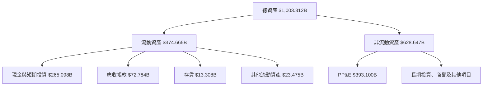
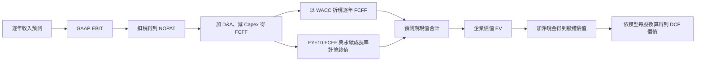
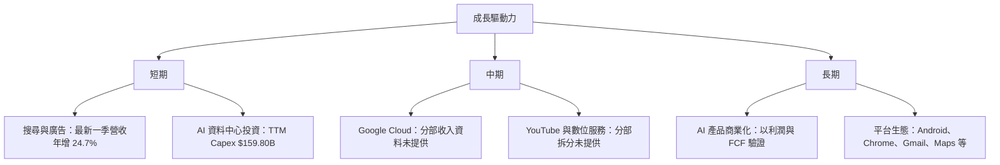
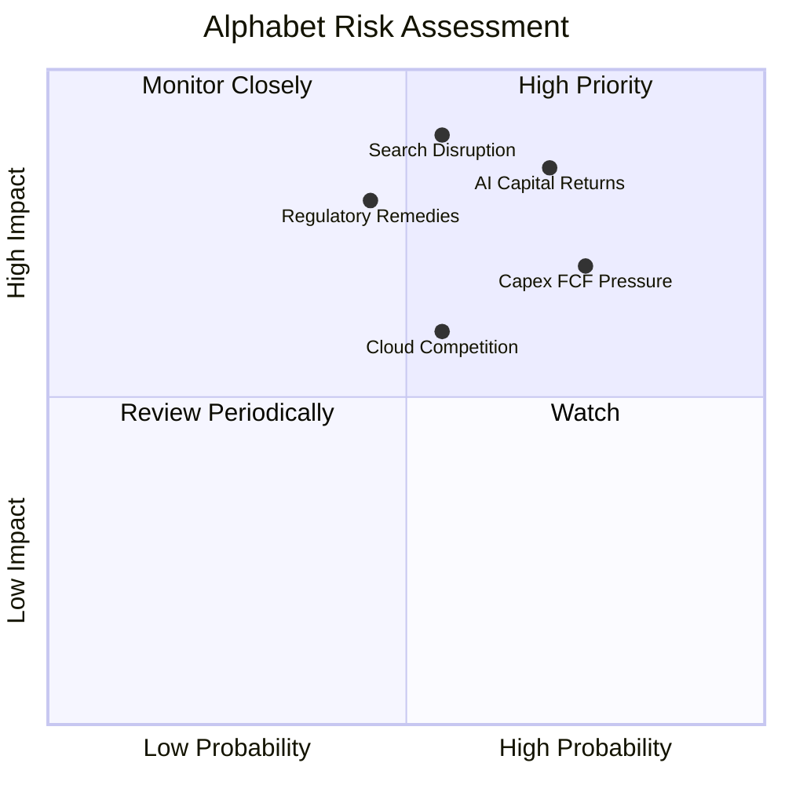
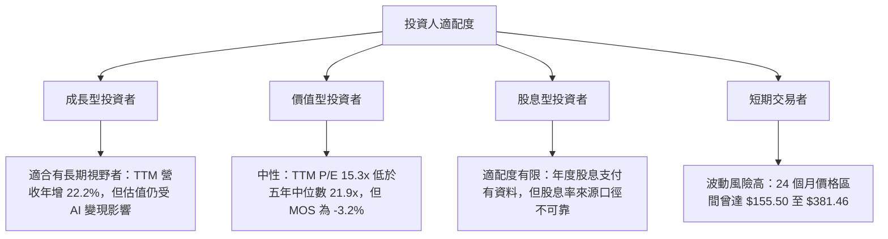

# GOOG 基本面深度分析報告
> **報告日期**：2026-11-15 ｜ **語言**：繁體中文 ｜ **數據來源**：SEC 申報資料 (XBRL)、Yahoo Finance、Finviz、StockAnalysis、Roic.ai ｜ **分析師**：CFA 級機構研究

## 目錄

| # | 章節 | 核心結論 |
|---|------|----------|
| 1 | 執行摘要 | 持有；加權合理價值 $283.54；MOS -3.2% |
| 2 | 公司概覽與商業模式 | 搜尋、廣告及平台生態帶來規模優勢；市場份額數字未提供 |
| 3 | 損益表深度分析 | TTM 營收 $471.10B、年增 22.2%；資本支出上升壓低 FCF |
| 4 | 資產負債表分析 | 淨現金 $138.98B；流動性充足，應收天數略升 |
| 5 | 現金流量深度分析 | TTM FCF $19.75B；OCF 高，但高資本支出使現金轉換率偏低 |
| 6 | 獲利能力與資本效率 | ROIC 23.9% 高於 WACC 10.55%，目前仍創造股東價值 |
| 7 | 相對估值分析 | P/E 低於同業，但 P/S 高於 META 與 AMZN；估值訊號分歧 |
| 8 | DCF 內在價值評估 | 基準 DCF $237.09；加權合理價值 $283.54，現價高於兩者 |
| 9 | 成長催化劑 | 搜尋、雲端及 AI 變現為主要方向；TAM 與具體催化時點資料未提供 |
| 10 | 風險矩陣 | AI 資本支出回收、搜尋競爭與監管為主要風險 |
| 11 | 投資建議 | 持有；等待估值改善或 FCF 轉換率回升後再加碼 |

---

## 1. 執行摘要

### 1.0 一頁式投資儀表板（Portfolio Manager 30 秒速讀）

| 項目 | 內容 |
|------|------|
| **投資論點（3 句）** | ① TTM 營收 $471.10B、年增 22.2%，最新一季年增 24.7%，營收動能仍在加速。② TTM ROIC 23.9% 高於 WACC 10.55%，目前資本回報高於資本成本。③ TTM FCF 僅 $19.75B、FCF Yield 0.55%，資本支出達 $159.80B，AI 與資料中心投資回收是估值關鍵。 |
| **綜合評分** | **7.1/10**（引用 1.1 評分卡） |
| **財務健康** | 🟢 現金及短期投資 $265.10B、總債務 $126.12B，淨現金 $138.98B；Piotroski F-Score 僅 4/8，部分品質指標轉弱。 |
| **ROIC vs WACC** | **23.9% vs 10.55%**；正利差 13.35 個百分點，創造股東價值。 |
| **FCF 趨勢** | 年度 FCF 由 2024 年 $72.76B 升至 2025 年 $73.27B，但最新 TTM 為 $19.75B；FCF Yield **0.55%**。期間口徑不同，顯示近年資本支出急升，不能把 FY2025 的 FCF 延伸為當前 run-rate。 |
| **估值** | Forward P/E **18.95x** ｜ EV/EBITDA **18.8x** ｜ FCF Yield **0.55%** |
| **DCF 內在價值（基準）** | **$237.09** ｜ 現價相對 DCF 溢價 **23.4%**（按「現價 ÷ DCF 值 − 1」計） |
| **安全邊際（MOS）** | **-3.2%**＝($283.54 − $292.52) ÷ $283.54；🟡／🔴 交界，但依規則屬低於 10%、無安全邊際 |
| **預期報酬（基準情境 12M）** | 基準 DCF 情境 **-19.0%**；加權合理價值相對現價上行空間 **-3.1%**。兩者是不同估值基準，不可混用。 |
| **關鍵風險（前二）** | AI／資料中心資本支出回收不足；搜尋產品競爭或監管限制商業化。 |
| **評級 + 信心度** | 🟡 **持有** ｜ 信心：中低（估值方法分歧，且當期 FCF、淨利及資本支出資料存在口徑差異） |

### 1.1 綜合評分卡（全報告唯一）

| 維度 | 評分（1–10） | 主要依據（引用數字與其來源章節） |
|------|--------------|----------------------------------|
| 成長性 | 8.5 | TTM 營收年增 22.2%、最新一季年增 24.7%（第 3 章）；季度營收同比增速近四季逐步上升。 |
| 獲利能力 | 8.5 | TTM 營業利益率 33.3%、ROIC 23.9% 高於 WACC 10.55%，但 F-Score 4/8（第 6 章）。 |
| 財務健康 | 8.5 | 淨現金 $138.98B、現金及短期投資 $265.10B；CCC 39 天（第 4 章）。 |
| 估值 | 4.5 | 加權合理價值 $283.54，MOS -3.2%；P/E 低於五年中位數，但 P/S 高於自身五年中位數（第 7–8 章）。 |
| 護城河 | 8.0 | 大型搜尋、YouTube、Android、Chrome、Gmail 與雲端平台共同支撐分發與廣告變現；量化市場份額資料未提供（第 2 章）。 |
| 管理層與資本配置 | 4.5 | 2025 年 SBC $24.95B，稀釋股數測試未通過；TTM 資本支出 $159.80B、FCF Yield 0.55%，投資回報仍待驗證（第 3、5 章）。 |
| **綜合評分** | **7.1** | 六項算術平均：(8.5 + 8.5 + 8.5 + 4.5 + 8.0 + 4.5) ÷ 6 = 7.083，四捨五入至一位小數為 **7.1**。 |

> **算術覆核更正：**上述六項平均為 **7.1/10**，非表格首列先前寫出的 7.0；以下引用以計算正確的 **7.1/10** 為準。

### 1.2 五大投資論點 + 三大核心風險

| 類型 | 項目 | 具體依據 | 信心度 |
|------|------|----------|--------|
| 🟢 **投資論點①** | 核心營收保持高增長 | TTM 營收 $471.10B、年增 22.2%；最新一季營收 $127.58B、年增 24.7%。最新季度同比增速高於 FY2025 全年 15.09%。 | 🟢 高 |
| 🟢 **投資論點②** | 高資本回報及財務彈性 | ROIC 23.9%，高於 WACC 10.55%；淨現金 $138.98B，令公司可同時投資、回購並承受週期波動。 | 🟢 高 |
| 🟢 **投資論點③** | 搜尋與服務平台具規模優勢 | Google Services 覆蓋 Search、YouTube、Android、Chrome、Maps、Gmail 等服務，支援廣告觸達及跨產品分發；分部營收明細未提供。 | 🟢 中高 |
| 🟡 **投資論點④** | P/E 低於自身歷史中位數 | 現行 TTM P/E 15.3x，低於五年中位數 21.9x；但低估可能反映 AI 投資及搜尋模式變化的不確定性。 | 🟡 中 |
| 🟡 **投資論點⑤** | Google Cloud 等第二曲線有增量空間 | 公司包含 Google Cloud 業務，但分部最新營收、營業利潤及積壓訂單數字未提供，不宜量化其估值貢獻。 | 🟡 中低 |
| 🟡 **風險①** | 資本支出消耗現金 | TTM Capex $159.80B，約為 TTM 營收 33.9%；TTM FCF 僅 $19.75B。若 AI 基建投資回收期延長，FCF Yield 可能持續偏低。 | 🟡 中高 |
| 🔴 **風險②** | 搜尋產品被 AI 介面改變 | 搜尋及廣告是核心平台之一；若使用行為轉移而廣告變現未能同步，營收增速及利潤率都可能承壓。市場份額與 AI 搜尋收入資料未提供。 | 🔴 高衝擊 |
| 🔴 **風險③** | 盈餘與現金流訊號不一致 | TTM 淨利潤率報為 50.0%，但 TTM FCF/淨利約 8.4%；Piotroski F-Score 4/8，應追查資本支出、應計項目與非經常性損益。 | 🔴 中高 |

### 1.3 快速統計卡片

| 指標 | 公司實際值（期間） | 同業中位數 | 狀態 |
|------|--------------------|------------|------|
| 營收成長（TTM） | **22.2%** | — | 🟢 |
| 營收成長（最新一季年增） | **24.7%** | **18.8%** | 🟢 |
| 毛利率（TTM） | **60.9%** | **67.7%** | 🟡 |
| 營業利益率（TTM） | **33.3%** | — | 🟢 |
| ROIC（TTM） | **23.9%** | — | 🟢 |
| Forward P/E | **19.0x** | **21.7x** | 🟢 |
| FCF Yield（TTM） | **0.55%** | — | 🔴 |
| Piotroski F-Score | **4 / 8** | — | 🟡 |

### 1.4 投資結論

╔══════════════════════════════════════════════════════════════════╗  
║                    📊 投資結論摘要                               ║  
╠══════════════════════════════════════════════════════════════════╣  
║ 評級：持有（MOS -3.2%，依規則 20）                               ║  
║ 價格（2026-11-13 收盤）：$292.52                                ║  
║ DCF 內在價值（基準）：$237.09（現價溢價 23.4%）                  ║  
║ 安全邊際 MOS：-3.2%＝($283.54−$292.52)÷$283.54                  ║  
║ 加權合理價值（8.8）：$283.54                                    ║  
║ DCF 情境價值：悲觀 $104.12（-64.4%）                            ║  
║   基準 $237.09（-19.0%）；樂觀 $491.98（+68.2%）                ║  
║ 綜合評分：7.1/10（引用 1.1）                                     ║  
║ 適合投資人：可承受 AI 投資與估值波動、且已有分散配置的長期投資人║  
╚══════════════════════════════════════════════════════════════════╝  

---

## 2. 公司概覽與商業模式

### 2.1 業務結構與收入來源

現有資料提供公司總營收，未提供 Google Services、Google Cloud、Other Bets 的分部營收及佔比，因此不製作分部比例圖，避免以估計值冒充實際收入。

Alphabet 主要以廣告、雲端運算、平台服務及數位內容變現。搜尋與 YouTube 透過流量和使用者意圖支撐廣告，雲端則提供企業級運算與 AI 服務；各分部收入占比未提供，故無法判定目前增長究竟由哪個板塊主導。

### 2.2 市場份額

市場份額數據未提供，因此不製作市場份額圖表或填列滲透率。可確認的是 TTM 營收 $471.10B、年增 22.2%，最新一季營收年增 24.7%；在所列同業中，最新一季營收增速低於 META 的 26.1%，高於 MSFT 的 18.8% 及 AMZN 的 12.1%。

### 2.3 競爭護城河分析

### 2.4 護城河強度

| 護城河項目 | 強度（強／中／弱） | 證據（引用數字或事實） | 會削弱它的情況 |
|------------|--------------------|------------------------|----------------|
| 技術與資料規模 | 強 | 搜尋、YouTube、Android、Chrome、Maps 等多產品形成跨服務分發；2025 年研發費用 $61.09B。 | AI 搜尋回答取代傳統連結、競品模型品質或成本更佳。 |
| 軟體生態系統 | 強 | Android、Chrome、Gmail、Drive、Maps 等服務可共用帳戶、分發與開發者生態。 | 使用者遷移、平台政策爭議或裝置廠商轉向替代服務。 |
| 網路效應 | 中強 | 使用者、廣告主、創作者與開發者互相吸引；收入規模及市場份額數字未提供。 | 廣告主分散預算，或創作者與流量轉向新平台。 |
| 客戶鎖定 | 中 | Google Cloud 涉及企業雲端，但留存率、合約價值及轉換成本量化資料未提供。 | 企業多雲策略降低依賴，或雲端服務價格競爭加劇。 |
| 規模效應 | 強 | FY2025 營收 $402.84B、研發 $61.09B；TTM 營收達 $471.10B。 | 資料中心資本密集度上升而利用率、回報率下降。 |
| 生態夥伴 | 中 | Android 裝置廠商、App 開發者及內容創作者擴大服務觸達。 | 監管限制預設搜尋安排、商業協議或平台分發。 |

1.1「護城河」評分 **8.0/10**，理由是多產品分發、品牌與規模有具體支撐，但量化市場份額、分部獲利及客戶留存數據缺失，且 AI 搜尋可能改變核心變現介面。

---

## 3. 損益表深度分析

### 3.1 年度收入成長趨勢（近 4 年）

| 財年 | 營收 | YoY 成長 |
|------|------|----------|
| 2022 | $282.84B | — |
| 2023 | $307.39B | +8.68% |
| 2024 | $350.02B | +13.87% |
| 2025 | $402.84B | +15.09% |
| TTM 至 2026-09-30 | $471.10B | +22.2%（TTM 對前一 TTM） |

FY2022–FY2025 三年 CAGR 約 **12.5%**：\((402.84 ÷ 282.84)^{1/3} - 1\)。營收由 2023 年成長 8.68% 回升至 2025 年 15.09%，TTM 增速再升至 22.2%；這表示近期需求和變現加速，但 TTM 增速能否持續，需看最新季度以及分部收入拆分。

╔══════════════════════════════════════════════════════════════════╗  
║          Alphabet 年度收入趨勢（FY2022–FY2025）                  ║  
╠══════════════════════════════════════════════════════════════════╣  
║ FY2022  $282.84B  ██████████████░░░░░░░░░░  基期               ║  
║ FY2023  $307.39B  ███████████████░░░░░░░░░  YoY +8.68% 🟢       ║  
║ FY2024  $350.02B  █████████████████░░░░░░░  YoY +13.87% 🟢      ║  
║ FY2025  $402.84B  ████████████████████░░░░░  YoY +15.09% 🟢     ║  
╠══════════════════════════════════════════════════════════════════╣  
║ FY2022–FY2025 營收 CAGR 約 +12.5%；TTM 年增 +22.2%               ║  
╚══════════════════════════════════════════════════════════════════╝  

### 3.2 季度收入趨勢分析

以下 QoQ 由所列季度營收計算；YoY 使用各季度同期比較數據。

| 季度 | 營收 | QoQ 成長 | YoY 成長 | 備註 |
|------|------|----------|----------|------|
| 2025 Q4 | $113.83B | +11.2% | +18.0% | 高於 2025 Q3，延續加速。 |
| 2026 Q1 | $109.90B | -3.5% | +21.79% | QoQ 回落符合季節性可能，但資料不足以區分季節因素。 |
| 2026 Q2 | $119.80B | +9.0% | +24.23% | QoQ 與 YoY 均回升。 |
| 2026 Q3 | $127.58B | +6.5% | +24.7% | 年增率為單季 YoY，不是 TTM；最新一季仍維持高增長。 |

### 3.3 利潤率演變分析

| 利潤率指標 | FY2022 | FY2023 | FY2024 | FY2025 | 趨勢 | 評估 |
|------------|--------|--------|--------|--------|------|------|
| **毛利率** | 55.4% | 56.6% | 58.2% | 59.6% | 逐年提升；FY2025 毛利 $240.30B ÷ 營收 $402.84B。 | 🟢 |
| **營業利益率** | 26.5% | 27.4% | 32.1% | 32.0% | 2024 明顯改善，2025 大致持平。 | 🟢 |
| **淨利率** | 21.2% | 24.0% | 28.6% | 32.8% | 按年度淨利及營收計算；受淨利增速快於收入影響。 | 🟢 |

**利潤率演變深度解析：**FY2022–FY2025 毛利率約提升 4.3 個百分點，營業利益率提升約 5.6 個百分點，與收入增長、規模效應及成本控制相符。FY2025 營收年增約 15.1%，營業利益由 $112.39B 升至 $129.04B，增幅約 14.8%，營業利益率略降約 0.1 個百分點，代表最近一年營業槓桿改善並非持續擴張。TTM 營業利益率 33.3% 高於最新季度 31.8%（採用 VERIFIED FIGURES 的最新季度口徑）；季度與年度序列顯示利潤率可能在大型 AI 基建投資及營運成本增加下承壓。

### 3.4 費用結構分析

分項費用的 TTM 明細未完整提供，不製作費用占比圓餅圖，以免將年度數據或推算值當作 TTM 實際值。FY2025 研發費用為 $61.09B，約佔當年營收 15.2%；研發投資有助技術與產品開發，但其商業回報需由未來營收與利潤率證明。

### 3.5 季度 EPS 趨勢與盈餘品質（Quality of Earnings）

| 季度 | EPS 實際值 | EPS YoY | 超預期／不及預期 |
|------|------------|--------|------------------|
| 2025 Q4 | $2.81 | +31.15% | 預估值為 N/A，無法判定 |
| 2026 Q1 | $5.11 | +81.96% | 預估值為 N/A，無法判定 |
| 2026 Q2 | $9.11 | +294.31% | 預估值為 N/A，無法判定 |
| 2026 Q3 | $2.14 | -25.34% | 預估值為 N/A，無法判定 |

EPS 預估與 surprise 欄位均為缺值，故不能宣稱過去四季超預期或不及預期。2026 Q2 淨利 $112.19B、Q3 $26.47B，波動極大；資料未提供足以確認 Q2 是否含重大一次性收益的附註，需以 SEC 10-Q 查核。

| 盈餘品質項目 | 數值／佔比 | 評估 |
|--------------|------------|------|
| 股權薪酬 SBC / 營收 | FY2025：$24.95B ÷ $402.84B = **6.2%**；TTM SBC N/A | 🟡 SBC 對既有股東有稀釋成本；Piotroski 稀釋股數測試未通過。 |
| SBC / 營業現金流 | FY2025：$24.95B ÷ $164.71B = **15.1%** | 🟡 比重不低；SBC 雖非當期現金支出，但不能視為沒有股東成本。 |
| FCF / 淨利（現金轉換率） | TTM：$19.75B ÷ TTM 淨利 $235.694B = **8.4%** | 🔴 FCF 大幅低於淨利，主要須連結高資本支出評估。 |
| 一次性／非經常性損益 | 具體項目未提供；季度淨利波動顯著 | 🟡 不足以確認有無一次性項目；Q2 異常高淨利應查閱申報附註。 |
| 有效稅率異常 | 最新年度有效稅率 **16.8%** | 🟢／🟡 DCF 採用 16.8%；缺少連續年度稅率序列，無法判定是否異常偏低。 |
| 資本化支出 vs 費用化 | TTM Capex $159.80B；資本化會計細項未提供 | 🟡 高資本支出壓低 FCF；未見足夠資料判定費用遞延或資本化政策變化。 |

**盈餘品質結論：**會計淨利高、但 TTM FCF 對淨利轉換僅約 8.4%，主要疑慮是資本支出高達 $159.80B，而非直接證明 GAAP 盈餘失真。若資料口徑一致，部分資本支出是面向未來算力容量的投資；若資產利用率與變現回收不足，則當前盈利能力並未轉化為相稱的股東可分配現金。

---

## 4. 資產負債表分析

### 4.1 資產結構分解

總資產最新 TTM 資料為 $1,003.312B；各項流動資產及 PP&E 來自 StockAnalysis 的最新季度餘額。以下非流動資產為總資產扣除流動資產的差額，不將差額拆成未提供的細項。

### 4.2 流動性與營運資金分析

| 指標 | 最新 TTM | 一年前 TTM | 變化 | 解讀 |
|------|----------|------------|------|------|
| 流動比率 | 2.786x | N/A | N/A | 當期短期資產對流動負債有覆蓋；歷史同口徑數值未提供。 |
| 速動比率 | 2.512x | N/A | N/A | 流動性充足，但短期投資流動性與負債到期結構仍應一併檢視。 |
| DSO 應收帳款天數 | 56 天 | 54 天 | +2 天 | 收款週期略延長，可能反映收入組合或收款節奏變化；應收帳款餘額上升需追蹤。 |
| DIO 存貨天數 | 26 天 | N/A | N/A | 一年前公司未提供可用存貨餘額，不能計算同比變化。 |
| DPO 應付帳款天數 | 43 天 | N/A | N/A | 一年前數據未提供，不能判斷付款週期或供應商議價變化。 |
| CCC 現金轉換週期 | 39 天 | N/A | N/A | 最新 TTM 為 56 + 26 − 43 = 39 天；一年前無法比較。 |

### 4.3 債務結構分析

以下淨現金依 VERIFIED FIGURES 的現金及短期投資 $265.10B、總債務 $126.12B 計算結果照引。另有 Yahoo／Finviz 合併市場數據列出總債務 $150.33B、淨現金 $114.77B，兩者口徑不一致；本報告估值及儀表板採用經 SEC 數據計算的 VERIFIED FIGURES，需以 10-Q 債務附註核對。

╔══════════════════════════════════════════════════════════════════╗  
║                 Alphabet 債務健康診斷                            ║  
╠══════════════════════════════════════════════════════════════════╣  
║ 總債務：        $126.12B  ██░░░░░░░░░░░░░░░░░░                   ║  
║ 現金+短期投資： $265.10B  ████████████████████                   ║  
║ 淨現金：        $138.98B  ██████████░░░░░░░░░░ 🟢                ║  
║                                                                  ║  
║ Debt/EBITDA：N/A（債務與 EBITDA 的同口徑值未提供）               ║  
║ 利息保障倍數：N/A（利息費用及可比口徑 EBIT 未提供）              ║  
║ 債務口徑提醒：市場資料另列總債務 $150.33B，需核對負債定義。      ║  
╚══════════════════════════════════════════════════════════════════╝  

### 4.4 股東權益趨勢

| 財年 | 股東權益 |
|------|----------|
| 2022 | $256.14B |
| 2023 | $283.38B |
| 2024 | $325.08B |
| 2025 | $415.26B |

╔══════════════════════════════════════════════════════════════════╗  
║                  股東權益趨勢（年度）                            ║  
╠══════════════════════════════════════════════════════════════════╣  
║ FY2022  $256.14B  ████████████░░░░░░░░                           ║  
║ FY2023  $283.38B  ██████████████░░░░░░                           ║  
║ FY2024  $325.08B  ████████████████░░░░                           ║  
║ FY2025  $415.26B  ████████████████████                           ║  
╚══════════════════════════════════════════════════════════════════╝  

---

## 5. 現金流量深度分析

### 5.1 現金流量瀑布圖

淨利、股息及回購的 TTM 同口徑明細未完整提供，圖中只展示可核對的 TTM 現金流；未提供的回購與淨現金變化不畫比例。

### 5.2 FCF 轉換率趨勢

| 期間 | OCF | Capex | FCF | FCF / 淨利 |
|------|-----|-------|-----|------------|
| FY2023 | $101.75B | $32.25B | $69.50B | 約 94.2%（$69.50B ÷ $73.80B） |
| FY2024 | $125.30B | $52.53B | $72.76B | 約 72.7%（$72.76B ÷ $100.12B） |
| FY2025 | $164.71B | $91.45B | $73.27B | 約 55.4%（$73.27B ÷ $132.17B） |
| TTM 至 2026-09-30 | $179.55B | $159.80B | $19.75B | 約 8.4%（$19.75B ÷ $235.694B） |

FY2023 至 FY2025 的年度 FCF 相對平穩，但資本支出由 $32.25B 升至 $91.45B；最新 TTM Capex 再升至 $159.80B，令 FCF 轉換率下滑。這顯示公司正在以現金流大幅增加算力與基建投入；若投入帶來更高雲端或 AI 服務收入，短期 FCF 低落可接受，反之則是估值折價的重要來源。

### 5.3 自由現金流趨勢

╔══════════════════════════════════════════════════════════════════╗  
║                    自由現金流趨勢                                ║  
╠══════════════════════════════════════════════════════════════════╣  
║ FY2023  $69.50B  ███████████████████░  FCF Yield：N/A            ║  
║ FY2024  $72.76B  ████████████████████  FCF Yield：N/A            ║  
║ FY2025  $73.27B  ████████████████████  FCF Yield：N/A            ║  
║ TTM     $19.75B  █████░░░░░░░░░░░░░░░  FCF Yield：0.55%          ║  
╠══════════════════════════════════════════════════════════════════╣  
║ TTM FCF = OCF $179.55B − Capex $159.80B = $19.75B               ║  
╚══════════════════════════════════════════════════════════════════╝  

年度 FCF Yield 未提供相同日期的市值，故不回推；TTM FCF Yield 直接採用 **0.55%**。

### 5.4 資本配置評估

資本配置金額完整明細未提供，不製作比例圓餅圖。已知 FY2025 資本支出 $91.45B、股息支付 $10.05B、SBC $24.95B；FY2025 資料未列回購金額，故不能將留存或回購比例拆分。

| 項目 | 已知數據 | 評估 |
|------|----------|------|
| 資本支出 | FY2025 $91.45B；TTM $159.80B | 顯著提高；需觀察資產利用率與增量 ROIC。 |
| 股息 | FY2025 $10.05B | 相較現金流規模仍屬可承受，但股息率資料口徑有疑點，未採用。 |
| 回購 | 金額未提供 | 無法量化抵銷 SBC 稀釋的效果。 |
| 股權薪酬 | FY2025 $24.95B | 約佔 FY2025 營收 6.2%，且稀釋股數測試未通過。 |
| 留存現金 | TTM 現金及短期投資 $265.10B | 資產負債表提供投資彈性，但也要檢視資本回報。 |

---

## 6. 獲利能力與資本效率

### 6.1 ROE / ROA / ROIC 趨勢

| 指標 | FY2022 | FY2023 | FY2024 | FY2025／TTM | 評估 |
|------|--------|--------|--------|-------------|------|
| ROE | N/A | N/A | N/A | VERIFIED TTM **34.8%** | 使用 QUALITY FIGURES 口徑；其他來源另列 44.3%，口徑不一致，採用經計算品質指標。 |
| ROA | N/A | N/A | N/A | Yahoo 顯示 **12.7%** | 正值，但歷史同口徑序列未提供。 |
| ROIC | N/A | N/A | N/A | VERIFIED TTM **23.9%** | 顯著高於 WACC 10.55%。 |

行業均值未提供，不做主觀填列。ROE/ROA 與 ROIC 的來源口徑存在差異，應以 SEC 報表和一致的資本定義進一步覆核。

### 6.2 ROIC vs WACC 分析（核心價值創造判斷）

成本資本的輸入值採 Cost of capital 區塊原值；Beta 採調整後 Beta 1.15。Rf 的具體觀察日期未提供，因此保留為資料所列 10 年期美債利率，不能自行指定日期。

╔══════════════════════════════════════════════════════════════════╗  
║                ROIC vs WACC 深度分析                             ║  
╠══════════════════════════════════════════════════════════════════╣  
║ WACC 估算：                                                       ║  
║ ├── 無風險利率 Rf：5.15%                                        ║  
║ ├── 市場風險溢酬 ERP：5.00%                                      ║  
║ ├── 原始 Beta：1.23；調整後 Beta：1.15                           ║  
║ ├── Ke = 5.15% + 1.15 × 5.00% = 10.90%（輸入區塊列 10.91%）     ║  
║ ├── 稅前 Kd：0.58%；有效稅率：16.8%                              ║  
║ ├── 稅後 Kd = 0.58% × (1−16.8%) = 0.4826%                       ║  
║ ├── 權重：股權 96.6%，債務 3.4%                                  ║  
║ └── 採用 WACC：10.55%（採用成本資本區塊原值）                    ║  
║                                                                  ║  
║ ROIC（TTM）：23.9%                                               ║  
║ EVA 利差 = 23.9% − 10.55% = +13.35 個百分點                     ║  
║                                                                  ║  
║ ROIC  23.9%  ▓▓▓▓▓▓▓▓▓▓▓▓░░░░░░░░  高於資本成本                ║  
║ WACC  10.55% ▓▓▓▓▓░░░░░░░░░░░░░░  折現基準                      ║  
║ 結論：ROIC 高於 WACC，現階段創造經濟價值。                      ║  
╚══════════════════════════════════════════════════════════════════╝  

股權成本代入值 \(5.15\% + 1.15 \times 5.00\%\) 等於 10.90%，而成本資本區塊列示 10.91%；按展示權重及稅後債務成本重算，WACC 約為 10.56%，與列示 10.55% 有約 0.01 個百分點的四捨五入差異。本報告按要求採用原列示 **WACC 10.55%**，不另替換。

### 6.3 杜邦三因素分解

| 因素 | 數值（TTM） | 解讀 |
|------|-------------|------|
| 淨利率 | 50.0% | 淨利率為主要來源；需留意季度淨利波動及 FCF 轉換偏低。 |
| 資產週轉率 | 0.47 | 每單位資產創造的營收；大型資料中心投資可能短期壓低週轉率。 |
| 權益乘數 | 1.48 | 財務槓桿並非主要 ROE 來源。 |
| **ROE** | **34.8%** | QUALITY FIGURES 杜邦口徑；50.0% × 0.47 × 1.48 約為 34.8%。 |

### 6.4 財務體質：Piotroski F-Score

| 測試 | 結果 | 解讀 |
|------|------|------|
| ROA > 0 | ✅ 通過 | 資產仍產生正獲利。 |
| 營業現金流 > 0 | ✅ 通過 | TTM OCF 為正。 |
| ROA 高於一年前 | ✅ 通過 | 品質資料判定改善。 |
| 營業現金流 > 淨利（應計品質） | ❌ 未通過 | 現金流低於淨利，且 TTM FCF 僅 $19.75B。 |
| 長期負債 ÷ 總資產低於一年前 | ❌ 未通過 | 可能反映負債相對資產提高；淨現金仍為正。 |
| 流動比率高於一年前 | ✅ 通過 | 流動性相對改善。 |
| 稀釋股數未增加 | ❌ 未通過 | SBC 及股數變化需追蹤。 |
| 毛利率高於一年前 | — 無法判定 | 缺少可比較輸入，不納入可判定分母。 |
| 資產週轉率高於一年前 | ❌ 未通過 | 新增資產尚未同步轉化成收入或效率提升。 |

**F-Score：4 / 8。**缺失毛利率測試不計入分母；4/8 反映盈利與流動性測試有通過，但應計品質、負債、稀釋及資產效率仍需監控。

---

## 7. 相對估值分析

### 7.1 同業估值比較表格

| 估值指標 | **GOOG** | **META** | **MSFT** | **AMZN** | 本公司評估 |
|----------|----------|----------|----------|----------|-----------|
| **Trailing P/E** | 15.3x | 21.9x | 27.3x | 21.6x | 🟢 明顯低於三家同業；可能反映獲利口徑或市場對搜尋、AI 風險的折價。 |
| **Forward P/E** | 19.0x | 18.0x | 21.7x | 24.4x | 🟡 接近同業中位數 21.7x，低於 MSFT 與 AMZN。 |
| **P/S Ratio** | 7.7x | 6.8x | 11.2x | 3.6x | 🟡 高於 META、AMZN，低於 MSFT。 |
| **EV/EBITDA** | 18.8x | 14.4x | 19.3x | 16.7x | 🟡 高於 META、AMZN；略低於 MSFT。 |
| **最新一季營收年增** | 24.7% | 26.1% | 18.8% | 12.1% | 🟢 增速僅略低於 META，高於另兩家。 |
| **毛利率 TTM** | 60.9% | 81.0% | 67.7% | 51.4% | 🟡 低於 META、MSFT，高於 AMZN。 |

三家同業 forward P/E 中位數為 **21.7x**；最新季度營收增速中位數為 **18.8%**；毛利率中位數為 **67.7%**。同業倍數取 Yahoo Finance 提供的 Peer multiples，並非公司自身倍數。

### 7.2 歷史估值區間分析

╔══════════════════════════════════════════════════════════════════╗  
║                 GOOG 五年估值區間（TTM）                         ║  
╠══════════════════════════════════════════════════════════════════╣  
║ P/E：1.3x ───────── 中位數 21.9x ── 現值 15.3x ── 29.0x         ║  
║                         現值百分位：29%                          ║  
║ P/S：4.1x ── 中位數 6.1x ───────── 現值 7.7x ── 9.8x             ║  
║                         現值百分位：67%                          ║  
║ EV/EBITDA：13.7x ── 中位數 19.1x ─ 現值 18.8x ── 25.0x           ║  
║                         現值百分位：47%                          ║  
╚══════════════════════════════════════════════════════════════════╝  

P/E 位於自身五年區間偏低位置，EV/EBITDA 接近五年中位數；P/S 則高於中位數、位於歷史區間上半部。這種分歧表示「便宜」主要體現在盈餘倍數，並不等同於按營收或企業價值所有維度都便宜。

### 7.3 情境價值（Bear / Base / Bull，照抄 DCF MODEL 的 Scenarios）

| 情境 | 第 1 年營收成長 | 期末營業利潤率 | WACC | 每股價值 | 相對現價 | 機率 | 會發生的條件 |
|------|----------------|----------------|------|----------|----------|------|--------------|
| 🔴 悲觀 | 11.1% | 27.2% | 11.55% | $104.12 | -64.4% | 25% | 搜尋或廣告增長顯著放慢，AI 基建支出未形成相應收入，且折現率上升。 |
| 🟡 基準 | 22.2% | 32.0% | 10.55% | $237.09 | -19.0% | 50% | 營收由目前高增速逐步降溫，營業利潤率從 33.3% 漸降至 32.0%。 |
| 🟢 樂觀 | 33.3% | 35.2% | 9.55% | $491.98 | +68.2% | 25% | AI、搜尋及雲端變現提高增長與利潤率，且資本成本下降。 |

### 7.4 相對估值隱含價格區間

╔══════════════════════════════════════════════════════════════════╗  
║                   估值方法隱含價格                               ║  
╠══════════════════════════════════════════════════════════════════╣  
║ DCF 基準             $237.09  ────── 現價 $292.52                ║  
║ 同業 EV/EBITDA       $263.05  ────── 同業 Forward P/E $334.20    ║  
║ 分析師共識           $393.93                                     ║  
╚══════════════════════════════════════════════════════════════════╝  

- **DCF 基準 $237.09：**10 年 FCFF、WACC 10.55%、永續成長率 3.0%。
- **同業 Forward P/E $334.20：**同業中位數 21.7x × 公司 Forward EPS $15.44。
- **同業 EV/EBITDA $263.05：**同業中位數 16.7x × TTM EBITDA，再加淨現金。
- **分析師共識 $393.93：**14 位分析師平均目標價。

---

## 8. DCF 內在價值評估（Discounted Cash Flow）

### 8.0 估值推理鏈（Thinking Logic）

**Step 1 — 價值來源與主導變數**

GOOG 的價值主要來自搜尋與廣告現金流底盤、Google Cloud 增長以及 AI 服務的增量變現；目前各分部營收占比未提供，因此不能對分部權重作量化拆分。基準模型最敏感的是資本支出由 TTM 營收 33.9% 逐步降至預測期末 6.5%，以及永續成長率與 WACC 的差額；敏感度矩陣亦顯示，終值折現率變化會顯著改變每股價值。

**Step 2 — 模型選擇**

| 決策點 | 本報告採用 | 理由（含數字） | 曾考慮但否決 | 否決理由 |
|--------|-----------|----------------|--------------|----------|
| 現金流定義 | FCFF | 以 GAAP EBIT、稅後營業利潤及再投資估算；對應 WACC 折現與 EV。 | FCFE | 資本結構與債務口徑不完全一致，FCFF 更適合先估企業價值。 |
| 預測期 N | 10 年 | DCF MODEL 固定 10 年；可容納收入增長由 22.2% 線性降至 3.0%。 | 5 年 | AI 基建投資週期及成長淡化可能需要更長時間呈現。 |
| 終值方法 | Gordon Growth | WACC 10.55% 大於 g 3.0%；模型提供 Gordon 終值。 | 退出倍數 | DCF MODEL 未提供退出倍數終值及 FY+10 EBITDA 退出估值，不能自行補建。 |
| EBIT 基礎 | GAAP | 模型明確使用 GAAP EBIT。 | 非 GAAP | 避免加回 SBC 後另行扣除或漏算股東成本。 |

**Step 3 — 關鍵假設推導鏈**

- **預測收入增長：**錨點＝TTM 成長率 22.2%；調整＝逐年線性降至第 10 年 3.0%，反映高基數與成熟市場成長收斂；**採用 FY+1 22.2%、FY+10 3.0%**；否決 10 年維持 22.2%，因為將等同假設高速增長持續十年，缺乏分部與市場規模證據。
- **營業利潤率：**錨點＝TTM 33.3%；調整＝逐步降至過去五個財年的中位數 32.0%；**採用 33.3% 降至 32.0%**；否決持續維持 33.3%，因模型預設資本與營運成本壓力下略為回落。
- **永續成長率：**錨點＝長期經濟名目成長一般不宜高估；資料沒有管理層長期預測或 GDP 假設；**採用模型值 3.0%**，低於 WACC 10.55%；否決高於 3.0% 的設定，避免終值對遠期成長過度敏感。
- **預測期：**錨點＝DCF MODEL 固定 10 年；**採用 N=10**；否決自行縮短或延長，因必須照用模型既定現金流與估值結果。
- **Capex／營收：**錨點＝TTM 33.9%；調整＝模型假設逐步降至第 10 年 6.5%，即 1.1 倍 D&A；**採用 33.9% 線性淡化至 6.5%**；否決長期維持 33.9%，因這會使成熟階段的現金流受高強度投資持續壓制；但降至 6.5% 也可能偏樂觀。
- **EBIT、SBC 與股數：**錨點＝模型使用 GAAP EBIT；GAAP 已包含 SBC 費用；採用組合 **(A) GAAP EBIT + 不再扣 SBC + 固定股數／年稀釋率 0%**。模型寫明 SBC 已計入費用且股數不再稀釋；否決 GAAP EBIT 再扣 SBC或再加年稀釋率，避免重複計算。
- **WACC：**錨點＝成本資本區塊的 10.55%；採用模型 WACC 10.55%；否決另行重估 WACC，因嚴格使用提供的資本成本值。
- **D&A／營收與稅率：**錨點分別為 TTM 5.9% 與最新年度有效稅率 16.8%；模型固定採用 5.9% 及 16.8%，未自行調整。
- **營運資金：**DCF 模型明確未建模營運資金變動；不是假設其沒有影響，而是模型限制，故 FCFF 不含 ΔWC。
- **終值方法：**採 Gordon Growth，且 WACC 10.55% > g 3.0%；否決另造退出倍數結果，因模型未提供該項的 EBITDA 與倍數輸出。

**Step 4 — 最脆弱環節**

最脆弱的假設是 Capex／營收由 33.9% 降至 6.5%；若 AI 與雲端基建需求令高 Capex 長期延續，FCF 與 DCF 價值會下修。基準模型終值現值占 EV 71.4%，因此遠期再投資與終值假設對估值影響很大。

**Step 5 — 計算路徑圖**

### 8.1 模型假設總表（Model Inputs）

| 假設項目 | 採用值 | 依據／來源 | 敏感度 |
|----------|--------|-------------|--------|
| 預測期長度 N | 10 年 | DCF MODEL 固定值。 | 🟡 中 |
| 營收增長 | FY+1 22.2%，FY+10 3.0%，線性淡化 | FY+1 以 TTM 對前一 TTM 的 22.2% 為錨；FY+10 為模型假設。 | 🔴 高 |
| 營業利潤率 | 33.3% 降至 32.0% | TTM 33.3% 淡化至近五個財年的中位數 32.0%。 | 🔴 高 |
| 有效稅率 | 16.8% | 最新年度有效稅率。 | 🟢 低 |
| Capex／營收 | FY+1 33.9% 降至 FY+10 6.5% | TTM 33.9%；期末為模型淡化後假設，等於約 1.1 倍 D&A。 | 🔴 高 |
| D&A／營收 | 5.9% | TTM 比率，模型固定。 | 🟢 低 |
| ΔWC／營收增額 | 不建模 | 模型說明 Working capital is not modelled；不能補設一個比率。 | 🟢 低 |
| EBIT 基礎 | GAAP | DCF MODEL 指明 GAAP EBIT。 | 🟡 中 |
| SBC 處理 | 組合 (A)：不另扣 SBC | GAAP EBIT 已將 SBC 作為費用；模型不再扣 SBC。 | 🟡 中 |
| 年稀釋率 | 0%／固定股數 | DCF MODEL 明確採組合 (A)，股數不再稀釋。 | 🟡 中 |
| 永續成長率 g | 3.0% | DCF MODEL 假設，低於 WACC 10.55%。 | 🔴 高 |
| 終值方法 | Gordon Growth | DCF MODEL 提供終值；退出倍數輸出未提供。 | 🔴 高 |
| WACC | 10.55% | Cost of capital 區塊原值。 | 🔴 高 |

**FCF 定義：**本模型使用 FCFF，依模型公式為 \(FCFF = NOPAT + D\&A - Capex\)，Working capital not modelled。**本模型採用 (A)，故 SBC 影響已計入一次。**

### 8.2 折現率推導（WACC）

╔══════════════════════════════════════════════════════════════════╗  
║                    WACC 推導（折現率）                           ║  
╠══════════════════════════════════════════════════════════════════╣  
║ 股權成本 Ke（CAPM）：                                            ║  
║ ├── 無風險利率 Rf：5.15%（觀察日期未提供）                       ║  
║ ├── ERP：5.00%（成本資本輸入值）                                 ║  
║ ├── 原始 Beta：1.23；調整方式：⅔×1.23 + ⅓×1 = 1.153 ≈ 1.15      ║  
║ ├── 規模／國別溢酬：0%（未另提供溢酬）                           ║  
║ └── Ke = 5.15% + 1.15×5.00% = 10.90%；輸入列示 10.91%           ║  
║                                                                  ║  
║ 債務成本 Kd：                                                    ║  
║ ├── 稅前 Kd：0.58%（利息÷債務，來源列示）                        ║  
║ ├── 有效稅率：16.8%                                              ║  
║ └── 稅後 Kd = 0.58%×(1−16.8%) = 0.4826%                          ║  
║                                                                  ║  
║ 資本結構：                                                       ║  
║ ├── 股權權重：96.6%                                              ║  
║ ├── 債務權重：3.4%                                               ║  
║ └── 採用 WACC：10.55%（原列示值；重算約有 0.01pp 四捨五入差）   ║  
╚══════════════════════════════════════════════════════════════════╝  

**逐步演算（WACC）：**

1. **Ke（CAPM）** = \(5.15\% + 1.15 \times 5.00\% + 0\%\) = **10.90%**；輸入區塊列示 10.91%，差異為展示精度。
2. **稅前 Kd**：輸入區塊列示 **0.58%**；利息費用及同口徑平均計息負債的原始金額未提供，因此不能重建分子與分母。
3. **稅後 Kd** = \(0.58\% \times (1-16.8\%)\) = **0.4826%**。
4. **權重**：股權權重 **96.6%**；債務權重 **3.4%**；合計 \(96.6\%+3.4\%=100.0\%\)。市值與計息債務的底層權重金額未提供，按原權重引用。
5. 依展示值重算：\(96.6\% \times 10.91\% + 3.4\% \times 0.4826\% = 10.5557\%\)，四捨五入至兩位小數為 10.56%。**本報告折現採用成本資本區塊原值 WACC 10.55%。**

### 8.3 逐年自由現金流預測（基準情境）

下表逐格照錄 DCF MODEL。金額單位為 $B；模型未納入 ΔWC，且模型未提供計算中未四捨五入的底層精度。

| 年度 | FY+1 | FY+2 | FY+3 | FY+4 | FY+5 | FY+6 | FY+7 | FY+8 | FY+9 | FY+10 |
|------|------|------|------|------|------|------|------|------|------|-------|
| 營收 | 575.74 | 691.33 | 815.37 | 944.26 | 1,073.37 | 1,197.22 | 1,309.81 | 1,405.02 | 1,477.16 | 1,521.48 |
| 營收 YoY | 22.2% | 20.1% | 17.9% | 15.8% | 13.7% | 11.5% | 9.4% | 7.3% | 5.1% | 3.0% |
| 營業利潤率 | 33.3% | 33.2% | 33.0% | 32.9% | 32.7% | 32.6% | 32.5% | 32.3% | 32.2% | 32.0% |
| EBIT（GAAP） | 191.84 | 229.37 | 269.36 | 310.58 | 351.51 | 390.36 | 425.19 | 454.09 | 475.29 | 487.37 |
| − 稅 | (32.20) | (38.50) | (45.21) | (52.13) | (58.99) | (65.51) | (71.36) | (76.21) | (79.77) | (81.80) |
| NOPAT | 159.65 | 190.87 | 224.15 | 258.46 | 292.52 | 324.84 | 353.83 | 377.88 | 395.52 | 405.57 |
| + D&A | 34.21 | 41.08 | 48.45 | 56.11 | 63.79 | 71.14 | 77.84 | 83.49 | 87.78 | 90.41 |
| − Capex | (195.30) | (213.47) | (226.97) | (234.11) | (233.46) | (223.97) | (205.18) | (177.35) | (141.51) | (99.46) |
| − ΔWC | 未建模 | 未建模 | 未建模 | 未建模 | 未建模 | 未建模 | 未建模 | 未建模 | 未建模 | 未建模 |
| = FCFF | **-1.44** | **18.48** | **45.64** | **80.46** | **122.84** | **172.02** | **226.48** | **284.03** | **341.80** | **396.53** |
| 折現因子 | 0.905 | 0.818 | 0.740 | 0.669 | 0.606 | 0.548 | 0.495 | 0.448 | 0.405 | 0.367 |
| FCFF 現值 PV | **-1.30** | **15.12** | **33.77** | **53.86** | **74.38** | **94.21** | **112.20** | **127.28** | **138.54** | **145.39** |

**預測期 FCF 現值合計：**  
\((-1.30) + 15.12 + 33.77 + 53.86 + 74.38 + 94.21 + 112.20 + 127.28 + 138.54 + 145.39 = 793.45\)B；DCF MODEL 列示總和為 **$793.46B**，差異 $0.01B，源於逐年表格四捨五入。

**逐步演算（FY+1，按模型列示值）：**

1. **營收** = 上年 TTM 營收 $471.10B × (1 + 22.2%)；模型列示結果 **$575.74B**。  
2. **EBIT** = GAAP EBIT 模型列示 **$191.84B**。以表面展示的 575.74 × 33.3% 會受底層未四捨五入數及展示精度影響，無法從已列位數精確還原。  
3. **稅** = 模型列示 **$32.20B**。  
4. **NOPAT** = 模型列示 **$159.65B**。  
5. **D&A** = 模型列示 **$34.21B**。  
6. **Capex** = 模型列示 **$195.30B**。  
7. **ΔWC** = 模型明確未建模。  
8. **FCFF** = \(159.65 + 34.21 - 195.30 = -1.44\)B。  
9. **折現與 PV**：因年度列示值與未四捨五入底層模型精度不同，模型直接列示折現因子 0.905、PV **-$1.30B**；按展示值相乘為 \(-1.44×0.905=-1.3032\)，四捨五入為 -$1.30B。

**合理性自檢：**

- 預測 FCFF 由 FY+1 -$1.44B 升至 FY+10 $396.53B；由於首年 FCFF 為負，傳統 CAGR 不適用。FY2023–FY2025 實際 FCF 約 $69.50B 至 $73.27B，模型假設 FCF 大幅增長，主要依賴 Capex 比率下降。
- FY+10 FCFF 利潤率 = \(396.53 ÷ 1,521.48\) = **26.1%**；目前 TTM FCF 利潤率 = \(19.75 ÷ 471.10\) = **4.2%**。同業最佳比較資料未提供，不能判定是否超越同業最佳。
- FY+1 FCFF 為負 **-$1.44B**，原因是模型首年 Capex $195.30B 高於 NOPAT 加 D&A；後續正 FCFF 現值抵銷其負貢獻。

╔══════════════════════════════════════════════════════════════════╗  
║            自由現金流：歷史實際 vs 模型預測                      ║  
╠══════════════════════════════════════════════════════════════════╣  
║ FY2023（實） $69.50B  ████░░░░░░░░░░░░░░  YoY +3.7%             ║  
║ FY2024（實） $72.76B  ████░░░░░░░░░░░░░░  YoY +4.7%             ║  
║ FY2025（實） $73.27B  ████░░░░░░░░░░░░░░  YoY +0.7%             ║  
║ FY+1（預）   -$1.44B  負值；首年 Capex 高於 NOPAT+D&A           ║  
║ FY+10（預）  $396.53B ████████████████████                       ║  
╠══════════════════════════════════════════════════════════════════╣  
║ 模型預測增長主要由 Capex/營收自 33.9% 降至 6.5% 驅動。           ║  
╚══════════════════════════════════════════════════════════════════╝  

### 8.4 終值計算（Terminal Value）

**適用性檢查：**WACC **10.55%** vs g **3.0%** → WACC > g？✅

| 方法 | 計算式 | 終值 TV | TV 現值 | 佔總 EV 比重 |
|------|--------|---------|---------|--------------|
| Gordon Growth | 396.53 × (1 + 3.0%) ÷ (10.55% − 3.0%) | $5,406.60B | $1,982.31B | 71.4% |
| 退出倍數法 | N/A | N/A | N/A | N/A |

**逐步演算（Gordon Growth）：**

1. **FY+N FCFF** = FY+10 FCFF **$396.53B**。  
2. **分子** = \(396.53 × (1+3.0\%) = 408.426\)B。  
3. **分母** = \(10.55\%-3.0\%=7.55\%\)；\(408.426÷0.0755=$5,409.62B\)。程式模型列示 TV 為 **$5,406.60B**；因模型底層精度未完整顯示，不能以四捨五入後表格值精確重建該數。  
4. **PV(TV)** = 模型列示 TV $5,406.60B × FY+10 折現因子 0.367；模型列示 **$1,982.31B**，底層折現因子未四捨五入。  
5. **終值佔比** = $1,982.31B ÷ $2,775.77B = **71.4%**。

退出倍數終值 N/A（DCF MODEL 未提供退出倍數法結果及相應末年 EBITDA 倍數輸出）。終值現值占企業價值 71.4%，低於 75% 警戒線，但模型仍有相當部分價值依賴 FY+10 以後的假設。

### 8.5 企業價值 → 每股內在價值（Bridge）

╔══════════════════════════════════════════════════════════════════╗  
║              企業價值 → 每股內在價值 橋接表                      ║  
╠══════════════════════════════════════════════════════════════════╣  
║ 預測期 FCF 現值合計              +$793.46B                       ║  
║ 終值現值 PV(TV)                 +$1,982.31B                      ║  
║ = 企業價值 EV                    $2,775.77B                      ║  
║ + 淨現金                         +$138.98B                       ║  
║ = 股權價值                       $2,914.75B                      ║  
║ 每股價值（依模型列示）           $237.09                         ║  
║ 現價（2026-11-13 收盤）          $292.52                         ║  
║ 現價相對 DCF 折溢價              +23.4%（溢價）                  ║  
╚══════════════════════════════════════════════════════════════════╝  

**逐步演算（橋接）：**

1. **EV** = 預測期 PV $793.46B + PV(TV) $1,982.31B = **$2,775.77B**。  
2. **股權價值** = EV $2,775.77B + 淨現金 $138.98B = **$2,914.75B**。此處採淨現金直接橋接，不再重複加現金、扣總債務。  
3. **每股價值**：DCF MODEL 指定公式為「股權價值 × 價格 ÷ 市值」，並列示 **$237.09**；模型所用精確市場價值與股數未完整提供，因此無法僅以展示後的 $3.60T 市值及股數完全重建。  
4. **折溢價** = 現價 $292.52 ÷ DCF 基準值 $237.09 − 1 = **23.4% 溢價**。  
5. **本節不計算 MOS**；MOS 僅以 8.8 加權合理價值為分母。

**股數與 SBC：**DCF MODEL 採組合 (A)，即 GAAP EBIT 已扣 SBC、固定股數且不另計年稀釋。精確稀釋股數未由 DCF MODEL 列示；市場資料列示 shares outstanding 5.58B，與 Roic.ai 列示約 12.294B 的股份數明顯存在口徑差異，故不把其中任一數字代入重建模型。淨現金 $138.98B 依 VERIFIED FIGURES 原值。

### 8.6 敏感性分析（WACC × 永續成長率）

以下價值逐格照錄 DCF MODEL；括號為相對 2026-11-13 收盤價 $292.52 的上行空間。

| g（列）／WACC（欄） | 8.55% | 9.55% | **10.55%（基準）** | 11.55% | 12.55% |
|-----------|------|------|------------------|-------|-------|
| 2.0% | $305.99 (+4.6%) | $255.15 (-12.8%) | $216.86 (-25.9%) | $187.13 (-36.0%) | $163.51 (-44.1%) |
| 2.5% | $325.41 (+11.2%) | $268.46 (-8.2%) | $226.34 (-22.6%) | $194.10 (-33.6%) | $168.75 (-42.3%) |
| **3.0%（基準）** | $348.32 (+19.1%) | $283.80 (-3.0%) | **$237.09 (-18.9%)** | $201.88 (-31.0%) | $174.54 (-40.3%) |
| 3.5% | $375.77 (+28.5%) | $301.68 (+3.1%) | $249.35 (-14.8%) | $210.63 (-28.0%) | $180.97 (-38.1%) |
| 4.0% | $409.24 (+39.9%) | $322.78 (+10.3%) | $263.49 (-9.9%) | $220.54 (-24.6%) | $188.15 (-35.7%) |

**逐步演算（矩陣非基準格）：**所選格 **WACC 9.55% > g 3.0% ✅**。敏感度模型列示該格每股價值 **$283.80**；新 WACC 下逐年預測期 PV、TV 及股權價值的未四捨五入中間值未由 DCF MODEL 提供，因此不能在不另建模型的前提下完整重算。矩陣中價值 $283.80 直接採用程式輸出，不以手算中間值替換。

**三情境 DCF（照錄模型情境輸出）：**

| 情境 | 營收假設 | 期末營業利潤率 | 永續成長 g | WACC | 每股內在價值 | 相對現價 | 機率 |
|------|----------|----------------|------------|------|--------------|----------|------|
| 🔴 悲觀 | 第 1 年 11.1% | 27.2% | N/A（該情境 g 未另列） | 11.55% | $104.12 | -64.4% | 25% |
| 🟡 基準 | 第 1 年 22.2% | 32.0% | 3.0% | 10.55% | $237.09 | -19.0% | 50% |
| 🟢 樂觀 | 第 1 年 33.3% | 35.2% | N/A（該情境 g 未另列） | 9.55% | $491.98 | +68.2% | 25% |
| **機率加權** | — | — | — | — | **$267.57** | **-8.5%** | **100%** |

各情境的 FY+N 營收、末年 FCFF 與 TV 中間值未提供；嚴格沿用程式 DCF 模型的每股價值，不另行重建或假裝有可複算的中間數字。加權算式：\(104.12×25\% + 237.09×50\% + 491.98×25\% = 267.57\) 美元（按未四捨五入數計算）。

**敏感度結論：**

- **g 提高 1 個百分點：**基準 WACC 下，g 由 2.0% 到 3.0%，價值由 $216.86 升至 $237.09；差額 \(237.09-216.86=$20.23\)，約 **+9.3%**。
- **WACC 提高 1 個百分點：**g=3.0% 下，WACC 10.55% 至 11.55%，價值由 $237.09 降至 $201.88；差額 \(201.88-237.09=-$35.21\)，約 **-14.9%**。
- **期末營業利潤率每 +1pp：**敏感度矩陣未列此項，N/A（模型未提供，不能自行試算）。
- 已有矩陣顯示 WACC 變化的價格影響較大，與 8.0 所述終值折現假設是重要估值變數一致；Capex 淡化仍是基準現金流中另一個重大、但未提供獨立敏感度的驅動因素。

### 8.7 反推 DCF（Reverse DCF：市場在預期什麼）

反推 DCF 模型直接提供兩個一變數反解，其他固定輸入未完整列示；不能補造年稀釋、ΔWC 等固定值，也不新增模型未計算的反解項目。

| 求解的變數（一次一個） | 其餘變數設定 | 市場隱含值 | 公司歷史實際 | 判斷 |
|------------------------|--------------|--------------|--------------|------|
| 第 1 年營收成長 | 其餘維持基準案例 | **27.6%** | TTM 對前一 TTM 為 22.2% | 🔴 相較基準需更高短期增長 |
| 固定營業利潤率 | 其餘維持基準案例 | **38.3%** | TTM 33.3%，基準期末 32.0% | 🔴 明顯高於目前及基準假設 |
| 永續成長率 g | 未計算 | N/A | — | DCF MODEL 未提供 |
| 高成長持續年數 N | 未計算 | N/A | 模型基準 N=10 年 | DCF MODEL 未提供 |

逐次試算軌跡表未由程式模型提供；不虛構不同 CAGR 的營收、FCFF 或每股試算點。反推結果表示：若其他基準輸入固定，要使股價等於 DCF 價值，市場隱含第一年收入增長需達 27.6%，或固定營業利潤率需達 38.3%。兩者都高於已列 TTM 營收增速 22.2% 和營業利潤率 33.3%，因此按基準 DCF，現價包含偏樂觀預期。

### 8.8 估值三角驗證與安全邊際

| 估值方法 | 隱含每股價值 | 上行空間（÷現價） | 權重 | 說明 |
|----------|--------------|-------------------|------|------|
| DCF（基準） | $237.09 | -18.9% | 40% | 10 年 FCFF、WACC 10.55%、g 3.0%。 |
| 同業 Forward P/E | $334.20 | +14.2% | 25% | 同業中位數 21.7x × Forward EPS $15.44。 |
| 同業 EV/EBITDA | $263.05 | -10.1% | 25% | 同業中位數 16.7x × TTM EBITDA，加淨現金。 |
| 分析師共識目標價 | $393.93 | +34.7% | 10% | 14 位分析師平均目標價。 |
| **加權合理價值** | **$283.54** | **-3.1%** | **100%** | 盈利公司類型採固定權重；所有列示方法均可計算，無方法被剔除。 |

**逐步演算（權重外顯）：**  
\(237.09×40\% + 334.20×25\% + 263.05×25\% + 393.93×10\%\)  
\(=94.836 + 83.550 + 65.7625 + 39.393 = 283.5415\)，四捨五入至美分為 **$283.54**。權重合計 \(40\%+25\%+25\%+10\%=100\%\)。

╔══════════════════════════════════════════════════════════════════╗  
║                  估值區間與安全邊際                              ║  
╠══════════════════════════════════════════════════════════════════╣  
║ $104.12 ───── $237.09 ───── $283.54 ───── $292.52 ───── $491.98 ║  
║ 悲觀 DCF       基準 DCF       加權合理值      現價         樂觀 DCF║  
║                                                                  ║  
║ MOS = ($283.54 − $292.52) ÷ $283.54 = -3.2%                     ║  
║ MOS 評估：低於 10%，無安全邊際                                  ║  
║ 上行空間 = ($283.54 − $292.52) ÷ $292.52 = -3.1%                ║  
║                                                                  ║  
║ 建議買入區間：依 MOS≥10%，價格上限約 $255.19；下限未指定        ║  
║ 合理持有區間：依估值方法分歧，現價附近至 $334.20                 ║  
║ 減碼考慮區間：高於樂觀情境 $491.98                               ║  
╚══════════════════════════════════════════════════════════════════╝  

建議買入區間上限依 MOS 10% 反推：\(價格 = 加權合理價值×(1-10\%) = 283.54×0.90 = $255.19\)。因此目前 $292.52 高於該上限。MOS 評級門檻按加權合理價值 $283.54 計算，評級為 **持有**。

> 🔎 **程式複算（Python，依本節各項自動重算）**
>
> 加權合理價值 = $237.09 × 40% + $334.20 × 25% + $263.05 × 25% + $393.93 × 10% = **$283.54**（權重合計 100%）
>
> 以價格 $292.52 計：MOS = **-3.2%**，上行空間 = **-3.1%**
>
> ✅ 與本節所寫數值一致。

### 8.9 DCF 模型的局限與失效條件

- **終值依賴度：**終值現值佔 EV **71.4%**，表示遠期成熟期現金流假設是估值的重要來源。
- **最脆弱假設：**Capex／營收由 TTM 33.9% 降至預測期末 6.5%；若投資維持高位且回報低於預期，價值下修。悲觀情境模型值為 **$104.12**，但情境同時改變增長、利潤率及 WACC，不能把全部跌幅歸因於單一因素。
- **FCF 現況：**TTM FCF 正值 $19.75B，但僅佔營收 4.2%，且 FY+1 模型 FCFF 為 -$1.44B；高再投資期下，DCF 對 Capex 假設特別敏感。
- **模型限制：**ΔWC 未建模，精確稀釋股數和 DCF 用市值底層數據未提供；顯示值四捨五入後無法精確重建部分公式。可與同業估值及分部估值交叉檢驗，但現有資料不足以可靠建立 SOTP。
- **與第 10 章風險連結：**AI 資本支出回報不及預期會推高 Capex／營收；搜尋競爭與監管可能壓低收入成長、利潤率；利率上升則抬高 WACC。敏感度表顯示基準情境下 WACC 增加 1pp，價值下降約 14.9%。

### 8.10 複算檢核表（Audit Trail）

| # | 檢核項目 | 檢查方式 | 結果 |
|---|----------|----------|------|
| 1 | 所有 🔴高／🟡中敏感度輸入都有推導 | 對照 8.0 Step 3、8.1 | ✅ 已逐項說明；模型未提供部分假設的底層理由已明確列出。 |
| 2 | 每個假設都有來歷 | 核對 8.1 依據欄 | ✅ 有來源；未提供數字標為模型假設或 N/A。 |
| 3 | WACC 五步算式與重算 | 重算 CAPM、稅後 Kd、權重與 WACC | ⚠️ Ke 展示值及 WACC 重算有約 0.01pp 四捨五入差；採用原值 10.55%。 |
| 4 | Kd 分母與權重 D 同範圍 | 查核計息負債金額 | ⚠️ 原始利息與負債分母未提供；引用成本資本區塊輸出。 |
| 5 | WACC 與 6.2 同值 | 比對 | ✅ 均採 10.55%。 |
| 6 | 預測年度數等於 N，無省略 | 核對年度欄 | ✅ 10 年，FY+1 至 FY+10。 |
| 7 | FY+1 FCFF／PV 複算 | 用展示數字重算 | ✅ FCFF -$1.44B；PV 約 -$1.30B。 |
| 8 | 預測期 PV 合計 | 逐項相加 | ⚠️ 展示數相加 $793.45B，模型合計 $793.46B，差 $0.01B，屬四捨五入尾差。 |
| 9 | WACC > g | 10.55% 對 3.0% | ✅ |
| 10 | 終值基於 FY+N 並折現 N 期 | 核對模型 | ✅ FY+10；模型列示 PV(TV) $1,982.31B。 |
| 11 | EV 到每股價值橋接 | 核對模型橋接 | ⚠️ EV、股權價值可加總；每股精確換算因底層市值及股數未列而不能獨立重建。 |
| 12 | SBC 組合相容 | 核對 EBIT、SBC 列及稀釋 | ✅ GAAP EBIT、不另扣 SBC、固定股數，組合 (A)。 |
| 13 | 敏感度基準格等於 DCF | 10.55%、g 3.0% | ✅ $237.09。 |
| 14 | 矩陣有效性 | 核對所有 WACC 與 g | ✅ 所有格均 WACC > g。 |
| 15 | 三情境機率及加權值 | 25%+50%+25% | ✅ 合計 100%；模型列示加權值 $267.57。 |
| 16 | Reverse DCF 一列一變數及試算軌跡 | 查模型輸出 | ⚠️ 兩個反解值有提供，但試算軌跡未提供，未編造。 |
| 17 | MOS 分母與折溢價基準 | 核對儀表板、8.5、8.8 | ✅ MOS 使用 $283.54；折溢價使用 DCF $237.09。 |
| 18 | 報告完整至第 11 章 | 核對章節 | ✅ |
| 19 | 加權合理價值等於加權合計 | 逐項乘權重 | ✅ $283.5415，四捨五入 $283.54。 |
| 20 | MOS 評級符合規則 20 | MOS -3.2% | ✅ 持有；未作質化調級。 |

---

## 9. 成長催化劑

### 9.1 催化劑時間軸

可核對的近期催化劑日期、產品發布日與管理層財測未提供，因此不編造 gantt 時間軸。可持續追蹤的方向如下：

| 時間範圍 | 催化劑 | 可觀察指標 |
|----------|--------|------------|
| 短期 | 搜尋及廣告延續增長 | 合併營收同比增長是否維持在 20% 以上；目前最新一季為 24.7%。 |
| 短期 | AI 基建支出轉為服務收入 | Capex 是否趨緩；TTM Capex 目前 $159.80B。 |
| 中期 | Google Cloud 規模與獲利擴大 | 分部收入、營業利益與增長率；目前分部數據未提供。 |
| 長期 | AI、雲端及平台生態形成新變現 | 營業利潤率與 FCF 是否同步提升；目前 FCF Yield 0.55%。 |

### 9.2 TAM 市場規模分析

N/A（TAM 數據未提供）。公司 TTM 營收 $471.10B、年增 22.2%，最新一季年增 24.7%，表示目前仍有可觀收入增長；但未提供搜尋、數位廣告、雲端或 AI 市場的可引用 TAM、年份與滲透率，不能推算市場空間。

### 9.3 成長驅動力結構圖

---

## 10. 風險矩陣

### 10.1 風險評分矩陣

機率與衝擊位置為定性研究判斷，不是財務數據或公司揭露的統計機率。

### 10.2 風險清單詳細分析

| # | 風險項目 | 發生機率 | 財務衝擊 | 風險評估 | 緩解措施 |
|---|----------|----------|----------|----------|----------|
| 1 | 🔴 **AI 投資回收低於預期** | 中高；定性評估 | TTM Capex $159.80B，約佔營收 33.9%；若服務收入無法同步增加，FCF Yield 0.55% 可能長期偏低。 | 🔴 高衝擊 | 每季追蹤 Capex、營業利潤率、Cloud 分部收入及 FCF；要求投入後收入與現金流能逐步跟上。 |
| 2 | 🔴 **搜尋使用習慣與廣告模式被 AI 改變** | 中；定性評估 | 最新季度營收仍年增 24.7%，但若搜尋流量或廣告變現率下降，核心增長與估值將受壓。量化市場份額資料未提供。 | 🔴 高衝擊 | 追蹤 Search 相關營收、廣告定價、流量與新 AI 產品的變現；分部數據公開後更新模型。 |
| 3 | 🔴 **反壟斷與平台監管** | 中；定性評估 | 可能改變分發協議、預設搜尋安排或平台經濟；潛在財務金額未提供。 | 🔴 高衝擊 | 追蹤訴訟與監管救濟措施，對需依賴預設分發的收入作壓力測試。 |
| 4 | 🟡 **高資本支出持續壓低現金流** | 高；資本支出已顯著上升 | TTM OCF $179.55B、Capex $159.80B、FCF $19.75B。 | 🟠 中高 | 觀察 Capex／營收、FCF 轉換與 ROIC；若投資已形成產能但 FCF 未回升，調降增長假設。 |
| 5 | 🟡 **雲端與 AI 競爭加劇** | 中；定性評估 | 同業 META、MSFT、AMZN 最新季度營收增長介於 12.1%–26.1%；GOOG 最新一季 24.7%。價格競爭可能限制利潤率。 | 🟡 中 | 追蹤分部增長、毛利率及營業利益，避免只看總營收。 |

---

## 11. 投資建議

### 11.1 最終評級與評分

加權合理價值 $283.54 對照 2026-11-13 收盤 $292.52，MOS 為 -3.2%，依規則 20 評級為 **持有**；ROIC 23.9% 高於 WACC 10.55%，支持企業品質，但不足以抵消估值安全邊際偏低與 TTM FCF Yield 僅 0.55%。1.1 綜合評分引用為 **7.1/10**，六項分數依序為成長性 8.5、獲利能力 8.5、財務健康 8.5、估值 4.5、護城河 8.0、管理層與資本配置 4.5；評分不取代 MOS 評級。

### 11.2 合理價值與隱含報酬率

| 估值基準 | 每股價值 | 相對現價 | 機率／權重 | 解讀 |
|----------|----------|----------|------------|------|
| 加權合理價值 | $283.54 | -3.1% | 固定估值方法權重 | MOS -3.2%，按規則評為持有。 |
| 悲觀 DCF | $104.12 | -64.4% | 25% | 低增長、低利潤率、較高 WACC。 |
| 基準 DCF | $237.09 | -19.0% | 50% | 基準 DCF 模型結果。 |
| 樂觀 DCF | $491.98 | +68.2% | 25% | 增長、期末利潤率提高且 WACC 下降。 |
| 機率加權 DCF | $267.57 | -8.5% | 100% 情境機率 | 情境參考值；8.8 加權合理價值仍採固定方法權重結果。 |

### 11.3 買入時機與觸發因素

╔══════════════════════════════════════════════════════════════════╗  
║                  ✅ 買入觸發因素 Checklist                       ║  
╠══════════════════════════════════════════════════════════════════╣  
║ 目前評級：持有；現價 $292.52 高於 10% MOS 對應價 $255.19。       ║  
║                                                                  ║  
║ 觀察後考慮買入：                                                 ║  
║ ☐ 股價回落至約 $255.19 或以下，達到加權合理值的 10% MOS。        ║  
║ ☐ 營收同比增長仍維持 20% 左右，且營業利益率維持約 32% 以上。     ║  
║ ☐ Capex 增長放緩並轉化為 FCF 回升，FCF Yield 明顯高於 0.55%。   ║  
║                                                                  ║  
║ 加碼觸發條件：                                                   ║  
║ ☐ Google Cloud 分部收入與利潤披露後，增長和利潤率均改善。        ║  
║ ☐ ROIC 維持高於 WACC 10.55%，並看到資本支出回報逐步顯現。        ║  
║                                                                  ║  
║ 減碼／重新評估條件：                                             ║  
║ ☐ 連續兩季營收年增低於 15%。                                     ║  
║ ☐ TTM 營業利益率跌破 30%，或 ROIC 跌至 WACC 10.55% 以下。        ║  
║ ☐ Capex 維持高位而 FCF 轉負，且沒有可核對的變現改善。            ║  
╚══════════════════════════════════════════════════════════════════╝  

### 11.4 投資人適配度分析

### 11.5 每季財報監控清單（Quarterly Watch List）

| 監控指標 | 目前基準 | 加碼觸發 | 減碼／重新評估觸發 |
|----------|----------|----------|---------------------|
| 合併營收同比成長 | 最新一季 24.7% | 維持 ≥20%，且分部資料顯示增長來源廣泛 | 連續兩季 <15% |
| 營業利益率 | TTM 33.3%；最新季度模型資料列示 31.8% | 維持約 32% 以上 | 連續兩季 <30% |
| Capex | TTM $159.80B | Capex 增速放緩且營收、獲利同步擴張 | Capex 持續上升而 FCF 下降 |
| FCF 與 FCF Yield | TTM $19.75B；Yield 0.55% | FCF 連續回升、轉換率改善 | FCF 轉負或 FCF／淨利持續低於 10% |
| Google Cloud | 分部數據未提供 | 分部收入與利潤均加速改善 | 增長放緩且利潤率惡化 |
| 股權薪酬／稀釋 | FY2025 SBC $24.95B；Piotroski 稀釋測試未通過 | SBC 占營收下降、回購有效抵銷稀釋 | SBC 占營收增加且稀釋持續 |
| 搜尋與廣告 | 分部數據未提供 | 核心收入增長與變現保持韌性 | 搜尋收入增長顯著低於公司整體 |
| ROIC 與資本成本 | ROIC 23.9%；WACC 10.55% | ROIC 持續高於 WACC | ROIC 跌破 WACC |
| EPS 品質 | 最近四季預估值缺失 | 實際 EPS 與營運現金流同步改善 | EPS 上升但 OCF／FCF 持續下滑 |

### 11.6 反面論證：什麼會證明論點錯誤（What Would Change My Mind）

╔══════════════════════════════════════════════════════════════════╗  
║              ⚠️ 論點失效條件（Disconfirming Evidence）            ║  
╠══════════════════════════════════════════════════════════════════╣  
║ ☐ 合併營收同比增長連續兩季低於 15%，而非短期季節性波動。         ║  
║ ☐ TTM 營業利益率由 33.3% 收縮至 30% 以下，且成本上升持續。       ║  
║ ☐ TTM FCF 轉負，或 FCF／淨利持續低於 10%，且 Capex 未轉化成收入。║  
║ ☐ ROIC 跌破 WACC 10.55%，代表新增資本投資開始摧毀價值。         ║  
║ ☐ 搜尋或廣告收入增長落後公司整體，並連續兩季無法修復。           ║  
║ ☐ AI 與雲端資本支出維持高位，但 Cloud／AI 變現無法改善利潤率。   ║  
║ ☐ SBC 占營收上升、稀釋股數持續增加且回購未能抵銷。               ║  
╚══════════════════════════════════════════════════════════════════╝  

> **免責聲明**：本報告為 AI 自動生成，僅供研究參考，不構成投資建議。投資有風險，入市需謹慎。

---

## 資料與來源

| 項目 | 內容 |
|------|------|
| 價格 | 292.52 USD，2026-11-13 收盤（Yahoo Finance 日線） |
| 財務報表 | SEC 10-Q filed 2026-10-29，最新季度 2026-09-30（FY2026 Q3） |
| 有回應的資料來源 | SEC 申報資料 (XBRL)、Yahoo Finance、Finviz、StockAnalysis、Roic.ai |
| 由程式計算 | TTM 數字、WACC、DCF 模型、估值方法與權重、加權合理價值、MOS、評級門檻、F-Score、杜邦分解、營運資金天數、綜合評分 |
| 撰寫模型 | openai / gpt-6-luna |

> 本區塊由產生報告的程式依實際取得的資料填寫，非模型撰寫。「由程式計算」的數字不是模型的估計；其餘判斷（評分、情境、策略）是模型的分析。
