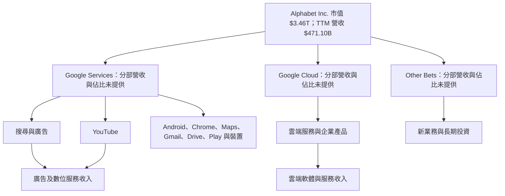
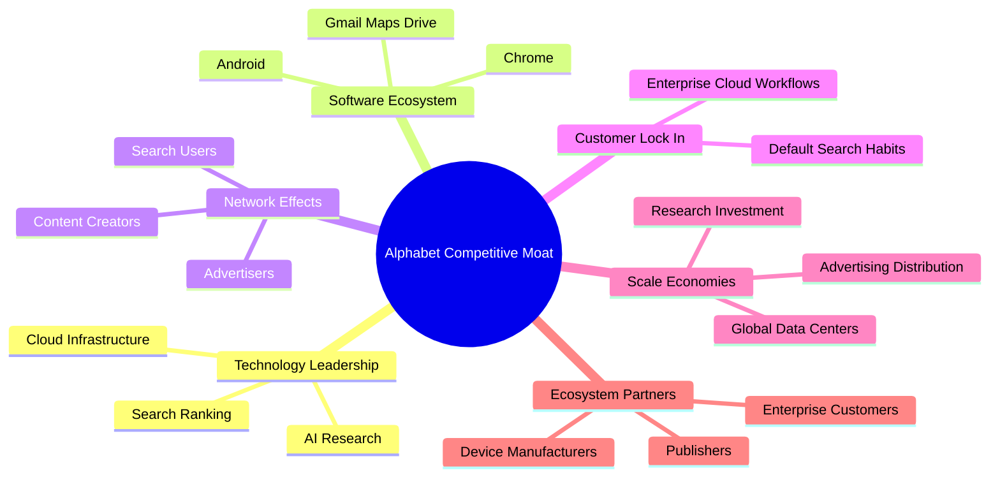
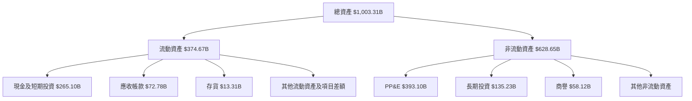
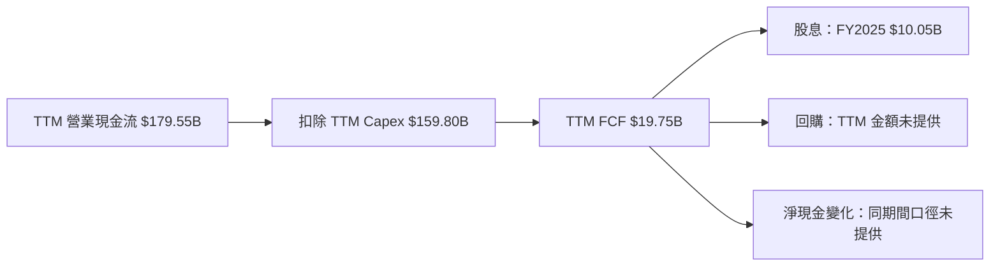
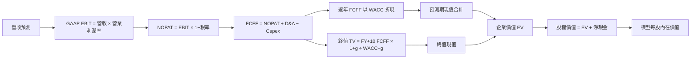
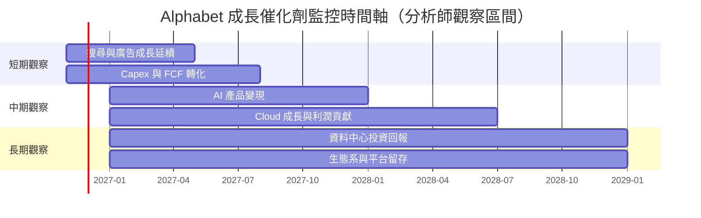
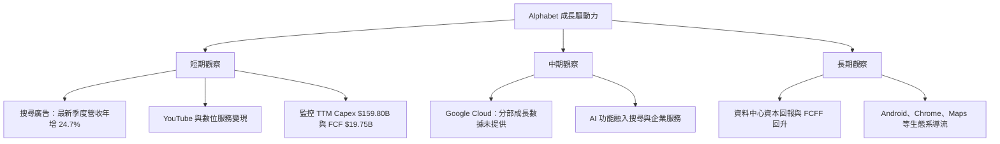
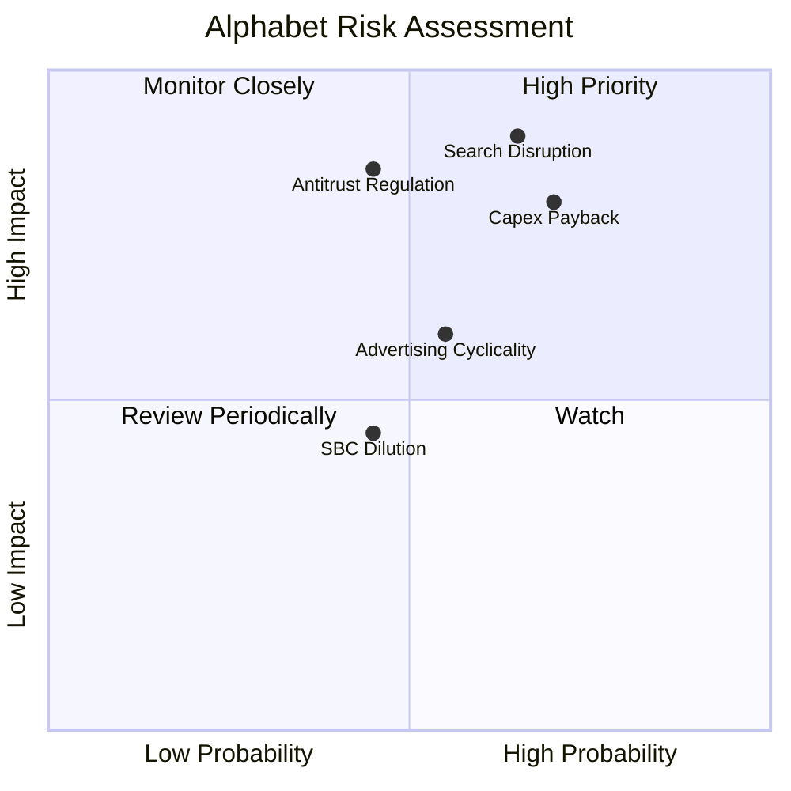
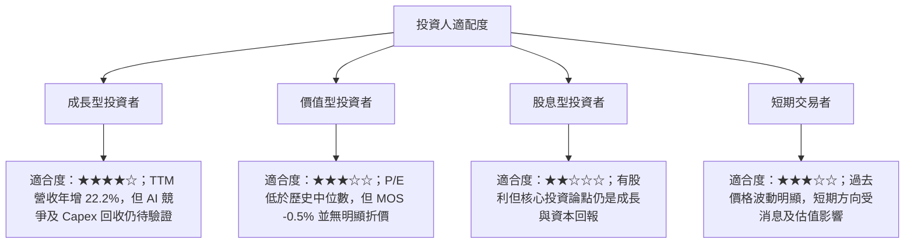

# GOOG 基本面深度分析報告
> **報告日期**：2026-11-17 ｜ **語言**：繁體中文 ｜ **數據來源**：SEC 申報資料 (XBRL)、Yahoo Finance、Finviz、StockAnalysis、Roic.ai ｜ **分析師**：CFA 級機構研究

---

## 目錄

| # | 章節 | 核心結論 |
|---|------|----------|
| 1 | 執行摘要 | 持有；加權合理價值 $279.91，MOS -0.5% |
| 2 | 公司概覽與商業模式 | 搜尋、廣告與雲端構成核心；市場份額數據未提供 |
| 3 | 損益表深度分析 | TTM 營收 $471.10B、年增 22.2%；高資本支出壓低 TTM FCF |
| 4 | 資產負債表分析 | 淨現金 $138.98B，流動性充足；營運資金週期 39 天 |
| 5 | 現金流量深度分析 | TTM FCF $19.75B，Capex 升至 $159.80B，現金轉換需留意 |
| 6 | 獲利能力與資本效率 | ROIC 23.9% 高於 WACC 10.51%，仍在創造經濟價值 |
| 7 | 相對估值分析 | P/E 低於同業及自身歷史中位數；同業估值顯示不同方法結論分歧 |
| 8 | DCF 內在價值評估 | DCF 基準價值 $238.93；終值佔 EV 71.6%，對假設敏感 |
| 9 | 成長催化劑 | 搜尋、YouTube、Cloud 及 AI 產品變現是主要觀察方向 |
| 10 | 風險矩陣 | AI 改變搜尋入口、資本支出回報及監管是主要風險 |
| 11 | 投資建議 | MOS 接近零；等待估值或基本面提供更佳風險報酬比 |

---

## 1. 執行摘要

截至 **2026-11-16 收盤價 $281.26**，DCF 基準價值為 **$238.93**，較現價低 15.1%；四種估值方法按固定權重得出的加權合理價值為 **$279.91**，MOS 為 **-0.5%**，依估值門檻評級為**持有**。基本面方面，TTM 營收 $471.10B、TTM 年增 22.2%，ROIC 23.9% 高於 WACC 10.51%；但 TTM FCF 僅 $19.75B、FCF Yield 0.57%，反映資本支出高企令短期現金回報受壓。評級不因質化因素調整。

### 1.0 一頁式投資儀表板

| 項目 | 內容 |
|------|------|
| **投資論點（3 句）** | ① TTM 營收 $471.10B、年增 22.2%，需求仍有擴張。② ROIC 23.9% 對比 WACC 10.51%，目前資本回報高於資本成本。③ TTM Capex $159.80B，令 FCF 降至 $19.75B、Yield 僅 0.57%，投資回報轉化需要驗證。 |
| **綜合評分** | **7.3/10**（引用 1.1） |
| **財務健康** | 🟢 現金及短期投資 $265.10B、總債務 $126.12B，淨現金 $138.98B |
| **ROIC vs WACC** | 23.9% vs 10.51%（正利差 13.39 個百分點，創造價值） |
| **FCF 趨勢** | 歷史年度 FCF 約 $60.01B–$73.27B；最新 TTM 因 Capex 上升而降至 $19.75B，FCF Yield 0.57% |
| **估值** | Forward P/E 18.53x ｜ EV/EBITDA 18.1x ｜ FCF Yield 0.57% |
| **DCF 內在價值（基準）** | $238.93 ｜ 現價相對 DCF 溢價 **17.7%** |
| **安全邊際（MOS）** | **-0.5%**＝($279.91 − $281.26) ÷ $279.91（基準為加權合理價值）｜ 🔴 <10% 無 |
| **預期報酬（基準情境 12M）** | -15.1%（DCF 基準情境價值相對現價） |
| **關鍵風險（前二）** | AI 改變搜尋使用與廣告入口；高 Capex 未能轉化為現金流 |
| **評級 + 信心度** | 🟡 **持有** ｜ 信心：中 |

> DCF 折溢價依規定以 DCF 基準價值作分母：($281.26 ÷ $238.93) − 1 = 17.7% 溢價。MOS 則以 8.8 加權合理價值作分母，兩者基準不同。

### 1.1 綜合評分卡（全報告唯一）

| 維度 | 評分（1–10） | 主要依據（引用數字與其來源章節） |
|------|--------------|----------------------------------|
| 成長性 | 8.5 | TTM 營收年增 22.2%，最新一季年增 24.7%（第 3 章） |
| 獲利能力 | 8.5 | TTM 營業利益率 33.3%、ROIC 23.9% 高於 WACC 10.51%；F-Score 4/8（第 3、6 章） |
| 財務健康 | 9.0 | 淨現金 $138.98B；最新 CCC 39 天（第 4 章） |
| 估值 | 5.0 | MOS -0.5%；P/E 14.7x，低於自身五年中位數 21.9x（第 7、8 章） |
| 護城河 | 8.0 | 搜尋、Android、Chrome、YouTube 等產品互相導流；分部營收明細未提供（第 2 章） |
| 管理層與資本配置 | 5.0 | 2025 年 SBC $24.95B；2026 年資本支出顯著上升，稀釋股數未通過 F-Score 測試（第 3、5、6 章） |
| **綜合評分** | **7.3** | 六項算術平均 7.333，四捨五入至小數一位 |

### 1.2 五大投資論點 + 三大核心風險

| 類型 | 項目 | 具體依據 | 信心度 |
|------|------|----------|--------|
| 🟢 **投資論點①** | 搜尋與廣告仍有規模優勢 | TTM 營收 $471.10B，最新一季年增 24.7%；公司有多個全球消費者入口 | 🟢 高 |
| 🟢 **投資論點②** | 資本回報高於資本成本 | ROIC 23.9% 對 WACC 10.51%，利差 13.39 個百分點 | 🟢 高 |
| 🟢 **投資論點③** | 資產負債表具韌性 | 現金及短期投資 $265.10B，總債務 $126.12B，淨現金 $138.98B | 🟢 高 |
| 🟢 **投資論點④** | 營收成長有加速跡象 | FY2025 營收年增 15.09%；最新季度年增 24.7% | 🟡 中 |
| 🟢 **投資論點⑤** | P/E 相對自身歷史偏低 | P/E 14.7x，低於五年中位數 21.9x；現處自身五年區間第 29 百分位 | 🟡 中 |
| 🟡 **風險①** | 資本支出侵蝕現金流 | TTM Capex $159.80B，約為營收 33.9%；TTM FCF 只剩 $19.75B | 🟡 中 |
| 🔴 **風險②** | 搜尋入口與生成式 AI 競爭 | 若搜尋使用、廣告轉換或定價受損，核心現金流與估值均可能下修 | 🔴 高衝擊 |
| 🔴 **風險③** | 近期盈餘資料存在異常波動 | 2026 Q2 淨利 $112.19B、Q3 $26.47B；EPS 驚喜數據缺漏，盈餘可比性下降 | 🟡 中 |

### 1.3 快速統計卡片

同業中位數由 META、MSFT、AMZN 三家公司資料計算；毛利率中位數為 67.7%。

| 指標 | 公司實際值（期間） | 同業中位數 | 狀態 |
|------|--------------------|------------|------|
| 營收成長（TTM） | **22.2%** | — | 🟢 |
| 營收成長（最新一季年增） | **24.7%** | 18.8% | 🟢 |
| 毛利率（TTM） | **60.9%** | 67.7% | 🟡 |
| 營業利益率（TTM） | **33.3%** | — | 🟢 |
| ROIC（TTM） | **23.9%** | — | 🟢 |
| Forward P/E | **18.53x** | 21.4x | 🟢 |
| FCF Yield（TTM） | **0.57%** | — | 🔴 |
| Piotroski F-Score | **4 / 8** | — | 🟡 |

### 1.4 投資結論

```
╔══════════════════════════════════════════════════════════════════╗
║                    📊 投資結論摘要                               ║
╠══════════════════════════════════════════════════════════════════╣
║  評級：持有（依規則 20；MOS -0.5% 落在 -10% 至 +10%）            ║
║  價格（2026-11-16 收盤）：$281.26                                ║
║  DCF 內在價值（基準）：$238.93（現價溢價 17.7%）                  ║
║  安全邊際 MOS：-0.5%（＝(加權合理價值−現價)÷加權合理價值）        ║
║  加權合理價值（8.8）：$279.91                                    ║
║  DCF 情境價值：                                                   ║
║    悲觀情境：$104.84（-62.7%）                                   ║
║    基準情境：$238.93（-15.1%）                                   ║
║    樂觀情境：$496.33（+76.5%）                                   ║
║  綜合評分：7.3/10（引用 1.1）                                    ║
║  適合投資人：能承受估值波動、看好長期平台與雲端成長的投資人      ║
╚══════════════════════════════════════════════════════════════════╝
```

---

## 2. 公司概覽與商業模式

### 2.1 業務結構與收入來源

SEC 10-Q 與公司資料將 Alphabet 業務描述為 Google Services、Google Cloud、Other Bets。所提供資料沒有各分部營收與佔比，故不推估分部數字。



### 2.2 市場份額

市場份額數據未提供，故不列比例或繪製市占圖。從公司規模看，Alphabet TTM 營收 $471.10B、最新一季年增 24.7%，高於 META、MSFT、AMZN 最新季度營收年增中位數 18.8%；但缺少同口徑分部營收，不能據此推導搜尋、雲端或影片的市場份額。

### 2.3 競爭護城河分析



### 2.4 護城河強度

| 護城河項目 | 強度（強／中／弱） | 證據（引用數字或事實） | 會削弱它的情況 |
|------------|--------------------|------------------------|----------------|
| 技術與搜尋品質 | 強 | 搜尋是 Google Services 核心產品之一；公司營業利益率 TTM 33.3% | AI 搜尋降低傳統搜尋點擊、廣告轉換與可變現流量 |
| 軟體生態系統 | 強 | Android、Chrome、Gmail、Maps、Drive、Play 等形成多入口 | 使用者轉向其他作業系統、瀏覽器或生成式 AI 入口 |
| 網路效應 | 中至強 | 使用者、廣告客戶、內容創作者互相支持；但分部與使用者數據未提供 | 廣告主預算移向其他平台、內容供給或流量減少 |
| 客戶鎖定 | 中 | 日常服務與企業雲端工作流程可能提高轉換成本；缺少留存率數字 | 企業多雲策略降低轉換障礙，使用者採用替代服務 |
| 規模效應 | 強 | TTM 營收 $471.10B，研發 FY2025 支出 $61.09B | AI 與資料中心投資未形成相應營收或現金流回報 |
| 生態夥伴 | 中 | 裝置廠商、廣告主、開發者與企業客戶是關鍵夥伴；依賴程度未量化 | 法規限制預設分發、夥伴自行發展競爭產品 |

護城河評分 **8.0/10** 的依據是產品生態、規模與獲利率；但分部收入、用戶留存及市占資料缺漏，限制了量化驗證。

---

## 3. 損益表深度分析

### 3.1 年度收入成長趨勢（近4年）

FY2022 至 FY2025 收入 CAGR 約 **12.5%**，計算為 \((402.84 ÷ 282.84)^{1/3}-1\)。

```
╔══════════════════════════════════════════════════════════════════╗
║              Alphabet 年度收入趨勢（FY2022-FY2025）              ║
╠══════════════════════════════════════════════════════════════════╣
║  FY2022  $282.84B  ██████████████░░░░░░░░░░  🟢 基期              ║
║  FY2023  $307.39B  ███████████████░░░░░░░░░  YoY: +8.68% 🟢       ║
║  FY2024  $350.02B  ██████████████████░░░░░░  YoY: +13.87% 🟢      ║
║  FY2025  $402.84B  ████████████████████░░░░  YoY: +15.09% 🟢      ║
║                                                                  ║
║  📊 FY2022–FY2025 收入 CAGR：約 +12.5%                            ║
╚══════════════════════════════════════════════════════════════════╝
```

2025 年收入增加至 $402.84B，年增 15.09%；TTM 再升至 $471.10B、年增 22.2%。單季營收年增率從 2025 Q1 的 12.04% 上升至 2026 Q3 的 24.65%，顯示近期需求與比較基期共同推升成長；是否能持續，需以未來季度分部數據和廣告變現率確認。

### 3.2 季度收入趨勢分析

| 季度 | 營收（$B） | QoQ | YoY | 備註 |
|------|------------:|----:|----:|------|
| 2025 Q4 | 113.83 | +11.2% | +18.0% | QoQ 對 2025 Q3；YoY 對 2024 Q4 |
| 2026 Q1 | 109.90 | -3.5% | +21.8% | 季節性回落，但年增加速 |
| 2026 Q2 | 119.80 | +9.0% | +24.2% | 成長延續 |
| 2026 Q3 | 127.58 | +6.5% | +24.7% | 最新季度年增率，不是 TTM 成長率 |

最新季度年增 24.7%，高於 TTM 年增 22.2%。季度營收持續增加，但單季營業利益由 Q2 $40.77B 降至 Q3 $40.58B，顯示營收成長未完全轉化為當季營業利益增長。

### 3.3 利潤率演變分析

| 利潤率指標 | FY2022 | FY2023 | FY2024 | FY2025 | 趨勢 | 評估 |
|------------|-------:|-------:|-------:|-------:|------|------|
| **毛利率** | 55.4% | 56.6% | 58.2% | 59.7% | 逐年改善 | 🟢 |
| **營業利益率** | 26.5% | 27.4% | 32.1% | 32.0% | 2024 明顯擴張，2025 大致持平 | 🟢 |
| **淨利率** | 21.2% | 24.0% | 28.6% | 32.8% | 年度數據逐步上升 | 🟢 |

年度利潤率以年度損益表金額計算。TTM 淨利率資料另列為 50.0%，與 FY2025 年度淨利率 32.8% 顯著不同，且季度淨利有異常波動；不宜將其直接解讀為可持續的經營改善。營業利益率由 FY2023 的 27.4% 升至 FY2024 的 32.1%，與營收規模擴大及營業槓桿改善相符；FY2025 32.0% 顯示改善沒有明顯延續。

> 數據一致性提醒：資料欄位對最新季度營業利益率同時出現 33.3% 與 31.8%。本報告採 VERIFIED FIGURES 的「最新一季營業利益率」31.8%；TTM 採 33.3%。

### 3.4 費用結構分析

FY2025 的收入 $402.84B、毛利 $240.30B、營業利益 $129.04B、研發費用 $61.09B。營業成本、銷售與管理費用的完整拆分未提供，故無法製作涵蓋全部費用項目的比例圓餅圖。

```
╔══════════════════════════════════════════════════════════════════╗
║                    FY2025 損益結構（已提供項目）                 ║
╠══════════════════════════════════════════════════════════════════╣
║  營收                 $402.84B                                   ║
║  ├─ 毛利             $240.30B ＝ 營收的 59.7%                    ║
║  ├─ 營業利益         $129.04B ＝ 營收的 32.0%                    ║
║  └─ 研發費用          $61.09B ＝ 營收的 15.2%                    ║
║  其他費用細項：未提供；不以差額反推或補造                         ║
╚══════════════════════════════════════════════════════════════════╝
```

### 3.5 季度 EPS 趨勢與盈餘品質（Quality of Earnings）

最近四季 EPS 實際值可由季度資料列示，但 EPS estimate 及 surprise 均為 NaN，因此不能判斷「超預期／不及預期」。

| 季度 | EPS 實際值 | EPS 預估 | Surprise | 說明 |
|------|-----------:|---------:|---------:|------|
| 2025 Q4 | $2.81 | N/A | N/A | 無可用預估值 |
| 2026 Q1 | $5.11 | N/A | N/A | 無可用預估值 |
| 2026 Q2 | $9.11 | N/A | N/A | 淨利 $112.19B，與前後季差異極大 |
| 2026 Q3 | $2.14 | N/A | N/A | EPS 年增 -25.3%；無法由 EPS estimate 判定盈餘驚喜 |

| 盈餘品質項目 | 數值/佔比 | 評估 |
|--------------|-----------|------|
| 股權薪酬 SBC / 營收 | TTM 約 $30.41B ÷ $471.10B = **6.5%** | 🟡 SBC 是實質股東成本；2025 FY SBC $24.95B，稀釋股數未通過 F-Score 測試 |
| SBC / 營業現金流 | TTM 約 $30.41B ÷ $179.55B = **16.9%** | 🟡 需以回購抵銷稀釋，但回購金額未提供 |
| FCF / 淨利（現金轉換率） | $19.75B ÷ TTM 淨利 $235.69B = **8.4%** | 🔴 主要受 Capex 高企拖累；不代表營運現金流同幅惡化 |
| 一次性/非經常性損益 | 季度淨利波動異常；具體一次性項目 N/A | 🟡 Q2 淨利 $112.19B 對 Q3 $26.47B，須核對 SEC 明細 |
| 有效稅率異常 | 16.8%（最近年度有效稅率） | 🟢 DCF 採用此稅率；無資料證明其為異常稅務利益 |
| 資本化支出 vs 費用化 | TTM Capex $159.80B；資本化支出明顯提高 | 🟡 資本支出先進資產負債表，再透過折舊影響損益；短期淨利可能高於扣除全部投資後的現金盈餘 |

**盈餘品質結論**：營業現金流 TTM $179.55B 仍高，但 Capex $159.80B 將 FCF 壓至 $19.75B，且 FCF/淨利僅 8.4%。GAAP 已將 SBC 計入費用，仍須關注其對股數與每股價值的稀釋；季度淨利數據異常使單季 EPS 趨勢的可比性偏低。

---

## 4. 資產負債表分析

### 4.1 資產結構分解

最新 TTM 資產總額 $1,003.31B；流動資產 $374.67B。非流動資產為總資產扣流動資產的差額，僅作分類總額展示；細項未必完整。



### 4.2 流動性與營運資金分析

| 指標 | 最新 TTM | 一年前 TTM | 變化 | 解讀 |
|------|----------|------------|------|------|
| DSO 應收帳款天數 | 56 天 | 54 天 | +2 天 | 收款週期略拉長；可能反映營收組合或帳期變化，尚不能單獨判定信用品質惡化 |
| DIO 存貨天數 | 26 天 | N/A | N/A | 一年前無可比資料 |
| DPO 應付帳款天數 | 43 天 | N/A | N/A | 一年前無可比資料 |
| CCC 現金轉換週期 | 39 天 | N/A | N/A | 最新 CCC = 56 + 26 − 43 = 39 天 |

流動比率由提供的市場資料為 2.786、速動比率 2.512；但 QUALITY FIGURES 指流動比率高於一年前，未提供其具體前值，因此不補算或反推。資料來源間資產負債表細項口徑不完全一致，流動性指標以列示來源為準。

### 4.3 債務結構分析

**採用口徑說明：**本節依 VERIFIED FIGURES 使用總債務 $126.12B、現金及短期投資 $265.10B、淨現金 $138.98B。其他市場資料另列總債務 $150.33B、淨現金 $114.77B；兩者口徑有差異，不混合使用。

```
╔══════════════════════════════════════════════════════════════════╗
║                   Alphabet 債務健康診斷                          ║
╠══════════════════════════════════════════════════════════════════╣
║  總債務：         $126.12B  ██████████░░░░░░░░░░                 ║
║  現金+短期投資：  $265.10B  ████████████████████                 ║
║  淨現金：         $138.98B  ██████████░░░░░░░░░░  🟢              ║
║  流動比率：          2.786x  🟢                                  ║
║  Debt/EBITDA：          N/A（同口徑 TTM EBITDA 未提供）           ║
║  利息保障倍數：        N/A（利息費用明細未提供）                   ║
╚══════════════════════════════════════════════════════════════════╝
```

### 4.4 股東權益趨勢

| 財年 | 股東權益（$B） | YoY |
|------|---------------:|----:|
| 2022 | 256.14 | — |
| 2023 | 283.38 | +10.6% |
| 2024 | 325.08 | +14.7% |
| 2025 | 415.26 | +27.7% |

```
╔══════════════════════════════════════════════════════════════════╗
║                    股東權益趨勢（$B）                            ║
╠══════════════════════════════════════════════════════════════════╣
║  FY2022  $256.14B  ████████████░░░░░░░░                          ║
║  FY2023  $283.38B  ██████████████░░░░░░                          ║
║  FY2024  $325.08B  ████████████████░░░░                          ║
║  FY2025  $415.26B  ████████████████████                          ║
╚══════════════════════════════════════════════════════════════════╝
```

FY2025 權益上升 27.7%，高於當年營收成長 15.1%；可能與保留盈餘及其他權益項目變化有關，完整權益變動表未提供，不能將增加額全數歸因於淨利。

---

## 5. 現金流量深度分析

### 5.1 現金流量瀑布圖

季度與年度現金流資料期間並不完全相同；下圖以 TTM OCF、Capex、FCF 為主，股利採年度/季度已披露數字示例，不將未提供的回購與淨現金變化補成差額。



### 5.2 FCF 轉換率趨勢

| 財年 | FCF（$B） | 淨利（$B） | FCF/淨利 |
|------|----------:|-----------:|---------:|
| 2022 | 60.01 | 59.97 | 100.1% |
| 2023 | 69.50 | 73.80 | 94.2% |
| 2024 | 72.76 | 100.12 | 72.7% |
| 2025 | 73.27 | 132.17 | 55.4% |
| 最新 TTM | 19.75 | 235.69 | 8.4% |

年度現金流轉換率逐年下降，主要特徵是淨利上升而資本支出增加。最新 TTM 比率更低，反映資料期間內 Capex 大幅升高；這是投資期現金流受壓，不應簡化為營運現金流品質崩壞，但必須觀察資本投資能否帶來新增收入與利潤。

### 5.3 自由現金流趨勢

| 期間 | FCF（$B） | 備註 |
|------|----------:|------|
| FY2022 | 60.01 | 年度現金流量表 |
| FY2023 | 69.50 | 年增約 15.8% |
| FY2024 | 72.76 | 年增約 4.7% |
| FY2025 | 73.27 | 年增約 0.7% |
| TTM 至 2026-09-30 | 19.75 | 以 OCF $179.55B − Capex $159.80B 計 |
| TTM FCF Yield | 0.57% | 使用已提供的 TTM FCF Yield |

```
╔══════════════════════════════════════════════════════════════════╗
║                 自由現金流（年度實際與最新 TTM）                 ║
╠══════════════════════════════════════════════════════════════════╣
║  FY2022  $60.01B  ████████████████░░░░                          ║
║  FY2023  $69.50B  ███████████████████░                          ║
║  FY2024  $72.76B  ████████████████████                          ║
║  FY2025  $73.27B  ████████████████████                          ║
║  TTM     $19.75B  █████░░░░░░░░░░░░░░░                          ║
╚══════════════════════════════════════════════════════════════════╝
```

### 5.4 資本配置評估

Capex 使用 TTM $159.80B；股利與 SBC 有披露，回購、收購及留存現金的同期間完整數據未提供，故不製作含估算比例的圓餅圖。

| 項目 | 可用數據 | 評估 |
|------|----------|------|
| 資本支出 | TTM $159.80B；FY2025 $91.45B | 🟡 明顯增加，投資回收需追蹤 |
| 股利 | FY2025 $10.05B；2026 各已列季度約 $2.54B–$2.94B | 🟢 支出相對營收仍低 |
| SBC | FY2025 $24.95B；最新四季約 $30.41B | 🟡 需要評估稀釋與回購抵銷 |
| 回購 | N/A（同期間金額未提供） | 無法判定淨回購效果 |
| 留存/其他投資 | N/A | 不以差額反推 |

---

## 6. 獲利能力與資本效率

### 6.1 ROE / ROA / ROIC 趨勢

| 指標 | FY2022 | FY2023 | FY2024 | FY2025 / TTM | 評估 |
|------|-------:|-------:|-------:|-------------:|------|
| ROE | N/A | N/A | N/A | TTM 34.8% | QUALITY FIGURES 值；另一彙整來源列 44.3%，口徑不一致 |
| ROA | N/A | N/A | N/A | TTM 12.7% | 正值，F-Score 通過正 ROA 與年增測試 |
| ROIC | N/A | N/A | N/A | TTM 23.9% | 高於 WACC 10.51% |
| 行業均值比較 | N/A | N/A | N/A | N/A | 無同口徑行業數據，不作比較 |

### 6.2 ROIC vs WACC 分析（核心價值創造判斷）

```text
╔══════════════════════════════════════════════════════════════════╗
║                ROIC vs WACC 深度分析                            ║
╠══════════════════════════════════════════════════════════════════╣
║  WACC（程式計算，依 Cost of capital inputs）：                   ║
║  ├── 無風險利率（10Y 美債）：       5.12%                        ║
║  ├── 市場風險溢酬（假設）：         5.00%                        ║
║  ├── Beta（調整後）：               1.15                         ║
║  ├── 股權成本：5.12% + 1.15×5.00% = 10.87%                      ║
║  ├── 稅前債務成本：                 0.58%                        ║
║  ├── 稅後債務成本：                 0.58%×(1−16.8%) = 0.48%      ║
║  ├── 資本權重：股權 96.5%，債務 3.5%                             ║
║  └── WACC：96.5%×10.87% + 3.5%×0.48% = 10.51%                  ║
║                                                                  ║
║  ROIC：23.9%（TTM；程式計算口徑）                                ║
║  經濟利差：23.9% − 10.51% = +13.39 個百分點                     ║
║  ROIC / WACC：23.9% ÷ 10.51% = 2.27 倍                           ║
║                                                                  ║
║  ROIC  23.9%  ▓▓▓▓▓▓▓▓▓▓▓▓▓▓▓▓▓▓▓▓▓▓▓▓░░░░░░  🟢              ║
║  WACC  10.51% ▓▓▓▓▓▓▓▓▓▓▓░░░░░░░░░░░░░░░░░░░  ──              ║
╚══════════════════════════════════════════════════════════════════╝
```

使用資料提供的 WACC 與 ROIC，不另行重算資本成本。近似核對：\(0.965×10.87\%+0.035×0.48\%=10.506\%\)，四捨五入為 10.51%。ROIC 高於 WACC 13.39 個百分點，表示目前投入資本創造正經濟利潤；若 AI 資料中心擴張拉低增量 ROIC，這一利差會收窄。

### 6.3 杜邦三因素分解

| 因素 | 數值（TTM） | 解讀 |
|------|-------------|------|
| 淨利率 | 50.0% | QUALITY FIGURES 列示值；高於 FY2025 年度淨利率，須注意期間與季度淨利波動 |
| 資產週轉率 | 0.47 | 每單位資產產生約 0.47 單位營收 |
| 權益乘數 | 1.48 | 槓桿不是 ROE 的主要來源 |
| **ROE** | **34.8%** | 50.0% × 0.47 × 1.48 約為 34.8%；數值採品質指標原值 |

ROE 主要由利潤率及資產週轉率共同驅動，權益乘數 1.48 顯示並非高度依賴財務槓桿。

### 6.4 財務體質：Piotroski F-Score

**Piotroski F-Score：4 / 8**。毛利率測試因缺資料而不計入，因此可判定測試數為 8。

| 測試 | 結果 | 解讀 |
|------|------|------|
| ROA > 0 | ✅ 通過 | 公司仍有正報酬 |
| 營業現金流 > 0 | ✅ 通過 | TTM OCF $179.55B |
| ROA 高於一年前 | ✅ 通過 | 資產獲利能力改善 |
| 營業現金流 > 淨利 | ❌ 未通過 | 應計品質測試未通過；Capex 會壓低 FCF，但本測試比較 OCF 與淨利 |
| 長期負債 ÷ 總資產低於一年前 | ❌ 未通過 | 負債比率方向未改善 |
| 流動比率高於一年前 | ✅ 通過 | 流動性較前期改善 |
| 稀釋股數未增加 | ❌ 未通過 | SBC 可能造成股數稀釋，須追蹤每股價值 |
| 毛利率高於一年前 | — 無法判定 | 缺少可比較輸入，未納入分母 |
| 資產週轉率高於一年前 | ❌ 未通過 | 資產週轉改善未能通過測試 |

---

## 7. 相對估值分析

### 7.1 同業估值比較表格

同業倍數採 Yahoo Finance 同業資料。GOOG 的 trailing P/E、P/S、EV/EBITDA 使用資料列示值；Forward P/E 採估值資料 18.53x。

| 估值指標 | **GOOG** | **META** | **MSFT** | **AMZN** | 本公司評估 |
|----------|---------:|---------:|---------:|---------:|-----------|
| **Trailing P/E** | 14.7x | 21.4x | 27.0x | 20.8x | 🟢 低於同業中位數 21.4x |
| **Forward P/E** | 18.53x | 17.6x | 21.4x | 23.6x | 🟡 接近同業中位數 21.4x，略低 |
| **P/S Ratio** | 7.34x | 6.6x | 11.1x | 3.5x | 🟡 高於同業中位數 6.6x |
| **EV/EBITDA** | 18.1x | 14.1x | 19.0x | 16.2x | 🟡 高於同業中位數 16.2x |
| **最新季度營收 YoY** | 24.7% | 26.1% | 18.8% | 12.1% | 🟢 增速高於兩家，略低於 META |
| **毛利率（TTM）** | 60.9% | 81.0% | 67.7% | 51.4% | 🟡 低於 META、MSFT，高於 AMZN |

GOOG 的低 trailing P/E 可能反映市場對搜尋競爭、監管及資本支出風險的折價；Forward P/E 仍接近同業中位數。P/S 與 EV/EBITDA 並不顯示全面折價，說明估值便宜與否取決於盈利持續性及資本回報。

### 7.2 歷史估值區間分析

```
╔══════════════════════════════════════════════════════════════════╗
║              GOOG 五年歷史估值區間（TTM）                        ║
╠══════════════════════════════════════════════════════════════════╣
║  P/E：       1.3x ───────── 中位 21.9x ───── 現值 14.7x ─ 29.0x ║
║              現值百分位：29%                                    ║
║  P/S：       4.1x ───── 中位 6.1x ─── 現值 7.4x ─────── 9.8x   ║
║              現值百分位：67%                                    ║
║  EV/EBITDA：13.7x ─ 現值 18.1x ─ 中位 19.1x ──────── 25.0x     ║
║              現值百分位：47%                                    ║
╚══════════════════════════════════════════════════════════════════╝
```

P/E 位於五年區間偏低位置，而 P/S 高於歷史中位數、EV/EBITDA 接近中位數。這種分歧可能來自近期獲利增長推低 P/E，但市場仍為營收規模與平台資產給予不低的銷售倍數。

### 7.3 情境價值（Bear / Base / Bull）

| 情境 | 第 1 年營收成長 | 期末營業利潤率 | WACC | 每股價值 | 相對現價 | 機率 | 會發生的條件 |
|------|----------------:|----------------:|-----:|---------:|---------:|-----:|--------------|
| 🔴 悲觀 | 11.1% | 27.2% | 11.51% | $104.84 | -62.7% | 25% | 搜尋廣告放緩、AI 投資回報不足、利潤率下行且折現率上升 |
| 🟡 基準 | 22.2% | 32.0% | 10.51% | $238.93 | -15.1% | 50% | TTM 增速逐步降至長期增速、營業率向五年中位數收斂 |
| 🟢 樂觀 | 33.3% | 35.2% | 9.51% | $496.33 | +76.5% | 25% | AI、Cloud 與廣告變現使高增長延續，利潤率擴張且資本成本下降 |

模型另列機率加權值 $269.76、相對現價 -4.1%，僅作情境參考；第 8.8 節依規定使用基準 DCF 及固定方法權重。

### 7.4 相對估值隱含價格區間

```
╔══════════════════════════════════════════════════════════════════╗
║                  相對估值隱含每股價值                            ║
╠══════════════════════════════════════════════════════════════════╣
║  $238.93        $255.16     $281.26     $324.99       $393.00     ║
║  DCF 基準 ─── EV/EBITDA ── 現價 ─── Forward P/E ─ 分析師共識     ║
╚══════════════════════════════════════════════════════════════════╝
```

- **同業 Forward P/E：$324.99**，依 META、MSFT、AMZN 同業中位數 21.4x × GOOG Forward EPS $15.18。
- **同業 EV/EBITDA：$255.16**，依同業中位數 16.2x × TTM EBITDA，再加回淨現金。
- 兩種相對估值分別高於與低於現價，顯示選擇盈利倍數與企業價值倍數會影響結論。

---

## 8. DCF 內在價值評估（Discounted Cash Flow）

> 本章唯一模型為程式計算的 10 年 FCFF DCF。財務金額以美元十億計，表格保留模型精度；比率採提供值。DCF 模型表格輸入多以一位小數或兩位小數顯示，內部精確度可能高於表面數字，允許約 1% 尾差。模型提供的假設、現金流、敏感度與情境值均原樣引用，不自行替換。

### 8.0 估值推理鏈（Thinking Logic）

**Step 1 — 價值由哪些變數決定？**  
模型以 Alphabet 整體 TTM 營收 $471.10B 為起點；分部營收佔比未提供，因此不能把搜尋、Cloud 或 Other Bets 拆成不同百分比。估值主要由現有廣告與服務現金流底盤、Cloud/AI 能否形成第二成長動能，以及終值假設構成。敏感度矩陣顯示 WACC 與終值成長率對每股價值有顯著影響，特別是終值佔 EV 71.6%。

**Step 2 — 模型選擇**

| 決策點 | 本報告採用 | 理由（含數字） | 曾考慮但否決 | 否決理由 |
|--------|-----------|----------------|--------------|----------|
| 現金流定義 | FCFF | 以 WACC 折現，先估 EV，再加淨現金 | FCFE | 模型已固定 FCFF 與 WACC |
| 預測期 N | 10 年 | 模型假設高成長逐步由 22.2% 淡化至 3.0% | 5 年 | 難以在 5 年內呈現模型設定的逐步收斂 |
| 終值方法 | Gordon Growth 為主 | 模型提供 g=3.0%、WACC=10.51% | 退出倍數 | DCF MODEL 未提供退出倍數終值，不自行新增 |
| EBIT 基礎 | GAAP EBIT | TTM 營業利益率 33.3% | 非 GAAP EBIT | 避免將 SBC 加回後忽略其股東成本 |

**Step 3 — 關鍵假設推導鏈**

- **營收成長路徑**：錨點為 TTM 營收年增 22.2%、最新季度年增 24.7% → 模型從 TTM 年增率起步，並線性淡化至第 10 年 3.0% → **第 1 年採用 22.2%，第 10 年採用 3.0%** → 否決全期維持 22.2%，因成熟企業長期持續高速成長的假設過於樂觀。
- **期末營業利益率**：錨點為 TTM 33.3% → 模型向過去五個財年中位數收斂 → **第 10 年採用 32.0%** → 否決維持 33.3%，因模型選擇回歸歷史中位數而非假設持續擴張。
- **Capex/營收**：錨點為 TTM 33.9% → 模型設定逐年下降，至第 10 年 6.5%，對應 1.1 倍 D&A 條件 → **FY+1 33.9%、FY+10 6.5%** → 否決永遠維持 33.9%，因這會把目前高投資期永久化；同時，此淡化是估值的重要上行來源，若資本密集度持續，估值會下修。
- **預測期 N**：模型採用 10 年 → 以 10 年容納成長率及 Capex 逐步收斂 → **10 年** → 否決更短預測期，因程式模型已固定 10 年，不自行重建。
- **永續成長率 g**：模型採用 3.0%，低於 WACC 10.51% → 終值公式有正分母，且屬成熟期假設 → **3.0%** → 不採用等於或高於 WACC 的成長率，因 Gordon Growth 會失效或發散。
- **WACC**：採用 Cost of capital 計算值 10.51% → 依調整後 Beta 1.15、ERP 5.00% 及提供權重 → **10.51%** → 不另用自行選定的折現率，避免與資本成本輸入不一致。
- **GAAP EBIT、SBC 與股數**：採 GAAP EBIT，SBC 已作費用處理，不再扣一次，且不額外稀釋股數 → **組合 (A)：GAAP EBIT + 固定股數 + 0% 年稀釋率** → 不採非 GAAP 加回 SBC，避免漏計或重複計算 SBC。
- **D&A/營收**：錨點為 TTM 5.9% → 固定 **5.9%**；模型採用值與錨點一致。
- **ΔWC**：模型未建模營運資金變動；DCF FCFF 採 `NOPAT + D&A − Capex`，不另加或扣 ΔWC。這使模型未反映營收擴張對應收、存貨及應付的現金需求。

**Step 4 — 最脆弱假設**  
最脆弱的一環是 Capex/營收由 FY+1 的 33.9% 降至 FY+10 的 6.5%；若資本支出長期高於模型路徑，FCFF 和終值均會低於基準，估值可能向悲觀情境 $104.84 靠近。

**Step 5 — 計算路徑圖**



### 8.1 模型假設總表（Model Inputs）

| 假設項目 | 採用值 | 依據 / 來源 | 敏感度 |
|----------|--------|-------------|--------|
| 預測期長度 N | 10 年 | DCF MODEL 固定預測期 | 🟡 中 |
| 營收成長率 | FY+1 22.2% → FY+10 3.0% | TTM vs prior TTM 22.2%；線性淡化至 3.0% | 🔴 高 |
| 營業利潤率 | 33.3% → 32.0% | TTM 33.3%，向過去五年中位數收斂 | 🔴 高 |
| 有效稅率 | 16.8% | 最近年度有效稅率 | 🟢 低 |
| Capex / 營收 | 33.9% → 6.5% | TTM 比率；逐步淡化至 1.1×D&A 條件 | 🔴 高 |
| D&A / 營收 | 5.9% | TTM 比率固定 | 🟢 低 |
| 營運資金變動 | 未建模 | DCF MODEL 明示不模擬 working capital | 🟢 低但有方向性影響 |
| EBIT 基礎 | GAAP EBIT | 模型採 GAAP 營業利益 | 🟡 中 |
| SBC 處理 | GAAP 已費用化，不再扣減 | 模型組合 A | 🟡 中 |
| 年稀釋率 | 0%（固定股數） | 模型不再稀釋股數；SBC 已反映於 GAAP EBIT | 🟡 中 |
| 永續成長率 g | 3.0% | DCF MODEL 固定值；小於 WACC | 🔴 高 |
| 終值方法 | Gordon Growth | DCF MODEL 提供此終值 | 🔴 高 |
| WACC | 10.51% | Cost of capital 計算值 | 🔴 高 |

**本模型採用 (A)，故 SBC 影響已計入一次。**模型 FCFF 為 FCFF = NOPAT + D&A − Capex；營運資金不建模，不增加 ΔWC 列。

### 8.2 折現率推導（WACC）

原始 Beta 為 1.23，採用調整後 Beta 1.15，依 ⅔×1.23 + ⅓×1 的調整方式。無風險利率 5.12%、ERP 5.00%；規模/國別溢酬未提供且未加計。債務成本採提供的稅前 0.58%，有效稅率 16.8%；利息支出及平均計息負債金額未提供，因此不另以負債金額重建債務成本。

```
╔══════════════════════════════════════════════════════════════════╗
║                    WACC 推導（折現率）                           ║
╠══════════════════════════════════════════════════════════════════╣
║  股權成本 Ke（CAPM）：                                           ║
║  ├── Rf：5.12%                                                   ║
║  ├── ERP：5.00%（假設值，採 Cost of capital 輸入）               ║
║  ├── 原始 Beta：1.23；調整後 Beta：1.15                          ║
║  ├── 規模/國別溢酬：0.00%（未另加計）                            ║
║  └── Ke = 5.12% + 1.15×5.00% = 10.87%                           ║
║                                                                  ║
║  債務成本 Kd：                                                    ║
║  ├── 稅前 Kd：0.58%（提供值；利息及平均計息負債金額 N/A）        ║
║  ├── 有效稅率：16.8%                                             ║
║  └── 稅後 Kd = 0.58%×(1−16.8%) = 0.48256%                       ║
║                                                                  ║
║  資本結構權重：股權 96.5%；債務 3.5%                             ║
║  WACC = 96.5%×10.87% + 3.5%×0.48256% = 10.5064% ≈ 10.51%       ║
╚══════════════════════════════════════════════════════════════════╝
```

五步演算核對：

1. **Ke** = 5.12% + 1.15 × 5.00% + 0.00% = **10.87%**
2. **稅前 Kd** = **0.58%**（提供值；利息費用及平均計息負債金額未提供，無法重建）
3. **稅後 Kd** = 0.58% × (1 − 16.8%) = **0.48256%**
4. **權重** = E 96.5%；D 3.5%；96.5% + 3.5% = **100.0%**。Cost of capital 權重依市值/債務採用；精確 E、D 市值金額未由該區塊提供。
5. **WACC** = 96.5% × 10.87% + 3.5% × 0.48256% = 10.48955% + 0.01689% = **10.50644% ≈ 10.51%**

資料來源同時列有不同債務口徑，因此無法以一致的平均計息負債金額獨立核對 Kd；本章按指定資本成本數值引用。第 6.2 節亦使用 10.51%。

### 8.3 逐年自由現金流預測（基準情境）

單位：$B。表中數字依 DCF MODEL 原樣引用。折現因子列示至三位小數。下表為 GAAP EBIT + 固定股數組合，無 −SBC 列。

| 年度 | FY+1 | FY+2 | FY+3 | FY+4 | FY+5 | FY+6 | FY+7 | FY+8 | FY+9 | FY+10 |
|------|-----:|-----:|-----:|-----:|-----:|-----:|-----:|-----:|-----:|------:|
| 營收 | 575.74 | 691.33 | 815.37 | 944.26 | 1,073.37 | 1,197.22 | 1,309.81 | 1,405.02 | 1,477.16 | 1,521.48 |
| 營收 YoY | 22.2% | 20.1% | 17.9% | 15.8% | 13.7% | 11.5% | 9.4% | 7.3% | 5.1% | 3.0% |
| 營業利潤率 | 33.3% | 33.2% | 33.0% | 32.9% | 32.7% | 32.6% | 32.5% | 32.3% | 32.2% | 32.0% |
| EBIT | 191.84 | 229.37 | 269.36 | 310.58 | 351.51 | 390.36 | 425.19 | 454.09 | 475.29 | 487.37 |
| − 稅 | (32.20) | (38.50) | (45.21) | (52.13) | (58.99) | (65.51) | (71.36) | (76.21) | (79.77) | (81.80) |
| = NOPAT | 159.65 | 190.87 | 224.15 | 258.46 | 292.52 | 324.84 | 353.83 | 377.88 | 395.52 | 405.57 |
| + D&A | 34.21 | 41.08 | 48.45 | 56.11 | 63.79 | 71.14 | 77.84 | 83.49 | 87.78 | 90.41 |
| − Capex | (195.30) | (213.47) | (226.97) | (234.11) | (233.46) | (223.97) | (205.18) | (177.35) | (141.51) | (99.46) |
| **= FCFF** | **-1.44** | **18.48** | **45.64** | **80.46** | **122.84** | **172.02** | **226.48** | **284.03** | **341.80** | **396.53** |
| 折現因子 | 0.905 | 0.819 | 0.741 | 0.671 | 0.607 | 0.549 | 0.497 | 0.450 | 0.407 | 0.368 |
| **FCFF 現值 PV** | **-1.30** | **15.13** | **33.82** | **53.95** | **74.53** | **94.45** | **112.53** | **127.70** | **139.06** | **145.99** |

預測期現值合計：  
**-1.30 + 15.13 + 33.82 + 53.95 + 74.53 + 94.45 + 112.53 + 127.70 + 139.06 + 145.99 = $795.86B**。  
DCF MODEL 列示合計為 **$795.85B**，差額 $0.01B，屬各年度現值四捨五入尾差。

**FY+1 逐步演算示範：**模型中使用未四捨五入的內部輸入，公開表格只顯示有限位數，以下算式以模型已列結果為準，不能只用顯示後百分比重建每個小數位。

1. **營收** = TTM 基礎 $471.10B × 模型年增假設 22.2%（內部精度較高）= **$575.74B**
2. **EBIT** = FY+1 營收 × 模型營業利益率 = **$191.84B**
3. **稅** = EBIT × 16.8% = **$32.20B**
4. **NOPAT** = EBIT − 稅 = **$159.65B**
5. **D&A** = 營收 × 5.9% = **$34.21B**
6. **Capex** = 營收 × 模型 Capex 比率 = **$195.30B**
7. **ΔWC** = 不建模，無此列
8. **FCFF** = NOPAT + D&A − Capex = 159.65 + 34.21 − 195.30 = **-$1.44B**（按表格四捨五入後可能有 $0.01B 尾差）
9. **折現因子與 PV** = 1 ÷ (1 + WACC)^1 = **0.905**；FCFF × 0.905 ≈ **-$1.30B**

> 由於 DCF MODEL 的營收、利潤率、稅額與現金流均經內部精度運算後四捨五入，使用表面顯示的百分比回算會出現小額尾差；不得以倒推值取代模型原值。

**合理性自檢**

- 預測 FCFF 由 FY+1 -$1.44B 增至 FY+10 $396.53B；因首年 Capex/營收高達 33.9%，後續 Capex/營收淡化，FCFF 增幅主要取決於該假設，而非單純營收成長。
- FY+10 FCFF 利潤率 = $396.53B ÷ $1,521.48B = **26.1%**；目前 TTM FCF 利潤率 = $19.75B ÷ $471.10B = **4.2%**。模型預期投資期結束後現金轉換大幅改善；同業最佳可比 FCFF 利潤率數據未提供。
- FY+1 FCFF 為負 $1.44B，原因為 Capex $195.30B 高於 NOPAT 加 D&A；由於之後模型假設 Capex 率下降，後續年度 FCFF 轉正，但此預測對資本投資回報假設敏感。

```
╔══════════════════════════════════════════════════════════════════╗
║            自由現金流：歷史實際 vs 模型預測（$B）               ║
╠══════════════════════════════════════════════════════════════════╣
║  FY2024(實)  $72.76B   █████░░░░░░░░░░░░░░░  YoY: +4.7%        ║
║  FY2025(實)  $73.27B   █████░░░░░░░░░░░░░░░  YoY: +0.7%        ║
║  FY+1 (預)   -$1.44B   ░░░░░░░░░░░░░░░░░░░░  FCFF 為負         ║
║  FY+10(預)  $396.53B   ████████████████████  模型末年           ║
╠══════════════════════════════════════════════════════════════════╣
║  模型預期 FCF 大幅回升的關鍵是 Capex/營收由 33.9% 降至 6.5%。   ║
╚══════════════════════════════════════════════════════════════════╝
```

### 8.4 終值計算（Terminal Value）

**適用性檢查：**WACC 10.51% vs g 3.0% → **WACC > g ✅**

| 方法 | 計算式 | 終值 TV | TV 現值 | 佔總 EV 比重 |
|------|--------|---------|---------|--------------|
| Gordon Growth | FY+10 FCFF × (1+g) ÷ (WACC−g) | $5,439.35B | $2,002.53B | 71.6% |
| 退出倍數法 | N/A（DCF MODEL 未提供退出倍數終值） | N/A | N/A | N/A |

逐步演算依模型列示值：

1. **FY+10 FCFF** = **$396.53B**
2. **分子** = $396.53B × (1 + 3.0%) = **$408.43B**（按兩位小數顯示）
3. **分母** = 10.51% − 3.0% = **7.51%**；模型列示 TV = **$5,439.35B**。以顯示後輸入直接重算會有小額差異，模型內部未四捨五入的 WACC/現金流精度未完整列出。
4. **PV(TV)** = 模型列示 **$2,002.53B**；折現因子表列 0.368，使用未四捨五入折現因子。
5. **終值佔比** = $2,002.53B ÷ $2,798.38B = **71.6%**。

終值低於 75% 警示門檻，但仍佔企業價值大部分，估值明顯受第 10 年後現金流與永續成長假設影響。

### 8.5 企業價值 → 每股內在價值（Bridge）

```
╔══════════════════════════════════════════════════════════════════╗
║              企業價值 → 每股內在價值 橋接表                      ║
╠══════════════════════════════════════════════════════════════════╣
║  預測期 FCF 現值合計            +$795.85B                         ║
║  終值現值 PV(TV)                +$2,002.53B                       ║
║  = 企業價值 EV                    $2,798.38B                      ║
║  + 淨現金                         +$138.98B                       ║
║  = 股權價值                       $2,937.36B                      ║
║  每股內在價值（模型列示）          $238.93                         ║
║  2026-11-16 收盤價                $281.26                         ║
║  折溢價（現價÷DCF價值−1）          +17.7% 溢價                    ║
╚══════════════════════════════════════════════════════════════════╝
```

1. **EV** = $795.85B + $2,002.53B = **$2,798.38B**
2. **股權價值** = $2,798.38B + $138.98B 淨現金 = **$2,937.36B**
3. **每股內在價值** = 模型列示 **$238.93**。DCF MODEL 指定以股權價值、市價及市值換算每股價值；市場資料的流通股數口徑不一致，不用單一 5.58B 股數重新替換模型值。
4. **折溢價** = $281.26 ÷ $238.93 − 1 = **17.7%**
5. **本節不計算 MOS**；MOS 僅於 8.8 依加權合理價值計算。

**股數與淨現金口徑：**DCF 模型採 GAAP EBIT、固定股數，市場資料同時列 5.58B shares outstanding 與 Roic.ai 季度 shares outstanding 12.294B，存在口徑差異；因此以 DCF MODEL 的每股結果為準，不以單一股數重建。淨現金採 VERIFIED FIGURES 的 $138.98B，來源期間至 2026-09-30。

### 8.6 敏感性分析（WACC × 永續成長率）

下表價值與格點原樣引用 DCF MODEL；括號上行空間以該格每股價值相對 $281.26 計算，四捨五入至一位小數。

| g（列）／WACC（欄） | 8.51% | 9.51% | **10.51%（基準）** | 11.51% | 12.51% |
|-----------|------:|------:|-------------------:|-------:|-------:|
| 2.0% | $308.70（+9.8%） | $257.15（-8.6%） | $218.39（-22.4%） | $188.34（-33.0%） | $164.47（-41.5%） |
| 2.5% | $328.47（+16.8%） | $270.68（-3.8%） | $228.02（-18.9%） | $195.40（-30.5%） | $169.78（-39.6%） |
| **3.0%** | $351.84（+25.1%） | $286.29（+1.8%） | **$238.93（-15.1%）** | $203.29（-27.7%） | $175.65（-37.6%） |
| 3.5% | $379.86（+35.1%） | $304.49（+8.3%） | $251.39（-10.6%） | $212.17（-24.6%） | $182.17（-35.2%） |
| 4.0% | $414.11（+47.2%） | $326.00（+15.9%） | $265.78（-5.5%） | $222.23（-21.0%） | $189.45（-32.6%） |

**敏感度演算示例：**所選格 WACC = **9.51% > g = 3.0% ✅**。DCF MODEL 敏感度格直接列每股價值 **$286.29**；該格相對現價上行空間 = ($286.29 ÷ $281.26) − 1 = **+1.8%**。模型未提供該格逐年 PV、TV 與股權價值的中間值，故不另造中間項或自行重建模型。

**三情境 DCF**（機率與每股價值照模型原值）

| 情境 | 營收成長假設 | 期末營業利潤率 | g | WACC | 每股價值 | 相對現價 | 機率 |
|------|--------------|----------------:|---:|-----:|---------:|---------:|-----:|
| 🔴 悲觀 | FY+1 11.1% | 27.2% | 3.0%（基準模型值） | 11.51% | $104.84 | -62.7% | 25% |
| 🟡 基準 | FY+1 22.2% | 32.0% | 3.0%（基準模型值） | 10.51% | $238.93 | -15.1% | 50% |
| 🟢 樂觀 | FY+1 33.3% | 35.2% | 3.0%（基準模型值） | 9.51% | $496.33 | +76.5% | 25% |

三種情境的每股價值與機率由 DCF MODEL 提供，但沒有列出各情境 FY+10 營收、FCFF、TV 中間值，因此不能按指定鏈條補造。基準情境的基準模型鏈為：FY+10 FCFF $396.53B → TV $5,439.35B → 每股 $238.93。機率加權值核對：  
**$104.84×25% + $238.93×50% + $496.33×25% = $269.76**（四捨五入）。

敏感度量化（按模型基準格對照矩陣）：

- g 由 3.0% 升至 4.0%，WACC 10.51%：$238.93 → $265.78，增加 **$26.85 / +11.2%**。
- WACC 由 10.51% 升至 11.51%，g 3.0%：$238.93 → $203.29，減少 **$35.64 / -14.9%**。
- 營業利益率每 +1pp 的獨立估值彈性：DCF MODEL 未提供單變數敏感度，**N/A**，不自行重跑模型。
- 在已提供的矩陣變動範圍內，WACC 變動造成的基準價值變化大於 g 由 3% 至 4% 的變化；方向與 8.0 所指終值、折現率敏感相符。

### 8.7 反推 DCF（Reverse DCF：市場在預期什麼）

固定其餘輸入採基準模型設定；程式已解出兩個變數，其他項目未提供反推結果，故不自行試算。

| 求解的變數（一次一個） | 其餘變數設定 | 市場隱含值（令 DCF = 現價） | 公司歷史實際 | 判斷 |
|------------------------|--------------|------------------------------|--------------|------|
| 第 1 年營收成長 | 其餘採基準；WACC 10.51%、稅率 16.8%、g 3.0%、N 10 年 | **26.4%** | TTM 22.2%；最新季度年增 24.7% | 🔴 隱含要求高於目前 TTM 成長 |
| 固定營業利益率 | 其餘採基準 | **36.9%** | TTM 33.3% | 🔴 高於當前利潤率 |
| 永續成長率 g | 未提供解 | **未計算** | — | N/A |
| 預測期長度 N | 未提供解 | **未計算** | — | N/A |

逐次試算的迭代軌跡未包含於模型輸出，故不提供虛構的試算點。反推結果顯示，以基準其他假設不變，若要讓現價等於 DCF，首年成長需達 26.4%，或固定營業利益率需達 36.9%；兩者均高於目前 TTM 指標，市場價格因而要求成長與盈利能力至少維持在偏高水準。

### 8.8 估值三角驗證與安全邊際

| 估值方法 | 隱含每股價值 | 上行空間（÷現價） | 權重 | 說明 |
|----------|--------------:|------------------:|-----:|------|
| DCF（基準） | $238.93 | -15.1% | 40% | 10 年 FCFF、WACC 10.51%、g 3.0% |
| 同業 Forward P/E | $324.99 | +15.5% | 25% | 同業中位數 21.4x × Forward EPS $15.18 |
| 同業 EV/EBITDA | $255.16 | -9.3% | 25% | 同業中位數 16.2x × TTM EBITDA，加回淨現金 |
| 分析師共識目標價 | $393.00 | +39.7% | 10% | 15 位分析師平均目標價 |
| **加權合理價值** | **$279.91** | **-0.5%** | **100%** | 公司類型：盈利企業；固定權重 |

逐步演算：  
**$238.93×40% + $324.99×25% + $255.16×25% + $393.00×10%**  
**= $95.572 + $81.2475 + $63.790 + $39.300 = $279.9095 ≈ $279.91**。  
權重合計 = 40% + 25% + 25% + 10% = **100%**。沒有因缺資料剔除方法。

MOS 與上行空間：

- **MOS** = ($279.91 − $281.26) ÷ $279.91 = **-0.5%**
- **上行空間** = ($279.91 − $281.26) ÷ $281.26 = **-0.5%**（未四捨五入前兩者略有差異）
- 評級：🟡 **持有**，MOS 落在 -10% 至 +10%。

```text
╔══════════════════════════════════════════════════════════════════╗
║                  估值區間與安全邊際                              ║
╠══════════════════════════════════════════════════════════════════╣
║  $104.84 ───── $238.93 ───── $281.26 ───── [$279.91] ─ $496.33  ║
║  悲觀DCF        基準DCF          現價          加權合理值   樂觀DCF║
║                                                                  ║
║  MOS = ($279.91 − $281.26) ÷ $279.91 = -0.5%                    ║
║  MOS 評估：🔴 <10% 無                                             ║
║  上行空間 = ($279.91 − $281.26) ÷ $281.26 = -0.5%                ║
║  建議買入區間：≤ $251.92（以 MOS 至少 10% 為界）                 ║
║  合理持有區間：$251.92–$349.89（以 MOS -25% 至 +10% 對應）       ║
║  減碼考慮區間：高於 $496.33（超過樂觀情境價值，非自動賣出訊號）  ║
╚══════════════════════════════════════════════════════════════════╝
```

買入價上限核對：$279.91 × (1 − 10%) = **$251.92**。持有區間上端採 MOS = -25% 的價格門檻：$279.91 × 1.25 = **$349.89**。此為估值對應區間，不是價格預測。

> 🔎 **程式複算（Python，依本節各項自動重算）**
>
> 加權合理價值 = $238.93 × 40% + $324.99 × 25% + $255.16 × 25% + $393.00 × 10% = **$279.91**（權重合計 100%）
>
> 以價格 $281.26 計：MOS = **-0.5%**，上行空間 = **-0.5%**
>
> ✅ 與本節所寫數值一致。

### 8.9 DCF 模型的局限與失效條件

- **終值依賴度**：終值現值佔 EV **71.6%**，估值大部分取決於第 10 年後 FCFF。
- **最脆弱假設**：Capex/營收由 FY+1 的 33.9% 降至 FY+10 的 6.5%；若未下降，FCF 將低於模型路徑。WACC 上升 1 個百分點、g 維持 3.0% 時，矩陣價值由 $238.93 降至 $203.29。
- **FCF 狀態**：最新 TTM FCF 仍為正 $19.75B，但遠低於 FY2025 年度 $73.27B；公司正處於較高資本支出期，DCF 預測可靠度依賴投資回收。
- **其他方法**：分部收入資料缺漏，無法進行可稽核的 SOTP；相對估值可作交叉參考，但不取代現金流檢驗。
- **風險連結**：搜尋競爭會衝擊營收成長率與營業率；AI 資料中心投資會影響 Capex/營收；監管可能影響分發與廣告變現；利率上升會提高 WACC。

### 8.10 複算檢核表（Audit Trail）

| # | 檢核項目 | 檢查方式 | 結果 |
|---|----------|----------|------|
| 1 | 所有高/中敏感度輸入有推導 | 逐項對照 8.0 與 8.1；Reverse DCF 及情境中間項資料未提供 | 🟡 已揭露未提供項目 |
| 2 | 每個假設都有來歷 | 8.1 依據欄列出模型錨點或來源 | ✅ |
| 3 | WACC 五步及乘加 | 權重 96.5%+3.5%=100%；結果 10.5064%≈10.51% | ✅ |
| 4 | Kd 分母與 D 同口徑 | 平均計息負債金額未提供，不能獨立核對；引用提供 Kd 與權重 | 🟡 |
| 5 | WACC 與第 6.2 節同值 | 兩處均 10.51% | ✅ |
| 6 | 預測年度數等於 N | 10 年；FY+1 至 FY+10 完整列出 | ✅ |
| 7 | FY+1 演算可複算 | 有模型內部精度與表面四捨五入差異 | 🟡 |
| 8 | 預測期 PV 合計 | 表列相加 $795.86B；模型合計 $795.85B，差 $0.01B | ✅ 尾差 |
| 9 | WACC > g | 10.51% > 3.0% | ✅ |
| 10 | 終值以 FY+N FCFF 並折現 10 期 | 使用 FY+10 FCFF $396.53B；模型列示 PV(TV) | ✅ |
| 11 | EV 至每股價值橋接 | EV 與股權價值加總可核；股數換算口徑不一致，採模型每股值 | 🟡 |
| 12 | SBC 三要素一致 | GAAP EBIT、無 −SBC 列、股數不額外稀釋 | ✅ |
| 13 | 矩陣基準格等於 DCF 基準 | 10.51% / 3.0% = $238.93 | ✅ |
| 14 | 矩陣示範格有效 | WACC 9.51% > g 3.0%，格值依模型引用 | ✅ |
| 15 | 三情境機率與加權 | 25%+50%+25%=100%；加權值 $269.76 | ✅ |
| 16 | Reverse DCF 每次只放開一個變數 | 只列模型已解出的 26.4% 與 36.9%；迭代軌跡未提供 | 🟡 |
| 17 | MOS 與折溢價基準正確 | MOS 用 $279.91；DCF 折溢價用 $238.93 | ✅ |
| 18 | 報告完整至第 11 章 | 章節完整列出 | ✅ |
| 19 | 加權合理價值等於各方法加權和 | 算術和 $279.9095，四捨五入 $279.91 | ✅ |
| 20 | 評級符合 MOS 門檻 | MOS -0.5%，評級持有，未調整 | ✅ |

---

## 9. 成長催化劑

### 9.1 催化劑時間軸

具體產品發布日期與管理層財測未提供。以下時間軸為分析師監控期間，不代表公司已公布的營運指引。



### 9.2 TAM 市場規模分析

**N/A（TAM 數據未提供）**。現有資料提供 Alphabet TTM 營收 $471.10B 及最新季度成長 24.7%，但沒有可引用的搜尋廣告、雲端運算或 AI 市場 TAM 數字與年份，因此不推算市場滲透率。雲端與 AI 是否能成為新增成長來源，應以分部營收、訂單或營業利益披露驗證。

### 9.3 成長驅動力結構圖



---

## 10. 風險矩陣

### 10.1 風險評分矩陣

風險位置為定性評估，不是公司財務數據或統計機率。



### 10.2 風險清單詳細分析

下列百分比是研究分析的主觀風險判斷，不是財務數據或管理層指引。

| # | 風險項目 | 發生機率 | 財務衝擊 | 風險評分 | 緩解措施 |
|---|----------|----------|----------|----------|----------|
| 1 | 🔴 搜尋入口被 AI 或其他平台分流 | 中高（主觀 45%–65%） | 高；若核心廣告成長明顯放緩，營收與終值假設同步下修 | 🔴 高 | 追蹤搜尋相關營收、流量、廣告價格與轉換率；若連續兩季增速低於 15%，重估模型 |
| 2 | 🔴 Capex 投資回報低於預期 | 中高（主觀約 55%） | 高；模型 TTM Capex $159.80B，FCF 僅 $19.75B | 🔴 高 | 每季比較 Capex 增幅、Cloud/AI 相關收入及 FCF；若 Capex 長期維持營收 30% 以上且 FCF 下降，降低估值信心 |
| 3 | 🔴 反壟斷與平台分發限制 | 中（主觀約 45%） | 高；可能限制預設搜尋分發或商業模式 | 🔴 高 | 追蹤法院裁決、監管補救措施與流量分發條款 |
| 4 | 🟡 廣告週期性與宏觀需求 | 中（主觀約 50%） | 中至高；廣告預算可隨景氣迅速調整 | 🟡 中 | 追蹤最新季度營收年增率及廣告業務分部披露 |
| 5 | 🟡 SBC 與股數稀釋 | 中（主觀約 45%） | 中；FY2025 SBC $24.95B，最新四季估計約 $30.41B | 🟡 中 | 追蹤稀釋股數、回購金額及每股 FCF 成長 |

---

## 11. 投資建議

### 11.1 最終評級與評分

GOOG 評級為 **持有**：加權合理價值 $279.91、現價 $281.26，MOS -0.5%，符合規則 20 的持有區間，未作一級調整。綜合評分為 **7.3/10**；六項評分依序為成長性 8.5、獲利能力 8.5、財務健康 9.0、估值 5.0、護城河 8.0、管理層與資本配置 5.0。

### 11.2 合理價值與隱含報酬率

| 方法/情境 | 每股價值 | 相對現價 | 機率/權重 | 說明 |
|-----------|---------:|---------:|---------:|------|
| 加權合理價值 | $279.91 | -0.5% | 固定方法權重合計 100% | MOS 基準 |
| DCF 悲觀 | $104.84 | -62.7% | 25% | FY+1 成長 11.1%、期末營業率 27.2%、WACC 11.51% |
| DCF 基準 | $238.93 | -15.1% | 50% | FY+1 成長 22.2%、期末營業率 32.0%、WACC 10.51% |
| DCF 樂觀 | $496.33 | +76.5% | 25% | FY+1 成長 33.3%、期末營業率 35.2%、WACC 9.51% |
| DCF 機率加權參考值 | $269.76 | -4.1% | 100% | 僅作情境參考，不替代第 8.8 節加權合理價值 |

### 11.3 買入時機與觸發因素

```text
╔══════════════════════════════════════════════════════════════════╗
║                  ✅ 買入觸發因素 Checklist                      ║
╠══════════════════════════════════════════════════════════════════╣
║  立即分批建倉觸發條件（需多數符合）：                            ║
║  ✅ 股價回落至 $251.92 或以下，對應 MOS 至少 10%                 ║
║  ✅ 搜尋與整體營收年增維持在 15% 以上                            ║
║  ✅ 營業利益率維持 30% 以上，且資本支出能支持可見的收入成長      ║
║                                                                  ║
║  加碼觸發條件（任一或多項）：                                    ║
║  ☐ TTM FCF 高於 $19.75B 並連續兩季改善                           ║
║  ☐ Capex/營收由目前模型錨點 33.9% 開始下降，且收入未同步放緩     ║
║  ☐ Cloud 或 AI 產品披露可驗證的營收及利潤貢獻                    ║
║                                                                  ║
║  減碼/重新評估條件：                                              ║
║  ☐ 最新一季營收年增連續兩季低於 15%                              ║
║  ☐ TTM 營業利益率低於 30%，或 ROIC 跌至 WACC 10.51% 以下         ║
║  ☐ Capex 持續高企而 FCF 轉負，且未見資本投資回收                 ║
╚══════════════════════════════════════════════════════════════════╝
```

### 11.4 投資人適配度分析



### 11.5 每季財報監控清單（Quarterly Watch List）

| 指標 | 最新基準 | 加碼觀察門檻 | 減碼/重新評估門檻 |
|------|----------|--------------|--------------------|
| 營收年增 | 最新一季 24.7% | 維持 ≥20%，並有分部數據支持 | 連續兩季 <15% |
| TTM 營業利益率 | 33.3% | 維持 ≥32% | 跌破 30% |
| 最新季度營業利益率 | 31.8%（採 VERIFIED FIGURES） | 不持續低於 TTM 水準 | 連續兩季 <30% |
| Capex | TTM $159.80B | Capex 增量與收入、Cloud/AI 變現同步 | Capex 長期維持營收 30% 以上且 FCF 下降 |
| TTM FCF | $19.75B | 逐季改善，並向 FY2025 $73.27B 年度水準回升 | 轉負或現金流持續落後淨利 |
| FCF Yield | 0.57% | 隨 FCF 回升而改善 | 持續偏低且估值上升 |
| SBC/營收 | 約 6.5% | SBC 佔比下降或回購有效抵銷稀釋 | 稀釋股數持續增加且每股 FCF 停滯 |
| 搜尋及廣告 | 分部數據未提供 | 公司披露分部成長穩定 | 搜尋流量或變現率連續兩季走弱 |
| Cloud/AI | 分部數據未提供 | 可驗證收入、利潤及訂單轉化 | 投資加速但收入及現金流回報不見改善 |
| EPS/淨利品質 | EPS surprise 缺資料；Q2 淨利異常 | 核對 SEC 10-Q 的非經常項目、稅率與每股數據 | 淨利增長依賴未重複項目或資料口徑持續不一致 |

### 11.6 反面論證：什麼會證明論點錯誤（What Would Change My Mind）

```text
╔══════════════════════════════════════════════════════════════════╗
║              ⚠️ 論點失效條件（Disconfirming Evidence）           ║
╠══════════════════════════════════════════════════════════════════╣
║  本投資論點在下列情況成立時應重新檢視或退出：                    ║
║  ☐ 整體營收年增連續兩季低於 15%                                   ║
║  ☐ TTM 營業利益率低於 30%，且無短期恢復跡象                      ║
║  ☐ TTM FCF 轉負，或 Capex 高企時 FCF 持續低於目前 $19.75B        ║
║  ☐ ROIC 跌破 WACC 10.51%，代表資本回報不再覆蓋資本成本           ║
║  ☐ SBC/營收升至 8% 以上且稀釋股數持續增加                         ║
║  ☐ AI 搜尋導致廣告變現或搜尋流量顯著流失                          ║
║  ☐ 資本支出長期無法轉化為收入與現金流，DCF 的 Capex 淡化假設失效  ║
╚══════════════════════════════════════════════════════════════════╝
```

---

> **免責聲明**：本報告為 AI 自動生成，僅供研究參考，不構成投資建議。投資有風險，入市需謹慎。

---

## 資料與來源

| 項目 | 內容 |
|------|------|
| 價格 | 281.26 USD，2026-11-16 收盤（Yahoo Finance 即時報價（該交易日已收盤）） |
| 財務報表 | SEC 10-Q filed 2026-10-29，最新季度 2026-09-30（FY2026 Q3） |
| 有回應的資料來源 | SEC 申報資料 (XBRL)、Yahoo Finance、Finviz、StockAnalysis、Roic.ai |
| 由程式計算 | TTM 數字、WACC、DCF 模型、估值方法與權重、加權合理價值、MOS、評級門檻、F-Score、杜邦分解、營運資金天數、綜合評分 |
| 撰寫模型 | openai / gpt-6-luna |

> 本區塊由產生報告的程式依實際取得的資料填寫，非模型撰寫。「由程式計算」的數字不是模型的估計；其餘判斷（評分、情境、策略）是模型的分析。
