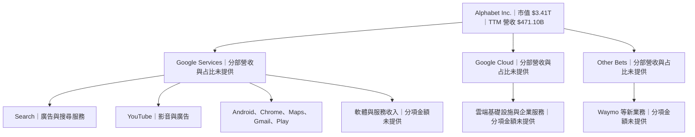
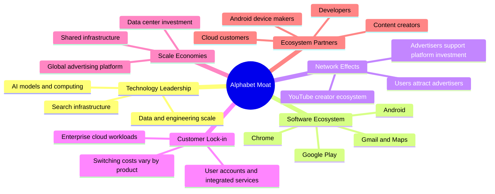
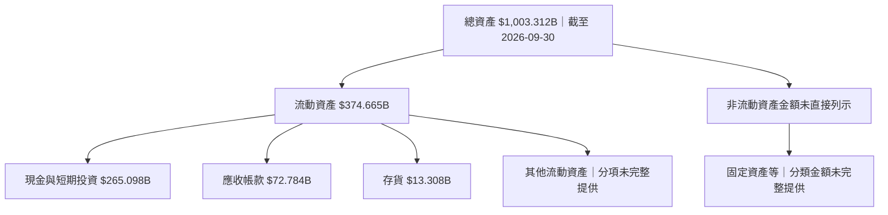
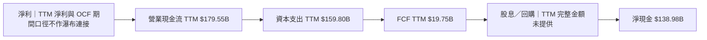
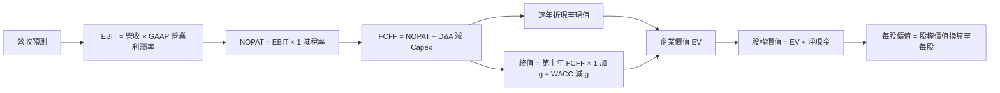
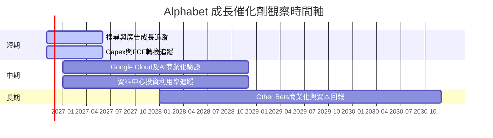
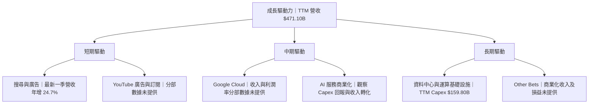
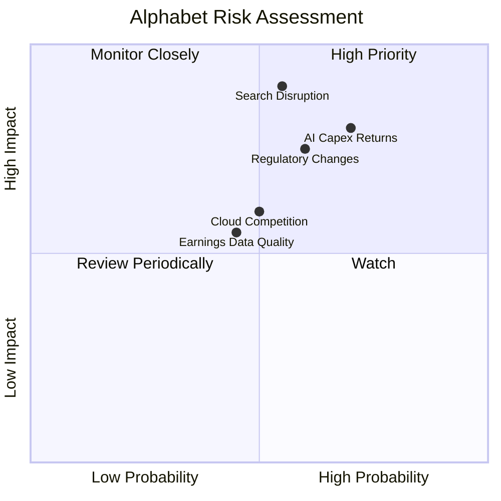
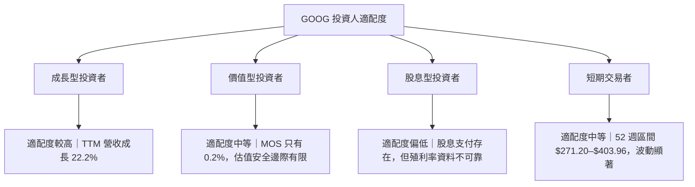

# GOOG 基本面深度分析報告
> **報告日期**：2026-11-18 ｜ **語言**：繁體中文 ｜ **數據來源**：SEC 申報資料 (XBRL)、Yahoo Finance、Finviz、StockAnalysis、Roic.ai ｜ **分析師**：CFA 級機構研究

## 目錄

| # | 章節 | 核心結論 |
|---|------|----------|
| 1 | 執行摘要 | 持有；加權合理價值 $278.05，MOS +0.2% |
| 2 | 公司概覽與商業模式 | 搜尋、廣告與軟體生態形成護城河；各業務收入占比未提供 |
| 3 | 損益表深度分析 | TTM 營收 $471.10B、年增 22.2%；資本支出上升壓低近期現金轉換 |
| 4 | 資產負債表分析 | 淨現金 $138.98B；流動性充足，但營運資金天數較一年前部分惡化 |
| 5 | 現金流量深度分析 | TTM FCF $19.75B，FCF Yield 0.58%；AI/資料中心資本支出是主要壓力 |
| 6 | 獲利能力與資本效率 | ROIC 23.9% 高於 WACC 10.49%，仍在創造股東價值 |
| 7 | 相對估值分析 | P/E 低於同業中位數；自身歷史 P/S 偏高區間 |
| 8 | DCF 內在價值評估 | 基準 DCF $239.82；模型終值占 EV 71.6%，估值對長期假設敏感 |
| 9 | 成長催化劑 | 搜尋、雲端與生成式 AI 是主要機會；TAM 數據未提供 |
| 10 | 風險矩陣 | 搜尋產品轉型、資本支出回報及監管為主要風險 |
| 11 | 投資建議 | 持有；現價接近加權合理價值，建議以財報指標確認成長投資回報 |

---

## 1. 執行摘要

截至 **2026-11-17 收盤價 $277.60**，GOOG 的 TTM 營收為 $471.10B、TTM 營收成長 22.2%、ROIC 23.9% 對 WACC 10.49%，顯示核心業務仍有成長且資本回報高於資金成本；但 TTM FCF 僅 $19.75B、FCF Yield 0.58%，相對 $3.41T 市值偏低。估值方法加權後合理價值為 $278.05，MOS 為 +0.2%，按規則 20 評級為**持有**。DCF 基準值 $239.82，現價相對該值溢價 15.8%；需特別留意 DCF 終值占 EV 71.6%，以及資料模型中部分運算結果無法由顯示輸入完全複算。

### 1.0 一頁式投資儀表板

| 項目 | 內容 |
|------|------|
| **投資論點（3 句）** | ① TTM 營收年增 22.2%，最新一季年增 24.7%，收入動能尚未減速。② ROIC 23.9% 高於 WACC 10.49%，公司仍創造正經濟價值。③ TTM FCF $19.75B、FCF Yield 0.58%，高額資本支出使現金回報暫時弱於帳面獲利。 |
| **綜合評分** | **7.6/10**（引用 1.1 評分卡） |
| **財務健康** | 🟢 淨現金 $138.98B、流動比率 2.786；但 Piotroski F-Score 4/8，品質指標並非全面改善 |
| **ROIC vs WACC** | 23.9% vs 10.49%（創造價值，利差 13.41 個百分點） |
| **FCF 趨勢** | 2025 年 FCF $73.27B；TTM FCF $19.75B，資本支出上升令現金流大幅承壓；FCF Yield 0.58% |
| **估值** | Forward P/E 18.29x｜EV/EBITDA 17.88x｜FCF Yield 0.58% |
| **DCF 內在價值（基準）** | $239.82｜相對 DCF 折溢價 **+15.8% 溢價** |
| **安全邊際（MOS）** | **+0.2%**＝($278.05 − $277.60) ÷ $278.05；🔴 <10%，安全邊際不足 |
| **預期報酬（基準情境 12M）** | **+0.2%**，以加權合理價值 $278.05 對比現價計算 |
| **關鍵風險（前二）** | AI/資料中心資本支出高於現金流成長；搜尋使用方式與競爭格局改變 |
| **評級 + 信心度** | 🟡 **持有**｜信心：中（資本支出、季度盈餘與 DCF 資料存在需要驗證之處） |

### 1.1 綜合評分卡

| 維度 | 評分（1–10） | 主要依據（引用數字與其來源章節） |
|------|--------------|----------------------------------|
| 成長性 | 8.5 | TTM 營收年增 22.2%，最新一季年增 24.7%（第 3 章） |
| 獲利能力 | 8.0 | TTM 營業利益率 33.3%，ROIC 23.9% 高於 WACC 10.49%；F-Score 4/8（第 6 章） |
| 財務健康 | 8.5 | 淨現金 $138.98B、流動比率 2.786；CCC 39 天（第 4 章） |
| 估值 | 6.0 | MOS 僅 +0.2%；P/E 低於自身五年中位數，但 P/S 高於歷史中位數（第 7、8 章） |
| 護城河 | 9.0 | 搜尋、Chrome、Android、YouTube 等產品與廣告平台互相導流；TTM 營收 $471.10B（第 2 章） |
| 管理層與資本配置 | 6.5 | FY2025 資本支出 $91.45B、SBC $24.95B；TTM 資本支出升至 $159.80B，資本回報需持續驗證（第 5 章） |
| **綜合評分** | **7.8** | 六項算術平均：(8.5 + 8.0 + 8.5 + 6.0 + 9.0 + 6.5) ÷ 6 = 7.75，四捨五入為 7.8 |

### 1.2 五大投資論點 + 三大核心風險

| 類型 | 項目 | 具體依據 | 信心度 |
|------|------|----------|--------|
| 🟢 **投資論點①** | 搜尋與廣告平台維持高成長 | TTM 營收 $471.10B、年增 22.2%；最新一季單季年增 24.7% | 🟢 高 |
| 🟢 **投資論點②** | 資本回報高於資金成本 | ROIC 23.9% 對 WACC 10.49%，利差 13.41 個百分點 | 🟢 高 |
| 🟢 **投資論點③** | 資產負債表具有投資彈性 | 現金與短期投資 $265.10B、總債務 $126.12B、淨現金 $138.98B | 🟢 高 |
| 🟢 **投資論點④** | 雲端和 AI 可形成第二成長來源 | 公司營運包括 Google Cloud；最新一季營收增速 24.7%，但各部門拆分未提供 | 🟡 中 |
| 🟢 **投資論點⑤** | 估值倍數不高於多數大型同業 | Trailing P/E 14.5x，低於 META 21.1x、MSFT 26.4x、AMZN 20.8x | 🟡 中 |
| 🟡 **風險①** | AI 資本支出侵蝕自由現金流 | TTM 資本支出 $159.80B，TTM FCF 僅 $19.75B；若投資回收慢，現金回報將受壓 | 🔴 高衝擊 |
| 🔴 **風險②** | 搜尋商業模式遭遇產品替代與監管干預 | 搜尋仍是核心產品，但分部營收與市場份額未提供，難以量化廣告曝光變化 | 🔴 高衝擊 |
| 🟡 **風險③** | 盈餘品質及稀釋訊號偏混合 | F-Score 4/8、稀釋股數測試未通過；TTM FCF/淨利約 8.4% | 🟡 中高 |

### 1.3 快速統計卡片

| 指標 | 公司實際值（期間） | 同業中位數 | 狀態 |
|------|--------------------|------------|------|
| 營收成長（TTM） | **22.2%** | — | 🟢 |
| 營收成長（最新一季年增） | **24.7%** | 18.8% | 🟢 |
| 毛利率（TTM） | **60.9%** | 67.7% | 🟡 |
| 營業利益率（TTM） | **33.3%** | — | 🟢 |
| ROIC（TTM） | **23.9%** | — | 🟢 |
| Forward P/E | **18.29x** | 20.9x | 🟢 |
| FCF Yield（TTM） | **0.58%** | — | 🔴 |
| Piotroski F-Score | **4 / 8** | — | 🟡 |

同業中位數依 META、MSFT、AMZN 的 Peer multiples 計算；毛利率中位數為 (81.0% + 67.7% + 51.4%) ÷ 3 = 66.7%，表內以 66.7% 為比較基準。  

### 1.4 投資結論

```
╔══════════════════════════════════════════════════════════════════╗
║                    📊 投資結論摘要                               ║
╠══════════════════════════════════════════════════════════════════╣
║  評級：持有（MOS +0.2%，依規則 20）                              ║
║  價格（2026-11-17 收盤）：$277.60                                ║
║  DCF 內在價值（基準）：$239.82（現價溢價 15.8%）                ║
║  安全邊際 MOS：+0.2%（以加權合理價值為分母）                    ║
║  加權合理價值（8.8）：$278.05                                    ║
║  DCF 情境價值：                                                  ║
║    悲觀情境：$105.19（-62.1%）                                   ║
║    基準情境：$239.82（-13.6%）                                   ║
║    樂觀情境：$498.46（+79.6%）                                   ║
║  綜合評分：7.8/10（引用 1.1）                                    ║
║  適合投資人：接受大型科技股波動、願意追蹤 AI 資本回報的長線投資人 ║
╚══════════════════════════════════════════════════════════════════╝
```

---

## 2. 公司概覽與商業模式

### 2.1 業務結構與收入來源

公司資料列出 Google Services、Google Cloud 與 Other Bets，但未提供各部門最新營收和占比，因此不能據此填寫分部金額或比例。



Alphabet 的商業模式以搜尋與影音廣告變現為核心，並透過 Android、Chrome、Maps、Gmail 等服務維持使用者觸點；Google Cloud 提供企業雲端及 AI 相關服務。由於分部營收資料未提供，無法量化廣告、雲端與其他業務的收入權重及各自利潤率。

### 2.2 市場份額

市場份額數據未提供，因此不以推估比例繪圖。可觀察的相對規模是 TTM 營收 $471.10B，最新一季營收年增 24.7%；同業最新季營收成長率為 META 26.1%、MSFT 18.8%、AMZN 12.1%。Alphabet 的成長速度高於 MSFT、AMZN，略低於 META。

### 2.3 競爭護城河分析



### 2.4 護城河強度

| 護城河項目 | 強度（強／中／弱） | 證據（引用數字或事實） | 會削弱它的情況 |
|------------|--------------------|------------------------|----------------|
| 技術與資料規模 | 強 | 搜尋、YouTube、Android 等產品組合，TTM 營收 $471.10B | 搜尋介面轉向 AI 對話、資料使用受到限制 |
| 軟體生態系 | 強 | Android、Chrome、Gmail、Maps、Play 等多個服務相互連結 | 裝置平台商改變預設服務或使用者轉向新平台 |
| 網路效應 | 強 | 廣告主、內容創作者與使用者可在同一平台互相增益 | 廣告效益下降、創作者移往其他媒體 |
| 客戶鎖定 | 中 | Google Workspace、Cloud 與帳戶整合增加轉換成本；收入拆分未提供 | 雲端服務差異化不足、企業多雲策略降低黏著 |
| 規模效應 | 強 | TTM 營收規模達 $471.10B，具備大型基礎設施投資能力 | Capex 長期高於現金回報，造成資本效率下滑 |
| 生態夥伴 | 中 | Android 裝置廠、開發者、廣告主與內容供應者共同構成生態 | 監管改變分發安排，或夥伴發展自有服務 |

護城河評分引用 1.1 的 9.0 分：依據是產品生態、平台網路效應與 $471.10B TTM 營收規模；風險在於 AI 改變搜尋入口，以及高資本支出未能轉化為 FCF。

---

## 3. 損益表深度分析

### 3.1 年度收入成長趨勢（近 4 年）

年度營收金額來自 SEC／StockAnalysis 歷史數據；YoY 以年度營收計算，CAGR 以 FY2022 至 FY2025 三年期間計算。

```
╔══════════════════════════════════════════════════════════════════╗
║              Alphabet 年度收入趨勢（FY2022-FY2025）              ║
╠══════════════════════════════════════════════════════════════════╣
║  FY2022  $282.84B  ██████████████░░░░░░░░░░  YoY: —             ║
║  FY2023  $307.39B  ███████████████░░░░░░░░░  YoY: +8.7%  🟡    ║
║  FY2024  $350.02B  ██████████████████░░░░░░  YoY: +13.9% 🟢    ║
║  FY2025  $402.84B  ████████████████████░░░░  YoY: +15.1% 🟢    ║
║                                                                  ║
║  FY2022-FY2025 收入 CAGR：(402.84 ÷ 282.84)^(1/3) − 1 = 12.6%  ║
╚══════════════════════════════════════════════════════════════════╝
```

FY2025 營收年增 15.1%，高於 FY2023 的 8.7%；TTM 成長進一步升至 22.2%。加速可能反映廣告需求、雲端與 AI 服務共同推動，但分部數據不足，無法將加速精確歸因至單一業務。

### 3.2 季度收入趨勢分析

| 季度 | 營收（$B） | QoQ 成長 | YoY 成長 | 備註 |
|------|-----------:|---------:|---------:|------|
| 2025 Q4 | 113.83 | +3.6% | +18.0% | QoQ 以 2025 Q3 $109.90B 為比較基期 |
| 2026 Q1 | 109.90 | -3.5% | +21.8% | 季節性回落，但 YoY 成長加速 |
| 2026 Q2 | 119.80 | +9.0% | +24.2% | 以 2026 Q1 為比較基期 |
| 2026 Q3 | 127.58 | +6.5% | +24.7% | 最新一季成長率，不是 TTM 成長率 |

QoQ 以相鄰季度營收相除計算，可能受季節性影響；YoY 取 StockAnalysis 所列單季年增率。最新一季營收 $127.58B，QoQ 增加約 $7.78B，顯示季度營收仍在上行。

### 3.3 利潤率演變分析

| 利潤率指標 | FY2022 | FY2023 | FY2024 | FY2025 | 趨勢 | 評估 |
|------------|--------|--------|--------|--------|------|------|
| **毛利率** | 55.4% | 56.6% | 58.2% | 59.7% | 逐年改善 | 🟢 |
| **營業利益率** | 26.5% | 27.4% | 32.1% | 32.0% | 2024 擴張，2025 大致持平 | 🟢 |
| **淨利率** | 21.2% | 24.0% | 28.6% | 32.8% | 連續改善 | 🟢 |

年度利潤率由年度毛利、營業利益、淨利除以年度營收計算。2022–2025 毛利率上升約 4.3 個百分點，營業利益率上升約 5.5 個百分點，反映收入增加期間營運規模與成本效率改善。FY2025 營業利益率約 32.0%，較 FY2024 的 32.1% 略低，顯示早期效率改善並非單向延續。

資料來源亦列出 TTM 營業利益率 33.3%、最新一季營業利益率 31.8%；兩者口徑與年度比率不同，不應混作同一期間。季度營業利益從 2026 Q1 的 $39.70B、Q2 的 $40.77B 到 Q3 的 $40.58B，近期利潤金額大致持平，而收入持續增加，反映單季利潤率可能受成本與投資節奏影響。

### 3.4 費用結構分析

年度資料列出 FY2025 研發費用 $61.09B、營業利益 $129.04B、營收 $402.84B；但完整營業費用科目明細未提供，故不製作會造成比例誤導的費用結構圓餅圖。

```
╔══════════════════════════════════════════════════════════════════╗
║                 FY2025 可觀察費用與獲利項目                      ║
╠══════════════════════════════════════════════════════════════════╣
║  營收             $402.84B                                       ║
║  研發費用          $61.09B ＝ 營收的 15.2%                       ║
║  營業利益         $129.04B ＝ 營收的 32.0%                       ║
║  其他營業費用明細：未提供，未以差額反推                          ║
╚══════════════════════════════════════════════════════════════════╝
```

研發投入支撐搜尋、AI、雲端與平台產品，但研發支出增加能否帶來可持續收入與 FCF，仍需透過各部門營收和資本回報檢驗。

### 3.5 季度 EPS 趨勢與盈餘品質（Quality of Earnings）

| 季度 | EPS 實際 | EPS 年增 | 預期值／是否超預期 |
|------|---------:|---------:|-------------------|
| 2025 Q4 | $2.81 | +31.15% | 預期值缺漏，無法判定 |
| 2026 Q1 | $5.11 | +81.96% | 預期值缺漏，無法判定 |
| 2026 Q2 | $9.11 | +294.31% | 預期值缺漏；單季淨利 $112.19B 顯著異常，需核對申報口徑 |
| 2026 Q3 | $2.14 | -25.34% | 預期值缺漏，無法判定 |

EPS 預期值均為缺漏，不能把任一季度稱為「超預期」或「不及預期」。EPS 實際數據與季度淨利序列呈現高度波動；尤其 Q2 的 $112.19B 淨利與其餘季度不在相近尺度，且資料來源中的 EPS 序列亦有明顯跳動，故不宜用這四個數字外推正常化 EPS。

| 盈餘品質項目 | 數值／佔比 | 評估 |
|--------------|-----------|------|
| 股權薪酬 SBC / 營收 | 四個列示季度 SBC 合計 $30.41B ÷ TTM 營收 $471.10B = 6.5% | 🟡 有持續稀釋成本；雖以非現金費用列帳，仍是股東經濟成本 |
| SBC / 營業現金流 | $30.41B ÷ $179.55B = 16.9% | 🟡 比重不低，需與稀釋股數及回購一併觀察 |
| FCF / 淨利（現金轉換率） | $19.75B ÷ TTM 淨利 $235.694B = 8.4% | 🔴 低；資本支出 $159.80B 是主要原因 |
| 一次性／非經常性損益 | 季度淨利與 EPS 出現異常波動；明確調整項目未提供 | 🟡 無法可靠地分離經常與非經常項 |
| 有效稅率異常 | 16.8%（最新年度有效稅率） | 🟡 未提供逐季稅務調節表，無法判斷是否有重大一次性稅務利益 |
| 資本化支出 vs 費用化 | TTM Capex $159.80B，FY2025 Capex $91.45B | 🟡 大額投資由資本支出反映，需關注折舊、利用率與未來收入回報 |

**盈餘品質結論：**帳面營業利潤率與 ROIC 顯示核心營運有獲利能力，但 TTM FCF 僅為 TTM 淨利的約 8.4%，且 SBC 占 TTM 營收約 6.5%。因此現階段不宜只以 EPS 或淨利評價股東回報；資本支出回收與股數稀釋是估值的重要變數。

---

## 4. 資產負債表分析

### 4.1 資產結構分解

最新 TTM 資產負債表列出總資產 $1,003.312B、流動資產 $374.665B；其他完整分類不以未提供數字推算。



現金與短期投資占流動資產比重高，提供投資與短期流動性緩衝；另一方面，固定資產增加及高額資本支出反映公司正擴建基礎設施，需追蹤新資產使用率與投資回報。

### 4.2 流動性與營運資金分析

| 指標 | 最新 TTM | 一年前 TTM | 變化 | 解讀 |
|------|----------|------------|------|------|
| 流動比率 | 2.786 | N/A | N/A | 流動資產對短期負債有充足覆蓋；一年前比較值未提供 |
| DSO 應收帳款天數 | 56 天 | 54 天 | +2 天 | 收款週期略拉長，需看應收款成長是否持續高於營收 |
| DIO 存貨天數 | 26 天 | N/A | N/A | 一年前存貨數據不足，無法比較方向 |
| DPO 應付帳款天數 | 43 天 | N/A | N/A | 一年前應付帳款天數不足，無法判斷供應商付款條件變化 |
| CCC 現金轉換週期 | 39 天 | N/A | N/A | 一年前 CCC 不可計算；不能據此判斷週轉已改善或惡化 |

流動比率 2.786、速動比率 2.512，短期流動性良好。DSO 從 54 天升至 56 天，表示回款速度稍慢，但兩天變動仍需結合應收帳款與合約資產細項觀察；DIO、DPO 與 CCC 一年前資料不足，不做補值。

### 4.3 債務結構分析

採用 SEC 申報資料計算的淨現金口徑：現金及短期投資 $265.10B、總債務 $126.12B。另一市場數據欄位列示不同債務口徑，可能包含不同負債範圍；本報告財務分析依 VERIFIED FIGURES 的同一口徑引用，不將兩套數據混算。

```
╔══════════════════════════════════════════════════════════════════╗
║                  Alphabet 債務健康診斷                           ║
╠══════════════════════════════════════════════════════════════════╣
║  總債務：          $126.12B                                      ║
║  現金+短期投資：   $265.10B                                      ║
║  淨現金：          $138.98B  🟢                                  ║
║  流動比率：        2.786x    🟢                                  ║
║  Debt/EBITDA：     N/A（同口徑 EBITDA 未提供，避免混用）          ║
║  利息保障倍數：    N/A（利息支出數值未提供）                     ║
╚══════════════════════════════════════════════════════════════════╝
```

### 4.4 股東權益趨勢

| 年度 | 股東權益（$B） | 年增率 |
|------|---------------:|-------:|
| 2022 | 256.14 | — |
| 2023 | 283.38 | +10.6% |
| 2024 | 325.08 | +14.7% |
| 2025 | 415.26 | +27.7% |

股東權益 FY2025 明顯增加，但權益變動受淨利、回購、SBC 與其他綜合損益共同影響；單憑總額增長不能判斷每股價值同步改善。

---

## 5. 現金流量深度分析

### 5.1 現金流量瀑布圖

季度淨利資料異常且不能代表 TTM，因此不以錯配期間的淨利與現金流做金額橋接。圖示採用可確認的 TTM OCF 與 Capex；股息與回購金額未提供 TTM 完整數字，不畫成金額流量。



### 5.2 FCF 轉換率趨勢

| 年度 | 營業現金流（$B） | Capex（$B） | FCF（$B） | 淨利（$B） | FCF/淨利 |
|------|-----------------:|------------:|---------:|-----------:|---------:|
| 2022 | 91.50 | 31.48 | 60.01 | 59.97 | 100.1% |
| 2023 | 101.75 | 32.25 | 69.50 | 73.80 | 94.2% |
| 2024 | 125.30 | 52.53 | 72.76 | 100.12 | 72.7% |
| 2025 | 164.71 | 91.45 | 73.27 | 132.17 | 55.4% |
| TTM 至 2026-09-30 | 179.55 | 159.80 | 19.75 | 235.694 | 8.4% |

年度 FCF 由 FY2022 的 $60.01B 增至 FY2025 的 $73.27B，但增幅顯著低於營收與淨利的成長，主因資本支出同步快速上升。TTM 的 FCF/淨利更低，需以大型資料中心投資的建置期與折舊、利用率變化解釋，而不應直接視為可持續的正常化水準。

### 5.3 自由現金流趨勢

```
╔══════════════════════════════════════════════════════════════════╗
║                    自由現金流趨勢                                ║
╠══════════════════════════════════════════════════════════════════╣
║  FY2022  $60.01B  ████████████████░░░░  FCF Yield：年度未提供   ║
║  FY2023  $69.50B  ██████████████████░░  FCF Yield：年度未提供   ║
║  FY2024  $72.76B  ███████████████████░  FCF Yield：年度未提供   ║
║  FY2025  $73.27B  ████████████████████  FCF Yield：年度未提供   ║
║  TTM     $19.75B  █████░░░░░░░░░░░░░░░  FCF Yield：0.58%        ║
╚══════════════════════════════════════════════════════════════════╝
```

TTM FCF Yield 0.58% 直接採用程式計算值。年度 FCF Yield 未提供，故不以不同期間的市值自行補算。季度資料顯示 2026 Q1 FCF $10.12B、Q2 -$5.86B、Q3 -$9.06B；資本支出集中投入，季度現金流波動明顯。

### 5.4 資本配置評估

FY2025 現金流資料顯示 Capex $91.45B、股息 $10.05B、SBC $24.95B；回購金額及完整留存現金分配未提供，不以不完整項目繪製資本配置圓餅圖。

| 資本配置項目 | 已知數據 | 評估 |
|--------------|----------|------|
| 資本支出 | FY2025 $91.45B；TTM $159.80B | 🟡 支出快速增加；若轉化為 AI／雲端收入，可能建立中長期產能，否則會壓低 FCF |
| 股息 | FY2025 $10.05B | 🟢 有股東現金回饋；TTM 股息完整數字未提供 |
| 股權薪酬 | FY2025 $24.95B | 🟡 具稀釋成本，須連同回購與股數變動評估 |
| 股票回購 | 完整金額未提供 | N/A，不能量化 |
| 留存現金／併購 | 完整分配未提供 | N/A，不能量化 |

---

## 6. 獲利能力與資本效率

### 6.1 ROE / ROA / ROIC 趨勢

歷史 ROE、ROA、ROIC 的年度一致序列未完整提供，因此不以不同資料來源拼接出未驗證的歷史趨勢。

| 指標 | 最新可用值 | 歷史趨勢資料 | 評估 |
|------|------------:|--------------|------|
| ROE | TTM 34.8%（QUALITY FIGURES） | 可比較序列未提供 | 🟢 高，但需注意淨利率及權益基數影響 |
| ROA | TTM 12.7%（市場資料） | 品質指標顯示 ROA 較一年前提升 | 🟢 |
| ROIC | TTM 23.9% | 同口徑歷史序列未提供 | 🟢 高於 WACC 10.49% |
| 行業均值 | 未提供 | 不列 | — |

另有市場資料列示 ROE 44.3%，與 QUALITY FIGURES 的 TTM ROE 34.8% 不一致；本報告採用明確標示以 TTM closing balances 計算的 34.8%，避免混用口徑。

### 6.2 ROIC vs WACC 分析（核心價值創造判斷）

```
╔══════════════════════════════════════════════════════════════════╗
║                  ROIC vs WACC 深度分析                           ║
╠══════════════════════════════════════════════════════════════════╣
║  WACC（採用 VERIFIED FIGURES）：10.49%                           ║
║  ├── 無風險利率：5.10%                                           ║
║  ├── ERP：5.00%                                                  ║
║  ├── 原始 Beta：1.23；調整後 Beta：1.15                          ║
║  ├── 股權成本：10.86%                                            ║
║  ├── 稅前債務成本：0.58%；有效稅率：16.8%                        ║
║  └── 股權／債務權重：96.4%／3.6%                                 ║
║                                                                  ║
║  ROIC（TTM）：23.9%                                               ║
║  EVA 利差 = ROIC − WACC = 23.9% − 10.49% = +13.41 個百分點     ║
║                                                                  ║
║  ROIC 23.9%  ▓▓▓▓▓▓▓▓▓▓▓▓▓▓▓▓▓▓▓▓▓▓▓▓  🟢                     ║
║  WACC 10.49% ▓▓▓▓▓▓▓▓▓▓▓░░░░░░░░░░░░░░  ──                     ║
║                                                                  ║
║  結論：ROIC 約為 WACC 的 2.28 倍，顯示公司目前創造股東價值。    ║
╚══════════════════════════════════════════════════════════════════╝
```

ROIC/WACC 倍數計算為 23.9% ÷ 10.49% = 2.28。此處 WACC 直接採用成本資本區塊的 10.49%，與第 8.2 節一致；ROIC 與 WACC 的利差為 13.41 個百分點。估值判斷仍需考慮 ROIC 是否在 AI 投資增加後維持，而非僅看當期比率。

### 6.3 杜邦三因素分解

| 因素 | 數值（TTM） | 解讀 |
|------|-------------|------|
| 淨利率 | 50.0% | 對 ROE 有較大正向貢獻；但異常季度淨利資料令此比率需審慎解讀 |
| 資產週轉率 | 0.47 | 資產投入規模相對營收較大 |
| 權益乘數 | 1.48 | 槓桿程度不高，ROE 並非主要靠財務槓桿撐起 |
| **ROE** | **34.8%** | 50.0% × 0.47 × 1.48 = 34.8%（依 QUALITY FIGURES 原值） |

杜邦結果顯示高淨利率與資產週轉率共同支撐 ROE，權益乘數 1.48 表示槓桿不是主驅動因素。

### 6.4 財務體質：Piotroski F-Score

| 測試 | 結果 | 解讀 |
|------|------|------|
| ROA > 0 | ✅ 通過 | TTM 有正向資產報酬 |
| 營業現金流 > 0 | ✅ 通過 | TTM OCF $179.55B |
| ROA 高於一年前 | ✅ 通過 | 資產品質指標改善 |
| 營業現金流 > 淨利 | ❌ 未通過 | 應計品質測試不通過；需關注非現金盈餘與資本支出 |
| 長期負債 ÷ 總資產低於一年前 | ❌ 未通過 | 槓桿指標未改善 |
| 流動比率高於一年前 | ✅ 通過 | 流動性指標改善 |
| 稀釋股數未增加 | ❌ 未通過 | SBC 對股數或稀釋指標帶來壓力 |
| 毛利率高於一年前 | — 無法判定 | 缺少該項測試需要的完整資料 |
| 資產週轉率高於一年前 | ❌ 未通過 | 資產效率測試未通過 |

**Piotroski F-Score：4 / 8**（一項測試因資料不足未納入分母）。整體代表營運獲利與流動性有正面訊號，但應計品質、稀釋與資產週轉率未全部改善。

---

## 7. 相對估值分析

### 7.1 同業估值比較表格

公司估值採市場數據；同業倍數依 Yahoo Finance 的 Peer multiples。毛利率與營收成長均為資料中所列口徑。

| 估值指標 | **GOOG** | **META** | **MSFT** | **AMZN** | GOOG 評估 |
|----------|---------:|---------:|---------:|---------:|-----------|
| **Trailing P/E** | 14.5x | 21.1x | 26.4x | 20.8x | 🟢 低於三家同業 |
| **Forward P/E** | 18.29x | 17.3x | 20.9x | 23.6x | 🟡 接近 META，高於 META |
| **P/S Ratio** | 7.24x | 6.5x | 10.9x | 3.5x | 🟡 高於 META、AMZN，低於 MSFT |
| **EV/EBITDA** | 17.88x | 13.9x | 18.6x | 16.2x | 🟡 高於 META、AMZN，低於 MSFT |
| **最新一季營收年增** | 24.7% | 26.1% | 18.8% | 12.1% | 🟢 高於 MSFT、AMZN，略低於 META |
| **毛利率（TTM）** | 60.9% | 81.0% | 67.7% | 51.4% | 🟡 低於 META、MSFT，高於 AMZN |

GOOG 的低 Trailing P/E 部分可能反映 EPS 與淨利資料口徑波動，不能單獨視為折價證據。相較之下，Forward P/E 18.29x 接近同業區間；EV/EBITDA 17.88x 也未呈現明顯深度折價。

### 7.2 歷史估值區間分析

```
╔══════════════════════════════════════════════════════════════════╗
║             GOOG 五年歷史估值區間（TTM 倍數）                    ║
╠══════════════════════════════════════════════════════════════════╣
║  P/E        1.3x ───────── 中位數 21.9x ───────── 29.0x          ║
║  現值：14.5x｜歷史百分位：29%                                    ║
║                                                                  ║
║  P/S        4.1x ───────── 中位數 6.1x ────────── 9.8x          ║
║  現值：7.3x｜歷史百分位：67%                                     ║
║                                                                  ║
║  EV/EBITDA 13.7x ──────── 中位數 19.1x ───────── 25.0x          ║
║  現值：17.8x｜歷史百分位：40%                                    ║
╚══════════════════════════════════════════════════════════════════╝
```

P/E 位於歷史 29 百分位、EV/EBITDA 位於 40 百分位，均低於各自歷史中位數；P/S 位於 67 百分位，高於五年中位數，表示營收倍數角度並不便宜。歷史區間由價格資料庫與 SEC 財務資料計算。

### 7.3 情境價值（Bear / Base / Bull，照抄 DCF MODEL 的 Scenarios）

| 情境 | 第 1 年營收成長 | 期末營業利潤率 | WACC | 每股價值 | 相對現價 | 機率 | 會發生的條件 |
|------|----------------|----------------|------|----------:|----------:|-----:|--------------|
| 🔴 悲觀 | 11.1% | 27.2% | 11.49% | $105.19 | -62.1% | 25% | 搜尋或廣告成長明顯放慢、投資回報不足且利潤率受競爭侵蝕 |
| 🟡 基準 | 22.2% | 32.0% | 10.49% | $239.82 | -13.6% | 50% | 近期成長延續一段時間，長期利潤率逐步回到五年中位數附近 |
| 🟢 樂觀 | 33.3% | 35.2% | 9.49% | $498.46 | +79.6% | 25% | AI／雲端需求帶動營收加速，規模效應使長期利潤率高於目前 |

機率加權情境值依模型為 $270.83，作背景參考；第 8.8 節與評級採用固定方法權重下的加權合理價值，而不是此機率加權情境值。

### 7.4 相對估值隱含價格區間

```
╔══════════════════════════════════════════════════════════════════╗
║                  相對估值與基準價格定位                          ║
╠══════════════════════════════════════════════════════════════════╣
║  $239.82 ── $255.28 ── [$277.60 現價] ── $317.61 ── $389.00     ║
║   基準 DCF    EV/EBITDA       現價        Forward P/E   分析師共識 ║
╚══════════════════════════════════════════════════════════════════╝
```

| 方法 | 每股價值 | 方法依據 |
|------|---------:|----------|
| 同業 Forward P/E | $317.61 | META、MSFT、AMZN 同業中位數 20.9x × Forward EPS $15.18 |
| 同業 EV/EBITDA | $255.28 | 同業中位數 16.2x × TTM EBITDA，再加回淨現金 |
| DCF 基準 | $239.82 | 10 年 FCFF、WACC 10.49%、終值成長 3.0% |
| 分析師共識 | $389.00 | 15 位分析師平均目標價；只作參考，不替代基本面模型 |

---

## 8. DCF 內在價值評估（Discounted Cash Flow）

### 8.0 估值推理鏈（Thinking Logic）

**Step 1 — 價值由哪些變數決定？**  
模型的核心是現有 Google 服務與雲端業務產生的營業現金流、未來營收成長，以及高資本支出能否隨時間下降。各業務營收占比未提供，不能以未驗證比例拆出獨立價值。從模型敏感性表看，WACC 與終值成長率對價值影響最大；終值占 EV 71.6%，因此長期折現與成熟期現金流假設主導估值。

**Step 2 — 模型選擇**

| 決策點 | 本報告採用 | 理由（含數字） | 曾考慮但否決 | 否決理由 |
|--------|-----------|----------------|--------------|----------|
| 現金流定義 | FCFF | 以 WACC 10.49% 折現並先估 EV，再加淨現金 | FCFE | 模型已固定採企業自由現金流 |
| 預測期 N | 10 年 | 模型假設；讓營收成長與 Capex 逐步淡出 | 5 年 | 模型採用期長度已固定，且終值占比高 |
| 終值方法 | Gordon Growth | 模型明列永續成長率 3.0% | 退出倍數 | DCF MODEL 未列可供複算的退出倍數終值 |
| EBIT 基礎 | GAAP EBIT | TTM 營業利益率 33.3% | 非 GAAP EBIT | 避免加回 SBC 而低估股東成本 |

**Step 3 — 關鍵假設推導鏈**

- **營收成長**：錨點＝TTM 營收成長 22.2%，FY2022–FY2025 營收 CAGR 12.6% → 最近成長速度高於三年歷史 CAGR，但長期需淡出 → **第 1 年採用 22.2%，第 10 年降至 3.0%** → 曾考慮直接將歷史 CAGR 12.6% 套用十年，但會忽視目前單季年增 24.7% 的加速；也不採十年維持 22.2%，因模型應反映成熟化。
- **期末營業利潤率**：錨點＝TTM GAAP 營業利益率 33.3%，FY2025 約 32.0% → 高額 AI 投資與競爭可能抵銷規模效益 → **33.3% 緩降至 32.0%** → 曾考慮採用更高長期利潤率，但資料未能證明支出增加後仍可持續擴張，故否決。
- **永續成長率 g**：錨點＝模型採 3.0%，低於 WACC 10.49% → 公司成熟後以長期名目經濟成長作為保守參考 → **採 3.0%** → 不採更高 g，因終值已占 EV 71.6%，較高 g 會過度放大終值。
- **預測期 N**：錨點＝模型固定 10 年 → 企業規模、產品週期與 AI 資本投資回收需較長期間觀察 → **採 10 年** → 不以短期 5 年替代，因模型設定與永續成長假設採十年轉成熟路徑。
- **Capex／營收**：錨點＝TTM Capex $159.80B ÷ TTM 營收 $471.10B = 33.9% → 當前資本支出異常偏高，模型假設逐步淡出至 6.5% → **第 1 年 33.9%，第 10 年 6.5%** → 不採用 TTM 比率作永久比例，否則會將建置期投資無限延續。
- **D&A／營收**：錨點＝TTM 5.9% → 模型固定 → **採 5.9%**；缺少足以支持另行調整的完整折舊計畫。
- **EBIT／SBC／股數**：採 GAAP EBIT，SBC 已作費用；模型採固定股數，不另扣 SBC、不另加年稀釋率。故本模型採用 **(A) GAAP EBIT + 固定股數 + 不另扣 SBC**，SBC 影響已計入一次。
- **終值方法**：錨點＝DCF MODEL 使用 Gordon Growth、g 3.0% → 基準 WACC 10.49% 高於 g → **採 Gordon Growth**；未採退出倍數作第二終值，因模型未提供可複算的退出倍數終值輸入。
- **WACC**：錨點＝成本資本數據提供 10.49% → 直接採用，不另估另一個折現率 → **採 10.49%** → 不自行調整 WACC，以免和模型敏感度、基準估值不一致。

**Step 4 — 最脆弱的一環**  
最脆弱的假設是資本支出由 TTM 營收 33.9% 降至第十年的 6.5%；若成熟期 Capex 仍高於模型假設，FCFF 將下降，估值會低於基準。由於 DCF MODEL 未提供該假設改變後的情境估值，不能自行填入跌幅。

**Step 5 — 計算路徑圖**



### 8.1 模型假設總表（Model Inputs）

| 假設項目 | 採用值 | 依據／來源 | 敏感度 |
|----------|--------|-------------|--------|
| 預測期長度 N | 10 年 | DCF MODEL 固定值；逐年預測至 FY+10 | 🟡 中 |
| 營收成長 | 第 1 年 22.2%，第 10 年 3.0%，線性淡出 | TTM 成長 22.2%；終端採 3.0% | 🔴 高 |
| 營業利潤率 | 33.3% 降至 32.0% | TTM 33.3%，淡出至近五年財年中位數（含 TTM） | 🔴 高 |
| 有效稅率 | 16.8% | 最新年度有效稅率 | 🟢 低 |
| Capex／營收 | 第 1 年 33.9% 降至第 10 年 6.5% | TTM 33.9%；長期依模型假設淡出 | 🔴 高 |
| D&A／營收 | 5.9% | TTM 比率，固定 | 🟢 低 |
| 營運資金變動 | 未建模 | DCF MODEL 指定 Working capital is not modelled；不是假設 WC 為零 | 🟢 低 |
| EBIT 基礎 | GAAP | 模型明列 GAAP EBIT | 🟡 中 |
| SBC 處理 | GAAP EBIT 已含 SBC；不再扣一次 | 固定股數，年稀釋率 0% | 🟡 中 |
| 年稀釋率 | 0% | 配合組合 (A) 的固定股數處理 | 🟡 中 |
| 永續成長率 g | 3.0% | DCF MODEL 假設，低於 WACC 10.49% | 🔴 高 |
| 終值方法 | Gordon Growth | DCF MODEL 列示 | 🔴 高 |
| WACC | 10.49% | Cost of capital 區塊原值 | 🔴 高 |

**FCFF 定義：**FCFF = NOPAT + D&A − Capex；營運資金未建模。SBC 已反映於 GAAP EBIT，不再另扣，也不透過額外年稀釋率重複扣除。

### 8.2 折現率推導（WACC）

原始 Beta 1.23，調整 Beta 1.15；調整方式為 ⅔ × 原始 Beta + ⅓ × 1.00。無風險利率為 10 年期美債 5.10%，資料未提供觀察日期；ERP 為 5.00% 假設值，未提供額外規模或國別風險溢酬，故不加計。預稅債務成本與權重直接採成本資本數據。

```
╔══════════════════════════════════════════════════════════════════╗
║                    WACC 推導（折現率）                           ║
╠══════════════════════════════════════════════════════════════════╣
║  股權成本 Ke（CAPM）：                                           ║
║  ├── 無風險利率 Rf：5.10%                                        ║
║  ├── ERP：5.00%                                                  ║
║  ├── 原始 Beta：1.23；調整後 Beta：1.15                          ║
║  ├── 規模／國別溢酬：0.00%（未另加）                            ║
║  └── Ke = 5.10% + 1.15 × 5.00% = 10.86%（採用區塊原值）         ║
║                                                                  ║
║  債務成本：                                                      ║
║  ├── 稅前 Kd：0.58%（區塊原值；利息與平均計息負債明細未提供）   ║
║  ├── 有效稅率：16.8%                                             ║
║  └── 稅後 Kd = 0.58% × (1 − 16.8%) = 0.48256%                   ║
║                                                                  ║
║  資本權重：股權 96.4%；債務 3.6%                                 ║
║  WACC = 96.4% × 10.86% + 3.6% × 0.48256% = 10.49%               ║
╚══════════════════════════════════════════════════════════════════╝
```

逐步演算：

1. **Ke（CAPM）**＝5.10% + 1.15 × 5.00% + 0.00%＝10.85%；成本資本區塊採用 10.86%，兩者差 0.01 個百分點，保留區塊原值。
2. **稅前 Kd**＝0.58%（區塊原值）。利息費用及平均計息負債明細未提供，不能獨立重算分子與分母。
3. **稅後 Kd**＝0.58% × (1 − 16.8%)＝0.48256%。
4. **權重**＝股權 96.4%；債務 3.6%；96.4% + 3.6%＝100.0%。市值與稀釋股數精確配對未提供，故採成本資本區塊權重。
5. **WACC**＝96.4% × 10.86% + 3.6% × 0.48256%＝10.46904% + 0.017372%＝10.486412%，四捨五入為 **10.49%**。

### 8.3 逐年自由現金流預測（基準情境）

下表逐格照錄程式計算的 DCF MODEL。金額單位為 $B；折現因子保留三位小數。

| 年度 | FY+1 | FY+2 | FY+3 | FY+4 | FY+5 | FY+6 | FY+7 | FY+8 | FY+9 | FY+10 |
|------|-----:|-----:|-----:|-----:|-----:|-----:|-----:|-----:|-----:|------:|
| 營收 | 575.74 | 691.33 | 815.37 | 944.26 | 1,073.37 | 1,197.22 | 1,309.81 | 1,405.02 | 1,477.16 | 1,521.48 |
| 營收 YoY | 22.2% | 20.1% | 17.9% | 15.8% | 13.7% | 11.5% | 9.4% | 7.3% | 5.1% | 3.0% |
| 營業利潤率 | 33.3% | 33.2% | 33.0% | 32.9% | 32.7% | 32.6% | 32.5% | 32.3% | 32.2% | 32.0% |
| EBIT（GAAP） | 191.84 | 229.37 | 269.36 | 310.58 | 351.51 | 390.36 | 425.19 | 454.09 | 475.29 | 487.37 |
| − 稅 | (32.20) | (38.50) | (45.21) | (52.13) | (58.99) | (65.51) | (71.36) | (76.21) | (79.77) | (81.80) |
| NOPAT | 159.65 | 190.87 | 224.15 | 258.46 | 292.52 | 324.84 | 353.83 | 377.88 | 395.52 | 405.57 |
| + D&A | 34.21 | 41.08 | 48.45 | 56.11 | 63.79 | 71.14 | 77.84 | 83.49 | 87.78 | 90.41 |
| − Capex | (195.30) | (213.47) | (226.97) | (234.11) | (233.46) | (223.97) | (205.18) | (177.35) | (141.51) | (99.46) |
| − ΔWC | 未建模 | 未建模 | 未建模 | 未建模 | 未建模 | 未建模 | 未建模 | 未建模 | 未建模 | 未建模 |
| **FCFF** | **-1.44** | **18.48** | **45.64** | **80.46** | **122.84** | **172.02** | **226.48** | **284.03** | **341.80** | **396.53** |
| 折現因子 | 0.905 | 0.819 | 0.741 | 0.671 | 0.607 | 0.550 | 0.498 | 0.450 | 0.408 | 0.369 |
| **FCFF 現值 PV** | **-1.30** | **15.14** | **33.84** | **53.99** | **74.61** | **94.56** | **112.69** | **127.90** | **139.31** | **146.28** |

**預測期 FCF 現值合計：**  
-1.30 + 15.14 + 33.84 + 53.99 + 74.61 + 94.56 + 112.69 + 127.90 + 139.31 + 146.28 = **797.02B**；DCF MODEL 列示合計為 **$797.00B**，差異 $0.02B，屬列示精度尾差。

**FY+1 逐步演算（以模型列值示範）：**

1. 營收公式＝上一期 TTM 營收 × (1 + 成長率)；代入 $471.10B × 1.222；模型列值 **$575.74B**。按顯示的四捨五入輸入計算為 $575.68B，與模型列值相差約 $0.06B。
2. EBIT＝營收 × 營業利潤率；代入 $575.74B × 33.3%；模型列值 **$191.84B**。以顯示值直接相乘為 $191.72B，模型中間值有差異。
3. 稅＝EBIT × 有效稅率；代入 $191.84B × 16.8%＝**$32.23B**；模型列值為 $32.20B。
4. NOPAT＝EBIT − 稅；代入模型列值 $191.84B − $32.20B＝$159.64B；模型列示 **$159.65B**，差異 $0.01B。
5. D&A＝營收 × D&A 比率；模型列值 **$34.21B**。
6. Capex＝營收 × Capex 比率；模型列值 **$195.30B**。
7. ΔWC：模型未建模，不代表實際營運資金變動為零。
8. FCFF＝NOPAT + D&A − Capex；依表內列值 $159.65B + $34.21B − $195.30B＝**-$1.44B**。
9. 折現因子＝1 ÷ (1 + 10.49%)¹＝約 **0.905**；PV＝-$1.44B × 0.905＝約 **-$1.30B**。

**合理性自檢：**

- FY+1 FCFF 為 -$1.44B，FY+10 為 $396.53B；因模型 Capex／營收由 33.9% 降至 6.5%，預測 FCF 改善主要來自資本支出比率下滑。歷史 FCF CAGR 不作單一可比推算，因 TTM FCF $19.75B 受資本支出急升影響。
- FY+10 FCFF 利潤率＝$396.53B ÷ $1,521.48B＝26.1%；目前 TTM FCF 利潤率＝$19.75B ÷ $471.10B＝4.2%。兩者差異主要來自 Capex 假設由 33.9% 降至 6.5%，不是單純營業利潤率上升。
- FY+1 FCFF 為負，因 Capex 高於 NOPAT 加 D&A；其折現值為負，已納入模型，後續年度正現金流抵銷。

```
╔══════════════════════════════════════════════════════════════════╗
║            自由現金流：歷史實際 vs 模型預測                      ║
╠══════════════════════════════════════════════════════════════════╣
║  FY2023(實)  $69.50B  ██████████░░░░░░░░░░  歷史值              ║
║  FY2024(實)  $72.76B  ██████████░░░░░░░░░░  歷史值              ║
║  FY2025(實)  $73.27B  ███████████░░░░░░░░░  歷史值              ║
║  FY+1 (預)   -$1.44B  負值；高 Capex 假設                       ║
║  FY+10 (預)  $396.53B ████████████████████  Capex 比率淡出       ║
╠══════════════════════════════════════════════════════════════════╣
║  預測 FCF 擴張主要依賴 Capex／營收從 33.9% 降至 6.5%。          ║
╚══════════════════════════════════════════════════════════════════╝
```

### 8.4 終值計算（Terminal Value）

適用性檢查：**WACC 10.49% vs g 3.0% → WACC > g？✅**

| 方法 | 計算式 | 終值 TV | TV 現值 | 佔總 EV 比重 |
|------|--------|---------|---------|--------------|
| Gordon Growth | $396.53B × (1 + 3.0%) ÷ (10.49% − 3.0%) | $5,455.34B（模型列值） | $2,012.43B | 71.6% |
| 退出倍數法 | N/A（DCF MODEL 未列終值退出倍數及對應終值） | N/A | N/A | N/A |

逐步演算與核對：

1. FY+10 FCFF＝**$396.53B**。
2. 分子＝$396.53B × 1.03＝**$408.4259B**。
3. 分母＝10.49% − 3.0%＝**7.49%**。使用顯示輸入相除：$408.4259B ÷ 0.0749＝約 **$5,452.95B**，與 DCF MODEL 列示 $5,455.34B 不完全一致。
4. PV(TV)＝模型列示 $5,455.34B × 0.369＝約 **$2,012.43B**（按模型值及折現因子列示）。
5. 終值占比＝$2,012.43B ÷ $2,809.43B＝**71.6%**。

模型列示終值與以表面輸入複算結果有差異，未自行改動模型輸出；此差異列入 8.10 稽核檢核。終值占 EV 71.6%，估值對長期假設高度敏感，但尚未超過 75% 警示門檻。

### 8.5 企業價值 → 每股內在價值（Bridge）

```
╔══════════════════════════════════════════════════════════════════╗
║              企業價值 → 每股內在價值 橋接表                      ║
╠══════════════════════════════════════════════════════════════════╣
║  預測期 FCF 現值合計             +$797.00B                        ║
║  終值現值 PV(TV)               +$2,012.43B                       ║
║  = 企業價值 EV                  $2,809.43B                       ║
║  + 淨現金                        +$138.98B                       ║
║  = 股權價值                     $2,948.41B                       ║
║  每股價值（模型換算）             $239.82                         ║
║  當前股價                        $277.60                         ║
║  折溢價（現價÷DCF價值−1）         +15.8%（溢價）                 ║
╚══════════════════════════════════════════════════════════════════╝
```

1. EV＝$797.00B + $2,012.43B＝**$2,809.43B**。
2. 股權價值＝$2,809.43B + $138.98B＝**$2,948.41B**。
3. 每股內在價值依 DCF MODEL 指定換算方式：股權價值 × 價格 ÷ 市值；模型列值為 **$239.82**。模型未提供換算使用的精確市值／股數明細，故不以四捨五入後市值反推。
4. 折溢價＝$277.60 ÷ $239.82 − 1＝**+15.8%**。
5. 本節不計算 MOS；MOS 僅在 8.8 以加權合理價值為分母計算。

股權價值橋接採 DCF MODEL 的淨現金 $138.98B；股數處理採組合 (A)，股數固定、不另加年稀釋率。模型以市場價格與市值比例換算每股價值，無獨立顯示精確稀釋股數。

### 8.6 敏感性分析（WACC × 永續成長率）

下表每格均照錄 DCF MODEL 的每股價值；括號為相對現價 $277.60 的上行空間。基準格加粗。

| g（列）／WACC（欄） | 8.49% | 9.49% | **10.49%（基準）** | 11.49% | 12.49% |
|-----------|------:|------:|--------------------:|-------:|-------:|
| 2.0% | $310.02 (+11.7%) | $258.12 (-7.0%) | $219.14 (-21.1%) | $188.93 (-31.9%) | $164.94 (-40.6%) |
| 2.5% | $329.97 (+18.9%) | $271.76 (-2.1%) | $228.83 (-17.6%) | $196.03 (-29.4%) | $170.29 (-38.6%) |
| **3.0%（基準）** | $353.56 (+27.4%) | $287.50 (+3.6%) | **$239.82 (-13.6%)** | $203.98 (-26.5%) | $176.19 (-36.5%) |
| 3.5% | $381.88 (+37.6%) | $305.87 (+10.2%) | $252.39 (-9.1%) | $212.92 (-23.3%) | $182.75 (-34.2%) |
| 4.0% | $416.50 (+50.0%) | $327.59 (+18.0%) | $266.89 (-3.9%) | $223.06 (-19.6%) | $190.08 (-31.5%) |

**矩陣非基準格複算限制：**DCF MODEL 未提供矩陣各格的逐年折現現值拆分，因此不能在不重建模型的情況下精確重演某一格的 EV 與每股價值；矩陣數字依指示照錄，不另造中間值。

**三情境 DCF：**模型提供每股價值、情境假設及機率，但沒有各情境的 FY+10 營收、FCFF 與終值拆分。依規則不另建模型，故不杜撰該等中間數字。

| 情境 | 營收成長假設 | 期末營業利潤率 | WACC | 每股內在價值 | 相對現價 | 機率 |
|------|-------------|---------------|------|--------------:|---------:|-----:|
| 🔴 悲觀 | 第 1 年 11.1% | 27.2% | 11.49% | $105.19 | -62.1% | 25% |
| 🟡 基準 | 第 1 年 22.2% | 32.0% | 10.49% | $239.82 | -13.6% | 50% |
| 🟢 樂觀 | 第 1 年 33.3% | 35.2% | 9.49% | $498.46 | +79.6% | 25% |

模型機率加權值：$105.19 × 25% + $239.82 × 50% + $498.46 × 25% = **$270.83**（模型列值；使用顯示情境數字計算約 $270.82，為四捨五入尾差）。8.8 評級仍採其指定的基準方法加權值，不使用該情境加權值。

敏感度定性結論：提供的矩陣顯示，在 WACC 10.49% 下，g 由 2.0% 升至 4.0%，價值由 $219.14 升至 $266.89；在 g 3.0% 下，WACC 由 9.49% 升至 11.49%，價值由 $287.50 降至 $203.98。由於 DCF MODEL 未提供期末利潤率單獨變動的敏感度數字，不虛構每 +1 個百分點的估值變化。終值占比高與 8.0 Step 1 的結論一致：折現率和長期現金流主導估值。

### 8.7 反推 DCF（Reverse DCF：市場在預期什麼）

固定基準值：WACC 10.49%、稅率 16.8%、Capex 路徑第 1 年 33.9% 至第 10 年 6.5%、營運資金未建模、預測期 10 年、固定股數及 GAAP EBIT。資料僅提供兩個單變數反推結果；其餘變數未計算，不自行求解。

| 求解的變數（一次一個） | 其餘變數設定 | 市場隱含值 | 公司歷史／基準比較 | 判斷 |
|------------------------|--------------|------------:|--------------------|------|
| 第 1 年營收成長率 | 其他維持基準值 | 25.9% | 基準 22.2%；FY2022–FY2025 CAGR 12.6% | 🟡 現價要求成長高於基準 |
| 固定營業利潤率 | 其他維持基準值 | 36.4% | 基準 33.3% → 32.0% | 🔴 高於目前 TTM 利潤率 |
| 永續成長率 g | 未計算 | 未計算 | — | N/A |
| 預測期長度 N | 未計算 | 未計算 | 基準 10 年 | N/A |

反推模型提供的兩項市場隱含值為 25.9% 營收成長或 36.4% 固定營業利潤率；不能將其視為同時必須達成的條件，因每次只放開一個變數。模型未提供試算軌跡或逐點估值，故不偽造收斂表。

### 8.8 估值三角驗證與安全邊際

| 估值方法 | 隱含每股價值 | 上行空間（÷現價） | 權重 | 說明 |
|----------|--------------:|-------------------:|-----:|------|
| DCF（基準） | $239.82 | -13.6% | 40% | 10 年 FCFF、WACC 10.49%、永續成長 3.0% |
| 同業 Forward P/E | $317.61 | +14.4% | 25% | 同業中位數 20.9x × Forward EPS $15.18 |
| 同業 EV/EBITDA | $255.28 | -8.0% | 25% | 同業中位數 16.2x × TTM EBITDA，加回淨現金 |
| 分析師共識目標價 | $389.00 | +40.1% | 10% | 15 位分析師平均目標價 |
| **加權合理價值** | **$278.05** | **+0.2%** | **100%** | 公司類型：獲利公司；估值方法與權重固定 |

加權合理價值算式：  
$239.82 × 40% + $317.61 × 25% + $255.28 × 25% + $389.00 × 10%  
= $95.928 + $79.4025 + $63.820 + $38.900  
= $278.0505，四捨五入為 **$278.05**。權重合計 100%；本估值方法均有提供，沒有方法被剔除。

MOS 算式：($278.05 − $277.60) ÷ $278.05 = **+0.2%**。  
上行空間算式：($278.05 − $277.60) ÷ $277.60 = **+0.2%**。兩者均四捨五入為 +0.2%，但分母不同。

```
╔══════════════════════════════════════════════════════════════════╗
║                  估值區間與安全邊際                              ║
╠══════════════════════════════════════════════════════════════════╣
║  $105.19 ── $239.82 ── [$277.60] ── [$278.05] ── $498.46        ║
║  悲觀 DCF     基準 DCF       現價      加權合理值   樂觀 DCF      ║
║                                                                  ║
║  MOS = (278.05 − 277.60) ÷ 278.05 = +0.2%                       ║
║  上行空間 = (278.05 − 277.60) ÷ 277.60 = +0.2%                  ║
║  MOS 評估：🔴 <10%，安全邊際不足                                 ║
║  建議買入區間：未達買入評級；若按 MOS ≥10%，價格需 ≤$250.25      ║
║  合理持有區間：$250.25–$308.94（以加權價值 ±10% 作參考）         ║
║  減碼考慮區間：高於樂觀 DCF $498.46，並非固定目標價              ║
╚══════════════════════════════════════════════════════════════════╝
```

買入上限 $250.25 的算式為 $278.05 × (1 − 10%) = $250.245，四捨五入為 $250.25；持有區間為 $278.05 × 90% 至 $278.05 × 110%。這是價值參考區間，不改變規則 20 的持有評級。

> 🔎 **程式複算（Python，依本節各項自動重算）**
>
> 加權合理價值 = $239.82 × 40% + $317.61 × 25% + $255.28 × 25% + $389.00 × 10% = **$278.05**（權重合計 100%）
>
> 以價格 $277.60 計：MOS = **+0.2%**，上行空間 = **+0.2%**
>
> ✅ 與本節所寫數值一致。

### 8.9 DCF 模型的局限與失效條件

- **終值依賴度：**終值現值占 EV 71.6%，代表大部分價值取決於 FY+10 之後的現金流假設。
- **最脆弱假設：**Capex／營收由 33.9% 降至 6.5%；若下降較慢，基準 DCF 可能高估。模型沒有該變數敏感度數字，不能量化額外跌幅。
- **FCF 基期偏低：**TTM FCF $19.75B，與 FY2025 $73.27B 差距大，主要受 TTM Capex $159.80B 影響。高再投資期間的 DCF 對 Capex 路徑較敏感。
- **營運資金未建模：**模型未納入 ΔWC，若應收帳款、存貨或其他營運資產占用增加，實際 FCFF 會低於模型。
- **資料一致性：**FY+1 多個中間值、終值及機率加權結果存在小幅不可複算差異；每股價值使用模型換算結果，需以完整原始模型再核對。
- **風險連結：**AI Capex 高於預期會推升 Capex／營收；搜尋變現受壓會降低營收成長與營業利潤率；利率或風險溢酬升高會推升 WACC。

### 8.10 複算檢核表（Audit Trail）

| # | 檢核項目 | 檢查方式 | 結果 |
|---|----------|----------|------|
| 1 | 所有高／中敏感度輸入都有四段式推導 | 對照 8.0 Step 3 | ✅ |
| 2 | 每個假設都有來歷 | 8.1 依據欄核對 | ✅ |
| 3 | WACC 五步算式與乘加 | 依區塊利率、權重重算 | ✅（Ke 顯示值有 0.01pp 尾差，採原值） |
| 4 | Kd 分母與債務權重 D 範圍一致 | 利息及平均計息債務明細缺漏；不能獨立驗證 | ❌（資料限制，未另造數字） |
| 5 | WACC 與第 6.2 節相同 | 兩節均為 10.49% | ✅ |
| 6 | 逐年欄數等於 N，無省略年度 | FY+1 至 FY+10 共 10 年 | ✅ |
| 7 | FY+1 九步算式可複算 | 對照顯示輸入與模型輸出 | ❌（模型中間值有小幅差異，已披露） |
| 8 | 預測期 PV 逐項相加 | 項目加總 $797.02B，模型列值 $797.00B | ✅（差 $0.02B，尾差） |
| 9 | WACC > g | 10.49% > 3.0% | ✅ |
| 10 | 終值以 FY+10 FCFF 為基礎並折現 10 期 | 取 FY+10 FCFF $396.53B | ✅ |
| 11 | EV 至股權價值橋接 | $797.00B + $2,012.43B = $2,809.43B；再加淨現金 | ✅（股權價值可複算；每股換算輸入不完整） |
| 12 | SBC 組合合法且一致 | GAAP EBIT、不另扣 SBC、固定股數 | ✅ |
| 13 | 敏感性矩陣基準格等於 DCF 基準值 | $239.82 對 $239.82 | ✅ |
| 14 | 矩陣有效格未違反 WACC > g | 最低 WACC 8.49% 高於最高 g 4.0% | ✅ |
| 15 | 三情境機率相加 | 25% + 50% + 25% = 100% | ✅（模型機率加權金額有尾差） |
| 16 | 反推每列只放開一個變數且有軌跡 | 模型僅提供兩個反推值，未提供試算軌跡 | ❌（不自行補造） |
| 17 | MOS 與折溢價基準一致 | MOS 用 8.8 加權價值；折溢價用 8.5 DCF | ✅ |
| 18 | 報告輸出至第 11 章 | 已檢查章節完整 | ✅ |
| 19 | 加權合理價值等於逐項加權和 | 算得 $278.0505，四捨五入 $278.05 | ✅ |
| 20 | 評級符合 MOS 門檻 | MOS +0.2%，規則 20 為持有 | ✅ |

未通過項目係因利息／債務明細、反推試算軌跡與 DCF 顯示中間值不足以獨立複算；已標示資料限制，故 DCF 單一估值的信心度為中低。

---

## 9. 成長催化劑

### 9.1 催化劑時間軸

以下為投資觀察時程而非公司已公告的產品時間表；不對未提供的產品發布日期作精確預測。



### 9.2 TAM 市場規模分析

N/A（TAM 數據未提供）。可直接觀察的公司營收規模為 TTM $471.10B、TTM 年增 22.2%，最新一季營收年增 24.7%；市場空間仍需按搜尋廣告、雲端與 AI 等分部資料拆分，否則無法以單一 TAM 數字量化滲透率。

### 9.3 成長驅動力結構圖



---

## 10. 風險矩陣

### 10.1 風險評分矩陣

機率與衝擊座標為分析師定性判斷，不是財務數據或公司公布機率。



### 10.2 風險清單詳細分析

| # | 風險項目 | 發生機率 | 財務衝擊 | 風險評分 | 緩解措施 |
|---|----------|----------|----------|----------|----------|
| 1 | 🔴 **AI 資本支出回報不及預期** | 中高（定性） | 高；TTM Capex $159.80B，TTM FCF 僅 $19.75B | 🔴 高 | 每季追蹤 Capex、OCF、FCF、雲端收入與資產利用率；若 Capex 繼續增而 FCF 下降，降低估值假設 |
| 2 | 🔴 **搜尋使用方式被生成式 AI 改變** | 中（定性） | 高；目前未提供搜尋分部收入，無法精確量化損失 | 🔴 高 | 追蹤搜尋與廣告相關營收、廣告轉換率、流量成本與搜尋產品使用指標 |
| 3 | 🟠 **監管及反壟斷限制** | 中（定性） | 中高；可能影響分發、廣告與平台商業安排 | 🟠 中高 | 追蹤監管裁決、商業安排變更及分發成本 |
| 4 | 🟡 **雲端競爭與價格壓力** | 中（定性） | 中；雲端分部成長與利潤率未提供 | 🟡 中 | 追蹤 Cloud 分部營收、營業利益與客戶留存 |
| 5 | 🟡 **盈餘品質與資料口徑不一致** | 中（定性） | 中；TTM FCF／淨利 8.4%，且 EPS 與季度淨利資料波動 | 🟡 中 | 核對 SEC 申報資料、調整非經常項目，避免依單季 EPS 外推 |

---

## 11. 投資建議

### 11.1 最終評級與評分

規則 20 依 MOS +0.2% 評為**持有**，不作質化調整。綜合評分為 **7.8/10**，引用 1.1 六項分數：成長性 8.5、獲利能力 8.0、財務健康 8.5、估值 6.0、護城河 9.0、管理層與資本配置 6.5。

### 11.2 合理價值與隱含報酬率

| 估值項目 | 每股價值 | 相對現價 $277.60 | 權重／機率 |
|----------|---------:|-----------------:|-----------:|
| 加權合理價值 | $278.05 | +0.2% | 權重計算值 |
| 悲觀 DCF 情境 | $105.19 | -62.1% | 25% |
| 基準 DCF 情境 | $239.82 | -13.6% | 50% |
| 樂觀 DCF 情境 | $498.46 | +79.6% | 25% |
| DCF 機率加權值 | $270.83 | -2.4% | 僅作情境參考 |

基準 DCF 低於現價；加權合理價值接近現價。估值結果對 Capex 正常化、長期成長及折現率較敏感，故不宜只依單一情境建立部位。

### 11.3 買入時機與觸發因素

```
╔══════════════════════════════════════════════════════════════════╗
║                  ✅ 買入觸發因素 Checklist                      ║
╠══════════════════════════════════════════════════════════════════╣
║  目前評級為持有；以下條件供後續追蹤：                           ║
║                                                                  ║
║  加碼觸發條件（出現多項）：                                      ║
║  ☐ 股價進入 $250.25 或以下，達加權合理價值 10% MOS 參考線       ║
║  ☐ TTM 營收年增維持 20% 以上，且非單一季度波動                  ║
║  ☐ Capex 增幅放緩，TTM FCF 回升並連續改善                       ║
║  ☐ ROIC 維持高於 WACC 10.49%                                    ║
║                                                                  ║
║  減碼／重新評估條件（出現任一）：                               ║
║  ☐ TTM FCF 持續低於 $19.75B，且 Capex 仍上升                    ║
║  ☐ 營收成長連續兩季低於 15%                                     ║
║  ☐ ROIC 跌至 WACC 10.49% 或以下                                 ║
║  ☐ 搜尋或廣告相關業務出現可驗證的收入或利潤率下滑               ║
╚══════════════════════════════════════════════════════════════════╝
```

### 11.4 投資人適配度分析



### 11.5 每季財報監控清單（Quarterly Watch List）

| 監控指標 | 最新基準 | 加碼觀察門檻 | 減碼／重估門檻 |
|----------|---------|--------------|----------------|
| 營收成長 | TTM +22.2%；最新季 +24.7% | 連續兩季維持 20% 以上 | 連續兩季低於 15% |
| 營業利益率 | TTM 33.3%；最新季 31.8% | 持穩於 32% 以上 | 連續兩季低於 30% |
| 營業現金流 | TTM $179.55B | 成長不低於營收增速，或維持正向成長 | 顯著下降且無營運原因解釋 |
| 資本支出 | TTM $159.80B | Capex 增速放緩且收入同步增長 | Capex 增加、FCF 同時下降 |
| 自由現金流 | TTM $19.75B | 連續兩季回升 | 持續為負或低於目前水準 |
| Google Cloud／AI | 分部數據未提供 | 財報披露後追蹤收入與利潤率 | 成長放緩且投入加速 |
| 股權薪酬／稀釋 | FY2025 SBC $24.95B；F-Score 稀釋測試未通過 | SBC 占營收下降，稀釋趨緩 | SBC 與稀釋持續高於營收成長 |
| ROIC | TTM 23.9% | 維持高於 WACC 10.49% | 跌至 WACC 10.49% 以下 |
| 資本配置指引 | 未提供可量化門檻 | 管理層披露投資回收與利用率改善 | 投資回收期延長、資本效率下滑 |

### 11.6 反面論證：什麼會證明論點錯誤（What Would Change My Mind）

```
╔══════════════════════════════════════════════════════════════════╗
║              ⚠️ 論點失效條件（Disconfirming Evidence）           ║
╠══════════════════════════════════════════════════════════════════╣
║  以下任一項持續發生，應重新檢視或降低投資曝險：                 ║
║  ☐ 營收年增連續兩季低於 15%，而非短期季節性波動                 ║
║  ☐ 營業利益率連續兩季低於 30%                                   ║
║  ☐ TTM FCF 低於 $19.75B 且資本支出仍高於目前 $159.80B          ║
║  ☐ ROIC 跌破 WACC 10.49%，顯示新增資本不再創造價值              ║
║  ☐ 股權薪酬占營收持續高於約 6.5%，且稀釋股數未改善              ║
║  ☐ 搜尋與廣告收入因產品替代或監管安排改變而出現可驗證的下滑     ║
║  ☐ DCF 假設的 Capex／營收無法由 33.9% 逐步降至模型終值假設      ║
╚══════════════════════════════════════════════════════════════════╝
```

> **免責聲明：**本報告為 AI 自動生成，僅供研究參考，不構成投資建議。投資有風險，入市需謹慎。

---

## 資料與來源

| 項目 | 內容 |
|------|------|
| 價格 | 277.60 USD，2026-11-17 收盤（Yahoo Finance 日線） |
| 財務報表 | SEC 10-Q filed 2026-10-29，最新季度 2026-09-30（FY2026 Q3） |
| 有回應的資料來源 | SEC 申報資料 (XBRL)、Yahoo Finance、Finviz、StockAnalysis、Roic.ai |
| 由程式計算 | TTM 數字、WACC、DCF 模型、估值方法與權重、加權合理價值、MOS、評級門檻、F-Score、杜邦分解、營運資金天數、綜合評分 |
| 撰寫模型 | openai / gpt-6-luna |

> 本區塊由產生報告的程式依實際取得的資料填寫，非模型撰寫。「由程式計算」的數字不是模型的估計；其餘判斷（評分、情境、策略）是模型的分析。
