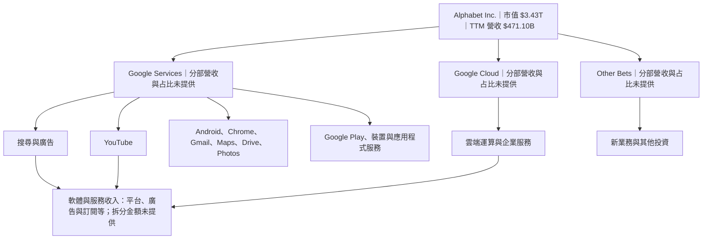
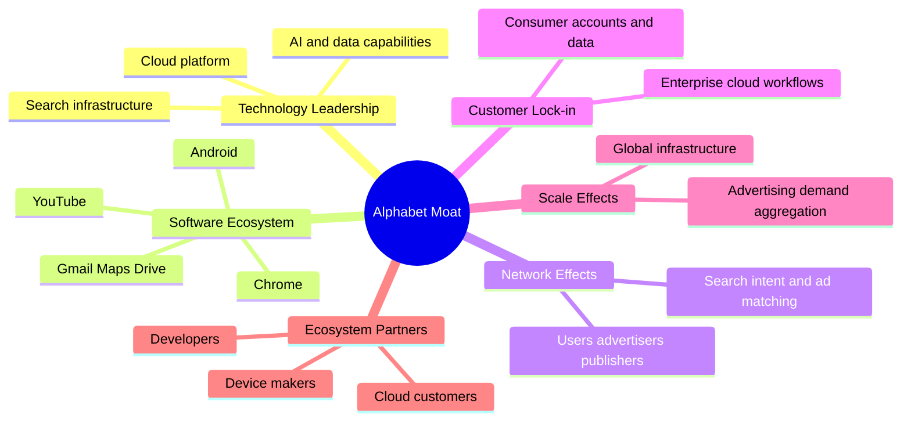
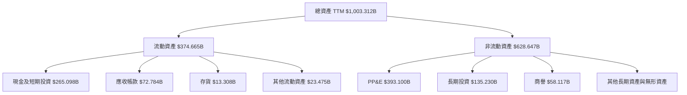
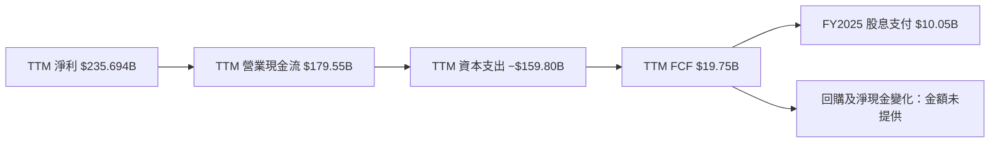
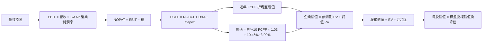
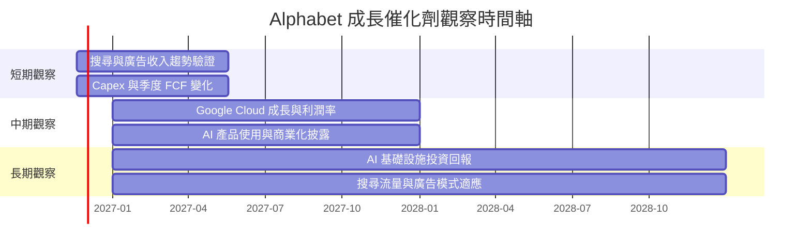
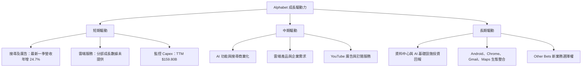
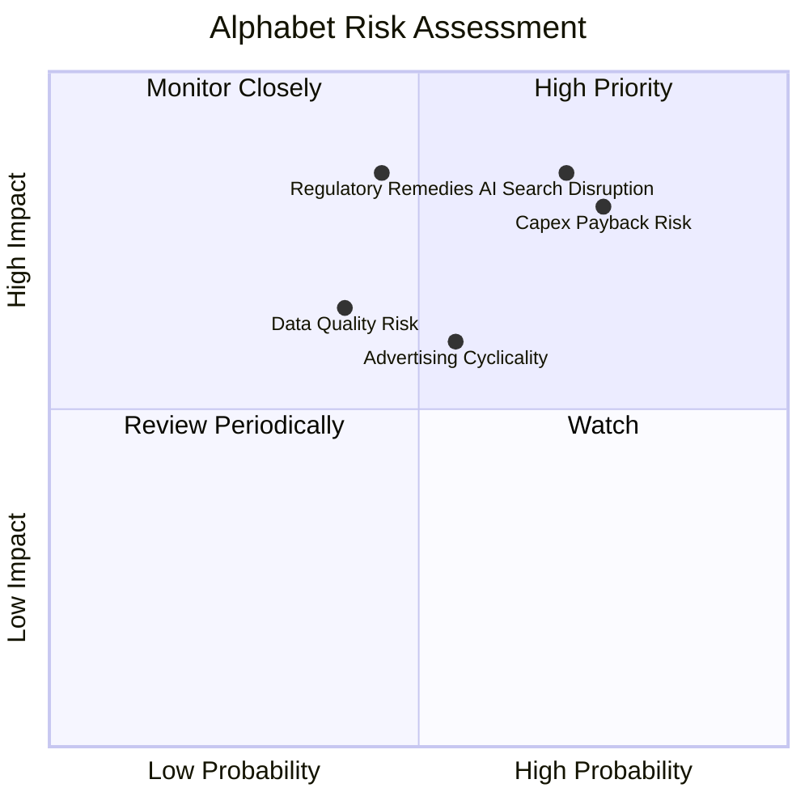
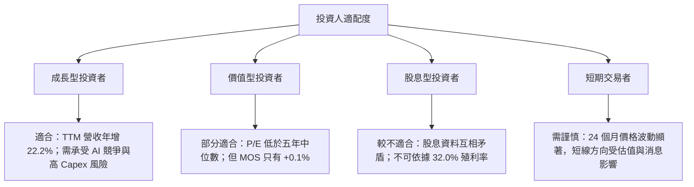

# GOOG 基本面深度分析報告
> **報告日期**：2026-11-19 ｜ **語言**：繁體中文 ｜ **數據來源**：SEC 申報資料 (XBRL)、Yahoo Finance、Finviz、StockAnalysis、Roic.ai ｜ **分析師**：CFA 級機構研究  
> **資料口徑說明**：財務資料存在若干來源間差異；涉及估值與關鍵判斷時，優先採用程式依 SEC 申報資料計算的 VERIFIED FIGURES。其他來源若與其衝突，明確標示而不混用。

## 目錄

| # | 章節 | 核心結論 |
|---|------|----------|
| 1 | 執行摘要 | 持有；加權合理價值 $279.54，MOS +0.1% |
| 2 | 公司概覽與商業模式 | 搜尋、廣告、雲端與平台生態構成護城河；分部收入比重未提供 |
| 3 | 損益表深度分析 | TTM 營收 $471.10B、年增 22.2%；TTM 營業利益率 33.3% |
| 4 | 資產負債表分析 | 淨現金 $138.98B；流動性強，但來源間債務數字不一致 |
| 5 | 現金流量深度分析 | TTM FCF $19.75B；高資本支出令現金轉換顯著承壓 |
| 6 | 獲利能力與資本效率 | ROIC 23.9% 高於 WACC 10.45%，仍在創造經濟價值 |
| 7 | 相對估值分析 | P/E 低於自身五年中位數及同業，但 P/S 高於自身中位數 |
| 8 | DCF 內在價值評估 | 基準 DCF $241.21；加權合理價值 $279.54，兩種估值基準不可混用 |
| 9 | 成長催化劑 | AI、雲端、搜尋與 YouTube 是主要方向；TAM 數據未提供 |
| 10 | 風險矩陣 | AI 對搜尋的替代、資本支出回報與監管是主要風險 |
| 11 | 投資建議 | 持有；現價接近加權合理價值，按季度監控 FCF、雲端成長與利潤率 |

---

## 1. 執行摘要

Alphabet 的 2026-11-18 收盤價為 **$279.20**。依估值方法加權後的合理價值為 **$279.54**，安全邊際（MOS）為 **+0.1%**；依估值規則應評為**持有**。基準 DCF 每股價值為 **$241.21**，現價相對 DCF 內在價值溢價 **15.8%**。另一方面，TTM 營收年增 **22.2%**、ROIC **23.9%** 高於 WACC **10.45%**，但 TTM FCF 僅 **$19.75B**、FCF Yield **0.58%**，顯示當前高額資本支出已明顯壓低現金回報。估值與現金流制約，抵銷了營運成長及資本效率優勢。

### 1.0 一頁式投資儀表板（Portfolio Manager 30 秒速讀）

| 項目 | 內容 |
|------|------|
| **投資論點（3 句）** | ① TTM 營收年增 **22.2%**，最新一季年增 **24.7%**，營收動能仍在加速。② ROIC **23.9%** 高於 WACC **10.45%**，目前投入資本仍創造價值。③ TTM 營業現金流 **$179.55B**，但資本支出 **$159.80B**，使 FCF 僅 **$19.75B**、FCF Yield **0.58%**。 |
| **綜合評分** | **7.3/10**（引用 1.1 六項算術平均） |
| **財務健康** | 🟢 現金及短期投資 **$265.10B**、債務 **$126.12B**，淨現金 **$138.98B**；流動性充裕。 |
| **ROIC vs WACC** | **23.9% vs 10.45%**；利差 **13.45 個百分點**，創造股東價值。 |
| **FCF 趨勢** | 過去年度 FCF 約 $60.01B–$73.27B；最新 TTM FCF 降至 **$19.75B**，反映資本支出加速。FCF Yield **0.58%**。 |
| **估值** | Forward P/E **18.25x** ｜ EV/EBITDA **17.9x** ｜ FCF Yield **0.58%** |
| **DCF 內在價值（基準）** | **$241.21** ｜ 現價相對 DCF 溢價 **15.8%**（採用現價 ÷ DCF 價值 − 1） |
| **安全邊際（MOS）** | **+0.1%＝($279.54 − $279.20) ÷ $279.54**；🟡 不足以提供顯著下檔保護。 |
| **預期報酬（基準情境 12M）** | DCF 基準價值對現價隱含 **−13.6%**；加權合理價值隱含上行 **+0.1%**。DCF 情境為模型估值而非一年期保證報酬。 |
| **關鍵風險（前二）** | AI 搜尋改變廣告與流量經濟；高資本支出持續擴張但未帶動 FCF 回升。 |
| **評級 + 信心度** | 🟡 **持有** ｜ 信心：中。模型對終值與資本支出路徑敏感，且部分來源數字互相矛盾。 |

### 1.1 綜合評分卡（全報告唯一）

| 維度 | 評分（1–10） | 主要依據（引用數字與其來源章節） |
|------|--------------|----------------------------------|
| 成長性 | 8.5 | TTM 營收年增 22.2%，最新一季年增 24.7%；見第 3 章。 |
| 獲利能力 | 8.5 | TTM 營業利益率 33.3%、ROIC 23.9% 高於 WACC 10.45%；F-Score 4/8，見第 6 章。 |
| 財務健康 | 9.0 | 淨現金 $138.98B；流動性指標見第 4 章。F-Score 未全數通過，略扣分。 |
| 估值 | 5.0 | MOS +0.1%；P/E 14.6x 低於自身五年中位數 21.9x，但 P/S 7.3x 高於中位數 6.1x；見第 7–8 章。 |
| 護城河 | 8.5 | 搜尋、Android、Chrome、YouTube、Gmail、Maps 等平台與生態整合；分部營收拆分未提供，見第 2 章。 |
| 管理層與資本配置 | 5.0 | 2025 年 SBC $24.95B；2026 年資本支出明顯上升而 TTM FCF 降至 $19.75B；股份變動測試未通過，見第 3、5、6 章。 |
| **綜合評分** | **7.4** | 六項算術平均：(8.5 + 8.5 + 9.0 + 5.0 + 8.5 + 5.0) ÷ 6 = 7.4167，四捨五入 **7.4**。 |

> 儀表板及第 11 章沿用此評分。評分反映公司品質，不取代由 MOS 決定的投資評級。

### 1.2 五大投資論點 + 三大核心風險

| 類型 | 項目 | 具體依據 | 信心度 |
|------|------|----------|--------|
| 🟢 **投資論點①** | 營收成長加速 | TTM 營收 $471.10B，年增 22.2%；最新一季營收年增 24.7%，高於 FY2025 全年年增 15.09%。 | 🟢 高 |
| 🟢 **投資論點②** | 資本回報高於資金成本 | ROIC 23.9%，WACC 10.45%，利差 13.45 個百分點。若維持，新增投資仍可創造價值。 | 🟢 高 |
| 🟢 **投資論點③** | 資產負債表有韌性 | 現金及短期投資 $265.10B，總債務 $126.12B，淨現金 $138.98B。 | 🟢 高 |
| 🟢 **投資論點④** | 搜尋與平台產品互相導流 | Search、Android、Chrome、YouTube、Gmail、Maps、Play 等服務構成分發網絡；平台用戶及廣告收入拆分未提供，定量驗證有限。 | 🟡 中 |
| 🟢 **投資論點⑤** | P/E 相對自身歷史偏低 | P/E 14.6x，低於五年中位數 21.9x；惟估值折價可能反映 AI 競爭與資本支出風險。 | 🟡 中 |
| 🟡 **風險①** | 資本支出吞噬現金流 | TTM Capex $159.80B，約為營業現金流 $179.55B 的 89.0%；FCF 僅 $19.75B。 |
| 🔴 **風險②** | AI 搜尋改變流量與廣告模式 | 若搜尋使用、查詢商業化或流量導向廣告轉化下降，核心現金流將承壓；目前缺少 AI 搜尋營收貢獻數據。 |
| 🔴 **風險③** | 財務資料品質及盈餘波動 | 2026 Q2 淨利 $112.19B 與 Q3 $26.47B 大幅波動；來源間總債務與淨現金亦不一致，需回查 SEC 附註。 |

### 1.3 快速統計卡片

| 指標 | 公司實際值（期間） | 同業中位數 | 狀態 |
|------|--------------------|------------|------|
| 營收成長（TTM） | **22.2%** | — | 🟢 |
| 營收成長（最新一季年增） | **24.7%** | **18.8%** | 🟢 |
| 毛利率（TTM） | **60.9%** | **67.7%** | 🟡 |
| 營業利益率（TTM） | **33.3%** | — | 🟢 |
| ROIC（TTM） | **23.9%** | — | 🟢 |
| Forward P/E | **18.25x** | **21.0x** | 🟢 |
| FCF Yield（TTM） | **0.58%** | — | 🔴 |
| Piotroski F-Score | **4 / 8** | — | 🟡 |

### 1.4 投資結論

```text
╔══════════════════════════════════════════════════════════════════╗
║                    📊 投資結論摘要                               ║
╠══════════════════════════════════════════════════════════════════╣
║  評級：持有（MOS +0.1%，符合規則 20）                            ║
║  價格（2026-11-18 收盤）：$279.20                                ║
║  DCF 內在價值（基準）：$241.21（現價溢價 15.8%）                ║
║  安全邊際 MOS：+0.1%＝($279.54−$279.20)÷$279.54                  ║
║  加權合理價值（8.8）：$279.54                                    ║
║  DCF 情境價值：                                                  ║
║    悲觀情境：$105.73（−62.1%）                                   ║
║    基準情境：$241.21（−13.6%）                                   ║
║    樂觀情境：$501.75（+79.7%）                                   ║
║  綜合評分：7.4/10（引用 1.1）                                    ║
║  適合投資人：可承受估值與 AI 競爭風險的長線投資人；不適合以高息║
║  收入或短期確定性為主要目標者。                                  ║
╚══════════════════════════════════════════════════════════════════╝
```

---

## 2. 公司概覽與商業模式

Alphabet Inc. 是美國通訊服務與網路內容平台公司，員工 **204,757 人**，市值 **$3.43T**。主要部門為 Google Services、Google Cloud、Other Bets。公司透過搜尋與展示廣告、YouTube、應用程式與平台服務，以及雲端產品取得收入；各分部營收金額及占比未提供，不能據總營收推算分部份額。

### 2.1 業務結構與收入來源



### 2.2 市場份額

市場份額資料未提供，因此不繪製占比圖或填入推估份額。公司 TTM 營收 **$471.10B**、最新一季營收年增 **24.7%**，規模與成長皆具備競爭力；同業最新一季年增率中位數為 **18.8%**，但不同公司的業務組合並不相同，不能直接視作同一市場份額比較。

### 2.3 競爭護城河分析



### 2.4 護城河強度

| 護城河項目 | 強度（強／中／弱） | 證據（引用數字或事實） | 會削弱它的情況 |
|------------|--------------------|------------------------|----------------|
| 技術與資料 | 強 | TTM 營收 $471.10B；研發支出 FY2025 為 $61.09B。搜尋、AI 與雲端技術需長期投入。 | AI 搜尋品質落後、成本過高，或資料使用受到監管限制。 |
| 軟體生態系統 | 強 | Android、Chrome、Gmail、Maps、Drive、YouTube、Play 等共同提供分發與服務入口。 | 預設分發協議流失、用戶轉向其他 AI 助理或平台。 |
| 網路效應 | 強 | 使用者、廣告主與出版商間存在多邊市場；廣告營收拆分數據未提供，未量化其網路效應回報。 | 搜尋流量下滑、廣告轉換效果惡化。 |
| 客戶鎖定 | 中 | Google Cloud、企業工作流程與個人帳戶服務可提高轉換成本，但客戶流失率未提供。 | 多雲採用與低轉換成本降低黏著度。 |
| 規模效應 | 強 | FY2025 研發支出 $61.09B；TTM 現金及短期投資 $265.10B，能支撐大型基礎設施與研發。 | 資本投入回報低於 WACC、固定成本增幅快於收入。 |
| 生態夥伴 | 中 | 開發者、裝置商、雲端客戶與廣告商形成夥伴網絡；具體夥伴營收占比未提供。 | 監管限制合作條款，或合作方轉向競爭平台。 |

護城河評分沿用 1.1 的 **8.5/10**：理由是跨產品分發與平台規模明確，但缺少分部營收、用戶留存及市場份額等可量化驗證。

---

## 3. 損益表深度分析

### 3.1 年度收入成長趨勢（近4年）

以下依年度損益表收入計算年度成長率；圖表刻度為收入相對大小。

```text
╔══════════════════════════════════════════════════════════════════╗
║              Alphabet 年度收入趨勢（FY2022–FY2025）             ║
╠══════════════════════════════════════════════════════════════════╣
║  FY2022  $282.84B  ██████████████░░░░░░░░░░  YoY：—             ║
║  FY2023  $307.39B  ███████████████░░░░░░░░░  YoY：+8.7% 🟡     ║
║  FY2024  $350.02B  ██████████████████░░░░░░  YoY：+13.9% 🟢   ║
║  FY2025  $402.84B  █████████████████████░░░  YoY：+15.1% 🟢   ║
╠══════════════════════════════════════════════════════════════════╣
║  FY2022–FY2025 收入 CAGR：(402.84÷282.84)^(1/3)−1 = 12.5%       ║
╚══════════════════════════════════════════════════════════════════╝
```

FY2025 收入年增 15.1%，高於 FY2023 的 8.7%，TTM 年增進一步達 22.2%。這說明近期收入增長加速，但不能僅由總收入資料判定搜尋、雲端或 YouTube 各自貢獻多少。

### 3.2 季度收入趨勢分析

| 季度 | 營收（$B） | QoQ | YoY | 備註 |
|------|-----------:|----:|----:|------|
| 2025 Q4 | 113.83 | — | 18.00% | YoY 採 StockAnalysis 季度資料。 |
| 2026 Q1 | 109.90 | −3.45% | 21.79% | 季節性及季度組合可能造成環比回落。 |
| 2026 Q2 | 119.80 | +9.01% | 24.23% | 環比回升，年增保持加速。 |
| 2026 Q3 | 127.58 | +6.50% | 24.65%（VERIFIED 24.7%） | 單季年增率，不是 TTM 成長率。 |

QoQ = 當季營收 ÷ 前季營收 − 1。例如 2026 Q3：$127.577B ÷ $119.796B − 1 = **6.50%**。季度營收連續提升，但單季走勢仍受到季節性、廣告預算及雲端合約認列時間影響。

### 3.3 利潤率演變分析

| 利潤率指標 | FY2022 | FY2023 | FY2024 | FY2025 | TTM／最新季 | 趨勢與評估 |
|------------|-------:|-------:|-------:|-------:|------------:|------------|
| 毛利率 | 55.4% | 56.6% | 58.2% | 59.6% | TTM 60.9% | ↗️ 產品與服務組合、規模效益支持改善；🟢 |
| 營業利益率 | 26.5% | 27.4% | 32.1% | 32.0% | TTM 33.3% | ↗️ FY2024 出現明顯擴張，之後維持高位；🟢 |
| 淨利率 | 21.2% | 24.0% | 28.6% | 32.8% | TTM 50.0% | TTM 高於年度值，且季度淨利波動大；🟡 |

年度毛利率與營業利益率依毛利／營業利益除以年度營收計算。FY2024 營業利益率從 FY2023 約 27.4% 升至 32.1%，與營收擴張及費用控制一致；2025 年維持約 32%。TTM 淨利率 50.0% 明顯高於 FY2025 的 32.8%，而 2026 Q2 淨利 $112.19B 對比 Q3 $26.47B，表明投資損益、稅務或其他非營運項目可能造成重大波動；完整附註未提供，不應將 TTM 淨利率直接視為可持續經營利潤率。

#### 利潤率演變深度解析

毛利率逐年上升，與高毛利服務、廣告規模化及基礎設施效率改善相容，但分部毛利數據未提供，無法區分產品組合與成本效率的相對貢獻。營業利益率由 FY2023 約 27.4% 擴大至 FY2024 約 32.1%，而 FY2025 約 32.0%，反映此前的營業槓桿改善大致維持。TTM 33.3% 顯示近期仍偏高；最新季營業利益率按 VERIFIED FIGURES 為 **31.8%**，與另一市場資料欄位列示的 33.3% 不同，本文以 31.8% 作單季口徑、33.3% 作 TTM 口徑。

### 3.4 費用結構分析

可用資料包括 FY2025 毛利 **$240.30B**、營業利益 **$129.04B**、研發費用 **$61.09B**；但完整銷售、行銷、行政及其他營業費用分類未提供。故不以部分費用項目拼湊比例，也不繪製可能造成誤讀的費用圓餅圖。

| FY2025 項目 | 金額 | 解讀 |
|-------------|------:|------|
| 營收 | $402.84B | 年增 15.1%。 |
| 毛利 | $240.30B | 毛利率約 59.6%。 |
| 營業利益 | $129.04B | 營業利益率約 32.0%。 |
| 研發費用 | $61.09B | 約為收入 15.2%；持續投入 AI、雲端及平台研發。 |

### 3.5 季度 EPS 趨勢與盈餘品質（Quality of Earnings）

近四季 EPS 實際值可從季度資料取得，但 EPS 預期值均為 nan，不能判斷「超預期」或「不及預期」。不把資料缺失當作 EPS miss。

| 季度 | EPS 實際（美元） | 預期／驚喜 | EPS 年增 | 說明 |
|------|----------------:|------------|--------:|------|
| 2025 Q4 | 2.81 | N/A | +31.15% | EPS 預期值未提供。 |
| 2026 Q1 | 5.11 | N/A | +81.96% | EPS 預期值未提供。 |
| 2026 Q2 | 9.11 | N/A | +294.31% | 單季淨利 $112.19B，與其餘季度不成比例，須查明非經常性因素。 |
| 2026 Q3 | 2.14 | N/A | −25.34% | EPS 預期值未提供；淨利同比下降 24.3%。 |

> 歷史來源中的季度 EPS 與全年 EPS 資料存在口徑／資料品質疑點，尤其 Q2 2026 與其他季差異極大。以下不將這組 EPS 趨勢視作已完成的盈餘驚喜分析。

盈餘品質量化依現有資料能支持的部分如下：

| 盈餘品質項目 | 數值／佔比 | 評估 |
|--------------|-----------|------|
| 股權薪酬 SBC / 營收 | FY2025：$24.95B ÷ $402.84B = **6.2%** | 🟡 SBC 為實質股東成本，會稀釋持股或形成回購抵銷需求。 |
| SBC / 營業現金流 | FY2025：$24.95B ÷ $164.71B = **15.1%** | 🟡 現金流中 SBC 是非現金加回項目，若忽略稀釋會高估股東可得現金。 |
| FCF / 淨利（現金轉換率） | TTM FCF $19.75B ÷ TTM 淨利 $235.694B = **8.4%** | 🔴 現金轉換偏低；主要須觀察 Capex 與淨利非營運波動。 |
| 一次性／非經常性損益 | N/A（無完整稅務及投資損益附註） | Q2 淨利與其他季度差異顯著，不能確定一次性收益金額。 |
| 有效稅率異常 | 模型及資本成本採 **16.8%**；各季實際稅率拆分 N/A | 無法判斷 Q2 異常淨利是否由稅項驅動。 |
| 資本化支出 vs 費用化 | TTM Capex $159.80B；資本化政策細節 N/A | 高額資本投資以 Capex 形式進入現金流，未來折舊可能提高，不能僅以當期 EBIT 衡量經濟成本。 |

**盈餘品質結論**：核心營業獲利能力有營業利益率與現金流支撐，但 TTM FCF 只佔淨利 8.4%，削弱當期 GAAP 淨利對可分配現金的代表性。Q2 淨利異常、單季 EPS 預期缺失及 SBC 稀釋均需查核；估值應更重視資本支出回報與正常化現金流，而非單看 P/E。

---

## 4. 資產負債表分析

### 4.1 資產結構分解

資產總額按 StockAnalysis TTM 資料為 **$1,003.312B**。以下數字以該來源口徑呈現；與年度資產負債表的資產總額不同，因此不與年度數據混加。



非流動資產 $628.647B 為總資產減流動資產的算術差額，並非另有披露的分類總額。主要可見項目 PP&E $393.100B 及長期投資 $135.230B，反映公司投資於資料中心、設備及金融資產的規模上升。

### 4.2 流動性與營運資金分析

| 指標 | 最新數值 | 歷史／補充資料 | 評估 |
|------|---------:|----------------|------|
| 流動比率 | 2.786 | 2025 年底以年度資產負債表推算約 2.01x；期間及來源口徑不同 | 🟢 短期流動性充足。 |
| 速動比率 | 2.512 | 年度歷史序列未提供 | 🟢 高於 1，具備流動性緩衝。 |
| 現金及短期投資 | $265.10B | TTM；2025 年底 StockAnalysis 為 $126.843B | 🟢 現金資產大幅增加。 |
| DSO 應收帳款天數 | 56 天 | 一年前 54 天；增加 2 天 | 🟡 收款時間略長，需觀察應收增幅是否快於營收。 |
| DIO 存貨天數 | 26 天 | 一年前 N/A | N/A；無法比較方向。 |
| DPO 應付帳款天數 | 43 天 | 一年前 N/A | N/A；無法比較方向。 |
| CCC 現金轉換週期 | 39 天 | 一年前 N/A | N/A；無法比較年度變化。 |

營運資金天數採程式依 SEC 營收、Yahoo 成本與季末資產負債表計算：DSO 由 54 天升至 56 天，變化幅度不大，但方向代表應收款較營收增長稍快的可能性；需避免將兩天變化解讀成明確收款惡化。公司未報告某些年度對照餘額，故 DIO、DPO、CCC 一年前皆保留 N/A。

### 4.3 債務結構分析

不同資料來源的債務總額有明顯差異：VERIFIED FIGURES 債務 **$126.12B**，市場資料另列 **$150.33B**；相應淨現金分別為 **$138.98B** 與 **$114.77B**。核心分析依優先口徑採用 $126.12B，並將此差異視為需核對的資料風險。

```text
╔══════════════════════════════════════════════════════════════════╗
║                   Alphabet 債務健康診斷                          ║
╠══════════════════════════════════════════════════════════════════╣
║  總債務（核心口徑）：       $126.12B  █████████                  ║
║  現金＋短期投資：           $265.10B  ████████████████████       ║
║  淨現金：                   $138.98B  ██████████  🟢             ║
║                                                                  ║
║  淨現金計算：$265.10B − $126.12B = $138.98B                     ║
║  Debt/EBITDA：N/A（可比較的債務與 EBITDA 同口徑輸入未提供）      ║
║  Interest Coverage：N/A（利息費用與 EBIT 覆蓋比缺少一致口徑）   ║
║  債務到期結構：N/A（未提供到期年度與利率明細）                   ║
║                                                                  ║
║  判斷：淨現金充裕；應先釐清 $126.12B 與 $150.33B 的債務差異。   ║
╚══════════════════════════════════════════════════════════════════╝
```

### 4.4 股東權益趨勢

| 年度 | 股東權益（$B） | 年增 | 解讀 |
|------|---------------:|-----:|------|
| 2022 | 256.14 | — | 基準年度。 |
| 2023 | 283.38 | +10.6% | 權益增加。 |
| 2024 | 325.08 | +14.7% | 盈利與累積權益上升。 |
| 2025 | 415.26 | +27.7% | 增長加快；需同時考慮現金及其他資產變化。 |

```text
╔══════════════════════════════════════════════════════════════════╗
║                 股東權益趨勢（FY2022–FY2025）                    ║
╠══════════════════════════════════════════════════════════════════╣
║  FY2022  $256.14B  █████████████░░░░░░░░░░░░░                   ║
║  FY2023  $283.38B  ██████████████░░░░░░░░░░░░                   ║
║  FY2024  $325.08B  ████████████████░░░░░░░░░░                   ║
║  FY2025  $415.26B  █████████████████████░░░░░                   ║
╚══════════════════════════════════════════════════════════════════╝
```

---

## 5. 現金流量深度分析

### 5.1 現金流量瀑布圖

TTM 淨利可由 StockAnalysis 列示為 $235.694B；營業現金流與 Capex 採 VERIFIED FIGURES。股息以 FY2025 年支付額 $10.05B 示意資本配置，並非 TTM 同期瀑布的完整勾稽項目；回購及現金餘額變化未提供。



### 5.2 FCF 轉換率趨勢

| 年度 | 營業現金流（$B） | Capex（$B） | FCF（$B） | 淨利（$B） | FCF／淨利 |
|------|-----------------:|------------:|----------:|-----------:|----------:|
| 2022 | 91.50 | 31.48 | 60.01 | 59.97 | 100.1% |
| 2023 | 101.75 | 32.25 | 69.50 | 73.80 | 94.2% |
| 2024 | 125.30 | 52.53 | 72.76 | 100.12 | 72.7% |
| 2025 | 164.71 | 91.45 | 73.27 | 132.17 | 55.4% |
| TTM 至 2026-09-30 | 179.55 | 159.80 | 19.75 | 235.694 | 8.4% |

FY2022–FY2025 的 FCF 對淨利轉換率逐年下降，與 Capex 增速快於 FCF 的趨勢一致。TTM 8.4% 更低，不能視為正常化常態，卻是當前投資者實際承受的現金流狀況。年度現金流資料中 2025 年 FCF $73.27B 與 OCF 減 Capex 的四捨五入略有尾差。

### 5.3 自由現金流趨勢

```text
╔══════════════════════════════════════════════════════════════════╗
║               自由現金流與資本支出（美元）                       ║
╠══════════════════════════════════════════════════════════════════╣
║  FY2022  FCF $60.01B  ████████████████░░░░░░░░   Yield：N/A      ║
║  FY2023  FCF $69.50B  ██████████████████░░░░░░   Yield：N/A      ║
║  FY2024  FCF $72.76B  ███████████████████░░░░░  Yield：N/A       ║
║  FY2025  FCF $73.27B  ███████████████████░░░░░  Yield：N/A       ║
║  TTM     FCF $19.75B  █████░░░░░░░░░░░░░░░░░░  Yield：0.58% 🔴 ║
╠══════════════════════════════════════════════════════════════════╣
║  TTM FCF = OCF $179.55B − Capex $159.80B = $19.75B              ║
╚══════════════════════════════════════════════════════════════════╝
```

2026 年的季度現金流資料顯示 Capex 逐季上升：2026 Q1 $35.67B、Q2 $44.92B、Q3 $51.35B；季度 FCF 分別為 $10.12B、−$5.86B、−$9.06B。季度數據與 TTM FCF 一樣顯示投資支出正在壓低短期現金回報。

### 5.4 資本配置評估

缺少回購總額及各類資本用途完整同期資料，不繪製比例圓餅圖，以免把未披露金額當成已知配置。

| 資本用途 | 可得數據 | 評估 |
|----------|---------|------|
| 資本支出 | TTM $159.80B | 佔 TTM OCF 約 89.0%；需關注雲端與 AI 投資能否轉化為收入、ROIC 和 FCF。 |
| 股息 | FY2025 支付 $10.05B；其他資料列示股息率 32.0% 與股利資料不相容 | 以現金支付額為可用資料；32.0% 殖利率疑似來源錯誤，不採用。 |
| 股票回購 | N/A（未提供同期總額） | 無法判斷回購是否完全抵銷 SBC 稀釋。 |
| SBC | FY2025 $24.95B | 佔營收 6.2%，需視為股東經濟成本。 |
| 留存現金 | 現金及短期投資 $265.10B | 具備資金彈性，但資金回報及配置細節未提供。 |

---

## 6. 獲利能力與資本效率

### 6.1 ROE / ROA / ROIC 趨勢

| 指標 | 可用期間與數值 | 歷史趨勢 | 評估 |
|------|----------------|----------|------|
| ROE | TTM 34.8%（VERIFIED）；市場資料另列 44.3% | 歷年品質計算序列未提供 | 🟢 高，但資料來源不一致，避免混用。 |
| ROA | 最新品質測試顯示為正；市場資料列示 12.7% | 可比年度序列未提供 | 🟢 正值；趨勢不完整。 |
| ROIC | TTM 23.9% | 可比歷史序列未提供 | 🟢 顯著高於 10.45% WACC。 |
| 行業均值 | N/A（沒有可核實的同口徑產業均值） | 不比較 | — |

ROIC 以 after-tax operating income 除以 equity + debt − cash 計算，反映投入資本回報高於資金成本。由於歷史 ROIC、ROA、ROE 口徑與時間序列不足，不能聲稱資本效率持續改善；其可支持的結論限於目前 TTM 的正利差。

### 6.2 ROIC vs WACC 分析（核心價值創造判斷）

```text
╔══════════════════════════════════════════════════════════════════╗
║                ROIC vs WACC 深度分析                            ║
╠══════════════════════════════════════════════════════════════════╣
║  WACC（採資本成本資料所列數值）：10.45%                         ║
║  ├── 無風險利率（10Y 美債）：5.07%                              ║
║  ├── ERP：5.00%                                                 ║
║  ├── 原始 Beta：1.23；調整後 Beta：1.15                         ║
║  ├── Ke = 5.07% + 1.15 × 5.00% = 10.82%                        ║
║  ├── 稅前債務成本：0.58%；有效稅率：16.8%                       ║
║  ├── 股權／債務權重：96.5%／3.5%                               ║
║  └── WACC：10.45%（採用來源所列值）                             ║
║                                                                  ║
║  ROIC（TTM）：23.9%                                             ║
║  EVA 利差 = ROIC − WACC = 23.9% − 10.45% = +13.45 pp           ║
║                                                                  ║
║  ROIC 23.9%  ▓▓▓▓▓▓▓▓▓▓▓▓▓▓▓▓▓▓▓▓▓▓▓░░░░░  🟢                 ║
║  WACC 10.45% ▓▓▓▓▓▓▓▓▓▓░░░░░░░░░░░░░░░░░░  ──                 ║
║  判斷：目前每單位投入資本回報高於資金成本，創造經濟價值。     ║
╚══════════════════════════════════════════════════════════════════╝
```

資本成本輸入是 10Y Treasury **5.07%**、假設 ERP **5.00%**、原始 Beta **1.23**，調整後 Beta 按 **⅔ × 1.23 + ⅓ × 1 = 1.15**。依提供的資本成本資料採用 WACC **10.45%**；不另行建立替代 WACC。由於第 8.2 節的市值、債務及權重細節缺乏完整一致的可回推資料，此處採用來源計算值，並在估值稽核中揭露限制。

#### 價值創造判斷

ROIC 高於 WACC **13.45 個百分點**，目前代表企業的營運回報超過資本要求。若 AI／資料中心投資大幅拉低未來 ROIC，或競爭令營業利潤率下降，這個利差才會收窄甚至反轉。此判斷依賴目前 ROIC 與 WACC 口徑一致，並非對未來回報的保證。

### 6.3 杜邦三因素分解

| 因素 | 數值（TTM） | 解讀 |
|------|-------------|------|
| 淨利率 | 50.0% | 高，但 TTM 淨利受 2026 Q2 異常高值影響，可能高估持續性。 |
| 資產週轉率 | 0.47 | 每單位資產產生約 0.47 單位收入。 |
| 權益乘數 | 1.48 | 槓桿不是 ROE 的主要來源。 |
| **ROE** | **34.8%** | 50.0% × 0.47 × 1.48 ≈ 34.8%；獲利率是主要驅動因素。 |

此處照抄品質指標所列 DuPont 數字；三項乘積受輸入數字四捨五入影響，與列示 ROE 可有尾差。它與市場資料另一欄 ROE 44.3% 不同，本文以品質計算口徑 34.8% 為準。

### 6.4 財務體質：Piotroski F-Score

品質資料列示 **4/8**。九項測試中毛利率測試因資料缺失未計入，故分母為 8。

| 測試 | 結果 | 解讀 |
|------|------|------|
| ROA > 0 | ✅ 通過 | 獲利為正。 |
| 營業現金流 > 0 | ✅ 通過 | TTM OCF 為正。 |
| ROA 高於一年前 | ✅ 通過 | 盈利資產回報有所改善。 |
| 營業現金流 > 淨利 | ❌ 未通過 | 應計品質測試不通過；TTM 淨利大於營業現金流。 |
| 長期負債 ÷ 總資產低於一年前 | ❌ 未通過 | 負債比例未改善，須檢視新增借款和租賃。 |
| 流動比率高於一年前 | ✅ 通過 | 流動性較一年前改善。 |
| 稀釋股數未增加 | ❌ 未通過 | 股數測試顯示稀釋股數增加；SBC 對股東份額有影響。 |
| 毛利率高於一年前 | — 未計分 | 缺少符合計算口徑的輸入。 |
| 資產週轉率高於一年前 | ❌ 未通過 | 資產增長未能帶來較高的週轉效率。 |

4/8 不是財務危機訊號，但說明現金流相對淨利、稀釋股數及資產效率方面仍有弱點，與高額 Capex、較低 TTM FCF 的觀察相符。

---

## 7. 相對估值分析

### 7.1 同業估值比較表格

同業倍數採 Yahoo Finance 同業資料；GOOG 市場估值採提供的市場估值資料。公司估值日期對應 2026-11-18 收盤價。

| 估值指標 | **GOOG** | **META** | **MSFT** | **AMZN** | 本公司評估 |
|----------|---------:|---------:|---------:|---------:|-----------|
| **Trailing P/E** | 14.6x | 21.0x | 26.5x | 21.6x | 🟢 低於三家同業；須留意 GAAP 淨利異常及資料口徑。 |
| **Forward P/E** | 18.25x | 17.3x | 21.0x | 24.5x | 🟡 接近 META，低於 MSFT、AMZN。 |
| **P/S（TTM）** | 7.3x | 6.5x | 10.9x | 3.6x | 🟡 高於 META、AMZN，低於 MSFT。 |
| **EV/EBITDA（TTM）** | 17.9x | 13.9x | 18.6x | 16.2x | 🟡 高於 META、AMZN，略低於 MSFT。 |
| **最新一季營收年增** | 24.7% | 26.1% | 18.8% | 12.1% | 🟢 成長高於 MSFT、AMZN，略低於 META。 |
| **毛利率（TTM）** | 60.9% | 81.0% | 67.7% | 51.4% | 🟡 低於 META、MSFT，高於 AMZN。 |

同業的業務組合、會計口徑與資本密集度不完全相同，因此倍數只作相對參照。GOOG 估值折價可能反映市場對搜尋變革、監管與資本支出回報的風險定價，而非單純定價錯誤。

### 7.2 歷史估值區間分析

```text
╔══════════════════════════════════════════════════════════════════╗
║            GOOG 五年估值區間（TTM multiples）                   ║
╠══════════════════════════════════════════════════════════════════╣
║  P/E        1.3x ├────────● 14.6x────────────┤ 29.0x           ║
║                       中位數 21.9x；現值百分位 29%               ║
║  P/S        4.1x ├────────────● 7.3x─────────┤ 9.8x            ║
║                       中位數 6.1x；現值百分位 67%               ║
║  EV/EBITDA 13.7x ├───────● 17.9x────────────┤ 25.0x           ║
║                       中位數 19.1x；現值百分位 47%              ║
╚══════════════════════════════════════════════════════════════════╝
```

P/E 處於自身五年區間約第 29 百分位，低於中位數；EV/EBITDA 約第 47 百分位，接近中位；P/S 約第 67 百分位，高於中位。這種分歧表示「低 P/E」與「低整體估值」並非同義，且目前 P/E 受到異常 TTM 淨利口徑影響的可能性需留意。

### 7.3 情境價值（Bear / Base / Bull，照抄 DCF MODEL 的 Scenarios）

| 情境 | 第 1 年營收成長 | 期末營業利潤率 | WACC | 每股價值 | 相對現價 | 機率 | 會發生的條件 |
|------|----------------:|---------------:|-----:|----------:|----------:|-----:|--------------|
| 🔴 悲觀 | 11.1% | 27.2% | 11.45% | $105.73 | −62.1% | 25% | 搜尋廣告增長大幅放緩、AI 導流及推論成本上升，投入資本回報下降。 |
| 🟡 基準 | 22.2% | 32.0% | 10.45% | $241.21 | −13.6% | 50% | 當前 TTM 成長逐步回落，長期營業利潤率接近五年中位水平。 |
| 🟢 樂觀 | 33.3% | 35.2% | 9.45% | $501.75 | +79.7% | 25% | AI、搜尋、雲端同時加速變現，營業槓桿擴張且資本成本下行。 |

情境是模型條件結果，不是確定性機率預測。樂觀情境需要成長高於當前 TTM 成長，並維持高於基準的長期利潤率，因此執行難度較高。

### 7.4 相對估值隱含價格區間

```text
╔══════════════════════════════════════════════════════════════════╗
║                   估值方法每股價值比較                          ║
╠══════════════════════════════════════════════════════════════════╣
║  $241.21 DCF ─── $255.28 EV/EBITDA ── $279.20 現價              ║
║                      ── $321.34 Forward P/E ── $389 共識        ║
╚══════════════════════════════════════════════════════════════════╝
```

| 方法 | 每股價值 | 相對現價 | 依據 |
|------|---------:|---------:|------|
| DCF（基準） | $241.21 | −13.6% | 10 年 FCFF，WACC 10.45%，終值成長 3.0%。 |
| 同業 Forward P/E | $321.34 | +15.1% | META、MSFT、AMZN 的 Forward P/E 中位數 21.0x × GOOG Forward EPS $15.30。 |
| 同業 EV/EBITDA | $255.28 | −8.6% | 三家同業 EV/EBITDA 中位數 16.2x × TTM EBITDA，再加淨現金。 |
| 分析師共識目標價 | $389.00 | +39.3% | 15 位分析師平均目標價。 |

---

## 8. DCF 內在價值評估（Discounted Cash Flow）

### 8.0 估值推理鏈（Thinking Logic：在算之前先想清楚）

本模型將價值拆為：現有搜尋、廣告及平台服務現金流底盤；Google Cloud 的成長選擇權；Other Bets 的潛在選擇權。三者目前營收占比均未提供，不能替它們分配營收權重。估值主導變數是營收成長與 Capex／營收路徑，尤其終值對企業價值貢獻 **71.7%**。

| 決策點 | 本報告採用 | 理由（含數字） | 曾考慮但否決 | 否決理由 |
|--------|-----------|----------------|--------------|----------|
| 現金流定義 | FCFF | 以 GAAP EBIT、稅後營業利益加 D&A 減 Capex，對應 WACC 折現至 EV。 | FCFE | 公司債務與現金需在 EV 後橋接，FCFF 較一致。 |
| 預測期 N | 10 年 | DCF MODEL 固定 10 年，期間營收成長由 22.2% 線性下降至 3.0%。 | 5 年 | 對大型平台公司而言短期預測可能使終值權重過高；不自行改動模型。 |
| 終值方法 | Gordon Growth | 使用終值成長率 3.0%，且 WACC 10.45% 高於 g。 | 單一退出倍數 | 區塊 DCF 使用 Gordon Growth；沒有提供完整退出倍數終值計算。 |
| EBIT 基礎 | GAAP EBIT | DCF 註明 EBIT 為 GAAP，已把 SBC 作為費用。 | 非 GAAP EBIT | 加回 SBC 會改變模型口徑，與程式模型不一致。 |

#### Step 3 — 關鍵假設推導鏈

- **營收成長**：錨點＝TTM 成長 22.2%（FY2025 年增 15.09%）→ 最新季度年增 24.7%，但未提供管理層長期指引 → **第 1 年採用 22.2%，其後線性降至第 10 年 3.0%** → 曾考慮把季度年增率直接作為十年 CAGR，但否決：單季成長不能代表十年可持續成長。
- **期末營業利潤率**：錨點＝TTM 33.3%，過去四個年度營業利益率約由 26.5% 至 32.1% → 模型假設逐步回落至近五個財年中位數 → **第 1 年 33.3%，第 10 年 32.0%** → 否決持續擴張至 35% 以上的基準假設，因目前沒有分部利潤率或成本資料支持。
- **永續成長率 g**：錨點＝模型採 3.0%，與長期名目經濟成長常用上限假設相符；此數字是模型假設而非公司財測 → **採用 3.0%** → 不採高於 3.0% 的基準值，因終值已占 EV 71.7%，提高 g 會放大終值敏感度。
- **預測期 N**：錨點＝模型固定 10 年 → 平台與雲端可見度較短期企業高，但 AI 技術及監管變化令長期預測不確定 → **採用 10 年** → 不採 15 年，因缺乏足夠長期分部資料與財測。
- **Capex／營收**：錨點＝TTM Capex／營收約 **33.9%** → 模型假設資本支出比率隨投資週期淡出至 **6.5%**，即 D&A／營收 5.9% 的約 1.1 倍 → **FY+1 33.9%，FY+10 6.5%** → 否決長期維持 33.9%，否則模型會延續目前極高投資比例；但快速回落也可能過度樂觀。
- **D&A／營收**：錨點＝TTM **5.9%** → 無獨立折舊預測，依模型固定 → **採用 5.9%**。此項照模型採用，不另行重估。
- **有效稅率**：錨點＝最新年度有效稅率 **16.8%** → 缺乏穩定的長期稅務預測 → **採用 16.8%**。此為模型假設，不代表每季實際稅率。
- **營運資金**：模型說明未建模 ΔWC → **採用 ΔWC = 0 的模型處理** → 不另加非模型現金流，因缺少可用的逐年營運資金假設。
- **EBIT 與 SBC**：錨點＝模型使用 GAAP EBIT，2025 SBC 為 $24.95B → GAAP 已將 SBC 列為費用 → **採用組合 (A)：GAAP EBIT、FCFF 不再扣 SBC、年稀釋率 0%、固定股數** → 否決加扣 SBC 或另計稀釋，以免重複計入。
- **WACC**：錨點＝資本成本區塊提供 **10.45%** → 使用調整後 Beta 1.15、股權成本 10.82% 及已計算資本權重 → **採用 10.45%** → 不自行以市場資料另算替代 WACC，以保持模型一致。
- **終值方法**：錨點＝Gordon Growth 終值成長率 3.0%、WACC 10.45% → 兩者差距 7.45 個百分點，公式適用 → **採 Gordon Growth** → 不以未提供的退出 EBITDA 倍數自行替代。

#### Step 4 — 最脆弱的一環

最脆弱假設是 Capex／營收由 FY+1 的 33.9% 降至 FY+10 的 6.5%；若資料中心投資長期維持較高比例，FCFF 低於基準，估值將下行。敏感性矩陣顯示即使只改 WACC 或 g，價值亦大幅變動；然而模型未提供 Capex 單變數敏感度，無法精確量化其單獨影響。

#### Step 5 — 計算路徑圖



### 8.1 模型假設總表（Model Inputs）

| 假設項目 | 採用值 | 依據／來源 | 敏感度 |
|----------|--------|-------------|--------|
| 預測期長度 **N** | 10 年 | DCF MODEL 固定預測期；十年營收與利潤率逐年淡出。 | 🟡 中 |
| 營收成長 | 第 1 年 22.2% → 第 10 年 3.0% | 第 1 年取 TTM 成長 22.2%，逐年線性淡出至模型值 3.0%。 | 🔴 高 |
| 營業利潤率 | 第 1 年 33.3% → 第 10 年 32.0% | TTM 營業利益率 33.3%，淡出至近五年中位數。 | 🔴 高 |
| 有效稅率 | 16.8% | 最新年度有效稅率。 | 🟢 低 |
| Capex／營收 | FY+1 33.9% → FY+10 6.5% | TTM 約 33.9%；模型淡出至 1.1×D&A。 | 🔴 高 |
| D&A／營收 | 5.9% | TTM 比率，模型固定。 | 🟢 低 |
| 營運資金變動 | 未建模 | DCF MODEL 明確說明不建模 working capital。 | 🟢 低 |
| EBIT 基礎 | GAAP | DCF MODEL 指定 GAAP EBIT。 | 🟡 中 |
| SBC 處理 | 組合 (A)：GAAP EBIT、不再扣 SBC、固定股數 | GAAP EBIT 已費用化 SBC；年稀釋率設為 0%。 | 🟡 中 |
| 年稀釋率 | 0% | 與模型組合 (A) 相容；並非對實際股數趨勢的估計。 | 🟡 中 |
| 永續成長率 g | 3.0% | 模型固定值，低於 WACC 10.45%。 | 🔴 高 |
| 終值方法 | Gordon Growth | DCF MODEL 終值公式。 | 🔴 高 |
| WACC | 10.45% | 資本成本區塊直接採用。 | 🔴 高 |
| FCFF 定義 | NOPAT + D&A − Capex；不含 ΔWC | 與模型唯一現金流定義一致。 | — |
| 股數／每股換算 | DCF 模型以 Equity value × price ÷ market cap 換算 | 依模型所列 Per share 算式；市場資料股數與 Roic.ai 股數不一致。 | 🔴 高 |

### 8.2 折現率推導（WACC）

```text
╔══════════════════════════════════════════════════════════════════╗
║                    WACC 推導（折現率）                           ║
╠══════════════════════════════════════════════════════════════════╣
║  股權成本 Ke（CAPM）：                                           ║
║  ├── 無風險利率 Rf：5.07%                                       ║
║  ├── ERP：5.00%                                                  ║
║  ├── 原始 Beta：1.23；調整後 Beta：1.15                         ║
║  ├── 規模／國別溢酬：未另加；成本資本資料未列示                  ║
║  └── Ke = 5.07% + 1.15 × 5.00% = 10.82%                        ║
║                                                                  ║
║  債務成本：稅前 0.58%；有效稅率 16.8%                           ║
║  稅後 Kd = 0.58% × (1 − 16.8%) = 0.48%                         ║
║                                                                  ║
║  E／D 權重：96.5%／3.5%                                         ║
║  WACC 採用：10.45%（直接採用資本成本區塊的計算值）              ║
╚══════════════════════════════════════════════════════════════════╝
```

逐步核對如下，並明確指出可用資料的限制：

1. **Ke（CAPM）** = 5.07% + 1.15 × 5.00% = **10.82%**。
2. **稅前 Kd**：資本成本資料已提供利息／債務代理值 **0.58%**；可用資料未提供可重現該數字的利息費用及同口徑平均計息負債，故**不自行反推**。
3. **稅後 Kd** = 0.58% × (1 − 16.8%) = 0.58% × 0.832 = **0.48256%**，四捨五入為 **0.48%**。
4. **權重**：資本成本資料給定股權 96.5%、債務 3.5%，合計 100.0%。市值、計息債務及租賃負債逐項範圍不足，不能另造一組市值及債務來覆蓋該權重。
5. **加權 WACC 的可見輸入重算** = 96.5% × 10.82% + 3.5% × 0.48256% = 10.4413% + 0.0169% = **10.4582%**，約 **10.46%**；資料區塊指定採用 **10.45%**。兩者約有 0.01 個百分點四捨五入差異，本文後續嚴格採用模型與資本成本區塊所列 **10.45%**。

原始 Beta **1.23** 調整為 **1.15**，採用規則為 ⅔ 原始 Beta 加 ⅓ 的市場中性 Beta 1.0。Rf 為成本資本資料所列 10 年美債利率 5.07%，具體觀測日期未提供；ERP 5.00% 為假設輸入。未另加規模或國別溢酬，因未提供數值依據。此 WACC 與第 6.2 節一致。

### 8.3 逐年自由現金流預測（基準情境）

下表逐格照錄 DCF MODEL，單位為美元十億；折現因子保留三位小數。FCFF 為 **NOPAT + D&A − Capex**，營運資金未建模。由於模型原始列示的稅額、NOPAT 與其假設稅率間存在小幅尾差，表中保留模型輸出而不自行覆寫。

| 年度 | FY+1 | FY+2 | FY+3 | FY+4 | FY+5 | FY+6 | FY+7 | FY+8 | FY+9 | FY+10 |
|------|-----:|-----:|-----:|-----:|-----:|-----:|-----:|-----:|-----:|------:|
| 營收 | 575.74 | 691.33 | 815.37 | 944.26 | 1,073.37 | 1,197.22 | 1,309.81 | 1,405.02 | 1,477.16 | 1,521.48 |
| 營收 YoY | 22.2% | 20.1% | 17.9% | 15.8% | 13.7% | 11.5% | 9.4% | 7.3% | 5.1% | 3.0% |
| 營業利潤率 | 33.3% | 33.2% | 33.0% | 32.9% | 32.7% | 32.6% | 32.5% | 32.3% | 32.2% | 32.0% |
| EBIT（GAAP） | 191.84 | 229.37 | 269.36 | 310.58 | 351.51 | 390.36 | 425.19 | 454.09 | 475.29 | 487.37 |
| − 稅 | (32.20) | (38.50) | (45.21) | (52.13) | (58.99) | (65.51) | (71.36) | (76.21) | (79.77) | (81.80) |
| = NOPAT | 159.65 | 190.87 | 224.15 | 258.46 | 292.52 | 324.84 | 353.83 | 377.88 | 395.52 | 405.57 |
| + D&A | 34.21 | 41.08 | 48.45 | 56.11 | 63.79 | 71.14 | 77.84 | 83.49 | 87.78 | 90.41 |
| − Capex | (195.30) | (213.47) | (226.97) | (234.11) | (233.46) | (223.97) | (205.18) | (177.35) | (141.51) | (99.46) |
| **= FCFF** | **−1.44** | **18.48** | **45.64** | **80.46** | **122.84** | **172.02** | **226.48** | **284.03** | **341.80** | **396.53** |
| 折現因子 @10.45% | 0.905 | 0.820 | 0.742 | 0.672 | 0.608 | 0.551 | 0.499 | 0.451 | 0.409 | 0.370 |
| **FCFF 現值 PV** | **−1.30** | **15.15** | **33.87** | **54.06** | **74.72** | **94.73** | **112.93** | **128.21** | **139.69** | **146.72** |

預測期 PV 合計，按模型列示逐項相加為：

**−$1.30 + $15.15 + $33.87 + $54.06 + $74.72 + $94.73 + $112.93 + $128.21 + $139.69 + $146.72 = $798.78B**。

#### 逐步演算（FY+1）

1. **營收** = $471.10B × (1 + 22.2%) = $471.10B × 1.222 = **$575.74B**（模型列示）。
2. **EBIT** = $575.74B × 33.3% = **$191.84B**（模型列示；使用未四捨五入的內部營收及利潤率）。
3. **稅** = 模型列示 **$32.20B**；以顯示值重算，$191.84B × 16.8% = $32.23B，約有 $0.03B 的模型精度／底層數值尾差。
4. **NOPAT** = 模型列示 $159.65B。直接用顯示值 $191.84B − $32.20B = $159.64B；與 $159.65B 差 $0.01B。
5. **D&A** = $575.74B × 5.9% = **$34.21B**。
6. **Capex** = $575.74B × 33.9% = **$195.30B**。
7. **ΔWC** = **0**（模型未建模，並非另行估算）。
8. **FCFF** = $159.65B + $34.21B − $195.30B = **−$1.44B**。
9. **折現因子** = 1 ÷ (1 + 10.45%)¹ = 0.905；**PV** = −$1.44B × 0.905 = **−$1.30B**。

**合理性自檢**

- 預測期 FCFF 由 FY+1 −$1.44B 增至 FY+10 $396.53B；因 FY+1 為負值，傳統 CAGR 無定義，不能與歷史 CAGR 直接比較。歷史年度 FCF FY2022 $60.01B 至 FY2025 $73.27B，三年 CAGR = (73.27 ÷ 60.01)^(1/3) − 1 = **6.9%**。
- FY+10 FCF 利潤率 = $396.53B ÷ $1,521.48B = **26.1%**；目前 TTM FCF 利潤率 = $19.75B ÷ $471.10B = **4.2%**。同業最佳 FCF 利潤率資料未提供，不能作比較。
- FY+1 FCFF 為負，原因是 Capex $195.30B 高於 NOPAT 加 D&A；後續年度 FCFF轉正，故估值仍可由未來年度現金流與終值支撐，但若投資支出無法帶來回報，基準估值可能偏高。

```text
╔══════════════════════════════════════════════════════════════════╗
║            自由現金流：歷史實際 vs 模型預測                      ║
╠══════════════════════════════════════════════════════════════════╣
║  FY2023（實） $69.50B  █████████░░░░░░░░░░░  YoY：+15.8%        ║
║  FY2024（實） $72.76B  █████████░░░░░░░░░░░  YoY：+4.7%         ║
║  FY2025（實） $73.27B  █████████░░░░░░░░░░░  YoY：+0.7%         ║
║  FY+1（預）   −$1.44B  負值                                      ║
║  FY+10（預）  $396.53B ████████████████████  FCF margin：26.1%  ║
╠══════════════════════════════════════════════════════════════════╣
║  歷史 FY2022–FY2025 FCF CAGR 6.9%；模型由高 Capex 起步、再假設 ║
║  Capex 比率大幅下降。該下降假設是估值最重要的風險來源之一。    ║
╚══════════════════════════════════════════════════════════════════╝
```

### 8.4 終值計算（Terminal Value）

**適用性檢查**：WACC **10.45%** vs g **3.0%** → **WACC > g ✅**

DCF MODEL 提供的終值數字如下：

| 方法 | 計算式 | 終值 TV | TV 現值 | 佔總 EV 比重 |
|------|--------|---------:|--------:|-------------:|
| Gordon Growth | $396.53B × 1.03 ÷ (10.45% − 3.0%) | $5,479.97B | $2,027.68B | 71.7% |
| 退出倍數法 | N/A（DCF MODEL 未提供此方法所需的 FY+10 EBITDA 與退出倍數終值） | N/A | N/A | N/A |

逐步演算：

1. **FY+N FCFF** = FY+10 FCFF **$396.53B**。
2. **分子** = $396.53B × (1 + 3.0%) = **$408.4259B**。
3. **分母** = 10.45% − 3.0% = **7.45%**；模型列示 **TV $5,479.97B**。
4. **PV(TV)** = 模型列示終值 $5,479.97B × FY+10 折現因子 0.370 = 模型列示 **$2,027.68B**。
5. **終值佔比** = $2,027.68B ÷ 模型 EV $2,826.45B = **71.7%**。

由顯示數字直接重算，$408.4259B ÷ 7.45% 約為 $5,482.23B，與模型列示 $5,479.97B 相差約 0.04%；PV 亦受折現因子顯示精度影響。本文以 DCF MODEL 的原值為正式模型輸出，差異在 8.10 稽核表中披露。終值現值佔 EV 71.7%，低於 75% 警示門檻，但仍表示估值主要取決於 FY+10 後的現金流假設。

### 8.5 企業價值 → 每股內在價值（Bridge）

```text
╔══════════════════════════════════════════════════════════════════╗
║              企業價值 → 每股內在價值 橋接表                      ║
╠══════════════════════════════════════════════════════════════════╣
║  預測期 FCF 現值合計            +$798.78B                        ║
║  終值現值 PV(TV)                +$2,027.68B                      ║
║  ─────────────────────────────────────────────                  ║
║  = 企業價值 EV                   $2,826.45B                      ║
║  + 淨現金                       +$138.98B                        ║
║  = 股權價值（模型列示）         $2,965.43B                      ║
║  ─────────────────────────────────────────────                  ║
║  每股價值：模型換算方式          $241.21                          ║
║  當前股價（2026-11-18 收盤）     $279.20                          ║
║  折溢價（現價÷DCF價值−1）       +15.8%（現價溢價）               ║
║  本節不計算 MOS；MOS 統一在 8.8 計算。                           ║
╚══════════════════════════════════════════════════════════════════╝
```

逐步演算：

1. **EV** = $798.78B + $2,027.68B = **$2,826.46B**；DCF MODEL 列示 EV **$2,826.45B**，差 $0.01B。
2. **股權價值** = 模型 EV $2,826.45B + 淨現金 $138.98B = **$2,965.43B**。
3. **每股內在價值**：DCF MODEL 原式為「股權價值 × price ÷ market cap」。模型市場資本化與價格的底層未四捨五入值未提供；依其原值列示 **$241.21**，不可使用互相衝突的 5.58B 股或 12.294B 股替代。
4. **折溢價** = $279.20 ÷ $241.21 − 1 = **+15.8%**。
5. **本節不計算 MOS**；安全邊際分母統一採第 8.8 節加權合理價值。

股數資料的來源差異明顯：市場資料列示 Shares Outstanding 5.58B，Roic.ai 列示 2026 年 9 月 Shares Outstanding 12.294B。DCF MODEL 使用「股權價值 × 價格 ÷ 市值」的換算式，不提供可供獨立核對的未四捨五入市值與股數；因此本節照抄模型結果，不聲稱已由股數直接除得 $241.21。

### 8.6 敏感性分析（WACC × 永續成長率）

下表每股價值照 DCF MODEL 敏感度矩陣原值。括號為相對現價 $279.20 的上行空間，按（矩陣價值 ÷ 現價 − 1）計算並四捨五入至一位小數。

| g（列）／WACC（欄） | 8.45% | 9.45% | **10.45%（基準）** | 11.45% | 12.45% |
|---|---:|---:|---:|---:|---:|
| 2.0% | $312.07（+11.8%） | $259.63（−7.0%） | $220.29（−21.1%） | $189.83（−32.0%） | $165.67（−40.7%） |
| 2.5% | $332.29（+19.0%） | $273.44（−2.1%） | $230.09（−17.6%） | $197.01（−29.4%） | $171.06（−38.7%） |
| 3.0% | $356.22（+27.6%） | $289.38（+3.6%） | **$241.21（−13.6%）** | $205.04（−26.6%） | $177.02（−36.6%） |
| 3.5% | $384.99（+37.9%） | $308.00（+10.3%） | $253.93（−9.0%） | $214.08（−23.3%） | $183.65（−34.2%） |
| 4.0% | $420.21（+50.5%） | $330.03（+18.2%） | $268.62（−3.8%） | $224.33（−19.7%） | $191.06（−31.6%） |

矩陣中所有格子皆滿足 WACC > g，沒有 Gordon Growth 無效格。基準格為 $241.21，與第 8.5 節相同。

**矩陣格的核對限制**：以非基準格 WACC 9.45%、g 3.0% 為例，DCF MODEL 提供的該格每股價值為 **$289.38**。但模型沒有提供該格重新折現後的 10 年逐年 PV 合計、終值現值及底層未四捨五入股數／市值，故無法在不自建模型、也不擅改輸入的前提下重算其完整 EV→每股算式；本節保留程式矩陣原值，不虛構中間值。

**三情境 DCF（營運假設變動）**

| 情境 | 第 1 年營收成長 | 第 10 年營業利潤率 | WACC | 每股價值 | 相對現價 | 機率 |
|------|----------------:|-------------------:|-----:|---------:|---------:|-----:|
| 🔴 悲觀 | 11.1% | 27.2% | 11.45% | $105.73 | −62.1% | 25% |
| 🟡 基準 | 22.2% | 32.0% | 10.45% | $241.21 | −13.6% | 50% |
| 🟢 樂觀 | 33.3% | 35.2% | 9.45% | $501.75 | +79.7% | 25% |

模型未提供每一情境完整的 FY+10 營收、FCFF、TV 分解，因此不以自行假設補出情境推導鏈。各情境成立條件見第 7.3 節。機率加權價格可複算為：

**$105.73 × 25% + $241.21 × 50% + $501.75 × 25% = $26.4325 + $120.605 + $125.4375 = $272.475 ≈ $272.48**。

依提供模型，機率加權值相對現價約 **−2.4%**；第 8.8 節則依規則使用基準方法加權值，不以此情境機率加權值取代。

敏感度（照矩陣原值）：

- g 由 2.0% 增至 3.0%，WACC 10.45% 不變：$220.29 → $241.21，增加 **$20.92／9.5%**；其區間不是單一 +1pp 局部導數。
- WACC 由 9.45% 增至 10.45%，g 3.0% 不變：$289.38 → $241.21，減少 **$48.17／16.6%**。
- 期末營業利潤率每 +1pp 的單變數價值敏感度：**N/A（矩陣只列 WACC × g，未提供利潤率敏感度）**。
- 可量化的矩陣中，WACC 變動對估值影響顯著；但由於 g 跨度與 WACC 跨度設計不同，不能僅據以上兩個區間判定最敏感變數。與 8.0 指出的營收／Capex 重要性相容，但模型未提供這些單變數彈性。

### 8.7 反推 DCF（Reverse DCF：市場在預期什麼）

反推結果照 DCF MODEL：其他輸入固定於基準條件，每次只求解一個變數。

| 求解的變數（一次一個） | 其餘變數設定 | 市場隱含值（令 DCF = 現價） | 可比錨點 | 判斷 |
|------------------------|--------------|------------------------------|---------|------|
| 第 1 年營收成長率 | 其餘基準條件固定 | **25.9%**（基準 22.2%） | TTM 成長 22.2%，最新季度年增 24.7% | 🟡 需要近期成長延續並略高於 TTM。 |
| 固定營業利潤率 | 其餘基準條件固定 | **36.4%**（基準起點 33.3%） | TTM 營業利益率 33.3% | 🔴 隱含利潤率高於目前 TTM。 |
| 永續成長率 g | N/A | 未提供模型反解 | — | 不填造解。 |
| 預測期 N | N/A | 未提供模型反解 | — | 不填造解。 |

固定條件依模型為 WACC 10.45%、稅率 16.8%、D&A／營收 5.9%、Capex 路徑按基準、ΔWC 不建模、預測期 N=10 年、固定股數處理。模型未提供反推試算軌跡，故不補出虛構的中間迭代點。

反推結果指出：若採固定營業利潤率反推，市場價格需要約 **36.4%** 的營業利益率，高於目前 TTM 33.3%；若採成長率反推則要求首年成長 **25.9%**。兩者是分別「一次只放開一個變數」的單變數解，並非公司必須同時達到的條件。

### 8.8 估值三角驗證與安全邊際

| 估值方法 | 隱含每股價值 | 上行空間（÷現價） | 權重 | 說明 |
|----------|--------------:|-----------------:|-----:|------|
| DCF（基準） | $241.21 | −13.6% | 40% | 10 年 FCFF、WACC 10.45%、終值成長率 3.0%。 |
| 同業 Forward P/E | $321.34 | +15.1% | 25% | 同業中位數 21.0x × Forward EPS $15.30。 |
| 同業 EV/EBITDA | $255.28 | −8.6% | 25% | 同業中位數 16.2x × TTM EBITDA，再加淨現金。 |
| 分析師共識目標價 | $389.00 | +39.3% | 10% | 15 位分析師平均目標價。 |
| **加權合理價值** | **$279.54** | **+0.1%** | **100%** | 按獲利公司固定權重加權。 |

加權價值逐項計算：

**$241.21 × 40% + $321.34 × 25% + $255.28 × 25% + $389.00 × 10%  
= $96.484 + $80.335 + $63.820 + $38.900  
= $279.539 ≈ $279.54**。

此處公司類型為 **profitable**，權重依方法固定；四種方法均有計算值，沒有方法被剔除。

| 指標 | 定義與計算 | 結果 |
|------|------------|-----:|
| 安全邊際 MOS | ($279.54 − $279.20) ÷ $279.54 | **+0.1%** |
| 上行空間 | ($279.54 − $279.20) ÷ $279.20 | **+0.1%** |
| DCF 折溢價 | $279.20 ÷ $241.21 − 1 | **+15.8% 溢價** |

MOS 與上行空間因差值極小，四捨五入後都顯示 +0.1%，但分母不同，定義不得混用。

```text
╔══════════════════════════════════════════════════════════════════╗
║                  估值區間與安全邊際                              ║
╠══════════════════════════════════════════════════════════════════╣
║  $105.73 ── $241.21 ── [$279.20] ── [$279.54] ── $501.75        ║
║  悲觀DCF      基準DCF       現價       加權合理值     樂觀DCF    ║
║                                                                  ║
║  安全邊際 MOS = (279.54 − 279.20) ÷ 279.54 = +0.1%              ║
║  MOS 評估：🔴 <10% 無顯著安全邊際                               ║
║  上行空間 = (279.54 − 279.20) ÷ 279.20 = +0.1%                  ║
║                                                                  ║
║  買入區間參考：不高於加權合理價值 $279.54；MOS≥10%對應價格     ║
║  $279.54 × 90% = $251.59。                                      ║
║  合理持有參考：加權合理價值附近；減碼區間：高於合理價值後再評估║
╚══════════════════════════════════════════════════════════════════╝
```

**評級依據**：MOS +0.1% 落在 −10% 至 +10%，依規則 20 為**持有**；未作質化一級調整。MOS≥10% 的參考買入上限為 **$251.59**（加權合理價值 × 90%），低於現價，因此與持有評級一致。

> 🔎 **程式複算（Python，依本節各項自動重算）**
>
> 加權合理價值 = $241.21 × 40% + $321.34 × 25% + $255.28 × 25% + $389.00 × 10% = **$279.54**（權重合計 100%）
>
> 以價格 $279.20 計：MOS = **+0.1%**，上行空間 = **+0.1%**
>
> ✅ 與本節所寫數值一致。

### 8.9 DCF 模型的局限與失效條件

- **終值依賴度**：終值現值佔 EV **71.7%**，代表估值高度依賴第 10 年後現金流及永續成長假設。
- **最脆弱假設一：Capex 下降**。模型由 TTM 約 33.9% 的營收比率，假設降至第 10 年 6.5%；如果資料中心及 AI 基礎設施需求令 Capex 高於模型路徑，基準 FCFF 會被高估。精確單變數估值未提供；可參照整體悲觀情境 **$105.73**，但不可把該數字解讀為 Capex 單獨造成的影響。
- **最脆弱假設二：營收與利潤率**。Reverse DCF 顯示現價隱含首年成長 25.9%，或固定營業利益率 36.4%；高於目前 TTM 22.2% 成長及 33.3% 營業利益率。若搜尋成長與商業化轉弱，估值下行風險增加。
- **適用性**：公司 TTM FCF 為正，但較 FY2025 年度 FCF $73.27B 大幅下降至 $19.75B，且季度出現負 FCF。對正在擴大基建投資的公司，DCF 的 Capex 正常化假設可靠度較低，可輔以 EV/EBITDA、同業 Forward P/E 與分部現金流分析；後者資料目前未提供。
- **與第 10 章風險連結**：AI 搜尋競爭影響營收成長與利潤率；高 Capex 回報不佳影響 Capex／營收與 ROIC；監管限制則可能影響流量分發及商業化。

### 8.10 複算檢核表（Audit Trail）

| # | 檢核項目 | 檢查方式 | 結果 |
|---|----------|----------|------|
| 1 | 所有 🔴高／🟡中敏感度輸入都有推導 | 8.0 Step 3 已逐項說明主要假設錨點、調整、採用值及替代值 | ✅ |
| 2 | 每個假設都有來歷 | 8.1 依據欄填列模型值或可用歷史值；缺資料已標明 | ✅ |
| 3 | WACC 五步算式及加權 | Ke、稅後 Kd、權重及加權重算已列；重算 10.4582% 與採用 10.45% 有約 0.01pp 尾差 | ⚠️ 已披露；依規則採用模型值 |
| 4 | Kd 分母與 D 權重為同範圍計息負債 | 原始明細及平均計息負債未提供，不能獨立核對 | ⚠️ 資料限制，採成本資本區塊 |
| 5 | WACC 與第 6.2 節同值 | 兩處均 10.45% | ✅ |
| 6 | 逐年表格年度數 = N 且無省略 | FY+1 至 FY+10，共 10 年 | ✅ |
| 7 | FY+1 FCFF 與 PV | 159.65 + 34.21 − 195.30 = −1.44；乘 0.905 = −1.30 | ✅ |
| 8 | 預測期 PV 合計 | 十項相加按列示數字為 $798.78B | ✅ |
| 9 | WACC > g | 10.45% > 3.0% | ✅ |
| 10 | 終值以 FY+10 FCFF 為基礎並折現 10 期 | 使用 FY+10 FCFF $396.53B，折現因子 0.370 | ✅ |
| 11 | 橋接可複算 | EV 與 Equity value 有 $0.01B 尾差；模型每股換算所需未四捨五入股數／市值缺失 | ⚠️ 保留模型原值並披露 |
| 12 | SBC 三要素相容 | GAAP EBIT、不再扣 SBC、年稀釋率 0%，組合 (A) | ✅ |
| 13 | 矩陣基準格 = DCF 基準值 | $241.21 = $241.21 | ✅ |
| 14 | 敏感度格有效性 | 所有 WACC 均高於各列 g | ✅ |
| 15 | 情境機率及加權值 | 25% + 50% + 25% = 100%；加權 $272.48 | ✅ |
| 16 | Reverse DCF 每列一次一變數、有試算軌跡 | 只提供求解結果，未提供逐步試算點 | ❌ 原模型未提供迭代軌跡，未編造 |
| 17 | MOS、折溢價定義與基準 | MOS 以 $279.54 加權合理價值為分母；DCF 溢價以 $241.21 為基準 | ✅ |
| 18 | 報告完整至第 11 章 | 章節 1–11 均已列出 | ✅ |
| 19 | 加權合理價值等於方法加權總和 | 加總 $279.539，四捨五入 $279.54 | ✅ |
| 20 | 評級符合 MOS 門檻 | MOS +0.1% 對應持有，未調整 | ✅ |

未能獨立核對之處包括 Reverse DCF 試算軌跡、部分 WACC 原始債務分母、DCF 中未四捨五入股數及模型內部尾差；這些不影響照錄模型指定結果，但降低 DCF 可獨立重算程度與估值信心。

---

## 9. 成長催化劑

### 9.1 催化劑時間軸

下列時間是研究觀察框架，而非公司財測日期；催化劑是否落地需由未來財報驗證。



### 9.2 TAM 市場規模分析

**N/A（TAM 數據未提供）**。公司 TTM 營收為 $471.10B，TTM 年增 22.2%，最新一季年增 24.7%，仍有營收擴張動能；但沒有可引用的市場總額、滲透率或分部 TAM 數字，因此不估算市場規模。

### 9.3 成長驅動力結構圖



短期可觀察數字是收入年增及 Capex；中長期關鍵在 AI 服務是否創造增量商業化，而非只有使用量或基建成本上升。由於目前分部收入、AI 相關收入與雲端營業利益率未提供，催化劑仍需透過後續財報確認。

---

## 10. 風險矩陣

### 10.1 風險評分矩陣

以下座標及發生機率是分析師的定性風險排序，不是公司申報的統計機率。QuadrantChart 所需英文標籤依語法規則呈現。



### 10.2 風險清單詳細分析

| # | 風險項目 | 發生機率 | 財務衝擊 | 風險評分 | 緩解措施 |
|---|----------|----------|----------|----------|----------|
| 1 | 🔴 **AI 搜尋替代與廣告模式變化** | 中高；定性判斷，非公司機率 | 若搜尋收入成長放緩，營收 CAGR 與營業利益率下修；分部收入基數未提供，不能給出可靠減收百分比。 | 🔴 高衝擊 | 按季追蹤搜尋／廣告收入增長、查詢量、廣告轉化與 AI 產品成本。 |
| 2 | 🔴 **Capex 回報不及投入** | 高；TTM Capex $159.80B、約佔 OCF 89.0% | TTM FCF 已降至 $19.75B；若 Capex 長期高位，FCF 可進一步下降。單變數敏感度未提供。 | 🔴 高衝擊 | 比較 Capex 增幅、雲端成長、折舊與 FCF；要求 ROIC 持續高於 WACC。 |
| 3 | 🔴 **監管、反壟斷與分發限制** | 中；事件機率未量化 | 可能改變搜尋分發、廣告技術或產品整合條款；直接財務影響 N/A。 | 🔴 高衝擊 | 追蹤 SEC 披露、司法裁決及分發協議變動。 |
| 4 | 🟡 **廣告景氣週期** | 中 | 最新季營收年增 24.7%，但廣告需求可能隨企業預算與景氣波動；廣告分部占比未提供。 | 🟡 中 | 關注最新季營收增長是否連續兩季低於 TTM 22.2%。 |
| 5 | 🟡 **淨利與資料品質波動** | 中 | Q2 2026 淨利 $112.19B，Q3 $26.47B；另有債務數據 $126.12B 與 $150.33B 的差異。 | 🟡 中 | 以 SEC 10-Q、10-K 逐項核實投資損益、稅率、債務及股數。 |
| 6 | 🟡 **SBC 與股數稀釋** | 中 | FY2025 SBC $24.95B，佔收入 6.2%；Piotroski 稀釋股數測試未通過。 | 🟡 中 | 追蹤稀釋股數淨變化、SBC／營收與回購抵銷率。 |

---

## 11. 投資建議

### 11.1 最終評級與評分

**評級：持有**。MOS +0.1% 介於 −10% 至 +10%，符合規則 20，沒有依質化因素調整一級。公司六項評分沿用 1.1：成長性 8.5、獲利能力 8.5、財務健康 9.0、估值 5.0、護城河 8.5、管理層與資本配置 5.0；綜合評分 **7.4/10**。

### 11.2 合理價值與隱含報酬率

| 方法／情境 | 每股價值 | 相對現價 $279.20 | 機率／權重 |
|------------|---------:|------------------:|-----------:|
| 加權合理價值 | **$279.54** | **+0.1%** | 估值權重合計 100% |
| 悲觀 DCF 情境 | $105.73 | −62.1% | 25% |
| 基準 DCF 情境 | $241.21 | −13.6% | 50% |
| 樂觀 DCF 情境 | $501.75 | +79.7% | 25% |
| DCF 情境機率加權 | $272.48 | −2.4% | 100% |

加權合理價值與機率加權 DCF 情境值採不同方法與權重，不應混為同一估值；MOS 僅使用加權合理價值作分母。

### 11.3 買入時機與觸發因素

```text
╔══════════════════════════════════════════════════════════════════╗
║                  ✅ 買入觸發因素 Checklist                      ║
╠══════════════════════════════════════════════════════════════════╣
║  立即建立／持有條件：                                            ║
║  ☑ TTM 營收成長維持雙位數，且最新一季年增不連續兩季低於 22.2%  ║
║  ☑ ROIC 維持高於 WACC 10.45%                                    ║
║  ☑ Capex 增長開始轉化為更高 OCF 與 FCF                          ║
║                                                                  ║
║  加碼觸發條件：                                                  ║
║  ☐ 股價回落至約 $251.59 或以下，對 $279.54 合理價值形成 ≥10% MOS║
║  ☐ TTM FCF 回升至高於近期 $19.75B，且不是由延後必要投資造成    ║
║  ☐ 搜尋、雲端或 YouTube 的成長及利潤率披露能支持估值假設        ║
║                                                                  ║
║  減碼／重新評估條件：                                            ║
║  ☐ 營收增長連續兩季低於 TTM 22.2%，且原因為流量或競爭流失      ║
║  ☐ ROIC 跌至 WACC 10.45% 以下                                   ║
║  ☐ Capex 持續吞噬營業現金流，FCF 持續低於 $19.75B               ║
║  ☐ 監管措施實質限制搜尋分發或廣告商業化                          ║
╚══════════════════════════════════════════════════════════════════╝
```

### 11.4 投資人適配度分析



### 11.5 每季財報監控清單（Quarterly Watch List）

| 指標 | 目前基準 | 加碼觀察門檻 | 減碼／重新評估門檻 |
|------|----------|--------------|--------------------|
| 總營收年增 | TTM 22.2%；最新一季 24.7% | 營收持續雙位數成長，且高於同業中位數 18.8% | 連續兩季年增低於 22.2%，並伴隨搜尋或廣告放緩 |
| 營業利益率 | TTM 33.3%；最新季度 VERIFIED 31.8% | 維持約 32% 或以上 | 相對 TTM 33.3% 收縮超過 3 個百分點且無明確投資回報解釋 |
| 營業現金流 | TTM $179.55B | 隨營收成長 | OCF 明顯低於近期水平或低於淨利 |
| Capex | TTM $159.80B | 資本支出成長伴隨雲端／AI 收入及 FCF 回升 | Capex／營收維持約 33.9% 高位而 FCF 繼續下滑 |
| FCF | TTM $19.75B | 回升至 FY2025 $73.27B 附近，需多季驗證 | 持續低於 $19.75B 或連續季度負值 |
| FCF Yield | TTM 0.58% | 隨 FCF 增長而上升 | 股價上漲但 FCF 不增，Yield 進一步下降 |
| ROIC vs WACC | 23.9% vs 10.45% | ROIC 維持高於 10.45% | ROIC ≤ 10.45% |
| SBC／稀釋股數 | FY2025 SBC $24.95B；稀釋股數測試未通過 | SBC／營收下降、淨稀釋停止 | SBC 佔營收上升或股數持續增加 |
| 淨現金／債務 | 核心口徑淨現金 $138.98B | SEC 對債務口徑核對後維持淨現金 | 淨現金快速下降或債務大幅增加 |
| AI／雲端變現 | 分部細節未提供 | 公司披露相關收入與利潤率可持續改善 | 投入成本上升但收入與營業利潤率未改善 |

### 11.6 反面論證：什麼會證明論點錯誤（What Would Change My Mind）

```text
╔══════════════════════════════════════════════════════════════════╗
║              ⚠️ 論點失效條件（Disconfirming Evidence）           ║
╠══════════════════════════════════════════════════════════════════╣
║  本投資論點在下列情況成立時應重新檢視或退出：                    ║
║  ☐ 營收年增連續兩季低於 22.2%，且搜尋／廣告流量為主因           ║
║  ☐ TTM 營業利益率由 33.3% 收縮超過 3 個百分點且持續惡化         ║
║  ☐ TTM FCF 低於 $19.75B，或負 FCF 延續且 Capex 回報未改善       ║
║  ☐ ROIC 跌破 WACC 10.45%，代表新增資本不再創造經濟價值          ║
║  ☐ AI／資料中心支出增加，卻未帶動可量化營收或營業現金流成長      ║
║  ☐ 稀釋股數持續增加、SBC／營收高於 FY2025 的 6.2%                ║
║  ☐ SEC 資料證實債務或淨現金遠差於本文採用的 $138.98B 淨現金口徑 ║
╚══════════════════════════════════════════════════════════════════╝
```

> **免責聲明**：本報告為 AI 自動生成，僅供研究參考，不構成投資建議。投資有風險，入市需謹慎。

---

## 資料與來源

| 項目 | 內容 |
|------|------|
| 價格 | 279.20 USD，2026-11-18 收盤（Yahoo Finance 日線） |
| 財務報表 | SEC 10-Q filed 2026-10-29，最新季度 2026-09-30（FY2026 Q3） |
| 有回應的資料來源 | SEC 申報資料 (XBRL)、Yahoo Finance、Finviz、StockAnalysis、Roic.ai |
| 由程式計算 | TTM 數字、WACC、DCF 模型、估值方法與權重、加權合理價值、MOS、評級門檻、F-Score、杜邦分解、營運資金天數、綜合評分 |
| 撰寫模型 | openai / gpt-6-luna |

> 本區塊由產生報告的程式依實際取得的資料填寫，非模型撰寫。「由程式計算」的數字不是模型的估計；其餘判斷（評分、情境、策略）是模型的分析。
