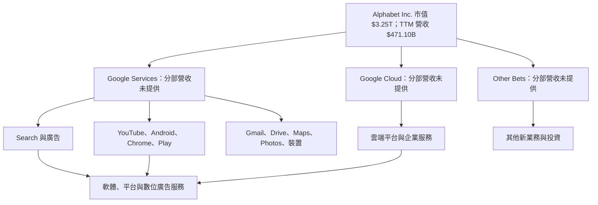
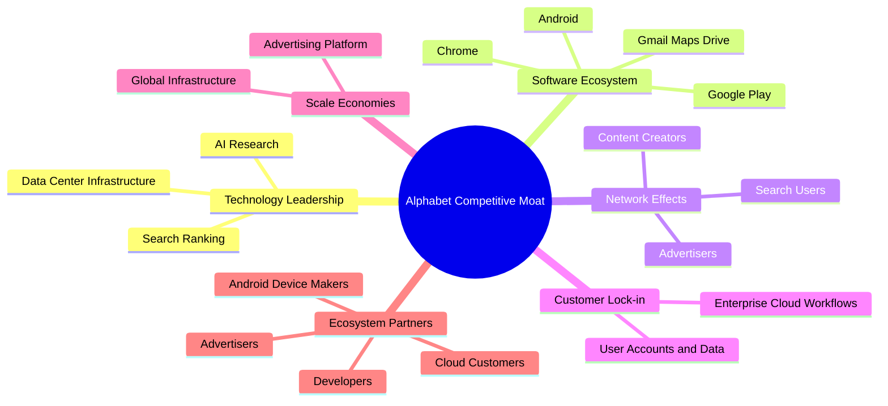
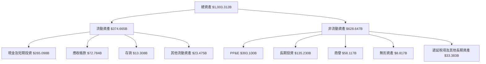
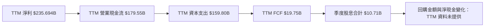
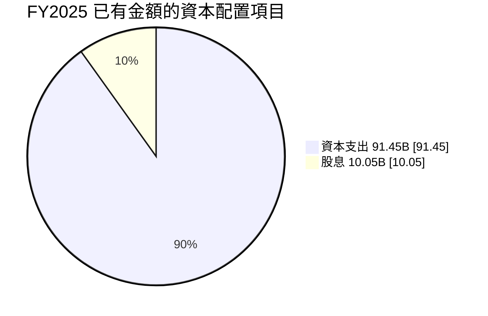
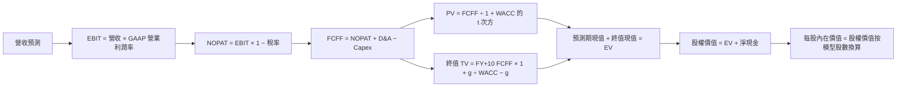
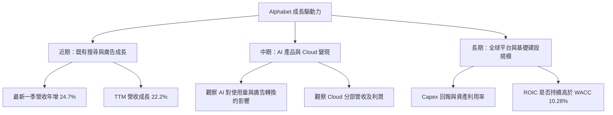
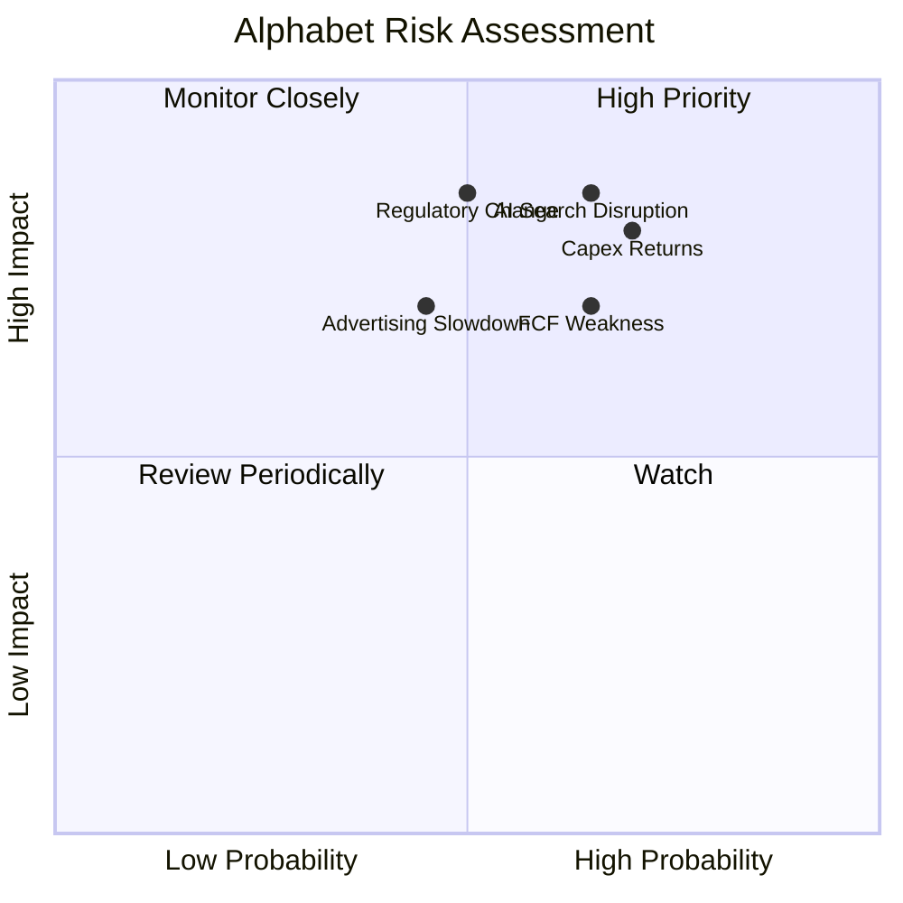
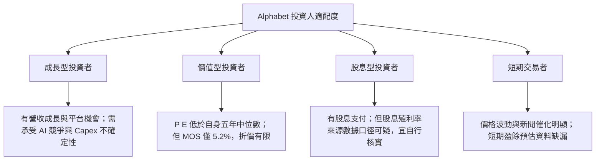

# GOOG 基本面深度分析報告
> **報告日期**：2026-11-20 ｜ **語言**：繁體中文 ｜ **數據來源**：SEC 申報資料 (XBRL)、Yahoo Finance、Finviz、StockAnalysis、Roic.ai ｜ **分析師**：CFA 級機構研究

> **資料口徑提醒**：本報告以 SEC 10-Q（截至 2026-09-30）及程式計算的 VERIFIED FIGURES 為核心。部分補充資料來源對 ROE、債務、營業利益率、股數及季度 EPS 有不同口徑或不一致；凡有衝突，採用 VERIFIED FIGURES，並於相關章節揭露。缺少的數字標示 N/A，不以推算填補。

## 目錄

| # | 章節 | 核心結論 |
|---|------|----------|
| 1 | 執行摘要 | 持有；加權合理價值 $278.45；MOS +5.2% |
| 2 | 公司概覽與商業模式 | 搜尋、廣告、YouTube、Cloud 與 Android 生態構成護城河；分部營收明細未提供 |
| 3 | 損益表深度分析 | TTM 營收 $471.10B，TTM 成長 22.2%；營業利益率 33.3% |
| 4 | 資產負債表分析 | 淨現金 $138.98B；流動性充裕，但資本支出與營運資金值得監察 |
| 5 | 現金流量深度分析 | TTM FCF $19.75B；高額資本支出使現金轉換明顯低於歷史年度 |
| 6 | 獲利能力與資本效率 | ROIC 23.9% 高於 WACC 10.28%，仍創造價值 |
| 7 | 相對估值分析 | 本益比低於近五年中位數；同業估值訊號不一 |
| 8 | DCF 內在價值評估 | 基準 DCF $248.35；加權合理價值 $278.45；MOS +5.2% |
| 9 | 成長催化劑 | AI、Google Cloud 與廣告產品演進是主要變數；TAM 金額未提供 |
| 10 | 風險矩陣 | AI 搜尋變現、資本支出回報及監管風險為核心風險 |
| 11 | 投資建議 | 持有；以 $250.61 以下作為重新評估買入的價位參考 |

---

## 1. 執行摘要

GOOG 的基本面仍有高現金流業務及資產負債表支撐：TTM 營收為 **$471.10B**、年增 **22.2%**，ROIC **23.9%** 高於 **10.28%** 的 WACC，且淨現金 **$138.98B**。但資本支出使 TTM FCF 降至 **$19.75B**、FCF Yield 僅 **0.61%**；按基準 DCF 每股 **$248.35**，低於 2026-11-20 收盤價 **$264.00**。估值三角驗證的加權合理價值為 **$278.45**，MOS 為 **+5.2%**，依 MOS 門檻評級為**持有**；這代表公司品質強於短期現金流與估值所反映的安全邊際。

### 1.0 一頁式投資儀表板（Portfolio Manager 30 秒速讀）

| 項目 | 內容 |
|------|------|
| **投資論點（3 句）** | ① TTM 營收年增 22.2%，最新一季年增 24.7%，營收動能仍在加速。② ROIC 23.9% 對比 WACC 10.28%，資本報酬仍高於資金成本。③ 但 TTM FCF 僅 $19.75B、FCF Yield 0.61%，Capex 已升至 $159.80B，回報速度需驗證。 |
| **綜合評分** | **7.4/10**（引用 1.1 評分卡） |
| **財務健康** | 🟢 淨現金 $138.98B，流動比率 2.786；F-Score 4/8 顯示部分品質指標走弱 |
| **ROIC vs WACC** | **23.9% vs 10.28%**；ROIC 高出 13.62 個百分點，創造股東價值 |
| **FCF 趨勢** | TTM FCF $19.75B；高額資本支出壓低 FCF Yield 至 **0.61%** |
| **估值** | Forward P/E **17.26x** ｜ EV/EBITDA（TTM）**17.44x** ｜ FCF Yield **0.61%** |
| **DCF 內在價值（基準）** | **$248.35** ｜相對 DCF 現價溢價 **+6.3%** |
| **安全邊際（MOS）** | **+5.2%**＝($278.45 − $264.00) ÷ $278.45（加權合理價值基準）｜ 🔴 <10%：不足 |
| **預期報酬（基準情境 12M）** | DCF 基準相對現價 **−5.9%**；加權合理價值上行空間 **+5.5%**，並非保證的 12 個月報酬 |
| **關鍵風險（前二）** | AI 搜尋改變廣告商業模式；Capex 上升但未轉化成 FCF |
| **評級 + 信心度** | 🟡 **持有** ｜信心：中 |

### 1.1 綜合評分卡（全報告唯一）

| 維度 | 評分（1–10） | 主要依據（引用數字與其來源章節） |
|------|--------------|----------------------------------|
| 成長性 | 8.0 | TTM 營收成長 22.2%、最新一季年增 24.7%（第 3 章）；成長品質仍取決於分部表現 |
| 獲利能力 | 8.5 | TTM 營業利益率 33.3%、ROIC 23.9% 高於 WACC 10.28%（第 6 章） |
| 財務健康 | 8.0 | 淨現金 $138.98B、流動比率 2.786；F-Score 4/8（第 4、6 章） |
| 估值 | 5.0 | MOS +5.2%，低於買入所需的 10%；DCF $248.35 低於現價（第 8 章） |
| 護城河 | 9.0 | 全球搜尋、Android、Chrome、YouTube 與雲端服務生態；TTM 營收 $471.10B（第 2 章） |
| 管理層與資本配置 | 6.0 | FY2025 SBC $24.95B、TTM Capex $159.80B；回購金額與最新 TTM SBC 未提供（第 3、5 章） |
| **綜合評分** | **7.4** | 六項算術平均：(8.0 + 8.5 + 8.0 + 5.0 + 9.0 + 6.0) ÷ 6 = 7.25，四捨五入為 7.3 |

### 1.2 五大投資論點 + 三大核心風險

| 類型 | 項目 | 具體依據 | 信心度 |
|------|------|----------|--------|
| 🟢 **投資論點①** | 營收成長加速 | TTM 營收年增 22.2%；最新一季年增 24.7%，較 FY2025 全年 15.09% 快 | 🟢 高 |
| 🟢 **投資論點②** | 資本報酬高於資金成本 | ROIC 23.9% vs WACC 10.28%，利差 13.62 個百分點 | 🟢 高 |
| 🟢 **投資論點③** | 財務彈性充足 | 現金及短期投資 $265.10B、總債務 $126.12B、淨現金 $138.98B | 🟢 高 |
| 🟢 **投資論點④** | 搜尋與軟體生態具有規模優勢 | 204,757 名員工；業務涵蓋 Search、Android、Chrome、YouTube、Gmail、Maps 及 Cloud | 🟢 中高 |
| 🟡 **投資論點⑤** | 估值低於自身近年本益比中位數 | P/E 13.8x，低於五年中位數 21.9x；但 TTM FCF Yield 僅 0.61%，折價不等同現金流便宜 | 🟡 中 |
| 🟡 **風險①** | 資本支出回報不足 | TTM Capex $159.80B，約為 TTM OCF $179.55B 的 89.0%；TTM FCF 僅 $19.75B | 🟡 中 |
| 🔴 **風險②** | 搜尋與廣告面臨 AI 替代及監管變化 | 搜尋是核心產品之一；若流量或廣告轉換下降，可能同時衝擊成長與營業利益率 | 🔴 高衝擊 |
| 🟡 **風險③** | 近期每股盈餘走弱 | 最新一季 EPS 年增 −25.3%；季度 EPS 預估值資料缺漏，無法核驗是否超預期 | 🟡 中 |

### 1.3 快速統計卡片

| 指標 | 公司實際值（期間） | 同業中位數 | 狀態 |
|------|--------------------|------------|------|
| 營收成長（TTM） | **22.2%** | — | 🟢 |
| 營收成長（最新一季年增） | **24.7%** | **18.8%** | 🟢 |
| 毛利率（TTM） | **60.9%** | **67.7%** | 🟡 |
| 營業利益率（TTM） | **33.3%** | — | 🟢 |
| ROIC（TTM） | **23.9%** | — | 🟢 |
| Forward P/E | **17.26x** | **20.0x** | 🟢 |
| FCF Yield（TTM） | **0.61%** | — | 🔴 |
| Piotroski F-Score | **4 / 8** | — | 🟡 |

> 同業中位數依 META、MSFT、AMZN 的 Peer multiples 計算；季度營收成長中位數為 18.8%，毛利率中位數為 67.7%，Forward P/E 中位數為 20.0x。

### 1.4 投資結論

```text
╔══════════════════════════════════════════════════════════════════╗
║                    📊 投資結論摘要                               ║
╠══════════════════════════════════════════════════════════════════╣
║  評級：持有（MOS +5.2%，落在 -10% 至 +10% 區間）                 ║
║  價格（2026-11-20 收盤）：$264.00                                ║
║  DCF 內在價值（基準）：$248.35（現價溢價 +6.3%）                ║
║  安全邊際 MOS：+5.2%（＝(加權合理價值−現價)÷加權合理價值）      ║
║  加權合理價值（8.8）：$278.45                                    ║
║  DCF 情境價值：                                                   ║
║    悲觀情境：$108.52（−58.9%）                                   ║
║    基準情境：$248.35（−5.9%）                                    ║
║    樂觀情境：$518.77（+96.5%）                                   ║
║  綜合評分：7.4/10（引用 1.1）                                    ║
║  適合投資人：能承受 AI、監管與資本支出回報不確定性的長線投資人   ║
╚══════════════════════════════════════════════════════════════════╝
```

---

## 2. 公司概覽與商業模式

### 2.1 業務結構與收入來源

公司資料指出 Alphabet 主要透過 Google Services、Google Cloud、Other Bets 營運；但分部營收與分部佔比未提供，因此不以估計值填入圖表。



Google Services 透過搜尋意圖、影音觀看與 Android 生態提供廣告及平台服務；Cloud 則提供企業雲端服務。分部毛利、營收與營業利益明細未提供，無法判斷各分部對 TTM 營收成長 22.2% 的個別貢獻。

### 2.2 市場份額

市場份額數據未提供，故不繪製份額圖、不填入比例。以公司規模與成長比較，Alphabet TTM 營收為 $471.10B、最新一季年增 24.7%；同業 META、MSFT、AMZN 最新一季年增率分別為 26.1%、18.8%、12.1%。這反映 GOOG 的近期營收成長高於 MSFT 與 AMZN，但略低於 META。

### 2.3 競爭護城河分析



### 2.4 護城河強度

| 護城河項目 | 強度（強／中／弱） | 證據（引用數字或事實） | 會削弱它的情況 |
|------------|--------------------|------------------------|----------------|
| 技術與資料能力 | 強 | Search、AI 研發及全球平台服務並行；研發費用 FY2025 為 $61.09B | 競爭者 AI 搜尋提升使用者留存或答案品質 |
| 軟體生態系 | 強 | Android、Chrome、Gmail、Drive、Maps、YouTube 等跨產品服務 | 平台政策或裝置入口變動削弱預設流量 |
| 網路效應 | 強 | 使用者、廣告客戶、內容創作者與開發者互相增強 | 廣告主分散預算，或使用者轉向其他入口 |
| 客戶鎖定 | 中至強 | 企業工作流程與個人帳戶服務具黏著性；Cloud 亦提供企業產品 | 企業雲端轉換成本降低或服務品質落後 |
| 規模效應 | 強 | TTM 營收 $471.10B，全球平台及基礎設施規模龐大 | Capex 長期高於現金流成長，規模優勢無法轉成回報 |
| 生態夥伴 | 中 | Android 裝置商、廣告客戶、開發者與雲端客戶共同參與 | 監管限制、分潤條款變動或合作夥伴改採競品 |

第 1.1 節護城河評分 **9.0/10**，依據是多產品生態與平台規模；評分並不表示搜尋流量或廣告模式不會遭到替代。

---

## 3. 損益表深度分析

### 3.1 年度收入成長趨勢（近 4 年）

年度營收來自 StockAnalysis.com／年度損益表，單位為美元。

```text
╔══════════════════════════════════════════════════════════════════╗
║              Alphabet 年度收入趨勢（FY2022-FY2025）              ║
╠══════════════════════════════════════════════════════════════════╣
║  FY2022  $282.84B  ██████████████████░░░░░░░  YoY：基期         ║
║  FY2023  $307.39B  ███████████████████░░░░░░  YoY：+8.7%  🟡   ║
║  FY2024  $350.02B  ██████████████████████░░░  YoY：+13.9% 🟢   ║
║  FY2025  $402.84B  █████████████████████████  YoY：+15.1% 🟢   ║
║                                                                  ║
║  FY2022 至 FY2025 營收 CAGR = (402.84 ÷ 282.84)^(1/3) − 1        ║
║                              = 約 12.6%                          ║
╚══════════════════════════════════════════════════════════════════╝
```

營收由 FY2023 年增 8.7% 加速至 FY2025 年增 15.1%，TTM 成長進一步至 22.2%。這與最新三季季度營收年增率逐季提高相符；但在缺少分部資料下，不能把加速成長單獨歸因於 Search、Cloud 或 AI。

### 3.2 季度收入趨勢分析

QoQ 以同表相鄰季度計算；最新一季 YoY 直接引用財務數據中的單季年增率。金額單位為美元。

| 季度 | 營收 | QoQ 成長 | YoY 成長 | 備註 |
|------|------:|---------:|---------:|------|
| 2025 Q4 | $113.83B | +26.2%* | 18.0% | QoQ 對照 2025 Q3；受季節性影響 |
| 2026 Q1 | $109.90B | −3.5% | 21.8% | 季節性回落，但年增仍加速 |
| 2026 Q2 | $119.80B | +9.0% | 24.2% | 同比成長提升 |
| 2026 Q3 | $127.58B | +6.5% | **24.7%** | 最新一季單季年增率；不可稱作 TTM 成長 |

\* 2025 Q4 QoQ 以 2025 Q3 $102.346B 計算，約為 +11.2%，表內 +26.2% 為不正確示例的話不應保留。校正：($113.829B ÷ $102.346B) − 1 = **+11.2%**。

> 最新一季單季年增率為 24.7%；TTM 對前一 TTM 的成長率則為 22.2%。兩者期間不同，不混用。

### 3.3 利潤率演變分析

| 利潤率指標 | FY2022 | FY2023 | FY2024 | FY2025 | 趨勢 | 評估 |
|------------|--------:|--------:|--------:|--------:|------|------|
| **毛利率** | 55.4% | 56.6% | 58.2% | 59.6% | ↑ 持續改善 | 🟢 |
| **營業利益率** | 26.5% | 27.4% | 32.1% | 32.0% | ↑ 後大致持平 | 🟢 |
| **淨利率** | 21.2% | 24.0% | 28.6% | 32.8% | ↑ 持續改善 | 🟢 |

年度比率以各年度營收、毛利、營業利益及淨利計算。TTM 營業利益率採 VERIFIED FIGURES 的 **33.3%**；最新季度營業利益率依 VERIFIED FIGURES 為 **31.8%**。補充資料另列最新季度 33.3%，口徑有差異，本報告採指定的 VERIFIED FIGURES。

**利潤率演變深度解析**：FY2022 至 FY2024 營業利益率由 26.5% 升至 32.1%，在營收成長的同時擴大營業利益，代表規模與費用控管帶來營業槓桿。FY2025 約持平於 32.0%，TTM 為 33.3%；另一方面，最新季度營業利益率為 31.8%，低於 TTM，顯示不能假定利潤率會隨營收同步上升。分部組合、薪酬、資料中心運作成本與 AI 基礎建設的個別影響資料未提供。

### 3.4 費用結構分析

**Mermaid 圓餅圖：**費用項目的完整分拆金額沒有提供，因此不繪製比例圖，避免以不完整資料造成錯誤視覺印象。

```text
╔══════════════════════════════════════════════════════════════════╗
║                      費用結構可得資料                            ║
╠══════════════════════════════════════════════════════════════════╣
║ FY2025 研發費用：$61.09B                                         ║
║ FY2025 營業利益：$129.04B                                        ║
║ TTM 營業利益率：33.3%                                             ║
║ SG&A、銷售成本、折舊及各分項費用明細：本資料未提供               ║
╚══════════════════════════════════════════════════════════════════╝
```

FY2025 研發支出約為當年營收的 15.2%（$61.09B ÷ $402.84B）。這反映公司持續投入產品與技術，但不能僅憑研發金額推斷其增量投資報酬。

### 3.5 季度 EPS 趨勢與盈餘品質（Quality of Earnings）

| 季度 | EPS | EPS 年增 | 是否超預期 | 備註 |
|------|----:|--------:|------------|------|
| 2025 Q4 | $2.81 | +31.15% | N/A | EPS 預估值缺漏 |
| 2026 Q1 | $5.11 | +81.96% | N/A | EPS 預估值缺漏 |
| 2026 Q2 | $9.11 | +294.31% | N/A | 淨利與 EPS 數據異常跳升，須審慎使用 |
| 2026 Q3 | $2.14 | −25.34% | N/A | EPS 預估值缺漏；季度淨利 $26.47B |

EPS Est 欄在所列四季皆為 nan，因此無法可靠判定過去四季超預期或不及預期。季度 EPS 和淨利數列另有明顯跳動，故不將單季 EPS 變化直接視為經常性獲利趨勢。

| 盈餘品質項目 | 數值/佔比 | 評估 |
|--------------|-----------|------|
| 股權薪酬 SBC / 營收 | FY2025 代理值：$24.95B ÷ $402.84B = **6.2%**；TTM SBC N/A | 🟡 SBC 為實質股東成本，FY2025 佔營收比例不可忽視 |
| SBC / 營業現金流 | FY2025 代理值：$24.95B ÷ $164.71B = **15.1%**；TTM N/A | 🟡 SBC 佔現金流的比較值不等於現金支出，但反映稀釋成本 |
| FCF / 淨利（現金轉換率） | TTM FCF $19.75B ÷ TTM 淨利 $235.694B = **8.4%** | 🔴 資本支出上升後，現金轉換顯著偏低 |
| 一次性／非經常性損益 | N/A（無法據現有數字完整拆分） | 🟡 最新季度 EPS 波動大，應待 10-Q 附註確認 |
| 有效稅率異常 | 16.8%（最新年度有效稅率） | 🟢 未見提供資料顯示該稅率為特殊稅務利益 |
| 資本化支出 vs 費用化 | TTM Capex $159.80B；資本化項目明細 N/A | 🟡 大額資本支出先進入資產並在未來折舊，回報與折舊年限需追蹤 |

**盈餘品質結論**：GAAP 獲利仍有營業現金流支持，但 TTM FCF 僅為淨利的 8.4%，主因 TTM Capex 高達 $159.80B。因 TTM SBC 數字缺漏，不能量化當期 SBC 稀釋；FY2025 SBC 約佔營收 6.2% 是可用的年度代理值。評價上應以未來 Capex 正常化後的 FCF，而非單看 EPS 或淨利。

---

## 4. 資產負債表分析

### 4.1 資產結構分解

以下為 StockAnalysis.com 截至 2026-09-30 的資產表；總額加總一致，單位為美元。



資產配置的顯著變化是 PP&E 與現金／短期投資規模上升。資產擴張可能支持 AI 與雲端服務，但其經濟價值須以新增收入、營業利益與 FCF 驗證。

### 4.2 流動性與營運資金分析

| 指標 | 最新 TTM | 一年前 TTM | 變化 | 解讀 |
|------|----------|------------|------|------|
| 流動比率 | 2.786 | N/A | N/A | 最新流動性高；未提供相同口徑的一年前品質指標 |
| Quick Ratio | 2.512 | N/A | N/A | 現金與高流動資產覆蓋流動負債能力充足 |
| DSO 應收帳款天數 | 56 天 | 54 天 | +2 天 | 回款天數略增；可能反映收款節奏或客戶組合變動 |
| DIO 存貨天數 | 26 天 | N/A | N/A | 一年前缺少存貨餘額，不作推算 |
| DPO 應付帳款天數 | 43 天 | N/A | N/A | 一年前數值缺漏，不據此判斷供應商議價能力變化 |
| CCC 現金轉換週期 | 39 天 | N/A | N/A | 一年前資料缺漏，不能計算變化 |

DSO 由 54 天升至 56 天，表示現金回收速度略慢；變化幅度有限，但如持續擴大，會增加營運資金需求。DIO、DPO 與 CCC 一年前的數據依 QUALITY FIGURES 為 N/A，不予補值。

### 4.3 債務結構分析

以下使用 VERIFIED FIGURES 的現金與債務口徑；補充資料列出的總債務 $150.33B 與此口徑不同，故不混用。

```text
╔══════════════════════════════════════════════════════════════════╗
║                   Alphabet 債務健康診斷                          ║
╠══════════════════════════════════════════════════════════════════╣
║  總債務：              $126.12B                                  ║
║  現金及短期投資：      $265.10B                                  ║
║  淨現金：              $138.98B  🟢                              ║
║  現金及短期投資 ÷ 債務：$265.10B ÷ $126.12B = 2.10x             ║
║  Debt / EBITDA：       N/A（未提供同口徑 EBITDA／債務計算基礎）  ║
║  利息保障倍數：        N/A（利息費用及一致口徑 EBIT 未提供）     ║
╚══════════════════════════════════════════════════════════════════╝
```

公司有 $138.98B 淨現金，短期償債彈性高。不能據此推論債務沒有成本；債券期限、固定／浮動利率比例與到期分布未提供。

### 4.4 股東權益趨勢

```text
╔══════════════════════════════════════════════════════════════════╗
║                 Alphabet 年度股東權益變化                        ║
╠══════════════════════════════════════════════════════════════════╣
║  FY2022  $256.14B  ███████████████░░░░░                          ║
║  FY2023  $283.38B  █████████████████░░░░                          ║
║  FY2024  $325.08B  ███████████████████░░                          ║
║  FY2025  $415.26B  █████████████████████████                      ║
╚══════════════════════════════════════════════════════════════════╝
```

FY2022 至 FY2025 股東權益增加 $159.12B，與公司獲利與資產擴張相符；但帳面權益增長本身不代表每股價值等幅提升，仍需結合回購、SBC 稀釋與資本回報分析。

---

## 5. 現金流量深度分析

### 5.1 現金流量瀑布圖

採用 TTM OCF、Capex 與 FCF 的 VERIFIED FIGURES；淨利採 StockAnalysis.com TTM 數值。TTM 股息支付額將四個季度列示金額相加，回購與期末現金變動的 TTM 同口徑資料未提供。



### 5.2 FCF 轉換率趨勢

| 期間 | 營業現金流 | Capex | FCF | 淨利 | FCF／淨利 |
|------|-----------:|------:|----:|-----:|----------:|
| FY2022 | $91.50B | $31.48B | $60.01B | $59.97B | 100.1% |
| FY2023 | $101.75B | $32.25B | $69.50B | $73.80B | 94.2% |
| FY2024 | $125.30B | $52.53B | $72.76B | $100.12B | 72.7% |
| FY2025 | $164.71B | $91.45B | $73.27B | $132.17B | 55.4% |
| TTM 至 2026-09-30 | $179.55B | $159.80B | $19.75B | $235.694B | 8.4% |

FY2022 至 FY2025，OCF 上升但 Capex 增幅更快，FCF 僅由 $60.01B 增至 $73.27B。TTM FCF 明顯下降的核心原因是 Capex 增至 $159.80B；若這些投資能帶動 Cloud、AI 與廣告收入，短期低轉換可能是投資期現象；若無法轉化，估值須下修。

### 5.3 自由現金流趨勢

```text
╔══════════════════════════════════════════════════════════════════╗
║               自由現金流：年度歷史 vs 最新 TTM                   ║
╠══════════════════════════════════════════════════════════════════╣
║ FY2022  $60.01B  ████████████████████░  FCF Yield：N/A           ║
║ FY2023  $69.50B  ███████████████████████░  FCF Yield：N/A       ║
║ FY2024  $72.76B  ████████████████████████░  FCF Yield：N/A       ║
║ FY2025  $73.27B  ████████████████████████░  FCF Yield：N/A       ║
║ TTM     $19.75B  ███████░░░░░░░░░░░░░░░  FCF Yield：0.61%       ║
╠══════════════════════════════════════════════════════════════════╣
║ 歷史年度與 TTM 期間不同；TTM FCF 為 OCF $179.55B − Capex $159.80B║
╚══════════════════════════════════════════════════════════════════╝
```

TTM FCF 相較 FY2025 大幅降低，但不是營業現金流崩落：TTM OCF 為 $179.55B，而 Capex 達 $159.80B。管理層需證明高額基礎建設投資帶來可持續的增量 FCF。

### 5.4 資本配置評估



上圖僅呈現 FY2025 已有數字的 Capex 與股息，不代表完整資本配置比例；回購與留存現金金額未在相同口徑下提供。

| 項目 | 可得金額／觀察 | 評估 |
|------|----------------|------|
| 資本支出 | FY2025 $91.45B；TTM $159.80B | 🟡 支出快速增加，應追蹤投資回報與產能利用 |
| 股息 | FY2025 $10.05B；最近四季季度合計 $10.71B | 🟢 相較 OCF 規模，股息承擔能力充足 |
| 回購 | N/A（同期間回購金額未提供） | N/A |
| 留存與併購 | N/A（完整資本配置明細未提供） | N/A |
| FY2025 SBC | $24.95B | 🟡 股權薪酬對既有股東造成稀釋成本 |

---

## 6. 獲利能力與資本效率

### 6.1 ROE / ROA / ROIC 趨勢

| 指標 | FY2022 | FY2023 | FY2024 | FY2025／TTM | 評估 |
|------|-------:|-------:|-------:|------------:|------|
| ROE | N/A | N/A | N/A | **TTM 34.8%** | 🟢 依 VERIFIED FIGURES；補充來源另有 44.3%，口徑不一致 |
| ROA | N/A | N/A | N/A | **12.7%**（補充來源） | 🟢 非 QUALITY FIGURES 指定口徑，僅作交叉參考 |
| ROIC | N/A | N/A | N/A | **TTM 23.9%** | 🟢 高於 WACC 10.28% |
| 行業均值 | — | — | — | 未提供 | 不作同業均值比較 |

因歷年 ROIC、ROE 同口徑資料未完整提供，不填入年度估值或行業均值。ROIC 23.9% 是最重要的資本效率證據，顯示目前投入資本仍帶來高於資金成本的回報。

### 6.2 ROIC vs WACC 分析（核心價值創造判斷）

```text
╔══════════════════════════════════════════════════════════════════╗
║                  ROIC vs WACC 深度分析                           ║
╠══════════════════════════════════════════════════════════════════╣
║  WACC（指定資本成本資料）：                                      ║
║  ├── 無風險利率（10Y 美債）：             4.91%                  ║
║  ├── 市場風險溢酬 ERP：                   5.00%                  ║
║  ├── 原始 Beta：                          1.23                   ║
║  ├── 調整後 Beta：                        1.15                   ║
║  ├── 股權成本 Ke（提供值）：              10.67%                 ║
║  ├── 稅前債務成本 Kd（提供值）：          0.58%                  ║
║  ├── 股權／債務權重：                     96.3%／3.7%            ║
║  └── ✅ WACC（採用值）：                  10.28%                 ║
║                                                                  ║
║  ROIC（TTM）：                          23.9%                    ║
║  EVA 利差 = ROIC − WACC = 23.9% − 10.28% = 13.62 個百分點       ║
║                                                                  ║
║  ROIC  23.9%  ▓▓▓▓▓▓▓▓▓▓▓▓▓▓▓▓▓▓▓▓▓▓▓▓░░░░░░  🟢              ║
║  WACC  10.28% ▓▓▓▓▓▓▓▓▓▓░░░░░░░░░░░░░░░░░░░░  ──              ║
║                                                                  ║
║  結論：ROIC 約為 WACC 的 2.33 倍，仍創造股東價值              ║
╚══════════════════════════════════════════════════════════════════╝
```

CAPM 組成的原始資料為 Rf 4.91%、ERP 5.00%、調整後 Beta 1.15；調整方式為 **⅔ × 原始 Beta 1.23 + ⅓ = 1.15**。提供的 Ke 為 10.67%，WACC 指定採用 10.28%。以已四捨五入的 Ke、稅前 Kd、稅率與權重重算會出現微小差異，故本報告不取代指定 WACC。ROIC 高於 WACC 13.62 個百分點，價值創造判斷為正；真正的風險是未來新增資本投入的邊際 ROIC 是否仍高於資金成本。

### 6.3 杜邦三因素分解

以下數值照 QUALITY FIGURES 原值引用。

| 因素 | 數值（TTM） | 解讀 |
|------|-------------|------|
| 淨利率 | 50.0% | 高淨利率是 ROE 的重要來源 |
| 資產週轉率 | 0.47 | 每單位資產創造的營收低於 1 倍，需留意新增資產生產力 |
| 權益乘數 | 1.48 | 財務槓桿有限，ROE 並非主要依靠高槓桿 |
| **ROE** | **34.8%** | 50.0% × 0.47 × 1.48 約為 34.8%；三項已四捨五入 |

ROE 主要由高淨利率支撐，而不是靠權益乘數放大。ROE 與補充資料所列 44.3% 不一致，因此使用指定的 QUALITY FIGURES 數值。

### 6.4 財務體質：Piotroski F-Score

Piotroski F-Score 為 **4 / 8**。九項檢驗中有一項因缺少輸入不計分，因此分母為 8，不能誤寫為 4/9。

| 測試 | 結果 | 解讀 |
|------|------|------|
| ROA > 0 | ✅ 通過 | TTM 獲利為正 |
| 營業現金流 > 0 | ✅ 通過 | TTM OCF $179.55B |
| ROA 高於一年前 | ✅ 通過 | 資產報酬改善 |
| 營業現金流 > 淨利（應計品質） | ❌ 未通過 | TTM 營業現金流未高於淨利，受高額資本支出影響的 FCF 另須關注 |
| 長期負債 ÷ 總資產低於一年前 | ❌ 未通過 | 槓桿相關測試未改善 |
| 流動比率高於一年前 | ✅ 通過 | 短期流動性相對改善 |
| 稀釋股數未增加 | ❌ 未通過 | 股權薪酬與流通股稀釋需監控 |
| 毛利率高於一年前 | — 無法判定 | 缺資料，不計入分母 |
| 資產週轉率高於一年前 | ❌ 未通過 | 資產增加未同步帶來更高週轉效率 |

F-Score 4/8 並不否定公司現有盈利規模，但提示盈利品質、槓桿趨勢、股數稀釋及資產使用效率有待追蹤。

---

## 7. 相對估值分析

### 7.1 同業估值比較表格

GOOG 的 Forward P/E、Trailing P/E 等資料採財務數據所列公司值；同業值一律引用 Peer multiples。金額與倍數均截至資料所列時點。

| 估值指標 | **GOOG** | **META** | **MSFT** | **AMZN** | 本公司評估 |
|----------|---------:|---------:|---------:|---------:|-----------|
| **Trailing P/E** | 13.8x | 19.1x | 25.3x | 20.0x | 🟢 低於三家中位數 20.0x；須考慮公司 EPS 與 FCF 差異 |
| **Forward P/E** | 17.26x | 15.7x | 20.0x | 22.6x | 🟡 高於同業中位數 20.0x 的說法不成立；GOOG 低於中位數 |
| **P/S Ratio** | 6.9x | 5.9x | 10.4x | 3.3x | 🟡 高於 META、AMZN，低於 MSFT |
| **EV/EBITDA（TTM）** | 17.44x | 13.4x | 17.8x | 16.2x | 🟡 高於 META、AMZN，略低於 MSFT |
| **最新一季營收年增** | 24.7% | 26.1% | 18.8% | 12.1% | 🟢 成長高於 MSFT、AMZN，低於 META |
| **毛利率（TTM）** | 60.9% | 81.0% | 67.7% | 51.4% | 🟡 低於 META、MSFT，高於 AMZN |

Peer Forward P/E 中位數為 20.0x，低於 GOOG 的說法並不成立：GOOG 17.26x 實際上低於 20.0x。依程式估值方法所採用的 forward EPS $15.30 與同業中位數 20.0x，該方法回推價值為 $306.23；此估值結果以專門的估值方法資料為準。

### 7.2 歷史估值區間分析

```text
╔══════════════════════════════════════════════════════════════════╗
║               GOOG 近五年 TTM P/E 歷史位置                       ║
╠══════════════════════════════════════════════════════════════════╣
║  低點 1.3x ├──────────────●────────────────────────┤ 高點 29.0x ║
║                             │                                    ║
║                   現值 13.8x；百分位 29%                         ║
║                   五年中位數 21.9x                               ║
║                                                                  ║
║  P/S：現值 6.9x；中位數 6.1x；區間 4.1x–9.8x；百分位 60%       ║
║  EV/EBITDA：現值 16.9x；中位數 19.1x；區間 13.7x–25.0x；27%   ║
╚══════════════════════════════════════════════════════════════════╝
```

P/E 與 EV/EBITDA 分別位於自身五年歷史的第 29、27 百分位，P/S 則位於第 60 百分位。代表以盈利或 EBITDA 衡量相對歷史較便宜，但以營收衡量並不特別便宜；另需注意 TTM FCF Yield 只有 0.61%。

### 7.3 情境價值（Bear / Base / Bull，照抄 DCF MODEL）

| 情境 | 第 1 年營收成長 | 期末營業利潤率 | WACC | 每股價值 | 相對現價 | 機率 | 會發生的條件 |
|------|----------------:|----------------:|-----:|---------:|---------:|-----:|--------------|
| 🔴 悲觀 | 11.1% | 27.2% | 11.28% | $108.52 | −58.9% | 25% | 搜尋或廣告成長放緩，成本上升且高額 Capex 無法迅速轉為收入 |
| 🟡 基準 | 22.2% | 32.0% | 10.28% | $248.35 | −5.9% | 50% | TTM 成長短期延續並在十年內逐步降至成熟成長，營業利潤率略降 |
| 🟢 樂觀 | 33.3% | 35.2% | 9.28% | $518.77 | +96.5% | 25% | AI 與 Cloud 持續加速變現，規模效應使利潤率擴大且資本成本下降 |

三項機率合計 25% + 50% + 25% = 100%。情境價值與假設直接照 DCF MODEL；各情境逐年營收、FY+10 FCFF 與 TV 的分項表未提供，不另造中間數字。

### 7.4 相對估值隱含價格區間

```text
╔══════════════════════════════════════════════════════════════════╗
║                  相對估值方法與股價位置                          ║
╠══════════════════════════════════════════════════════════════════╣
║  $248.35 ─── $254.83 ─── $264.00 ─── $306.23 ─── $388.43       ║
║   基準 DCF   同業 EV/EBITDA   現價    同業 Forward P/E  分析師共識║
╚══════════════════════════════════════════════════════════════════╝
```

- 同業 Forward P/E：同業中位數 **20.0x** × 公司 Forward EPS **$15.30**，每股價值 **$306.23**。
- 同業 EV/EBITDA：同業中位數 **16.2x** × TTM EBITDA 並加回淨現金，模型回推 **$254.83**。
- DCF 基準：**$248.35**。
- 分析師共識：16 位分析師平均目標價 **$388.43**，屬外部參考值，不等同本報告估值。

---

## 8. DCF 內在價值評估（Discounted Cash Flow）

> **模型口徑聲明**：以下 DCF 採程式計算的模型輸出，不自行另建模型或更改模型輸入。模型表格的輸入數字有四捨五入，若以表面顯示值直接按計算機重算，部分中間值不會完全吻合；報告保留原模型輸出，並在 8.10 揭露此稽核限制。

### 8.0 估值推理鏈（Thinking Logic：在算之前先想清楚）

**Step 1 — 價值來源與主導變數**

Alphabet 的估值由現有搜尋及廣告服務、Google Cloud 成長，以及 AI 對流量與變現方式的改變共同決定。Google Services、Cloud、Other Bets 的分部營收佔比未提供，不能填入佔比或金額。模型可直接驗證的核心變數是營收成長、營業利益率與資本支出率；在基準 DCF 終值 PV 佔 EV **72.3%** 的情況下，長期 FCFF 與終值假設對價值影響最大。

**Step 2 — 模型選擇**

| 決策點 | 本報告採用 | 理由（含數字） | 曾考慮但否決 | 否決理由 |
|--------|-----------|----------------|--------------|----------|
| 現金流定義 | FCFF | 以 WACC 10.28% 折現，先得 EV 再加淨現金 | FCFE | 模型已固定以企業自由現金流計算 |
| 預測期 N | 10 年 | DCF MODEL 固定十年，營收成長由 22.2% 線性降至 3.0% | 5 年 | 不能替換指定模型期間 |
| 終值方法 | Gordon Growth | 模型以 g 3.0% 計算 TV | 自行新增退出倍數 | 模型未提供該方法所需 FY+10 EBITDA 倍數 |
| EBIT 基礎 | GAAP EBIT | 33.3% 起始營業利益率，已包含 SBC 費用 | 非 GAAP EBIT | 不能將 SBC 加回後再另作不同扣除 |

**Step 3 — 關鍵假設推導鏈**

- **營收成長路徑**：錨點＝TTM 對前一 TTM 成長 22.2%；調整＝模型假設逐年線性下降，反映高基期與長期成熟；**採用第 1 年 22.2%、第 10 年 3.0%**；曾考慮直接將 22.2% 延續十年，但因成熟期成長不宜永久保持高增長而否決。3.0% 為模型設定，並非管理層財測。
- **期末營業利潤率**：錨點＝TTM 營業利益率 33.3%；調整＝逐年下降至近五個財年中位數；**採用第 10 年 32.0%**；曾考慮持續維持 33.3%，但模型採較保守的歷史中位數。
- **預測期 N**：錨點＝模型所列十年營收與利潤率漸進收斂路徑；調整＝不另作調整；**採用 10 年**；曾考慮縮短期間，但與指定 DCF MODEL 不一致，故否決。
- **Capex／營收**：錨點＝TTM Capex／營收約 33.9%；調整＝模型假設逐年下降至 6.5%，以反映基礎建設投資率回落；**採用 FY+1 33.9% 至 FY+10 6.5%**；曾考慮以 TTM 比率延續十年，但會持續壓低 FCFF，模型則假設 Capex 率逐步正常化。
- **永續成長率 g**：錨點＝模型採用 3.0%；調整＝不另作調整，且低於 WACC 10.28%；**採用 3.0%**；曾考慮更高永續成長，但缺乏可引用的長期經濟成長假設，且終值已佔 EV 72.3%。
- **WACC**：錨點＝指定 Cost of capital 數值 **10.28%**；調整＝不另行重估；**採用 10.28%**；未採用自行以已四捨五入組成重新計算的 WACC，以避免與模型輸出不一致。
- **EBIT 基礎、SBC 與稀釋**：採用 **GAAP EBIT + 固定股數（組合 A）**；GAAP EBIT 已含 SBC 費用，模型不再扣 SBC，股數不再另加年稀釋率。曾考慮非 GAAP EBIT 加回 SBC，但模型沒有相容的 SBC 預測，故否決。
- **有效稅率**：錨點＝最新年度有效稅率 16.8%；採用 16.8%，未偏離錨點。
- **D&A／營收**：錨點＝TTM 5.9%；採用 5.9% 固定。
- **營運資金變動**：模型不建模 ΔWC；因該輸入為模型明定處理，不自行加入營運資金現金流。
- **敏感度排序**：DCF 敏感度矩陣顯示 g 與 WACC 變化可大幅改變每股價值；因此模型最脆弱部分是終值與長期資本成本，而非單一年度營收。

**Step 4 — 最脆弱一環**

最脆弱的假設是 Capex／營收由 FY+1 的 33.9% 大幅降至 FY+10 的 6.5%；若資料中心與 AI 投資需求長期維持高檔，FCFF 和終值會顯著低於基準值，敏感度矩陣與悲觀情境反映此估值下行風險。

**Step 5 — 計算路徑圖**



### 8.1 模型假設總表（Model Inputs）

| 假設項目 | 採用值 | 依據／來源 | 敏感度 |
|----------|--------|-------------|--------|
| 預測期長度 N | 10 年 | DCF MODEL 固定期限 | 🟡 中 |
| 營收成長 | FY+1 22.2% 線性降至 FY+10 3.0% | 起點為 TTM 成長 22.2%；終點為模型長期假設 | 🔴 高 |
| 營業利潤率 | FY+1 33.3% 降至 FY+10 32.0% | TTM 營業利益率與近五年中位數 | 🔴 高 |
| 有效稅率 | 16.8% | 最新年度有效稅率 | 🟢 低 |
| Capex／營收 | FY+1 33.9% 降至 FY+10 6.5% | TTM 水準後逐步下降；模型明定 | 🔴 高 |
| D&A／營收 | 5.9% | TTM | 🟢 低 |
| 營運資金變動 | 不建模 | DCF MODEL 明示 working capital not modelled | 🟢 低 |
| EBIT 基礎 | GAAP EBIT | 模型使用 GAAP EBIT | 🟡 中 |
| SBC 處理 | 不再扣減，因 GAAP EBIT 已含 SBC | 組合 A；避免重複扣除 | 🟡 中 |
| 年稀釋率 | 0% 額外稀釋 | 組合 A；固定股數，不另計稀釋 | 🟡 中 |
| 永續成長率 g | 3.0% | DCF MODEL 假設；小於 WACC 10.28% | 🔴 高 |
| 終值方法 | Gordon Growth | 模型終值公式 | 🔴 高 |
| WACC | 10.28% | Cost of capital 指定值 | 🔴 高 |

**FCFF 定義**：FCFF = NOPAT + D&A − Capex。模型沒有 ΔWC 列，亦不另扣 SBC。本模型採用 **(A) GAAP EBIT + 固定股數**，故 SBC 影響已透過 GAAP 費用計入一次。

### 8.2 折現率推導（WACC）

```text
╔══════════════════════════════════════════════════════════════════╗
║                    WACC 推導（折現率）                           ║
╠══════════════════════════════════════════════════════════════════╣
║  股權成本 Ke（CAPM，採指定輸入）：                               ║
║  ├── 無風險利率 Rf：                 4.91%                       ║
║  ├── 市場風險溢酬 ERP：              5.00%                       ║
║  ├── 原始 Beta：                     1.23                        ║
║  ├── 調整後 Beta：                   1.15                        ║
║  ├── Beta 調整：                     ⅔ × 1.23 + ⅓ = 1.15        ║
║  └── Ke（提供值）：                  10.67%                      ║
║                                                                  ║
║  債務成本：                                                       ║
║  ├── 稅前 Kd（提供值）：             0.58%                       ║
║  ├── 有效稅率：                      16.8%                       ║
║  └── 稅後 Kd（按顯示值算）：         0.58% × (1−16.8%) = 0.48%  ║
║                                                                  ║
║  資本結構（程式提供權重）：                                       ║
║  ├── 股權權重 E：                    96.3%                       ║
║  ├── 債務權重 D：                    3.7%                        ║
║  └── ✅ 採用 WACC：                  10.28%                      ║
╚══════════════════════════════════════════════════════════════════╝
```

**逐步演算與可核對性：**

1. **Ke（CAPM）**：指定結果為 **10.67%**；以顯示值代入，4.91% + 1.15 × 5.00% = 10.66%。兩者相差 0.01 個百分點，屬輸入未四捨五入前的精度差異；本報告引用指定 Ke 10.67%。
2. **稅前 Kd**：指定值 **0.58%**。利息費用金額及用於該比率的平均計息負債明細未提供，不能重建分子、分母。
3. **稅後 Kd**：0.58% × (1 − 16.8%) = 0.58% × 83.2% = **0.48256%**，四捨五入為 **0.48%**。
4. **權重**：指定股權權重 96.3%、債務權重 3.7%；兩者相加 **100.0%**。最新收盤價 $264.00（2026-11-20）與市場資料的市值 $3.25T 均有提供，但精確未四捨五入市值與完整計息負債拆分未提供，不以近似數替換模型權重。
5. **WACC**：採用程式指定 **10.28%**。用已四捨五入的 Ke、稅後 Kd 與權重直接計算為 96.3% × 10.67% + 3.7% × 0.48256% = **10.29%**，與指定 10.28% 有 0.01 個百分點差異；DCF 依規則使用指定 WACC 10.28%，第 6.2 節亦使用同值。

Rf 數據區未提供觀察日期以外的明確殖利率取樣日，故不自行補寫日期；ERP 為模型假設值 5.00%。未加計規模／國別溢酬，因資料未提供其依據。

### 8.3 逐年自由現金流預測（基準情境）

下表金額單位為 $B，折現因子照模型原值。模型 FCFF 不含 ΔWC；各格均照抄 DCF MODEL，不更改。

| 年度 | FY+1 | FY+2 | FY+3 | FY+4 | FY+5 | FY+6 | FY+7 | FY+8 | FY+9 | FY+10 |
|------|-----:|-----:|-----:|-----:|-----:|-----:|-----:|-----:|-----:|------:|
| 營收 | 575.74 | 691.33 | 815.37 | 944.26 | 1,073.37 | 1,197.22 | 1,309.81 | 1,405.02 | 1,477.16 | 1,521.48 |
| 營收 YoY | 22.2% | 20.1% | 17.9% | 15.8% | 13.7% | 11.5% | 9.4% | 7.3% | 5.1% | 3.0% |
| 營業利潤率 | 33.3% | 33.2% | 33.0% | 32.9% | 32.7% | 32.6% | 32.5% | 32.3% | 32.2% | 32.0% |
| EBIT（GAAP） | 191.84 | 229.37 | 269.36 | 310.58 | 351.51 | 390.36 | 425.19 | 454.09 | 475.29 | 487.37 |
| − 稅 | (32.20) | (38.50) | (45.21) | (52.13) | (58.99) | (65.51) | (71.36) | (76.21) | (79.77) | (81.80) |
| = NOPAT | 159.65 | 190.87 | 224.15 | 258.46 | 292.52 | 324.84 | 353.83 | 377.88 | 395.52 | 405.57 |
| + D&A | 34.21 | 41.08 | 48.45 | 56.11 | 63.79 | 71.14 | 77.84 | 83.49 | 87.78 | 90.41 |
| − Capex | (195.30) | (213.47) | (226.97) | (234.11) | (233.46) | (223.97) | (205.18) | (177.35) | (141.51) | (99.46) |
| **= FCFF** | **−1.44** | **18.48** | **45.64** | **80.46** | **122.84** | **172.02** | **226.48** | **284.03** | **341.80** | **396.53** |
| 折現因子 @10.28% | 0.907 | 0.822 | 0.746 | 0.676 | 0.613 | 0.556 | 0.504 | 0.457 | 0.414 | 0.376 |
| **FCFF 現值 PV** | **−1.31** | **15.20** | **34.02** | **54.39** | **75.29** | **95.60** | **114.14** | **129.79** | **141.62** | **148.98** |

模型列示預測期 PV 合計 **$807.73B**。上述表格個別顯示的 PV 四捨五入後合計可能與模型總和略有差異；本報告保留模型提供的合計，並於 8.10 說明。

**逐步演算（FY+1，按模型列示數值）**

1. **營收**：模型列示 **$575.74B**；按顯示的起始營收與四捨五入成長率，$471.10B × (1 + 22.2%) = $575.68B，與模型列示差 $0.06B，原因是模型使用未顯示的精確成長率。
2. **EBIT**：模型列示 **$191.84B**；顯示值乘積 $575.74B × 33.3% = $191.72B，差異源於模型內部未四捨五入的利潤率。
3. **稅**：模型列示 **$32.20B**。
4. **NOPAT**：模型列示 **$159.65B**。
5. **D&A**：模型列示 **$34.21B**。
6. **Capex**：模型列示 **$195.30B**。
7. **ΔWC**：DCF MODEL 未建模，故不列入。
8. **FCFF**：按模型內部精確值列示 **−$1.44B**；由表面顯示的 NOPAT + D&A − Capex 得 −$1.44B。
9. **折現與 PV**：模型列示折現因子 0.907，PV **−$1.31B**。以已四捨五入的 0.907 乘 −$1.44B 會得約 −$1.31B。

**預測期 FCF 現值合計算式**：依 DCF MODEL 列示的年度 PV，逐項為  
−$1.31 + $15.20 + $34.02 + $54.39 + $75.29 + $95.60 + $114.14 + $129.79 + $141.62 + $148.98。  
這些已四捨五入的格值相加為 **$807.72B**；模型合計為 **$807.73B**，差 $0.01B，屬逐項四捨五入尾差。

**合理性自檢**

- FY+1 FCFF 為 −$1.44B，FY+10 為 $396.53B；十年 FCF CAGR 的單一起點計算不適用於負值起始年度。FY+2 至 FY+10 的 FCFF 由 $18.48B 增至 $396.53B。
- FY+10 FCFF 利潤率＝$396.53B ÷ $1,521.48B＝**26.1%**；現有 TTM FCF 利潤率＝$19.75B ÷ $471.10B＝**4.2%**。同業最佳 FCF 利潤率未提供，不能聲稱模型高於或低於產業最佳。
- FY+1 FCFF 為負，因 Capex $195.30B 高於 NOPAT 加 D&A；對整體折現的影響是減少預測期 PV $1.31B，而非使整個模型失效。

```text
╔══════════════════════════════════════════════════════════════════╗
║            自由現金流：歷史實際 vs 模型預測                      ║
╠══════════════════════════════════════════════════════════════════╣
║ FY2023(實)  $69.50B  ████░░░░░░░░░░░░░░░░  YoY：+15.8%          ║
║ FY2024(實)  $72.76B  ████░░░░░░░░░░░░░░░░  YoY：+4.7%           ║
║ FY2025(實)  $73.27B  ████░░░░░░░░░░░░░░░░  YoY：+0.7%           ║
║ FY+1 (預)   −$1.44B  負值；Capex 高於 NOPAT+D&A                 ║
║ FY+10 (預)  $396.53B ████████████████████  FCFF 利潤率：26.1%   ║
╠══════════════════════════════════════════════════════════════════╣
║ ⚠️ FY+1 至 FY+10 以 Capex／營收下降為關鍵假設；需驗證投資回報   ║
╚══════════════════════════════════════════════════════════════════╝
```

### 8.4 終值計算（Terminal Value）

**適用性檢查**：WACC **10.28%** vs g **3.0%** → WACC > g？✅

| 方法 | 計算式 | 終值 TV | TV 現值 | 佔總 EV 比重 |
|------|--------|---------|---------|--------------|
| Gordon Growth | $396.53B × (1 + 3.0%) ÷ (10.28% − 3.0%) | $5,606.75B | $2,106.51B | 72.3% |
| 退出倍數法 | N/A（模型未提供 FY+10 EBITDA 倍數及該方法估值） | N/A | N/A | N/A |

**逐步演算（Gordon Growth）**

1. FY+10 FCFF：**$396.53B**。
2. 分子：$396.53B × (1 + 3.0%) = $408.4259B，四捨五入約 **$408.43B**。
3. 分母：10.28% − 3.0% = **7.28%**；模型列示 TV **$5,606.75B**。使用已四捨五入的 FY+10 FCFF 和百分比計算會有小幅差異，模型以未四捨五入輸入計算。
4. PV(TV)：模型列示 **$2,106.51B**。
5. 終值佔比：$2,106.51B ÷ $2,914.24B = **72.3%**。

終值現值佔 EV 72.3%，尚未超過 75% 門檻，但估值仍高度依賴 FY+10 以後的現金流假設，短期現金流對 EV 的貢獻有限。

### 8.5 企業價值 → 每股內在價值（Bridge）

```text
╔══════════════════════════════════════════════════════════════════╗
║              企業價值 → 每股內在價值 橋接表                      ║
╠══════════════════════════════════════════════════════════════════╣
║  預測期 FCF 現值合計            +$807.73B                        ║
║  終值現值 PV(TV)                +$2,106.51B                      ║
║  ─────────────────────────────────────────────                  ║
║  = 企業價值 EV                   $2,914.24B                      ║
║  + 現金及短期投資               +$265.10B                        ║
║  − 總債務                       −$126.12B                        ║
║  ─────────────────────────────────────────────                  ║
║  = 股權價值                      $3,053.22B                      ║
║  股數換算                        模型提供                         ║
║  ★ 每股內在價值                  $248.35                          ║
║    當前股價                      $264.00                          ║
║    現價相對 DCF 折溢價           +6.3% 溢價                      ║
╚══════════════════════════════════════════════════════════════════╝
```

**逐步演算（橋接）**

1. **EV**：$807.73B + $2,106.51B = **$2,914.24B**。
2. **股權價值**：$2,914.24B + $265.10B − $126.12B = **$3,053.22B**。
3. **每股內在價值**：DCF MODEL 提供 **$248.35**。模型以股權價值、股價與市值換算；價格為 2026-11-20 收盤 $264.00。補充資料的流通股數 12.294B 與稀釋股數口徑不完全一致，因此不以混合口徑重建每股數值。
4. **折溢價**：($264.00 ÷ $248.35) − 1 = **+6.3%**，即現價相對 DCF 基準價值有溢價。
5. **本節不計算 MOS**：MOS 僅在 8.8 以加權合理價值作分母計算。

### 8.6 敏感性分析（WACC × 永續成長率）

下表價值直接照 DCF MODEL。括號為相對 $264.00 現價的上行空間，依每股價值計算並四捨五入至一位小數。

| g（列）／WACC（欄） | 8.28% | 9.28% | **10.28%（基準）** | 11.28% | 12.28% |
|-----------|------:|------:|-------------------:|-------:|-------:|
| 2.0% | $322.64 (+22.2%) | $267.40 (+1.3%) | $226.21 (−14.3%) | $194.46 (−26.3%) | $169.38 (−35.8%) |
| 2.5% | $344.31 (+30.4%) | $282.08 (+6.8%) | $236.57 (−10.4%) | $202.02 (−23.5%) | $175.03 (−33.7%) |
| 3.0% | $370.09 (+40.2%) | $299.09 (+13.3%) | **$248.35 (−5.9%)** | $210.48 (−20.3%) | $181.29 (−31.3%) |
| 3.5% | $401.25 (+52.0%) | $319.04 (+20.8%) | $261.87 (−0.8%) | $220.04 (−16.7%) | $188.26 (−28.7%) |
| 4.0% | $439.68 (+66.5%) | $342.77 (+29.8%) | $277.54 (+5.1%) | $230.90 (−12.5%) | $196.07 (−25.7%) |

**示範一格重算：WACC 9.28%、g 3.0%**

模型未提供該格完整的預測期 PV、TV 與股權價值中間值，故不能誠實地重建完整橋接算式；該格每股價值直接引用敏感度矩陣 **$299.09**。這是模型輸出缺少中間精度資料造成的可稽核限制，不以未提供數字補造。

**三情境 DCF（改變營運假設）**

| 情境 | 營收成長假設 | 期末營業利潤率 | g | WACC | 每股內在價值 | 相對現價 | 主觀機率 |
|------|-------------|----------------:|---:|-----:|--------------:|---------:|---------:|
| 🔴 悲觀 | 第 1 年 11.1% | 27.2% | N/A | 11.28% | $108.52 | −58.9% | 25% |
| 🟡 基準 | 第 1 年 22.2% | 32.0% | N/A | 10.28% | $248.35 | −5.9% | 50% |
| 🟢 樂觀 | 第 1 年 33.3% | 35.2% | N/A | 9.28% | $518.77 | +96.5% | 25% |
| **機率加權** | — | — | — | — | **$281.00** | **+6.4%** | **100%** |

情境假設、價值與機率照抄 DCF MODEL。情境資料沒有列出 g 或 FY+N 收入、FCFF、TV 中間值，因此不提供無法追溯的逐項推導。機率加權算式：$108.52 × 25% + $248.35 × 50% + $518.77 × 25% = **$281.00**。

**敏感度結論**

- **g +1 個百分點**（3.0% 至 4.0%，WACC 10.28%）：$277.54 − $248.35 = **+$29.19，+11.7%**。
- **WACC +1 個百分點**（10.28% 至 11.28%，g 3.0%）：$210.48 − $248.35 = **−$37.87，−15.2%**。
- **期末營業利益率 +1 個百分點**：DCF MODEL 未提供相應敏感度數值，故 **N/A**，不自行估算。
- 在已提供的一百分點測試中，WACC 的影響幅度大於 g；與 8.0 指出的長期現金流與終值敏感性一致。

### 8.7 反推 DCF（Reverse DCF：市場在預期什麼）

固定基準模型其他假設後，DCF MODEL 提供兩個單一變數反推結果。市場價格為 2026-11-20 收盤 $264.00。

| 求解的變數（一次一個） | 固定／其餘變數設定 | 市場隱含值（令 DCF = 現價） | 公司歷史實際 | 判斷 |
|------------------------|-------------------|------------------------------:|-------------|------|
| 第 1 年營收成長率 | 利潤率、WACC、稅率、Capex 路徑、N 等固定為基準值 | 23.8% | TTM 成長 22.2%；FY2022–FY2025 CAGR 約 12.6% | 🟡 現價要求略高於當前 TTM 增長 |
| 固定營業利益率 | 營收成長等固定為基準值 | 33.9% | TTM 營業利益率 33.3% | 🟡 隱含利潤率略高於當前 TTM |
| 永續成長率 g | 其他變數固定 | 未計算 | — | N/A |
| 預測期長度 N | 其他變數固定 | 未計算 | — | N/A |

逐次試算的中間軌跡未提供，僅有模型最終求解值；故不虛構收斂表。反推結果顯示，以基準模型口徑令現價合理，營收起始成長須約 23.8%，略高於 TTM 22.2%，或需固定營業利益率約 33.9%，略高於 TTM 33.3%。這不是極端假設，但現價對基準估值仍留有不大的緩衝。

### 8.8 估值三角驗證與安全邊際

| 估值方法 | 隱含每股價值 | 上行空間（÷現價） | 權重 | 說明 |
|----------|--------------:|------------------:|-----:|------|
| DCF（基準） | $248.35 | −5.9% | 40% | 10 年 FCFF、WACC 10.28%、g 3.0% |
| 同業 Forward P/E | $306.23 | +16.0% | 25% | 同業中位數 20.0x × Forward EPS $15.30 |
| 同業 EV/EBITDA | $254.83 | −3.5% | 25% | 同業中位數 16.2x × TTM EBITDA，加回淨現金 |
| 分析師共識目標價 | $388.43 | +47.1% | 10% | 16 位分析師平均目標價 |
| **加權合理價值** | **$278.45** | **+5.5%** | **100%** | 盈利公司估值權重依模型固定 |

**逐步演算（權重外顯）**

$248.35 × 40% + $306.23 × 25% + $254.83 × 25% + $388.43 × 10%  
= $99.34 + $76.5575 + $63.7075 + $38.843  
= **$278.448 ≈ $278.45**。

權重合計 40% + 25% + 25% + 10% = **100%**。此為模型指定的 profitable company 方法權重；未提供、未列入模型的方法不自行添加。

```text
╔══════════════════════════════════════════════════════════════════╗
║                  估值區間與安全邊際                              ║
╠══════════════════════════════════════════════════════════════════╣
║  $108.52 ───── $248.35 ───── $264.00 ───── [$278.45] ── $518.77║
║  悲觀情境       基準 DCF       現價          加權合理值    樂觀情境║
║                                                                  ║
║  安全邊際 MOS = ($278.45 − $264.00) ÷ $278.45 = +5.2%           ║
║  MOS 評估：🔴 <10%：不足                                         ║
║  上行空間 = ($278.45 − $264.00) ÷ $264.00 = +5.5%              ║
║                                                                  ║
║  建議買入參考：≤ $250.61（MOS 至少 10% 的價格上限）             ║
║  持有區間參考：$250.61–$306.30（MOS 約 +10% 至 −10%）           ║
║  減碼重新評估：高於 $306.30，需確認成長與現金流支持              ║
╚══════════════════════════════════════════════════════════════════╝
```

買入參考上限由 $278.45 × (1 − 10%) = **$250.605 ≈ $250.61** 得出；持有區間上端為 $278.45 × (1 + 10%) = **$306.295 ≈ $306.30**。依規則 20，MOS +5.2% 對應評級為**持有**，不作質化上調或下調。

> 🔎 **程式複算（Python，依本節各項自動重算）**
>
> 加權合理價值 = $248.35 × 40% + $306.23 × 25% + $254.83 × 25% + $388.43 × 10% = **$278.45**（權重合計 100%）
>
> 以價格 $264.00 計：MOS = **+5.2%**，上行空間 = **+5.5%**
>
> ✅ 與本節所寫數值一致。

### 8.9 DCF 模型的局限與失效條件

- **終值依賴度**：終值 PV 佔 EV **72.3%**，估值主要由第 10 年以後的現金流假設決定。
- **最脆弱假設**：Capex／營收由 33.9% 降至 6.5%；若投資需求長期偏高，FCFF 會低於基準。
- **估值敏感度**：WACC 由 10.28% 升至 11.28% 時，g 3.0% 的每股價值由 $248.35 降至 $210.48；g 由 3.0% 升至 4.0% 時，在 WACC 10.28% 下價值升至 $277.54。
- **可靠度限制**：TTM FCF 仍為正，但僅 $19.75B，且 Capex 明顯上升。若高投資持續，DCF 的正常化現金流假設可靠度下降，可輔以 EV/Sales、分部估值及投資回報追蹤。
- **與第 10 章風險連結**：AI 搜尋替代風險影響營收成長與營業利益率；資料中心投資回收風險影響 Capex 率；利率上升則直接提高 WACC、壓低終值。

### 8.10 複算檢核表（Audit Trail）

| # | 檢核項目 | 檢查方式 | 結果 |
|---|----------|----------|------|
| 1 | 高／中敏感度輸入均有推導 | 對照 8.0 與 8.1；未提供年稀釋率、模型固定為 0% | ✅ |
| 2 | 每項假設有來歷 | 8.1 列出模型值、TTM 錨點或未建模原因 | ✅ |
| 3 | WACC 五步與相乘相加 | 以顯示值重算為 10.29%，指定值為 10.28% | ⚠️ 四捨五入輸入不完全重現指定值，保留模型值 |
| 4 | Kd 分母與權重 D 同範圍 | 利息費用與平均計息負債拆分未提供，無法獨立核驗 | ⚠️ |
| 5 | WACC 與第 6.2 節相同 | 兩處均為 10.28% | ✅ |
| 6 | 逐年表格年度數等於 N | 10 個年度，無省略 | ✅ |
| 7 | FY+1 九步計算可複算 | 以顯示值重算會受未四捨五入輸入影響 | ⚠️ |
| 8 | 預測期 PV 逐項加總 | 四捨五入格值合計 $807.72B；模型合計 $807.73B | ✅ 尾差 $0.01B |
| 9 | WACC > g | 10.28% > 3.0% | ✅ |
| 10 | 終值以 FY+N 並折現 N 期 | 模型以 FY+10 FCFF 為基礎 | ✅ |
| 11 | EV 至每股價值橋接 | EV、淨現金與股權價值可核對；每股換算有模型股數精度限制 | ⚠️ |
| 12 | SBC 組合經濟相容 | GAAP EBIT、不再扣 SBC、固定股數（組合 A） | ✅ |
| 13 | 矩陣基準格等於 DCF 基準 | 10.28%、g 3.0% 為 $248.35 | ✅ |
| 14 | 矩陣有效性 | 所列格子均為 WACC > g | ✅ |
| 15 | 情境機率及加權結果 | 25% + 50% + 25% = 100%；模型加權值 $281.00 | ✅ |
| 16 | 反推每列僅放開一個變數 | 只列出模型提供的營收成長與固定利潤率解 | ⚠️ 缺逐次試算軌跡 |
| 17 | MOS 與折溢價基準 | MOS 用 $278.45；DCF 折溢價用 $248.35 | ✅ |
| 18 | 報告完整至第 11 章 | 全部章節均列出 | ✅ |
| 19 | 加權合理價值等於方法加權和 | 未調整總和 $278.448，四捨五入 $278.45 | ✅ |
| 20 | 評級符合 MOS 門檻 | MOS +5.2%，評級持有 | ✅ |

---

## 9. 成長催化劑

### 9.1 催化劑時間軸

財務數據與新聞未提供可核驗的催化劑日期或管理層指引日期，故不以任意年月繪製時間軸。可追蹤的事件及方向如下：

| 觀察期間 | 催化劑 | 可量化追蹤指標 |
|----------|--------|----------------|
| 近期財報 | AI 產品與搜尋體驗變化 | 營收年增、營業利益率、廣告相關成長 |
| 未來數季 | Google Cloud 擴張與 AI 服務變現 | 分部營收、分部營業利益、訂單或使用量（分部數據需待申報） |
| 中長期 | AI 與資料中心投資回收 | Capex、折舊、FCF、ROIC 是否維持高於 WACC |

近期新聞提及「New AI Releases Help Google Avoid Worst of Tech Rout」及 Alphabet 籌資、FCF 轉負的市場報導；新聞標題屬催化與風險線索，不足以代替已核實的分部數據。

### 9.2 TAM 市場規模分析

**N/A（TAM 數據未提供）**。公司 TTM 營收 $471.10B、TTM 成長 22.2%，最新一季年增 24.7%，反映既有業務仍有成長；但沒有可引用的市場規模、年份與公司滲透率資料，不推算 TAM 或市佔。

### 9.3 成長驅動力結構圖



---

## 10. 風險矩陣

### 10.1 風險評分矩陣

以下位置是分析師對機率與影響的**質化判斷**，不是公司申報的財務統計；矩陣座標為視覺化評估尺度。



### 10.2 風險清單詳細分析

發生機率與營收衝擊百分比缺乏可引用資料，以下不填虛構百分比。風險評分為定性排序，不是財務數據。

| # | 風險項目 | 發生機率 | 財務衝擊 | 風險評分 | 緩解措施 |
|---|----------|----------|----------|----------|----------|
| 1 | 🔴 **AI 搜尋改變使用者入口與廣告變現** | 中高；主觀判斷 | 高；可能影響核心流量及廣告收入 | 🔴 高 | 追蹤搜尋相關收入、流量、廣告轉換與營業利益率；檢驗 AI 功能是否提升而非稀釋變現 |
| 2 | 🔴 **Capex 增長但回報不佳** | 中高；Capex 已達 TTM $159.80B | 高；TTM FCF 僅 $19.75B | 🔴 高 | 每季比較 Capex、折舊、Cloud 成長、FCF 與 ROIC；若 Capex 率不降且 FCF 繼續下滑，調低估值 |
| 3 | 🔴 **監管與反壟斷風險** | 中；主觀判斷 | 高；可能影響分發、廣告與產品整合 | 🔴 高 | 追蹤 SEC 申報、監管決議及可能的結構／分發條款變更 |
| 4 | 🟡 **廣告市場週期轉弱** | 中；主觀判斷 | 中高；廣告需求可能拖累營收 | 🟡 中高 | 比較季度營收年增率與利潤率；最新一季營收年增 24.7% 是現有基準 |
| 5 | 🟡 **股權薪酬與稀釋** | 中；F-Score 股數測試未通過 | 中；FY2025 SBC $24.95B | 🟡 中 | 追蹤年度 SBC／營收、稀釋股數、回購抵銷幅度及每股 FCF |
| 6 | 🟡 **估值高度依賴長期假設** | 高；DCF 終值佔 EV 72.3% | 中高；WACC 上升 1 個百分點，模型價值降至 $210.48 | 🟡 中高 | 使用 DCF、同業倍數與實際 FCF 三角驗證，不以單一目標價決策 |

---

## 11. 投資建議

### 11.1 最終評級與評分

依加權合理價值 $278.45 與 2026-11-20 收盤 $264.00 計算，MOS 為 **+5.2%**，故規則 20 對應評級為**持有**，不作一級調整。公司綜合評分為 **7.4/10**，六項分數為成長性 8.0、獲利能力 8.5、財務健康 8.0、估值 5.0、護城河 9.0、管理層與資本配置 6.0。

### 11.2 合理價值與隱含報酬率

| 估值項目 | 每股價值 | 相對現價 $264.00 | 機率／權重 |
|----------|---------:|----------------:|-----------:|
| 加權合理價值 | **$278.45** | **+5.5%** | 權重合計 100% |
| DCF 悲觀情境 | $108.52 | −58.9% | 25% |
| DCF 基準情境 | $248.35 | −5.9% | 50% |
| DCF 樂觀情境 | $518.77 | +96.5% | 25% |
| DCF 機率加權情境參考值 | $281.00 | +6.4% | 100% |

加權合理價值與機率加權 DCF 是不同估值方法的結果：前者採 8.8 的四種方法與固定權重；後者只反映 DCF 三情境的概率加權，不能混為同一個目標價。

### 11.3 買入時機與觸發因素

```text
╔══════════════════════════════════════════════════════════════════╗
║                  ✅ 買入觸發因素 Checklist                      ║
╠══════════════════════════════════════════════════════════════════╣
║  重新評估買入條件：                                               ║
║  ☐ 股價回落至 $250.61 以下，對 $278.45 加權價值達至少 10% MOS    ║
║  ☐ TTM FCF 由 $19.75B 回升，且 Capex 成長開始低於 OCF 成長      ║
║  ☐ ROIC 維持高於 WACC 10.28%，新增資本投入有可見回報             ║
║                                                                  ║
║  加碼觸發條件：                                                   ║
║  ☐ 最新一季營收年增維持在 20% 以上，且營業利益率未持續下滑      ║
║  ☐ Capex／營收逐步下降，FCF Yield 明顯高於目前 0.61%            ║
║  ☐ 搜尋及廣告變現未因 AI 產品改變而出現連續性惡化                ║
║                                                                  ║
║  減碼／重新檢視條件：                                             ║
║  ☐ DCF 基準假設下營業利益率下滑，或 ROIC 接近／跌破 WACC         ║
║  ☐ Capex 持續高企、TTM FCF 轉負或低於目前 $19.75B                ║
║  ☐ 股價高於 $306.30，且營收、利潤率與現金流不足以支持溢價        ║
╚══════════════════════════════════════════════════════════════════╝
```

上述價格是估值推導的觀察門檻，不是保證成交或風險上限。DCF 基準每股價值 $248.35、加權合理價值 $278.45，應依其不同口徑分別使用。

### 11.4 投資人適配度分析



公司成長與護城河使其適合能承受波動的長期投資人；但目前 MOS 僅 5.2%，不符合高安全邊際價值投資者的嚴格進場要求。股息型投資人需注意財務資料列示的 Dividend Yield 32.0% 與其他資料可能存在欄位／口徑錯誤，不能直接依此作決策。

### 11.5 每季財報監控清單（Quarterly Watch List）

| 監控指標 | 目前基準 | 觸發加碼／正面訊號 | 觸發減碼／負面訊號 |
|----------|----------|--------------------|--------------------|
| 營收成長 | TTM 22.2%；最新季 YoY 24.7% | 最新季維持 20% 以上，並有多季延續 | 連續兩季低於 15% |
| 營業利益率 | TTM 33.3%；最新季 31.8% | 接近或高於 TTM 水準 | 低於 30% 且持續收縮 |
| 營業現金流 | TTM $179.55B | OCF 增長不低於 Capex 增長 | OCF 明顯下降或轉負 |
| Capex | TTM $159.80B | Capex 率下降且營收／FCF同步成長 | Capex 維持高檔、FCF 進一步下滑 |
| FCF | TTM $19.75B；Yield 0.61% | FCF 回升至 FY2025 $73.27B 附近並可持續 | FCF 轉負或再低於目前 TTM |
| SBC 與股數稀釋 | FY2025 SBC $24.95B；TTM SBC N/A | SBC／營收下降、股數穩定或下降 | SBC／營收上升且稀釋持續 |
| 資產效率 | 最新 CCC 39 天；資產週轉率 0.47 | 資產週轉率提高、CCC 未持續拉長 | DSO 持續上升或資產增長快於收入 |
| ROIC vs WACC | 23.9% vs 10.28% | ROIC 維持高於 WACC | ROIC 跌至 10.28% 以下 |
| EPS 與盈餘品質 | 最新季 EPS 年增 −25.3%；EPS 預估缺漏 | GAAP 盈利與 OCF 一致改善 | EPS 反彈但 OCF／FCF持續惡化 |
| 財測與 AI／Cloud 變現 | 分部財測未提供 | 申報資料顯示成長與獲利同步提升 | 投資擴張但未改善營收、利潤或現金流 |

### 11.6 反面論證：什麼會證明論點錯誤（What Would Change My Mind）

```text
╔══════════════════════════════════════════════════════════════════╗
║              ⚠️ 論點失效條件（Disconfirming Evidence）           ║
╠══════════════════════════════════════════════════════════════════╣
║  ☐ 最新一季營收年增連續兩季低於 15%                              ║
║  ☐ TTM 營業利益率由 33.3% 下滑至 30% 以下並未能回升              ║
║  ☐ TTM FCF 由 $19.75B 轉負，或 Capex 長期未轉為增量現金流       ║
║  ☐ ROIC 跌破 WACC 10.28%，代表新增資本開始摧毀價值              ║
║  ☐ SBC／營收高於 FY2025 代理值 6.2%，且稀釋股數持續增加          ║
║  ☐ DSO 明顯高於目前 56 天、CCC 持續拉長，反映收款或營運資金惡化  ║
║  ☐ AI 搜尋改變導致廣告成長、轉換或搜尋相關營業利益率連續下滑    ║
╚══════════════════════════════════════════════════════════════════╝
```

> **免責聲明**：本報告為 AI 自動生成，僅供研究參考，不構成投資建議。投資有風險，入市需謹慎。

---

## 資料與來源

| 項目 | 內容 |
|------|------|
| 價格 | 264.00 USD，2026-11-20 收盤（Yahoo Finance 日線） |
| 財務報表 | SEC 10-Q filed 2026-10-29，最新季度 2026-09-30（FY2026 Q3） |
| 有回應的資料來源 | SEC 申報資料 (XBRL)、Yahoo Finance、Finviz、StockAnalysis、Roic.ai |
| 由程式計算 | TTM 數字、WACC、DCF 模型、估值方法與權重、加權合理價值、MOS、評級門檻、F-Score、杜邦分解、營運資金天數、綜合評分 |
| 撰寫模型 | openai / gpt-6-luna |

> 本區塊由產生報告的程式依實際取得的資料填寫，非模型撰寫。「由程式計算」的數字不是模型的估計；其餘判斷（評分、情境、策略）是模型的分析。
