# GOOG 基本面深度分析報告
> **報告日期**：2026-11-20 ｜ **語言**：繁體中文 ｜ **數據來源**：SEC 申報資料 (XBRL)、Yahoo Finance、Finviz、StockAnalysis、Roic.ai ｜ **分析師**：CFA 級機構研究

## 目錄

| # | 章節 | 核心結論 |
|---|------|----------|
| 1 | 執行摘要 | 持有；加權合理價值 $278.23；MOS +2.6% |
| 2 | 公司概覽與商業模式 | 搜尋、影音、雲端及軟體生態構成護城河；分部營收占比未提供 |
| 3 | 損益表深度分析 | TTM 營收 $471.10B、年增 22.2%；最新一季年增 24.7%，但 EPS 年減 25.3% |
| 4 | 資產負債表分析 | 淨現金 $138.98B；流動性充足，惟資料來源的債務數字有差異 |
| 5 | 現金流量深度分析 | TTM FCF $19.75B；資本支出升高使 FCF Yield 降至 0.59% |
| 6 | 獲利能力與資本效率 | ROIC 23.9% 高於 WACC 10.43%，仍在創造股東價值 |
| 7 | 相對估值分析 | 本益比低於部分同業與自身歷史中位數；估值方法結果分歧 |
| 8 | DCF 內在價值評估 | 基準 DCF $242.21；高終值依賴且資本支出淡出假設是關鍵風險 |
| 9 | 成長催化劑 | 搜尋、Cloud、AI 商業化具潛在推力；TAM 數據未提供 |
| 10 | 風險矩陣 | AI 搜尋競爭、資本支出回報、監管與訴訟為主要風險 |
| 11 | 投資建議 | 持有；等候估值回到約 $250.41 以下或基本面進一步驗證 |

## 1. 執行摘要

GOOG 的基本面仍有營收成長與高資本報酬支撐：TTM 營收 $471.10B、年增 22.2%，ROIC 23.9% 高於 WACC 10.43%。但 TTM 資本支出 $159.80B 把 FCF 壓至 $19.75B、FCF Yield 僅 0.59%；基準 DCF 為 $242.21，低於 2026-11-19 收盤價 $271.02。另一方面，同業估值與分析師共識拉高估值三角驗證後的加權合理價值至 $278.23，MOS 為 +2.6%，按規則 20 評級為 **持有**，不作一級調整。

### 1.0 一頁式投資儀表板

| 項目 | 內容 |
|------|------|
| **投資論點（3 句）** | ① TTM 營收年增 22.2%，最新一季年增 24.7%，收入動能尚未見明顯減速。② ROIC 23.9% 對比 WACC 10.43%，資本報酬仍高於資本成本。③ 資本支出 TTM 達 $159.80B，令 FCF 僅 $19.75B、FCF Yield 0.59%，未來回報需由投資變現證明。 |
| **綜合評分** | **7.7/10**（引用 1.1 評分卡） |
| **財務健康** | 🟢 淨現金 $138.98B、流動比率 2.786；但 F-Score 為 4/8 |
| **ROIC vs WACC** | 23.9% vs 10.43%：🟢 正向利差 13.47 個百分點，創造價值 |
| **FCF 趨勢** | 年度 FCF（2022–2025）由 $60.01B 升至 $73.27B；最新 TTM FCF Yield 0.59%，近期資本支出使轉換率承壓 |
| **估值** | Forward P/E 17.72x ｜ EV/EBITDA 17.44x ｜ FCF Yield 0.59% |
| **DCF 內在價值（基準）** | $242.21 ｜相對 DCF 折溢價：現價溢價 **11.9%** |
| **安全邊際（MOS）** | **+2.6%**＝($278.23 − $271.02) ÷ $278.23；🔴 <10%，安全邊際有限 |
| **預期報酬（基準情境 12M）** | **+2.7%**，依加權合理價值相對現價計算；非獨立 12 個月價格預測 |
| **關鍵風險（前二）** | AI 搜尋改變商業模式；資本支出持續偏高而回報未同步提升 |
| **評級 + 信心度** | 🟡 **持有** ｜ 信心：中 |

### 1.1 綜合評分卡

| 維度 | 評分（1–10） | 主要依據（引用數字與其來源章節） |
|------|--------------|----------------------------------|
| 成長性 | 8.0 | TTM 營收年增 22.2%，最新一季年增 24.7%（第 3 章） |
| 獲利能力 | 9.0 | TTM 營業利益率 33.3%、ROIC 23.9% 高於 WACC 10.43%；F-Score 4/8 降低滿分理由（第 3、6 章） |
| 財務健康 | 8.0 | 淨現金 $138.98B、流動比率 2.786，但應計品質與稀釋股數測試未通過（第 4、6 章） |
| 估值 | 5.0 | MOS +2.6%；現價高於基準 DCF $242.21，但 P/E 低於 5 年中位數（第 7、8 章） |
| 護城河 | 9.0 | 全球性搜尋、Android、Chrome、YouTube、Google Cloud 等產品與服務組合；分部數字未提供（第 2 章） |
| 管理層與資本配置 | 7.0 | 2025 年 SBC $24.95B、股東稀釋測試未通過；同時持有 $138.98B 淨現金（第 3、4、6 章） |
| **綜合評分** | **7.7** | 六項算術平均：(8+9+8+5+9+7) ÷ 6 = 7.7 |

### 1.2 五大投資論點 + 三大核心風險

| 類型 | 項目 | 具體依據 | 信心度 |
|------|------|----------|--------|
| 🟢 **投資論點①** | 搜尋與廣告主業具規模與現金流能力 | TTM 營收 $471.10B、營業利益率 33.3%；但最新季度資本支出升高使現金轉換變弱 | 🟢 高 |
| 🟢 **投資論點②** | 收入成長近期加速 | 最新一季營收年增 24.7%，高於 TTM 年增 22.2% | 🟢 高 |
| 🟢 **投資論點③** | 資本報酬高於資本成本 | ROIC 23.9% − WACC 10.43% = 13.47 個百分點 | 🟢 高 |
| 🟢 **投資論點④** | 資產負債表有緩衝 | 淨現金 $138.98B，現金及短期投資 $265.10B | 🟢 高 |
| 🟡 **投資論點⑤** | 估值低於自身部分歷史倍數 | P/E 14.1x，低於 5 年中位數 21.9x；但 P/S 7.1x 高於中位數 6.1x | 🟡 中 |
| 🟡 **風險①** | 資本支出回報不確定 | TTM Capex $159.80B，FCF Yield 僅 0.59%；若投資不能產生相應收入，FCF 可能長期低迷 | 🟡 中 |
| 🔴 **風險②** | AI 搜尋競爭與商業模式轉換 | 搜尋體驗或流量分配改變可能影響高利潤廣告；目前未提供可量化的分部 AI 收入 | 🔴 高衝擊 |
| 🔴 **風險③** | 監管與訴訟 | 多市場反壟斷與平台規範可能限制預設分發、廣告技術或商業安排；財務衝擊尚難量化 | 🔴 高衝擊 |

### 1.3 快速統計卡片

| 指標 | 公司實際值（期間） | 同業中位數 | 狀態 |
|------|--------------------|------------|------|
| 營收成長（TTM） | **22.2%** | — | 🟢 |
| 營收成長（最新一季年增） | **24.7%** | 18.8% | 🟢 |
| 毛利率（TTM） | **60.9%** | 67.7% | 🟡 |
| 營業利益率（TTM） | **33.3%** | — | 🟢 |
| ROIC（TTM） | **23.9%** | — | 🟢 |
| Forward P/E | **17.72x** | 20.6x | 🟢 |
| FCF Yield（TTM） | **0.59%** | — | 🔴 |
| Piotroski F-Score | **4 / 8** | — | 🟡 |

同業中位數為 META、MSFT、AMZN 三家公司數值的中位數；成長率使用各公司最新一季年增率。

### 1.4 投資結論

╔══════════════════════════════════════════════════════════════════╗  
║                    📊 投資結論摘要                               ║  
╠══════════════════════════════════════════════════════════════════╣  
║  評級：持有（MOS +2.6%，符合規則 20 的持有區間）                ║  
║  價格（2026-11-19 收盤）：$271.02                                ║  
║  DCF 內在價值（基準）：$242.21（現價溢價 11.9%）                ║  
║  安全邊際 MOS：+2.6%（＝(加權合理價值−現價)÷加權合理價值）       ║  
║  加權合理價值（8.8）：$278.23                                    ║  
║  悲觀情境：$106.13（−60.8%）                                     ║  
║  基準情境：$242.21（−10.6%）                                     ║  
║  樂觀情境：$504.13（+86.0%）                                     ║  
║  綜合評分：7.7/10（引用 1.1）                                    ║  
║  適合投資人：能承受大型科技股估值與資本支出波動的長線投資人       ║  
╚══════════════════════════════════════════════════════════════════╝  

## 2. 公司概覽與商業模式

Alphabet 透過 Google Services、Google Cloud、Other Bets 經營搜尋、廣告、影音、作業系統、雲端及其他業務。員工數為 204,757；TTM 營收 $471.10B，市值 $3.33T。分部收入與占比未提供，以下不推估分部比例。

### 2.1 業務結構與收入來源

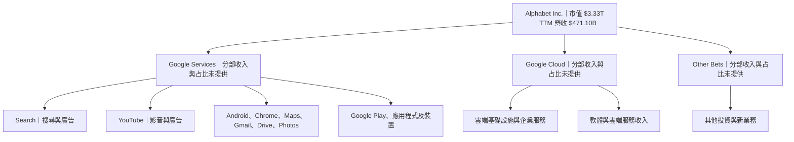

搜尋與影音廣告主要透過廣告主付費變現；雲端則提供基礎設施與企業軟體服務。各分部營收、分部利潤及廣告收入占比未提供，不能以集團總收入反推。

### 2.2 市場份額

市場份額數據未提供，故不繪製市占圖或填入比例。相對規模方面，Alphabet TTM 營收為 $471.10B，最新一季營收年增 24.7%；三家可比較同業的最新季度營收成長率中，META 為 26.1%、MSFT 為 18.8%、AMZN 為 12.1%。

### 2.3 競爭護城河分析

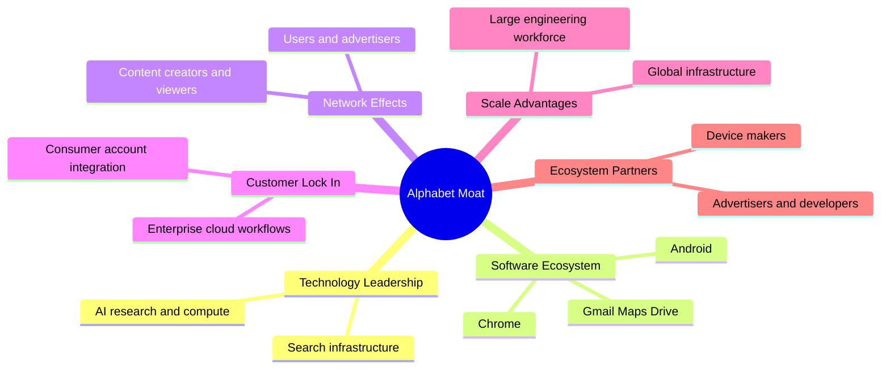

### 2.4 護城河強度

| 護城河項目 | 強度（強／中／弱） | 證據（引用數字或事實） | 會削弱它的情況 |
|------------|--------------------|------------------------|----------------|
| 技術與資料規模 | 強 | 搜尋、廣告、Android、YouTube、Cloud 等產品組合；TTM 營收 $471.10B | 搜尋品質落後、AI 回答介面改變流量與廣告模式 |
| 軟體生態系統 | 強 | Android、Chrome、Gmail、Maps、Drive 等服務可互相導流；分部活躍用戶數未提供 | 競爭平台降低預設使用或使用者轉向其他生態系 |
| 網路效應 | 強 | 搜尋使用者與廣告主、YouTube 觀眾與創作者形成多邊平台；量化網路效應指標未提供 | 廣告主回報下降、創作者與流量遷移 |
| 客戶鎖定 | 中 | Google Cloud 提供企業雲與軟體服務，但續約率、客戶集中度未提供 | 雲端服務商品化、轉換成本降低 |
| 規模效應 | 強 | 204,757 名員工、TTM 營收 $471.10B；營業利益率 33.3% | 資本密集度升高、監管限制規模優勢 |
| 生態夥伴 | 中 | 裝置商、開發者、廣告主與內容創作者共同參與；相關分潤與夥伴數據未提供 | 監管改變預設搜尋安排或分潤條件 |

1.1 護城河評分為 9.0/10，理由是 Alphabet 具多產品平台與規模優勢，但廣告依賴度、AI 搜尋轉型及監管風險尚需持續驗證。

## 3. 損益表深度分析

### 3.1 年度收入成長趨勢（近 4 年）

╔══════════════════════════════════════════════════════════════════╗  
║             Alphabet 年度收入趨勢（FY2022–FY2025）               ║  
╠══════════════════════════════════════════════════════════════════╣  
║ FY2022  $282.84B  ██████████████░░░░░░░░░░  YoY +9.78% 🟡       ║  
║ FY2023  $307.39B  ███████████████░░░░░░░░░  YoY +8.68% 🟡       ║  
║ FY2024  $350.02B  ██████████████████░░░░░░  YoY +13.87% 🟢      ║  
║ FY2025  $402.84B  ████████████████████░░░░  YoY +15.09% 🟢      ║  
╠══════════════════════════════════════════════════════════════════╣  
║ FY2022–FY2025 收入 CAGR：(402.84 ÷ 282.84)^(1/3)−1 = 12.5%      ║  
╚══════════════════════════════════════════════════════════════════╝  

FY2022–FY2025 的營收 CAGR 約 12.5%；近兩年增速提高，TTM 成長率進一步達 22.2%。最新一季營收年增 24.7%，顯示近期收入動能高於年度歷史增速；但需觀察增長是否伴隨更高資本支出。

### 3.2 季度收入趨勢分析

| 季度 | 營收 | QoQ 成長 | YoY 成長 | 備註 |
|------|------:|---------:|---------:|------|
| 2025 Q4 | $113.83B | +26.1% | +18.0% | QoQ 相較 2025 Q3；具有年末季節性影響 |
| 2026 Q1 | $109.90B | −3.5% | +21.8% | QoQ = 109.90 ÷ 113.83 − 1；同比增速繼續上行 |
| 2026 Q2 | $119.80B | +9.0% | +24.2% | QoQ = 119.80 ÷ 109.90 − 1 |
| 2026 Q3 | $127.58B | +6.5% | +24.7% | QoQ = 127.58 ÷ 119.80 − 1；最新一季同比增速高於 TTM |

### 3.3 利潤率演變分析

| 利潤率指標 | FY2022 | FY2023 | FY2024 | FY2025 | 趨勢 | 評估 |
|------------|--------|--------|--------|--------|------|------|
| **毛利率** | 55.4% | 56.6% | 58.2% | 59.6% | ↗️ 連續改善 | 🟢 |
| **營業利益率** | 26.5% | 27.4% | 32.1% | 32.0% | ↗️ 2024 上升、2025 大致持平 | 🟢 |
| **淨利率** | 21.2% | 24.0% | 28.6% | 32.8% | ↗️ 逐年增加 | 🟢 |

FY2022–FY2025 毛利率提高，反映收入成長高於直接服務成本增長；營業利益率在 2024 年由 27.4% 升至 32.1%，2025 年為 32.0%，顯示營業槓桿已顯著釋放但未再擴張。這些年度利潤率以年度收入及毛利、營業利益計算；TTM 營業利益率採程式核定值 33.3%，最新一季採核定值 31.8%。不同期間不可混為一談。

### 3.4 費用結構分析

FY2025 收入與營業費用分解如下；「其他營業費用」由毛利減研發費用及營業利益計算，代表多項費用合計，不等於單一報表科目。

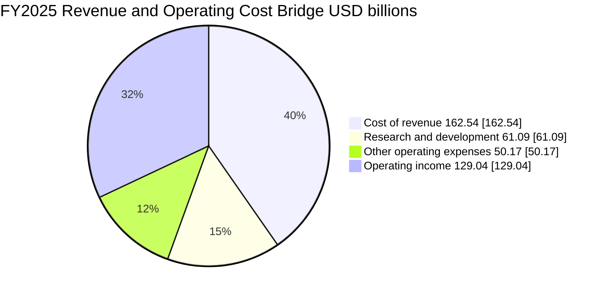

╔══════════════════════════════════════════════════════════════════╗  
║ FY2025 營收 $402.84B：營業成本 $162.54B                         ║  
║ 研發 $61.09B；其他營業費用 $50.17B；營業利益 $129.04B           ║  
║ 營業利益率 = $129.04B ÷ $402.84B = 32.0%                        ║  
╚══════════════════════════════════════════════════════════════════╝  

### 3.5 季度 EPS 趨勢與盈餘品質（Quality of Earnings）

| 盈餘品質項目 | 數值/佔比 | 評估 |
|--------------|-----------|------|
| 股權薪酬 SBC / 營收 | 2025 年 $24.95B ÷ $402.84B = **6.2%** | 🟡 SBC 為非現金費用，但對股東的經濟成本會透過稀釋或回購抵銷 |
| SBC / 營業現金流 | 2025 年 $24.95B ÷ $164.71B = **15.1%** | 🟡 不可忽略，需同時監控股數變動 |
| FCF / 淨利 | TTM FCF $19.75B ÷ TTM 淨利 $235.694B = **8.4%** | 🔴 現金轉換偏低；主要需檢視高資本支出而非直接解讀為低獲利 |
| 一次性/非經常性損益 | 最新季度 EPS 年增 −25.3%、淨利年增 −24.3%；一次性明細未提供 | 🟡 無法判定異常項目是否主導單季變化 |
| 有效稅率異常 | 16.8%（最新年度有效稅率） | 🟢 未提供證據顯示極端稅率利益 |
| 資本化支出 vs 費用化 | TTM Capex $159.80B；資本化資產明細與折舊攤銷完整拆分未提供 | 🟡 投資前置可能令當期 FCF 偏低；需追蹤折舊與產能回報 |

最近四季 EPS surprise 的估值與實際值均為缺失（N/A），所以不能嚴謹判斷「超預期／不及預期」。StockAnalysis 所列季度 EPS 為 2025 Q4 $2.81、2026 Q1 $5.11、Q2 $9.11、Q3 $2.14，但同一季度淨利數據變動極大，且季度 EPS 序列與年增率口徑不完全一致；本報告以核定的最新季度 EPS 年增率 −25.3% 作為比較依據，不以不一致資料自行補算 surprise。盈餘品質結論：GAAP 獲利仍有大量營業利潤支撐，但 TTM FCF 對淨利轉換率僅 8.4%，故當前估值應更重視資本支出與現金流恢復，而非單看 EPS。

## 4. 資產負債表分析

### 4.1 資產結構分解

截至 2026-09-30，總資產 $1,003.312B。下列非流動資產為總資產減流動資產；細項加總與報表可能有四捨五入差異。

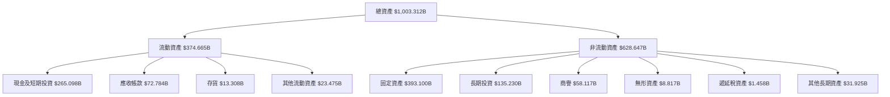

### 4.2 流動性與營運資金分析

| 指標 | 最新值 | 評估 |
|------|--------|------|
| 流動比率 | 2.786 | 🟢 短期資產相對流動負債有緩衝 |
| 速動比率 | 2.512 | 🟢 排除存貨後仍具流動性 |
| 現金及短期投資 | $265.10B | 🟢 可提供投資與應對風險的資金彈性 |

| 指標 | 最新 TTM | 一年前 TTM | 變化 | 解讀 |
|------|----------|------------|------|------|
| DSO 應收帳款天數 | 56 天 | 54 天 | +2 天 | 🟡 收款週期略延長；可能反映收入組合或收款時點，仍需追蹤 |
| DIO 存貨天數 | 26 天 | N/A | N/A | 一年前無可用存貨餘額，不能比較 |
| DPO 應付帳款天數 | 43 天 | N/A | N/A | 一年前無可用數值 |
| CCC 現金轉換週期 | 39 天 | N/A | N/A | 一年前無可用數值；最新 CCC = 56 + 26 − 43 = 39 天 |

### 4.3 債務結構分析

核定財務數字顯示總債務 $126.12B，現金及短期投資 $265.10B，淨現金 $138.98B。其他市場資料來源列出 $150.33B 總債務與 $114.77B 淨現金，與 SEC 核定口徑不一致；本報告估值與淨現金判斷採核定口徑，差異須在後續申報中核對。

╔══════════════════════════════════════════════════════════════════╗  
║                    Alphabet 債務健康診斷                        ║  
╠══════════════════════════════════════════════════════════════════╣  
║ 總債務：        $126.12B  ██████████░░░░░░░░░░                 ║  
║ 現金+短期投資： $265.10B  ████████████████████                 ║  
║ 淨現金：        $138.98B  ██████████░░░░░░░░░░  🟢            ║  
║ Debt/EBITDA：   N/A（口徑及 EBITDA 同期分母未提供核定值）        ║  
║ Interest Coverage：N/A（利息費用與利息保障倍數未提供）          ║  
║ 債務成本（稅前）：0.58%（資本成本數據）                          ║  
╚══════════════════════════════════════════════════════════════════╝  

### 4.4 股東權益趨勢

| 年度 | 股東權益 | 年變化 | 說明 |
|------|---------:|-------:|------|
| 2022 | $256.14B | — | 起始比較年度 |
| 2023 | $283.38B | +10.6% | 權益增加 |
| 2024 | $325.08B | +14.7% | 隨保留盈餘與資本項目增加 |
| 2025 | $415.26B | +27.7% | 增幅較大；資本變動明細未在所列資料中拆分 |

## 5. 現金流量深度分析

### 5.1 現金流量瀑布圖

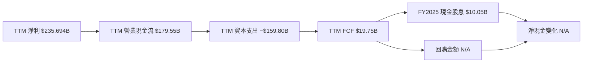

股息採 FY2025 數字，其他節點為 TTM，期間不同，不應直接視作同一期間的現金流加總。TTM FCF 定義為營業現金流減資本支出。

### 5.2 FCF 轉換率趨勢

| 年度 | 營業現金流 | 資本支出 | FCF | 淨利 | FCF / 淨利 |
|------|-----------:|---------:|----:|-----:|-----------:|
| 2022 | $91.50B | $31.48B | $60.01B | $59.97B | 100.1% |
| 2023 | $101.75B | $32.25B | $69.50B | $73.80B | 94.2% |
| 2024 | $125.30B | $52.53B | $72.76B | $100.12B | 72.7% |
| 2025 | $164.71B | $91.45B | $73.27B | $132.17B | 55.4% |
| 最新 TTM | $179.55B | $159.80B | $19.75B | $235.694B | 8.4% |

年度表與 TTM 核定值可能因期間及資料源口徑不同而不完全對應。整體方向是營業現金流增加，但資本支出增速更快，壓低可自由分配現金。

### 5.3 自由現金流趨勢

╔══════════════════════════════════════════════════════════════════╗  
║                    自由現金流與 FCF Yield                         ║  
╠══════════════════════════════════════════════════════════════════╣  
║ FY2022  $60.01B  ████████████████░░░░░░░░  歷史年度 FCF         ║  
║ FY2023  $69.50B  ██████████████████░░░░░░  歷史年度 FCF         ║  
║ FY2024  $72.76B  ███████████████████░░░░░  FCF Yield N/A        ║  
║ FY2025  $73.27B  ███████████████████░░░░░  FCF Yield N/A        ║  
║ TTM     $19.75B  █████░░░░░░░░░░░░░░░░░░░  Yield 0.59%         ║  
╚══════════════════════════════════════════════════════════════════╝  

### 5.4 資本配置評估

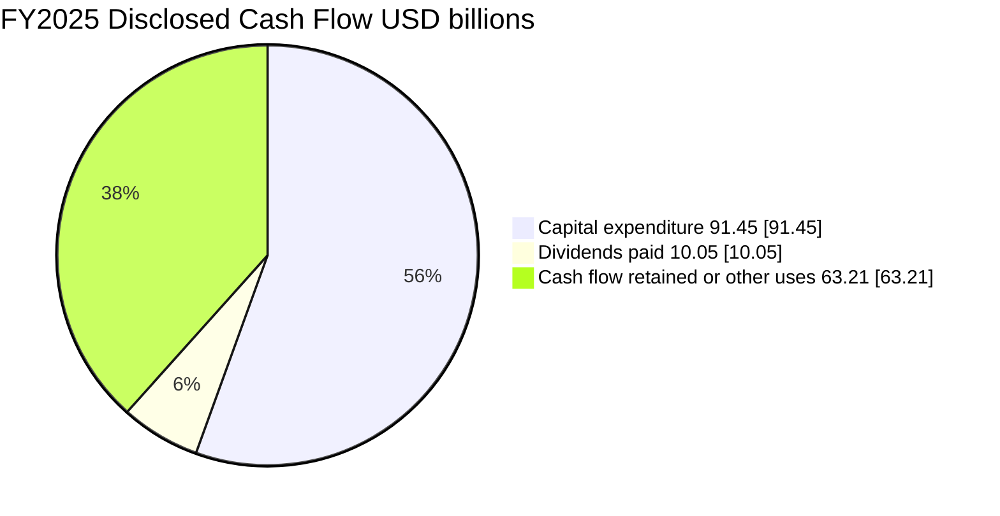

上述圓餅只呈現 FY2025 營業現金流 $164.71B 的分類；「留存或其他用途」為營業現金流減資本支出及股息的算術餘額，並非單一申報科目。公司 FY2025 Capex $91.45B、股息 $10.05B；回購金額未提供，不能推定。

| 配置項目 | 已知數據 | 評估 |
|----------|----------|------|
| 資本支出 | FY2025 $91.45B；TTM $159.80B | 🟡 投資明顯增加，需以雲端、AI 及廣告變現回報檢驗 |
| 股息 | FY2025 $10.05B | 🟡 有分配但相對營業現金流有限 |
| 回購 | N/A | 無法量化回購與 SBC 對股數的抵銷程度 |
| 留存現金／其他用途 | 精確分類 N/A | 淨現金 $138.98B 提供財務彈性 |

## 6. 獲利能力與資本效率

### 6.1 ROE / ROA / ROIC 趨勢

| 指標 | 最新 TTM | 歷史序列 | 評估 |
|------|----------|----------|------|
| ROE | 34.8%（品質指標口徑） | N/A（同口徑歷史未提供） | 🟢 高，但受淨利率與權益乘數共同影響 |
| ROA | N/A（最新核定口徑未列數值） | Piotroski 測試確認 ROA > 0 且高於一年前 | 🟢 方向正向，缺精確趨勢值 |
| ROIC | 23.9% | N/A（同口徑歷史未提供） | 🟢 明顯高於 WACC |
| 產業均值 | N/A（未提供可核實資料） | — | 不作無來源比較 |

### 6.2 ROIC vs WACC 分析（核心價值創造判斷）

╔══════════════════════════════════════════════════════════════════╗  
║                ROIC vs WACC 深度分析                            ║  
╠══════════════════════════════════════════════════════════════════╣  
║ WACC 採用值：10.43%（資本成本資料核定值）                       ║  
║ ├── 無風險利率：5.05%                                            ║  
║ ├── ERP：5.00%                                                   ║  
║ ├── Beta：原始 1.23；調整後 1.15                                 ║  
║ ├── 股權成本：10.81%                                             ║  
║ ├── 稅前債務成本：0.58%；稅率：16.8%                             ║  
║ ├── 股權／債務權重：96.4%／3.6%                                  ║  
║ └── 採用 WACC：10.43%                                            ║  
║                                                                  ║  
║ ROIC（TTM）：23.9%                                               ║  
║ EVA 利差 = ROIC − WACC = 23.9% − 10.43% = +13.47pp              ║  
║ ROIC  23.9%  ▓▓▓▓▓▓▓▓▓▓▓▓▓▓░░░░░░░░░░ 🟢                       ║  
║ WACC  10.43% ▓▓▓▓▓▓░░░░░░░░░░░░░░░░░░ ──                       ║  
║ 結論：ROIC 約為 WACC 的 2.29 倍，仍在創造股東價值               ║  
╚══════════════════════════════════════════════════════════════════╝  

**口徑核對說明：**資本成本資料提供的 WACC 10.43% 是本報告採用值，不另行替換。以已四捨五入的股權成本 10.81%、稅前債務成本 0.58%、稅率 16.8%、權重 96.4%／3.6% 直接重算，結果約 10.34%，與核定 WACC 相差約 0.09 個百分點；這表示底層未四捨五入輸入或計算口徑未完整列出。ROIC 與 DCF 均依規定使用核定 WACC 10.43%，該差異列為審計限制。

### 6.3 杜邦三因素分解

| 因素 | 數值（TTM） | 解讀 |
|------|-------------|------|
| 淨利率 | 50.0% | 高淨利率是 ROE 的主要推力 |
| 資產週轉率 | 0.47 | 大型平台與資產投入使週轉率低於 1 |
| 權益乘數 | 1.48 | 槓桿適中，並非以高槓桿撐高 ROE |
| **ROE** | **34.8%** | 50.0% × 0.47 × 1.48 = 約 34.8% |

### 6.4 財務體質：Piotroski F-Score

Piotroski F-Score 為 **4 / 8**；有一項毛利率測試因缺資料無法判定，故依可判定測試數呈現。

| 測試 | 結果 | 解讀 |
|------|------|------|
| ROA > 0 | ✅ 通過 | 獲利為正 |
| 營業現金流 > 0 | ✅ 通過 | 營運現金流為正 |
| ROA 高於一年前 | ✅ 通過 | 資產獲利能力改善 |
| 營業現金流 > 淨利 | ❌ 未通過 | 現金流未高於帳面淨利，與高資本支出、現金轉換下降相符 |
| 長期負債 ÷ 總資產低於一年前 | ❌ 未通過 | 資本結構的該項比較沒有改善 |
| 流動比率高於一年前 | ✅ 通過 | 流動性相對改善 |
| 稀釋股數未增加 | ❌ 未通過 | 股數增加可能抵銷部分每股價值成長 |
| 毛利率高於一年前 | — 無法判定 | 缺少測試所需資料 |
| 資產週轉率高於一年前 | ❌ 未通過 | 資產擴張尚未轉化為更高周轉 |

## 7. 相對估值分析

### 7.1 同業估值比較表格

| 估值指標 | **GOOG** | **META** | **MSFT** | **AMZN** | GOOG 評估 |
|----------|---------:|---------:|---------:|---------:|-----------|
| **Trailing P/E** | 14.1x | 20.3x | 26.0x | 20.8x | 🟢 低於三家同業 |
| **Forward P/E** | 17.72x | 16.7x | 20.6x | 23.6x | 🟡 高於 META、低於 MSFT 與 AMZN |
| **P/S Ratio** | 7.1x | 6.3x | 10.7x | 3.5x | 🟡 位於同業差異化區間 |
| **EV/EBITDA** | 17.4x | 13.4x | 18.3x | 16.2x | 🟡 高於 META、AMZN，低於 MSFT |
| **最新季度營收 YoY** | 24.7% | 26.1% | 18.8% | 12.1% | 🟢 成長率接近 META 並高於其餘兩家 |
| **TTM 毛利率** | 60.9% | 81.0% | 67.7% | 51.4% | 🟡 高於 AMZN、低於 META 與 MSFT |

GOOG 的 trailing P/E 相對便宜，但 forward P/E 不低於全部同業；倍數差異需與各公司業務組合及利潤結構一併解讀，不能單靠單一倍數判定低估。

### 7.2 歷史估值區間分析

╔══════════════════════════════════════════════════════════════════╗  
║                 P/E 五年區間與目前位置                           ║  
╠══════════════════════════════════════════════════════════════════╣  
║ 五年低點 1.3x ├────────────●──────────────┤ 五年高點 29.0x       ║  
║                         現值 14.1x                               ║  
║ 五年中位數 21.9x ｜目前百分位 29%                                ║  
║ P/S：現值 7.1x｜中位數 6.1x｜百分位 67%                         ║  
║ EV/EBITDA：現值 17.4x｜中位數 19.1x｜百分位 33%                 ║  
╚══════════════════════════════════════════════════════════════════╝  

### 7.3 情境價值（Bear / Base / Bull，照抄 DCF MODEL 的 Scenarios）

| 情境 | 第 1 年營收成長 | 期末營業利潤率 | WACC | 每股價值 | 相對現價 | 機率 | 會發生的條件 |
|------|----------------|----------------|------|----------|----------|------|--------------|
| 🔴 悲觀 | 11.1% | 27.2% | 11.43% | $106.13 | −60.8% | 25% | 搜尋或廣告成長下滑、投資回報偏低、利潤率受競爭與成本壓力收縮 |
| 🟡 基準 | 22.2% | 32.0% | 10.43% | $242.21 | −10.6% | 50% | 近期高成長逐步回落，長期利潤率略降，資本支出占比淡出 |
| 🟢 樂觀 | 33.3% | 35.2% | 9.43% | $504.13 | +86.0% | 25% | AI、雲端及廣告共同推升成長，利潤率擴張且折現率較低 |

### 7.4 相對估值隱含價格區間

╔══════════════════════════════════════════════════════════════════╗  
║ 相對估值與參考價位                                               ║  
╠══════════════════════════════════════════════════════════════════╣  
║ 同業 Forward P/E：$314.94（peer median 20.6x × Forward EPS $15.30）║  
║ DCF 基準：         $242.21                                        ║  
║ 同業 EV/EBITDA：   $254.83（peer median 16.2x × TTM EBITDA，加淨現金）║  
║ 現價：             $271.02                                        ║  
║ 分析師共識：       $389.00（15 位分析師平均目標價）              ║  
╚══════════════════════════════════════════════════════════════════╝  

以上相對估值均採同業中位數，而非 GOOG 自身現行倍數。Forward P/E 的同業中位數為 20.6x；EV/EBITDA 的同業中位數為 16.2x。估值方法的權重與完整數字於 8.8 列示。

## 8. DCF 內在價值評估（Discounted Cash Flow）

> DCF 假設、逐年預測、終值、敏感度及情境價值均按程式計算輸出引用。本節不重建另一套模型；缺少的底層資料明確標示 N/A。

### 8.0 估值推理鏈（Thinking Logic）

**Step 1 — 價值來源與主導變數**

GOOG 的價值主要取決於搜尋與廣告、Google Cloud，以及其他新業務的未來現金流；但分部收入占比未提供，不能量化各來源占集團營收比例。DCF 直接以集團 TTM 營收 $471.10B 為起點。模型中對估值影響最大的變數之一是長期資本支出／營收比率：Capex 由 FY+1 的 33.9% 淡出至 FY+10 的 6.5%，直接驅動模型後期 FCFF 增加。

| 決策點 | 本報告採用 | 理由 | 曾考慮但否決 | 否決理由 |
|--------|-----------|------|--------------|----------|
| 現金流定義 | FCFF | 對應 WACC 折現並推得企業價值 | FCFE | 模型已使用 WACC 及 EV 橋接 |
| 預測期 N | 10 年 | DCF MODEL 固定輸入 | 5 年 | 不符合指定模型；不得自行改動 |
| 終值方法 | Gordon Growth | 模型提供終值計算 | 退出倍數 | DCF MODEL 未提供可稽核退出倍數 |
| EBIT 基礎 | GAAP EBIT | 模型明示使用 GAAP EBIT | 非 GAAP EBIT | 會改變 SBC 及營業費用處理 |

**Step 3 — 高／中敏感度輸入推導**

- **營收成長**：錨點＝TTM vs prior TTM 成長 22.2% → 調整＝首年沿用近期成長，再線性淡出至年 10 的 3.0% → **採用首年 22.2%、第十年 3.0%** → 曾考慮更快淡出，但模型明示採線性淡出；不能更換模型輸入。
- **期末營業利潤率**：錨點＝TTM 33.3% → 調整＝向過去五個財政年度中位數淡出 → **採用第十年 32.0%** → 曾考慮維持 33.3%，但模型指定回落至五年中位數。
- **預測期 N**：錨點＝模型規定 10 年 → 調整＝不作調整 → **採用 10 年** → 曾考慮縮短至 5 年，但不符合唯一 DCF 模型。
- **Capex / 營收**：錨點＝TTM 159.80 ÷ 471.10 = 33.9% → 調整＝逐步淡出，最後達 1.1 倍 D&A（模型列示第十年 6.5%）→ **FY+1 33.9% 至 FY+10 6.5%** → 曾考慮維持當前比率，但會與模型假設衝突；同時該大幅下降是模型最需質疑的假設。
- **永續成長率 g**：錨點＝模型長期終值輸入 3.0% → 調整＝不作調整，且低於 WACC 10.43% → **採用 3.0%** → 曾考慮更高終值成長，但沒有依據支持且會提高終值權重。
- **WACC**：錨點＝資本成本核定值 10.43% → 調整＝不另行計算 → **採用 10.43%** → 曾考慮以已四捨五入組成重算，但重算不與核定值完全相符，故不替代模型值。
- **GAAP EBIT／SBC／年稀釋**：錨點＝模型指定 GAAP EBIT、固定股數 → 調整＝不再另扣 SBC、不再額外稀釋 → **組合 (A)，年稀釋率 0%** → 否決再扣 SBC 或另加稀釋，避免重複計量。
- **終值方法**：錨點＝DCF MODEL 以 FY+10 FCFF 做 Gordon Growth → 調整＝無 → **Gordon Growth** → 退出倍數未提供，不能自行製作交叉驗證。
- **有效稅率**：錨點與採用值均為最新年度 16.8%。
- **D&A / 營收**：錨點與採用值均為 TTM 5.9%。
- **ΔWC / 營收增額**：模型未模擬營運資金變動，故不建模；不可靜默假設為其他數值。

**Step 4 — 最脆弱環節**

最脆弱假設是 Capex / 營收由 33.9% 降至 6.5%；若高資本支出成為結構性需求，FCFF 將低於模型預測，基準 DCF $242.21 有下修風險，方向與悲觀情境 $106.13 相符。

**Step 5 — 計算路徑**

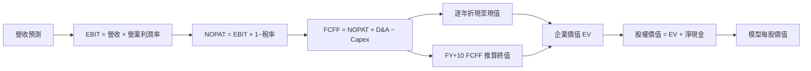

### 8.1 模型假設總表（Model Inputs）

| 假設項目 | 採用值 | 依據 / 來源 | 敏感度 |
|----------|--------|-------------|--------|
| 預測期長度 **N** | 10 年 | DCF MODEL 固定輸入；不另行改動 | 🟡 中 |
| 營收成長 | FY+1 22.2%，FY+10 3.0%，線性淡出 | TTM vs prior TTM 成長 22.2%；模型輸入 | 🔴 高 |
| 營業利潤率 | FY+1 33.3% → FY+10 32.0% | TTM 營業利益率與過去五個財政年度中位數 | 🔴 高 |
| 有效稅率 | 16.8% | 最新年度有效稅率 | 🟢 低 |
| Capex / 營收 | FY+1 33.9% → FY+10 6.5% | TTM Capex / 營收及模型淡出規則 | 🔴 高 |
| D&A / 營收 | 5.9% | TTM 比率 | 🟢 低 |
| 營運資金變動 | 未建模 | DCF MODEL 明示 working capital is not modelled | 🟡 中 |
| EBIT 基礎 | GAAP | 模型明示 GAAP EBIT | 🟡 中 |
| SBC 處理 | GAAP EBIT 已扣費用；不再扣 SBC | 模型指定組合 A，固定股數 | 🟡 中 |
| 年稀釋率 | 0% | 組合 A；不另行擴大股數 | 🟡 中 |
| 永續成長率 g | 3.0% | DCF MODEL 固定輸入，低於 WACC | 🔴 高 |
| 終值方法 | Gordon Growth | DCF MODEL 提供；退出倍數未提供 | 🔴 高 |
| WACC | 10.43% | 資本成本核定值 | 🔴 高 |

本模型採用 **(A) GAAP EBIT + 固定股數**，故 SBC 已透過 GAAP 費用計入一次；不另扣 SBC，也不設年稀釋。

### 8.2 折現率推導（WACC）

╔══════════════════════════════════════════════════════════════════╗  
║                    WACC 推導（折現率）                           ║  
╠══════════════════════════════════════════════════════════════════╣  
║ 無風險利率 Rf：5.05%                                             ║  
║ ERP：5.00%                                                       ║  
║ 原始 Beta：1.23；調整 Beta：⅔×1.23+⅓×1 = 1.153 ≈ 1.15           ║  
║ Ke = 5.05% + 1.15 × 5.00% = 10.80%；核定 Ke 為 10.81%           ║  
║ 稅前 Kd：0.58%；有效稅率：16.8%                                  ║  
║ 稅後 Kd = 0.58% × (1−16.8%) = 0.48256% ≈ 0.48%                  ║  
║ 股權／債務權重：96.4%／3.6%                                      ║  
║ 採用 WACC：10.43%（核定值）                                      ║  
╚══════════════════════════════════════════════════════════════════╝  

逐步核對：

1. **Ke（CAPM）** = 5.05% + 1.15 × 5.00% = 10.80%；資本成本資料列示 **10.81%**，差異來自未四捨五入輸入。
2. **稅前 Kd** = 0.58%（利息費用及平均計息負債的底層金額未提供，故不能重建除法）。
3. **稅後 Kd** = 0.58% × (1 − 16.8%) = 0.48256% ≈ 0.48%。
4. **權重** = 股權 96.4%；債務 3.6%；合計 100%。計算資本結構所用市值及計息負債的精確底層口徑未提供。
5. 以已四捨五入值重算：96.4% × 10.81% + 3.6% × 0.48256% = 10.3386% ≈ **10.34%**，而核定 WACC 為 **10.43%**。本報告依規定採用核定值 10.43%，差異約 0.09 個百分點，不能以缺少的輸入自行調整。

資本成本資料未提供 10 年期美債數據的具體觀察日期、ERP 的細部估計方法、額外規模或國別溢酬資料，因此不補造其來源細節。

### 8.3 逐年自由現金流預測（基準情境）

單位：美元十億；折現因子沿用模型列示值。模型明示營運資金未建模，因此不列 ΔWC 行。數值依 DCF MODEL 照列。

| 年度 | FY+1 | FY+2 | FY+3 | FY+4 | FY+5 | FY+6 | FY+7 | FY+8 | FY+9 | FY+10 |
|------|------:|------:|------:|------:|------:|------:|------:|------:|------:|-------:|
| 營收 | 575.74 | 691.33 | 815.37 | 944.26 | 1,073.37 | 1,197.22 | 1,309.81 | 1,405.02 | 1,477.16 | 1,521.48 |
| 營收 YoY | 22.2% | 20.1% | 17.9% | 15.8% | 13.7% | 11.5% | 9.4% | 7.3% | 5.1% | 3.0% |
| 營業利潤率 | 33.3% | 33.2% | 33.0% | 32.9% | 32.7% | 32.6% | 32.5% | 32.3% | 32.2% | 32.0% |
| EBIT | 191.84 | 229.37 | 269.36 | 310.58 | 351.51 | 390.36 | 425.19 | 454.09 | 475.29 | 487.37 |
| − 稅 | (32.20) | (38.50) | (45.21) | (52.13) | (58.99) | (65.51) | (71.36) | (76.21) | (79.77) | (81.80) |
| NOPAT | 159.65 | 190.87 | 224.15 | 258.46 | 292.52 | 324.84 | 353.83 | 377.88 | 395.52 | 405.57 |
| + D&A | 34.21 | 41.08 | 48.45 | 56.11 | 63.79 | 71.14 | 77.84 | 83.49 | 87.78 | 90.41 |
| − Capex | (195.30) | (213.47) | (226.97) | (234.11) | (233.46) | (223.97) | (205.18) | (177.35) | (141.51) | (99.46) |
| **= FCFF** | **−1.44** | **18.48** | **45.64** | **80.46** | **122.84** | **172.02** | **226.48** | **284.03** | **341.80** | **396.53** |
| 折現因子 @10.43% | 0.906 | 0.820 | 0.743 | 0.672 | 0.609 | 0.551 | 0.499 | 0.452 | 0.409 | 0.371 |
| **FCFF 現值 PV** | **−1.30** | **15.16** | **33.89** | **54.10** | **74.80** | **94.86** | **113.10** | **128.44** | **139.97** | **147.04** |

模型列示預測期 PV 合計 **$800.05B**。按表內已四捨五入 PV 相加，得 −1.30 + 15.16 + 33.89 + 54.10 + 74.80 + 94.86 + 113.10 + 128.44 + 139.97 + 147.04 = **$800.06B**，與模型總數相差 $0.01B，屬逐年四捨五入尾差。

**FY+1 逐步演算（模型數值與四捨五入口徑）：**

1. 營收 = $471.10B × (1 + 22.2%) = $575.7442B ≈ **$575.74B**。
2. EBIT = $575.74B × 33.3% = $191.7214B；模型列示 **$191.84B**。差異顯示模型使用未列明的精確利潤率／未四捨五入營收，不能用表格精度完全重建。
3. 稅 = 模型列示 **$32.20B**；有效稅率 16.8%。
4. NOPAT = 模型列示 EBIT − 稅 = **$159.65B**（因底層未四捨五入值未提供，表面數字相減存在尾差）。
5. D&A = $575.74B × 5.9% = $33.97B；模型列示 **$34.21B**，同樣存在未列明的精確輸入差異。
6. Capex = 模型列示 **$195.30B**。
7. ΔWC = **未建模**。
8. FCFF = 模型列示 NOPAT + D&A − Capex = **−$1.44B**。
9. 折現因子 = 模型列示 **0.906**；PV = −$1.44B × 0.906 ≈ **−$1.30B**。

**複算限制：**由於模型只提供四捨五入後的營收、利潤率及財務數值，FY+1 的單一乘法部分與列示 EBIT、D&A 不完全一致。為遵守不得改動 DCF MODEL 的要求，本表保留模型原值，並將差異揭露，不以自行推算的數字替換。

- 預測 FCFF CAGR：因 FY+1 FCFF 為負、FY+10 為正，跨期 CAGR **不適用**；歷史 FY2022–FY2025 FCF 約由 $60.01B 至 $73.27B，年化約 6.9%。模型預測的快速改善主要由 Capex 占比淡出驅動。
- FY+10 FCFF 利潤率 = 396.53 ÷ 1,521.48 = **26.1%**；TTM FCF 利潤率 = 19.75 ÷ 471.10 = **4.2%**。同業最佳 FCF 利潤率未提供，不作比較。
- FY+1 FCFF 為負，主因模型預設 Capex $195.30B 高於 NOPAT 與 D&A 合計；不會單獨否定估值，但使估值更依賴後期投資回報。

╔══════════════════════════════════════════════════════════════════╗  
║           自由現金流：歷史實際 vs 模型預測                      ║  
╠══════════════════════════════════════════════════════════════════╣  
║ FY2022（實） $60.01B  ████████░░░░░░░░░░░░░░                    ║  
║ FY2023（實） $69.50B  █████████░░░░░░░░░░░░░                    ║  
║ FY2025（實） $73.27B  █████████░░░░░░░░░░░░░                    ║  
║ FY+1（預）   −$1.44B  現金流為負                                 ║  
║ FY+10（預）  $396.53B ██████████████████████                    ║  
╠══════════════════════════════════════════════════════════════════╣  
║ 模型後期增長依賴 Capex/營收由 33.9% 下降至 6.5%                 ║  
╚══════════════════════════════════════════════════════════════════╝  

### 8.4 終值計算（Terminal Value）

**適用性檢查：**WACC 10.43% vs g 3.0% → WACC > g？✅

| 方法 | 計算式 | 終值 TV | TV 現值 | 佔總 EV 比重 |
|------|--------|---------|---------|--------------|
| Gordon Growth | $396.53 × (1+3.0%) ÷ (10.43%−3.0%) | $5,497.77B | $2,038.72B | 71.8% |
| 退出倍數法 | N/A（DCF MODEL 未提供退出倍數） | N/A | N/A | N/A |

1. FY+10 FCFF = **$396.53B**。
2. 分子 = $396.53B × 1.03 = **$408.4259B**。
3. 分母 = 10.43% − 3.0% = **7.43%**；終值依模型列示為 **$5,497.77B**。
4. PV(TV) 依模型列示為 **$2,038.72B**。
5. 終值占比 = $2,038.72B ÷ $2,838.77B = **71.8%**（模型列示）。

PV(TV) 占 EV 的 71.8%，尚未超過 75%警戒線，但估值仍高度依賴終值假設。由於退出倍數法的必要輸入未提供，本報告不自行補做第二套終值計算。

### 8.5 企業價值 → 每股內在價值（Bridge）

╔══════════════════════════════════════════════════════════════════╗  
║              企業價值 → 每股內在價值 橋接表                      ║  
╠══════════════════════════════════════════════════════════════════╣  
║ 預測期 FCF 現值合計              +$800.05B                       ║  
║ 終值現值 PV(TV)                 +$2,038.72B                      ║  
║ = 企業價值 EV                    $2,838.77B                      ║  
║ + 淨現金                         +$138.98B                       ║  
║ = 股權價值                       $2,977.75B                      ║  
║ 每股價值（模型指定換算）          $242.21                         ║  
║ 2026-11-19 收盤價                 $271.02                         ║  
║ 折溢價：現價÷DCF價值−1             +11.9%（溢價）                 ║  
╚══════════════════════════════════════════════════════════════════╝  

1. EV = $800.05B + $2,038.72B = **$2,838.77B**。
2. 股權價值 = $2,838.77B + 淨現金 $138.98B = **$2,977.75B**。
3. 每股價值依模型指定公式：**股權價值 × 價格 ÷ 市值 = $242.21**。模型沒有使用可直接核對的稀釋股數除法；不可擅自以資料中互相不一致的股數替代。
4. 折溢價 = $271.02 ÷ $242.21 − 1 = **+11.9%**。模型另列「−10.6% vs price」，那是每股價值相對現價的下行幅度，不是本節折溢價定義。
5. 本節不計算 MOS；MOS 僅於 8.8 以加權合理價值為分母計算。

現金及債務採 2026-09-30 核定口徑的淨現金 $138.98B。模型的每股換算採其原有「股權價值 × price ÷ market cap」指定公式；由於所列市值、價格、股數在來源中並非完全同一口徑，無法以普通每股除法獨立複核。

### 8.6 敏感性分析（WACC × 永續成長率）

下表每格為 DCF MODEL 原列每股價值；括號為相對 $271.02 現價的上行／下行幅度，按「價值 ÷ 現價 − 1」計算並四捨五入至一位小數。基準格以粗體表示。

| g（列）／WACC（欄） | 8.43% | 9.43% | **10.43%（基準）** | 11.43% | 12.43% |
|-----------|------:|------:|--------------------:|-------:|-------:|
| **2.0%** | $313.54 (+15.7%) | $260.72 (−3.8%) | $221.12 (−18.4%) | $190.48 (−29.7%) | $166.19 (−38.7%) |
| **2.5%** | $333.97 (+23.2%) | $274.65 (+1.3%) | $231.00 (−14.8%) | $197.71 (−27.0%) | $171.62 (−36.7%) |
| **3.0%（基準）** | $358.15 (+32.1%) | $290.74 (+7.3%) | **$242.21 (−10.6%)** | $205.81 (−24.1%) | $177.62 (−34.5%) |
| **3.5%** | $387.25 (+42.9%) | $309.54 (+14.2%) | $255.04 (−5.9%) | $214.92 (−20.7%) | $184.30 (−31.9%) |
| **4.0%** | $422.91 (+56.0%) | $331.81 (+22.4%) | $269.87 (−0.4%) | $225.25 (−16.9%) | $191.76 (−29.2%) |

**非基準格示例：**所選格 WACC 9.43% > g 3.0% ✅。該格 DCF MODEL 結果為每股 $290.74。程式未提供該格的新預測期 PV、終值及橋接中間值；因此無法在不另建模型的前提下逐步重算，該中間算式為 N/A，結果照列模型矩陣。

| 情境 | 營收成長假設 | 期末營業利潤率 | g | WACC | 每股價值 | 相對現價 | 主觀機率 |
|------|-------------|----------------|---:|-----:|---------:|---------:|----------:|
| 🔴 悲觀 | 年 1 11.1% | 27.2% | 3.0%（模型固定，情境未另列） | 11.43% | $106.13 | −60.8% | 25% |
| 🟡 基準 | 年 1 22.2% | 32.0% | 3.0% | 10.43% | $242.21 | −10.6% | 50% |
| 🟢 樂觀 | 年 1 33.3% | 35.2% | 3.0%（模型固定，情境未另列） | 9.43% | $504.13 | +86.0% | 25% |
| **機率加權** | — | — | — | — | **$273.67** | **+1.0%** | 100% |

完整的悲觀與樂觀情境逐年營收、FY+10 FCFF、終值中間值未列於模型輸出，故不能照提示另行拼建計算鏈。加權值 = $106.13 × 25% + $242.21 × 50% + $504.13 × 25% = $26.5325 + $121.105 + $126.0325 = **$273.67**；此數僅作情境參考，8.8 仍使用基準 DCF $242.21。

- **g 變動**：基準 WACC 10.43% 下，g 由 2.0% 的 $221.12 升至 3.0% 的 $242.21，增 **$21.09**；由 3.0% 升至 4.0% 的 $269.87，增 **$27.66**。
- **WACC 變動**：g=3.0% 下，WACC 由 9.43% 的 $290.74 升至 10.43% 的 $242.21，下降 **$48.53**；由 10.43% 升至 11.43% 的 $205.81，下降 **$36.40**。
- 期末營業利潤率每 +1 個百分點的價值變化：**N/A（敏感度矩陣未提供，且不可另建 DCF）**。
- 在已列敏感度區間內，WACC 變動影響較大；但模型核心營運風險仍是 Capex 淡出假設，與 8.0 指出的主導假設相呼應。

### 8.7 反推 DCF（Reverse DCF：市場在預期什麼）

DCF MODEL 僅提供兩個反推結果；其他變數不自行試算。

| 求解的變數（一次一個） | 其餘變數設定 | 市場隱含值（令 DCF = 現價） | 公司歷史實際 | 判斷 |
|------------------------|--------------|------------------------------|--------------|------|
| 年 1 營收成長率 | 其餘採基準值 | **25.1%** | TTM 成長 22.2%；最新季度 YoY 24.7% | 🟡 略高於 TTM，接近最新季度增速 |
| 固定營業利潤率 | 其餘採基準值 | **35.4%** | 基準模型 33.3% → 32.0% | 🔴 高於基準營業利潤率 |
| 永續成長率 g | N/A（模型未提供解） | 未計算 | — | N/A |
| 預測期長度 N | N/A（模型未提供解） | 未計算 | — | N/A |

模型只提供「年 1 成長 25.1%」及「固定營業利潤率 35.4%」兩個結果，未提供疊代軌跡或其他固定輸入的逐項數值。不能虛構收斂試算表。反推結果顯示，若固定其他基準條件，現價需較高首年營收成長或高於基準的營業利潤率支撐；這是市場隱含要求，不代表公司已達成。

### 8.8 估值三角驗證與安全邊際

| 估值方法 | 隱含每股價值 | 上行空間（÷現價） | 權重 | 說明 |
|----------|--------------|-------------------|------|------|
| DCF（基準） | $242.21 | −10.6% | 40% | 10 年 FCFF、WACC 10.43%、g 3.0% |
| 同業 Forward P/E | $314.94 | +16.2% | 25% | 同業中位數 20.6x × Forward EPS $15.30 |
| 同業 EV/EBITDA | $254.83 | −6.0% | 25% | 同業中位數 16.2x × TTM EBITDA，加淨現金 |
| 分析師共識目標價 | $389.00 | +43.5% | 10% | 15 位分析師平均目標價 |
| **加權合理價值** | **$278.23** | **+2.7%** | **100%** | 公司類型：獲利公司；方法均依固定權重納入 |

加權合理價值 = $242.21 × 40% + $314.94 × 25% + $254.83 × 25% + $389.00 × 10%  
= $96.884 + $78.735 + $63.7075 + $38.90  
= **$278.2265 ≈ $278.23**。權重合計 100%。四項方法均有可計算價值，沒有剔除方法。

╔══════════════════════════════════════════════════════════════════╗  
║                  估值區間與安全邊際                              ║  
╠══════════════════════════════════════════════════════════════════╣  
║ $106.13 ── $242.21 ── [$271.02] ── [$278.23] ── $504.13        ║  
║ 悲觀 DCF     基準 DCF       現價       加權合理值       樂觀 DCF   ║  
║                                                                  ║  
║ MOS = ($278.23−$271.02)÷$278.23 = +2.6%                         ║  
║ 上行空間 = ($278.23−$271.02)÷$271.02 = +2.7%                    ║  
║ MOS 評估：🔴 <10%，安全邊際有限                                  ║  
║ 參考買入區間：≤$250.41，對應加權價值折讓至少 10%                ║  
╚══════════════════════════════════════════════════════════════════╝  

建議買入觀察區間為約 **$242.21–$250.41**；這是估值參考，不等於保證底部。現價 $271.02 高於區間。

> 🔎 **程式複算（Python，依本節各項自動重算）**
>
> 加權合理價值 = $242.21 × 40% + $314.94 × 25% + $254.83 × 25% + $389.00 × 10% = **$278.23**（權重合計 100%）
>
> 以價格 $271.02 計：MOS = **+2.6%**，上行空間 = **+2.7%**
>
> ✅ 與本節所寫數值一致。

### 8.9 DCF 模型的局限與失效條件

- **終值依賴度：**PV(TV) 占 EV 71.8%，估值大部分由 FY+10 以後的假設決定。
- **最脆弱假設：**Capex / 營收從 33.9% 下降至 6.5%；若資本需求維持高位，FCFF 將低於模型預測。悲觀情境價值為 $106.13，但不能把該情境等同於 Capex 單一變動。
- **現金流近況：**TTM FCF $19.75B，FCF Yield 0.59%；FY+1 模型 FCFF −$1.44B。若資本支出仍高企，DCF 可靠度下降，估值應更多參照同業相對估值及分部現金流，而本報告未有足夠分部數據做 SOTP。
- **模型口徑限制：**營運資金未建模、股數以模型換算方式處理、底層未四捨五入輸入未提供；FY+1 中間算式與表列數存在小額差異。
- **第 10 章連結：**AI 競爭衝擊營收成長與利潤率；AI 基礎設施投資延續衝擊 Capex；監管限制搜尋分發或廣告技術，則可能壓低營收成長與終值。

### 8.10 複算檢核表（Audit Trail）

| # | 檢核項目 | 檢查方式 | 結果 |
|---|----------|----------|------|
| 1 | 所有高／中敏感度輸入均有推導 | 對照 8.0 與 8.1；部分模型未提供更細資料 | ⚠️ 已說明資料缺口 |
| 2 | 每個假設都有來歷 | 8.1 逐項列出來源或缺漏 | ✅ |
| 3 | WACC 五步算式與加權核對 | 已揭露圓整輸入重算 10.34% 與核定 10.43% 不符 | ⚠️ 原始未圓整輸入未提供 |
| 4 | Kd 分母與權重 D 範圍一致 | 平均計息負債與市值權重底層金額未提供 | ⚠️ 無法獨立檢核 |
| 5 | WACC 與第 6.2 節同值 | 均採 10.43% | ✅ |
| 6 | 逐年表格年度數等於 N | FY+1 至 FY+10 共 10 年，無年度省略 | ✅ |
| 7 | FY+1 九步算式可複算 | 已指出模型未圓整輸入造成 EBIT、D&A 對不上 | ⚠️ 未能完全複算 |
| 8 | 預測期 PV 加總 | 表列加總 $800.06B，模型總數 $800.05B，差 $0.01B | ✅（四捨五入尾差） |
| 9 | WACC > g | 10.43% > 3.0% | ✅ |
| 10 | 終值基於 FY+N 並折現 N 期 | 模型列示 FY+10 FCFF、10 年折現 | ✅ |
| 11 | 橋接 EV 與股權價值 | $800.05B + $2,038.72B = $2,838.77B；加淨現金 = $2,977.75B | ✅ |
| 12 | SBC 三要素相容 | GAAP EBIT、無 −SBC 列、年稀釋率 0% | ✅ |
| 13 | 敏感度基準格與 DCF 基準一致 | 矩陣基準格 $242.21 | ✅ |
| 14 | 矩陣選格有效 | 選用 WACC 9.43% > g 3.0%；無不合法格 | ✅ |
| 15 | 三情境機率 | 25% + 50% + 25% = 100%；加權值 $273.67 | ✅ |
| 16 | 反推每列只放開一個變數 | 只引用模型提供的兩個反推結果；未補造疊代軌跡 | ⚠️ 原始迭代未提供 |
| 17 | MOS 與折溢價基準一致 | MOS 用 $278.23；DCF 折溢價用 $242.21 | ✅ |
| 18 | 報告完整至第 11 章 | 已輸出全部章節 | ✅ |
| 19 | 加權合理價值無事後調整 | 計算結果 $278.23 | ✅ |
| 20 | 評級與 MOS 門檻一致 | MOS +2.6%，評級持有 | ✅ |

未能完全複算的原因是底層未四捨五入模型輸入及個別橋接中間值未提供；本報告保留程式列示值、明確揭露差異，不自行改寫 DCF 結果。

## 9. 成長催化劑

### 9.1 催化劑時間軸

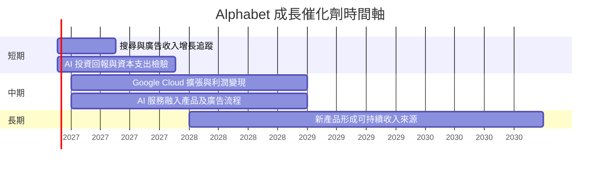

### 9.2 TAM 市場規模分析

N/A（TAM 數據未提供）。營收規模方面，Alphabet TTM 營收 $471.10B、TTM 年增 22.2%，最新一季年增 24.7%；增長空間需由搜尋、雲端及 AI 服務的實際營收和利潤揭示，不能以缺乏來源的 TAM 數字外推。

### 9.3 成長驅動力結構圖

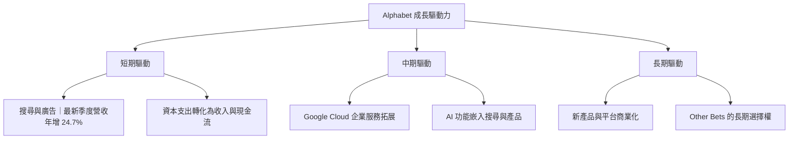

成長催化劑的具體分部收入、Cloud 利潤率、AI 付費用戶及商業化收入均未提供，需以後續季報確認。

## 10. 風險矩陣

### 10.1 風險評分矩陣

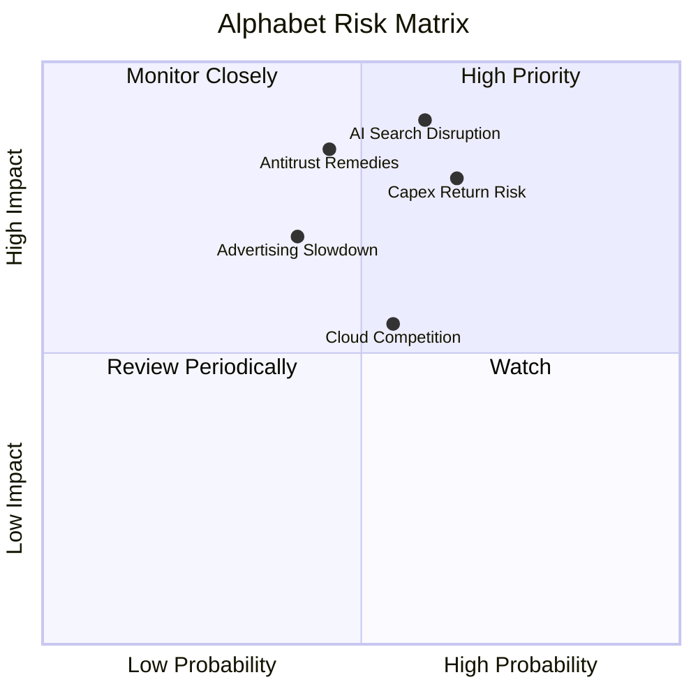

### 10.2 風險清單詳細分析

| # | 風險項目 | 發生機率 | 財務衝擊 | 風險評分 | 緩解措施 |
|---|----------|----------|----------|----------|----------|
| 1 | 🔴 **AI 搜尋改變流量與廣告模式** | 中高（定性估計） | 高；營收受影響幅度未提供 | 🔴 8.5/10 | 追蹤搜尋收入成長、廣告單價與流量成本；分散至 Cloud、YouTube 及其他服務 |
| 2 | 🔴 **資本支出未轉化為足夠回報** | 中高（定性估計） | 高；TTM Capex $159.80B、FCF $19.75B | 🔴 8.0/10 | 按季對照 Capex、營業現金流、FCF 與 Cloud 及 AI 變現進度 |
| 3 | 🔴 **反壟斷監管與訴訟** | 中（定性估計） | 高；收入或成本影響未提供 | 🔴 7.5/10 | 監控法院判決、補救措施及分發合約變化 |
| 4 | 🟡 **廣告週期放緩** | 中（定性估計） | 中高；依賴廣告的分部營收比例未提供 | 🟡 6.5/10 | 監控各類廣告客戶需求及最新季營收趨勢 |
| 5 | 🟡 **Cloud 競爭與價格壓力** | 中（定性估計） | 中；分部利潤及市場數據未提供 | 🟡 6.0/10 | 追蹤 Cloud 收入增速、利潤率及客戶留存；未披露者標記 N/A |

機率與風險評分為定性研究判斷，不是財務資料庫的客觀統計頻率；表列百分比未提供，因此不以假精確數字填寫。

## 11. 投資建議

### 11.1 最終評級與評分

以加權合理價值 $278.23 對比 2026-11-19 收盤價 $271.02，MOS 為 +2.6%，依規則 20 評級為 **持有**，未作一級調整。1.1 綜合評分為 **7.7/10**，六項分數依序為成長性 8.0、獲利能力 9.0、財務健康 8.0、估值 5.0、護城河 9.0、管理層與資本配置 7.0。

### 11.2 合理價值與隱含報酬率

| 估值基準 | 每股價值 | 相對現價 | 機率／權重 |
|----------|---------:|---------:|-----------:|
| 加權合理價值 | $278.23 | +2.7% 上行空間 | 權重合計 100% |
| 🔴 DCF 悲觀情境 | $106.13 | −60.8% | 25% |
| 🟡 DCF 基準情境 | $242.21 | −10.6% | 50% |
| 🟢 DCF 樂觀情境 | $504.13 | +86.0% | 25% |
| DCF 機率加權參考值 | $273.67 | +1.0% | 情境參考，不取代加權合理價值 |

### 11.3 買入時機與觸發因素

╔══════════════════════════════════════════════════════════════════╗  
║                  ✅ 買入觸發因素 Checklist                       ║  
╠══════════════════════════════════════════════════════════════════╣  
║ 估值觀察條件：                                                   ║  
║ ✅ 股價回落至約 $250.41 或以下，對加權價值折讓至少 10%           ║  
║ ✅ 最新季度營收年增維持在 20% 以上且利潤率沒有明顯惡化           ║  
║ ✅ FCF 隨投資變現改善，而非只靠模型假設 Capex 下降               ║  
║                                                                  ║  
║ 加碼觸發條件：                                                   ║  
║ ☐ TTM FCF Yield 從 0.59% 回升，並連續兩季改善                    ║  
║ ☐ ROIC 維持高於 WACC 10.43%，且 Cloud／AI 投資出現可量化回報     ║  
║ ☐ 股價回到買入觀察區間，基本面假設未下修                         ║  
║                                                                  ║  
║ 減碼／重新評估觸發條件：                                         ║  
║ ☐ 最新季度營收年增連續兩季低於 15%                               ║  
║ ☐ 營業利益率相對 TTM 33.3% 下滑逾 3 個百分點                     ║  
║ ☐ FCF 轉負或資本支出維持高位但現金流沒有改善                     ║  
║ ☐ ROIC 跌至 WACC 10.43% 以下                                     ║  
╚══════════════════════════════════════════════════════════════════╝  

### 11.4 投資人適配度分析

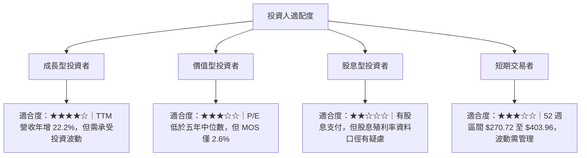

股息殖利率來源列示 32.0%，與公司股息支付及 payout ratio 資料顯著不一致，應視為資料品質異常，不以該數值支持股息型投資論點。股息 5 年平均殖利率未提供。

### 11.5 每季財報監控清單（Quarterly Watch List）

| 監控指標 | 基準／現況 | 觸發加碼 | 觸發減碼或重估 |
|----------|-----------|----------|----------------|
| 營收成長 | TTM 22.2%；最新季 YoY 24.7% | YoY 維持 ≥20% | 連續兩季 <15% |
| 營業利益率 | TTM 33.3%；最新季核定 31.8% | 維持 ≥32% 且營收增長 | 低於 30.3% 或連續下滑 |
| 營業現金流 | TTM $179.55B | 成長快於 Capex | 明顯下滑或轉負 |
| 資本支出 | TTM $159.80B | Capex 穩定而收入、FCF 加速 | Capex 增長但 FCF 持續收縮 |
| FCF | TTM $19.75B；Yield 0.59% | FCF 連續兩季改善 | FCF 轉負且非短期季節性 |
| FCF / 淨利 | 8.4% | 隨投資週期結束回升 | 長期低於 10% 且資本回報未改善 |
| 股權薪酬與稀釋 | FY2025 SBC $24.95B；稀釋股數測試未通過 | SBC / 營收下降或股數穩定 | SBC 占比上升、股數持續增加 |
| AI／Cloud 商業化 | 分部數值未提供 | 申報披露可核實的收入與利潤增長 | 投資與成本增加、收入回報不明 |
| 管理層財測 | 最新財測未提供 | 實際收入、利潤率高於指引 | 指引下修或長期無法達標 |

### 11.6 反面論證：什麼會證明論點錯誤（What Would Change My Mind）

╔══════════════════════════════════════════════════════════════════╗  
║              ⚠️ 論點失效條件（Disconfirming Evidence）            ║  
╠══════════════════════════════════════════════════════════════════╣  
║ ☐ 核心營收成長連續兩季低於 15%                                   ║  
║ ☐ TTM 營業利益率由 33.3% 下滑超過 3 個百分點                     ║  
║ ☐ FCF 持續為負，或 FCF Yield 長期低於目前 0.59%                  ║  
║ ☐ ROIC 跌破 WACC 10.43%，表明資本投入不再創造價值                ║  
║ ☐ Capex / 營收長期維持高位，卻未帶來可核實的收入與 FCF 改善      ║  
║ ☐ 稀釋股數持續增加，SBC 占營收比率高於 FY2025 的 6.2%            ║  
║ ☐ 監管措施實質限制搜尋分發或廣告商業化，且核心業務增長同步轉弱    ║  
╚══════════════════════════════════════════════════════════════════╝  

> **免責聲明**：本報告為 AI 自動生成，僅供研究參考，不構成投資建議。投資有風險，入市需謹慎。

---

## 資料與來源

| 項目 | 內容 |
|------|------|
| 價格 | 271.02 USD，2026-11-19 收盤（Yahoo Finance 日線） |
| 財務報表 | SEC 10-Q filed 2026-10-29，最新季度 2026-09-30（FY2026 Q3） |
| 有回應的資料來源 | SEC 申報資料 (XBRL)、Yahoo Finance、Finviz、StockAnalysis、Roic.ai |
| 由程式計算 | TTM 數字、WACC、DCF 模型、估值方法與權重、加權合理價值、MOS、評級門檻、F-Score、杜邦分解、營運資金天數、綜合評分 |
| 撰寫模型 | openai / gpt-6-luna |

> 本區塊由產生報告的程式依實際取得的資料填寫，非模型撰寫。「由程式計算」的數字不是模型的估計；其餘判斷（評分、情境、策略）是模型的分析。
