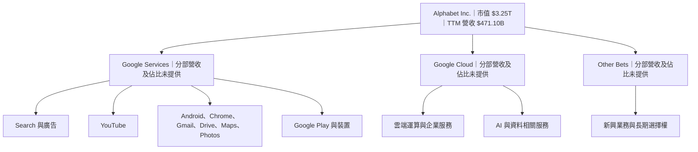
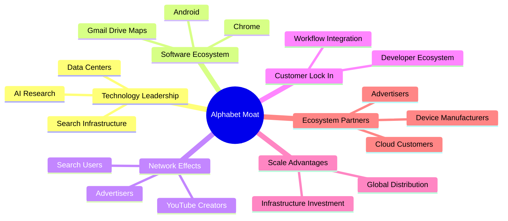
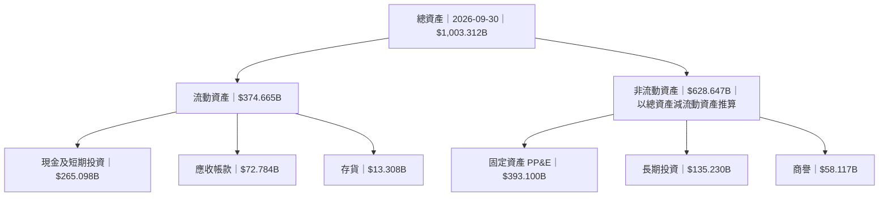
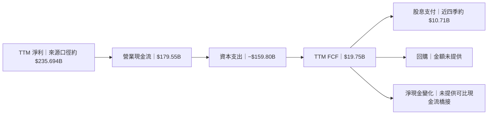
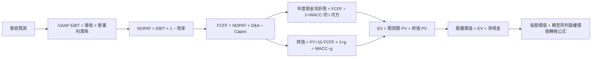
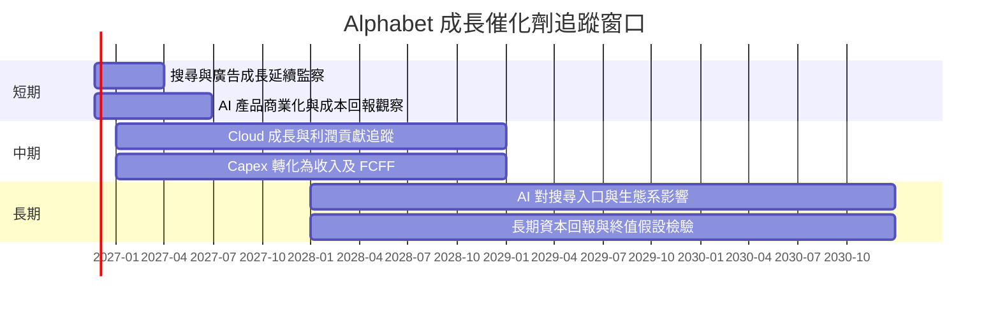
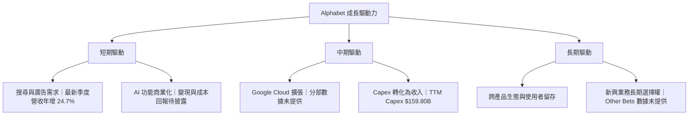
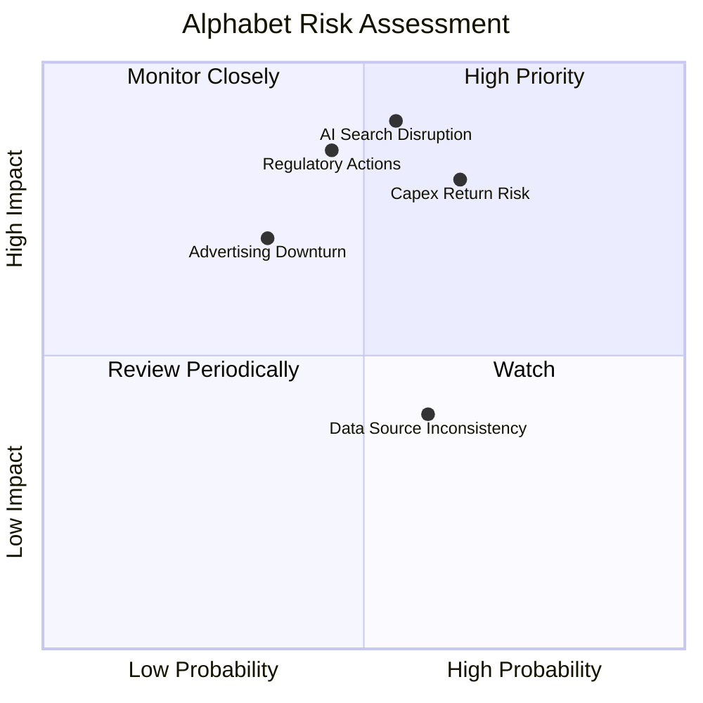
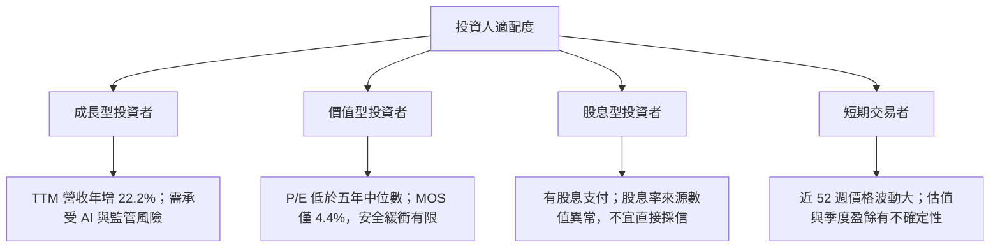

# GOOG 基本面深度分析報告
> **報告日期**：2026-11-21 ｜ **語言**：繁體中文 ｜ **數據來源**：SEC 申報資料 (XBRL)、Yahoo Finance、Finviz、StockAnalysis、Roic.ai ｜ **分析師**：CFA 級機構研究

## 目錄

| # | 章節 | 核心結論 |
|---|------|----------|
| 1 | 執行摘要 | 持有；加權合理價值 $276.17，MOS +4.4% |
| 2 | 公司概覽與商業模式 | 搜尋、YouTube、Cloud 與生態系構成護城河；分部營收細項未完整提供 |
| 3 | 損益表深度分析 | TTM 營收 $471.10B，TTM 年增 22.2%；最新季度年增 24.7% |
| 4 | 資產負債表分析 | 淨現金 $138.98B；流動性高，但來源間債務數字有差異 |
| 5 | 現金流量深度分析 | TTM FCF $19.75B，FCF Yield 0.61%；資本支出大幅壓低自由現金流 |
| 6 | 獲利能力與資本效率 | ROIC 23.9% 高於 WACC 10.28%，仍創造股東價值 |
| 7 | 相對估值分析 | P/E 低於同業，但 Forward P/E 高於目前 Trailing P/E；估值訊號分歧 |
| 8 | DCF 內在價值評估 | 基準 DCF $248.35；終值佔 EV 72.3%，估值對長期假設敏感 |
| 9 | 成長催化劑 | AI、Cloud 與廣告產品組合為主要增長方向；TAM 數據未提供 |
| 10 | 風險矩陣 | AI 搜尋替代、資本支出回報與監管風險是主要下行因素 |
| 11 | 投資建議 | 持有；依加權合理價值設定觀察區間，並以成長、利潤率與 FCF 作監控 |

---

## 1. 執行摘要

### 1.0 一頁式投資儀表板（Portfolio Manager 30 秒速讀）

| 項目 | 內容 |
|------|------|
| **投資論點（3 句）** | ① TTM 營收 $471.10B、年增 22.2%，最新一季年增 24.7%，需求動能仍在。② ROIC 23.9% 高於 WACC 10.28%，價差 13.62 個百分點，顯示資本配置仍創造價值。③ TTM FCF 僅 $19.75B、FCF Yield 0.61%，主要需關注資本支出高企對現金轉換的拖累。 |
| **綜合評分** | **7.8/10**（引用 1.1 評分卡） |
| **財務健康** | 🟢 淨現金 $138.98B，現金及短期投資 $265.10B；但 F-Score 為 4/8，現金流品質須觀察 |
| **ROIC vs WACC** | **23.9% vs 10.28%**；ROIC 高出 13.62 個百分點，創造股東價值 |
| **FCF 趨勢** | 年度 FCF 2022–2025 由 $60.01B 增至 $73.27B，但 TTM FCF 降至 $19.75B；FCF Yield **0.61%** |
| **估值** | Forward P/E **17.3x**（行情資料）；EV/EBITDA **16.9x**；FCF Yield **0.61%** |
| **DCF 內在價值（基準）** | **$248.35**；相對 DCF 折溢價 **+6.3%**（現價高於 DCF） |
| **安全邊際（MOS）** | **+4.4%＝($276.17 − $264.00) ÷ $276.17**；以加權合理價值為分母，低於 10%，緩衝有限 |
| **預期報酬（基準情境 12M）** | 加權合理價值對現價上行空間 **+4.6%**；DCF 基準情境則為 **−5.9%**，兩者口徑不同 |
| **關鍵風險（前二）** | AI 搜尋改變廣告流量與變現模式；資本支出持續高增但回報不及預期 |
| **評級 + 信心度** | 🟡 **持有** ｜ 信心：中（估值方法與財務來源數字存在差異） |

### 1.1 綜合評分卡（全報告唯一）

| 維度 | 評分（1–10） | 主要依據（引用數字與其來源章節） |
|------|--------------|----------------------------------|
| 成長性 | 8.5 | TTM 營收年增 22.2%，最新季度年增 24.7%（第 3 章） |
| 獲利能力 | 8.0 | TTM 營業利益率 33.3%，ROIC 23.9% 高於 WACC 10.28%；但 F-Score 4/8（第 6 章） |
| 財務健康 | 8.5 | 淨現金 $138.98B、現金及短期投資 $265.10B，流動比率 2.786；現金轉換週期 39 天（第 4 章） |
| 估值 | 5.5 | MOS 僅 +4.4%；DCF 基準值低於現價 5.9%，但 P/E 低於自身五年中位數（第 7–8 章） |
| 護城河 | 9.0 | 搜尋、Android、Chrome、YouTube、Gmail、Maps 等產品網絡；營收規模 $471.10B（第 2 章） |
| 管理層與資本配置 | 7.5 | 2025 年 Capex $91.45B、SBC $24.95B；投資規模大，回報與稀釋需要持續監察（第 5 章） |
| **綜合評分** | **7.8** | 六項算術平均：$(8.5+8.0+8.5+5.5+9.0+7.5)÷6=7.83$，四捨五入至一位小數 |

### 1.2 五大投資論點 + 三大核心風險

| 類型 | 項目 | 具體依據 | 信心度 |
|------|------|----------|--------|
| 🟢 **投資論點①** | 搜尋與廣告仍具規模優勢 | TTM 營收 $471.10B，最新季度營收年增 24.7%；能否延續取決於搜尋入口與廣告變現能否適應 AI 介面 | 🟢 高 |
| 🟢 **投資論點②** | 高於資本成本創造價值 | ROIC 23.9% 對 WACC 10.28%，價差 13.62 個百分點 | 🟢 高 |
| 🟢 **投資論點③** | 資產負債表提供抗風險能力 | 淨現金 $138.98B，現金及短期投資 $265.10B | 🟢 高 |
| 🟢 **投資論點④** | 多產品生態有交叉導流能力 | Android、Chrome、Search、YouTube、Gmail、Maps、Drive 與 Play 共同構成分發網絡；分部營收拆分未提供 | 🟡 中 |
| 🟢 **投資論點⑤** | 相對自身歷史估值不高 | Trailing P/E 13.8x，低於五年中位數 21.9x；但這不代表盈利品質與 FCF 風險已充分反映 | 🟡 中 |
| 🟡 **風險①** | 資本支出與 FCF 壓力 | TTM Capex $159.80B、FCF $19.75B；若投資回報落後，估值與回購能力均受壓 | 🟡 中 |
| 🔴 **風險②** | AI 搜尋替代與監管 | 搜尋產品入口或廣告定價受影響，將直接打擊核心營收；目前未提供可量化市場份額資料 | 🔴 高 |
| 🟡 **風險③** | 財報與資料來源不一致 | 債務、ROE、季度營業利益率等項目存在差異；應以 SEC 申報資料與後續財報核對 | 🟡 中 |

### 1.3 快速統計卡片

| 指標 | 公司實際值（期間） | 同業中位數 | 狀態 |
|------|--------------------|------------|------|
| 營收成長（TTM） | **22.2%** | — | 🟢 |
| 營收成長（最新一季年增） | **24.7%** | 18.8% | 🟢 |
| 毛利率（TTM） | **60.9%** | 67.7% | 🟡 |
| 營業利益率（TTM） | **33.3%** | — | 🟢 |
| ROIC（TTM） | **23.9%** | — | 🟢 |
| Forward P/E | **17.3x** | 20.0x | 🟢 |
| FCF Yield（TTM） | **0.61%** | — | 🔴 |
| Piotroski F-Score | **4 / 8** | — | 🟡 |

> 同業中位數僅依有提供的 META、MSFT、AMZN 倍數與成長資料計算；毛利率中位數為 67.7%，Forward P/E 中位數為 20.0x。GOOG Forward P/E 以市場估值資料 17.257856x 表示，四捨五入至 17.3x。

### 1.4 投資結論

╔══════════════════════════════════════════════════════════════════╗  
║　　　　　　　　　📊 投資結論摘要　　　　　　　　　　　　　　║  
╠══════════════════════════════════════════════════════════════════╣  
║ 評級：持有（MOS +4.4%，落在 −10% 至 +10% 區間）　　　　　　　║  
║ 價格（2026-11-20 收盤）：$264.00　　　　　　　　　　　　　　║  
║ DCF 內在價值（基準）：$248.35（現價溢價 +6.3%）　　　　　　　║  
║ 安全邊際 MOS：+4.4%＝($276.17−$264.00)÷$276.17　　　　　　　║  
║ 加權合理價值（8.8）：$276.17　　　　　　　　　　　　　　　　║  
║ DCF 情境價值：　　　　　　　　　　　　　　　　　　　　　　║  
║　悲觀情境：$108.52（−58.9%）　　　　　　　　　　　　　　　║  
║　基準情境：$248.35（−5.9%）　　　　　　　　　　　　　　　　║  
║　樂觀情境：$518.77（+96.5%）　　　　　　　　　　　　　　　║  
║ 綜合評分：7.8/10（引用 1.1）　　　　　　　　　　　　　　　　║  
║ 適合投資人：長線成長型、能承受 AI 與監管風險的投資人　　　　║  
╚══════════════════════════════════════════════════════════════════╝

---

## 2. 公司概覽與商業模式

### 2.1 業務結構與收入來源

公司資料指出 Alphabet 主要由 Google Services、Google Cloud、Other Bets 三個板塊構成，Google Services 涵蓋搜尋、廣告、YouTube、Android、Chrome、Gmail、Drive、Maps、Photos、Play 與裝置等。各分部營收金額與營收佔比未提供，因此不推算、不製作比例圖。

### 2.2 市場份額

市場份額數據未提供，財務資料亦沒有 Search、YouTube、Cloud 等分部營收的可引用拆分。就規模而言，Alphabet TTM 營收為 $471.10B，最新季度年增 24.7%；META、MSFT、AMZN 最新季度營收年增分別為 26.1%、18.8%、12.1%，GOOG 成長高於後兩者、略低於 META。

### 2.3 競爭護城河分析

### 2.4 護城河強度

| 護城河項目 | 強度（強／中／弱） | 證據（引用數字或事實） | 會削弱它的情況 |
|------------|--------------------|------------------------|----------------|
| 技術與資料規模 | 強 | TTM 營收 $471.10B；業務涵蓋搜尋、廣告、AI 與雲端 | 生成式 AI 改變使用者查詢入口，或資料優勢轉化不了廣告收入 |
| 軟體生態系統 | 強 | Android、Chrome、Gmail、Drive、Maps、Play 等產品跨服務互通 | 預設入口被競爭者取代、平台政策改變或監管限制 |
| 網路效應 | 強 | 搜尋使用者、廣告主與內容創作者形成多邊網絡；未提供市占數字 | 使用者流量與廣告主預算轉移，造成網絡密度下降 |
| 客戶鎖定 | 中 | Workspace、Android 與雲端工具能嵌入日常工作流程；留存率數據未提供 | 企業轉換成本下降、雲端客戶採用多雲 |
| 規模效應 | 強 | $471.10B TTM 營收與全球產品覆蓋，支撐大規模研發與基礎建設 | 高 Capex 未帶來相稱收入與回報 |
| 生態夥伴 | 中 | 裝置製造商、開發者、內容創作者與廣告商共同構成分發鏈 | 合作協議受監管限制或夥伴自建替代入口 |

**1.1 護城河評分理由：9.0/10**，依據是多產品分發網絡及 $471.10B TTM 營收規模；分部營收、用戶量與市占數據未提供，因此不以未披露指標補強。

---

## 3. 損益表深度分析

### 3.1 年度收入成長趨勢（近 4 年）

╔══════════════════════════════════════════════════════════════════╗  
║　　　　　Alphabet 年度收入趨勢（FY2022–FY2025）　　　　　　　　║  
╠══════════════════════════════════════════════════════════════════╣  
║ FY2022　$282.84B　██████████████████　YoY：基期　　　　　　　　║  
║ FY2023　$307.39B　███████████████████ YoY：+8.7%　🟡　　　　　║  
║ FY2024　$350.02B　██████████████████████　YoY：+13.9%　🟢　　　║  
║ FY2025　$402.84B　█████████████████████████　YoY：+15.1%　🟢　║  
╠══════════════════════════════════════════════════════════════════╣  
║ 2022–2025 營收 CAGR：約 12.6%　　　　　　　　　　　　　　　　║  
╚══════════════════════════════════════════════════════════════════╝

年度營收由 2022 年 $282.84B 增至 2025 年 $402.84B，三年 CAGR 約 12.6%。收入增速由 2023 年 8.7% 回升至 2025 年 15.1%；TTM 年增進一步升至 22.2%，反映近期增長速度高於過去完整年度，但未來是否可持續仍取決於廣告需求、AI 變現與 Cloud 擴張。

### 3.2 季度收入趨勢分析

| 季度 | 營收 | QoQ 成長 | YoY 成長 | 備註 |
|------|------|----------|----------|------|
| 2025 Q4 | $113.83B | +11.2% | +18.0% | QoQ 比較 2025 Q3 |
| 2026 Q1 | $109.90B | −3.5% | +21.8% | 季節性回落，但年增加速 |
| 2026 Q2 | $119.80B | +9.0% | +24.2% | 年增率續升 |
| 2026 Q3 | $127.58B | +6.5% | +24.7% | 最新季度營收成長加速 |

QoQ 計算採相鄰季度營收；YoY 採同季比較。2026 Q3 營收較 Q2 增加約 $7.78B，季度年增由 2025 Q3 的 16.0% 升至 24.7%，對收入能見度有利，但不能將單季成長率誤稱為 TTM 成長率。

### 3.3 利潤率演變分析

| 利潤率指標 | FY2022 | FY2023 | FY2024 | FY2025 | 趨勢 | 評估 |
|------------|--------|--------|--------|--------|------|------|
| **毛利率** | 55.4% | 56.6% | 58.2% | 59.7% | 連續改善 | 🟢 |
| **營業利益率** | 26.5% | 27.4% | 32.1% | 32.0% | 2024 擴張，2025 大致持平 | 🟢 |
| **淨利率** | 21.2% | 24.0% | 28.6% | 32.8% | 持續上升 | 🟢 |

年度毛利率與營業利益率依年度營收、毛利與營業利益計算。毛利率四年提升約 4.3 個百分點，營業利益率則自 2022 年 26.5% 提升至 2025 年 32.0%。這與規模效應、費用紀律及收入組合改善相符；但個別成本項目拆分不足，不能將改善全部歸因於單一產品。

TTM 營業利益率為 33.3%，高於 FY2025 的 32.0%；最新季度營業利益率則按 VERIFIED FIGURES 為 31.8%。另一來源列示 33.3%，兩者不一致，本報告引用程式計算的最新季度值 31.8%，並以 TTM 33.3% 作跨期比較。

### 3.4 費用結構分析

完整營業費用拆分不足以製作有意義的費用圓餅圖：已提供 FY2025 研發費用 $61.09B，但銷售、一般及行政等費用的完整同期明細未以一致口徑提供。研發費用約佔 FY2025 營收 15.2%（$61.09B ÷ $402.84B），顯示持續投入技術與產品，但不能以單一費用項目代表完整成本結構。

### 3.5 季度 EPS 趨勢與盈餘品質（Quality of Earnings）

#### EPS 趨勢

| 季度 | EPS 實際值 | EPS 年增 | 超預期／不及預期 |
|------|------------|---------|-------------------|
| 2025 Q4 | $2.81 | +31.2% | 估計值與 Surprise 為 N/A，不能判定 |
| 2026 Q1 | $5.11 | +82.0% | 估計值與 Surprise 為 N/A，不能判定 |
| 2026 Q2 | $9.11 | +294.3% | 估計值與 Surprise 為 N/A，不能判定 |
| 2026 Q3 | $2.14 | −25.3% | 估計值與 Surprise 為 N/A，不能判定 |

四季 EPS 實際值與年增率取自 StockAnalysis；EPS 預估值與 Surprise 欄位均為 `nan`，因此無法判斷四季各自是否超預期或不及預期。2026 Q2 EPS $9.11、淨利 $112.19B 顯著高於相鄰季度；提供資料不足以辨認其是否由一次性或非營業項目造成，應避免將該季直接外推。

| 盈餘品質項目 | 數值／佔比 | 評估 |
|--------------|------------|------|
| 股權薪酬 SBC / 營收 | 約 6.5%（近四季 SBC 合計 $30.41B ÷ TTM 營收 $471.10B） | 🟡 SBC 是重要股東成本；若以股權支付，會稀釋持股 |
| SBC / 營業現金流 | 約 16.9%（$30.41B ÷ $179.55B） | 🟡 規模不小，不能忽略 |
| FCF / 淨利（現金轉換率） | 約 8.4%（TTM FCF $19.75B ÷ StockAnalysis TTM 淨利 $235.694B） | 🔴 TTM 現金轉換偏低；高 Capex 是主要壓力，但淨利數據受異常季度影響 |
| 一次性／非經常性損益 | N/A；2026 Q2 淨利 $112.19B 異常偏高，原因未提供 | 🟡 需查 SEC 附註，不將單季數字年化 |
| 有效稅率異常 | 16.8%（最新年度有效稅率） | 🟢 DCF 採用此值；實際季度稅務項目明細未提供 |
| 資本化支出 vs 費用化 | TTM Capex $159.80B；資本化比例與明細 N/A | 🟡 投資資產快速增加可能推高折舊與未來現金流壓力，無法判斷是否有費用遞延 |

**盈餘品質結論：**營業現金流仍達 $179.55B，但 TTM Capex $159.80B 後，FCF 只剩 $19.75B；以可得 TTM 淨利口徑計算的 FCF 轉換率僅約 8.4%。因此 GAAP 盈利的現金含量在本期較弱，主要問題是資本支出而非已證實的會計操縱。估值應重視正常化投資後的現金流，不宜只看 EPS。

---

## 4. 資產負債表分析

### 4.1 資產結構分解

其中非流動資產為總資產扣除流動資產的算術差額，並非額外披露項目。資產結構顯示現金與短期投資規模大，固定資產亦達 $393.10B；與 TTM Capex $159.80B 相互印證，公司正處於高強度基礎設施投資階段。

### 4.2 流動性與營運資金分析

| 指標 | 最新 TTM | 一年前 TTM | 變化 | 解讀 |
|------|----------|------------|------|------|
| 流動比率 | 2.786（行情資料） | N/A | N/A | 流動資產對短期負債有覆蓋，但歷史比較口徑未提供 |
| 速動比率 | 2.512（行情資料） | N/A | N/A | 高於 1，短期償債緩衝充足 |
| DSO 應收帳款天數 | 56 天 | 54 天 | +2 天 | 收款週期小幅延長；需追蹤是否為收入組合或收款條件改變 |
| DIO 存貨天數 | 26 天 | N/A | N/A | 公司前期未報告可用存貨餘額，無法做年比 |
| DPO 應付帳款天數 | 43 天 | N/A | N/A | 缺少前期可比數據，無法判斷供應商付款週期變化 |
| CCC 現金轉換週期 | 39 天 | N/A | N/A | 一年前 CCC 未能判定；目前收款、存貨與付款週期合計仍需監控 |

營運資金天數照抄品質指標計算結果。DSO 從 54 天升至 56 天，幅度有限；DIO、DPO 及 CCC 的一年前值為 N/A，不能推估。

### 4.3 債務結構分析

> 此處採 VERIFIED FIGURES：總債務 $126.12B、現金及短期投資 $265.10B、淨現金 $138.98B。行情與其他合併資料另有總債務 $150.33B、淨現金 $114.77B，與 VERIFIED FIGURES 不一致；本報告財務分析以 SEC 計算區塊優先，估值模型亦照用其淨現金。

╔══════════════════════════════════════════════════════════════════╗  
║　　　　　　　　　Alphabet 債務健康診斷　　　　　　　　　　　　║  
╠══════════════════════════════════════════════════════════════════╣  
║ 總債務：　　　　$126.12B　████████　　　　　　　　　　　　　║  
║ 現金＋短期投資：$265.10B　█████████████████　　　　　　　　　║  
║ 淨現金：　　　　$138.98B　█████████　🟢　　　　　　　　　　　║  
║ Debt/EBITDA：N/A（Debt 與 EBITDA 口徑來源不一致）　　　　　　║  
║ 利息保障倍數：N/A（利息費用明細未提供）　　　　　　　　　　　║  
╚══════════════════════════════════════════════════════════════════╝

淨現金使 Alphabet 具備承受監管罰款、景氣波動與高額投資的能力；但 EBITDA 與債務資料來源不一致，本報告不據此推算 Debt/EBITDA。

### 4.4 股東權益趨勢

| 年度 | 股東權益 | YoY 變化 |
|------|----------|----------|
| 2022 | $256.14B | — |
| 2023 | $283.38B | +10.6% |
| 2024 | $325.08B | +14.7% |
| 2025 | $415.26B | +27.7% |

╔══════════════════════════════════════════════════════════════════╗  
║　　　　　　　　股東權益（年度末）　　　　　　　　　　　　　　║  
╠══════════════════════════════════════════════════════════════════╣  
║ 2022　$256.14B　████████████　　　　　　　　　　　　　　　　║  
║ 2023　$283.38B　██████████████　　　　　　　　　　　　　　　║  
║ 2024　$325.08B　████████████████　　　　　　　　　　　　　　║  
║ 2025　$415.26B　█████████████████████　　　　　　　　　　　　║  
╚══════════════════════════════════════════════════════════════════╝

股東權益在 2025 年增加 27.7%，但可得資料不足以將變動完整分解為留存盈餘、回購、OCI 或其他項目；因此不將權益增加直接等同於每股價值增加。

---

## 5. 現金流量深度分析

### 5.1 現金流量瀑布圖

淨利與營業現金流並非直接相等；圖中以現金流量表中的營業現金流作為現金瀑布起點。近四季股息支付為已列季度數字相加，回購與淨現金變化資料不足，不以 FCF 強行推導。

### 5.2 FCF 轉換率趨勢

| 年度 | FCF | 淨利 | FCF / 淨利 |
|------|-----|------|------------|
| 2022 | $60.01B | $59.97B | 100.1% |
| 2023 | $69.50B | $73.80B | 94.2% |
| 2024 | $72.76B | $100.12B | 72.7% |
| 2025 | $73.27B | $132.17B | 55.4% |
| TTM 至 2026 Q3 | $19.75B | $235.694B（StockAnalysis TTM） | 約 8.4% |

年度轉換率下降，與淨利增幅快於 FCF、Capex 增加一致。TTM 數值進一步走低，尤其 TTM Capex 已達 $159.80B；但 TTM 淨利受到 2026 Q2 異常高值影響，8.4% 不宜視為穩態轉換率。

### 5.3 自由現金流趨勢

╔══════════════════════════════════════════════════════════════════╗  
║　　　　　　　　年度 FCF 與最新 TTM　　　　　　　　　　　　　　║  
╠══════════════════════════════════════════════════════════════════╣  
║ FY2022　$60.01B　████████████████　　　　　　　　　　　　　　║  
║ FY2023　$69.50B　███████████████████　　　　　　　　　　　　　║  
║ FY2024　$72.76B　████████████████████　　　　　　　　　　　　║  
║ FY2025　$73.27B　████████████████████　　　　　　　　　　　　║  
║ TTM　　 $19.75B　██████　　　　　　　　　　　　　　　　　　　║  
╠══════════════════════════════════════════════════════════════════╣  
║ TTM FCF Yield：0.61%｜TTM FCF = $179.55B − $159.80B　　　　　║  
╚══════════════════════════════════════════════════════════════════╝

歷史年度 FCF 由 2022 至 2025 大致上升，年複合成長約 6.9%；但最新 TTM 降至 $19.75B，顯示未來現金流可能高度受 AI 與資料中心投資週期影響。

### 5.4 資本配置評估

公司未提供可一致拆分的近年回購金額、留存現金用途與資本配置總額，因此不畫比例圓餅圖。

| 配置項目 | 已知數據 | 評估 |
|----------|----------|------|
| Capex | FY2025 $91.45B；TTM $159.80B | 投資強度上升，需追蹤投資回報與折舊負擔 |
| 研發 | FY2025 $61.09B | 佔 FY2025 營收約 15.2%，反映技術投入 |
| 股息 | FY2025 $10.05B；最新四季季度支付合計約 $10.71B | 相對現金流規模可承擔，但 TTM FCF 下降後需觀察 |
| 回購 | 金額未提供 | 不推算回購收益率或淨回購額 |
| 留存與投資 | 現金及短期投資 $265.10B | 資產負債表緩衝充足 |

---

## 6. 獲利能力與資本效率

### 6.1 ROE / ROA / ROIC 趨勢

| 指標 | 可用期間 | 數值 | 評估 |
|------|----------|------|------|
| ROE | TTM | 34.8%（VERIFIED FIGURES） | 高，但與其他資料所列 44.3% 不一致；採用 VERIFIED FIGURES |
| ROA | TTM | 12.7%（市場資料） | 正向回報；非歷史序列 |
| ROIC | TTM | 23.9%（VERIFIED FIGURES） | 明顯高於 WACC 10.28% |
| 歷史 ROE／ROA／ROIC 完整可比序列 | N/A | 缺少一致口徑歷年資料 | 不補造趨勢 |

### 6.2 ROIC vs WACC 分析（核心價值創造判斷）

╔══════════════════════════════════════════════════════════════════╗  
║　　　　　　　　ROIC vs WACC 深度分析　　　　　　　　　　　　　║  
╠══════════════════════════════════════════════════════════════════╣  
║ 無風險利率（10Y 美債）：4.91%　　　　　　　　　　　　　　　　║  
║ 市場風險溢酬 ERP：5.00%　　　　　　　　　　　　　　　　　　║  
║ 原始 Beta：1.23；採用調整後 Beta：1.15　　　　　　　　　　　║  
║ 股權成本：4.91% + 1.15 × 5.00% = 10.66%，資料列示 10.67%　　║  
║ 稅前債務成本：0.58%；稅率：16.8%　　　　　　　　　　　　　　║  
║ 稅後債務成本：0.58% × (1−16.8%) = 0.48%　　　　　　　　　　║  
║ 股權／債務權重：96.3% / 3.7%　　　　　　　　　　　　　　　　║  
║ 採用 WACC：10.28%（依 Cost of capital 列值）　　　　　　　　║  
║ ROIC：23.9%　　　　　　　　　　　　　　　　　　　　　　　　║  
║ EVA spread：23.9% − 10.28% = +13.62 個百分點　　　　　　　　║  
║ ROIC / WACC：23.9% ÷ 10.28% = 約 2.33 倍　　　　　　　　　　║  
╚══════════════════════════════════════════════════════════════════╝

WACC 採用成本資本資料所列 10.28%，不自行替換。依四捨五入後組成項重算可能有約 0.01 個百分點差異；股權成本列示 10.67%，而以 4.91% + 1.15 × 5.00% 的顯示值計算為 10.66%，屬輸入精度差異。此處不以重新計算值取代指定 WACC。

**價值創造判斷：**ROIC 高於 WACC 13.62 個百分點，代表目前投入資本仍創造經濟利潤；但若 AI／資料中心投資回報下降，ROIC 可能收斂。WACC 中的風險自由利率與 ERP 已由成本資本資料提供；利息費用及平均計息負債的詳細底數未提供，故不另造完整債務成本推導。

### 6.3 杜邦三因素分解

| 因素 | 數值（TTM） | 解讀 |
|------|-------------|------|
| 淨利率 | 50.0% | 品質指標列值；受 TTM 淨利高值影響，需與 GAAP 詳細附註核實 |
| 資產週轉率 | 0.47 | 資產投入增加下，收入轉化效率須持續追蹤 |
| 權益乘數 | 1.48 | 槓桿相對有限 |
| **ROE** | **34.8%** | 50.0% × 0.47 × 1.48 約等於 34.8%（採品質指標原列結果） |

杜邦資料顯示 ROE 主要由高淨利率帶動，而非高權益乘數；但組成比率顯示值相乘可能因四捨五入產生小幅差異，ROE 採品質指標原列 34.8%。

### 6.4 財務體質：Piotroski F-Score

**Piotroski F-Score：4/8**。毛利率測試因資料不足未能判定，因此分母低於傳統九項。

| 測試 | 結果 | 解讀 |
|------|------|------|
| ROA > 0 | ✅ 通過 | 公司仍具正向資產報酬 |
| 營業現金流 > 0 | ✅ 通過 | TTM 營業現金流為 $179.55B |
| ROA 高於一年前 | ✅ 通過 | 資產報酬改善 |
| 營業現金流 > 淨利（應計品質） | ❌ 未通過 | 盈餘轉為營業現金流的比例不足 |
| 長期負債 ÷ 總資產低於一年前 | ❌ 未通過 | 槓桿指標未改善 |
| 流動比率高於一年前 | ✅ 通過 | 流動性改善 |
| 稀釋股數未增加 | ❌ 未通過 | 股數增加會抵銷每股價值增長 |
| 毛利率高於一年前 | — 無法判定 | 缺少該測試可用輸入 |
| 資產週轉率高於一年前 | ❌ 未通過 | 資產擴張快於收入轉化效率改善 |

---

## 7. 相對估值分析

### 7.1 同業估值比較表格

| 估值指標 | **GOOG** | **META** | **MSFT** | **AMZN** | GOOG 評估 |
|----------|----------|----------|----------|----------|-----------|
| **Trailing P/E** | 13.8x | 19.1x | 25.3x | 20.0x | 🟢 低於三家同業 |
| **Forward P/E** | 17.3x | 15.7x | 20.0x | 22.6x | 🟡 低於 MSFT、AMZN，但高於 META |
| **P/S Ratio** | 6.9x | 5.9x | 10.4x | 3.3x | 🟡 高於 META、AMZN，低於 MSFT |
| **EV/EBITDA** | 16.9x | 12.6x | 17.8x | 15.6x | 🟡 接近 MSFT，較 META、AMZN 高 |
| **最新季度營收年增** | 24.7% | 26.1% | 18.8% | 12.1% | 🟢 僅略低於 META |
| **TTM 毛利率** | 60.9% | 81.0% | 67.7% | 51.4% | 🟡 高於 AMZN，低於 META、MSFT |

GOOG Trailing P/E 13.8x 明顯低於三家同業，但 Forward P/E 17.3x 高於 META 的 15.7x；需注意 GOOG 前瞻 EPS $15.30 低於 TTM EPS $19.15，故前瞻倍數高於後向倍數。這組數字顯示市場估值偏低並不等於預期盈餘仍在加速。

### 7.2 歷史估值區間分析

╔══════════════════════════════════════════════════════════════════╗  
║　　　　　GOOG 五年估值區間｜Trailing P/E　　　　　　　　　　　║  
╠══════════════════════════════════════════════════════════════════╣  
║ 五年最低：1.3x　│ 現值：13.8x　│ 五年中位數：21.9x　　　　　║  
║ 五年最高：29.0x　│ 現值百分位：29%　　　　　　　　　　　　║  
║ 當前低於歷史中位數，但數值受極端低值影響，不能單獨視為便宜。║  
╠══════════════════════════════════════════════════════════════════╣  
║ P/S：現值 6.9x｜五年中位數 6.1x｜區間 4.1x–9.8x｜百分位 60%║  
║ EV/EBITDA：16.9x｜中位數 19.1x｜區間 13.7x–25.0x｜百分位 27%║  
╚══════════════════════════════════════════════════════════════════╝

Trailing P/E 位於自身五年區間第 29 百分位，EV/EBITDA 為第 27 百分位；相對地，P/S 位於第 60 百分位且高於五年中位數。各估值倍數呈現分歧，不宜只依 P/E 得出便宜結論。

### 7.3 情境價值（Bear / Base / Bull，依 DCF MODEL）

| 情境 | 第 1 年營收成長 | 期末營業利潤率 | WACC | 每股價值 | 相對現價 | 機率 | 會發生的條件 |
|------|----------------|----------------|------|----------|----------|------|--------------|
| 🔴 悲觀 | 11.1% | 27.2% | 11.28% | $108.52 | −58.9% | 25% | 搜尋與廣告成長放緩、AI 投資回報不足、營業利潤率下滑且折現率上升 |
| 🟡 基準 | 22.2% | 32.0% | 10.28% | $248.35 | −5.9% | 50% | 成長由目前 TTM 22.2% 逐步降至長期增速，利潤率緩降至 32.0% |
| 🟢 樂觀 | 33.3% | 35.2% | 9.28% | $518.77 | +96.5% | 25% | AI 商業化帶動更高成長、規模效益令利潤率擴張、風險折現率下降 |

情境數字照抄 DCF 模型，不另建模型。機率加權價值為 $281.00，僅作情境參考；第 8.8 節指定的合理價值仍使用基準 DCF 與其他估值方法加權。

### 7.4 相對估值隱含價格區間

╔══════════════════════════════════════════════════════════════════╗  
║　　　　　估值方法回推每股價值（美元）　　　　　　　　　　　　║  
╠══════════════════════════════════════════════════════════════════╣  
║ 同業 EV/EBITDA　$245.49　─ DCF 基準 $248.35 ─ 現價 $264.00　║  
║ 同業 Forward P/E $306.23　　　　　　　　　分析師均值 $389.00 ║  
╚══════════════════════════════════════════════════════════════════╝

| 方法 | 每股價值 | 相對現價 | 依據 |
|------|----------|----------|------|
| DCF（基準） | $248.35 | −5.9% | 10 年 FCFF、WACC 10.28%、終值成長率 3.0% |
| 同業 Forward P/E | $306.23 | +16.0% | META、MSFT、AMZN 同業中位數 20.0x × Forward EPS $15.30 |
| 同業 EV/EBITDA | $245.49 | −7.0% | 同業中位數 15.6x × TTM EBITDA，再加淨現金 |
| 分析師共識目標價 | $389.00 | +47.3% | 15 位分析師平均目標價 |

---

## 8. DCF 內在價值評估（Discounted Cash Flow）

> 本節只引用程式計算的 DCF 模型結果；下列逐年財務預測、敏感度及情境數字均按模型原值列示。由於部分底層精度與股數轉換資料未列出，表中顯示值可能因四捨五入而無法用顯示至兩位小數的數字完全重現模型內部精度。

### 8.0 估值推理鏈（Thinking Logic）

#### Step 1 — 價值由哪些變數決定？

GOOG 的估值主要來自 Google Services 的廣告及平台現金流、Google Cloud 的成長，以及 AI／新業務的長期選擇權；但財務資料未提供分部營收佔比，不能把總營收拆分成具體比例。模型中最主導估值的變數是終值現金流與折現率：終值現值佔 EV 72.3%，因此長期利潤率、Capex 正常化、永續成長率與 WACC 的改變，會明顯影響每股價值。

#### Step 2 — 模型選擇

| 決策點 | 本報告採用 | 理由（含數字） | 曾考慮但否決 | 否決理由 |
|--------|-----------|----------------|--------------|----------|
| 現金流定義 | FCFF | 以 WACC 折現，模型輸出企業價值後加淨現金 | FCFE | 模型未提供股權自由現金流或單獨股權折現率 |
| 預測期 N | 10 年 | DCF 模型設定 10 年，涵蓋高成長逐步降速過程 | 5 年 | 模型並非 5 年預測，不能自行縮短 |
| 終值方法 | Gordon Growth | 模型採 3.0% 永續成長率，且 WACC 10.28% 高於 g | 退出倍數 | DCF MODEL 未提供退出倍數終值，不另建模型 |
| EBIT 基礎 | GAAP EBIT | 模型已明確採用 GAAP EBIT | 非 GAAP EBIT | 會改變模型口徑且非程式模型設定 |

#### Step 3 — 關鍵假設推導鏈

- **營收成長**：錨點＝TTM 年增 22.2% → 調整＝模型將成長率由 FY+1 的 22.2% 線性降至 FY+10 的 3.0%，反映高基期與成熟化 → **採用模型原值** → 曾考慮把 22.2% 固定十年，但會忽略成熟化，故不採用。
- **期末營業利潤率**：錨點＝TTM 營業利益率 33.3% → 調整＝模型逐步淡化至近五個會計年度中位數 32.0% → **FY+10 採 32.0%** → 曾考慮維持 33.3%，但模型採用五年中位數以避免長期利潤率永久保持高位。
- **預測期 N**：錨點＝模型規定 10 年 → 調整＝不自行改動模型年限 → **採用 10 年** → 曾考慮更短期間，但模型現金流、終值及敏感度均按十年建構，故否決。
- **Capex / 營收**：錨點＝TTM 33.9% → 調整＝模型線性降至 FY+10 的 6.5%，並以 D&A 的 1.1 倍作為下限約束 → **採用模型逐年值** → 曾考慮持續使用 33.9%，但會忽略投資率可能正常化；反之若高 Capex 延續，基準估值可能偏高。
- **永續成長率 g**：錨點＝模型設定 3.0% → 調整＝符合成熟大型企業長期增長假設範圍，且低於 WACC 10.28% → **採用 3.0%** → 曾考慮更高 g，但會抬高終值且拉近 WACC，故不採用。
- **WACC**：錨點＝成本資本資料提供 10.28% → 調整＝不重新估計或替換 → **採用 10.28%** → 曾考慮用其他風險溢酬，但會偏離統一成本資本口徑。
- **EBIT／SBC／稀釋**：模型錨點＝GAAP EBIT，SBC 已列入費用，股數不再額外稀釋 → **採組合 A**：GAAP EBIT、不另扣 SBC、股數固定 → 曾考慮額外減 SBC 或再放大股數，但會重複計入成本。
- **營運資金**：模型明示 Working capital is not modelled → **不加入 ΔWC 項** → 曾考慮自行估算營運資金率，但缺乏模型輸入，且違反不可另建模型要求。
- **D&A / 營收**：錨點＝TTM 5.9% → **維持 5.9%**；依據為模型假設，不額外推演。

#### Step 4 — 最脆弱的一環

最脆弱的假設是 Capex/營收由 TTM 33.9% 大幅降至 FY+10 的 6.5%；若資料中心投資長期高於模型路徑，FY+N FCFF 與終值將低於基準，內在價值向下偏移。此風險與終值佔 EV 72.3% 的高終值依賴度一致。

#### Step 5 — 計算路徑

### 8.1 模型假設總表（Model Inputs）

| 假設項目 | 採用值 | 依據／來源 | 敏感度 |
|----------|--------|-------------|--------|
| 預測期長度 N | 10 年 | DCF 模型設定；完整列示 FY+1 至 FY+10 | 🟡 中 |
| 營收成長 | FY+1 22.2% 線性降至 FY+10 3.0% | TTM 年增 22.2%，模型設定逐步成熟化 | 🔴 高 |
| 營業利潤率 | FY+1 33.3% 至 FY+10 32.0% | TTM 33.3%，淡化至近五年中位數 | 🔴 高 |
| 有效稅率 | 16.8% | 最新年度有效稅率 | 🟢 低 |
| Capex / 營收 | FY+1 33.9% 至 FY+10 6.5% | TTM 起點；模型逐步降至 1.1 × D&A | 🔴 高 |
| D&A / 營收 | 5.9% | TTM 模型輸入，維持不變 | 🟢 低 |
| 營運資金變動 / 營收增額 | 未建模 | DCF 模型明示 Working capital is not modelled | 🟢 低 |
| EBIT 基礎 | GAAP EBIT | DCF 模型明示 GAAP EBIT | 🟡 中 |
| 股權薪酬 SBC 處理 | 不另扣 SBC | GAAP EBIT 已含 SBC 費用 | 🟡 中 |
| 年稀釋率 | 0%／股數不再稀釋 | 模型指定股數不再稀釋；成本由 GAAP EBIT 反映 | 🟡 中 |
| 永續成長率 g | 3.0% | 模型輸入；低於 WACC 10.28% | 🔴 高 |
| 終值方法 | Gordon Growth | DCF 模型終值公式 | 🔴 高 |
| WACC | 10.28% | 成本資本資料指定值 | 🔴 高 |

**FCFF 定義：**使用模型指定的 `FCFF = NOPAT + D&A − Capex`，營運資金未建模。  
**SBC 一致性：**本模型採用 **(A) GAAP EBIT + 固定股數**，故 SBC 影響已計入一次；不另減 SBC，亦不再增加稀釋股數。

### 8.2 折現率推導（WACC）

╔══════════════════════════════════════════════════════════════════╗  
║　　　　　　　　　WACC 推導（折現率）　　　　　　　　　　　　　║  
╠══════════════════════════════════════════════════════════════════╣  
║ Rf（10Y 美債）：4.91%　　　　　　　　　　　　　　　　　　　　║  
║ ERP（假設值）：5.00%　　　　　　　　　　　　　　　　　　　　║  
║ 原始 Beta（Yahoo）：1.23　　　　　　　　　　　　　　　　　　║  
║ 調整後 Beta：⅔ × 1.23 + ⅓ × 1.00 = 1.15　　　　　　　　　　║  
║ 規模／國別風險溢酬：0.00%（成本資本資料未列額外溢酬）　　　　║  
║ Ke 資料列值：10.67%　　　　　　　　　　　　　　　　　　　　║  
║ 稅前 Kd：0.58%｜有效稅率：16.8%　　　　　　　　　　　　　　║  
║ 稅後 Kd：0.58% × (1−16.8%) = 0.4826%　　　　　　　　　　　║  
║ 股權／債務權重：96.3%／3.7%　　　　　　　　　　　　　　　　║  
║ 採用 WACC：10.28%　　　　　　　　　　　　　　　　　　　　　║  
╚══════════════════════════════════════════════════════════════════╝

WACC 採用程式計算所列 10.28%，不另算替代 WACC。成本資本資料未提供 10Y 殖利率的觀測日、平均計息負債與利息費用絕對值，故這些底層輸入不能獨立重建；Beta 以 Yahoo 原始 1.23 按指定調整公式後採用 1.15。顯示值以四捨五入後輸入計算，與模型指定的 10.28% 可能有微小尾差。第 6.2 節使用相同 WACC。

### 8.3 逐年自由現金流預測（基準情境）

金額單位：USD billions。以下逐年數字照 DCF 模型列示；模型不包含 ΔWC，也不另列 SBC。

| 年度 | FY+1 | FY+2 | FY+3 | FY+4 | FY+5 | FY+6 | FY+7 | FY+8 | FY+9 | FY+10 |
|------|------:|------:|------:|------:|------:|------:|------:|------:|------:|-------:|
| 營收 | 575.74 | 691.33 | 815.37 | 944.26 | 1,073.37 | 1,197.22 | 1,309.81 | 1,405.02 | 1,477.16 | 1,521.48 |
| 營收 YoY | 22.2% | 20.1% | 17.9% | 15.8% | 13.7% | 11.5% | 9.4% | 7.3% | 5.1% | 3.0% |
| 營業利潤率 | 33.3% | 33.2% | 33.0% | 32.9% | 32.7% | 32.6% | 32.5% | 32.3% | 32.2% | 32.0% |
| EBIT（GAAP） | 191.84 | 229.37 | 269.36 | 310.58 | 351.51 | 390.36 | 425.19 | 454.09 | 475.29 | 487.37 |
| − 稅 | (32.20) | (38.50) | (45.21) | (52.13) | (58.99) | (65.51) | (71.36) | (76.21) | (79.77) | (81.80) |
| = NOPAT | 159.65 | 190.87 | 224.15 | 258.46 | 292.52 | 324.84 | 353.83 | 377.88 | 395.52 | 405.57 |
| + D&A | 34.21 | 41.08 | 48.45 | 56.11 | 63.79 | 71.14 | 77.84 | 83.49 | 87.78 | 90.41 |
| − Capex | (195.30) | (213.47) | (226.97) | (234.11) | (233.46) | (223.97) | (205.18) | (177.35) | (141.51) | (99.46) |
| **= FCFF** | **−1.44** | **18.48** | **45.64** | **80.46** | **122.84** | **172.02** | **226.48** | **284.03** | **341.80** | **396.53** |
| 折現因子 @10.28% | 0.907 | 0.822 | 0.746 | 0.676 | 0.613 | 0.556 | 0.504 | 0.457 | 0.414 | 0.376 |
| **FCFF 現值 PV** | **−1.31** | **15.20** | **34.02** | **54.39** | **75.29** | **95.60** | **114.14** | **129.79** | **141.62** | **148.98** |

**預測期 PV 合計：**  
$-1.31 + 15.20 + 34.02 + 54.39 + 75.29 + 95.60 + 114.14 + 129.79 + 141.62 + 148.98 = **$807.72B**；模型列示合計 **$807.73B**，差額 $0.01B 來自逐年數字四捨五入，落在尾差範圍內。

**FY+1 逐步演算示範：**

1. 營收：$471.10B × (1 + 22.2%) = **$575.74B**（模型列值；精度受未顯示小數影響）。
2. EBIT：$575.74B × 33.3% ≈ **$191.84B**（模型列值；以顯示至一位小數的利潤率重算會有四捨五入差）。
3. 稅：$191.84B × 16.8% ≈ **$32.20B**。
4. NOPAT：模型列值 **$159.65B**。
5. D&A：模型列值 **$34.21B**，來源假設為營收的 5.9%。
6. Capex：模型列值 **$195.30B**，依模型首年 Capex/營收假設。
7. ΔWC：模型未建模，不列入計算。
8. FCFF：$159.65B + $34.21B − $195.30B = **−$1.44B**。
9. 折現與現值：$1 ÷ (1+10.28%)^1 = **0.907**；$−1.44B × 0.907 ≈ **−$1.31B**。

模型的單年顯示值有小幅四捨五入差，應以模型 FCFF 與 PV 列為準，而非用已四捨五入的 EBIT、NOPAT 再覆寫模型結果。

**合理性自檢：**

- 歷史年度 FCF CAGR（FY2022–FY2025）：約 6.9%；預測 FCFF 由 FY+1 負值起步，無法以負基期計算常規 CAGR，故不給出無意義的 CAGR 比較。
- FY+10 FCFF 利潤率：$396.53B ÷ $1,521.48B = **26.1%**；TTM FCF 利潤率：$19.75B ÷ $471.10B = **4.2%**。模型隱含資本支出正常化後現金利潤率大幅回升。
- FY+1 FCFF 為 **−$1.44B**，因首年 Capex 高於 NOPAT 加回折舊；其對預測期 PV 的影響為 −$1.31B，之後年度轉正。

╔══════════════════════════════════════════════════════════════════╗  
║　　　　　自由現金流：歷史實際 vs 模型預測　　　　　　　　　　║  
╠══════════════════════════════════════════════════════════════════╣  
║ FY2023（實）$69.50B　████████████　　　　　　　　　　　　　　║  
║ FY2024（實）$72.76B　█████████████　　　　　　　　　　　　　║  
║ FY2025（實）$73.27B　█████████████　　　　　　　　　　　　　║  
║ FY+1（預）　−$1.44B　首年為負，Capex 高於 NOPAT+D&A　　　　　║  
║ FY+10（預）$396.53B　████████████████████　　　　　　　　　　║  
╠══════════════════════════════════════════════════════════════════╣  
║ 模型依賴 Capex/營收由 33.9% 降至 6.5%；這是主要估值風險。　　║  
╚══════════════════════════════════════════════════════════════════╝

### 8.4 終值計算（Terminal Value）

**適用性檢查：**WACC 10.28% vs g 3.0% → WACC > g？✅

| 方法 | 計算式 | 終值 TV | TV 現值 | 佔總 EV 比重 |
|------|--------|---------|---------|--------------|
| Gordon Growth | FY+10 FCFF × (1+g) ÷ (WACC−g) | $5,606.75B | $2,106.51B | 72.3% |
| 退出倍數法 | N/A | N/A（DCF 模型未提供退出倍數終值） | N/A | N/A |

**Gordon Growth 計算鏈（依模型原值）：**

1. FY+N FCFF：**$396.53B**。
2. 分子：$396.53B × (1 + 3.0%) = 約 **$408.43B**（模型計算採未四捨五入底層數字）。
3. 分母：10.28% − 3.0% = **7.28%**；模型 TV 列值 **$5,606.75B**。
4. PV(TV)：$5,606.75B × 0.376 = **$2,106.51B**（以模型折現因子及未四捨五入值計算）。
5. 終值佔比：$2,106.51B ÷ $2,914.24B = **72.3%**。

終值佔 EV 72.3%，雖未超過 75% 警示門檻，仍代表估值主要由第十年後現金流與折現率假設決定。模型沒有提供退出倍數終值，故不另行建立交叉驗證。

### 8.5 企業價值 → 每股內在價值（Bridge）

╔══════════════════════════════════════════════════════════════════╗  
║　　　　　企業價值 → 每股內在價值 橋接表　　　　　　　　　　　║  
╠══════════════════════════════════════════════════════════════════╣  
║ 預測期 FCF 現值合計　　　　+$807.73B　　　　　　　　　　　　║  
║ 終值現值 PV(TV)　　　　　　+$2,106.51B　　　　　　　　　　　║  
║ = 企業價值 EV　　　　　　　 $2,914.24B　　　　　　　　　　　║  
║ + 淨現金　　　　　　　　　 +$138.98B　　　　　　　　　　　　║  
║ = 股權價值　　　　　　　　 $3,053.22B　　　　　　　　　　　║  
║ 每股價值（模型轉換公式）　　$248.35　　　　　　　　　　　　　║  
║ 當前股價（2026-11-20）　　　$264.00　　　　　　　　　　　　　║  
║ 折溢價：$264÷$248.35−1　　　+6.3%（現價溢價）　　　　　　　║  
╚══════════════════════════════════════════════════════════════════╝

**逐步演算：**

1. EV：$807.73B + $2,106.51B = **$2,914.24B**。
2. 股權價值：$2,914.24B + $138.98B = **$3,053.22B**。
3. 每股內在價值：模型指定轉換式為「股權價值 × 股價 ÷ 市值」，模型輸出 **$248.35**；模型底層市值／股數轉換精度未完整提供，故不以其他市場股數欄位替代。
4. 折溢價：$264.00 ÷ $248.35 − 1 = **+6.3%**。
5. 本節不計算 MOS；MOS 僅於 8.8 以加權合理價值為分母。

現金與債務橋接採成本資本及 DCF 模型使用的淨現金 $138.98B。模型表述為股數不再稀釋，與 GAAP EBIT 已含 SBC 的組合 A 一致。

### 8.6 敏感性分析（WACC × 永續成長率）

下表每股值直接引用 DCF 模型；括號內上行／下行以現價 $264.00 計算。

| g（列）／WACC（欄） | 8.28% | 9.28% | **10.28%（基準）** | 11.28% | 12.28% |
|-----------|------:|------:|-------------------:|-------:|-------:|
| 2.0% | $322.64（+22.2%） | $267.40（+1.3%） | $226.21（−14.3%） | $194.46（−26.3%） | $169.38（−35.8%） |
| 2.5% | $344.31（+30.4%） | $282.08（+6.8%） | $236.57（−10.4%） | $202.02（−23.5%） | $175.03（−33.7%） |
| 3.0% | $370.09（+40.2%） | $299.09（+13.3%） | **$248.35（−5.9%）** | $210.48（−20.3%） | $181.29（−31.3%） |
| 3.5% | $401.25（+52.0%） | $319.04（+20.8%） | $261.87（−0.8%） | $220.04（−16.7%） | $188.26（−28.7%） |
| 4.0% | $439.68（+66.5%） | $342.77（+29.8%） | $277.54（+5.1%） | $230.90（−12.5%） | $196.07（−25.7%） |

**代表格說明：**選格 WACC 11.28% > g 3.0% ✅。DCF 模型直接列示該格每股價值 **$210.48**。因敏感度矩陣由程式計算，底層逐年未四捨五入 FCFF、股數／市值轉換精度未完整列出，本報告不另造一套重算數值，以免偏離指定矩陣。

#### 三情境 DCF

| 情境 | 營收假設 | 期末營業利潤率 | g | WACC | 每股價值 | 相對現價 | 主觀機率 |
|------|----------|----------------|---|------|----------|----------|----------|
| 🔴 悲觀 | 第一年成長 11.1% | 27.2% | 模型情境輸入未另列 | 11.28% | $108.52 | −58.9% | 25% |
| 🟡 基準 | 第一年成長 22.2% | 32.0% | 3.0% | 10.28% | $248.35 | −5.9% | 50% |
| 🟢 樂觀 | 第一年成長 33.3% | 35.2% | 模型情境輸入未另列 | 9.28% | $518.77 | +96.5% | 25% |
| **機率加權** | — | — | — | — | **$281.00** | **+6.4%** | **100%** |

機率加權算式：$108.52 × 25% + $248.35 × 50% + $518.77 × 25% = **$281.00**（依模型原值四捨五入）。

DCF MODEL 僅提供情境的首年成長率、期末利潤率、WACC、每股價值與機率，未提供每個情境的 FY+10 營收、FCFF、g 及終值分項。因此依規則不自行重建或填入未披露的情境中間值。

#### 敏感度結論

- **g 變動：**以 WACC 10.28% 欄比較，g 2.0% 的 $226.21 至 g 3.0% 的 $248.35，上升 **$22.14／9.8%**；g 4.0% 的 $277.54 比基準高 **$29.19／11.8%**。
- **WACC 變動：**以 g 3.0% 列比較，WACC 9.28% 的 $299.09 降至 10.28% 的 $248.35，變動 **−$50.74／−17.0%**；升至 11.28% 則為 $210.48，低 **$37.87／−15.2%**。
- **期末營業利潤率每 +1pp 的價值變動：**DCF MODEL 未提供單變數利潤率敏感度，故為 **N/A**，不反推。
- 在已提供的數值範圍，WACC 的一個百分點改變會造成明顯估值變化；與 8.0 所述「長期現金流折現」主導估值的判斷一致。

### 8.7 反推 DCF（Reverse DCF）

反推 DCF 固定其他基準假設、每次只解一個變數。模型提供兩項反推結果：

| 求解的變數 | 其餘變數設定 | 市場隱含值（令 DCF = 現價） | 公司歷史實際 | 判斷 |
|------------------------|--------------|------------------------------|--------------|------|
| 第 1 年營收成長 | 其他輸入固定為基準值 | 23.8% | TTM 年增 22.2% | 略高於當前增長，要求不低 |
| 固定營業利潤率 | 其他輸入固定為基準值 | 33.9% | TTM 33.3%；基準路徑 33.3%→32.0% | 略高於當前 TTM，亦高於基準期末值 |
| 永續成長率 g | 未計算 | 未計算 | — | 模型未提供 |
| 預測期長度 N | 未計算 | 未計算 | — | 模型未提供 |

固定基準輸入包括 WACC 10.28%、稅率 16.8%、Capex 路徑、預測期 10 年與固定股數。程式未提供逐點試算軌跡，故不製造迭代表格。模型解讀為：市場價格需要 FY+1 營收成長 23.8%，高於 TTM 22.2%；或需要營業利潤率持續固定於 33.9%，高於基準模型 FY+10 的 32.0%。這是可監控、但並非低門檻的市場預期。

### 8.8 估值三角驗證與安全邊際

| 估值方法 | 隱含每股價值 | 上行空間（÷現價） | 權重 | 說明 |
|----------|--------------|-------------------|------|------|
| DCF（基準） | $248.35 | −5.9% | 40% | 10 年 FCFF、WACC 10.28%、g 3.0% |
| 同業 Forward P/E | $306.23 | +16.0% | 25% | 同業中位數 20.0x × Forward EPS $15.30 |
| 同業 EV/EBITDA | $245.49 | −7.0% | 25% | 同業中位數 15.6x × TTM EBITDA，加回淨現金 |
| 分析師共識目標價 | $389.00 | +47.3% | 10% | 15 位分析師平均目標價 |
| **加權合理價值** | **$276.17** | **+4.6%** | **100%** | 公司類型：獲利企業；四種方法均依固定權重納入 |

**加權計算：**  
$248.35 × 40% + $306.23 × 25% + $245.49 × 25% + $389.00 × 10%  
= $99.34 + $76.5575 + $61.3725 + $38.90  
= **$276.17**。

**MOS：**($276.17 − $264.00) ÷ $276.17 = **+4.4%**。  
**上行空間：**($276.17 − $264.00) ÷ $264.00 = **+4.6%**。  
**DCF 折溢價：**$264.00 ÷ $248.35 − 1 = **+6.3% 溢價**。

╔══════════════════════════════════════════════════════════════════╗  
║　　　　　　　　估值區間與安全邊際　　　　　　　　　　　　　　║  
╠══════════════════════════════════════════════════════════════════╣  
║ $108.52 ─ $248.35 ─ $264.00 ─ [$276.17] ─ $306.23 ─ $518.77 ║  
║ 悲觀DCF　基準DCF　現價　　 加權合理值　Forward P/E　樂觀DCF　║  
║ MOS = ($276.17−$264.00)÷$276.17 = +4.4%　　　　　　　　　　　║  
║ MOS 評估：🔴 <10% 無　　　　　　　　　　　　　　　　　　　　║  
║ 上行空間 = ($276.17−$264.00)÷$264.00 = +4.6%　　　　　　　　║  
║ 建議買入觀察區間：$248.55–$264.00（按 MOS 10% 對應上限）　　║  
║ 合理持有區間：$264.00–$306.23　　　　　　　　　　　　　　　║  
║ 減碼考慮區間：高於 $518.77（樂觀 DCF 情境價值）　　　　　　　║  
╚══════════════════════════════════════════════════════════════════╝

在加權合理價值固定為 $276.17 的條件下，MOS ≥ 10% 所對應價格上限為 $276.17 × 90% = **$248.55**。此為估值觀察區間，並非價格預測。現價 $264.00 高於該上限，因此按規則 20 評級為持有，而非買入。

> 🔎 **程式複算（Python，依本節各項自動重算）**
>
> 加權合理價值 = $248.35 × 40% + $306.23 × 25% + $245.49 × 25% + $389.00 × 10% = **$276.17**（權重合計 100%）
>
> 以價格 $264.00 計：MOS = **+4.4%**，上行空間 = **+4.6%**
>
> ✅ 與本節所寫數值一致。

### 8.9 DCF 模型的局限與失效條件

- **終值依賴度：**終值 PV 佔 EV 72.3%，價值主要由第十年以後的 FCFF 與 WACC、g 決定。
- **最脆弱假設：**Capex/營收由 TTM 33.9% 降至 FY+10 的 6.5%；若高投資週期延長，基準每股價值 $248.35 將有下修風險。其次是 WACC：g 3.0% 下，WACC 由 10.28% 升至 11.28%，模型價值從 $248.35 降至 $210.48。
- **FCF 階段性壓力：**最新 TTM FCF 為 $19.75B，與模型十年後 $396.53B 的 FCFF 差距很大，代表 DCF 依賴 Capex 正常化；高再投資階段下 DCF 可靠度下降，宜同時參考 Forward P/E、EV/EBITDA 與分部估值。
- **失效條件：**若營收增長明顯低於市場隱含 23.8%、營業利潤率持續低於模型路徑，或資本支出無法轉化為收入，DCF 基準值會高估。
- **風險連結：**AI 搜尋替代會衝擊營收成長；資料中心投資效率會衝擊 Capex/營收與終值 FCFF；利率上行會直接提高 WACC。

### 8.10 複算檢核表（Audit Trail）

| # | 檢核項目 | 檢查方式 | 結果 |
|---|----------|----------|------|
| 1 | 所有高／中敏感度輸入都有推導 | 對照 8.0、8.1；已列出主要推導鏈，情境中間值未提供 | ⚠️ 部分受資料限制 |
| 2 | 每個假設都有來歷 | 8.1 每項均列模型或財務依據 | ✅ |
| 3 | WACC 五步算式齊全且精確可重建 | 成本資本資料提供 WACC 與組成，但缺利息費用及平均計息負債底數 | ⚠️ 依指定值採用 10.28% |
| 4 | Kd 分母與權重 D 範圍一致 | 成本資本資料有 Kd、權重，未提供完整平均債務底數 | ⚠️ 無法獨立核對底層債務範圍 |
| 5 | WACC 與第 6.2 節同值 | 兩處均為 10.28% | ✅ |
| 6 | 逐年年度數 = N 且無省略 | FY+1 至 FY+10 共十年 | ✅ |
| 7 | FY+1 代表年度可複算 | 模型顯示值有四捨五入精度差，採用原模型 FCFF、PV | ⚠️ 尾數不可由顯示精度完全重現 |
| 8 | 預測期 PV 逐項加總 | 顯示值合計 $807.72B，模型合計 $807.73B，差 $0.01B | ✅（四捨五入尾差） |
| 9 | WACC > g | 10.28% > 3.0% | ✅ |
| 10 | 終值以 FY+N 現金流並折現 N 期 | 採 FY+10 FCFF $396.53B、折現因子 0.376 | ✅ |
| 11 | EV 至每股價值橋接 | EV $2,914.24B + 淨現金 $138.98B = 股權價值 $3,053.22B；每股轉換依模型原式 | ⚠️ 股數／市值轉換底層精度未完整提供 |
| 12 | SBC 三要素組合相容 | GAAP EBIT、不另扣 SBC、股數不再稀釋 | ✅ |
| 13 | 敏感度矩陣基準格 = DCF 基準值 | 10.28% / 3.0% = $248.35 | ✅ |
| 14 | 矩陣格符合 WACC > g | 所列全部 WACC 均高於各 g | ✅ |
| 15 | 三情境機率相加 | 25% + 50% + 25% = 100% | ✅ |
| 16 | 反推每列只放開一個變數 | 模型提供營收成長與固定利潤率兩項解，未提供迭代軌跡 | ⚠️ 無法展示底層試算點 |
| 17 | MOS 與折溢價分母正確 | MOS 用 $276.17；DCF 折溢價用 $248.35 | ✅ |
| 18 | 報告完整至第 11 章 | 已完整列出十一章 | ✅ |
| 19 | 加權合理價值無事後調整 | 方法價值乘權重加總為 $276.17 | ✅ |
| 20 | 評級符合 MOS 門檻 | MOS +4.4%，符合持有區間 | ✅ |

---

## 9. 成長催化劑

### 9.1 催化劑時間軸

下列時間為分析追蹤窗口，並非公司已公布的財測或已確認產品時程。

### 9.2 TAM 市場規模分析

**N/A（TAM 數據未提供）。**Alphabet TTM 營收為 $471.10B，最新季度年增 24.7%，同業中高於 MSFT 的 18.8% 與 AMZN 的 12.1%，略低於 META 的 26.1%。由於缺乏可引用的市場總量與分部營收，不能計算滲透率或市場規模。

### 9.3 成長驅動力結構圖

---

## 10. 風險矩陣

### 10.1 風險評分矩陣

以下機率與衝擊座標屬分析師定性估計，不是財務披露數字。

### 10.2 風險清單詳細分析

| # | 風險項目 | 發生機率 | 財務衝擊 | 風險評分 | 緩解措施 |
|---|----------|----------|----------|----------|----------|
| 1 | 🔴 **AI 搜尋替代與廣告模式變化** | 中高（分析估計 55%） | 高；可能壓低核心收入成長與利潤率，幅度未能由資料量化 | 🔴 8.5/10（分析估計） | 追蹤搜尋相關收入成長、廣告價格與流量指標；要求 AI 產品具備可驗證變現 |
| 2 | 🔴 **Capex 高增但回報不足** | 高（分析估計 65%） | 高；TTM Capex $159.80B，TTM FCF 僅 $19.75B | 🔴 8.0/10（分析估計） | 比較 Capex 增速、折舊、營業現金流及 FCF；投資回報不改善時下修長期假設 |
| 3 | 🔴 **監管與反壟斷風險** | 中（分析估計 45%） | 高；可能影響預設分發、廣告產品或商業條款，財務影響未提供 | 🔴 7.8/10（分析估計） | 追蹤訴訟與監管裁決，壓力測試流量和分發條件改變 |
| 4 | 🟡 **廣告週期與宏觀需求** | 中（分析估計 35%） | 中高；季度營收增長可能減速，幅度未提供 | 🟡 6.8/10（分析估計） | 觀察季度營收 YoY 與廣告相關指標，避免將單季成長年化 |
| 5 | 🟡 **財務來源及統計口徑差異** | 中高（分析估計 60%） | 中；債務、ROE、季度利潤率等數字不一致，可能影響模型輸入 | 🟡 5.5/10（分析估計） | 以 SEC 10-Q／10-K 為主，逐季核對負債、稀釋股數與非經常性項目 |

---

## 11. 投資建議

### 11.1 最終評級與評分

MOS 為 +4.4%，落在規則 20 的 −10% 至 +10% 區間，因此評級為**持有**；不作質化上調或下調。1.1 綜合評分為 **7.8/10**，六項分數依序為成長性 8.5、獲利能力 8.0、財務健康 8.5、估值 5.5、護城河 9.0、管理層與資本配置 7.5。

### 11.2 合理價值與隱含報酬率

| 價值基準 | 每股價值 | 相對現價 $264.00 | 機率／權重 |
|----------|----------|------------------|------------|
| 加權合理價值 | $276.17 | +4.6% | 方法權重合計 100% |
| DCF 悲觀情境 | $108.52 | −58.9% | 25% |
| DCF 基準情境 | $248.35 | −5.9% | 50% |
| DCF 樂觀情境 | $518.77 | +96.5% | 25% |
| DCF 機率加權參考值 | $281.00 | +6.4% | 100% |

加權合理價值是評級與 MOS 的依據；DCF 情境則反映營收、利潤率與 WACC 同時變動的範圍，二者不可混用。

### 11.3 買入時機與觸發因素

╔══════════════════════════════════════════════════════════════════╗  
║　　　　　　　　✅ 買入觸發因素 Checklist　　　　　　　　　　　║  
╠══════════════════════════════════════════════════════════════════╣  
║ 立即買入觸發條件（多數符合）：　　　　　　　　　　　　　　　║  
║ ☐ 股價回到或低於 $248.55，即相對加權合理價值 MOS 達 10%　　　║  
║ ☐ TTM 營收成長維持 20% 以上，且營業利益率不低於 31.8%　　　║  
║ ☐ Capex 增長開始放緩，FCF 高於目前 TTM $19.75B　　　　　　　║  
║ 加碼觸發條件（出現以下任一）：　　　　　　　　　　　　　　　║  
║ ☐ 連續季度營收年增維持 20% 以上，並有現金流同步改善　　　　║  
║ ☐ ROIC 維持高於 WACC 10.28%，且投資回報可由財報驗證　　　　║  
║ 減碼／停損觸發條件（出現以下任一）：　　　　　　　　　　　　║  
║ ☐ 核心營收成長連續兩季跌破市場反推的 23.8% 且加速下滑　　　║  
║ ☐ 營業利益率低於 31.8% 並持續收縮　　　　　　　　　　　　　║  
║ ☐ Capex 持續高企、FCF 進一步惡化或轉負　　　　　　　　　　　║  
║ ☐ ROIC 跌至 WACC 10.28% 以下　　　　　　　　　　　　　　　　║  
╚══════════════════════════════════════════════════════════════════╝

上述條件中，23.8% 是模型反推的第一年營收成長市場隱含值，不是公司指引；31.8% 是最新季度營業利益率的 VERIFIED FIGURES 值。應與後續季報實際數字配合判斷，不將單季波動單獨視為長期趨勢。

### 11.4 投資人適配度分析

### 11.5 每季財報監控清單（Quarterly Watch List）

| 監控指標 | 最新基準 | 觸發加碼 | 觸發減碼／重新評估 |
|----------|----------|----------|-------------------|
| 營收成長 | TTM +22.2%；最新季度 YoY +24.7% | 季度 YoY 維持 ≥20% 且成長來源廣泛 | 連續兩季低於 15% |
| 營業利益率 | TTM 33.3%；最新季度 31.8% | 持穩或回升至 33.3% 以上 | 低於 31.8% 且連續收縮 |
| Capex | TTM $159.80B | Capex 增速放緩、現金流回升 | Capex 持續升高但收入成長放緩 |
| FCF | TTM $19.75B；Yield 0.61% | FCF 持續改善並高於 TTM 基準 | FCF 轉負或長期低於淨利的 25% |
| 營業現金流 | TTM $179.55B | OCF 與營收同步成長 | OCF 下滑或應計品質再惡化 |
| SBC | 近四季估算約 $30.41B | SBC/營收下降且稀釋股數受控 | SBC/營收上升、稀釋股數持續增加 |
| ROIC / WACC | 23.9% / 10.28% | ROIC 持續高於 WACC | ROIC 跌破 10.28% |
| Cloud／AI 變現 | 分部數據未提供 | 後續 SEC／公司財報披露成長與利潤貢獻 | 高投資未轉為收入、利潤或現金流 |
| EPS 品質 | 最新季度 EPS $2.14，YoY −25.3% | EPS 與 OCF 同步改善 | 出現高淨利但現金流持續背離 |
| 預測與資本配置 | 分部財測未提供 | 資本支出逐步回報、長期指引可驗證 | 投資回報延後或公司下修成長展望 |

### 11.6 反面論證：什麼會證明論點錯誤（What Would Change My Mind）

╔══════════════════════════════════════════════════════════════════╗  
║　　　　　　⚠️ 論點失效條件（Disconfirming Evidence）　　　　　　║  
╠══════════════════════════════════════════════════════════════════╣  
║ ☐ TTM 營收成長由 22.2% 下滑，且連續兩季低於 15%　　　　　　　║  
║ ☐ 最新季度營業利益率低於 31.8%，並連續兩季收縮　　　　　　　║  
║ ☐ TTM FCF 低於 $19.75B 並進一步轉負，或 FCF Yield 長期低於　║  
║　　目前 0.61% 且無明確投資回報改善　　　　　　　　　　　　　║  
║ ☐ ROIC 由 23.9% 下滑至 WACC 10.28% 以下　　　　　　　　　　║  
║ ☐ Capex/營收未朝模型假設由 33.9% 降至長期正常化方向改善　　　║  
║ ☐ SBC 佔營收比例上升，稀釋股數持續增加且每股價值未改善　　　║  
║ ☐ AI 搜尋造成流量、廣告變現或分發地位持續受損　　　　　　　　║  
╚══════════════════════════════════════════════════════════════════╝

> **免責聲明：**本報告為 AI 自動生成，僅供研究參考，不構成投資建議。投資有風險，入市需謹慎。

---

## 資料與來源

| 項目 | 內容 |
|------|------|
| 價格 | 264.00 USD，2026-11-20 收盤（Yahoo Finance 日線） |
| 財務報表 | SEC 10-Q filed 2026-10-29，最新季度 2026-09-30（FY2026 Q3） |
| 有回應的資料來源 | SEC 申報資料 (XBRL)、Yahoo Finance、Finviz、StockAnalysis、Roic.ai |
| 由程式計算 | TTM 數字、WACC、DCF 模型、估值方法與權重、加權合理價值、MOS、評級門檻、F-Score、杜邦分解、營運資金天數、綜合評分 |
| 撰寫模型 | openai / gpt-6-luna |

> 本區塊由產生報告的程式依實際取得的資料填寫，非模型撰寫。「由程式計算」的數字不是模型的估計；其餘判斷（評分、情境、策略）是模型的分析。
