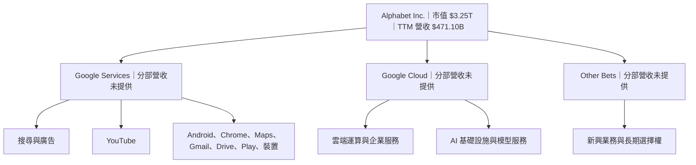
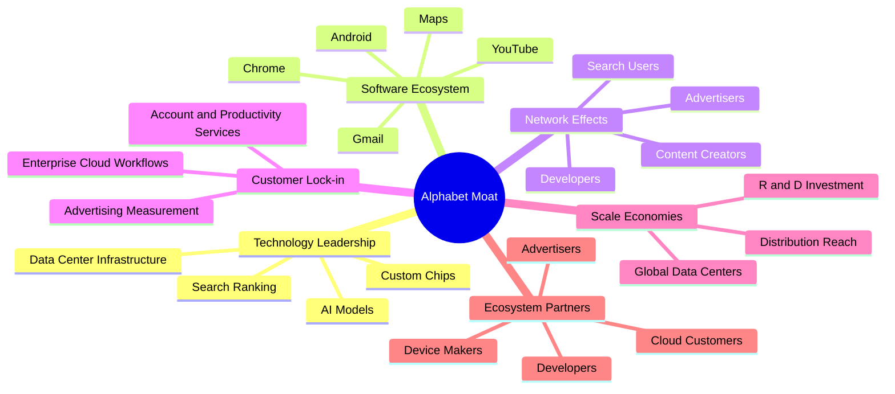
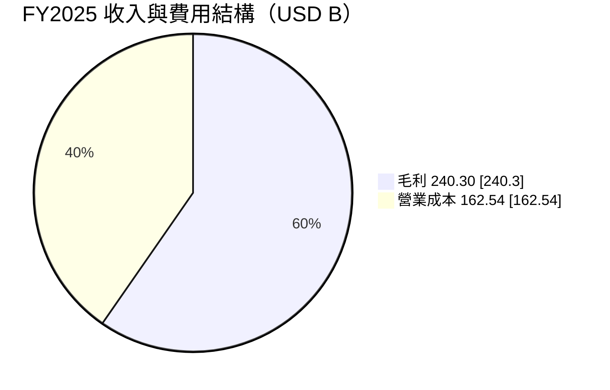
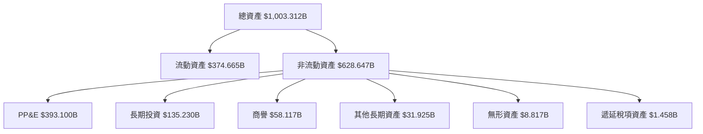
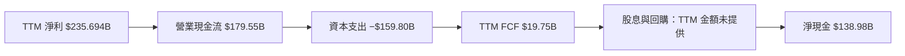
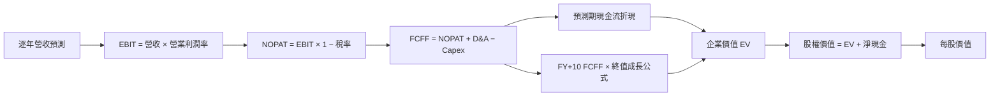
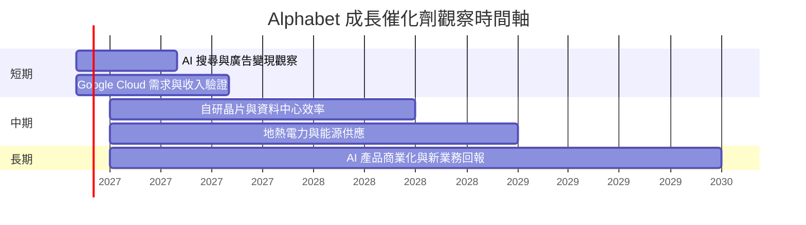
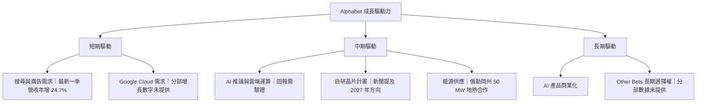
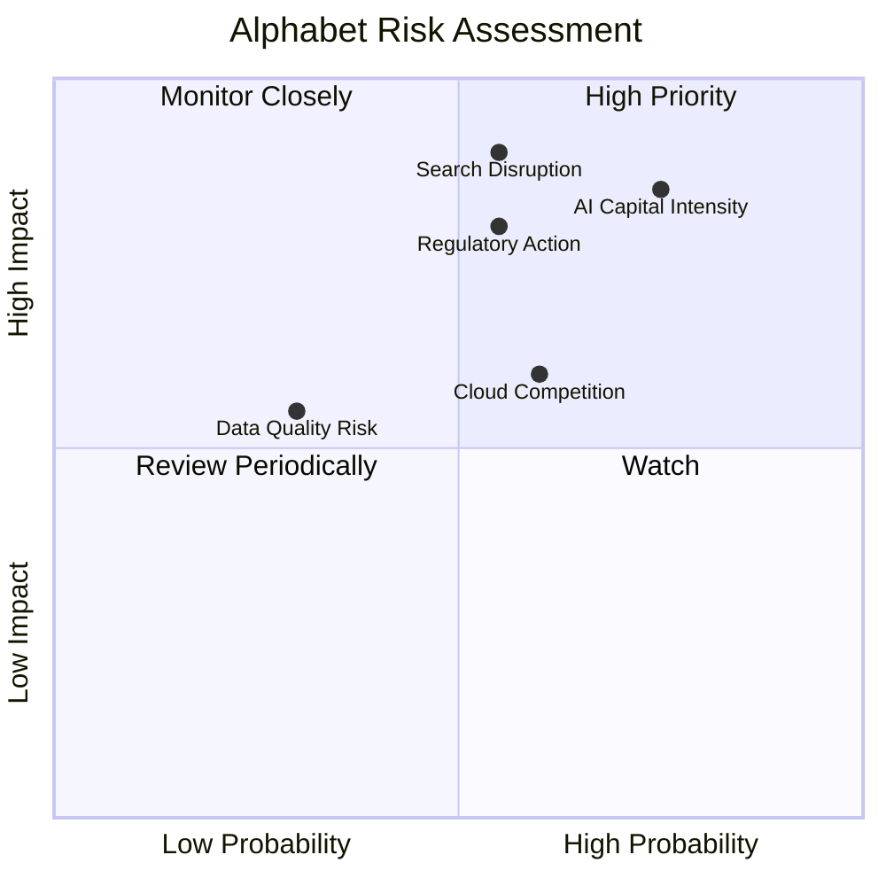
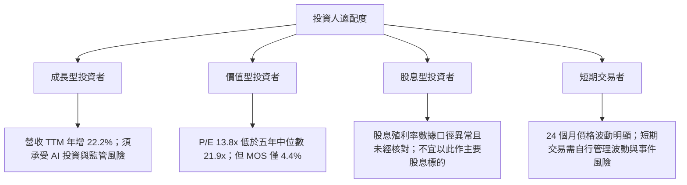

# GOOG 基本面深度分析報告

> **報告日期**：2026-11-22 ｜ **語言**：繁體中文 ｜ **數據來源**：SEC 申報資料 (XBRL)、Yahoo Finance、Finviz、StockAnalysis、Roic.ai ｜ **分析師**：CFA 級機構研究

## 目錄

| # | 章節 | 核心結論 |
|---|------|----------|
| 1 | 執行摘要 | 持有；加權合理價值 $276.17，MOS +4.4% |
| 2 | 公司概覽與商業模式 | 搜尋、廣告與雲端生態構成護城河；分部營收明細未提供 |
| 3 | 損益表深度分析 | TTM 營收 $471.10B，年增 22.2%；TTM 營業利益率 33.3% |
| 4 | 資產負債表分析 | 淨現金 $138.98B；現金及短期投資 $265.10B |
| 5 | 現金流量深度分析 | TTM FCF $19.75B；高資本支出使現金轉換率承壓 |
| 6 | 獲利能力與資本效率 | ROIC 23.9% 高於 WACC 10.28%，仍創造股東價值 |
| 7 | 相對估值分析 | GOOG 估值低於多數同業及自身歷史 P/E 中位數 |
| 8 | DCF 內在價值評估 | 基準 DCF 每股 $248.35；終值占 EV 72.3% |
| 9 | 成長催化劑 | AI、Cloud、搜尋與自研晶片是主要催化劑；TAM 數據未提供 |
| 10 | 風險矩陣 | AI 資本支出、搜尋商業模式與監管是主要風險 |
| 11 | 投資建議 | 持有；現價接近加權合理價值，等待估值或現金流改善 |

---

## 1. 執行摘要

GOOG 2026-11-20 收盤價為 **$264.00**。TTM 營收 **$471.10B**、年增 **22.2%**，最新一季營收年增 **24.7%**；ROIC **23.9%** 高於 WACC **10.28%**，顯示核心業務仍創造資本回報。然而，TTM 營業現金流 **$179.55B** 扣除資本支出 **$159.80B** 後，FCF 僅 **$19.75B**，FCF Yield **0.61%**，反映 AI／資料中心投資大幅壓低近年自由現金流。估值三角驗證的加權合理價值為 **$276.17**，MOS **+4.4%**，按規則 20 評級為 **持有**；基準 DCF 為 **$248.35**，相對現價代表 **+6.3% 折溢價**（現價／DCF 價值−1），而非折價。

### 1.0 一頁式投資儀表板（Portfolio Manager 30 秒速讀）

| 項目 | 內容 |
|------|------|
| **投資論點（3 句）** | ① TTM 營收年增 **22.2%**，最新一季年增 **24.7%**，成長仍在加速。② ROIC **23.9%** 對比 WACC **10.28%**，資本回報高於資本成本。③ TTM FCF **$19.75B**、FCF Yield **0.61%**，資本支出對現金流形成明顯壓力。 |
| **綜合評分** | **7.7/10**（引用 1.1 評分卡） |
| **財務健康** | 🟢 淨現金 **$138.98B**、流動比率 **2.786**；但 Piotroski F-Score 為 **4/8**，需關注資本支出與應計品質。 |
| **ROIC vs WACC** | **23.9% vs 10.28%**；利差 **13.62 個百分點**，創造價值。 |
| **FCF 趨勢** | FY2025 年 FCF **$73.27B**，TTM 降至 **$19.75B**；TTM FCF Yield **0.61%**。 |
| **估值** | Forward P/E **17.26x** ｜ EV/EBITDA **16.9x** ｜ FCF Yield **0.61%** |
| **DCF 內在價值（基準）** | **$248.35** ｜現價較 DCF 基準溢價 **+6.3%**（第 8.5 節） |
| **安全邊際（MOS）** | **+4.4%**＝（加權合理價值 **$276.17** − 現價 **$264.00**）÷ **$276.17**｜🔴 <10%，不足 |
| **預期報酬（基準情境 12M）** | **−5.9%**，以 DCF 基準情境 **$248.35** 對比現價計算；非 12 個月股價預測。 |
| **關鍵風險（前二）** | AI／資料中心 Capex 長期高於現金流增長；搜尋廣告遭生成式 AI 與監管改變商業模式。 |
| **評級 + 信心度** | 🟡 **持有** ｜ 信心：中 |

### 1.1 綜合評分卡（全報告唯一）

| 維度 | 評分（1–10） | 主要依據（引用數字與其來源章節） |
|------|--------------|----------------------------------|
| 成長性 | 8.5 | TTM 營收年增 **22.2%**、最新一季年增 **24.7%**；見 3.1–3.2。 |
| 獲利能力 | 8.5 | TTM 營業利益率 **33.3%**、ROIC **23.9%**，但 F-Score **4/8**；見 3、6。 |
| 財務健康 | 9.0 | 淨現金 **$138.98B**、流動比率 **2.786**；見 4。 |
| 估值 | 5.0 | MOS **4.4%**；低於自身 P/E 五年中位數，但 FCF Yield 僅 **0.61%**；見 7–8。 |
| 護城河 | 9.0 | Search、Android、Chrome、YouTube、Google Cloud 等互補生態，TTM 營收 **$471.10B**；見 2。 |
| 管理層與資本配置 | 7.0 | FY2025 SBC **$24.95B**；TTM Capex **$159.80B**，投入具戰略合理性但短期 FCF 受壓；見 3.5、5。 |
| **綜合評分** | **7.8** | 六項算術平均＝（8.5+8.5+9.0+5.0+9.0+7.0）÷6＝**7.8**。 |

### 1.2 五大投資論點 + 三大核心風險

| 類型 | 項目 | 具體依據 | 信心度 |
|------|------|----------|--------|
| 🟢 **投資論點①** | 核心營收仍加速 | TTM 營收 **$471.10B**、年增 **22.2%**；最新一季年增 **24.7%**。 | 🟢 高 |
| 🟢 **投資論點②** | 資本回報高於資本成本 | ROIC **23.9%**，高於 WACC **10.28%**。 | 🟢 高 |
| 🟢 **投資論點③** | 淨現金提供投資彈性 | 現金及短期投資 **$265.10B**，總債務 **$126.12B**，淨現金 **$138.98B**。 | 🟢 高 |
| 🟢 **投資論點④** | 估值低於自身歷史 P/E 中位數 | 現行 P/E **13.8x**，五年中位數 **21.9x**。 | 🟡 中 |
| 🟢 **投資論點⑤** | Cloud 與 AI 提供第二成長來源 | 最新新聞提及 Anthropic 對 Google Cloud 的需求；但分部營收及獲利數字未提供，無法量化貢獻。 | 🟡 中 |
| 🟡 **風險①** | AI 投資壓低 FCF | TTM Capex **$159.80B**，FCF **$19.75B**，FCF Yield **0.61%**。 | 🟡 中 |
| 🔴 **風險②** | 搜尋廣告面臨產品與監管風險 | 搜尋是核心商業模式之一；市場份額、廣告分部營收及監管事件財務影響未提供。 | 🔴 高衝擊 |
| 🔴 **風險③** | TTM 盈餘與現金流轉換偏弱 | TTM FCF／淨利約 **8.4%**；F-Score **4/8**，應計品質測試未通過。 | 🔴 高衝擊 |

### 1.3 快速統計卡片

| 指標 | 公司實際值（期間） | 同業中位數 | 狀態 |
|------|--------------------|------------|------|
| 營收成長（TTM） | **22.2%** | — | 🟢 |
| 營收成長（最新一季年增） | **24.7%** | **18.8%** | 🟢 |
| 毛利率（TTM） | **60.9%** | **67.7%** | 🟡 |
| 營業利益率（TTM） | **33.3%** | — | 🟢 |
| ROIC（TTM） | **23.9%** | — | 🟢 |
| Forward P/E | **17.3x** | **20.0x** | 🟢 |
| FCF Yield（TTM） | **0.61%** | — | 🔴 |
| Piotroski F-Score | **4 / 8** | — | 🟡 |

### 1.4 投資結論

```text
╔══════════════════════════════════════════════════════════════════╗
║                    📊 投資結論摘要                               ║
╠══════════════════════════════════════════════════════════════════╣
║  評級：持有（MOS +4.4%，落在 -10% 至 +10% 區間）                ║
║  價格（2026-11-20 收盤）：$264.00                               ║
║  DCF 內在價值（基準）：$248.35（現價溢價 +6.3%）                ║
║  安全邊際 MOS：+4.4%（以加權合理價值 $276.17 為分母）           ║
║  加權合理價值（8.8）：$276.17                                    ║
║  DCF 情境價值：                                                   ║
║    悲觀情境：$108.52（-58.9%）                                   ║
║    基準情境：$248.35（-5.9%）                                    ║
║    樂觀情境：$518.77（+96.5%）                                   ║
║  綜合評分：7.8/10（引用 1.1）                                    ║
║  適合投資人：能承受 AI 投資與監管不確定性的長期成長型投資人      ║
╚══════════════════════════════════════════════════════════════════╝
```

---

## 2. 公司概覽與商業模式

### 2.1 業務結構與收入來源

最新公司資料列出 Google Services、Google Cloud、Other Bets 三大板塊，但沒有提供各板塊收入及占比，故不以推估比例繪製分部收入圖。可確認的公司層級數據為 TTM 營收 **$471.10B**、市值 **$3.25T**。



商業模式主要由廣告變現、雲端服務及數位產品生態構成。由於各分部收入、營業利益及分部成長數據未提供，本報告不推算營收占比。

### 2.2 市場份額

市場份額數據未提供，亦無可引用的來源年份或市占率數字，因此不繪製市占率圖表。以公司規模而言，Alphabet TTM 營收 **$471.10B**、最新一季營收年增 **24.7%**，高於 META、MSFT、AMZN 最新一季營收成長中位數 **18.8%**；但缺少同口徑分部收入，無法單獨判斷搜尋、雲端或 YouTube 的相對市占變化。

### 2.3 競爭護城河分析



### 2.4 護城河強度

| 護城河項目 | 強度（強／中／弱） | 證據（引用數字或事實） | 會削弱它的情況 |
|------------|--------------------|------------------------|----------------|
| 技術與資料 | 強 | Search、YouTube、Maps、AI 與大規模資料中心並存；FY2025 研發費用 **$61.09B**。 | AI 搜尋替代傳統搜尋、品質或成本落後。 |
| 軟體生態系統 | 強 | Android、Chrome、Gmail、Maps、Drive、Play 等互相導流；使用者數據未提供。 | 平台規則改變、預設入口流失、監管拆分。 |
| 網路效應 | 中至強 | 使用者、廣告主、出版商與開發者形成多邊平台；可量化網路效應資料未提供。 | 廣告主轉移預算、內容供應商降低依賴。 |
| 客戶鎖定 | 中 | Workspace、Android 與 Google Cloud 產品可形成工作流程依賴；留存率未提供。 | 多雲轉換成本下降、企業客戶轉向競品。 |
| 規模效應 | 強 | TTM 營收 **$471.10B**，FY2025 研發投入 **$61.09B**。 | Capex 增速高於收入、AI 投資回報不足。 |
| 生態夥伴 | 中 | 裝置商、開發者、廣告商及雲端客戶共同拓展分發；夥伴收入貢獻未提供。 | 監管限制預設分發、合作夥伴自行發展競爭產品。 |

1.1「護城河」評分為 **9.0/10**，依據是多產品生態、規模與研發投入；分部貢獻及用戶留存等細項資料不足，因此不評為滿分。

---

## 3. 損益表深度分析

### 3.1 年度收入成長趨勢（近4年）

年度營收來自 2022–2025 年財務資料；成長率按相鄰年度營收計算。2022 年營收 **$282.84B**、2025 年 **$402.84B**，三年 CAGR 約 **12.5%**。

```text
╔══════════════════════════════════════════════════════════════════╗
║             Alphabet 年度收入趨勢（FY2022–FY2025）                ║
╠══════════════════════════════════════════════════════════════════╣
║  FY2022  $282.84B  ██████████████████░░░░░░░░  YoY：基期         ║
║  FY2023  $307.39B  ███████████████████░░░░░░░  YoY：+8.7%  🟡    ║
║  FY2024  $350.02B  ██████████████████████░░░░  YoY：+13.9% 🟢    ║
║  FY2025  $402.84B  █████████████████████████░  YoY：+15.1% 🟢    ║
║                                                                  ║
║  📊 2022–2025 三年營收 CAGR：約 +12.5%                           ║
╚══════════════════════════════════════════════════════════════════╝
```

FY2023 成長 **8.7%**，FY2024 回升至 **13.9%**、FY2025 再升至 **15.1%**；TTM 成長進一步達 **22.2%**，反映近年需求與比較基期均對增長有利，但要判定是 Search、Cloud 或其他產品帶動，仍需分部數字。

### 3.2 季度收入趨勢分析

| 季度 | 營收 | QoQ | YoY | 備註 |
|------|------|-----|-----|------|
| 2025 Q4 | $113.83B | +11.2% | +18.0% | QoQ 以 2025 Q3 為比較基期。 |
| 2026 Q1 | $109.90B | −3.5% | +21.8% | 季節性回落，但年增加速。 |
| 2026 Q2 | $119.80B | +9.0% | +24.2% | 營收較前季回升。 |
| 2026 Q3 | $127.58B | +6.5% | +24.7% | 最新一季營收年增率，屬單季數字，非 TTM。 |

最新一季營收成長快於前兩季，表示整體收入動能向上；然而，資料未提供各分部及價格／量的拆分，無法將成長精確歸因於廣告定價、搜尋查詢量或 Cloud 用量。

### 3.3 利潤率演變分析

年度毛利率及營業利益率以年度營收及相應利潤計算。

| 利潤率指標 | FY2022 | FY2023 | FY2024 | FY2025 | 趨勢 | 評估 |
|------------|--------|--------|--------|--------|------|------|
| **毛利率** | 55.4% | 56.6% | 58.2% | 59.7% | ↗️ 連續改善 | 🟢 |
| **營業利益率** | 26.5% | 27.4% | 32.1% | 32.0% | ↗️ 後趨穩 | 🟢 |
| **淨利率** | 21.2% | 24.0% | 28.6% | 32.8% | ↗️ 改善 | 🟢 |

FY2022 至 FY2024 的營業利益率增加，與收入恢復成長、營運費用相對收入的槓桿效應相符；FY2025 約持平，表示成本控制成果仍在，但不宜假設利潤率會持續擴張。TTM 營業利益率為 **33.3%**，最新季度數據區塊另列 **31.8%**；兩者期間不同，應避免混用。

### 3.4 費用結構分析

FY2025 營業收入、毛利與營業利益可支持以下費用結構核對。以營收減毛利計算營業成本約 **$162.54B**；毛利減營業利益所代表的營業費用約 **$111.26B**。此為由同年度財務數字推導的合計，並非各費用科目拆分。



```text
╔══════════════════════════════════════════════════════════════════╗
║                  FY2025 費用與利潤概覽                           ║
╠══════════════════════════════════════════════════════════════════╣
║  營收          $402.84B  ██████████████████████████████          ║
║  毛利          $240.30B  ██████████████████                      ║
║  營業利益      $129.04B  ██████████                              ║
║  研發費用       $61.09B  █████                                   ║
║  營業成本      $162.54B  （營收 − 毛利）                          ║
║  毛利以下營業費用約 $111.26B（毛利 − 營業利益）                  ║
╚══════════════════════════════════════════════════════════════════╝
```

圓餅圖僅呈現營收與營業成本之間的毛利構成，不代表完整費用分類；完整營業費用明細及研發以外的費用拆分未提供。

### 3.5 季度 EPS 趨勢與盈餘品質（Quality of Earnings）

#### EPS 趨勢

| 季度 | EPS 實際值 | EPS 預估 | 超預期／不及預期 | 說明 |
|------|------------|----------|------------------|------|
| 2025 Q4 | $2.81 | N/A | N/A | EPS 預估資料缺失。 |
| 2026 Q1 | $5.11 | N/A | N/A | EPS 預估資料缺失。 |
| 2026 Q2 | $9.11 | N/A | N/A | EPS 預估資料缺失；淨利數字顯著異常，須核對原始申報。 |
| 2026 Q3 | $2.14 | N/A | N/A | EPS 預估資料缺失，不能判定是否超預期。 |

季度 EPS 預估欄為缺失值，故無法可靠判斷最近四季的盈餘超預期或不及預期。另 2026 Q2 淨利列示 **$112.19B**，與相鄰季度差異極大，且與其他來源的季度敘述不完全一致；本報告不據此推斷一次性損益，而將其列為需查核的資料品質風險。

#### 盈餘品質量化

| 盈餘品質項目 | 數值／佔比 | 評估 |
|--------------|-----------|------|
| 股權薪酬 SBC／營收 | FY2025：$24.95B／$402.84B＝**6.2%** | 🟡 SBC 是真實的股東稀釋成本；FY2025 SBC 約占營收 6.2%。 |
| SBC／營業現金流 | FY2025：$24.95B／$164.71B＝**15.1%** | 🟡 金額不低；不能因其為非現金會計費用而忽略股東成本。 |
| FCF／淨利（現金轉換率） | TTM：$19.75B／$235.694B＝**8.4%** | 🔴 偏低，主要需結合 TTM Capex **$159.80B** 評估。 |
| 一次性／非經常性損益 | N/A（未提供可核對明細） | 無法判斷一次性項目對 TTM 淨利的影響。 |
| 有效稅率異常 | **16.8%**（最新年度有效稅率） | 未見足夠資料證明稅率異常；不可據此認定淨利受稅務利益美化。 |
| 資本化支出 vs 費用化 | TTM Capex **$159.80B**；資本化／費用化細項 N/A | Capex 透過折舊逐期進入損益，需監控資產壽命與未來折舊負擔；資料不足以判定資本化是否不當。 |

**盈餘品質結論**：營業現金流仍達 **$179.55B**，但高資本支出使 TTM FCF 降至 **$19.75B**，TTM FCF／淨利僅約 **8.4%**。因此，當期 GAAP 淨利不能直接等同可分配現金盈餘；估值須把資料中心投資、未來折舊及 SBC 稀釋一併納入。

---

## 4. 資產負債表分析

### 4.1 資產結構分解

截至 2026-09-30，總資產 **$1,003.312B**。下圖使用同一來源列示的資產明細；流動資產以總額呈現，不再與其內部項目重複相加。



### 4.2 流動性與營運資金分析

| 流動性指標 | 數值 | 評估 |
|------------|------|------|
| 現金及短期投資 | **$265.10B** | 🟢 可為投資、營運與債務管理提供流動性。 |
| 流動比率 | **2.786** | 🟢 流動資產對短期負債覆蓋充足。 |
| 速動比率 | **2.512** | 🟢 不依賴存貨亦有流動性緩衝。 |

| 指標 | 最新 TTM | 一年前 TTM | 變化 | 解讀 |
|------|----------|------------|------|------|
| DSO 應收帳款天數 | 56 天 | 54 天 | +2 天 | 🟡 收款天數略升；需持續觀察是否為收入成長、客戶組合或付款條款所致。 |
| DIO 存貨天數 | 26 天 | N/A | N/A | 一年前無可比數據，不作趨勢判斷。 |
| DPO 應付帳款天數 | 43 天 | N/A | N/A | 一年前無可比數據，不推測供應商議價能力變化。 |
| CCC 現金轉換週期 | 39 天 | N/A | N/A | 一年前 CCC 無法計算；最新值依來源計算口徑照錄。 |

### 4.3 債務結構分析

```text
╔══════════════════════════════════════════════════════════════════╗
║                   Alphabet 債務健康診斷                          ║
╠══════════════════════════════════════════════════════════════════╣
║  總債務：        $126.12B  █████████░░░░░░░░░░░  🟡              ║
║  現金+短期投資： $265.10B  ████████████████████  🟢              ║
║  淨現金：        $138.98B  ██████████░░░░░░░░░░  🟢              ║
║                                                                  ║
║  流動比率：      2.786     🟢                                    ║
║  Debt/EBITDA：   N/A（債務與 EBITDA 口徑未提供可對應基數）        ║
║  利息保障倍數：  N/A（利息費用資料未完整提供）                   ║
║                                                                  ║
║  註：採用 SEC 計算區塊的債務 $126.12B 與淨現金 $138.98B。        ║
╚══════════════════════════════════════════════════════════════════╝
```

### 4.4 股東權益趨勢

| 年度 | 股東權益 | YoY 變化 | 觀察 |
|------|----------|----------|------|
| 2022 | $256.14B | — | 基期。 |
| 2023 | $283.38B | +10.6% | 權益增加。 |
| 2024 | $325.08B | +14.7% | 權益增幅提高。 |
| 2025 | $415.26B | +27.7% | 增幅較快，需與留存盈餘、回購及其他權益項目一併分析。 |

```text
╔══════════════════════════════════════════════════════════════════╗
║                 股東權益趨勢（年度）                              ║
╠══════════════════════════════════════════════════════════════════╣
║  2022  $256.14B  ███████████████░░░░░░░░░░                      ║
║  2023  $283.38B  █████████████████░░░░░░░░                      ║
║  2024  $325.08B  ███████████████████░░░░░░                      ║
║  2025  $415.26B  █████████████████████████                      ║
╚══════════════════════════════════════════════════════════════════╝
```

---

## 5. 現金流量深度分析

### 5.1 現金流量瀑布圖

以下 TTM 瀑布僅呈現有數字支持的項目；TTM 股息、回購及現金餘額變化未提供，故不填入金額。



營業現金流低於淨利，Capex 又接近營業現金流，因此可分配的 TTM FCF 明顯收窄。FY2025 股息支付為 **$10.05B**；但 TTM 的股息與回購金額缺失，不以年度資料替代 TTM 數字。

### 5.2 FCF 轉換率趨勢

| 年度 | FCF | 淨利 | FCF／淨利 |
|------|-----|------|-----------|
| 2022 | $60.01B | $59.97B | 100.1% |
| 2023 | $69.50B | $73.80B | 94.2% |
| 2024 | $72.76B | $100.12B | 72.7% |
| 2025 | $73.27B | $132.17B | 55.4% |
| TTM 至 2026-09-30 | $19.75B | $235.694B | 8.4% |

FY2022–FY2025 的 FCF 約持平至溫和上升，但淨利增速更快，使轉換率由 **100.1%** 降至 **55.4%**。TTM 比率進一步降至 **8.4%**，主要需從 Capex 飆升理解；這表示營收與盈餘成長尚未同步轉化為可分配現金。

### 5.3 自由現金流趨勢

| 年度／期間 | FCF | 備註 |
|------------|-----|------|
| FY2022 | $60.01B | 年度財務資料。 |
| FY2023 | $69.50B | 年度財務資料。 |
| FY2024 | $72.76B | 年度財務資料。 |
| FY2025 | $73.27B | 年度財務資料。 |
| TTM 至 2026-09-30 | $19.75B | 採營業現金流減資本支出的定義。 |

```text
╔══════════════════════════════════════════════════════════════════╗
║                自由現金流：年度實際與 TTM                        ║
╠══════════════════════════════════════════════════════════════════╣
║  FY2022  $60.01B  ████████████████░░░░░░░░  FCF Yield：N/A       ║
║  FY2023  $69.50B  ██████████████████░░░░░░  FCF Yield：N/A       ║
║  FY2024  $72.76B  ███████████████████░░░░░  FCF Yield：N/A       ║
║  FY2025  $73.27B  ███████████████████░░░░░  FCF Yield：N/A       ║
║  TTM     $19.75B  █████░░░░░░░░░░░░░░░░░░  FCF Yield：0.61%     ║
╚══════════════════════════════════════════════════════════════════╝
```

年度 FCF Yield 未提供，不以不同期間市值自行回推。

### 5.4 資本配置評估

資本配置占比圖需要同一期間的回購、投資、Capex、股息及留存等完整金額；TTM 資料不齊，故不繪製比例圖。

| 已知項目 | 金額 | 評估 |
|----------|------|------|
| TTM Capex | $159.80B | 高額投入壓低 TTM FCF；投資回報需透過未來 Cloud、AI 及搜尋效率驗證。 |
| FY2025 股息支付 | $10.05B | 年度數據；TTM 股息金額未提供。 |
| FY2025 SBC | $24.95B | 增加員工激勵，但對股東構成稀釋成本。 |
| TTM 回購 | N/A | 數據未提供，不推估回購金額。 |
| TTM 現金留存變化 | N/A | 無法從現有 TTM 表格獨立計算。 |

---

## 6. 獲利能力與資本效率

### 6.1 ROE / ROA / ROIC 趨勢

| 指標 | 可用期間與數值 | 評估 |
|------|----------------|------|
| ROE | TTM **34.8%**（品質指標計算） | 🟢 高；但 Yahoo 區塊另列 **44.3%**，口徑或期間不一致，本報告採用品質指標區塊數字。 |
| ROA | TTM **12.7%** | 🟢 資產回報具吸引力。 |
| ROIC | TTM **23.9%** | 🟢 明顯高於 WACC **10.28%**。 |

歷史一致口徑的 ROIC／ROA／ROE 序列未提供，且外部資料區塊有不同的 ROE 數值，因此不補造年度趨勢或行業平均值。

### 6.2 ROIC vs WACC 分析（核心價值創造判斷）

```text
╔══════════════════════════════════════════════════════════════════╗
║                ROIC vs WACC 深度分析                            ║
╠══════════════════════════════════════════════════════════════════╣
║  WACC（採用資本成本資料）：                                      ║
║  ├── 無風險利率（10Y 美債）：  4.91%                             ║
║  ├── 市場風險溢酬 ERP：        5.00%                             ║
║  ├── 原始 Beta：               1.23                              ║
║  ├── 調整 Beta：               1.15                              ║
║  ├── 股權成本 Ke：             10.67%                            ║
║  ├── 稅前債務成本 Kd：         0.58%                             ║
║  ├── 股權／債務權重：          96.3%／3.7%                       ║
║  └── ✅ WACC：                 10.28%                            ║
║                                                                  ║
║  ROIC（TTM）：                23.9%                              ║
║  EVA 利差：                   23.9% − 10.28% = +13.62pp          ║
║                                                                  ║
║  ROIC  23.9%  ▓▓▓▓▓▓▓▓▓▓▓▓▓▓▓▓▓▓▓▓▓▓▓▓  🟢                     ║
║  WACC  10.28% ▓▓▓▓▓▓▓▓▓▓▓░░░░░░░░░░░░░  ──                     ║
║                                                                  ║
║  📊 結論：ROIC／WACC 約 2.33 倍，TTM 口徑下創造股東價值。       ║
╚══════════════════════════════════════════════════════════════════╝
```

Beta 調整依據為 **2/3 × 1.23 + 1/3 × 1 = 1.15**。CAPM 依來源列示股權成本 **10.67%**；以已四捨五入的權重及債務成本重算可能產生細微差異，因此 WACC 採用來源給定的 **10.28%**，不另行覆蓋。ROIC–WACC 差額 **13.62 個百分點**表示目前投入資本的稅後回報高於資本成本；若高 Capex 長期無法產生相稱營業利潤，該利差會收窄。

### 6.3 杜邦三因素分解

| 因素 | 數值（TTM） | 解讀 |
|------|-------------|------|
| 淨利率 | 50.0% | 對照 TTM 營收與淨利數據時，須留意資料來源口徑及單季淨利異常。 |
| 資產週轉率 | 0.47 | 每單位資產產生的營收有限，反映大型資產基礎。 |
| 權益乘數 | 1.48 | 槓桿適中，不是 ROE 的主要來源。 |
| **ROE** | **34.8%** | 品質指標區塊列示：50.0% × 0.47 × 1.48＝34.8%（四捨五入）。 |

ROE 主要由高淨利率推動，而非高財務槓桿；惟資料中另一來源列示 ROE **44.3%**，口徑差異需以正式申報核對。

### 6.4 財務體質：Piotroski F-Score

| 測試 | 結果 | 解讀 |
|------|------|------|
| ROA > 0 | ✅ 通過 | TTM ROA 為正。 |
| 營業現金流 > 0 | ✅ 通過 | TTM 營業現金流 **$179.55B**。 |
| ROA 高於一年前 | ✅ 通過 | 年增方向有改善。 |
| 營業現金流 > 淨利（應計品質） | ❌ 未通過 | 淨利高於營業現金流，且 Capex 壓低 FCF。 |
| 長期負債／總資產低於一年前 | ❌ 未通過 | 負債比未改善。 |
| 流動比率高於一年前 | ✅ 通過 | 流動比率方向改善。 |
| 稀釋股數未增加 | ❌ 未通過 | 稀釋股數測試未通過，須留意 SBC。 |
| 毛利率高於一年前 | — 無法判定 | 缺少所需比較資料。 |
| 資產週轉率高於一年前 | ❌ 未通過 | 資產週轉率未改善。 |

**Piotroski F-Score：4/8**；毛利率測試因資料缺失不納入分母。分數顯示盈利與流動性面有通過項，但應計品質、負債趨勢、稀釋及資產效率值得監控。

---

## 7. 相對估值分析

### 7.1 同業估值比較表格

| 估值指標 | **GOOG** | **META** | **MSFT** | **AMZN** | 本公司評估 |
|----------|----------|----------|----------|----------|-----------|
| **Trailing P/E** | 13.8x | 19.1x | 25.3x | 20.0x | 🟢 低於三家同業。 |
| **Forward P/E** | 17.3x | 15.7x | 20.0x | 22.6x | 🟡 低於同業中位數 20.0x，但高於 META。 |
| **P/S Ratio** | 6.9x | 5.9x | 10.4x | 3.3x | 🟡 高於 META、AMZN，低於 MSFT。 |
| **EV/EBITDA** | 16.9x | 12.6x | 17.8x | 15.6x | 🟡 接近同業中位數 15.6x，略高。 |
| **最新一季營收 YoY** | 24.7% | 26.1% | 18.8% | 12.1% | 🟢 成長僅低於 META，高於 MSFT、AMZN。 |
| **毛利率（TTM）** | 60.9% | 81.0% | 67.7% | 51.4% | 🟡 低於 META、MSFT，高於 AMZN。 |

### 7.2 歷史估值區間分析

| 倍數 | 目前 | 五年中位數 | 五年區間 | 目前百分位 |
|------|------|------------|----------|------------|
| P/E | 13.8x | 21.9x | 1.3x–29.0x | 29% |
| P/S | 6.9x | 6.1x | 4.1x–9.8x | 60% |
| EV/EBITDA | 16.9x | 19.1x | 13.7x–25.0x | 27% |

```text
╔══════════════════════════════════════════════════════════════════╗
║                GOOG 五年估值區間與目前位置                        ║
╠══════════════════════════════════════════════════════════════════╣
║  P/E        1.3x ├────────────●──────────────────┤ 29.0x       ║
║                            現值 13.8x｜中位數 21.9x              ║
║  P/S        4.1x ├────────────────●──────────────┤ 9.8x        ║
║                            現值 6.9x｜中位數 6.1x                ║
║  EV/EBITDA 13.7x ├────────●──────────────────────┤ 25.0x       ║
║                            現值 16.9x｜中位數 19.1x              ║
╚══════════════════════════════════════════════════════════════════╝
```

P/E 與 EV/EBITDA 位於各自五年區間偏低位置；P/S 則略高於中位數。估值較低可能反映市場對搜尋模式、監管及 AI 投資回報的折價，不能單純視為低估證據。

### 7.3 情境價值（Bear / Base / Bull，照抄 DCF MODEL）

| 情境 | 第 1 年營收成長 | 期末營業利潤率 | WACC | 每股價值 | 相對現價 | 機率 | 會發生的條件 |
|------|----------------|----------------|------|----------|----------|------|--------------|
| 🔴 悲觀 | 11.1% | 27.2% | 11.28% | $108.52 | −58.9% | 25% | 搜尋增長放緩、AI 投資未能提高變現、利潤率承壓且資本成本上升。 |
| 🟡 基準 | 22.2% | 32.0% | 10.28% | $248.35 | −5.9% | 50% | 近期增長逐步減速至模型假設，長期利潤率略降。 |
| 🟢 樂觀 | 33.3% | 35.2% | 9.28% | $518.77 | +96.5% | 25% | AI、Cloud 與廣告成長超過基準，規模效益擴張利潤率，資本成本下降。 |

### 7.4 相對估值隱含價格區間

```text
╔══════════════════════════════════════════════════════════════════╗
║            同業估值法回推價值與現價位置                          ║
╠══════════════════════════════════════════════════════════════════╣
║  $245.49 ─── $248.35 ─── $264.00 ─── $306.23 ─── $389.00        ║
║  EV/EBITDA    基準 DCF     現價       Forward P/E    共識目標價  ║
╚══════════════════════════════════════════════════════════════════╝
```

| 方法 | 每股價值 | 依據 |
|------|----------|------|
| 同業 Forward P/E | $306.23 | META、MSFT、AMZN 同業中位數 **20.0x** × GOOG Forward EPS **$15.30**。 |
| 同業 EV/EBITDA | $245.49 | 同業 EV/EBITDA 中位數 **15.6x** × TTM EBITDA，再加淨現金。 |

---

## 8. DCF 內在價值評估（Discounted Cash Flow）

> 本節依 SEC 申報資料及程式計算的 DCF 基準模型呈現。模型假設、逐年預測及估值結果依原模型列示；下文亦揭露部分輸出值在複算時的差異，不自行改寫模型數字。

### 8.0 估值推理鏈（Thinking Logic）

**Step 1 — 價值來源與主導變數**

Alphabet 的價值可理解為現有搜尋／廣告服務現金流、Google Cloud 成長及其他新業務選擇權；但分部營收占比未提供，不能為各來源填入比例。DCF 模型最敏感的是終值假設及長期 Capex／營收比率：模型終值現值占 EV **72.3%**，且 Capex／營收從 FY+1 **33.9%** 降至 FY+10 **6.5%**，因此長期投資強度與終值對估值影響重大。

**Step 2 — 模型選擇**

| 決策點 | 本報告採用 | 理由 | 曾考慮但否決 | 否決理由 |
|--------|-----------|------|--------------|----------|
| 現金流定義 | FCFF | 以 WACC 折現並推導 EV，符合企業價值框架。 | FCFE | 債務及現金橋接由模型另行處理。 |
| 預測期 N | 10 年 | 模型提供 FY+1 至 FY+10 逐年預測。 | 5 年 | 與指定模型假設不一致，且會改動模型。 |
| 終值方法 | Gordon Growth | 模型明列永續成長率 **3.0%**。 | 退出倍數 | DCF 區塊未提供可複製的退出倍數終值，故不另建。 |
| EBIT 基礎 | GAAP EBIT | 模型明確採 GAAP 營業利益。 | 非 GAAP EBIT | 無須另行調整 SBC。 |

**Step 3 — 關鍵假設推導鏈**

- **營收成長**：錨點＝TTM 營收年增 **22.2%**；調整＝模型假設逐年線性減速，以反映規模擴大後增速回歸；**採用第 1 年 22.2%、第 10 年 3.0%**；曾考慮延長高增長，但缺乏分部預測支持，不採用額外上調。
- **期末營業利潤率**：錨點＝TTM **33.3%**；調整＝模型按過去五個財政年度中位數逐步收斂；**採用 FY+10 為 32.0%**；不採用持續擴張假設，因近年年度營業利益率已在約 32% 附近。
- **永續成長率 g**：錨點＝長期成熟企業通常需低於名目經濟成長與 WACC；模型直接採 **3.0%**；因 WACC 為 **10.28%**，符合 g < WACC；不採用更高永續成長率，避免終值過度擴張。
- **預測期 N**：錨點＝模型提供十年預測；**採用 10 年**；不改成 5 年，因會改變終值基期及現值加總。
- **Capex／營收**：錨點＝TTM Capex **$159.80B**／TTM 營收 **$471.10B**，約 **33.9%**；模型逐步淡化至 **6.5%**；未採用永久維持 33.9%，因那會令穩態自由現金流過低；也不把較低比率提前，因 AI 基建投資仍在進行。
- **EBIT 基礎與 SBC**：採 GAAP EBIT，SBC 已在費用中反映；模型不再扣 SBC。
- **年稀釋率**：採模型組合 A 的固定股數處理，年稀釋率 **0%**；替代的股數增長情境未納入。
- **終值方法**：採 Gordon Growth，錨點為模型所列終值；退出倍數交叉檢驗因缺少模型輸入而不另行計算。
- **WACC**：採程式計算的 **10.28%**，不是另行估算。其組成與限制見 8.2。

**Step 4 — 最脆弱的一環**

最脆弱假設是 Capex／營收由 **33.9%** 長期降至 **6.5%**；若資料中心投資強度下降較慢，FCF 與終值會低於基準。反向風險則是投資回報高於預期，Cloud／AI 變現加速，基準模型可能低估價值。

**Step 5 — 計算路徑**



### 8.1 模型假設總表（Model Inputs）

| 假設項目 | 採用值 | 依據／來源 | 敏感度 |
|----------|--------|-------------|--------|
| 預測期長度 N | 10 年 | DCF 模型列 FY+1 至 FY+10。 | 🟡 中 |
| 營收成長 | 第 1 年 22.2%，第 10 年 3.0% | 起點取 TTM vs prior TTM 成長 **22.2%**，線性淡化。 | 🔴 高 |
| 營業利潤率 | 33.3% 降至 32.0% | 起點為 TTM 營業利益率，終點取模型所用五年中位數。 | 🔴 高 |
| 有效稅率 | 16.8% | 最新年度有效稅率。 | 🟢 低 |
| Capex／營收 | 第 1 年 33.9% 降至第 10 年 6.5% | TTM Capex／營收基準及模型淡化假設。 | 🔴 高 |
| D&A／營收 | 5.9% | DCF 模型假設，按 TTM 比率固定。 | 🟢 低 |
| 營運資金變動 | 未建模 | DCF 模型明確未納入 ΔWC。 | 🟢 低 |
| EBIT 基礎 | GAAP | 模型使用 GAAP EBIT。 | 🟡 中 |
| SBC 處理 | 不再另扣 SBC | GAAP EBIT 已包含 SBC 費用。 | 🟡 中 |
| 年稀釋率 | 0% | 模型採固定股數組合 A。 | 🟡 中 |
| 永續成長率 g | 3.0% | 模型假設，且低於 WACC 10.28%。 | 🔴 高 |
| 終值方法 | Gordon Growth | 模型終值計算方法。 | 🔴 高 |
| WACC | 10.28% | 成本資本資料區塊指定值。 | 🔴 高 |

FCFF 定義為 **FCFF = NOPAT + D&A − Capex**，ΔWC 未建模。模型採 **(A) GAAP EBIT + 固定股數**，因此 SBC 影響已計入一次，不再扣除 SBC，也不額外增加年稀釋率。

### 8.2 折現率推導（WACC）

```text
╔══════════════════════════════════════════════════════════════════╗
║                    WACC 推導（折現率）                           ║
╠══════════════════════════════════════════════════════════════════╣
║  股權成本 Ke（CAPM）：                                           ║
║  ├── 無風險利率 Rf：                 4.91%                       ║
║  ├── 市場風險溢酬 ERP：              5.00%                       ║
║  ├── 原始 Beta：                     1.23                        ║
║  ├── 調整 Beta：                     1.15                        ║
║  ├── 調整方式：2/3 × 1.23 + 1/3 × 1.00 = 1.15                  ║
║  ├── 規模／國別溢酬：                0.00%（未另加）             ║
║  └── Ke：                            10.67%                      ║
║                                                                  ║
║  債務成本：                                                      ║
║  ├── 稅前 Kd：                       0.58%                       ║
║  ├── 有效稅率：                      16.8%                       ║
║  └── 稅後 Kd：0.58% × (1−16.8%) =   0.48256%                    ║
║                                                                  ║
║  資本結構權重：股權 96.3%／債務 3.7%                              ║
║  ✅ 採用 WACC：                       10.28%                      ║
╚══════════════════════════════════════════════════════════════════╝
```

1. **Ke（CAPM）**＝Rf＋β×ERP＝**4.91%＋1.15×5.00%＝10.66%**。成本資本資料區塊列示 Ke **10.67%**；差異為輸入四捨五入，本報告引用該區塊數值。
2. **稅前 Kd**＝**0.58%**，引用利息／債務成本資料；平均計息負債的完整構成與利息費用金額未提供，故不重建分母。
3. **稅後 Kd**＝0.58%×（1−16.8%）＝**0.48256%**。
4. **權重**＝股權 **96.3%**、債務 **3.7%**；兩者合計 **100.0%**。市值採 2026-11-20 收盤價資料的市值口徑；計息債務範圍未提供與分項對照，故無法獨立重算權重。
5. **WACC**：採成本資本資料區塊的 **10.28%**。以已四捨五入的權重、Ke 與 Kd 直接重算，結果可能與 10.28% 有細微差異；模型及第 6.2 節一致採用 10.28%。

10Y 美債數據日期未另外列示；ERP **5.00%** 為假設值，非公司歷史實績。未加規模或國別溢酬。利息費用與計息負債分項缺失，相關債務成本僅引用資本成本資料列示值。

### 8.3 逐年自由現金流預測（基準情境）

下表依 DCF 模型列示，金額單位為 **USD B**。折現因子保留三位小數。ΔWC 未建模，因此不列為現金流調整項。

| 年度 | FY+1 | FY+2 | FY+3 | FY+4 | FY+5 | FY+6 | FY+7 | FY+8 | FY+9 | FY+10 |
|------|-----:|-----:|-----:|-----:|-----:|-----:|-----:|-----:|-----:|------:|
| 營收 | 575.74 | 691.33 | 815.37 | 944.26 | 1,073.37 | 1,197.22 | 1,309.81 | 1,405.02 | 1,477.16 | 1,521.48 |
| 營收 YoY | 22.2% | 20.1% | 17.9% | 15.8% | 13.7% | 11.5% | 9.4% | 7.3% | 5.1% | 3.0% |
| 營業利潤率 | 33.3% | 33.2% | 33.0% | 32.9% | 32.7% | 32.6% | 32.5% | 32.3% | 32.2% | 32.0% |
| EBIT | 191.84 | 229.37 | 269.36 | 310.58 | 351.51 | 390.36 | 425.19 | 454.09 | 475.29 | 487.37 |
| − 稅 | (32.20) | (38.50) | (45.21) | (52.13) | (58.99) | (65.51) | (71.36) | (76.21) | (79.77) | (81.80) |
| NOPAT | 159.65 | 190.87 | 224.15 | 258.46 | 292.52 | 324.84 | 353.83 | 377.88 | 395.52 | 405.57 |
| + D&A | 34.21 | 41.08 | 48.45 | 56.11 | 63.79 | 71.14 | 77.84 | 83.49 | 87.78 | 90.41 |
| − Capex | (195.30) | (213.47) | (226.97) | (234.11) | (233.46) | (223.97) | (205.18) | (177.35) | (141.51) | (99.46) |
| **FCFF** | **−1.44** | **18.48** | **45.64** | **80.46** | **122.84** | **172.02** | **226.48** | **284.03** | **341.80** | **396.53** |
| 折現因子 | 0.907 | 0.822 | 0.746 | 0.676 | 0.613 | 0.556 | 0.504 | 0.457 | 0.414 | 0.376 |
| **FCFF 現值 PV** | **−1.31** | **15.20** | **34.02** | **54.39** | **75.29** | **95.60** | **114.14** | **129.79** | **141.62** | **148.98** |

預測期 PV 合計完整加總：

**−$1.31 + $15.20 + $34.02 + $54.39 + $75.29 + $95.60 + $114.14 + $129.79 + $141.62 + $148.98 = $807.72B**；模型列示合計 **$807.73B**，差異約 **$0.01B**，屬逐年取一位／兩位小數造成的尾差。

#### 逐步演算：FY+1

1. **營收**＝$471.10B×（1+22.2%）＝**$575.74B**（模型列示值）。
2. **EBIT**＝$575.74B×33.3%＝**$191.84B**（模型列示值）。
3. **稅**＝$191.84B×16.8%＝**$32.23B**；模型列示 **$32.20B**，差異來自未四捨五入的內部輸入。
4. **NOPAT**＝模型列示 EBIT−稅＝**$159.65B**。
5. **D&A**＝$575.74B×5.9%＝**$33.97B**；模型列示 **$34.21B**，模型底層比率使用未四捨五入輸入。
6. **Capex**＝模型列示 **$195.30B**。
7. **ΔWC**＝未建模。
8. **FCFF**＝$159.65B+$34.21B−$195.30B＝**−$1.44B**。
9. **折現因子**＝模型列示 **0.907**；PV＝−$1.44B×0.907＝**−$1.31B**（取兩位小數）。

FY+1 FCFF 為負，原因是模型假設 Capex 高於 NOPAT 加 D&A；後續年度 Capex／營收逐步下降，FCFF 轉正。需注意：模型表內若以已四捨五入數值直接複算，部分 EBIT、稅額、D&A 與原表存在尾差，後文檢核表據實揭露。

#### 合理性自檢

- 預測期 FCFF 從 FY+1 **−$1.44B** 增至 FY+10 **$396.53B**；負起點使 CAGR 不具數學解讀性，故不報 CAGR。FY2022–FY2025 歷史 FCF 為 **$60.01B、$69.50B、$72.76B、$73.27B**，模型前期轉換路徑對 Capex 下降假設高度敏感。
- FY+10 FCF 利潤率＝$396.53B÷$1,521.48B＝**26.1%**；TTM FCF 利潤率＝$19.75B÷$471.10B＝**4.2%**。同業最佳 FCF 利潤率未提供，不能作同業比較。
- FY+1 FCFF 為負，後續轉正；其折現值為 **−$1.31B**，已納入預測期現值。

```text
╔══════════════════════════════════════════════════════════════════╗
║            自由現金流：歷史實際 vs 模型預測                      ║
╠══════════════════════════════════════════════════════════════════╣
║  FY2023(實)  $69.50B   ███████░░░░░░░░░░░░░  YoY：+15.8%         ║
║  FY2024(實)  $72.76B   ███████░░░░░░░░░░░░░  YoY：+4.7%          ║
║  FY2025(實)  $73.27B   ███████░░░░░░░░░░░░░  YoY：+0.7%          ║
║  FY+1 (預)   −$1.44B   負值：高 Capex 下的模型結果               ║
║  FY+10(預)  $396.53B   ████████████████████  依賴 Capex 下降     ║
╠══════════════════════════════════════════════════════════════════╣
║  ⚠️ FY+10 預測須以 Capex／營收由 33.9% 降至 6.5% 為前提。       ║
╚══════════════════════════════════════════════════════════════════╝
```

### 8.4 終值計算（Terminal Value）

**適用性檢查**：WACC **10.28%** vs g **3.0%** → WACC > g？✅

| 方法 | 計算式 | 終值 TV | TV 現值 | 佔總 EV 比重 |
|------|--------|---------|---------|--------------|
| Gordon Growth | 模型列示：396.53×(1+3.0%)÷(10.28%−3.0%) | $5,606.75B | $2,106.51B | 72.3% |
| 退出倍數法 | N/A（模型未提供退出倍數假設及計算值） | N/A | N/A | N/A |

逐步演算依模型輸出列示：

1. FY+10 FCFF＝**$396.53B**。
2. 分子＝$396.53B×（1+3.0%）＝**$408.4259B**。
3. 分母＝10.28%−3.0%＝**7.28%**；按此兩位小數輸入直接相除，結果約 **$5,610.24B**，而模型列示終值為 **$5,606.75B**。
4. 模型列示 PV(TV)＝**$2,106.51B**；以表列折現因子 0.376 直接相乘為 $5,606.75B×0.376＝**$2,108.14B**，存在模型輸出或未四捨五入精度差異。
5. 依模型列示數字，終值現值占 EV **72.3%**；本估值高度依賴終值假設，短期現金流貢獻有限。

依嚴格要求不改動模型區塊的 DCF 結果；上述算式差異列為可稽核性限制，不以錯誤等號掩蓋。

### 8.5 企業價值 → 每股內在價值（Bridge）

```text
╔══════════════════════════════════════════════════════════════════╗
║              企業價值 → 每股內在價值 橋接表                      ║
╠══════════════════════════════════════════════════════════════════╣
║  預測期 FCF 現值合計             +$807.73B                       ║
║  終值現值 PV(TV)                 +$2,106.51B                     ║
║  = 企業價值 EV                    $2,914.24B                     ║
║  + 淨現金                         +$138.98B                      ║
║  = 股權價值                       $3,053.22B                     ║
║  每股 DCF 基準價值                $248.35                        ║
║  2026-11-20 收盤價                $264.00                        ║
║  折溢價（現價÷DCF價值−1）          +6.3% 溢價                     ║
╚══════════════════════════════════════════════════════════════════╝
```

1. **EV**＝$807.73B+$2,106.51B＝**$2,914.24B**。
2. **股權價值**＝$2,914.24B+$138.98B＝**$3,053.22B**。
3. 模型每股價值照錄為 **$248.35**；DCF 區塊使用「股權價值 × 價格 ÷ 市值」換算，未提供可直接一一對應的稀釋股數，因此不以其他股數替代。
4. **折溢價**＝$264.00÷$248.35−1＝**+6.3%**，即現價相對 DCF 基準價值溢價。
5. 本節不計算 MOS；MOS 只在 8.8 以加權合理價值為分母計算。

現金與債務依最新 TTM 資料所列現金及短期投資 **$265.10B**、總債務 **$126.12B**，淨現金 **$138.98B**。模型折現及橋接列示值依原模型保留。

### 8.6 敏感性分析（WACC × 永續成長率）

括號為每股價值相對 **$264.00** 現價的上行空間。基準格以粗體表示。

| g（列）／WACC（欄） | 8.28% | 9.28% | **10.28%（基準）** | 11.28% | 12.28% |
|-----------|------:|------:|------------------:|-------:|-------:|
| 2.0% | $322.64（+22.2%） | $267.40（+1.3%） | $226.21（−14.3%） | $194.46（−26.3%） | $169.38（−35.8%） |
| 2.5% | $344.31（+30.4%） | $282.08（+6.8%） | $236.57（−10.4%） | $202.02（−23.5%） | $175.03（−33.7%） |
| 3.0% | $370.09（+40.2%） | $299.09（+13.3%） | **$248.35（−5.9%）** | $210.48（−20.3%） | $181.29（−31.3%） |
| 3.5% | $401.25（+52.0%） | $319.04（+20.8%） | $261.87（−0.8%） | $220.04（−16.7%） | $188.26（−28.7%） |
| 4.0% | $439.68（+66.5%） | $342.77（+29.8%） | $277.54（+5.1%） | $230.90（−12.5%） | $196.07（−25.7%） |

所選格 **WACC 9.28% > g 3.0% ✅**。模型給定該格每股價值 **$299.09**；但沒有提供該格下的預測期 PV、終值現值及橋接分項，且第 8.4 節基準終值複算已有差異，因此不能在不重建模型的情況下補造一條完整中間計算鏈。

#### 三情境 DCF

| 情境 | 營收成長假設 | 期末營業利潤率 | g | WACC | 每股內在價值 | 相對現價 | 機率 |
|------|--------------|----------------|---|------|--------------|----------|------|
| 🔴 悲觀 | 第 1 年 11.1% | 27.2% | N/A（情境模型未另列） | 11.28% | $108.52 | −58.9% | 25% |
| 🟡 基準 | 第 1 年 22.2% | 32.0% | 3.0% | 10.28% | $248.35 | −5.9% | 50% |
| 🟢 樂觀 | 第 1 年 33.3% | 35.2% | N/A（情境模型未另列） | 9.28% | $518.77 | +96.5% | 25% |
| **機率加權** | — | — | — | — | **$281.00** | **+6.4%** | **100%** |

模型未提供悲觀與樂觀情境逐年營收、FY+10 FCFF 與終值細項，故不自行補建情境推導鏈。機率加權檢核：**$108.52×25%+$248.35×50%+$518.77×25%=$281.00**。

#### 敏感度結論

- **g 由 2.5% 升至 3.5%（WACC 10.28%）**：$236.57→$261.87，增加 **$25.30**，約 **10.7%**。
- **WACC 由 9.28% 升至 11.28%（g 3.0%）**：$299.09→$210.48，下降 **$88.61**，約 **29.6%**。
- **期末營業利潤率每 +1pp**：模型未提供該變數的獨立敏感度數值，故不自行計算。
- 以可用敏感度表看，WACC 變動的影響最大；而 8.0 所指出的終值與長期再投資假設亦高度敏感，方向一致。

### 8.7 反推 DCF（Reverse DCF）

模型固定其他基準輸入後，提供兩個單變數反推結果。逐年迭代軌跡並未提供，因此不自行宣稱試算步距或收斂誤差。

| 求解的變數（一次一個） | 其餘變數設定 | 市場隱含值 | 公司歷史實際／基準 | 判斷 |
|------------------------|--------------|------------|-------------------|------|
| 第 1 年營收成長 | 利潤率、g 及其他輸入固定為基準 | **23.8%** | 基準 **22.2%**；TTM 實際年增 **22.2%** | 🟡 市場價格隱含略高於基準的首年成長。 |
| 固定營業利潤率 | 營收成長及其他輸入固定為基準 | **33.9%** | 基準由 **33.3%** 降至 **32.0%** | 🟡 高於基準路徑；需營運效率或產品組合支持。 |
| 永續成長率 g | 未提供反推結果 | 未計算 | 基準 3.0% | N/A |
| 預測期長度 N | 未提供反推結果 | 未計算 | 基準 10 年 | N/A |

市場價格要由 DCF 完全解釋，模型顯示需有第 1 年營收成長 **23.8%**，或固定營業利潤率 **33.9%** 的單變數條件；現有模型沒有提供完整營運里程碑或求解軌跡，不能進一步聲稱市場必然要求哪一個條件。

### 8.8 估值三角驗證與安全邊際

| 估值方法 | 隱含每股價值 | 上行空間（÷現價） | 權重 | 說明 |
|----------|--------------|-------------------|------|------|
| DCF（基準） | $248.35 | −5.9% | 40% | 10 年 FCFF，WACC 10.28%，g 3.0%。 |
| 同業 Forward P/E | $306.23 | +16.0% | 25% | 同業中位數 20.0x × Forward EPS $15.30。 |
| 同業 EV/EBITDA | $245.49 | −7.0% | 25% | 同業中位數 15.6x × TTM EBITDA，加回淨現金。 |
| 分析師共識目標價 | $389.00 | +47.3% | 10% | 15 位分析師平均目標價。 |
| **加權合理價值** | **$276.17** | **+4.6%** | **100%** | 估值方法類型為盈利公司。 |

加權計算完整式：

**$248.35×40%+$306.23×25%+$245.49×25%+$389.00×10%  
＝$99.34+$76.5575+$61.3725+$38.90  
＝$276.17**（按模型四捨五入）。

權重合計 **40%+25%+25%+10%=100%**；此為盈利公司類型的固定權重。區塊未提供的其他方法不加入。

```text
╔══════════════════════════════════════════════════════════════════╗
║                  估值區間與安全邊際                              ║
╠══════════════════════════════════════════════════════════════════╣
║  $108.52 ─── $248.35 ─── $264.00 ─── [$276.17] ─── $518.77      ║
║  悲觀DCF       基準DCF      現價       加權合理值     樂觀DCF     ║
║                                                                  ║
║  MOS = ($276.17−$264.00)÷$276.17 = +4.4%                        ║
║  上行空間 = ($276.17−$264.00)÷$264.00 = +4.6%                   ║
║  MOS 評估：🔴 <10%，安全邊際不足                                 ║
║                                                                  ║
║  建議買入區間：未給予（評級為持有，非買入）                     ║
║  合理持有參考：加權合理價值附近；並須觀察 FCF 回升               ║
║  減碼考慮：若價格顯著高於樂觀情境 $518.77，重新檢視估值           ║
╚══════════════════════════════════════════════════════════════════╝
```

> 🔎 **程式複算（Python，依本節各項自動重算）**
>
> 加權合理價值 = $248.35 × 40% + $306.23 × 25% + $245.49 × 25% + $389.00 × 10% = **$276.17**（權重合計 100%）
>
> 以價格 $264.00 計：MOS = **+4.4%**，上行空間 = **+4.6%**
>
> ✅ 與本節所寫數值一致。

### 8.9 DCF 模型的局限與失效條件

- **終值依賴度**：模型列示終值現值占 EV **72.3%**，代表價值大部分取決於 FY+10 之後現金流假設。
- **最脆弱假設**：Capex／營收由 **33.9%** 降至 **6.5%**；若降幅較慢，價值低於基準。另一方面，WACC 或終值成長率變動可令敏感度表價值大幅改變。
- **FCF 適用性**：TTM FCF **$19.75B** 仍為正，但遠低於 FY2025 **$73.27B**；公司處於高再投資期，單一年度 FCF 不宜視為穩態。
- **資料與模型限制**：ΔWC 未建模；部分年度表格依四捨五入數值複算存在尾差；退出倍數交叉驗證缺少模型輸入；情境模型未提供完整逐年明細。
- **與第 10 章風險連結**：AI 資本支出若持續偏高，直接影響 Capex／營收與 FCFF；搜尋廣告受衝擊會影響營收增長；監管或競爭造成利潤率下降，則影響 EBIT 與終值。

### 8.10 複算檢核表（Audit Trail）

| # | 檢核項目 | 檢查方式 | 結果 |
|---|----------|----------|------|
| 1 | 所有高／中敏感度輸入都有推導 | 對照 8.0 與 8.1；部分稀釋及情境細節缺乏底層資料 | ❌ |
| 2 | 每個假設都有來歷 | 8.1 已列模型來源、歷史錨點或缺失情況 | ✅ |
| 3 | WACC 五步算式及數值一致 | 成本資本輸入有四捨五入差異；採用值照列 10.28% | ❌ |
| 4 | Kd 分母與債務權重範圍一致 | 計息負債分項與平均餘額未提供，無法獨立驗證 | ❌ |
| 5 | WACC 與第 6.2 節相同 | 兩處均為 10.28% | ✅ |
| 6 | 逐年年度數量等於 N 且無省略 | FY+1 至 FY+10 共 10 年 | ✅ |
| 7 | FY+1 算式可複算 | 已揭露模型四捨五入值與原始輸入可能不一致 | ❌ |
| 8 | 預測期 PV 加總 | 表列數字加總 $807.72B，模型合計 $807.73B，差額 $0.01B | ✅ |
| 9 | WACC > g | 10.28% > 3.0% | ✅ |
| 10 | 終值以 FY+N FCFF 並折現 N 期 | 模型採 FY+10；終值現值算式有輸出精度差異 | ❌ |
| 11 | 橋接 EV 至每股價值 | EV 與淨現金橋接可核對；股數／每股換算未完整提供 | ❌ |
| 12 | SBC 組合經濟一致 | GAAP EBIT、無 SBC 扣除列、固定股數（組合 A） | ✅ |
| 13 | 敏感度矩陣基準格等於 DCF 基準 | 10.28%、3.0% 格為 $248.35 | ✅ |
| 14 | 敏感度矩陣 WACC > g | 所列所有格均符合 WACC > g | ✅ |
| 15 | 三情境機率與加權值 | 25%+50%+25%=100%；加權值 $281.00 | ✅ |
| 16 | 反推每列僅放開一個變數 | 模型僅提供兩個單變數反推值，無迭代軌跡 | ❌ |
| 17 | MOS 與折溢價定義一致 | MOS 用 $276.17；DCF 溢價用 $248.35 | ✅ |
| 18 | 報告完整至第 11 章 | 已完整輸出 11 章 | ✅ |
| 19 | 加權合理價值等於加權總和 | 方法價值×固定權重合計 $276.17 | ✅ |
| 20 | 評級符合 MOS 門檻 | MOS +4.4%，評級持有 | ✅ |

**未通過項目說明**：模型來源沒有提供足以重建的精確未四捨五入輸入、計息負債分項、股數橋接與情境迭代軌跡；終值算式以列示數字重算亦與模型輸出不完全相同。本報告保留模型指定的 DCF 估值，不用自行推算值替換，故估值結論信心度為中。

---

## 9. 成長催化劑

### 9.1 催化劑時間軸

因資料只提供新聞標題與業務背景，未提供具體商業化日期，以下時間軸呈現可能的觀察期間，不代表已確認的發布時程。



新聞提及 Google 2027 年晶片計畫及俄勒岡州 50 MW 地熱能源合作。前者可能改善 AI 運算成本或供應彈性，後者可能協助能源供給；但目前未提供節省金額、Capex 回報或對營業利益的量化指引。

### 9.2 TAM 市場規模分析

**N/A（TAM 數據未提供）**。Alphabet TTM 營收 **$471.10B**、年增 **22.2%**，最新一季年增 **24.7%**，公司規模與成長均具體可見；但缺少可引用的搜尋、雲端、AI 或數位廣告 TAM 金額與年份，故不推算滲透率。

### 9.3 成長驅動力結構圖



---

## 10. 風險矩陣

### 10.1 風險評分矩陣

機率與衝擊座標屬分析師定性評估，不是財務數據；象限圖僅用於風險排序。



### 10.2 風險清單詳細分析

| # | 風險項目 | 發生機率 | 財務衝擊 | 風險評分 | 緩解措施 |
|---|----------|----------|----------|----------|----------|
| 1 | 🔴 **AI 與資料中心資本支出回報不及預期** | 中高；定性估計 | TTM Capex **$159.80B**、FCF **$19.75B**；若投資持續高於現金流增長，FCF 可能進一步受壓，損失幅度無法由現有資料量化。 | 🔴 8/10（分析師定性） | 逐季追蹤 Capex／營收、FCF、Cloud 成長與營業利益；若 Capex 上升但現金流未改善，降低估值假設。 |
| 2 | 🔴 **生成式 AI 改變搜尋使用與廣告變現** | 中；定性估計 | 最新一季總營收年增 **24.7%**，但搜尋分部收入及搜尋廣告占比未提供，無法估算單一業務衝擊。 | 🔴 8/10（分析師定性） | 監控搜尋相關收入、查詢量、廣告定價與 AI 回答的商業化指標；若總營收成長連續減速，重新評估。 |
| 3 | 🟠 **監管限制及反壟斷措施** | 中；定性估計 | 潛在影響包含分發、廣告技術或產品整合；具體金額及機率未提供。 | 🟠 7/10（分析師定性） | 追蹤法規、判決、合約與產品結構變更，避免將目前整合優勢視為永久不變。 |
| 4 | 🟡 **Cloud 競爭及 AI 客戶集中風險** | 中；定性估計 | Cloud 分部營收、毛利及客戶集中度未提供；新聞提及 Anthropic 需求，但不能據此計算收入貢獻。 | 🟡 6/10（分析師定性） | 追蹤 Cloud 分部成長、利潤率及客戶多樣性披露。 |
| 5 | 🟡 **資料口徑與季度盈餘異常** | 低至中；資料品質風險 | 2026 Q2 淨利列示 **$112.19B**，另有 ROE **34.8%／44.3%** 口徑差異；可能影響短期趨勢判讀。 | 🟡 5/10（分析師定性） | 以 SEC 10-Q、10-K 核對季度損益、股數及指標定義，再更新模型。 |

---

## 11. 投資建議

### 11.1 最終評級與評分

依加權合理價值 **$276.17** 與 2026-11-20 收盤價 **$264.00** 計算，MOS 為 **+4.4%**，按規則 20 評級為 **持有**，無質化調整。1.1 綜合評分為 **7.8/10**；其中成長性 **8.5**、獲利能力 **8.5**、財務健康 **9.0**、估值 **5.0**、護城河 **9.0**、管理層與資本配置 **7.0**。

### 11.2 合理價值與隱含報酬率

| 估值參考 | 每股價值 | 相對現價 | 機率／權重 | 解讀 |
|----------|----------|----------|------------|------|
| 加權合理價值 | $276.17 | +4.6% | 估值權重合計 100% | MOS +4.4%，以合理價值為分母。 |
| 悲觀 DCF | $108.52 | −58.9% | 25% | 增長、利潤率與 WACC 均不利。 |
| 基準 DCF | $248.35 | −5.9% | 50% | 模型基準，終值占 EV 72.3%。 |
| 樂觀 DCF | $518.77 | +96.5% | 25% | 高成長、較高期末利潤率及較低 WACC。 |
| DCF 機率加權參考 | $281.00 | +6.4% | 100% | 情境參考值；8.8 加權合理價值仍採固定方法權重。 |

### 11.3 買入時機與觸發因素

```text
╔══════════════════════════════════════════════════════════════════╗
║                  ✅ 買入觸發因素 Checklist                       ║
╠══════════════════════════════════════════════════════════════════╣
║  立即建立／維持部位前應確認：                                    ║
║  ✅ 最新一季營收年增 24.7% 的動能未明顯反轉                     ║
║  ✅ ROIC 仍高於 WACC 10.28%                                     ║
║  ✅ 檢視 TTM FCF 是否由 $19.75B 回升，而非只看會計淨利           ║
║                                                                  ║
║  加碼觸發條件（出現以下任一並經財報確認）：                       ║
║  ☐ 股價回落至加權合理價值以下，且營收與 ROIC 假設未惡化          ║
║  ☐ Capex／營收下降、FCF 回升，同時 Cloud／AI 變現持續             ║
║  ☐ FCF Yield 較目前 0.61% 明顯改善                               ║
║                                                                  ║
║  減碼／停損觸發條件：                                            ║
║  ☐ 搜尋或總營收成長連續兩季顯著低於基準假設                     ║
║  ☐ ROIC 跌至 WACC 10.28% 以下                                   ║
║  ☐ Capex 長期高企且 FCF 進一步下滑                               ║
║  ☐ 監管或產品變化實質削弱搜尋分發與廣告變現能力                  ║
╚══════════════════════════════════════════════════════════════════╝
```

由於評級為持有，本報告不給予正式買入價位區間；執行上宜要求更高的安全邊際，並以現金流回升或估值折價作為加碼確認，而非只依賴分析師共識目標價。

### 11.4 投資人適配度分析



### 11.5 每季財報監控清單（Quarterly Watch List）

| 監控指標 | 目前基準 | 觸發加碼條件 | 觸發減碼／重估條件 |
|----------|----------|--------------|--------------------|
| 總營收年增 | 最新一季 **24.7%** | 維持高於 20%，且成長由多個業務支撐 | 連續兩季低於 15%，重新檢視成長假設 |
| TTM 營業利益率 | **33.3%**；最新季度不同口徑另列 31.8% | 維持約 32% 以上且費用增速受控 | 較 33.3% 基準收縮逾 3 個百分點 |
| 營業現金流 | TTM **$179.55B** | 隨營收增長而維持或改善 | 營業現金流持續下降 |
| Capex | TTM **$159.80B** | 投資增幅放緩且 Cloud／AI 變現同步改善 | Capex 持續攀升但 FCF 不回升 |
| FCF | TTM **$19.75B** | 連續季度回升，FCF Yield 高於 **0.61%** | FCF 轉負或長期低於現行水準 |
| FCF／淨利 | TTM 約 **8.4%** | 明顯回升並接近過往年度轉換率 | 持續低於 10%，需檢查 Capex 及應計項目 |
| ROIC | TTM **23.9%** | 維持明顯高於 WACC **10.28%** | 跌破 WACC |
| SBC／營收 | FY2025 **6.2%** | SBC 占比穩定或下降、稀釋改善 | SBC 占比上升且股數持續增加 |
| 分部營收與利潤 | 未提供可用基準 | 新披露數據證明 Cloud／AI 具增量回報 | 分部增長放緩、利潤率惡化或披露不足以支持估值 |
| 管理層財測與資本支出指引 | N/A | Capex 指引與現金流回報相匹配 | 資本支出上修但營收及 FCF 預期未同步提高 |

### 11.6 反面論證：什麼會證明論點錯誤（What Would Change My Mind）

```text
╔══════════════════════════════════════════════════════════════════╗
║              ⚠️ 論點失效條件（Disconfirming Evidence）           ║
╠══════════════════════════════════════════════════════════════════╣
║  本投資論點在下列情況成立時應重新檢視或退出：                    ║
║  ☐ 總營收年增連續兩季低於 15%                                    ║
║  ☐ TTM 營業利益率較 33.3% 基準收縮超過 3 個百分點               ║
║  ☐ TTM FCF 轉負，或 FCF／淨利連續兩季低於 10%                   ║
║  ☐ ROIC 跌破 WACC 10.28%                                         ║
║  ☐ TTM Capex 持續高於營業現金流，且 Cloud／AI 未呈現變現改善      ║
║  ☐ SBC／營收高於 FY2025 的 6.2% 且稀釋股數持續增加               ║
║  ☐ 搜尋或廣告模式遭產品替代／監管限制，造成核心收入持續下滑       ║
╚══════════════════════════════════════════════════════════════════╝
```

> **免責聲明**：本報告為 AI 自動生成，僅供研究參考，不構成投資建議。投資有風險，入市需謹慎。

---

## 資料與來源

| 項目 | 內容 |
|------|------|
| 價格 | 264.00 USD，2026-11-20 收盤（Yahoo Finance 日線） |
| 財務報表 | SEC 10-Q filed 2026-10-29，最新季度 2026-09-30（FY2026 Q3） |
| 有回應的資料來源 | SEC 申報資料 (XBRL)、Yahoo Finance、Finviz、StockAnalysis、Roic.ai |
| 由程式計算 | TTM 數字、WACC、DCF 模型、估值方法與權重、加權合理價值、MOS、評級門檻、F-Score、杜邦分解、營運資金天數、綜合評分 |
| 撰寫模型 | openai / gpt-6-luna |

> 本區塊由產生報告的程式依實際取得的資料填寫，非模型撰寫。「由程式計算」的數字不是模型的估計；其餘判斷（評分、情境、策略）是模型的分析。
