# GOOG 基本面深度分析報告
> **報告日期**：2026-11-24 ｜ **語言**：繁體中文 ｜ **數據來源**：SEC 申報資料 (XBRL)、Yahoo Finance、Finviz、StockAnalysis、Roic.ai ｜ **分析師**：CFA 級機構研究

## 目錄

| # | 章節 | 核心結論 |
|---|------|----------|
| 1 | 執行摘要 | 持有；加權合理價值 $278.87，MOS -0.2% |
| 2 | 公司概覽與商業模式 | 多產品生態系及規模構成護城河；分部營收占比未提供 |
| 3 | 損益表深度分析 | TTM 營收 $471.10B、年增 22.2%；最新季營收年增 24.7% |
| 4 | 資產負債表分析 | 淨現金 $138.98B；流動性充足，但資本支出攀升 |
| 5 | 現金流量深度分析 | TTM FCF $19.75B，受 $159.80B 資本支出壓低 |
| 6 | 獲利能力與資本效率 | ROIC 23.9% 高於 WACC 10.31%，仍創造股東價值 |
| 7 | 相對估值分析 | P/E 低於同業及自身歷史中位數，其他倍數則不一致 |
| 8 | DCF 內在價值評估 | DCF 基準 $247.22；終值占 EV 72.2%，對假設敏感 |
| 9 | 成長催化劑 | 搜尋、YouTube、Cloud 與 AI 是主要質化催化劑 |
| 10 | 風險矩陣 | AI 資本支出回收、搜尋商業模式轉變、監管風險居前 |
| 11 | 投資建議 | 持有；依加權價值，MOS 達 10% 的價格約不高於 $250.98 |

---

## 1. 執行摘要

### 1.0 一頁式投資儀表板

| 項目 | 內容 |
|------|------|
| **投資論點（3 句）** | ① TTM 營收 $471.10B、年增 22.2%，最新季單季年增 24.7%，顯示需求仍有動能。② ROIC 23.9% 高於 WACC 10.31%，資本報酬仍高於資金成本。③ TTM FCF 僅 $19.75B、FCF Yield 0.57%，主要受資本支出 $159.80B 拖累，AI 投資回收仍是估值關鍵。 |
| **綜合評分** | **7.7/10**（引用 1.1；六項算術平均） |
| **財務健康** | 🟢 現金及短期投資 $265.10B、淨現金 $138.98B；但 Piotroski F-Score 為 4/8，並非所有品質指標都改善 |
| **ROIC vs WACC** | **23.9% vs 10.31%**；高出 13.59 個百分點，創造經濟價值 |
| **FCF 趨勢** | 年度 FCF 由 FY2025 $73.27B 降至 TTM $19.75B；FCF Yield **0.57%** |
| **估值** | Forward P/E **18.3x** ｜ EV/EBITDA **17.9x** ｜ FCF Yield **0.57%** |
| **DCF 內在價值（基準）** | **$247.22** ｜ 現價相對 DCF 溢價 **13.1%**（折溢價以 DCF 為基準） |
| **安全邊際（MOS）** | **-0.2%＝($278.87 − $279.53) ÷ $278.87**；🔴 <10%，缺乏安全邊際 |
| **預期報酬（基準情境 12M）** | **-11.6%**（DCF 基準 $247.22 相對現價 $279.53） |
| **關鍵風險（前二）** | AI 基礎設施投資未能轉化為現金流；搜尋入口與廣告模式遭生成式 AI 改變 |
| **評級 + 信心度** | 🟡 **持有** ｜ 信心：中 |

> 2026-11-23 收盤價為 $279.53。加權合理價值 $278.87 與現價幾乎相同，依 MOS 規則評為持有；DCF 基準 $247.22 另顯示現價高出 DCF 約 13.1%。ROIC 高於 WACC 是基本面優勢，但 TTM FCF 僅 $19.75B、FCF Yield 0.57%，且 DCF 終值占 EV 72.2%，因此估值對長期假設相當敏感。

### 1.1 綜合評分卡（全報告唯一）

| 維度 | 評分（1–10） | 主要依據（引用數字與其來源章節） |
|------|--------------|----------------------------------|
| 成長性 | 8.0 | TTM 營收年增 22.2%、最新季單季年增 24.7%（第 3 章） |
| 獲利能力 | 9.0 | TTM 營業利益率 33.3%、ROIC 23.9% 高於 WACC 10.31%；F-Score 4/8（第 3、6 章） |
| 財務健康 | 8.5 | 淨現金 $138.98B、流動比率 2.786；CCC 39 天，但 Piotroski 有未通過項目（第 4、6 章） |
| 估值 | 5.0 | MOS -0.2%；P/E 低於自身五年中位數，但 P/S 高於自身中位數（第 7、8 章） |
| 護城河 | 9.0 | 搜尋、Android、Chrome、YouTube、Gmail、Maps 等產品形成生態；分部市占率及營收占比未提供（第 2 章） |
| 管理層與資本配置 | 6.5 | FY2025 SBC $24.95B、股數稀釋測試未通過；FY2026 TTM Capex $159.80B、投資回報尚待驗證（第 3、5、6 章） |
| **綜合評分** | **7.7** | 六項算術平均：$(8.0+9.0+8.5+5.0+9.0+6.5) ÷ 6 = 7.7$ |

### 1.2 五大投資論點 + 三大核心風險

| 類型 | 項目 | 具體依據 | 信心度 |
|------|------|----------|--------|
| 🟢 **投資論點①** | 營收動能仍在加速 | TTM 營收 $471.10B、年增 22.2%；最新季營收 $127.58B、單季年增 24.7% | 🟢 高 |
| 🟢 **投資論點②** | 高資本報酬創造經濟價值 | ROIC 23.9% 對照 WACC 10.31%，利差 13.59 個百分點 | 🟢 高 |
| 🟢 **投資論點③** | 強大現金緩衝 | 現金及短期投資 $265.10B、總債務 $126.12B、淨現金 $138.98B | 🟢 高 |
| 🟢 **投資論點④** | 搜尋與產品生態互相導流 | 搜尋、Android、Chrome、Maps、Gmail、YouTube 等產品跨平台連結；此為質化判斷，分部數字未提供 | 🟡 中 |
| 🟢 **投資論點⑤** | 相對 P/E 並非處於自身高估區間 | P/E 14.6x，低於自身五年中位數 21.9x；但低倍數不等於低風險 | 🟡 中 |
| 🟡 **風險①** | 資本支出高企，FCF 急降 | TTM Capex $159.80B、FCF $19.75B，較 FY2025 FCF $73.27B 低 73.1%（期間口徑不同，僅作方向性比較） | 🔴 高衝擊 |
| 🔴 **風險②** | 搜尋與廣告模式被 AI 改變 | 若使用者轉向 AI 助理、搜尋廣告展示或點擊率下降，營收與利潤率可能承壓；目前缺乏可量化分部數據 | 🔴 高衝擊 |
| 🟡 **風險③** | 淨利及 EPS 季度數據異常 | FY2026 Q2 淨利 $112.19B，遠高於其他季度；Q3 EPS 年增 -25.3%，可能使短期盈餘指標失真 | 🟡 中高 |

### 1.3 快速統計卡片

| 指標 | 公司實際值（期間） | 同業中位數 | 狀態 |
|------|--------------------|------------|------|
| 營收成長（TTM） | **22.2%** | — | 🟢 |
| 營收成長（最新一季年增） | **24.7%** | 18.8% | 🟢 |
| 毛利率（TTM） | **60.9%** | 67.7% | 🟡 |
| 營業利益率（TTM） | **33.3%** | — | 🟢 |
| ROIC（TTM） | **23.9%** | — | 🟢 |
| Forward P/E | **18.3x** | 20.3x | 🟢 |
| FCF Yield（TTM） | **0.57%** | — | 🔴 |
| Piotroski F-Score | **4 / 8** | — | 🟡 |

### 1.4 投資結論

```text
╔══════════════════════════════════════════════════════════════════╗
║                    📊 投資結論摘要                               ║
╠══════════════════════════════════════════════════════════════════╣
║  評級：持有（MOS -0.2%，符合規則 20）                           ║
║  價格（2026-11-23 收盤）：$279.53                               ║
║  DCF 內在價值（基準）：$247.22（現價溢價 13.1%）               ║
║  安全邊際 MOS：-0.2%（＝(加權合理價值−現價)÷加權合理價值）     ║
║  加權合理價值（8.8）：$278.87                                    ║
║  DCF 情境價值：                                                  ║
║    悲觀情境：$108.08（-61.3%）                                  ║
║    基準情境：$247.22（-11.6%）                                  ║
║    樂觀情境：$516.06（+84.6%）                                  ║
║  綜合評分：7.7/10（引用 1.1）                                   ║
║  適合投資人：長線成長型、能承受 AI 投資及估值波動者             ║
╚══════════════════════════════════════════════════════════════════╝
```

---

## 2. 公司概覽與商業模式

### 2.1 業務結構與收入來源

公司資料列出 Google Services、Google Cloud、Other Bets 三大分部，但未提供其各自營收與占比，故不以推算數字製作分部占比圖。公司 TTM 營收為 $471.10B，市值約 $3.44T。

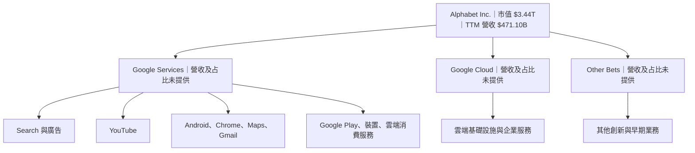

### 2.2 市場份額

市場份額數據未提供，近期新聞亦未附可引用的市場份額數字。以營收規模觀察，Alphabet TTM 營收 $471.10B，最新季營收年增 24.7%；Peer multiples 所列 META、MSFT、AMZN 最新季營收年增率分別為 26.1%、18.8%、12.1%。這顯示 Alphabet 的單季成長高於 MSFT 與 AMZN、略低於 META，但不能替代市場份額資料。

### 2.3 競爭護城河分析

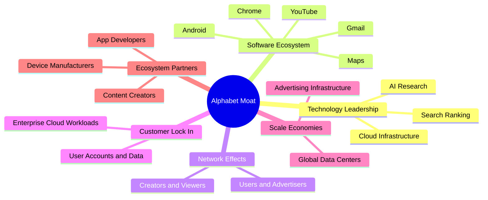

### 2.4 護城河強度

| 護城河項目 | 強度（強／中／弱） | 證據（引用數字或事實） | 會削弱它的情況 |
|------------|--------------------|------------------------|----------------|
| 技術領先 | 強 | 搜尋、YouTube、雲端與 AI 研發並存；FY2025 R&D $61.09B | AI 搜尋品質或商業化落後、算力成本持續上升 |
| 軟體生態系統 | 強 | Android、Chrome、Gmail、Maps、Drive、Photos、Play 等產品互相連結 | 平台規則、預設入口或使用者習慣改變 |
| 網路效應 | 強 | 廣告客戶、使用者、創作者與內容彼此吸引；分部活躍數據未提供 | 使用者轉往其他服務、廣告主降低預算 |
| 客戶鎖定 | 中 | Google 帳戶、Workspace、雲端工作負載可增加轉換成本；量化留存數字未提供 | 企業多雲策略降低轉換摩擦 |
| 規模效應 | 強 | TTM 營收 $471.10B、員工 204,757 人，具備全球基礎設施規模 | 資本密集度增加，規模未轉化成更高 FCF |
| 生態夥伴 | 中 | 開發者、裝置商、內容創作者及企業客戶共同參與 | 平台抽成或分發政策引發監管及夥伴反彈 |

護城河評分理由：第 1.1 節給 **9.0/10**，主要依據是產品生態廣度、網路效應與規模；但市占率、各業務收入占比及客戶留存率未提供，故不以缺乏的量化證據進一步推高評價。

---

## 3. 損益表深度分析

### 3.1 年度收入成長趨勢（近 4 年）

年度營收及年增率來自 StockAnalysis／SEC 歷史財務資料；CAGR 為 2022 至 2025 三年間營收複合成長率。

```text
╔══════════════════════════════════════════════════════════════════╗
║             Alphabet 年度收入趨勢（FY2022–FY2025）              ║
╠══════════════════════════════════════════════════════════════════╣
║ FY2022  $282.84B  ████████████████████░░░░░░░  YoY +9.78% 🟢   ║
║ FY2023  $307.39B  ██████████████████████░░░░░  YoY +8.68% 🟢   ║
║ FY2024  $350.02B  ████████████████████████░░░  YoY +13.87% 🟢  ║
║ FY2025  $402.84B  ███████████████████████████  YoY +15.09% 🟢  ║
╠══════════════════════════════════════════════════════════════════╣
║ FY2022–FY2025 營收 CAGR：((402.84 ÷ 282.84)^(1/3) − 1) = 12.4% ║
╚══════════════════════════════════════════════════════════════════╝
```

三年營收由 $282.84B 升至 $402.84B，期間年增率由 8.68% 回升至 15.09%。TTM 營收年增 22.2%，高於 FY2025 年增，代表近期增速擴張；但 TTM 與曆年年度口徑不同，不能直接視為完整年度預測。

### 3.2 季度收入趨勢分析

| 季度 | 營收 | QoQ | YoY | 備註 |
|------|------:|----:|----:|------|
| 2025 Q4 | $113.83B | — | 18.00% | YoY 依 StockAnalysis 季度資料 |
| 2026 Q1 | $109.90B | -3.5% | 21.79% | QoQ：109.896 ÷ 113.829 − 1 |
| 2026 Q2 | $119.80B | +9.0% | 24.23% | QoQ：119.796 ÷ 109.896 − 1 |
| 2026 Q3 | $127.58B | +6.5% | 24.65% | QoQ：127.577 ÷ 119.796 − 1 |

最新季度營收由 $119.80B 增至 $127.58B，QoQ 增長 6.5%；最新一季單季 YoY 增長 24.7%。這表示當季業務動能延續，但季度營收可能受季節性影響，仍需配合後續季度觀察。

### 3.3 利潤率演變分析

| 利潤率指標 | FY2022 | FY2023 | FY2024 | FY2025 | 趨勢 | 評估 |
|------------|------:|------:|------:|------:|------|------|
| **毛利率** | 55.4% | 56.6% | 58.2% | 59.7% | ↗️ 持續改善 | 🟢 |
| **營業利益率** | 26.5% | 27.4% | 32.1% | 32.0% | ↗️ FY2024 擴張後持平 | 🟢 |
| **淨利率** | 21.2% | 24.0% | 28.6% | 32.8% | ↗️ 持續改善 | 🟢 |

年度毛利率及營業利益率以年度毛利、營業利益除以年度營收計算。FY2024 營業利益率明顯提升，與營收擴張及成本槓桿相符；FY2025 營業利益率約持平，顯示此前改善未再大幅延伸。TTM 營業利益率為 33.3%，而最新季度營業利益率為 **31.8%**，較 TTM 低 1.5 個百分點，可能反映 AI 基礎設施與其他投入成本上升；單季表現是否代表趨勢，需看後續季度。

> TTM 淨利率 50.0% 與 FY2025 淨利率 32.8% 差距很大，主要是季度資料中 FY2026 Q2 淨利 $112.19B 異常偏高。由於未提供足以拆解的非營業損益與稅務明細，不應把 TTM 淨利率直接外推。

### 3.4 費用結構分析

FY2025 財務數據可分為營業成本、營業費用與營業利益：營業成本 = $402.84B − $240.30B = $162.54B；營業費用 = $240.30B − $129.04B = $111.26B。R&D $61.09B 是營業費用的一部分，未另行加總。

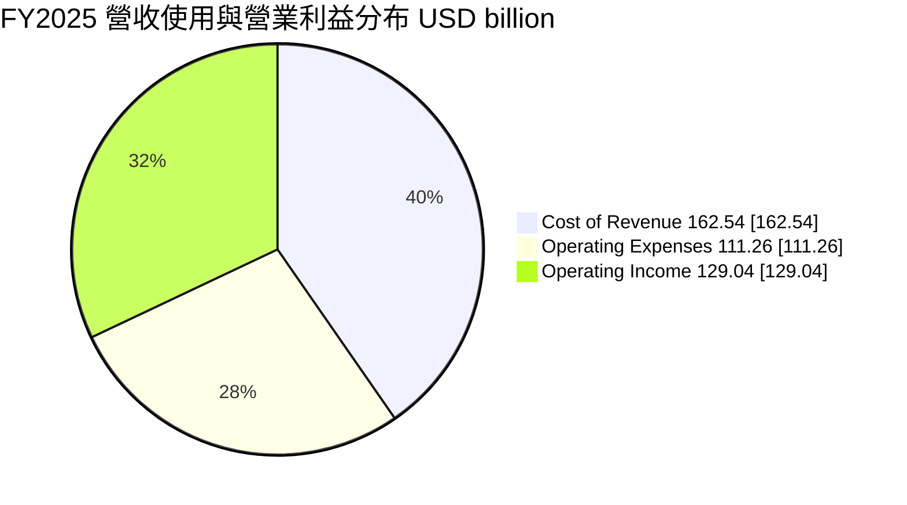

```text
╔══════════════════════════════════════════════════════════════════╗
║                  FY2025 營收費用橋接（$B）                      ║
╠══════════════════════════════════════════════════════════════════╣
║ 營收             $402.84B  ██████████████████████████████       ║
║ 營業成本         $162.54B  ████████████                         ║
║ 營業費用         $111.26B  ████████                             ║
║ 營業利益         $129.04B  ██████████                           ║
╚══════════════════════════════════════════════════════════════════╝
```

FY2025 R&D 為 $61.09B，約占營收 15.2%（$61.09B ÷ $402.84B）。研發支出支持搜尋、AI、雲端及產品能力，但支出增加是否能轉化為收入與 FCF，仍需由產品變現和資本回報證明。

### 3.5 季度 EPS 趨勢與盈餘品質（Quality of Earnings）

| 盈餘品質項目 | 數值／佔比 | 評估 |
|--------------|-----------|------|
| 股權薪酬 SBC / 營收 | TTM SBC 約 $30.41B ÷ TTM 營收 $471.10B = **6.46%** | 🟡 SBC 規模具實質稀釋成本；季度 SBC 相加所得，與年度口徑不同 |
| SBC / 營業現金流 | $30.41B ÷ $179.55B = **16.94%** | 🟡 營業現金流含 SBC 非現金加回，需考慮股東稀釋 |
| FCF / 淨利 | $19.75B ÷ StockAnalysis TTM 淨利 $235.694B = **8.38%** | 🔴 現金轉換偏低，主要因資本支出大 |
| 一次性／非經常性損益 | FY2026 Q2 淨利 $112.19B，資料未拆出來源 | 🟡 存在重大異常，不能確認是否為一次性項目 |
| 有效稅率 | **16.8%**（最新年度有效稅率） | 🟢 DCF 採用該值；未見足夠資料確認 TTM 淨利是否受異常稅務利益影響 |
| 資本化支出 vs 費用化 | TTM Capex $159.80B；資本化項目明細 N/A | 🟡 高資本投入會透過折舊逐步進入損益；無法量化資本化政策影響 |

最近四季 EPS 實際值為 2025 Q4 $2.81、2026 Q1 $5.11、Q2 $9.11、Q3 $2.14；季度 EPS 預估值在資料來源中為缺值，故**過去四季是否超預期或不及預期皆無法確認**。最新季 EPS 年增 -25.3%，最新季度淨利年增 -24.3%。Q2 EPS 與淨利大幅高於相鄰季度，令季度序列波動明顯，解讀時不宜只看單季同比。

**盈餘品質結論**：營業現金流仍高達 $179.55B，但 Capex $159.80B 將 TTM FCF 壓至 $19.75B，FCF/淨利率只有 8.38%。因此，GAAP 獲利的核心營運基礎仍有價值，但 TTM 淨利受單季異常放大，且現金轉換率偏低；估值應更多依賴正常化獲利與資本支出回落，而非直接外推當前 TTM 淨利。

---

## 4. 資產負債表分析

### 4.1 資產結構分解

使用 StockAnalysis 2026-09-30 資產負債表；金額為 USD billion。

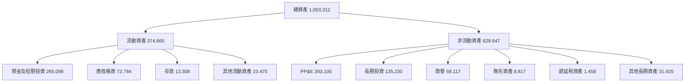

### 4.2 流動性與營運資金分析

流動比率與速動比率取 Yahoo Finance／StockAnalysis 所列最新資料；營運資金天數照錄品質指標。

| 流動性指標 | 數值 | 評估 |
|------------|------|------|
| 流動比率 | 2.786 | 🟢 流動資產高於流動負債 |
| 速動比率 | 2.512 | 🟢 短期支付能力充足 |
| 淨現金 | $138.98B | 🟢 現金緩衝大 |

| 指標 | 最新 TTM | 一年前 TTM | 變化 | 解讀 |
|------|----------|------------|------|------|
| DSO 應收帳款天數 | 56 天 | 54 天 | +2 天 | 收款週期略長；應收帳款由 $62.886B 增至 $72.784B，仍需留意營收增長以外的回款質量 |
| DIO 存貨天數 | 26 天 | N/A | N/A | 一年前資料缺漏，不作推算 |
| DPO 應付帳款天數 | 43 天 | N/A | N/A | 一年前資料缺漏，不作推算 |
| CCC 現金轉換週期 | 39 天 | N/A | N/A | 依最新 DSO 56 + DIO 26 − DPO 43 = 39 天；無法比較年度變化 |

### 4.3 債務結構分析

以下採用 SEC／程式計算的標準化債務與淨現金口徑。不同來源的市場資料另有總債務 $150.33B、淨現金 $114.77B，與標準化口徑不一致；本報告不混用兩套數字。

```text
╔══════════════════════════════════════════════════════════════════╗
║                   Alphabet 債務健康診斷                         ║
╠══════════════════════════════════════════════════════════════════╣
║  總債務：          $126.12B  █████████░░░░░░░░░░░░░░░░           ║
║  現金及短期投資：  $265.10B  ████████████████████░░░░░           ║
║  淨現金：          $138.98B  ██████████░░░░░░░░░░░░░░           ║
║                                                                  ║
║  Debt / EBITDA： N/A（未提供同口徑 TTM EBITDA 與債務拆分）       ║
║  Interest Coverage：N/A（利息費用明細未提供）                    ║
║  債務償還壓力：低；現金與短期投資高於債務                        ║
╚══════════════════════════════════════════════════════════════════╝
```

### 4.4 股東權益趨勢

FY2022 至 FY2025 股東權益由 $256.14B 增至 $415.26B，資本基礎增加；但 2026-09-30 的總資產已達 $1,003.312B，與年度資產口徑及不同資料來源需分開看待。

```text
╔══════════════════════════════════════════════════════════════════╗
║                 股東權益歷史趨勢（年度，$B）                    ║
╠══════════════════════════════════════════════════════════════════╣
║ FY2022  $256.14B  ███████████████████                           ║
║ FY2023  $283.38B  █████████████████████                         ║
║ FY2024  $325.08B  ████████████████████████                      ║
║ FY2025  $415.26B  ██████████████████████████████                ║
╚══════════════════════════════════════════════════════════════════╝
```

---

## 5. 現金流量深度分析

### 5.1 現金流量瀑布圖

淨利採 StockAnalysis TTM 數字，可能受 FY2026 Q2 異常項目影響；股息以最近四季現金股利 $10.71B 加總。回購金額及淨現金變化未提供，故不填入。

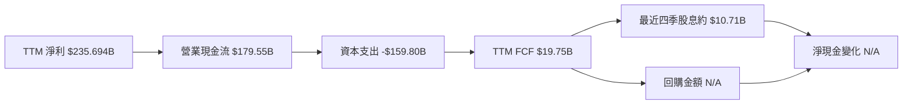

### 5.2 FCF 轉換率趨勢

| 年度 | FCF | 淨利 | FCF／淨利 | 解讀 |
|------|----:|----:|----------:|------|
| FY2022 | $60.01B | $59.97B | 100.1% | 現金轉換接近淨利 |
| FY2023 | $69.50B | $73.80B | 94.2% | 現金轉換仍高 |
| FY2024 | $72.76B | $100.12B | 72.7% | 投資支出相對增加 |
| FY2025 | $73.27B | $132.17B | 55.4% | 淨利增幅高於 FCF |
| TTM 至 2026-09-30 | $19.75B | $235.694B | 8.4% | 高 Capex 及異常淨利共同影響 |

### 5.3 自由現金流趨勢

FY2022–FY2025 FCF 取年度現金流量表；TTM FCF 依統一定義 OCF − Capex，為 $19.75B。年度 FCF Yield 未提供，不製作年度殖利率序列。

```text
╔══════════════════════════════════════════════════════════════════╗
║                 自由現金流趨勢（USD billion）                   ║
╠══════════════════════════════════════════════════════════════════╣
║ FY2022  $60.01B  ██████████████████████                         ║
║ FY2023  $69.50B  █████████████████████████                      ║
║ FY2024  $72.76B  ██████████████████████████                     ║
║ FY2025  $73.27B  ██████████████████████████                     ║
║ TTM     $19.75B  ███████                                        ║
╠══════════════════════════════════════════════════════════════════╣
║ TTM FCF Yield：0.57%                                            ║
║ TTM Capex $159.80B，約為 OCF $179.55B 的 89.0%                  ║
╚══════════════════════════════════════════════════════════════════╝
```

### 5.4 資本配置評估

FY2025 的 R&D、Capex、股息及 FCF 可量化；回購與其他投資金額未完整提供，不以估計值補足。

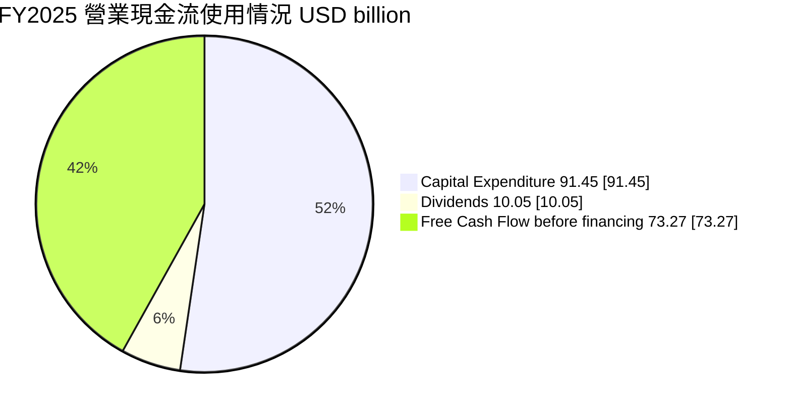

| 資本配置項目 | 可見數據 | 評估 |
|--------------|---------|------|
| 資本支出 | FY2025 $91.45B；TTM $159.80B | AI 與基礎設施投資擴大；回報需由新增營收及 FCF 驗證 |
| 股息 | FY2025 $10.05B；最近四季合計約 $10.71B | 金額遠低於營業現金流，具支付能力 |
| SBC | FY2025 $24.95B | 對股東而言是稀釋成本，不應視為免費資金 |
| 回購 | N/A | 金額未提供，不評估回購抵銷稀釋的程度 |
| 留存現金／投資 | 淨現金 $138.98B | 提供財務彈性，但現金配置報酬率資料未提供 |

---

## 6. 獲利能力與資本效率

### 6.1 ROE / ROA / ROIC 趨勢

| 指標 | FY2022 | FY2023 | FY2024 | 最新 TTM | 評估 |
|------|------:|------:|------:|---------:|------|
| ROE | N/A | N/A | N/A | 34.8% | 歷史同口徑序列未提供；依品質指標採用 TTM 值 |
| ROA | N/A | N/A | N/A | 12.7% | 最新資料顯示正向；歷史同口徑序列未提供 |
| ROIC | N/A | N/A | N/A | 23.9% | 顯著高於 WACC 10.31%，具價值創造 |

行業均值未提供，因此不列無可靠來源的同業 ROIC／ROE 均值。

### 6.2 ROIC vs WACC 分析（核心價值創造判斷）

WACC 與其組成直接採用 Cost of capital 數據。Beta 原始值 1.23，調整後 Beta 1.15，調整方式為 $\frac{2}{3}×1.23+\frac{1}{3}×1=1.153$，採用值 1.15。無風險利率為 4.92%，日期未提供；ERP 5.00% 為模型假設。債務成本採程式計算值，利息費用及平均計息負債明細未提供，故不另行重算。

```text
╔══════════════════════════════════════════════════════════════════╗
║                ROIC vs WACC 深度分析                            ║
╠══════════════════════════════════════════════════════════════════╣
║  WACC 估算：                                                     ║
║  ├── 無風險利率（10Y 美債）：       4.92%                        ║
║  ├── 市場風險溢酬（ERP）：          5.00%                        ║
║  ├── 原始 Beta：                     1.23                        ║
║  ├── 調整 Beta：                     1.15                        ║
║  ├── 股權成本 Ke：4.92%+1.15×5.00% = 10.67%                     ║
║  ├── 稅前債務成本：                  0.58%                        ║
║  ├── 稅後債務成本：0.58%×(1−16.8%) = 0.48%                       ║
║  ├── 資本權重：股權 96.5%，債務 3.5%                            ║
║  └── WACC：96.5%×10.67%+3.5%×0.48% = 10.31%                     ║
║                                                                  ║
║  ROIC（TTM）：23.9%                                              ║
║  EVA 利差：23.9%−10.31% = +13.59 個百分點                       ║
║  ROIC / WACC：23.9%÷10.31% = 2.32 倍                            ║
║                                                                  ║
║  ROIC 23.9%  ▓▓▓▓▓▓▓▓▓▓▓▓▓▓▓▓▓▓▓▓▓▓▓▓░░░░░░  🟢               ║
║  WACC 10.31%  ▓▓▓▓▓▓▓▓▓▓▓░░░░░░░░░░░░░░░░░░░  ──               ║
╠══════════════════════════════════════════════════════════════════╣
║  結論：ROIC 高於 WACC，現有資本投入仍在創造股東價值。           ║
╚══════════════════════════════════════════════════════════════════╝
```

### 6.3 杜邦三因素分解

| 因素 | 數值（TTM） | 解讀 |
|------|-------------|------|
| 淨利率 | 50.0% | 極高，但需注意 TTM 淨利受 Q2 異常值影響 |
| 資產週轉率 | 0.47 | 每單位資產產生約 0.47 單位營收 |
| 權益乘數 | 1.48 | 槓桿並非 ROE 的主要來源 |
| **ROE** | **34.8%** | $50.0% × 0.47 × 1.48 = 約 34.8%（四捨五入） |

### 6.4 財務體質：Piotroski F-Score

Piotroski F-Score 為 **4/8**；缺少毛利率測試輸入，因此測試分母為 8，不補入缺失項。

| 測試 | 結果 | 解讀 |
|------|------|------|
| ROA > 0 | ✅ 通過 | 資產報酬為正 |
| 營業現金流 > 0 | ✅ 通過 | TTM 營業現金流為 $179.55B |
| ROA 高於一年前 | ✅ 通過 | 盈利資產效率改善 |
| 營業現金流 > 淨利（應計品質） | ❌ 未通過 | TTM 淨利高於 OCF；Q2 淨利異常亦使比較失真 |
| 長期負債 ÷ 總資產低於一年前 | ❌ 未通過 | 負債比改善測試未通過 |
| 流動比率高於一年前 | ✅ 通過 | 短期流動性改善 |
| 稀釋股數未增加 | ❌ 未通過 | 股數稀釋未被完全抵銷 |
| 毛利率高於一年前 | — 無法判定 | 缺少測試輸入 |
| 資產週轉率高於一年前 | ❌ 未通過 | 資產使用效率測試未通過 |

---

## 7. 相對估值分析

### 7.1 同業估值比較表格

同業倍數依 Yahoo Finance Peer multiples。GOOG 的 P/E 取 VERIFIED 數值；Forward P/E 使用市價資料欄位。

| 估值指標 | **GOOG** | **META** | **MSFT** | **AMZN** | GOOG 評估 |
|----------|---------:|---------:|---------:|---------:|-----------|
| **Trailing P/E** | 14.6x | 20.4x | 25.7x | 20.6x | 🟢 明顯低於三家同業 |
| **Forward P/E** | 18.3x | 16.8x | 20.3x | 23.4x | 🟡 接近同業中位數 20.3x |
| **P/S Ratio** | 7.3x | 6.3x | 10.6x | 3.5x | 🟡 高於中位數 6.3x |
| **EV/EBITDA** | 17.9x | 13.4x | 18.1x | 16.1x | 🟡 略高於同業中位數 16.1x |
| **最新季營收年增** | 24.7% | 26.1% | 18.8% | 12.1% | 🟢 成長高於 MSFT、AMZN，略低於 META |
| **毛利率 TTM** | 60.9% | 81.0% | 67.7% | 51.4% | 🟡 低於 META、MSFT，高於 AMZN |

### 7.2 歷史估值區間分析

```text
╔══════════════════════════════════════════════════════════════════╗
║                GOOG 五年估值位置（TTM 倍數）                    ║
╠══════════════════════════════════════════════════════════════════╣
║ P/E        範圍 1.3x ├──────────●────────────┤ 29.0x            ║
║                     現值 14.6x｜中位數 21.9x｜百分位 29%         ║
║                                                                  ║
║ P/S        範圍 4.1x ├────────────────●──────┤ 9.8x             ║
║                     現值 7.3x｜中位數 6.1x｜百分位 67%           ║
║                                                                  ║
║ EV/EBITDA  範圍13.7x ├──────────●───────────┤ 25.0x            ║
║                     現值 17.9x｜中位數 19.1x｜百分位 47%         ║
╚══════════════════════════════════════════════════════════════════╝
```

P/E 位於自身五年區間第 29 百分位，低於五年中位數；EV/EBITDA 亦低於中位數。相反，P/S 位於第 67 百分位，且高於中位數，反映以營收衡量並不便宜。三種倍數訊號並不一致。

### 7.3 情境價值（Bear / Base / Bull）

| 情境 | 第 1 年營收成長 | 期末營業利潤率 | WACC | 每股價值 | 相對現價 | 機率 | 會發生的條件 |
|------|----------------:|---------------:|-----:|---------:|---------:|-----:|--------------|
| 🔴 悲觀 | 11.1% | 27.2% | 11.31% | $108.08 | -61.3% | 25% | 搜尋廣告轉型不順、競爭及 AI 投資壓低長期利潤率，資金成本上升 |
| 🟡 基準 | 22.2% | 32.0% | 10.31% | $247.22 | -11.6% | 50% | 營收由當前增速逐步降至成熟期，利潤率略降後趨穩 |
| 🟢 樂觀 | 33.3% | 35.2% | 9.31% | $516.06 | +84.6% | 25% | 成長高於當前 TTM、AI 與雲端投資成功變現、風險溢酬下降 |

### 7.4 相對估值隱含價格區間

```text
╔══════════════════════════════════════════════════════════════════╗
║             估值方法隱含每股價值與現價位置                      ║
╠══════════════════════════════════════════════════════════════════╣
║ DCF 基準             $247.22  ────┤                             ║
║ 同業 EV/EBITDA       $253.07  ──────┤                           ║
║ 現價                  $279.53  ────────────●                    ║
║ 同業 Forward P/E     $311.27  ─────────────────┤               ║
║ 分析師共識目標價      $389.00  ───────────────────────────┤     ║
╚══════════════════════════════════════════════════════════════════╝
```

- **同業 Forward P/E：$311.27**，採同業中位數 20.3x × GOOG Forward EPS $15.30。
- **同業 EV/EBITDA：$253.07**，採同業中位數 16.1x 乘 TTM EBITDA，再加入淨現金。
- **DCF 基準：$247.22**，10 年 FCFF，WACC 10.31%、終值成長率 3.0%。
- **分析師共識：$389.00**，15 位分析師平均目標價；屬外部參考，不是現金流模型結果。

---

## 8. DCF 內在價值評估（Discounted Cash Flow）

> 本節的 DCF 假設、逐年現金流、估值橋接、敏感度與情境均採用程式計算模型原值。由於模型部分輸入只提供比率或結果，沒有完整底層明細，以下明確標示不可單靠顯示精度完全重建的項目，不以自建模型替代。

### 8.0 估值推理鏈（Thinking Logic）

**Step 1 — 價值來源與主導變數**

Alphabet 的價值主要來自搜尋與廣告、YouTube、Google Cloud，以及其他業務選擇權；但各分部收入占比未提供，不能假設分部百分比。估值模型以 TTM 營收 $471.10B 為基礎，主導變數是「高資本支出是否能轉化為成熟期 FCFF」：模型 TTM Capex 為營收的 33.9%，預測逐步降至 6.5%，因此支出回落幅度直接影響終值現金流與 DCF。

**Step 2 — 模型選擇**

| 決策點 | 本報告採用 | 理由（含數字） | 曾考慮但否決 | 否決理由 |
|--------|-----------|----------------|--------------|----------|
| 現金流定義 | FCFF | 配合 WACC 折現並先求企業價值；模型定義為 NOPAT + D&A − Capex | FCFE | 債務與現金需另外橋接，模型已固定採 FCFF |
| 預測期 N | 10 年 | DCF 模型明列 10 年，收入成長由 22.2% 線性降至 3.0% | 5 年 | 會縮短模型已設的成熟化路徑，不能替換固定模型 |
| 終值方法 | Gordon Growth | 模型以 g = 3.0% 計終值，WACC 10.31% | 另自行設定退出倍數 | 模型未提供退出倍數及終值 EBITDA 倍數，不另建模型 |
| EBIT 基礎 | GAAP EBIT | TTM 營業利益率 33.3%；模型明確採 GAAP | 非 GAAP EBIT | 會改變 SBC 與現金流處理，模型未採用 |

**Step 3 — 關鍵假設推導鏈**

- **營收成長路徑**：錨點＝TTM 營收年增 22.2%，最新季單季年增 24.7% → 調整＝隨規模與基期擴大，模型把增速線性降至第 10 年 3.0% → **採用第 1 年 22.2%、第 10 年 3.0%** → 曾考慮維持 22.2% 十年，但否決，因成熟企業長期維持該增速缺乏資料支持。
- **期末營業利潤率**：錨點＝TTM 33.3%、最近季度 31.8% → 調整＝模型假定規模效率部分抵銷 AI 基礎設施等投入，並向過去五個會計年度中位數收斂 → **第 10 年 32.0%** → 曾考慮維持 33.3%，但否決，因最近季度低於 TTM，且需容納成本風險。
- **Capex／營收**：錨點＝TTM 33.9% → 調整＝模型假設 AI 建設高峰後投資率逐年降低 → **第 1 年 33.9% 降至第 10 年 6.5%** → 曾考慮長期維持 33.9%，但否決，因會持續壓抑 FCFF，且 DCF 模型設定明確採逐步回落。
- **永續成長率 g**：錨點＝DCF 模型設定 3.0%；此值亦低於 WACC 10.31% → 調整＝採成熟期名目長期成長假設 → **3.0%** → 曾考慮更高增長，但否決，因終值敏感度會進一步升高，且永續成長必須低於 WACC。
- **預測期 N**：錨點＝模型長度 10 年 → 調整＝不另行變更 → **10 年** → 曾考慮縮短至 5 年，但與程式模型不符。
- **D&A／營收**：錨點＝TTM 5.9% → 採用 **5.9% 固定**；低敏感度項目，模型依據即 TTM 比率。
- **稅率**：錨點＝最新年度有效稅率 16.8% → 採用 **16.8%**；未用其他稅率替代。
- **營運資金**：模型明示不建模。這不代表已觀察到零營運資金需求，而是模型未納入 ΔWC 項。
- **SBC 與股數**：採組合 **(A)**，GAAP EBIT 已含 SBC 費用，不再從 FCFF 扣 SBC，股數不額外稀釋；因此 SBC 只計入一次。
- **WACC**：錨點＝Cost of capital 計算 WACC 10.31%；股權權重 96.5%、債務權重 3.5% → **採用 10.31%** → 不另改用其他折現率，以維持與程式 DCF 一致。

**Step 4 — 最脆弱環節**

最脆弱的假設是 Capex／營收由 TTM 33.9% 降至第 10 年 6.5%；若資料中心投資長期維持高檔，FCFF 和 DCF 會低於基準，而敏感度矩陣顯示 WACC、g 的變化也會大幅改變估值。

**Step 5 — 計算路徑**

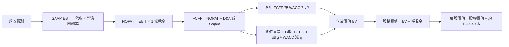

### 8.1 模型假設總表（Model Inputs）

| 假設項目 | 採用值 | 依據／來源 | 敏感度 |
|----------|--------|-------------|--------|
| 預測期長度 N | 10 年 | DCF MODEL 明列 10 年 | 🟡 中 |
| 營收成長 | 第 1 年 22.2% 線性降至第 10 年 3.0% | 起點採 TTM 營收年增 22.2%；終點由模型假設 | 🔴 高 |
| 營業利潤率 | 第 1 年 33.3% → 第 10 年 32.0% | TTM 營業利益率及過去五年中位數設定 | 🔴 高 |
| 有效稅率 | 16.8% | 最新年度有效稅率 | 🟢 低 |
| Capex／營收 | 第 1 年 33.9% → 第 10 年 6.5% | TTM 33.9%，逐步降至模型設定；第 10 年仍為 D&A 的 1.1 倍 | 🔴 高 |
| D&A／營收 | 5.9% | TTM 比率 | 🟢 低 |
| 營運資金變動 | 不建模 | DCF MODEL 明示 Working capital is not modelled | 🟢 低 |
| EBIT 基礎 | GAAP | 模型明示 GAAP EBIT | 🟡 中 |
| SBC 處理 | SBC 已含於 GAAP 費用，不再扣除 | DCF MODEL 明示組合 A | 🟡 中 |
| 年稀釋率 | 0%（模型不再稀釋） | 與 GAAP EBIT + 固定股數組合 A 相容 | 🟡 中 |
| 永續成長率 g | 3.0% | DCF MODEL | 🔴 高 |
| 終值方法 | Gordon Growth | DCF MODEL 明列 | 🔴 高 |
| WACC | 10.31% | Cost of capital | 🔴 高 |
| FCFF 定義 | NOPAT + D&A − Capex | 不含 ΔWC 項；模型明示 WC 不建模 | — |

### 8.2 折現率推導（WACC）

無風險利率的觀察日期未提供；ERP 5.00% 為假設值，資料來源沒有另列風險溢酬研究依據。以下採用已提供的成本資本數字，不自行替換 WACC。

```text
╔══════════════════════════════════════════════════════════════════╗
║                    WACC 推導（折現率）                           ║
╠══════════════════════════════════════════════════════════════════╣
║  股權成本 Ke（CAPM）：                                           ║
║  ├── 無風險利率 Rf（10Y 美債）：      4.92%                      ║
║  ├── ERP（假設值）：                   5.00%                      ║
║  ├── 原始 Beta：                       1.23                       ║
║  ├── 調整 Beta：                       1.15                       ║
║  └── Ke = 4.92% + 1.15×5.00% = 10.67%                           ║
║                                                                  ║
║  債務成本 Kd：                                                   ║
║  ├── 稅前 Kd（程式計算）：             0.58%                      ║
║  ├── 有效稅率：                        16.8%                      ║
║  └── 稅後 Kd = 0.58%×(1−16.8%) = 0.48%                          ║
║                                                                  ║
║  資本權重（市值基礎）：                                          ║
║  ├── 股權權重：                        96.5%                      ║
║  ├── 債務權重：                         3.5%                      ║
║  └── WACC = 96.5%×10.67% + 3.5%×0.48% = 10.31%                  ║
╚══════════════════════════════════════════════════════════════════╝
```

**逐步演算（WACC）**

1. **Ke（CAPM）** = Rf + β × ERP = 4.92% + 1.15 × 5.00% = **10.67%**。
2. **稅前 Kd**：程式提供值為 **0.58%**。利息費用、平均計息負債及租賃負債明細未提供，不能另以債務餘額倒算。
3. **稅後 Kd** = 0.58% × (1 − 16.8%) = 0.58% × 83.2% = **0.4826%**，四捨五入為 0.48%。
4. **權重**：市場資料市值約 $3.44T，標準化總債務 $126.12B；使用所列市場價值近似計算，股權權重約 96.5%、債務約 3.5%，採用程式提供的 **96.5% / 3.5%**。當前收盤價日期為 2026-11-23。
5. **WACC** = 96.5% × 10.67% + 3.5% × 0.4826% = 10.29655% + 0.016891% = **10.313441%**，四捨五入為 **10.31%**。

此 WACC 與第 6.2 節一致。債務成本原始利息支出與計息負債範圍未能從資料中獨立重建，因此將 0.58% 視為程式計算輸入，而不是自行宣稱已用平均負債複算。

### 8.3 逐年自由現金流預測（基準情境）

金額單位 USD billion；以下數字照抄 DCF MODEL。營運資金未建模，故表中不設 ΔWC 列。GAAP EBIT 已含 SBC，故不再列 SBC 扣除。

| 年度 | FY+1 | FY+2 | FY+3 | FY+4 | FY+5 | FY+6 | FY+7 | FY+8 | FY+9 | FY+10 |
|------|-----:|-----:|-----:|-----:|-----:|-----:|-----:|-----:|-----:|------:|
| 營收 | 575.74 | 691.33 | 815.37 | 944.26 | 1,073.37 | 1,197.22 | 1,309.81 | 1,405.02 | 1,477.16 | 1,521.48 |
| 營收 YoY | 22.2% | 20.1% | 17.9% | 15.8% | 13.7% | 11.5% | 9.4% | 7.3% | 5.1% | 3.0% |
| 營業利潤率 | 33.3% | 33.2% | 33.0% | 32.9% | 32.7% | 32.6% | 32.5% | 32.3% | 32.2% | 32.0% |
| EBIT（GAAP） | 191.84 | 229.37 | 269.36 | 310.58 | 351.51 | 390.36 | 425.19 | 454.09 | 475.29 | 487.37 |
| − 稅 | (32.20) | (38.50) | (45.21) | (52.13) | (58.99) | (65.51) | (71.36) | (76.21) | (79.77) | (81.80) |
| = NOPAT | 159.65 | 190.87 | 224.15 | 258.46 | 292.52 | 324.84 | 353.83 | 377.88 | 395.52 | 405.57 |
| + D&A | 34.21 | 41.08 | 48.45 | 56.11 | 63.79 | 71.14 | 77.84 | 83.49 | 87.78 | 90.41 |
| − Capex | (195.30) | (213.47) | (226.97) | (234.11) | (233.46) | (223.97) | (205.18) | (177.35) | (141.51) | (99.46) |
| **= FCFF** | **-1.44** | **18.48** | **45.64** | **80.46** | **122.84** | **172.02** | **226.48** | **284.03** | **341.80** | **396.53** |
| 折現因子 | 0.907 | 0.822 | 0.745 | 0.675 | 0.612 | 0.555 | 0.503 | 0.456 | 0.413 | 0.375 |
| **FCFF 現值 PV** | **-1.31** | **15.19** | **34.00** | **54.34** | **75.21** | **95.47** | **113.95** | **129.54** | **141.32** | **148.63** |

預測期現值逐項加總：  
**-1.31 + 15.19 + 34.00 + 54.34 + 75.21 + 95.47 + 113.95 + 129.54 + 141.32 + 148.63 = $806.34B**。  
模型列示合計為 **$806.33B**，差額 $0.01B，來自各年度顯示值的四捨五入。

**逐步演算（FY+1，模型呈現值）**

1. **營收**：$471.10B × (1 + 22.2%) = $575.70B；模型列示 $575.74B，差異來自模型內未四捨五入的起始輸入／成長率。
2. **EBIT** = $575.74B × 33.3% = $191.72B；模型列示 $191.84B，顯示模型採用未四捨五入的利潤率輸入。
3. **稅** = $191.84B × 16.8% = $32.23B；模型列示 $32.20B。
4. **NOPAT** = $191.84B − $32.20B = $159.64B；模型列示 $159.65B。
5. **D&A** = $575.74B × 5.9% = $33.97B；模型列示 $34.21B，表示底層比率精度或計算輸入未完整披露。
6. **Capex** = $575.74B × 33.9% = $195.18B；模型列示 $195.30B。
7. **ΔWC**：DCF 模型不建模，無獨立數值。
8. **FCFF** = $159.65B + $34.21B − $195.30B = **-$1.44B**。
9. **折現因子** = 1 ÷ (1 + 10.31%)¹ = **0.907**；PV = -$1.44B × 0.907 = **-$1.31B**。

> 逐年表格各列採用模型原值；部分逐步反算與顯示表格略有差異，反映輸入值以未四捨五入精度計算，但完整底層精度未提供，故無法從兩位小數顯示值完全重建。沒有用替代值改寫模型結果。

**合理性自檢**

- 預測 FCFF 從 FY+1 -$1.44B 轉為 FY+2 $18.48B，負值起點使完整十年 FCFF CAGR 不適用；FY+2 至 FY+10 CAGR = $(396.53 ÷ 18.48)^{1/8} − 1$，約 **46.8%**。FY2022–FY2025 年度 FCF CAGR 約 6.9%，差距大，主因模型假定 Capex 比率由 33.9% 逐年大幅下降。
- FY+10 FCFF 利潤率 = $396.53 ÷ $1,521.48 = **26.1%**；當前 TTM FCF 利潤率 = $19.75 ÷ $471.10 = **4.2%**。同業最佳 FCF 利潤率數據未提供，不作比較。
- FY+1 FCFF 為負，原因是高 Capex 超過當年 NOPAT 與 D&A；該年 PV 為 -$1.31B，對總預測期 PV 的拖累有限，但反映短期投資期現金流承壓。

```text
╔══════════════════════════════════════════════════════════════════╗
║            自由現金流：歷史實際 vs 模型預測（$B）               ║
╠══════════════════════════════════════════════════════════════════╣
║ FY2023(實)  $69.50B  ███████░░░░░░░░░░░░░░  YoY +15.8%          ║
║ FY2024(實)  $72.76B  ███████░░░░░░░░░░░░░░  YoY +4.7%           ║
║ FY2025(實)  $73.27B  ███████░░░░░░░░░░░░░░  YoY +0.7%           ║
║ FY+1 (預)   -$1.44B  負值：高資本支出                           ║
║ FY+10(預)   $396.53B ████████████████████  FCFF margin 26.1%    ║
╠══════════════════════════════════════════════════════════════════╣
║ 預測關鍵：Capex／營收由 33.9% 降至 6.5%，若未發生，估值下修。  ║
╚══════════════════════════════════════════════════════════════════╝
```

### 8.4 終值計算（Terminal Value）

**適用性檢查**：WACC **10.31%** vs g **3.0%** → **WACC > g ✅**

| 方法 | 計算式 | 終值 TV | TV 現值 | 佔總 EV 比重 |
|------|--------|---------|---------|--------------|
| Gordon Growth | 396.53 × (1 + 3.0%) ÷ (10.31% − 3.0%) | $5,586.66B | $2,093.99B | 72.2% |
| 退出倍數法 | N/A | N/A | N/A | N/A |

退出倍數法的終值 EBITDA 倍數未由 DCF MODEL 提供，且規則要求不另建模型，因此不補估。

**逐步演算**

1. **FY+N FCFF** = FY+10 **$396.53B**。
2. **分子** = $396.53B × (1 + 3.0%) = **$408.4259B**。
3. **分母** = 10.31% − 3.0% = **7.31%**；按顯示值試算，$408.4259B ÷ 7.31% 約為 $5,587.2B；模型列示 **$5,586.66B**，差異約 0.01%，屬底層未四捨五入輸入差異。
4. **PV(TV)** = $5,586.66B × 0.375 = **$2,094.9975B**；模型列示 **$2,093.99B**，同樣受未顯示精度影響。
5. **終值佔比** = $2,093.99B ÷ $2,900.32B = **72.2%**。

終值現值占 EV 72.2%，雖未超過 75% 警示線，估值仍主要受第 10 年以後的現金流假設主導。

### 8.5 企業價值 → 每股內在價值（Bridge）

| 橋接項目 | 金額 |
|---------|-----:|
| 預測期 FCF 現值合計 | +$806.33B |
| 終值現值 PV(TV) | +$2,093.99B |
| **企業價值 EV** | **$2,900.32B** |
| + 淨現金 | +$138.98B |
| **股權價值** | **$3,039.30B** |
| 稀釋股數參考 | 約 12.294B 股（Roic.ai 2026 年 9 月資料） |
| **DCF 每股內在價值（模型值）** | **$247.22** |
| 現價（2026-11-23 收盤） | $279.53 |
| **折溢價＝現價 ÷ DCF 價值 − 1** | **+$32.31 ÷ $247.22 = +13.1% 溢價** |

逐步演算：

1. **EV** = $806.33B + $2,093.99B = **$2,900.32B**。
2. **股權價值** = $2,900.32B + $138.98B = **$3,039.30B**。
3. **每股價值**：模型列示每股價值 **$247.22**；以所列約 12.294B 股試算，$3,039.30B ÷ 12.294B 約為 $247.2，與模型值一致至顯示精度。
4. **折溢價** = $279.53 ÷ $247.22 − 1 = **13.1%**。這是現價相對 DCF 內在價值的溢價，不是 MOS。
5. **本節不計算 MOS**；MOS 僅在 8.8 以加權合理價值為分母計算。

模型每股價值原式為「股權價值 × 價格 ÷ 市值」；由於市值只有約 $3.44T 的顯示精度，且市場數據中股數口徑互有差異，未用該約數取代程式列示的 $247.22。

### 8.6 敏感性分析（WACC × 永續成長率）

下表內在價值直接照錄程式模型；括號為相對現價 $279.53 的上行空間。WACC 測試範圍均高於 g，因此矩陣各格有效。

| g（列）／WACC（欄） | 8.31% | 9.31% | **10.31%（基準）** | 11.31% | 12.31% |
|-----------|------:|------:|-------------------:|-------:|-------:|
| **2.0%** | $320.96 (+14.8%) | $266.17 (-4.8%) | $225.27 (-19.4%) | $193.73 (-30.7%) | $168.80 (-39.6%) |
| **2.5%** | $342.40 (+22.5%) | $280.71 (+0.4%) | $235.54 (-15.7%) | $201.23 (-28.0%) | $174.40 (-37.6%) |
| **3.0%** | $367.87 (+31.6%) | $297.54 (+6.4%) | **$247.22 (-11.6%)** | $209.62 (-25.0%) | $180.61 (-35.4%) |
| **3.5%** | $398.64 (+42.6%) | $317.28 (+13.5%) | $260.61 (-6.8%) | $219.09 (-21.6%) | $187.53 (-32.9%) |
| **4.0%** | $436.55 (+56.2%) | $340.73 (+21.9%) | $276.12 (-1.2%) | $229.86 (-17.8%) | $195.27 (-30.1%) |

**矩陣代表格檢查**：選 WACC = 9.31%、g = 3.5%，**9.31% > 3.5% ✅**。模型矩陣該格為 $317.28，依現價計算，上行空間 = $(317.28 ÷ 279.53) − 1$ = **13.5%**。該格的逐年現金流現值分項未列於資料，且不能自行另建模型，因此不另造一套 EV 與 PV(TV) 拆分。

#### 三情境 DCF（改變營運假設）

| 情境 | 第 1 年營收成長 | 期末營業利潤率 | WACC | 每股內在價值 | 相對現價 | 機率 |
|------|----------------:|---------------:|-----:|--------------:|---------:|-----:|
| 🔴 悲觀 | 11.1% | 27.2% | 11.31% | $108.08 | -61.3% | 25% |
| 🟡 基準 | 22.2% | 32.0% | 10.31% | $247.22 | -11.6% | 50% |
| 🟢 樂觀 | 33.3% | 35.2% | 9.31% | $516.06 | +84.6% | 25% |
| **機率加權** | — | — | — | **$279.64** | **約 +0.0%** | **100%** |

三種情境的逐年營收與情境終值拆分未提供，依規則只列模型已計算的每股值與輸入，不自行反推各情境 FCFF。機率加權計算為：  
$108.08 × 25% + $247.22 × 50% + $516.06 × 25% = **$279.645，約 $279.64**；使用模型原精度計算時以模型列示的 $279.64 為準。各情境機率合計 100%。

#### 敏感度結論

- **g 每 +1pp（2.5% 至 3.5%，WACC 10.31%）**：$235.54 升至 $260.61，增加 **$25.07／10.6%**。
- **WACC 每 +1pp（9.31% 至 11.31%，g 3.0%）**：$297.54 降至 $209.62，減少 **$87.92／29.5%**。
- **期末營業利潤率每 +1pp**：敏感度表未提供單一利潤率變動的獨立重算結果，故每股影響為 **N/A**，不另做模型試算。
- 以已提供的矩陣比較，WACC 變化對估值的影響大於 g 變化；與 8.0 Step 1 的判斷相容：融資成本與長期資本支出回落共同主導終值估值。

### 8.7 反推 DCF（Reverse DCF）

模型固定其他假設、每次解一個變數，求得：

| 求解的變數（一次一個） | 固定條件 | 市場隱含值（令 DCF = 現價） | 對照基準 | 判斷 |
|------------------------|----------|------------------------------|----------|------|
| 第 1 年營收成長率 | 其他模型輸入維持基準 | **25.3%** | 基準 22.2% | 🔴 市場價格要求成長高於基準假設 |
| 固定營業利潤率 | 其他模型輸入維持基準 | **35.7%** | 基準利潤率 33.3% → 32.0% | 🔴 隱含利潤率高於基準路徑 |
| 永續成長率 g | 未提供求解結果 | 未計算 | — | N/A |
| 預測期長度 N | 未提供求解結果 | 未計算 | — | N/A |

反推市場要求的營收第 1 年成長率 25.3%，高於基準 22.2%；另一種單一變數解是固定營業利潤率 35.7%，亦高於現行 TTM 33.3%。完整數值疊代軌跡未提供，不能以自建步進資料冒充模型結果。結論是現價要求成長或利潤率至少有一項好於 DCF 基準，現價並未反映明顯悲觀預期。

### 8.8 估值三角驗證與安全邊際

| 估值方法 | 隱含每股價值 | 上行空間（÷現價） | 權重 | 說明 |
|----------|--------------:|-------------------:|-----:|------|
| DCF（基準） | $247.22 | -11.6% | 40% | 10 年 FCFF，WACC 10.31%、g 3.0% |
| 同業 Forward P/E | $311.27 | +11.4% | 25% | 同業中位數 20.3x × Forward EPS $15.30 |
| 同業 EV/EBITDA | $253.07 | -9.5% | 25% | 同業中位數 16.1x × TTM EBITDA，加回淨現金 |
| 分析師共識目標價 | $389.00 | +39.2% | 10% | 15 位分析師平均目標價 |
| **加權合理價值** | **$278.87** | **-0.2%** | **100%** | 盈利公司固定權重 |

**逐步演算（加權合理價值）**

$247.22 × 40% + $311.27 × 25% + $253.07 × 25% + $389.00 × 10%  
= $98.888 + $77.8175 + $63.2675 + $38.900  
= **$278.873，按模型列示精度為 $278.87**。

權重對應盈利公司類型，且四種方法均可計算，沒有剔除方法。

**安全邊際與評級**

- **MOS** = ($278.87 − $279.53) ÷ $278.87 = **-0.2%**。
- **上行空間** = ($278.87 − $279.53) ÷ $279.53 = **-0.2%**（與 MOS 近似但分母不同）。
- **折溢價**以 DCF 基準衡量：$279.53 ÷ $247.22 − 1 = **+13.1% 溢價**。
- MOS 評估：🔴 <10%，無安全邊際。
- 規則 20 評級：**持有**；不作質化調整。

```text
╔══════════════════════════════════════════════════════════════════╗
║                  估值區間與安全邊際                              ║
╠══════════════════════════════════════════════════════════════════╣
║ $108.08 ── $247.22 ── $278.87 ── $279.53 ── $516.06            ║
║ 悲觀DCF       基準DCF     加權合理值      現價       樂觀DCF      ║
║                                                                  ║
║ MOS = (加權合理價值−現價)÷加權合理價值 = -0.2%                  ║
║ 上行空間 = (加權合理價值−現價)÷現價 = -0.2%                    ║
║                                                                  ║
║ 建議買入區間：不高於 $250.98（MOS 約達 10%）                   ║
║ 合理持有區間：$250.98–$306.76（MOS 約 +10% 至 -10%）           ║
║ 減碼考慮區間：高於約 $306.76（MOS 低於 -10%）                  ║
╚══════════════════════════════════════════════════════════════════╝
```

買入價格上限計算：$278.87 × (1 − 10%) = **$250.983，約 $250.98**。持有區間上緣：$278.87 × (1 + 10%) = **$306.757，約 $306.76**。

> 🔎 **程式複算（Python，依本節各項自動重算）**
>
> 加權合理價值 = $247.22 × 40% + $311.27 × 25% + $253.07 × 25% + $389.00 × 10% = **$278.87**（權重合計 100%）
>
> 以價格 $279.53 計：MOS = **-0.2%**，上行空間 = **-0.2%**
>
> ✅ 與本節所寫數值一致。

### 8.9 DCF 模型的局限與失效條件

- **終值依賴度**：PV(TV) 占 EV **72.2%**，主要價值由第 10 年之後的現金流假設決定。
- **最脆弱假設一：Capex 下降**。模型假定 Capex／營收由第 1 年 33.9% 降至第 10 年 6.5%；若算力與資料中心投資長期高於模型，FCFF 及合理價值會下修。
- **最脆弱假設二：終值與 WACC**。敏感度矩陣中，g = 3.0%、WACC 由 9.31% 升至 11.31%，每股價值由 $297.54 降至 $209.62。
- **適用性**：公司仍有正營業現金流，但 TTM FCF $19.75B 低於 FY2025 $73.27B，顯示 AI 投資期可能降低 DCF 可靠度；相對估值可作交叉檢驗，但不可忽略資本開支回報。
- **風險連結**：AI 投資支出超預期影響 Capex；生成式 AI 改變搜尋使用量影響營收成長；利率或風險溢酬上升影響 WACC；監管限制分發或廣告模式則可能降低利潤率。

### 8.10 複算檢核表（Audit Trail）

| # | 檢核項目 | 檢查方式 | 結果 |
|---|----------|----------|------|
| 1 | 所有高／中敏感度輸入均有推導 | 對照 8.0 假設鏈 | ✅ 已列；底層精度缺漏有註明 |
| 2 | 每項假設有來歷 | 檢查 8.1 依據欄 | ✅ |
| 3 | WACC 五步算式及權重 | CAPM、稅後 Kd、權重及加權 | ✅ 顯示精度重算為 10.31% |
| 4 | Kd 分母與權重的計息債務範圍 | 利息費用及平均計息負債明細未提供 | ⚠️ 採用程式提供的 0.58% 與權重，無法獨立核對債務範圍 |
| 5 | WACC 與第 6.2 節一致 | 比對兩處 | ✅ 10.31% |
| 6 | 逐年表格年數 = N | FY+1 至 FY+10 | ✅ |
| 7 | FY+1 FCFF 與 PV | -1.44 × 0.907 = -1.31 | ✅ |
| 8 | 預測期 PV 加總 | 顯示值相加 $806.34B；模型 $806.33B | ✅ 差額 $0.01B，顯示四捨五入 |
| 9 | WACC > g | 10.31% > 3.0% | ✅ |
| 10 | 終值以 FY+10 FCFF 並折現 10 期 | 模型列示 FY+10 與 PV(TV) | ✅ 模型值與顯示精度有尾差 |
| 11 | EV 至每股價值橋接 | 806.33 + 2,093.99 = 2,900.32；加淨現金 = 3,039.30 | ✅ |
| 12 | SBC 組合相容 | GAAP EBIT、無 −SBC 列、0% 額外稀釋 | ✅ 組合 A |
| 13 | 敏感度基準格 = DCF 基準 | 10.31%、g 3.0% = $247.22 | ✅ |
| 14 | 敏感度格均為 WACC > g | 最低 WACC 8.31% 仍高於最高 g 4.0% | ✅ |
| 15 | 情境機率合計 | 25% + 50% + 25% | ✅ 100% |
| 16 | Reverse DCF 每列只放開一變數 | 僅列模型已提供的兩個解 | ✅ 疊代軌跡資料未提供 |
| 17 | MOS 與折溢價基準一致 | MOS 用 $278.87；DCF 溢價用 $247.22 | ✅ |
| 18 | 報告輸出至第 11 章 | 章節檢查 | ✅ |
| 19 | 加權合理價值為權重乘積總和 | 依 8.8 算式 | ✅ $278.87 |
| 20 | 評級符合 MOS 門檻 | MOS -0.2% | ✅ 持有 |

---

## 9. 成長催化劑

### 9.1 催化劑時間軸

以下是研究追蹤期間，不代表公司已公布的具體產品發布日期。

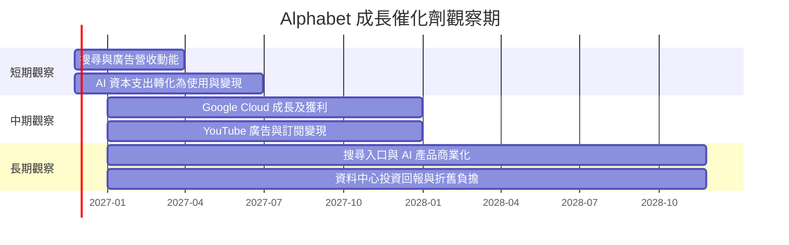

### 9.2 TAM 市場規模分析

**N/A（TAM 數據未提供）**。可量化的公司指標為 TTM 營收 $471.10B、年增 22.2%，最新季度單季年增 24.7%；沒有可引用的 TAM 數字或滲透率，故不推估市場規模。

### 9.3 成長驅動力結構圖

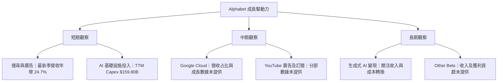

---

## 10. 風險矩陣

### 10.1 風險評分矩陣

下圖的機率與衝擊位置為分析師定性判斷，不是公司申報數字；因缺少可核實的分部暴露數據，不將圖上位置解讀為精確發生機率。

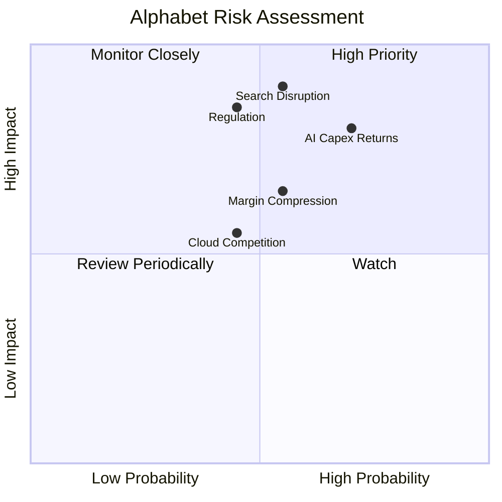

### 10.2 風險清單詳細分析

| # | 風險項目 | 發生機率 | 財務衝擊 | 風險評分 | 緩解措施 |
|---|----------|----------|----------|----------|----------|
| 1 | 🔴 **AI 搜尋與商業模式轉變** | 中高；分析師判斷 40–60% | 高；可能影響核心搜尋廣告收入，金額未能可靠量化 | 🔴 8.5/10 | 追蹤搜尋收入、廣告增長、流量分發及 AI 服務成本；核心業務連續放緩時重新估值 |
| 2 | 🔴 **AI／資料中心資本支出回收不及預期** | 高；分析師判斷 50–70% | 高；TTM Capex $159.80B、FCF 僅 $19.75B | 🔴 8.5/10 | 每季比較 Capex、OCF、FCF 及雲端／AI 變現；若投資持續增加而 FCF 下降，降低終值假設 |
| 3 | 🟠 **反壟斷與平台監管** | 中；分析師判斷 30–50% | 高；可能影響分發協議、廣告或平台經濟，但影響額未提供 | 🟠 7.5/10 | 跟進訴訟及法規進展，估值不依賴單一分發安排 |
| 4 | 🟡 **利潤率與成本壓力** | 中；分析師判斷 35–55% | 中高；最新季營業利益率 31.8%，低於 TTM 33.3% | 🟡 6.5/10 | 監控營業利益率及費用增速，區分短期投資與結構性成本 |
| 5 | 🟡 **競爭與人才／算力成本** | 中；分析師判斷 30–50% | 中；同業 META 最新季營收年增 26.1%，略高於 GOOG 的 24.7% | 🟡 5.5/10 | 觀察市場增長、產品留存、算力效率及研發成果轉化 |

風險評分為定性排序，不代表可量化損失預測；目前缺少分部收入及監管事件損益估計，因此不聲稱某項風險將造成特定營收百分比下降。

---

## 11. 投資建議

### 11.1 最終評級與評分

GOOG 評級為 **持有**：加權合理價值 $278.87，對照 2026-11-23 收盤價 $279.53，MOS 為 -0.2%，符合規則 20 的持有區間，未作一級調整。第 1.1 節綜合評分為 **7.7/10**，六項分數為成長性 8.0、獲利能力 9.0、財務健康 8.5、估值 5.0、護城河 9.0、管理層與資本配置 6.5。

### 11.2 合理價值與隱含報酬率

| 指標 | 每股價值 | 相對現價 | 機率／權重 | 解讀 |
|------|---------:|---------:|-----------:|------|
| 加權合理價值 | $278.87 | -0.2% | 固定估值權重合計 100% | 與現價接近，MOS 幾乎為零 |
| 悲觀 DCF | $108.08 | -61.3% | 25% | 成長與利潤率受壓、WACC 升至 11.31% |
| 基準 DCF | $247.22 | -11.6% | 50% | 基準營收成長、32.0% 期末營業利益率、WACC 10.31% |
| 樂觀 DCF | $516.06 | +84.6% | 25% | 第 1 年成長 33.3%、期末營業利益率 35.2%、WACC 9.31% |

### 11.3 買入時機與觸發因素

```text
╔══════════════════════════════════════════════════════════════════╗
║                  ✅ 買入觸發因素 Checklist                      ║
╠══════════════════════════════════════════════════════════════════╣
║  立即買入觸發條件（需多數符合）：                                ║
║  ✅ 股價回落至 $250.98 以下，對加權合理價值具至少約 10% MOS     ║
║  ✅ 營收年增仍維持雙位數，且營業利益率不持續低於 31.8%          ║
║  ✅ Capex 增長放緩後，FCF 明確回升                               ║
║                                                                  ║
║  加碼觸發條件（出現以下任一並確認基本面）：                      ║
║  ☐ Google Cloud 或 AI 相關投資轉化為可持續收入與現金流           ║
║  ☐ FCF 連續兩季改善，且 Capex／營收開始下降                     ║
║  ☐ 股價低於 $250.98，且 ROIC 持續高於 10.31%                    ║
║                                                                  ║
║  減碼／停損觸發條件（出現以下任一）：                            ║
║  ☐ 營業利益率連續兩季低於 30%                                    ║
║  ☐ TTM FCF 進一步下滑或轉負                                      ║
║  ☐ ROIC 跌至 WACC 10.31% 以下                                    ║
║  ☐ 搜尋／廣告增長連續兩季低於 10%                                ║
╚══════════════════════════════════════════════════════════════════╝
```

### 11.4 投資人適配度分析

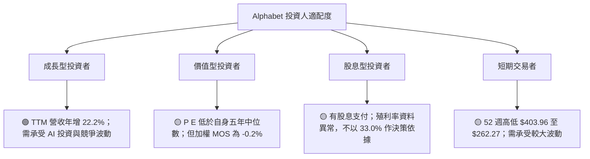

### 11.5 每季財報監控清單（Quarterly Watch List）

| 監控指標 | 最新參考值 | 加碼觸發門檻 | 減碼／重新估值門檻 |
|----------|-----------:|--------------|--------------------|
| 營收成長 | TTM +22.2%；最新季單季 +24.7% | 單季 YoY 維持 ≥15% | 連續兩季 <10% |
| 營業利益率 | TTM 33.3%；最新季 31.8% | 回升至 ≥33% 且費用率受控 | 連續兩季 <30% |
| Capex | TTM $159.80B | 投資增速放緩並開始帶動收入／現金流 | Capex 上升、但營收與 OCF 未同步改善 |
| FCF | TTM $19.75B | 季度趨勢持續改善、TTM 回升至 FY2025 水準方向 | FCF 轉負或連續兩季下降 |
| 營業現金流 | TTM $179.55B | 維持正增長且 FCF 轉換改善 | OCF 下降並伴隨 FCF 惡化 |
| SBC | TTM 估計約 $30.41B；約占營收 6.46% | SBC／營收下降或被實質回購抵銷 | SBC 增長持續高於營收、股數繼續增加 |
| Google Cloud／AI | 分部數據未提供 | 以申報資料披露的收入與利潤趨勢為準 | 投資擴張但分部收入及利潤無改善 |
| 應收帳款 | DSO 56 天；一年前 54 天 | DSO 穩定或下降 | DSO 持續上升且高於收入增長 |
| 估值／股價 | 現價 $279.53；加權值 $278.87 | 價格不高於 $250.98 且基本面未惡化 | 價格超過 $306.76 且估值缺乏盈利上修支持 |

### 11.6 反面論證：什麼會證明論點錯誤（What Would Change My Mind）

```text
╔══════════════════════════════════════════════════════════════════╗
║              ⚠️ 論點失效條件（Disconfirming Evidence）           ║
╠══════════════════════════════════════════════════════════════════╣
║ 本投資論點在下列情況成立時，應重新檢視估值或退出：              ║
║  ☐ 核心營收增長連續兩季低於 10%                                 ║
║  ☐ 營業利益率連續兩季低於 30%                                   ║
║  ☐ TTM FCF 持續下降或轉負，且 Capex 未見回報改善                ║
║  ☐ ROIC 跌破 WACC 10.31%                                         ║
║  ☐ DSO 持續上升，且應收帳款增幅高於營收增幅                     ║
║  ☐ SBC／營收高於目前約 6.46%，且稀釋股數持續增加                ║
║  ☐ AI 搜尋或監管變化導致廣告收入及獲利能力結構性下滑             ║
╚══════════════════════════════════════════════════════════════════╝
```

> **免責聲明**：本報告為 AI 自動生成，僅供研究參考，不構成投資建議。投資有風險，入市需謹慎。

---

## 資料與來源

| 項目 | 內容 |
|------|------|
| 價格 | 279.53 USD，2026-11-23 收盤（Yahoo Finance 日線） |
| 財務報表 | SEC 10-Q filed 2026-10-29，最新季度 2026-09-30（FY2026 Q3） |
| 有回應的資料來源 | SEC 申報資料 (XBRL)、Yahoo Finance、Finviz、StockAnalysis、Roic.ai |
| 由程式計算 | TTM 數字、WACC、DCF 模型、估值方法與權重、加權合理價值、MOS、評級門檻、F-Score、杜邦分解、營運資金天數、綜合評分 |
| 撰寫模型 | openai / gpt-6-luna |

> 本區塊由產生報告的程式依實際取得的資料填寫，非模型撰寫。「由程式計算」的數字不是模型的估計；其餘判斷（評分、情境、策略）是模型的分析。
