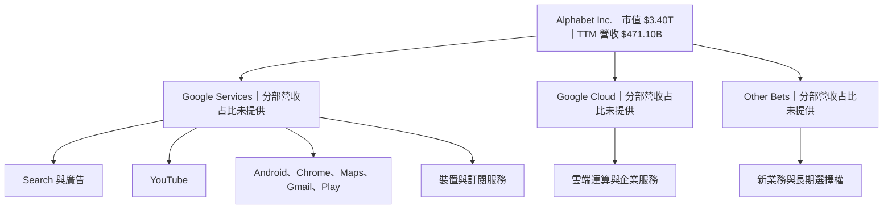
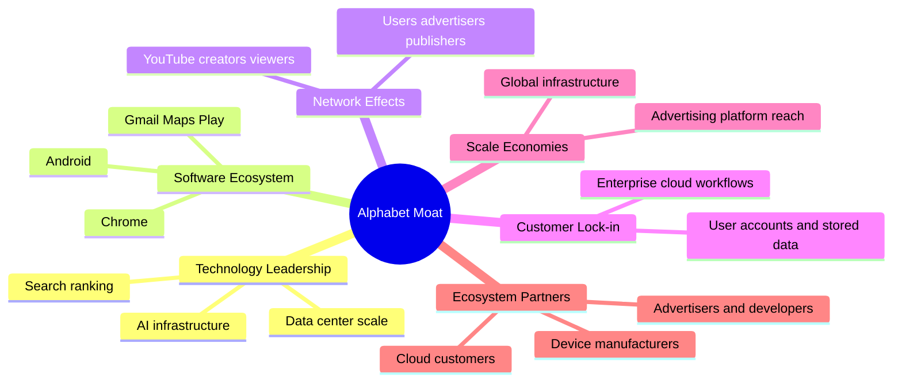
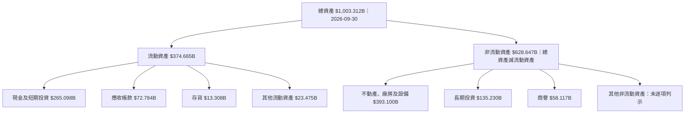
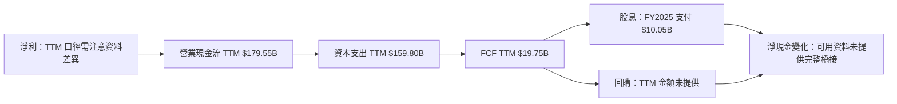
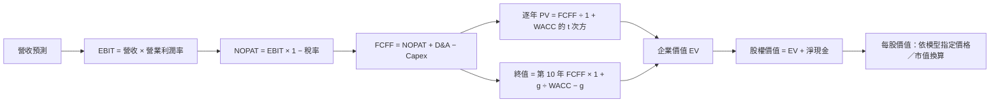
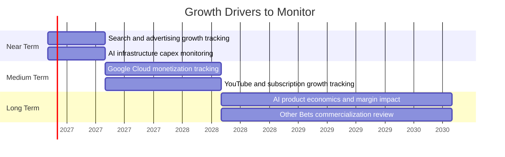
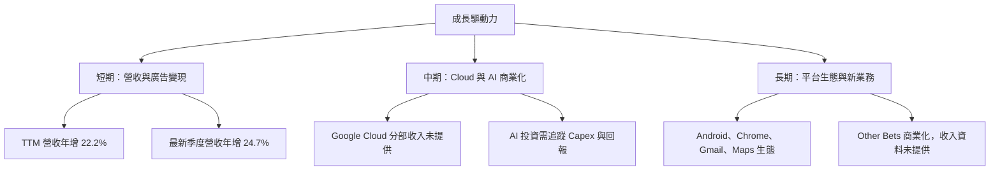
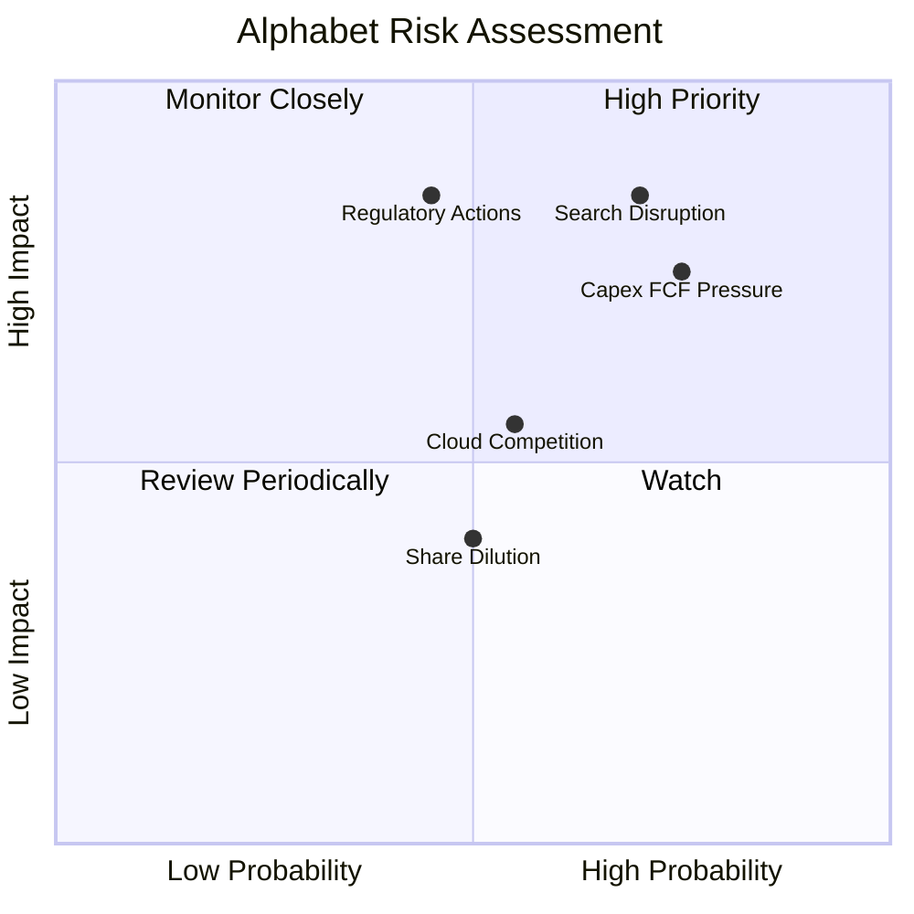
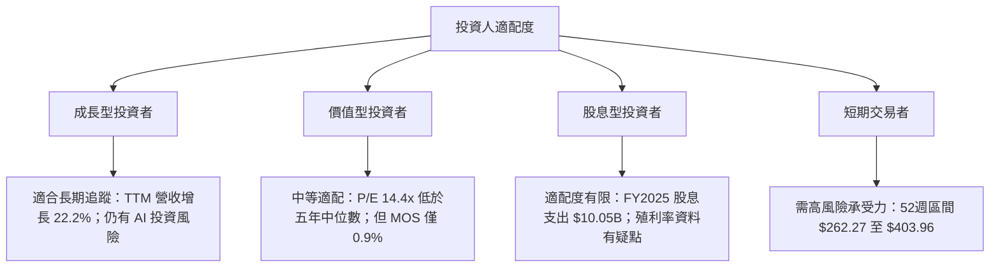

# GOOG 基本面深度分析報告
> **報告日期**：2026-11-25 ｜ **語言**：繁體中文 ｜ **數據來源**：SEC 申報資料 (XBRL)、Yahoo Finance、Finviz、StockAnalysis、Roic.ai ｜ **分析師**：CFA 級機構研究

## 目錄

| # | 章節 | 核心結論 |
|---|------|----------|
| 1 | 執行摘要 | 持有；加權合理價值 $279.07，MOS +0.9% |
| 2 | 公司概覽與商業模式 | Search、YouTube、Cloud 等構成多層護城河；分部營收占比未提供 |
| 3 | 損益表深度分析 | TTM 營收 $471.10B，成長 22.2%；最新一季年增 24.7% |
| 4 | 資產負債表分析 | 淨現金 $138.98B；流動性充裕，但資本支出攀升 |
| 5 | 現金流量深度分析 | TTM FCF $19.75B，FCF Yield 0.58%，受高資本支出壓縮 |
| 6 | 獲利能力與資本效率 | ROIC 23.9% 高於 WACC 10.29%，仍創造股東價值 |
| 7 | 相對估值分析 | P/E 低於自身五年中位數；相對估值方法呈分歧 |
| 8 | DCF 內在價值評估 | 基準 DCF $247.96；終值占 EV 72.3%，估值對長期假設敏感 |
| 9 | 成長催化劑 | AI、Cloud、YouTube 與廣告效率是主要追蹤方向 |
| 10 | 風險矩陣 | 搜尋競爭／監管、AI 資本支出、FCF 下滑為主要風險 |
| 11 | 投資建議 | 持有；等待價格低於加權合理價值約 90% 再提高安全邊際 |

---

## 1. 執行摘要

GOOG 2026-11-24 收盤價為 **$276.58**。TTM 營收 $471.10B、年增 22.2%，最新一季營收年增 24.7%；TTM ROIC 23.9% 高於 WACC 10.29%，顯示核心業務仍創造資本價值。但 TTM FCF 僅 $19.75B、FCF Yield 0.58%，而 DCF 基準價值為 $247.96，低於現價；相對估值與分析師共識則將加權合理價值推至 $279.07。依規則 20，MOS 為 +0.9%，評級為**持有**。

### 1.0 一頁式投資儀表板（Portfolio Manager 30 秒速讀）

| 項目 | 內容 |
|------|------|
| **投資論點（3 句）** | ① TTM 營收年增 22.2%，最新一季年增 24.7%，增長動能尚在。② ROIC 23.9% 對比 WACC 10.29%，資本回報仍高於資金成本。③ TTM FCF $19.75B、FCF Yield 0.58%，主要顧慮是高資本支出壓縮現金流。 |
| **綜合評分** | **7.8/10**（引用 1.1 評分卡） |
| **財務健康** | 🟢 淨現金 $138.98B；流動比率 2.786，短期償付能力充足 |
| **ROIC vs WACC** | 23.9% vs 10.29%；創造價值，差額 13.61 個百分點 |
| **FCF 趨勢** | TTM FCF $19.75B；資本支出高，FCF Yield 0.58% |
| **估值** | Forward P/E 18.08x｜EV/EBITDA 17.813x｜FCF Yield 0.58% |
| **DCF 內在價值（基準）** | $247.96；現價相對 DCF 溢價 **11.5%** |
| **安全邊際（MOS）** | **+0.9%**＝($279.07 − $276.58) ÷ $279.07；🔴 <10%，不足 |
| **預期報酬（基準情境 12M）** | DCF 基準情境相對現價 **−10.3%**；估值模型不是 12 個月股價預測 |
| **關鍵風險（前二）** | 搜尋業務遭 AI 介面改變；資本支出持續高於現金流增長 |
| **評級 + 信心度** | 🟡 **持有**｜信心：中 |

> MOS 按加權合理價值計算；DCF 折溢價按 DCF 基準價值計算，兩者分母不同，不能互換。

### 1.1 綜合評分卡（全報告唯一）

| 維度 | 評分（1–10） | 主要依據（引用數字與其來源章節） |
|------|--------------|----------------------------------|
| 成長性 | 8.0 | TTM 營收成長 22.2%、最新一季年增 24.7%（第 3 章） |
| 獲利能力 | 8.5 | TTM 營業利益率 33.3%、ROIC 23.9% 高於 WACC 10.29%；F-Score 4/8（第 6 章） |
| 財務健康 | 8.5 | 淨現金 $138.98B、流動比率 2.786；CCC 39 天（第 4 章） |
| 估值 | 6.0 | MOS +0.9%；P/E 14.4x 低於自身五年中位數 21.9x，但 FCF Yield 0.58%（第 7、8 章） |
| 護城河 | 9.0 | Search、Android、Chrome、YouTube、Cloud 等跨平台服務與規模（第 2 章）；分部財務拆分未提供 |
| 管理層與資本配置 | 7.0 | 2025 年 SBC $24.95B、股數稀釋測試未通過；2025 年股息支出 $10.05B（第 3、5 章） |
| **綜合評分** | **7.8** | 六項算術平均：(8.0 + 8.5 + 8.5 + 6.0 + 9.0 + 7.0) ÷ 6 = 7.833，四捨五入至一位小數 |

### 1.2 五大投資論點 + 三大核心風險

| 類型 | 項目 | 具體依據 | 信心度 |
|------|------|----------|--------|
| 🟢 **投資論點①** | 營收成長重新加速 | TTM 營收年增 22.2%；最新一季年增 24.7%，高於 2025 全年 15.09% | 🟢 高 |
| 🟢 **投資論點②** | 資本回報高於資金成本 | ROIC 23.9% vs WACC 10.29%，正利差 13.61 個百分點 | 🟢 高 |
| 🟢 **投資論點③** | 資產負債表提供緩衝 | 現金及短期投資 $265.10B、總債務 $126.12B、淨現金 $138.98B | 🟢 高 |
| 🟢 **投資論點④** | Search、YouTube、Cloud 多產品觸及 | 服務涵蓋 Search、Android、Chrome、Gmail、Maps、YouTube、Google Cloud 等；分部占比未提供 | 🟡 中 |
| 🟢 **投資論點⑤** | 相對自身歷史 P/E 偏低 | 當前 P/E 14.4x，五年中位數 21.9x，當前位於歷史第 29 百分位 | 🟡 中 |
| 🟡 **風險①** | 高資本支出壓低自由現金流 | TTM OCF $179.55B、Capex $159.80B，FCF 只有 $19.75B | 🔴 高衝擊 |
| 🔴 **風險②** | 搜尋介面與廣告模式受 AI 改變 | Search 是核心產品之一，但各分部營收依賴度未提供，無法直接量化轉移風險 | 🟡 中 |
| 🟡 **風險③** | 盈餘與現金流品質存在落差 | F-Score 4/8；OCF 未高於淨利測試未通過；股數稀釋測試未通過 | 🟡 中 |

### 1.3 快速統計卡片

| 指標 | 公司實際值（期間） | 同業中位數 | 狀態 |
|------|--------------------|------------|------|
| 營收成長（TTM） | **22.2%** | — | 🟢 |
| 營收成長（最新一季年增） | **24.7%** | 18.8% | 🟢 |
| 毛利率（TTM） | **60.9%** | 67.7% | 🟡 |
| 營業利益率（TTM） | **33.3%** | — | 🟢 |
| ROIC（TTM） | **23.9%** | — | 🟢 |
| Forward P/E | **18.08x** | 20.5x | 🟢 |
| FCF Yield（TTM） | **0.58%** | — | 🔴 |
| Piotroski F-Score | **4 / 8** | — | 🟡 |

同業中位數依 META、MSFT、AMZN 的 Peer multiples 計算；同業營收成長與毛利率比較使用最新季度年增與 TTM 毛利率資料。

### 1.4 投資結論

```text
╔══════════════════════════════════════════════════════════════════╗
║                    📊 投資結論摘要                               ║
╠══════════════════════════════════════════════════════════════════╣
║  評級：持有（MOS +0.9%，符合 −10% 至 +10% 區間）                 ║
║  價格（2026-11-24 收盤）：$276.58                               ║
║  DCF 內在價值（基準）：$247.96（現價溢價 11.5%）                 ║
║  安全邊際 MOS：+0.9%（以加權合理價值 $279.07 為分母）            ║
║  加權合理價值（8.8）：$279.07                                   ║
║  DCF 情境價值：悲觀 $108.37（−60.8%）｜基準 $247.96（−10.3%）  ║
║                 樂觀 $517.84（+87.2%）                           ║
║  綜合評分：7.8/10（引用 1.1）                                    ║
║  適合投資人：長線成長型、能承受 AI 投資與監管不確定性的投資人    ║
╚══════════════════════════════════════════════════════════════════╝
```

---

## 2. 公司概覽與商業模式

### 2.1 業務結構與收入來源

Alphabet 提供 Google Services、Google Cloud、Other Bets 三個主要業務板塊；服務涵蓋搜尋、廣告、YouTube、Android、Chrome、Gmail、Maps、Google Play、裝置與雲端服務。可用財務資料沒有提供各板塊營收金額與占比，因此不推算分部比例或繪製比例圖。



### 2.2 市場份額

市場份額數據未提供，因此不列市場占比。可觀察到 Alphabet TTM 營收為 $471.10B，最新一季營收年增 24.7%；META、MSFT、AMZN 最新季度營收成長分別為 26.1%、18.8%、12.1%。營收增速高於 MSFT 與 AMZN、略低於 META，但不能以營收增長直接代替市場份額。

### 2.3 競爭護城河分析



### 2.4 護城河強度

| 護城河項目 | 強度（強／中／弱） | 證據（引用數字或事實） | 會削弱它的情況 |
|------------|--------------------|------------------------|----------------|
| 技術與資料 | 強 | Search、YouTube、Maps 等產品覆蓋多個高頻使用情境；公司 TTM 營收 $471.10B | AI 搜尋服務降低傳統搜尋使用，或廣告成效下降 |
| 軟體生態系統 | 強 | Android、Chrome、Gmail、Drive、Maps、Play 等服務互相連結 | 作業系統、瀏覽器或應用分發規則變化 |
| 網路效應 | 強 | 廣告客戶與受眾、YouTube 創作者與觀眾形成雙邊平台 | 使用者注意力分散、廣告主轉移預算 |
| 客戶鎖定 | 中至強 | 帳戶、雲端工作流程與內容服務提高轉換成本；未提供留存率數字 | 企業遷移成本下降或雲端服務差異縮小 |
| 規模效應 | 強 | TTM 營收 $471.10B，TTM 營業利益率 33.3% | Capex 增速長期高於營收、規模未能轉化為 FCF |
| 生態夥伴 | 中 | 依賴裝置商、開發者、廣告主與企業客戶 | 監管改變分發安排或合作夥伴轉向競爭平台 |

1.1 的護城河評分為 9.0/10，理由是產品廣度、使用者與廣告生態，以及 33.3% TTM 營業利益率；分部收入、用戶數與市場份額資料未提供，因此保留部分不確定性。

---

## 3. 損益表深度分析

### 3.1 年度收入成長趨勢（近4年）

2022–2025 年收入分別為 $282.84B、$307.39B、$350.02B、$402.84B。三年累計 CAGR 約 12.5%，計算為 `(402.84 ÷ 282.84)^(1/3) − 1`。2025 年成長加快至 15.09%，TTM 增長進一步至 22.2%。

```text
╔══════════════════════════════════════════════════════════════════╗
║              Alphabet 年度收入趨勢（FY2022-FY2025）              ║
╠══════════════════════════════════════════════════════════════════╣
║  FY2022  $282.84B  ██████████████░░░░░░░░░░  YoY：基期          ║
║  FY2023  $307.39B  ███████████████░░░░░░░░░  YoY：+8.68% 🟡     ║
║  FY2024  $350.02B  █████████████████░░░░░░░  YoY：+13.87% 🟢    ║
║  FY2025  $402.84B  ████████████████████░░░░░  YoY：+15.09% 🟢   ║
║                                                                  ║
║  FY2022–FY2025 三年收入 CAGR：約 +12.5%                          ║
║  TTM 營收 $471.10B；TTM 年增 22.2%                               ║
╚══════════════════════════════════════════════════════════════════╝
```

### 3.2 季度收入趨勢分析

| 季度 | 營收（$B） | QoQ 成長 | YoY 成長 | 備註 |
|------|-----------:|---------:|---------:|------|
| 2025 Q4 | 113.83 | — | 18.00% | QoQ 比較所需 2025 Q3 已有；此列作為後續季度基準 |
| 2026 Q1 | 109.90 | −3.45% | 21.79% | 季節性或業務組合可能影響 QoQ；不能單憑一季判斷趨勢 |
| 2026 Q2 | 119.80 | +9.01% | 24.23% | 年增率延續上升 |
| 2026 Q3 | 127.58 | +6.49% | 24.65% | 最新一季年增 24.7%，不得視為 TTM 成長率 |

計算例：2026 Q3 QoQ = `(127.58 ÷ 119.80) − 1 = 6.49%`；YoY = `(127.577 ÷ 102.346) − 1 = 24.65%`。營收連續高增有利固定成本攤薄，但還需觀察增量營收是否轉化為現金流，因 TTM Capex 已達 $159.80B。

### 3.3 利潤率演變分析

| 利潤率指標 | FY2022 | FY2023 | FY2024 | FY2025 | 趨勢 | 評估 |
|------------|-------:|-------:|-------:|-------:|------|------|
| **毛利率** | 55.4% | 56.6% | 58.2% | 59.6% | 逐年改善 | 🟢 |
| **營業利益率** | 26.5% | 27.4% | 32.1% | 32.0% | 2024 改善後大致持平 | 🟢 |
| **淨利率** | 21.2% | 24.0% | 28.6% | 32.8% | 歷史年度提高 | 🟢 |

年度毛利率依提供的年度毛利與營收計算；營業利益率依年度營業利益與營收計算。TTM 營業利益率為 33.3%，最新季度官方整理的營業利益率為 31.8%；另有彙總欄位列 33.3%，此處依 VERIFIED FIGURES 的最新季度口徑使用 31.8%。

**利潤率演變深度解析：**FY2022–FY2025 毛利率約由 55.4% 升至 59.6%，營業利益率由 26.5% 升至 32.0%。這代表收入增長帶來一定營運槓桿，亦可能與產品組合與成本控制相關；但資料未提供分部成本明細，不能將改善歸因於某單一產品。最新季度營業利益率 31.8%，低於 TTM 33.3%，需追蹤 AI 基礎設施與折舊支出是否持續壓迫利潤率。

### 3.4 費用結構分析

未提供完整 TTM 費用分項以及可與營收對照的費用結構，因此不繪製費用圓餅圖。已知 FY2025 研發費用 $61.09B，約為當年營收 $402.84B 的 15.2%；研發投入支持搜尋、AI、雲端與平台服務，但是否產生相應增量回報，仍須以收入與現金流驗證。

### 3.5 季度 EPS 趨勢與盈餘品質（Quality of Earnings）

財報資料中的四季 EPS 預估值與實際值均為 NaN，不能可靠判定超預期或不及預期。季度 EPS 年增率資料顯示 2026 Q1 +81.96%、Q2 +294.31%、Q3 −25.34%、2025 Q4 +31.15%；Q2 的淨利與 EPS 變動幅度異常大，但沒有足夠明細辨認其具體一次性來源。

| 盈餘品質項目 | 數值/佔比 | 評估 |
|--------------|-----------|------|
| 股權薪酬 SBC / 營收 | 估計 TTM SBC $30.41B ÷ $471.10B = **6.46%** | 🟡 SBC 是非現金費用，但可透過稀釋造成股東成本 |
| SBC / 營業現金流 | 估計 TTM SBC $30.41B ÷ $179.55B = **16.94%** | 🟡 SBC 規模不可忽略；TTM SBC 由最近四季季度數據相加 |
| FCF / 淨利（現金轉換率） | 以 StockAnalysis TTM 淨利 $235.694B 作分母：$19.75B ÷ $235.694B = **8.38%** | 🔴 現金轉換率偏低，主要需關注 Capex；不同資料彙總口徑可能不完全一致 |
| 一次性/非經常性損益 | N/A（缺少足以拆分 TTM 非經常性項目的明細） | 無法據此判斷本期淨利是否由一次性項目美化 |
| 有效稅率異常 | 16.8%（最新年度有效稅率） | 🟢 未見本資料中顯示的異常高稅率，但缺少完整多年稅項調節表 |
| 資本化支出 vs 費用化 | TTM Capex $159.80B；折舊攤銷／資本化明細 N/A | 大額資本開支可能先形成資產、再逐期折舊；無法據此指稱盈餘被高估 |

**盈餘品質結論：**GAAP EBIT 已反映 SBC 費用，但股票薪酬仍可能稀釋既有股東。TTM FCF 只占所列 TTM 淨利約 8.4%，主因是 TTM 資本支出高達 $159.80B；因此估值應同時看獲利能力與投資後剩餘現金，而不能只看 EPS。

---

## 4. 資產負債表分析

### 4.1 資產結構分解

以 StockAnalysis 2026-09-30 資料，總資產 $1,003.312B，流動資產 $374.665B；非流動資產為兩者差額 $628.647B。此結構顯示資產基礎包含大量固定資產與投資，但資產項目分類存在資料來源口徑差異，以下只呈現可核對的已報數字。



### 4.2 流動性與營運資金分析

| 指標 | 最新 TTM | 一年前 TTM | 變化 | 解讀 |
|------|----------|------------|------|------|
| DSO 應收帳款天數 | 56 天 | 54 天 | +2 天 | 收款週期略延長；需觀察是否因收入組合或付款條件改變 |
| DIO 存貨天數 | 26 天 | N/A | N/A | 一年前沒有可用存貨資料，不能推算年度變化 |
| DPO 應付帳款天數 | 43 天 | N/A | N/A | 一年前資料不足，不能推論供應商付款條件趨勢 |
| CCC 現金轉換週期 | 39 天 | N/A | N/A | 目前營運資金週期可計算；缺乏一年前可比數值 |

最新流動比率 2.786、速動比率 2.512，顯示流動資產對短期負債覆蓋充裕。CCC 與 DSO 等數值依品質指標區塊照錄，不另行重算。

### 4.3 債務結構分析

債務採用 VERIFIED FIGURES：現金及短期投資 $265.10B、總債務 $126.12B、淨現金 $138.98B。市場資料另列總債務 $150.33B、淨現金 $114.77B，與 SEC／程式計算彙整口徑不一致；本報告債務與淨現金評估統一採用 VERIFIED FIGURES，避免混用。

```text
╔══════════════════════════════════════════════════════════════════╗
║                   Alphabet 債務健康診斷                          ║
╠══════════════════════════════════════════════════════════════════╣
║  總債務：        $126.12B  ██████████░░░░░░░░░░                  ║
║  現金及短期投資：$265.10B  ████████████████████                  ║
║  淨現金：        $138.98B  ██████████░░░░░░░░░░  🟢              ║
║                                                                  ║
║  流動比率：2.786x  🟢                                            ║
║  速動比率：2.512x  🟢                                            ║
║  Debt/EBITDA：N/A（債務與 EBITDA 同口徑輸入未提供）              ║
║  Interest Coverage：N/A（利息費用絕對額未提供）                 ║
╚══════════════════════════════════════════════════════════════════╝
```

### 4.4 股東權益趨勢

| 財政年度 | 股東權益（$B） | 年增 |
|----------|---------------:|-----:|
| 2022 | 256.14 | — |
| 2023 | 283.38 | +10.6% |
| 2024 | 325.08 | +14.7% |
| 2025 | 415.26 | +27.7% |

股東權益逐年增加，FY2025 增幅較高；缺乏完整權益變動表，無法將增長精確拆分為留存盈餘、其他綜合損益、回購或其他項目。

---

## 5. 現金流量深度分析

### 5.1 現金流量瀑布圖

季度與年度股息資料可用，但回購金額及淨現金變動的完整 TTM 拆分未提供；故流程圖呈現已知項目，缺漏處明示資料不足。



### 5.2 FCF 轉換率趨勢

| 年度 | OCF（$B） | Capex（$B） | FCF（$B） | 淨利（$B） | FCF / 淨利 |
|------|----------:|------------:|----------:|-----------:|-----------:|
| 2022 | 91.50 | 31.48 | 60.01 | 59.97 | 100.1% |
| 2023 | 101.75 | 32.25 | 69.50 | 73.80 | 94.2% |
| 2024 | 125.30 | 52.53 | 72.76 | 100.12 | 72.7% |
| 2025 | 164.71 | 91.45 | 73.27 | 132.17 | 55.4% |

歷史資料顯示 OCF 上升，但 Capex 增長更快，FCF 由 2023 年 $69.50B 升至 2025 年 $73.27B，增幅有限。TTM FCF $19.75B 與 FY2025 FCF 不同，反映最新期間資本支出擴大；不能將年度與 TTM 口徑混為一談。

### 5.3 自由現金流趨勢

```text
╔══════════════════════════════════════════════════════════════════╗
║               自由現金流趨勢（年度及最新 TTM）                   ║
╠══════════════════════════════════════════════════════════════════╣
║  FY2022  $60.01B  ████████████████░░░░  FCF/淨利 100.1%         ║
║  FY2023  $69.50B  ██████████████████░░  FCF/淨利 94.2%          ║
║  FY2024  $72.76B  ███████████████████░  FCF/淨利 72.7%          ║
║  FY2025  $73.27B  ███████████████████░  FCF/淨利 55.4%          ║
║  TTM     $19.75B  █████░░░░░░░░░░░░░░░  FCF Yield 0.58%         ║
╠══════════════════════════════════════════════════════════════════╣
║  TTM OCF $179.55B − Capex $159.80B = FCF $19.75B                 ║
╚══════════════════════════════════════════════════════════════════╝
```

### 5.4 資本配置評估

提供的年度現金流資料只量化 Capex、股息與 SBC；回購、併購及留存現金的完整 TTM 配置比例未提供，因此不繪製不完整資本配置圓餅圖。

| 配置項目 | 已知數據 | 評估 |
|----------|----------|------|
| 資本支出 | TTM $159.80B；FY2025 $91.45B | 近期投入大幅提高；需驗證其是否帶來足夠營收與回報 |
| 股息 | FY2025 $10.05B | 相對 FY2025 FCF $73.27B，派息規模可承受 |
| SBC | FY2025 $24.95B | 相當於 FY2025 營收約 6.2%，是股東稀釋成本 |
| 回購 | 近期金額 N/A | 無法判斷回購是否足以抵銷 SBC 稀釋 |
| 留存／其他投資 | N/A | 未提供可核對的完整分項 |

---

## 6. 獲利能力與資本效率

### 6.1 ROE / ROA / ROIC 趨勢

| 指標 | 最新可用值 | 期間／口徑 | 評估 |
|------|-----------:|-------------|------|
| ROE | 34.8% | TTM，品質指標計算 | 🟢 資本回報高；不採用其他彙總欄位的 44.3% |
| ROA | 12.7% | TTM，市場資料 | 🟢 資產仍具獲利能力 |
| ROIC | 23.9% | TTM、稅後營業利益／投入資本 | 🟢 高於 WACC 10.29% |
| ROIC 歷史趨勢 | N/A | 缺乏同一口徑連續年度 ROIC 序列 | 不補造年度比較值 |

公司有正向價值創造，但 TTM FCF Yield 只有 0.58%，顯示高會計回報目前未完全轉化為可自由支配現金，主要須檢視資本支出回報。

### 6.2 ROIC vs WACC 分析（核心價值創造判斷）

```text
╔══════════════════════════════════════════════════════════════════╗
║                ROIC vs WACC 深度分析                            ║
╠══════════════════════════════════════════════════════════════════╣
║  WACC 估算（直接採用資本成本輸入）：                             ║
║  ├── 無風險利率（10Y 美債）：             4.90%                  ║
║  ├── 市場風險溢酬 ERP：                   5.00%                  ║
║  ├── 原始 Beta：                          1.23                   ║
║  ├── 調整 Beta：                          1.15                   ║
║  ├── Ke：                                 10.66%                 ║
║  ├── 稅前 Kd：                            0.58%                  ║
║  ├── 股權／債務權重：                     96.4%／3.6%            ║
║  └── ✅ WACC：                            10.29%                 ║
║                                                                  ║
║  ROIC（TTM）：                             23.9%                  ║
║  EVA 利差 = ROIC − WACC：                 +13.61 個百分點        ║
║                                                                  ║
║  ROIC  23.9%  ▓▓▓▓▓▓▓▓▓▓▓▓▓▓▓▓▓▓▓▓▓▓▓░░░░░ 🟢                  ║
║  WACC  10.29% ▓▓▓▓▓▓▓▓▓▓░░░░░░░░░░░░░░░░░ ──                    ║
║                                                                  ║
║  結論：ROIC 約為 WACC 的 2.32 倍，仍在創造股東價值。             ║
║  ROIC/WACC = 23.9% ÷ 10.29% = 2.32x                             ║
╚══════════════════════════════════════════════════════════════════╝
```

原始 Beta 1.23 調整為 1.15，按 `⅔ × 1.23 + ⅓ × 1.00 = 1.1533`，四捨五入為 1.15。CAPM 使用輸入值：`4.90% + 1.15 × 5.00% = 10.65%`；資本成本資料列示 Ke 10.66%，細小差異來自未四捨五入的底層輸入。債務稅後成本為 `0.58% × (1 − 16.8%) = 0.48256%`。採用資料列示資本權重後：

`WACC = 96.4% × 10.66% + 3.6% × 0.48256% = 10.2936% ≈ 10.29%`

ROIC 23.9% 減 WACC 10.29% 得 13.61 個百分點正利差。這是基於 TTM 會計口徑的價值創造判斷；若高額 Capex 未能形成同等回報，未來 ROIC 可能下滑。

### 6.3 杜邦三因素分解

| 因素 | 數值（TTM） | 解讀 |
|------|-------------|------|
| 淨利率 | 50.0% | 品質指標所列；較高淨利率是 ROE 的主要來源 |
| 資產週轉率 | 0.47 | 資產每年形成約 0.47 倍營收 |
| 權益乘數 | 1.48 | 財務槓桿不高，不是 ROE 的主要推升來源 |
| **ROE** | **34.8%** | 依品質指標照錄；三項乘積會因使用期末餘額與四捨五入而有差異 |

採用品質指標所列 DuPont：`50.0% × 0.47 × 1.48 = ROE 34.8%`。ROE 主要由淨利率而非高槓桿驅動。

### 6.4 財務體質：Piotroski F-Score

**Piotroski F-Score：4 / 8**。因一項測試缺少輸入而不計入分母，依品質指標原值照錄。

| 測試 | 結果 | 解讀 |
|------|------|------|
| ROA > 0 | ✅ 通過 | TTM 獲利為正 |
| 營業現金流 > 0 | ✅ 通過 | TTM OCF $179.55B |
| ROA 高於一年前 | ✅ 通過 | 獲利資產效率改善 |
| 營業現金流 > 淨利（應計品質） | ❌ 未通過 | 現金流低於淨利，需關注現金轉換與高投資需求 |
| 長期負債 ÷ 總資產低於一年前 | ❌ 未通過 | 債務比率測試未改善 |
| 流動比率高於一年前 | ✅ 通過 | 流動性趨勢改善 |
| 稀釋股數未增加 | ❌ 未通過 | SBC 可能造成股數稀釋 |
| 毛利率高於一年前 | — 無法判定 | 缺少可用毛利率輸入，未納入分母 |
| 資產週轉率高於一年前 | ❌ 未通過 | 周轉效率測試未改善 |

F-Score 不是單獨的買賣訊號；4/8 表示資產負債表、現金流品質與效率指標並非全面改善，與公司高 ROIC、充裕淨現金形成「回報強、現金轉換承壓」的組合。

---

## 7. 相對估值分析

### 7.1 同業估值比較表格

| 估值指標 | **GOOG** | **META** | **MSFT** | **AMZN** | GOOG 評估 |
|----------|---------:|---------:|---------:|---------:|-----------|
| **Trailing P/E** | 14.4x | 20.1x | 25.9x | 20.4x | 🟢 低於三家同業 |
| **Forward P/E** | 18.08x | 16.5x | 20.5x | 23.1x | 🟡 接近同業中位數 20.5x |
| **P/S Ratio** | 7.3x | 6.2x | 10.6x | 3.4x | 🟡 高於中位數 6.2x |
| **EV/EBITDA** | 17.7x | 13.3x | 18.3x | 15.9x | 🟡 高於中位數 15.9x |
| **最新季度營收年增** | 24.7% | 26.1% | 18.8% | 12.1% | 🟢 增速高於 MSFT、AMZN |
| **TTM 毛利率** | 60.9% | 81.0% | 67.7% | 51.4% | 🟡 低於 META、MSFT，高於 AMZN |

估值倍數依 VERIFIED FIGURES 的 Peer multiples；GOOG 自身 P/E、P/S、EV/EBITDA 使用歷史估值區塊對應值。市場資料中的 Forward P/E 為 18.08022x。

### 7.2 歷史估值區間分析

```text
╔══════════════════════════════════════════════════════════════════╗
║                 GOOG 五年估值區間（TTM）                         ║
╠══════════════════════════════════════════════════════════════════╣
║  P/E：        1.3x ├────────────●──────────────┤ 29.0x          ║
║                              現值 14.4x｜中位數 21.9x            ║
║               現值歷史百分位：29%                                ║
║                                                                  ║
║  P/S：        4.1x ├────────────────●──────────┤ 9.8x            ║
║                              現值 7.3x｜中位數 6.1x              ║
║               現值歷史百分位：67%                                ║
║                                                                  ║
║  EV/EBITDA： 13.7x ├──────────●────────────────┤ 25.0x           ║
║                              現值 17.7x｜中位數 19.1x            ║
║               現值歷史百分位：40%                                ║
╚══════════════════════════════════════════════════════════════════╝
```

P/E 位於自身歷史第 29 百分位，表面上較自身歷史偏低；P/S 則位於第 67 百分位，高於自身五年中位數，反映市場仍願為收入規模給予較高倍數。不同倍數得出的訊號不一致，不宜只依 P/E 判斷便宜。

### 7.3 情境價值（Bear / Base / Bull，照抄 DCF MODEL 的 Scenarios）

| 情境 | 第 1 年營收成長 | 期末營業利潤率 | WACC | 每股價值 | 相對現價 | 機率 | 會發生的條件 |
|------|----------------:|----------------:|-----:|----------:|---------:|-----:|--------------|
| 🔴 悲觀 | 11.1% | 27.2% | 11.29% | $108.37 | −60.8% | 25% | 廣告增長降速、AI 基建成本侵蝕利潤率、資金成本維持偏高 |
| 🟡 基準 | 22.2% | 32.0% | 10.29% | $247.96 | −10.3% | 50% | 營收從目前增速逐步放緩，營業利潤率向模型假設收斂 |
| 🟢 樂觀 | 33.3% | 35.2% | 9.29% | $517.84 | +87.2% | 25% | AI／Cloud／廣告帶動增長，成本效率使利潤率提高且折現率下降 |

情境機率加權參考值為 `$108.37 × 25% + $247.96 × 50% + $517.84 × 25% = $280.53`，但估值三角驗證指定採用基準 DCF 值，不以情境加權值替換。

### 7.4 相對估值隱含價格區間

```text
╔══════════════════════════════════════════════════════════════════╗
║              相對估值方法與股價位置（美元／股）                 ║
╠══════════════════════════════════════════════════════════════════╣
║  $247.96 ───── $250.33 ─────── $276.58 ─────── $313.60          ║
║  基準 DCF      同業 EV/EBITDA    現價           同業 Forward P/E ║
║                                                                  ║
║  分析師共識平均目標：$389.00；15 位分析師                        ║
╚══════════════════════════════════════════════════════════════════╝
```

- **同業 Forward P/E：$313.60**；同業中位數 20.5x × GOOG Forward EPS $15.30。
- **同業 EV/EBITDA：$250.33**；同業中位數 15.9x × TTM EBITDA，再計入淨現金。
- 同業樣本為 META、MSFT、AMZN。以上方法數值與權重於第 8.8 節依估值方法表照錄。

---

## 8. DCF 內在價值評估（Discounted Cash Flow）

### 8.0 估值推理鏈（Thinking Logic：在算之前先想清楚）

**Step 1 — 價值由哪些變數決定？**  
模型把 Alphabet 價值視為已存在的搜尋、YouTube 與其他服務現金流底盤，加上 Google Cloud 與 AI 帶來的增長，以及 Other Bets 的選擇權。分部營收占比未提供，不能為這些來源填入營收權重。DCF 的主導變數是長期 Capex 正常化與終值：預測終值現值占企業價值 72.3%，遠高於任何單一年度現金流。

**Step 2 — 模型選擇**

| 決策點 | 本報告採用 | 理由（含數字） | 曾考慮但否決 | 否決理由 |
|--------|-----------|----------------|--------------|----------|
| 現金流定義 | FCFF | 與 WACC 折現並估算 EV；模型已提供 FCFF | FCFE | 現有模型使用 FCFF，改用 FCFE 會改變模型與折現率口徑 |
| 預測期 N | 10 年 | DCF MODEL 指定 10 年，讓營收增長與 Capex 比率逐步收斂 | 5 年 | 與既有模型輸出不一致，且不能自行重建模型 |
| 終值方法 | Gordon Growth | 模型提供永續成長率 3.0% 與 Gordon 終值 | 退出倍數 | DCF MODEL 未提供退出倍數終值，不能另造數字 |
| EBIT 基礎 | GAAP EBIT | 模型以 GAAP 營業利益率投影；GAAP EBIT 已含 SBC 費用 | 非 GAAP EBIT | 會造成與提供模型口徑不一致 |

**Step 3 — 關鍵假設推導鏈**

- **營收增長**：錨點＝TTM 營收成長 22.2%，FY2025 年增 15.09%，最新季度年增 24.7% → 調整＝短期採用 TTM 增速，之後線性降至成熟期增長 → **採用第 1 年 22.2%、第 10 年 3.0%** → 替代方案曾可考慮直接用 FY2025 的 15.09%，但既有模型未採用，且不可更改模型輸入。
- **營業利潤率**：錨點＝TTM 營業利益率 33.3%；近年資料中 FY2024 約 32.1%、FY2025 約 32.0% → 調整＝假設隨成熟逐步回落，而非維持當前高點 → **採用 33.3% 緩降至 32.0%** → 否決維持 33.3% 不變，因模型使用五年期中位數作終值年利潤率錨點。
- **預測期 N**：錨點＝模型列示 N=10 年 → 調整＝與既有模型一致，保持逐年轉型假設 → **採用 10 年** → 不採用較短期間，因無法保留與指定模型相同的現金流與終值。
- **Capex／營收**：錨點＝TTM Capex $159.80B ÷ TTM 營收 $471.10B，約 33.9% → 調整＝模型假設資本投入率逐步下降至 D&A 的 1.1 倍 → **採用第 1 年 33.9%、第 10 年 6.5%** → 不採用長期維持 33.9%，那會改變模型且忽略成熟期資本支出收斂假設。
- **永續成長率 g**：錨點＝模型採 3.0%，並低於 WACC 10.29% → 調整＝成熟期仍保留正增長，但需顯著低於折現率 → **採用 3.0%** → 不採用接近或高於 WACC 的數值，否則 Gordon Growth 分母失效或不合理放大終值。
- **EBIT／SBC 處理**：錨點＝模型明示 GAAP EBIT、SBC 已作費用 → 調整＝現金流不再扣 SBC，股數不再加稀釋 → **採用組合 (A)** → 否決再扣 SBC 或再加稀釋，避免對同一成本重複計算。
- **年稀釋率**：錨點＝模型採固定股數處理 → 調整＝SBC 已透過 GAAP 費用反映 → **採用 0% 額外稀釋** → 否決另加正稀釋率，以免與組合 (A) 重複計入。
- **終值方法**：錨點＝模型提供 Gordon Growth 終值 → 調整＝沿用模型指定方式 → **採用 Gordon Growth** → 退出倍數法未提供相應終值數據，不臆測倍數。
- **WACC**：錨點＝資本成本計算列示 WACC 10.29% → 調整＝不自行另估，依規則使用指定折現率 → **採用 10.29%** → 否決使用其他折現率，避免改動模型結果。

**Step 4 — 最脆弱環節**  
最脆弱的是 Capex 率由 TTM 約 33.9% 降至第 10 年 6.5%；若基建投資強度較高而未能下降，FCFF 與終值都會受壓，DCF 對此假設的敏感度高。

**Step 5 — 計算路徑圖**



### 8.1 模型假設總表（Model Inputs）

| 假設項目 | 採用值 | 依據 / 來源 | 敏感度 |
|----------|--------|-------------|--------|
| 預測期長度 N | 10 年 | DCF MODEL 固定假設 | 🟡 中 |
| 營收成長 | 第 1 年 22.2% 緩降至第 10 年 3.0% | TTM 成長 22.2%；終端為模型假設 | 🔴 高 |
| 營業利潤率 | 33.3% 緩降至 32.0% | TTM 33.3%；終端依近五年中位數假設 | 🔴 高 |
| 有效稅率 | 16.8% | 最新年度有效稅率 | 🟢 低 |
| Capex / 營收 | 33.9% 緩降至 6.5% | TTM Capex 比率；終端依 D&A × 1.1 | 🔴 高 |
| D&A / 營收 | 5.9% | TTM 比率 | 🟢 低 |
| 營運資金變動 | 模型未納入 | 模型公式為 NOPAT + D&A − Capex | 🟡 中 |
| EBIT 基礎 | GAAP | DCF MODEL 明示 GAAP EBIT | 🟡 中 |
| SBC 處理 | 不再扣減 | GAAP EBIT 已含 SBC 費用 | 🟡 中 |
| 年稀釋率 | 固定股數、不另稀釋 | DCF MODEL 指定組合 (A) | 🟡 中 |
| 永續成長率 g | 3.0% | DCF MODEL 指定，且低於 WACC | 🔴 高 |
| 終值方法 | Gordon Growth | DCF MODEL 提供終值 | 🔴 高 |
| WACC | 10.29% | 資本成本輸入，見 8.2 | 🔴 高 |

本模型採用 **(A) GAAP EBIT + 固定股數**：SBC 已包含於 GAAP 費用，因此 FCFF 不再扣 SBC，股數也不再額外稀釋。模型公式未扣營運資金變動，不能另行加減。

### 8.2 折現率推導（WACC）

```text
╔══════════════════════════════════════════════════════════════════╗
║                    WACC 推導（折現率）                           ║
╠══════════════════════════════════════════════════════════════════╣
║  股權成本 Ke（CAPM）：                                           ║
║  ├── 無風險利率 Rf（10Y 美債）：      4.90%                     ║
║  ├── 市場風險溢酬 ERP：               5.00%                     ║
║  ├── 原始 Beta：                      1.23                      ║
║  ├── 調整 Beta：                      1.15                      ║
║  ├── 規模／國別溢酬：                 0.00%（未另加）           ║
║  └── Ke = 4.90% + 1.15 × 5.00% = 10.65%；輸入列示 10.66%       ║
║                                                                  ║
║  債務成本 Kd：                                                   ║
║  ├── 稅前 Kd：                        0.58%                     ║
║  ├── 有效稅率：                      16.8%                     ║
║  └── 稅後 Kd = 0.58% × (1−16.8%) = 0.48256%                     ║
║                                                                  ║
║  資本結構：                                                      ║
║  ├── 股權權重：                       96.4%                     ║
║  ├── 債務權重：                        3.6%                     ║
║  └── ✅ WACC = 96.4%×10.66% + 3.6%×0.48256% = 10.29%          ║
╚══════════════════════════════════════════════════════════════════╝
```

逐步計算如下：

1. **Ke** = Rf + β × ERP = `4.90% + 1.15 × 5.00% = 10.65%`；資本成本輸入列示 10.66%，使用其未四捨五入底層值。
2. **稅前 Kd**：資料列示利息／債務成本為 0.58%；利息費用絕對值與平均計息負債分項未提供，因此不能獨立重建比率。
3. **稅後 Kd** = `0.58% × (1 − 16.8%) = 0.48256%`。
4. **權重**：採用資本成本輸入所列股權 96.4%、債務 3.6%；市值與計息債務範圍的底層權重輸入未提供，故不反推金額。
5. **WACC** = `96.4% × 10.66% + 3.6% × 0.48256% = 10.2936% ≈ 10.29%`。

Rf 的具體觀察日期未提供；ERP 5.00% 為輸入假設。WACC 與第 6.2 節採用同一數值 10.29%。

### 8.3 逐年自由現金流預測（基準情境）

金額單位為美元十億；依 DCF MODEL 原值逐年照錄。折現因子保留三位小數。FCFF 公式為 `NOPAT + D&A − Capex`，模型沒有營運資金變動列。

| 年度 | FY+1 | FY+2 | FY+3 | FY+4 | FY+5 | FY+6 | FY+7 | FY+8 | FY+9 | FY+10 |
|------|-----:|-----:|-----:|-----:|-----:|-----:|-----:|-----:|-----:|------:|
| 營收 | 575.74 | 691.33 | 815.37 | 944.26 | 1,073.37 | 1,197.22 | 1,309.81 | 1,405.02 | 1,477.16 | 1,521.48 |
| 營收 YoY | 22.2% | 20.1% | 17.9% | 15.8% | 13.7% | 11.5% | 9.4% | 7.3% | 5.1% | 3.0% |
| 營業利潤率 | 33.3% | 33.2% | 33.0% | 32.9% | 32.7% | 32.6% | 32.5% | 32.3% | 32.2% | 32.0% |
| EBIT（GAAP） | 191.84 | 229.37 | 269.36 | 310.58 | 351.51 | 390.36 | 425.19 | 454.09 | 475.29 | 487.37 |
| − 稅 | (32.20) | (38.50) | (45.21) | (52.13) | (58.99) | (65.51) | (71.36) | (76.21) | (79.77) | (81.80) |
| NOPAT | 159.65 | 190.87 | 224.15 | 258.46 | 292.52 | 324.84 | 353.83 | 377.88 | 395.52 | 405.57 |
| + D&A | 34.21 | 41.08 | 48.45 | 56.11 | 63.79 | 71.14 | 77.84 | 83.49 | 87.78 | 90.41 |
| − Capex | (195.30) | (213.47) | (226.97) | (234.11) | (233.46) | (223.97) | (205.18) | (177.35) | (141.51) | (99.46) |
| **FCFF** | **−1.44** | **18.48** | **45.64** | **80.46** | **122.84** | **172.02** | **226.48** | **284.03** | **341.80** | **396.53** |
| 折現因子 @10.29% | 0.907 | 0.822 | 0.745 | 0.676 | 0.613 | 0.556 | 0.504 | 0.457 | 0.414 | 0.375 |
| **FCFF 現值 PV** | **−1.31** | **15.19** | **34.01** | **54.37** | **75.26** | **95.56** | **114.07** | **129.70** | **141.52** | **148.86** |

**逐步演算（FY+1）：**

1. 營收 = `$471.10B × (1 + 22.2%) = $575.74B`（模型列示值）
2. EBIT = `$575.74B × 33.3% = $191.84B`
3. 稅 = `$191.84B × 16.8% = $32.20B`
4. NOPAT = `$191.84B − $32.20B = $159.64B`，模型因底層精度列示 $159.65B
5. D&A = `$575.74B × 5.9% = $34.21B`
6. Capex = `$575.74B × 33.9% = $195.30B`
7. ΔWC = **模型未納入**
8. FCFF = `$159.65B + $34.21B − $195.30B = −$1.44B`
9. 折現因子 = `1 ÷ (1 + 10.29%)^1 = 0.907`；PV = `−$1.44B × 0.907 = −$1.31B`

預測期 PV 加總：

`−1.31 + 15.19 + 34.01 + 54.37 + 75.26 + 95.56 + 114.07 + 129.70 + 141.52 + 148.86 = $807.23B`

模型列示預測期 PV 合計為 **$807.25B**；與逐項使用已四捨五入 PV 加總的差額為 $0.02B，來自表內精度四捨五入，低於 1%。

**合理性自檢：**

- FY+1 FCFF 為 −$1.44B，FY+10 為 $396.53B；模型未提供可直接比較的預測 FCF CAGR 基準，故不另造 CAGR。
- FY+10 FCF 利潤率 = `$396.53B ÷ $1,521.48B = 26.1%`；目前 TTM FCF 利潤率 = `$19.75B ÷ $471.10B = 4.2%`。模型隱含大幅改善，核心原因是 Capex／營收從 33.9% 降至 6.5%。
- FY+1 FCFF 為負，因模型第 1 年 Capex $195.30B 高於 NOPAT 加 D&A；此負值會降低預測期 PV，但其後正現金流仍貢獻 EV。

```text
╔══════════════════════════════════════════════════════════════════╗
║            自由現金流：歷史實際 vs 模型預測                      ║
╠══════════════════════════════════════════════════════════════════╣
║  FY2023(實)  $69.50B  ████░░░░░░░░░░░░░░░░  FCF/淨利 94.2%      ║
║  FY2024(實)  $72.76B  ████░░░░░░░░░░░░░░░░  FCF/淨利 72.7%      ║
║  FY2025(實)  $73.27B  ████░░░░░░░░░░░░░░░░  FCF/淨利 55.4%      ║
║  FY+1 (預)   −$1.44B  模型第 1 年 Capex 高於 NOPAT 加 D&A       ║
║  FY+10(預)  $396.53B  模型假設 Capex／營收降至 6.5%             ║
╠══════════════════════════════════════════════════════════════════╣
║  主要分歧：模型估值高度依賴投資強度長期正常化。                  ║
╚══════════════════════════════════════════════════════════════════╝
```

### 8.4 終值計算（Terminal Value）

適用性檢查：`WACC 10.29% vs g 3.0% → WACC > g？✅`

| 方法 | 計算式 | 終值 TV | TV 現值 | 佔總 EV 比重 |
|------|--------|---------:|--------:|-------------:|
| Gordon Growth | `396.53 × (1 + 3.0%) ÷ (10.29% − 3.0%)` | $5,599.84B | $2,102.20B | 72.3% |
| 退出倍數法 | N/A（DCF MODEL 未提供退出倍數輸出） | N/A | N/A | N/A |

逐步演算：

1. FY+10 FCFF = **$396.53B**。
2. 分子 = `$396.53B × (1 + 3.0%) = $408.4259B`。
3. 分母 = `10.29% − 3.0% = 7.29%`；TV = `$408.4259B ÷ 7.29% = $5,599.84B`。
4. PV(TV) = `$5,599.84B × 0.375 = $2,099.94B`（按已四捨五入折現因子計算）；模型以未四捨五入折現因子列示 **$2,102.20B**，下文橋接沿用模型原值。
5. 終值占比 = `$2,102.20B ÷ $2,909.45B = 72.3%`。

終值現值占 EV 72.3%，雖低於 75%警示門檻，但仍表示大部分 DCF 價值取決於長期現金流與 Capex 正常化假設。

### 8.5 企業價值 → 每股內在價值（Bridge）

```text
╔══════════════════════════════════════════════════════════════════╗
║              企業價值 → 每股內在價值 橋接表                      ║
╠══════════════════════════════════════════════════════════════════╣
║  預測期 FCF 現值合計            +$807.25B                        ║
║  終值現值 PV(TV)               +$2,102.20B                       ║
║  ─────────────────────────────────────────────                  ║
║  = 企業價值 EV                  $2,909.45B                       ║
║  + 淨現金                       +$138.98B                        ║
║  = 股權價值                     $3,048.43B                       ║
║  每股價值：模型列示             $247.96                          ║
║  當前股價（2026-11-24）         $276.58                          ║
║  折溢價（現價÷DCF內在價值−1）   +11.5% 溢價                      ║
╚══════════════════════════════════════════════════════════════════╝
```

逐步演算：

1. EV = `$807.25B + $2,102.20B = $2,909.45B`。
2. 股權價值 = `$2,909.45B + $138.98B = $3,048.43B`。
3. 每股內在價值：DCF MODEL 明示公式為 `股權價值 × 股價 ÷ 市值`，結果 **$247.96**。由於該模型採價格／市值換算，而可用股數欄位與市值口徑存在不一致，本報告不擅自替換模型的每股價值。
4. 折溢價 = `$276.58 ÷ $247.96 − 1 = +11.5%`。
5. 本節不計算 MOS；全報告 MOS 僅採第 8.8 節加權合理價值為分母。

現金及債務採 2026-09-30 TTM／季度口徑的 VERIFIED FIGURES 淨現金 $138.98B。股數處理沿用模型組合 (A)，不另加稀釋。

### 8.6 敏感性分析（WACC × 永續成長率）

下表逐格照錄 DCF MODEL。括號數字為相對 $276.58 現價的上行空間；基準格為 WACC 10.29%、g 3.0%。

| g（列）／WACC（欄） | 8.29% | 9.29% | **10.29%（基準）** | 11.29% | 12.29% |
|-----------|------:|------:|-------------------:|------:|------:|
| 2.0% | $322.06（+16.5%） | $266.98（−3.5%） | $225.88（−18.3%） | $194.21（−29.8%） | $169.18（−38.8%） |
| 2.5% | $343.65（+24.3%） | $281.61（+1.8%） | $236.21（−14.6%） | $201.75（−27.1%） | $174.81（−36.8%） |
| **3.0%（基準）** | $369.33（+33.5%） | $298.56（+7.9%） | **$247.96（−10.3%）** | $210.19（−24.0%） | $181.05（−34.5%） |
| 3.5% | $400.35（+44.8%） | $318.44（+15.1%） | $261.44（−5.5%） | $219.71（−20.6%） | $188.01（−32.0%） |
| 4.0% | $438.60（+58.5%） | $342.07（+23.7%） | $277.05（+0.2%） | $230.54（−16.6%） | $195.79（−29.2%） |

**逐步演算限制：**依要求，敏感度矩陣的格值必須直接採用 DCF MODEL；模型沒有提供每個替代 WACC 下預測期 PV、TV 及股權價值的完整中間值，因此不虛構一格的中間計算。基準格已與 DCF 基準每股價值 $247.96 一致。

**三情境 DCF（改變營運假設）：**

| 情境 | 第 1 年成長 | 期末營業利潤率 | WACC | 每股內在價值 | 相對現價 | 機率 |
|------|-----------:|---------------:|-----:|-------------:|---------:|-----:|
| 🔴 悲觀 | 11.1% | 27.2% | 11.29% | $108.37 | −60.8% | 25% |
| 🟡 基準 | 22.2% | 32.0% | 10.29% | $247.96 | −10.3% | 50% |
| 🟢 樂觀 | 33.3% | 35.2% | 9.29% | $517.84 | +87.2% | 25% |
| **機率加權** | — | — | — | **$280.53** | **+1.4%** | 100% |

模型未列出每個情境的 FY+10 營收、FCFF 與 TV 中間表，依規則不重建情境模型；情境價值與假設均照錄。

**敏感度結論：**

- g 由 2.5% 升至 3.5%，在 WACC 10.29% 下價值由 $236.21 升至 $261.44，變動 `+$25.23`，即 `+$25.23 ÷ $236.21 = +10.7%`。
- WACC 由 9.29% 升至 11.29%，在 g 3.0% 下價值由 $298.56 降至 $210.19，變動 `−$88.37`，即 `−$88.37 ÷ $298.56 = −29.6%`。
- 期末營業利潤率每增加 1 個百分點的單變數價值彈性，模型未提供，標示 **N/A（未提供單變數敏感度）**。
- 在已提供的矩陣中，WACC 變化影響大於 g 的 1 個百分點變動；而模型總體最脆弱的經營假設仍是 Capex 率正常化，與 8.0 的判斷一致。

### 8.7 反推 DCF（Reverse DCF：市場在預期什麼）

模型所列反推結果照錄如下；其他輸入固定為基準模型。原資料未提供收斂迭代路徑，因此不製造試算軌跡。

| 求解的變數（一次一個） | 固定基準輸入 | 市場隱含值 | 基準值 | 判斷 |
|------------------------|--------------|-----------:|-------:|------|
| 第 1 年營收成長率 | WACC 10.29%、其他基準假設不變 | 25.0% | 22.2% | 🔴 市場價較基準 DCF 高，需更高短期增長 |
| 固定營業利潤率 | 其他基準假設不變 | 35.3% | 33.3% → 32.0% | 🔴 高於模型基準利潤率 |
| 永續成長率 | N/A | N/A（未提供解） | 3.0% | N/A |
| 預測期長度 N | N/A | N/A（未提供解） | 10 年 | N/A |

反推結果顯示，以現價匹配基準 DCF，需要第 1 年營收成長率達 25.0%，或固定營業利潤率達 35.3%。這兩者是分別單變數求解，不能同時解讀為市場必須同時達成的條件；市場價格對未來成長與利潤率的要求高於基準模型。

### 8.8 估值三角驗證與安全邊際

| 估值方法 | 隱含每股價值 | 上行空間（÷現價） | 權重 | 說明 |
|----------|--------------:|------------------:|-----:|------|
| DCF（基準） | $247.96 | −10.3% | 40% | 10 年 FCFF、WACC 10.29%、g 3.0% |
| 同業 Forward P/E | $313.60 | +13.4% | 25% | META、MSFT、AMZN 同業中位數 20.5x × Forward EPS $15.30 |
| 同業 EV/EBITDA | $250.33 | −9.5% | 25% | 同業中位數 15.9x × TTM EBITDA，加計淨現金 |
| 分析師共識目標價 | $389.00 | +40.6% | 10% | 15 位分析師平均目標價 |
| **加權合理價值** | **$279.07** | **+0.9%** | **100%** | 公司類型：獲利公司；權重依既定類型固定 |

逐步演算：

`$247.96 × 40% + $313.60 × 25% + $250.33 × 25% + $389.00 × 10%`

`= $99.184 + $78.400 + $62.5825 + $38.900 = $279.0665 ≈ $279.07`

權重合計 `40% + 25% + 25% + 10% = 100%`。未有估值方法被剔除。相對估值採同業中位數倍數，不使用 GOOG 自身倍數回推。

```text
╔══════════════════════════════════════════════════════════════════╗
║                  估值區間與安全邊際                              ║
╠══════════════════════════════════════════════════════════════════╣
║  $108.37 ───── $247.96 ───── $276.58 ───── [$279.07] ───── $517.84║
║  悲觀DCF       基準DCF         現價           加權合理值    樂觀DCF║
║                                                                  ║
║  MOS = (加權合理價值 − 現價) ÷ 加權合理價值                       ║
║      = ($279.07 − $276.58) ÷ $279.07 = +0.9%                     ║
║  MOS 評估：🔴 <10%，下檔保護不足                                 ║
║  上行空間 = ($279.07 − $276.58) ÷ $276.58 = +0.9%                ║
║  DCF 折溢價 = $276.58 ÷ $247.96 − 1 = +11.5% 溢價               ║
║                                                                  ║
║  建議觀察買入區間：$251.16 以下（價格不高於合理價值的 90%）       ║
║  合理持有區間：$251.16–$307.00（分析師目標價低端 $320 以上，      ║
║                    此持有區間為風險管理參考，非估值模型輸出）     ║
║  減碼考慮：高於 $517.84 的樂觀 DCF 情境價值                      ║
╚══════════════════════════════════════════════════════════════════╝
```

建議觀察價 $251.16 的計算為 `$279.07 × (1 − 10%) = $251.163`。此價位代表相對加權合理價值約 10% 的折價，不改變本報告 MOS 評級。

> 🔎 **程式複算（Python，依本節各項自動重算）**
>
> 加權合理價值 = $247.96 × 40% + $313.60 × 25% + $250.33 × 25% + $389.00 × 10% = **$279.07**（權重合計 100%）
>
> 以價格 $276.58 計：MOS = **+0.9%**，上行空間 = **+0.9%**
>
> ✅ 與本節所寫數值一致。

### 8.9 DCF 模型的局限與失效條件

- **終值依賴度**：終值現值占 EV 72.3%，模型很大程度取決於第 10 年之後現金流假設。
- **最脆弱假設**：Capex／營收由 33.9% 降至 6.5%；若不能收斂，模型的長期 FCF 會低於基準。模型敏感度矩陣提供的基準價值為 $247.96，悲觀營運情境為 $108.37。
- **當期 FCF 狀況**：TTM FCF $19.75B 為正，但低於 FY2025 的 $73.27B；公司並非沒有現金流，但正處於高資本投資期，DCF 可靠度低於資本開支較穩定的成熟公司。
- **不適用情境**：若未來資本開支、折舊或廣告模式快速轉變，應加強分部估值（SOTP）、EV/Sales 與投入回報分析；目前缺少分部資料，不能建立 SOTP。
- **與第 10 章連結**：AI 搜尋造成廣告收入受壓會影響營收成長與營業利潤率；資料中心建設延續會影響 Capex／營收；監管事件可能改變產品分發、成本與終值假設。

### 8.10 複算檢核表（Audit Trail：輸出前自我驗算）

| # | 檢核項目 | 檢查方式 | 結果 |
|---|----------|----------|------|
| 1 | 高／中敏感度輸入均有推導 | 對照 8.0 Step 3 與 8.1 | ✅ 已逐項列出；部分替代假設因無資料而說明不另造值 |
| 2 | 每個假設有來歷 | 核對 8.1 依據欄 | ✅ 有列來源或模型假設 |
| 3 | WACC 算式及權重 | 96.4% + 3.6% = 100%；重算 WACC | ✅ 10.29%；Ke 有四捨五入差異 |
| 4 | Kd 分母與債務權重範圍 | 檢查計息負債分項資料 | ⚠️ 權重直接採用資本成本輸入；負債範圍與金額無法獨立重建 |
| 5 | WACC 與第 6.2 節一致 | 兩節比對 | ✅ 均為 10.29% |
| 6 | 預測年度數為 N=10 | 核對 FY+1 至 FY+10 | ✅ 10 年完整列出 |
| 7 | FY+1 代表年度算式 | 重算 FCFF 與 PV | ✅ 依模型列示數字複算；中間值受底層精度影響 |
| 8 | 預測期 PV 加總 | 加總表內四捨五入 PV | ✅ $807.23B vs 模型 $807.25B，差額低於 1% |
| 9 | WACC > g | 10.29% 比 3.0% | ✅ |
| 10 | 終值基礎與折現期 | FY+10 FCFF、折現 10 期 | ✅ 模型終值與 PV 原值照錄 |
| 11 | 橋接 EV 與股權價值 | 重算 PV 合計及淨現金 | ✅ $2,909.45B + $138.98B = $3,048.43B |
| 12 | SBC 組合相容 | GAAP EBIT、無 SBC 列、固定股數 | ✅ 採用組合 (A) |
| 13 | 基準敏感度格等於 DCF 價值 | 對照矩陣與 8.5 | ✅ 均為 $247.96 |
| 14 | 矩陣有效性 | WACC 與 g 比較 | ✅ 所列格子均 WACC > g |
| 15 | 情境機率與加權值 | 25% + 50% + 25%；核對加權值 | ✅ 100%；$280.53 |
| 16 | 反推每列只解一變數 | 核對已提供反推數字 | ✅ 已列結果；迭代軌跡未提供，未自行補造 |
| 17 | MOS 與折溢價基準一致 | MOS 用 $279.07；折溢價用 $247.96 | ✅ MOS +0.9%；DCF 溢價 +11.5% |
| 18 | 報告完整至第 11 章 | 核對章節 | ✅ |
| 19 | 加權合理價值加總 | 逐項相乘加總 | ✅ $279.0665，四捨五入 $279.07 |
| 20 | 評級符合 MOS 門檻 | MOS +0.9% 對照規則 | ✅ 持有；未作質化調級 |

---

## 9. 成長催化劑

### 9.1 催化劑時間軸

具體產品推出日期或管理層量化目標未提供；以下以研究追蹤期間呈現，不代表公司正式財測。



### 9.2 TAM 市場規模分析

N/A（TAM 數據未提供）。目前可確認 TTM 營收 $471.10B、成長 22.2%，最新季度營收年增 24.7%；市場空間可由 Search、YouTube、Cloud、AI 等產品延伸，但沒有可引用 TAM 金額與滲透率，不自行估算。

### 9.3 成長驅動力結構圖



---

## 10. 風險矩陣

### 10.1 風險評分矩陣

以下座標為研究判斷的定性風險位置，不是公司財務預測或已發生機率；財務衝擊沒有可引用的量化數值時，不作虛假精確估算。



### 10.2 風險清單詳細分析

| # | 風險項目 | 發生機率 | 財務衝擊 | 風險評分 | 緩解措施 |
|---|----------|----------|----------|----------|----------|
| 1 | 🔴 **搜尋與廣告模式遭 AI 介面替代** | 中至高；定性判斷 | 可能影響核心廣告營收與估值；分部收入、衝擊幅度未提供 | 🔴 高 | 追蹤搜尋相關營收成長、廣告價格與點擊量；留意 AI 功能的變現能力 |
| 2 | 🔴 **高資本支出壓縮 FCF** | 高；TTM Capex 已達 $159.80B | TTM FCF 只有 $19.75B、Yield 0.58% | 🔴 高 | 逐季檢查 Capex、OCF、FCF 及新增投資回報；若 Capex 長期快於營收需重估 |
| 3 | 🟡 **反壟斷及平台監管** | 中；事件機率無法量化 | 可能影響分發、搜尋預設位置或平台經濟；未提供可量化財務損失 | 🔴 高 | 追蹤法律裁決、補救措施與各項分發安排變化 |
| 4 | 🟡 **Cloud 同業競爭與投資回報不確定** | 中 | 分部營收及利潤率未提供，無法量化 | 🟡 中 | 追蹤 Cloud 成長、利潤率與新增 Capex 對應回報 |
| 5 | 🟡 **SBC 與股數稀釋** | 中 | FY2025 SBC $24.95B；F-Score 股數測試未通過 | 🟡 中 | 比較 SBC 與營收、FCF，檢查稀釋股數是否連續增加 |

---

## 11. 投資建議

### 11.1 最終評級與評分

以加權合理價值 $279.07 與 2026-11-24 收盤價 $276.58 計算，MOS 為 +0.9%，依規則 20 評級為**持有**；沒有作質化調級。綜合評分為 **7.8/10**，引用 1.1 評分卡六項：成長性 8.0、獲利能力 8.5、財務健康 8.5、估值 6.0、護城河 9.0、管理層與資本配置 7.0。

### 11.2 合理價值與隱含報酬率

| 估值項目 | 每股價值 | 相對現價 | 機率／權重 | 解讀 |
|----------|---------:|---------:|-----------:|------|
| 加權合理價值 | $279.07 | +0.9% | 權重 100% | MOS +0.9%，接近現價 |
| DCF 悲觀情境 | $108.37 | −60.8% | 25% | 成長放緩、利潤率下降、WACC 提高 |
| DCF 基準情境 | $247.96 | −10.3% | 50% | 模型基準假設 |
| DCF 樂觀情境 | $517.84 | +87.2% | 25% | 增長與利潤率提高、WACC 降低 |

### 11.3 買入時機與觸發因素

```text
╔══════════════════════════════════════════════════════════════════╗
║                  ✅ 買入觸發因素 Checklist                       ║
╠══════════════════════════════════════════════════════════════════╣
║  立即建立／維持部位的條件：                                      ║
║  ✅ 可接受 MOS 僅 +0.9%，並能承受 DCF 情境估值差異               ║
║  ✅ 接受 TTM FCF Yield 0.58% 與高 Capex 所帶來的現金流風險       ║
║                                                                  ║
║  加碼觸發條件：                                                  ║
║  ☐ 股價降至約 $251.16 以下，對加權合理價值折價至少約 10%        ║
║  ☐ TTM 營收增長維持 20% 以上且營業利益率保持約 32% 或以上       ║
║  ☐ Capex 增長放緩，FCF 由 $19.75B 回升且 FCF Yield 改善          ║
║                                                                  ║
║  減碼／重新檢視條件：                                            ║
║  ☐ 最新季度營收年增連續兩季低於 15%                             ║
║  ☐ TTM 營業利益率低於 30% 且持續下降                             ║
║  ☐ TTM FCF 轉負或 Capex 長期高於 OCF                             ║
║  ☐ ROIC 降至 WACC 10.29% 以下                                    ║
╚══════════════════════════════════════════════════════════════════╝
```

### 11.4 投資人適配度分析



提供資料中的 Dividend Yield 31.0% 與 Payout Ratio 4.5% 彼此不易相互核實，且年度股息資料與股價資料的口徑可能不同；因此不將 31.0% 作為可靠股息殖利率，也不以股息型投資作主要投資論點。

### 11.5 每季財報監控清單（Quarterly Watch List）

| 監控指標 | 目前基準 | 加碼訊號 | 減碼／重新估值訊號 |
|----------|----------|----------|--------------------|
| 營收增長 | TTM +22.2%；最新季度 YoY +24.7% | 最新季度年增維持 ≥20% | 連續兩季低於 15% |
| 營業利益率 | TTM 33.3%；最新季度 31.8% | 維持 ≥32% | 低於 30% 且持續收縮 |
| 營業現金流 | TTM $179.55B | OCF 成長快於 Capex | OCF 年減而 Capex 繼續上升 |
| 資本支出 | TTM $159.80B | Capex 強度下降且營收仍成長 | Capex 長期接近或超過 OCF |
| 自由現金流 | TTM $19.75B；Yield 0.58% | FCF 明顯回升、Yield 提升 | TTM FCF 轉負或連續下滑 |
| SBC／股數 | FY2025 SBC $24.95B；稀釋股數測試未通過 | SBC 占營收下降、股數穩定 | SBC 占營收升高且股數連續擴張 |
| ROIC 對 WACC | 23.9% vs 10.29% | ROIC 維持高於 WACC | ROIC ≤ WACC |
| Cloud／AI 商業化 | 分部收入與 AI 回報細節未提供 | 分部營收、利潤率及利用率同步改善 | 投資增加但收入或利潤率未改善 |

### 11.6 反面論證：什麼會證明論點錯誤（What Would Change My Mind）

```text
╔══════════════════════════════════════════════════════════════════╗
║              ⚠️ 論點失效條件（Disconfirming Evidence）           ║
╠══════════════════════════════════════════════════════════════════╣
║  本投資論點在下列情況成立時應重新檢視或退出：                    ║
║  ☐ 最新季度營收年增連續兩季低於 15%                              ║
║  ☐ TTM 營業利益率跌破 30%，或較目前 TTM 33.3% 收縮逾 3 pp       ║
║  ☐ TTM FCF 轉負，或 FCF 長期低於淨利的 20%                       ║
║  ☐ ROIC 跌至 WACC 10.29% 以下，代表正向價值利差消失              ║
║  ☐ Capex 持續高於 OCF，且新增投資未帶動營收或營業利益率改善      ║
║  ☐ SBC 占營收持續高於目前約 6.5%，且稀釋股數繼續增加             ║
║  ☐ 搜尋與廣告增長明顯弱於整體公司增長，且 Cloud 無法補足差距     ║
╚══════════════════════════════════════════════════════════════════╝
```

> **免責聲明**：本報告為 AI 自動生成，僅供研究參考，不構成投資建議。投資有風險，入市需謹慎。

---

## 資料與來源

| 項目 | 內容 |
|------|------|
| 價格 | 276.58 USD，2026-11-24 收盤（Yahoo Finance 即時報價（該交易日已收盤）） |
| 財務報表 | SEC 10-Q filed 2026-10-29，最新季度 2026-09-30（FY2026 Q3） |
| 有回應的資料來源 | SEC 申報資料 (XBRL)、Yahoo Finance、Finviz、StockAnalysis、Roic.ai |
| 由程式計算 | TTM 數字、WACC、DCF 模型、估值方法與權重、加權合理價值、MOS、評級門檻、F-Score、杜邦分解、營運資金天數、綜合評分 |
| 撰寫模型 | openai / gpt-6-luna |

> 本區塊由產生報告的程式依實際取得的資料填寫，非模型撰寫。「由程式計算」的數字不是模型的估計；其餘判斷（評分、情境、策略）是模型的分析。
